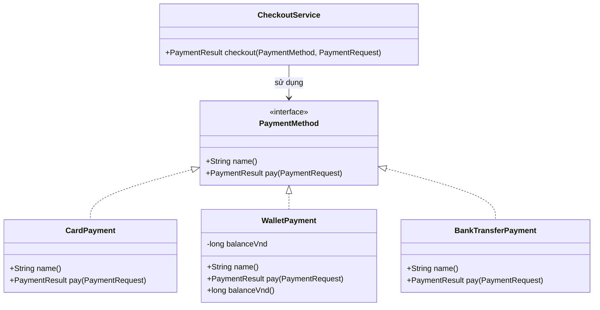
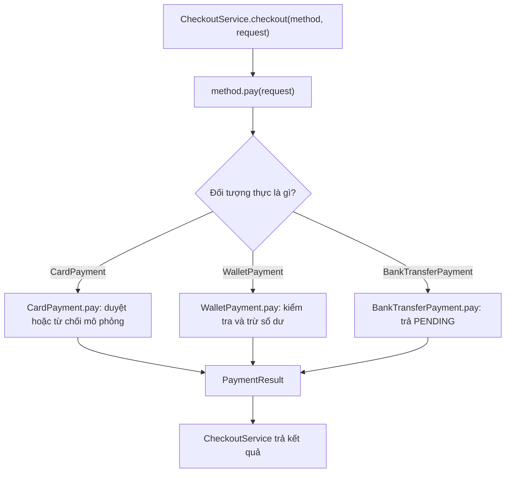

# Multiple Payment Methods Using Polymorphism in Java

> **Topic:** OOP → Polymorphism → Multiple Payment Methods Example.
>
> A sales system can let customers choose **cards**, **digital wallets**, or **bank transfers**. Each method processes payments differently, but the application's checkout logic should invoke them through **a shared contract**. This illustrates polymorphism: **one call, different object types performing different implementations**.

## 1. The Problem with Checking Every Type Using `if/else`

Suppose payment processing is written like this:

```java
// Minh họa cách thiết kế khó mở rộng, không phải API hoàn chỉnh.
if ("CARD".equals(method)) {
    // Xử lý thẻ
} else if ("WALLET".equals(method)) {
    // Xử lý ví
} else if ("BANK".equals(method)) {
    // Xử lý chuyển khoản
} else {
    throw new IllegalArgumentException("Phương thức không hỗ trợ");
}
```

Adding a new payment method requires editing the coordinator's conditional chain. If that logic is scattered across multiple services, missed updates become more likely. Card charges, wallet debits, and pending bank transfers also have very different lifecycles; squeezing everything into one large method makes testing and debugging harder.

The OOP solution is to standardize **inputs and outputs** while letting each class decide **how to implement the operation**.



In the diagram, `CheckoutService` depends only on `PaymentMethod`, and the three concrete classes **implement** that interface.

## 2. What Does the Shared Contract Include?

A compact contract for this example:

```java
interface PaymentMethod {
    String name();
    PaymentResult pay(PaymentRequest request);
}
```

Here:

- `name()`: display name of the payment method.
- `pay(request)`: accepts a payment request and returns a structured result.
- Every implementation must provide both methods with the required signatures and behavior.
- Interface consumers need not know whether the implementation handles cards, wallets, or transfers.

We define three result statuses:

| Status | Meaning in This Example | May the Order Be Marked Paid? |
|---|---|---|
| `PAID` | The simulated method has confirmed success | Yes, **within the simulation** |
| `DECLINED` | The request was declined | No |
| `PENDING` | Instructions or a request were created; confirmation is still pending | **No** |

**Important:** `PENDING` is not `PAID`. The transfer example only returns transfer instructions; it must not record payment as received by the bank.

## 3. Complete Java Example: Three Methods, One CheckoutService

Save all the following code as **`MultiPaymentDemo.java`**. It runs with **Java 17+**, needs no third-party libraries, does not process real money, and stores no sensitive card data.

```java
import java.util.List;
import java.util.Objects;

public class MultiPaymentDemo {

    enum PaymentStatus {
        PAID, DECLINED, PENDING
    }

    record PaymentRequest(String orderId, long amountVnd) {
        PaymentRequest {
            if (orderId == null || orderId.isBlank()) {
                throw new IllegalArgumentException("Mã đơn hàng không hợp lệ");
            }
            if (amountVnd <= 0) {
                throw new IllegalArgumentException("Số tiền phải dương");
            }
        }
    }

    record PaymentResult(PaymentStatus status, String message) {
        PaymentResult {
            Objects.requireNonNull(status, "status");
            Objects.requireNonNull(message, "message");
        }
    }

    interface PaymentMethod {
        String name();
        PaymentResult pay(PaymentRequest request);
    }

    // 1. Thẻ: mô phỏng việc duyệt hoặc từ chối theo hạn mức.
    static final class CardPayment implements PaymentMethod {
        private final String lastFourDigits;

        CardPayment(String lastFourDigits) {
            if (lastFourDigits == null
                    || !lastFourDigits.matches("[0-9]{4}")) {
                throw new IllegalArgumentException(
                    "Chỉ nhập 4 chữ số cuối để minh họa"
                );
            }
            this.lastFourDigits = lastFourDigits;
        }

        @Override
        public String name() {
            return "Thẻ **** " + lastFourDigits;
        }

        @Override
        public PaymentResult pay(PaymentRequest request) {
            Objects.requireNonNull(request, "request");

            // Quy tắc mô phỏng, KHÔNG phải hạn mức thẻ thực tế.
            if (request.amountVnd() > 200_000) {
                return new PaymentResult(
                    PaymentStatus.DECLINED,
                    "Vượt hạn mức mô phỏng của thẻ"
                );
            }
            return new PaymentResult(
                PaymentStatus.PAID,
                "Thẻ mô phỏng đã được duyệt"
            );
        }
    }

    // 2. Ví: giữ số dư của instance, chỉ trừ khi đủ tiền.
    static final class WalletPayment implements PaymentMethod {
        private long balanceVnd;

        WalletPayment(long openingBalanceVnd) {
            if (openingBalanceVnd < 0) {
                throw new IllegalArgumentException("Số dư không thể âm");
            }
            this.balanceVnd = openingBalanceVnd;
        }

        @Override
        public String name() {
            return "Ví điện tử";
        }

        @Override
        public synchronized PaymentResult pay(PaymentRequest request) {
            Objects.requireNonNull(request, "request");

            if (request.amountVnd() > balanceVnd) {
                return new PaymentResult(
                    PaymentStatus.DECLINED,
                    "Ví không đủ số dư"
                );
            }

            balanceVnd -= request.amountVnd();
            return new PaymentResult(
                PaymentStatus.PAID,
                "Đã trừ " + request.amountVnd() + " VND từ ví mô phỏng"
            );
        }

        synchronized long balanceVnd() {
            return balanceVnd;
        }
    }

    // 3. Chuyển khoản: chỉ tạo thông tin, chờ ngân hàng xác nhận.
    static final class BankTransferPayment implements PaymentMethod {
        private final String bankAccount;

        BankTransferPayment(String bankAccount) {
            if (bankAccount == null || bankAccount.isBlank()) {
                throw new IllegalArgumentException("Tài khoản không hợp lệ");
            }
            this.bankAccount = bankAccount;
        }

        @Override
        public String name() {
            return "Chuyển khoản";
        }

        @Override
        public PaymentResult pay(PaymentRequest request) {
            Objects.requireNonNull(request, "request");

            return new PaymentResult(
                PaymentStatus.PENDING,
                "Chờ chuyển " + request.amountVnd()
                    + " VND tới " + bankAccount
                    + ", nội dung " + request.orderId()
            );
        }
    }

    // Service chỉ gọi hợp đồng chung, không kiểm tra instanceof.
    static final class CheckoutService {
        PaymentResult checkout(
                PaymentMethod method,
                PaymentRequest request) {

            Objects.requireNonNull(method, "method");
            Objects.requireNonNull(request, "request");

            return Objects.requireNonNull(
                method.pay(request),
                "Phương thức thanh toán không được trả null"
            );
        }
    }

    public static void main(String[] args) {
        WalletPayment wallet = new WalletPayment(150_000);

        List<PaymentMethod> methods = List.of(
            new CardPayment("4242"),
            wallet,
            new BankTransferPayment("DEMO-ACCOUNT")
        );

        CheckoutService checkout = new CheckoutService();

        // Mỗi lần là một đơn hàng KHÁC NHAU để minh họa từng lựa chọn.
        for (int i = 0; i < methods.size(); i++) {
            PaymentMethod method = methods.get(i);
            PaymentRequest request =
                new PaymentRequest("ORD-" + (i + 1), 120_000);

            PaymentResult result = checkout.checkout(method, request);

            System.out.println(method.name() + " -> "
                    + result.status());
            System.out.println("  " + result.message());
        }

        System.out.println("Số dư ví còn: " + wallet.balanceVnd());

        PaymentResult notEnough = checkout.checkout(
            wallet,
            new PaymentRequest("ORD-4", 40_000)
        );
        System.out.println("Ví thanh toán lần nữa -> "
                + notEnough.status());
        System.out.println("Số dư ví cuối: " + wallet.balanceVnd());
    }
}
```

Compile and run from the file's directory:

```bash
javac MultiPaymentDemo.java
java MultiPaymentDemo
```

Expected output:

```text
Thẻ **** 4242 -> PAID
  Thẻ mô phỏng đã được duyệt
Ví điện tử -> PAID
  Đã trừ 120000 VND từ ví mô phỏng
Chuyển khoản -> PENDING
  Chờ chuyển 120000 VND tới DEMO-ACCOUNT, nội dung ORD-3
Số dư ví còn: 30000
Ví thanh toán lần nữa -> DECLINED
Số dư ví cuối: 30000
```

The first three iterations represent **three distinct orders** (`ORD-1`, `ORD-2`, `ORD-3`) to demonstrate three implementations. In a real purchase, **the customer selects one payment method for one payment attempt**; do not automatically invoke every method to charge a single order.

## 4. Which Line Demonstrates Polymorphism?

The key is:

```java
PaymentMethod method = methods.get(i);
PaymentResult result = checkout.checkout(method, request);
```

And inside `CheckoutService`:

```java
return method.pay(request);
```

The service code contains just one `pay` call. Its result varies according to the supplied object:



That is **runtime polymorphism**.

| Aspect | In Calling Code | In the Actual Object |
|---|---|---|
| Declared variable `method` | `PaymentMethod` | Any class implementing the contract |
| Callable methods | `name()`, `pay(...)` exposed by the interface | Implementations may expose additional APIs |
| `pay` signature | Checked at compile time | Must be honored by implementing classes |
| Executed `pay` body | Not fixed in the service | Selected from runtime class |
| Result | Same `PaymentResult` type | May be PAID, DECLINED, or PENDING |

**The runtime object selects the implementation**, not the string returned by `name()`, not the variable name, and not a cast inside `CheckoutService`.

Note that `PaymentMethod` is an interface and cannot be directly instantiated with `new PaymentMethod()`. You can declare an **interface-typed variable** and assign an instance of an implementation class:

```java
PaymentMethod selected = new WalletPayment(100_000);
PaymentResult result = selected.pay(
    new PaymentRequest("ORD-5", 60_000)
);
System.out.println(result.status()); // PAID
```

## 5. `@Override`, Signatures, and Interface Constraints

When a class `implements PaymentMethod`, it must implement the interface's instance methods with appropriate accessibility:

```java
@Override
public PaymentResult pay(PaymentRequest request) {
    // ...
}
```

Because `pay` in the interface is `public`, its implementation cannot narrow access to `protected`, package-private, or `private`.

A common mistake:

```java
class IncorrectPayment implements PaymentMethod {
    @Override
    public PaymentResult pay(long amount) {
        // Sai: pay(long) không phải pay(PaymentRequest).
        return null;
    }

    @Override
    public String name() {
        return "Sai chữ ký";
    }
}
```

The class above fails compilation: `pay(long)` has different parameters and does not implement `pay(PaymentRequest)`; `@Override` helps detect this immediately.

**Do not confuse overriding with overloading:**

- `pay(PaymentRequest)` in the implementing classes **overrides** a contract with the same signature; the implementation is dynamically selected.
- Adding `pay(String orderId, long amount)` alongside `pay(PaymentRequest)` creates an **overload** (same name, different parameters). Its signature is selected using compile-time types; it does not itself select a payment class at runtime.

`static` methods also do not dispatch dynamically like instance methods; do not model multiple payment implementations as same-named static methods and expect the JVM to select one based on an object.

## 6. Add a Payment Method Without Modifying CheckoutService

Suppose we add **cash on delivery (COD)**. Create another class `implements PaymentMethod`:

```java
// Thêm vào bên trong MultiPaymentDemo nếu muốn chạy cùng ví dụ:
static final class CashOnDeliveryPayment implements PaymentMethod {
    @Override
    public String name() {
        return "Thanh toán khi nhận hàng";
    }

    @Override
    public PaymentResult pay(PaymentRequest request) {
        Objects.requireNonNull(request, "request");
        return new PaymentResult(
            PaymentStatus.PENDING,
            "Chỉ thu tiền khi giao đơn " + request.orderId()
        );
    }
}
```

Then use it with the existing service:

```java
PaymentMethod cod = new CashOnDeliveryPayment();
PaymentResult result = new CheckoutService().checkout(
    cod,
    new PaymentRequest("ORD-COD", 80_000)
);
System.out.println(result.status()); // PENDING
```

`CheckoutService` needs no new `if ("COD")` or `instanceof CashOnDeliveryPayment` branch. This is a clear benefit of contract-based extensibility.

However, the **user interface or payment-method registration configuration** may still need updating to make COD selectable. "No changes to `CheckoutService`" does not mean no code anywhere needs to change.

## 7. Return Values Express More Than a `boolean`

If `pay` returns only a `boolean`, it is hard to distinguish:

- Payment was declined.
- The customer has not completed the transfer.
- The provider is slow to respond.
- Funds were successfully collected.

A `PaymentResult` result with `PaymentStatus` makes these states explicit. Post-payment domain logic can branch **on a business result** rather than **on an implementation class**:

```java
PaymentResult result = checkout.checkout(selected, request);

switch (result.status()) {
    case PAID -> System.out.println("Có thể ghi nhận đã thanh toán");
    case DECLINED -> System.out.println("Báo khách chọn cách thanh toán khác");
    case PENDING -> System.out.println("Chờ xác nhận trước khi hoàn tất");
}
```

This is **appropriate branching**: payment state is information exposed by every implementation through its contract. Avoid checking `selected instanceof CardPayment` and duplicating card-specific logic in the service.

A real application also needs a state or information for cases where **payment success is unknown**. A network timeout does not prove that no funds were debited. The three-status model is only for illustrating polymorphism and is not a complete production payment system.

## 8. Test Polymorphism with a Fake Payment Method

You can verify that `CheckoutService` calls `PaymentMethod.pay` and forwards results without connecting to a real payment provider.

Add the following class **inside** `MultiPaymentDemo`:

```java
static final class RecordingPayment implements PaymentMethod {
    int calls;
    PaymentRequest lastRequest;

    @Override
    public String name() {
        return "Fake cho kiểm thử";
    }

    @Override
    public PaymentResult pay(PaymentRequest request) {
        calls++;
        lastRequest = request;
        return new PaymentResult(PaymentStatus.PAID, "fake-ok");
    }
}
```

You can place a check in `main`:

```java
RecordingPayment fake = new RecordingPayment();
CheckoutService service = new CheckoutService();
PaymentRequest testRequest = new PaymentRequest("TEST-1", 10_000);

PaymentResult actual = service.checkout(fake, testRequest);

if (fake.calls != 1
        || fake.lastRequest != testRequest
        || actual.status() != PaymentStatus.PAID) {
    throw new AssertionError("CheckoutService gọi sai PaymentMethod");
}
System.out.println("PASS");
```

The fake verifies **which implementation was invoked** and **which request was passed**, independently of banks or wallets. This test does not prove the security of a real payment gateway; production adapters require their own contract and integration tests.

## 9. Benefits and Limits of This Design

| Benefit | Demonstration |
|---|---|
| Polymorphism | One `pay` call invokes three different implementations |
| Extensibility | Adding `CashOnDeliveryPayment` requires no checkout-code changes |
| Separation of responsibilities | Each class manages its own payment processing |
| Testability | Use `RecordingPayment` instead of a real service |
| Reduced coupling | `CheckoutService` only knows `PaymentMethod` |
| Maintainability | Wallet rules can change without changing card rules |

But polymorphism **does not automatically solve** production payment concerns:

1. **Retries/idempotency:** if a customer retries a request after a network failure, do not charge twice. Real payment processors require transaction IDs and a deduplication contract.
2. **Persistence:** the example wallet stores its balance only in RAM. Restarting loses it; real systems need durable storage and appropriate transactions.
3. **Concurrency:** `synchronized` in `WalletPayment` protects one instance within one JVM, not multiple instances or machines concurrently accessing the same account.
4. **Security:** never store full card numbers, CVV, or secret keys in example code/logs; production integrations must meet provider requirements and applicable regulations.
5. **Failure handling:** a `PENDING` result needs a separate confirmation flow (webhook, status query, reconciliation, etc.) before the transaction is considered complete.

These are responsibilities of payment architecture and integration contracts, **not features that appear automatically when using interfaces**.

## 10. Practice Exercises

**Exercise 1 — Predict the Result.** Use `PaymentMethod method = new BankTransferPayment("DEMO-02")` and call `method.pay(new PaymentRequest("ORD-7", 90_000))`. Is the result `PAID` or `PENDING`? Why does Java not need the class name in `CheckoutService`?

**Exercise 2 — Add a Method.** Implement `CashOnDeliveryPayment` from section 6, add an instance to the selection list, and verify the program still calls `method.pay(...)` through the interface.

**Exercise 3 — Test a Decline.** Create `WalletPayment(20_000)`, request `30_000` VND, and assert `DECLINED` with a remaining balance of `20_000`. Then request `10_000` and verify the new balance.

**Exercise 4 — Distinguish Statuses.** Explain why `PENDING` is more accurate than `PAID` for transfers and COD before confirmation that money was collected.

**Exercise 5 — Choose the Abstraction Level.** If each payment method displays different instructions, should you extend `PaymentResult`, add a UI-specific interface, or let the UI decide? Identify the data the domain layer truly needs and avoid making the UI depend on `instanceof` of each payment class.

**Remember:** Polymorphism lets `CardPayment`, `WalletPayment`, and `BankTransferPayment` **all honor `PaymentMethod` but implement `pay()` differently**. When a service depends on the shared interface, Java selects the implementation by **the actual runtime object**, while orchestration stays compact, extensible, and testable.
