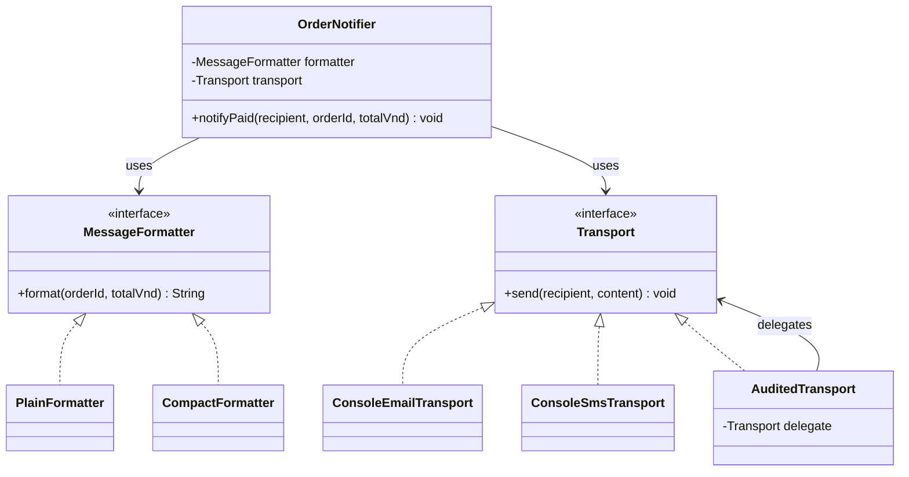
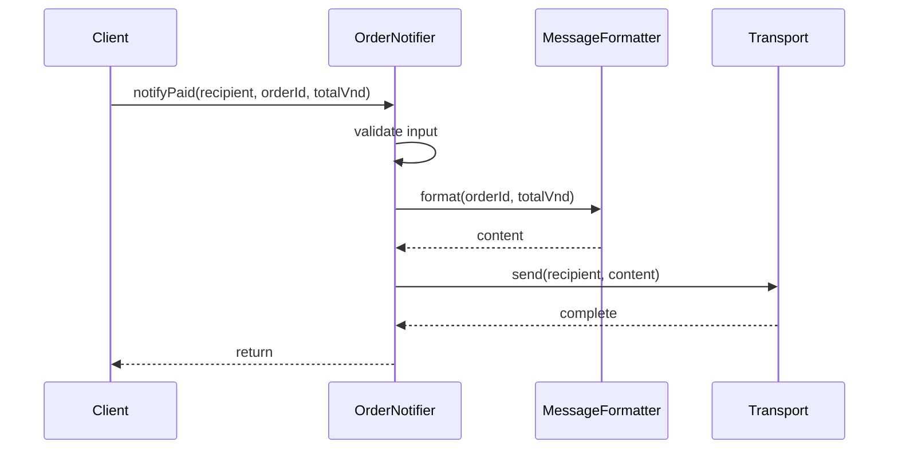

# Composing Objects to Build Behavior in Java OOP

An object does not need to implement every capability it provides on its own. In OOP, we can **combine several small objects, each with a distinct responsibility**, to produce more complex behavior. This approach is called **object composition**; when object A hands part of its work to object B, that is **delegation**.

For example, the feature "notify a customer that an order has been paid" can consist of three parts:

1. An object that **formats the notification content**.
2. An object that **sends** the notification through the selected channel.
3. An object that **coordinates** those two steps in the correct order.

Each part has a clear job. To switch from email to SMS, or from a detailed message to a short one, we **replace a component object** instead of rewriting the entire coordinating class.

> **Lesson objective:** Understand how to build behavior through **having or using another object** (*has-a / uses-a*) relationships, how objects communicate through interfaces, how they delegate responsibilities, and when composition is preferable to *inheritance*.

## 1. What Is Wrong with a Class That Does Everything?

Consider this initial design:

```java
class OrderNotification {
    void notifyCustomer(
            String channel,
            String recipient,
            String orderId,
            long totalVnd) {

        String content = "Đơn " + orderId
                + " đã thanh toán: " + totalVnd + " VND";

        if ("email".equals(channel)) {
            System.out.println("[EMAIL] " + recipient + ": " + content);
        } else if ("sms".equals(channel)) {
            System.out.println("[SMS] " + recipient + ": " + content);
        } else {
            throw new IllegalArgumentException("Kênh không hỗ trợ");
        }
    }
}
```

This short example works. But adding push notifications, channel-specific formatting, logging, or retries after a failed send would gradually burden the class with too many responsibilities. A change to email delivery could also affect the logic that builds SMS content.

Instead of having one method know every detail, we separate the following roles:

| Role | Responsibility | Does not need to know |
| --- | --- | --- |
| `MessageFormatter` | Converts order data into message content | Which channel sends it |
| `Transport` | Receives a recipient and content and performs delivery | Which order rules produced the content |
| `OrderNotifier` | Validates the request, invokes the formatter, and passes the result to the transport | Formatting details and delivery mechanics |
| `AuditedTransport` (optional) | Wraps a transport to add a logging step after sending | How the underlying transport sends |

The complete behavior therefore comes from **deliberate collaboration among objects**, rather than from one enormous class.

## 2. Designing Relationships Between Objects

We start with two small interfaces:

```java
interface MessageFormatter {
    String format(String orderId, long totalVnd);
}

interface Transport {
    void send(String recipient, String content);
}
```

Next, `OrderNotifier` has two fields:

```java
private final MessageFormatter formatter;
private final Transport transport;
```

This is a typical **has-a** relationship: an `OrderNotifier` **has** (holds references to) a formatter and a transport and asks them to perform work. It does not need `extends EmailTransport` or `extends PlainFormatter`.



**Reading the diagram:** A dashed realization arrow from a class to an interface represents `implements`; a `uses` relationship means one object holds and uses a reference to another.

In UML, a filled diamond (composition in the *whole–part* lifecycle-ownership sense) implies stronger ownership. The example below receives dependencies from the application's assembly code, so we use reference/delegation relationships rather than claiming that `OrderNotifier` exclusively owns its components' lifecycles. In everyday programming, "composition over inheritance" often refers more broadly to **assembling behavior from objects**, as in this design.

## 3. Complete Java Example: Building Behavior from Multiple Objects

Create a file named **`CompositionDemo.java`**. The example uses no framework and is compatible with Java 11+.

```java
import java.util.Objects;

public class CompositionDemo {

    // 1) Hợp đồng định dạng.
    interface MessageFormatter {
        String format(String orderId, long totalVnd);
    }

    // 2) Hợp đồng gửi.
    interface Transport {
        void send(String recipient, String content);
    }

    // 3) Hai cách định dạng có thể thay thế.
    static final class PlainFormatter implements MessageFormatter {
        @Override
        public String format(String orderId, long totalVnd) {
            return "Đơn " + orderId
                    + " đã thanh toán: " + totalVnd + " VND";
        }
    }

    static final class CompactFormatter implements MessageFormatter {
        @Override
        public String format(String orderId, long totalVnd) {
            return orderId + " | PAID | " + totalVnd + " VND";
        }
    }

    // 4) Hai cách gửi có cùng interface.
    // Chỉ mô phỏng gửi bằng console, không gửi email/SMS thật.
    static final class ConsoleEmailTransport implements Transport {
        @Override
        public void send(String recipient, String content) {
            System.out.println(
                    "[EMAIL -> " + recipient + "] " + content);
        }
    }

    static final class ConsoleSmsTransport implements Transport {
        @Override
        public void send(String recipient, String content) {
            System.out.println(
                    "[SMS -> " + recipient + "] " + content);
        }
    }

    // 5) Một transport "bọc" transport khác để thêm hành vi.
    static final class AuditedTransport implements Transport {
        private final Transport delegate;

        AuditedTransport(Transport delegate) {
            this.delegate = Objects.requireNonNull(
                    delegate, "delegate");
        }

        @Override
        public void send(String recipient, String content) {
            delegate.send(recipient, content);
            System.out.println(
                    "[AUDIT] Đã thực hiện thao tác gửi tới " + recipient);
        }
    }

    // 6) Đối tượng cấp cao chỉ điều phối.
    static final class OrderNotifier {
        private final MessageFormatter formatter;
        private final Transport transport;

        OrderNotifier(MessageFormatter formatter, Transport transport) {
            this.formatter = Objects.requireNonNull(
                    formatter, "formatter");
            this.transport = Objects.requireNonNull(
                    transport, "transport");
        }

        void notifyPaid(
                String recipient,
                String orderId,
                long totalVnd) {

            requireText(recipient, "recipient");
            requireText(orderId, "orderId");

            if (totalVnd < 0) {
                throw new IllegalArgumentException(
                        "Tổng tiền không được âm");
            }

            String content = formatter.format(orderId, totalVnd);
            transport.send(recipient, content);
        }

        private static void requireText(String value, String field) {
            if (value == null || value.isBlank()) {
                throw new IllegalArgumentException(
                        field + " không được rỗng");
            }
        }
    }

    public static void main(String[] args) {
        // Tổ hợp A: nội dung đầy đủ, email và audit.
        OrderNotifier emailNotifier = new OrderNotifier(
                new PlainFormatter(),
                new AuditedTransport(new ConsoleEmailTransport())
        );

        // Tổ hợp B: nội dung ngắn, SMS và không audit.
        OrderNotifier smsNotifier = new OrderNotifier(
                new CompactFormatter(),
                new ConsoleSmsTransport()
        );

        emailNotifier.notifyPaid(
                "an@example.test", "ORD100", 150_000);

        smsNotifier.notifyPaid(
                "0900000000", "ORD101", 200_000);

        try {
            smsNotifier.notifyPaid("0900000000", "ORD102", -1);
        } catch (IllegalArgumentException ex) {
            System.out.println("Từ chối: " + ex.getMessage());
        }
    }
}
```

Run:

```bash
javac CompositionDemo.java
java CompositionDemo
```

Output:

```text
[EMAIL -> an@example.test] Đơn ORD100 đã thanh toán: 150000 VND
[AUDIT] Đã thực hiện thao tác gửi tới an@example.test
[SMS -> 0900000000] ORD101 | PAID | 200000 VND
Từ chối: Tổng tiền không được âm
```

From a single `OrderNotifier` class, we create two behavior configurations:

| Configuration | Formatter | Transport | Observed behavior |
| --- | --- | --- | --- |
| Email with audit logging | `PlainFormatter` | `AuditedTransport(ConsoleEmailTransport)` | Produces detailed content, "sends" it through console email, then logs the action |
| Short SMS | `CompactFormatter` | `ConsoleSmsTransport` | Produces short content, then "sends" it through console SMS |
| Call with a negative total | Any | Any | Rejected before the formatter or transport is invoked |

**No change to `OrderNotifier` is needed** to switch from configuration A to B. The difference lies in **the component objects passed to its constructor**.

This is composition's core flexibility: a few small objects can be combined into many behaviors to meet different needs.

## 4. Delegation: Who Actually Performs the Work?

Consider the coordinating method:

```java
void notifyPaid(String recipient, String orderId, long totalVnd) {
    requireText(recipient, "recipient");
    requireText(orderId, "orderId");

    if (totalVnd < 0) {
        throw new IllegalArgumentException(
                "Tổng tiền không được âm");
    }

    String content = formatter.format(orderId, totalVnd);
    transport.send(recipient, content);
}
```

`OrderNotifier` is responsible for **coordination**, but:

- It **delegates** content creation to `formatter`.
- It **delegates** delivery to `transport`.
- It directly validates only the basic inputs required by the business operation.
- It need not know how the formatter builds strings or which protocol the transport uses.

Call sequence:



Coordination and delegation help **divide responsibilities**; they do not automatically make the program asynchronous. Calls in this example are synchronous and execute sequentially on the same thread.

In a real application, `Transport.send` may encounter network errors, timeouts, or asynchronous processing results. Its contract must then specify whether the method merely accepts a request or confirms successful delivery, how errors are reported, and whether retries and idempotency are supported. The console example only simulates sending so we can focus on OOP design.

## 5. Constructor Injection: Assembling Components Where Objects Are Created

Why does `OrderNotifier` receive two dependencies through its constructor instead of creating them itself?

```java
// Cách gắn chặt vào chi tiết implementation:
private final Transport transport = new ConsoleEmailTransport();
```

If it creates its own dependencies, each `OrderNotifier` chooses a specific transport. Changing the delivery channel could require editing the coordinating class or adding conditional branches within it.

Constructor injection:

```java
OrderNotifier(MessageFormatter formatter, Transport transport) {
    this.formatter = Objects.requireNonNull(formatter);
    this.transport = Objects.requireNonNull(transport);
}
```

offers these benefits:

1. **Separates assembly from execution:** `main` or a composition root decides which components to use; `OrderNotifier` only uses them.
2. **Creates valid objects:** The constructor rejects `null` dependencies immediately.
3. **Simplifies test substitution:** A fake transport can be injected to observe calls without real delivery.
4. **Reduces coupling:** `OrderNotifier` depends only on two small interfaces.
5. **Makes required dependencies explicit:** A notifier cannot operate correctly without a formatter and a transport.

Using `final` on fields means their references cannot be reassigned after construction. It **does not make the referenced objects immutable**. For mutable or shared dependencies, ownership and concurrency constraints still matter.

Constructor injection does not require Spring or any other DI framework. A framework can simply automate object creation and wiring.

## 6. Extending Behavior by Replacing Components

Suppose the system gains a requirement to **append a campaign code** to messages. We can create a new formatter that fulfills the same contract:

```java
final class CampaignFormatter
        implements CompositionDemo.MessageFormatter {

    private final CompositionDemo.MessageFormatter base;
    private final String campaign;

    CampaignFormatter(
            CompositionDemo.MessageFormatter base,
            String campaign) {

        this.base = java.util.Objects.requireNonNull(base);
        this.campaign = java.util.Objects.requireNonNull(campaign);
    }

    @Override
    public String format(String orderId, long totalVnd) {
        return base.format(orderId, totalVnd)
                + " | Campaign: " + campaign;
    }
}
```

Here, one formatter **holds another formatter** to extend its behavior. This is also composition and resembles the **Decorator** pattern because the wrapper implements the same interface as the wrapped object.

Example usage in the same package:

```java
CompositionDemo.MessageFormatter format =
        new CampaignFormatter(
                new CompositionDemo.PlainFormatter(), "SALE");

CompositionDemo.OrderNotifier notifier =
        new CompositionDemo.OrderNotifier(
                format, new CompositionDemo.ConsoleEmailTransport());

notifier.notifyPaid("an@example.test", "ORD103", 300_000);
```

Output:

```text
[EMAIL -> an@example.test] Đơn ORD103 đã thanh toán: 300000 VND | Campaign: SALE
```

When adding multiple wrappers, consider the order in which they run. For example, "normalize input before formatting" differs from "format first, then filter content." Composition provides flexibility, but the **contract and order of collaboration** must still be designed explicitly.

> `CampaignFormatter` is an illustrative extension placed alongside the main example's classes in the same package. A real project can put each class in its own file with appropriate access modifiers.

## 7. Strategy and Decorator: Two Familiar Ways to Compose Behavior

The two configurations in the main program demonstrate two common ideas:

**Strategy:** `MessageFormatter` has multiple implementations, such as `PlainFormatter` and `CompactFormatter`. `OrderNotifier` receives the desired behavior through a supplied object instead of containing an `if/else` for every formatting option.

**Decorator:** `AuditedTransport` also `implements Transport` and contains another `Transport`. It performs additional work before or after delegation while remaining usable as a `Transport`.

```java
Transport transport =
        new AuditedTransport(new ConsoleEmailTransport());
```

What this means:

- `ConsoleEmailTransport` performs the underlying operation.
- `AuditedTransport` wraps that operation and logs it after `delegate.send(...)` returns normally.
- `OrderNotifier` does not know whether the current transport is wrapped.

Avoid overinterpreting the output: the `[AUDIT]` line only indicates that the console call did not report an error. It is **not a durably stored transaction audit record**, nor does it prove that an email or SMS reached the recipient's device. Real auditing requires defined storage, safeguards against missing or duplicate records, and failure handling.

Not every composition design needs a complex design pattern. If a straightforward helper is sufficient, one field and one delegated call may be all that is needed.

## 8. How Does Composition Differ from Inheritance?

Compare these two approaches:

**Inheritance approach:**

```java
class EmailSender {
    void sendEmail(String recipient, String content) {
        System.out.println(recipient + ": " + content);
    }
}

// Không nên kế thừa chỉ để mượn method sendEmail.
class OrderNotifierByInheritance extends EmailSender {
    void notifyPaid(String recipient, String content) {
        sendEmail(recipient, content);
    }
}
```

`OrderNotifierByInheritance extends EmailSender` establishes a relationship in which a notifier **is a type of** email sender. From a business perspective, that is usually incorrect: a notifier **uses** a sender; it **is not** a sender.

**Composition approach:**

```java
class OrderNotifierByComposition {
    private final EmailSender sender;

    OrderNotifierByComposition(EmailSender sender) {
        this.sender = sender;
    }

    void notifyPaid(String recipient, String content) {
        sender.sendEmail(recipient, content);
    }
}
```

The second approach accurately represents a notifier that **has/uses** a sender. By changing the field to the `Transport` interface, we can also switch from email to SMS without modifying the notifier class.

| Criterion | Inheritance | Object composition |
| --- | --- | --- |
| Primary relationship | `is-a`: a subtype is a kind of its supertype | `has-a / uses-a`: an object holds and uses another object |
| Reuse | Inherits implementation and/or the superclass contract | Calls/delegates to a component object |
| Coupling to details | A subclass may depend on protected APIs, execution order, and superclass invariants | Details can be hidden behind a small interface |
| Changing behavior | Overrides at permitted extension points | Replaces dependencies or combines decorators/strategies |
| Runtime changes | An existing object's concrete type does not change on its own | A new configuration can be created, or a deliberately designed mechanism can update a dependency |
| Risks | Inheriting merely to borrow code and violating subtype relationships | Too many intermediary classes and complex configuration |
| Appropriate when | A genuine subtype relationship exists and preserves the superclass contract | Collaboration or reuse is needed without coupling to a superclass |

The principle "**favor composition over inheritance**" is a **design guideline**, not a ban on `extends`. If `ElectricCar` truly is a kind of `Vehicle` and satisfies its contract, inheritance can still make sense. If an object merely needs another object's functionality, composition usually expresses that relationship more clearly.

## 9. Composition Does Not Imply Exclusive Ownership

This is a subtle but important distinction.

```java
Transport shared = new ConsoleEmailTransport();

OrderNotifier first =
        new OrderNotifier(new PlainFormatter(), shared);
OrderNotifier second =
        new OrderNotifier(new CompactFormatter(), shared);
```

`first` and `second` **both hold references** to `shared`, so both can use it. Java does not automatically clone the transport, close it when one notifier stops using it, or guarantee that each notifier exclusively owns its dependency.

When components contain state, such as caches, I/O connections, or queues:

- Determine **who creates, closes, and may modify** the dependency.
- Specify whether instances may be shared.
- Consider thread safety when sharing between threads.
- Use defensive copies or suitable value objects if independent snapshots of mutable data are needed.

Having a `private final Transport transport` field does not necessarily represent strong-ownership composition in UML or make the dependency immutable. **A `final` field only fixes the reference**; the referenced object's internal state may still change.

When a component strongly owns a child object's lifecycle, make that ownership explicit in its API and resource-cleanup rules. For example, a service might create a private buffer, never expose it externally, and release it when the service closes. A tighter *whole–part* model can be appropriate in that case.

## 10. Testing a Composition Without Sending Real Notifications

A practical benefit of composition is replacing a real sender with a **test double** to observe how the coordinating class behaves.

Create **`CompositionTest.java`** in the same directory as `CompositionDemo.java`:

```java
public class CompositionTest {

    static final class RecordingTransport
            implements CompositionDemo.Transport {

        int calls;
        String lastRecipient;
        String lastContent;

        @Override
        public void send(String recipient, String content) {
            calls++;
            lastRecipient = recipient;
            lastContent = content;
        }
    }

    public static void main(String[] args) {
        RecordingTransport transport = new RecordingTransport();

        CompositionDemo.OrderNotifier notifier =
                new CompositionDemo.OrderNotifier(
                        new CompositionDemo.PlainFormatter(),
                        transport);

        notifier.notifyPaid("lan@example.test", "ORD200", 75_000);

        check(transport.calls == 1,
                "Phải gọi transport đúng một lần");
        check("lan@example.test".equals(transport.lastRecipient),
                "Sai người nhận");
        check("Đơn ORD200 đã thanh toán: 75000 VND"
                .equals(transport.lastContent),
                "Sai nội dung đã định dạng");

        try {
            notifier.notifyPaid("lan@example.test", "ORD201", -5);
            throw new AssertionError("Phải từ chối tổng tiền âm");
        } catch (IllegalArgumentException expected) {
            // Đúng: không gọi Transport cho yêu cầu sai.
        }

        check(transport.calls == 1,
                "Lỗi validation không được tạo thêm lời gọi gửi");

        System.out.println("PASS: composition và delegation");
    }

    static void check(boolean condition, String message) {
        if (!condition) {
            throw new AssertionError(message);
        }
    }
}
```

Run:

```bash
javac CompositionDemo.java CompositionTest.java
java CompositionTest
```

Expected output:

```text
PASS: composition và delegation
```

This test does not rely on actual email or SMS services. It demonstrates that:

1. `OrderNotifier` invokes the correct injected dependency.
2. The formatter's result is passed unchanged to the transport.
3. Invalid inputs are rejected before any delivery side effect occurs.
4. We can test **an object's behavior** without starting the entire external infrastructure.

In a JUnit application, `RecordingTransport` can remain a fake or be replaced with a mock, depending on the test's objective. Not every test needs a mocking framework.

### Testing Dependency Failures

Suppose `Transport.send(...)` throws an exception while sending. With this `OrderNotifier` implementation, the exception propagates to the caller; no retry, rollback, or transaction guarantee is implicitly added.

If the system needs "exactly once" or "at least once" delivery, additional mechanisms are needed for idempotency, queues, request-state persistence, and infrastructure failures. **Composition only organizes responsibilities**; it does not guarantee reliability in a distributed system.

## 11. Common Mistakes

| Mistake | Why it is a problem | How to fix it |
| --- | --- | --- |
| Inheriting from `EmailSender` just to reuse a send method | Introduces an incorrect `is-a` relationship | Hold a `Transport` and delegate to it |
| Using one `OrderNotifier` with `if`/`switch` for every channel and format | Each new variant requires changing the coordinating class | Move implementations behind suitable interfaces |
| Calling `new ConsoleEmailTransport()` inside a service | Makes channel switching and testing difficult | Assemble dependencies in a constructor/composition root |
| Accidentally exposing an internal mutable reference | Callers can alter state without control | Define ownership, return a copy, or restrict the API |
| Assuming `final` makes dependencies immutable | `final` only prevents field reassignment | Check whether the referenced object is mutable |
| Creating dozens of interfaces for a few lines of logic | Makes code harder to read and maintain | Split only when responsibilities or substitution needs are clear |
| Changing error semantics in a decorator without telling clients | Makes the contract unpredictable | Document and preserve the published error behavior |
| Treating console logs as real transaction audits | Provides neither durable storage nor reconciliation | Design auditing separately when the business requires it |
| Assuming every combined object shares one lifecycle | Dependencies may be shared or externally owned | Define who creates, holds, and releases each object |

## 12. Practice Exercises

**Exercise A — change formatting without editing the notifier.** Write `UppercaseFormatter implements MessageFormatter`, have it use another formatter internally, and convert the result to uppercase with `toUpperCase(Locale.ROOT)`. Use it with `ConsoleSmsTransport` and explain how composition/decorator adds behavior.

**Exercise B — switch delivery channels.** Write `ConsolePushTransport implements Transport` that prints `[PUSH -> recipient] content`. Combine it with `PlainFormatter`. Must any line in `OrderNotifier` change? **No**, provided the transport honors the `send` contract.

**Exercise C — behavior ordering.** Write a `PrefixFormatter` and a `SuffixFormatter` that each wrap `MessageFormatter`. Compare the outputs of `Prefix(Suffix(base))` and `Suffix(Prefix(base))`, then analyze when decorator order makes a difference.

**Exercise D — test failures.** Create a `FailingTransport` that always throws `IllegalStateException`. Use `RecordingTransport` or another test to verify that the example's notifier **does not suppress exceptions**, and discuss the retry contract if recovery is required.

**Exercise E — design a checkout service.** Sketch a `CheckoutService` with `DiscountPolicy`, `ShippingFeePolicy`, and `PaymentGateway`. Specify its inputs, result, call order, and monetary invariants. Discuss why a hierarchy such as `CheckoutService extends PaymentGateway` should not be used merely to reuse a payment method.

## Conclusion

**Composing objects to build behavior** lets a higher-level object work through components with clearly defined responsibilities. Components can be wired through constructors, interact through interfaces, and delegate to one another, producing different behavior combinations without putting all logic in one class or overusing inheritance.

When designing a composition, define **what each component does**, **which contracts connect them**, **the order in which they collaborate**, and **who owns their lifecycles and state**. A good composition reduces coupling and makes behavior easier to replace and test at each boundary.
