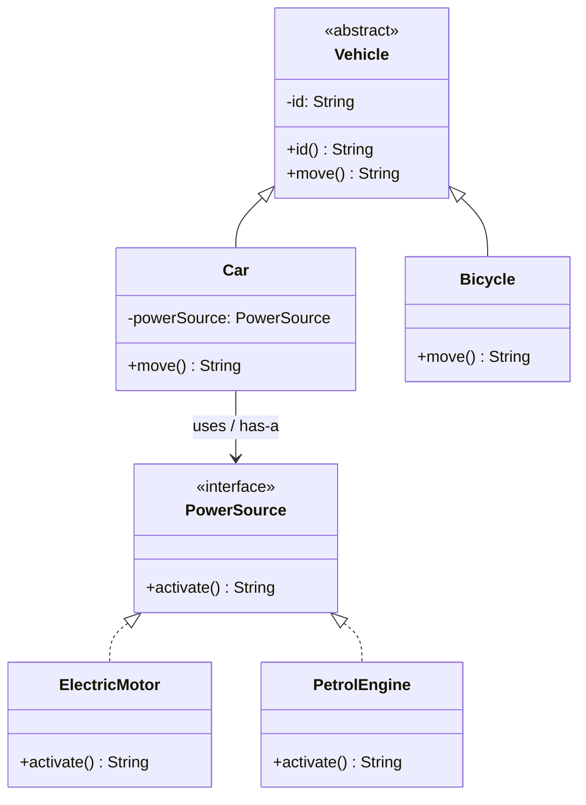
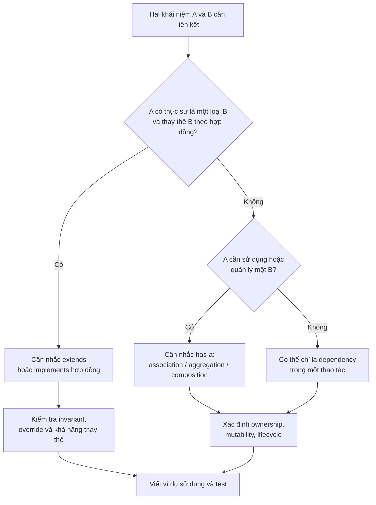

# Has-a and Is-a Relationships in Java OOP

When designing classes, one of the most important decisions is **which relationships should connect them**. Two common relationships are:

- **Is-a:** An object belongs to a more general type. For example, *a car is a kind of vehicle*. In Java, subtype relationships are usually expressed with `extends` or `implements`.
- **Has-a:** An object holds or uses another object as part of its structure or capabilities. For example, *a car has a powertrain*. In Java, this is commonly expressed through **reference fields**, object *composition*, or appropriate forms of association/aggregation.

These relationships are not mutually exclusive: **the `Car` declaration can use `extends Vehicle` while also containing a `PowerSource`**.

The goal is not to choose the shortest syntax but to represent **business meaning, state ownership, substitutability, and lifecycles** accurately.

## 1. Direct Comparison of Is-a and Has-a

| Question | Is-a | Has-a |
|---|---|---|
| Nature | Classification, specialization, or fulfilling a type contract | Linking to, containing, or using a component |
| Description | "Every `Car` is a `Vehicle`" | "Every `Car` has/is given a `PowerSource`" |
| Common Java mechanism | `extends`, `implements` | Fields, constructor injection, internally created components |
| Goal | Use a subtype where a supertype/contract is required | Build behavior by coordinating objects with separate responsibilities |
| Runtime objects | A subclass instance includes the superclass portion of its state | Components are separate objects connected by references |
| Reuse | Inherit valid behavior or provide the same API | Delegate to components |
| Coupling | Subclasses depend more tightly on the superclass contract | Components can be substituted through interfaces |
| Common mistake | Inheriting merely to "borrow" a utility method | Assuming every reference field implies exclusive ownership |

**Quick decision rules:**

- If **"X is a kind of Y"** is true in the business domain **and X can substitute for Y without violating its contract**, consider is-a.
- If **"X uses/holds a Y to perform X's work"** is true, consider has-a.
- A few similar lines of code in two classes are **not sufficient** to justify an is-a relationship.

## 2. Complete Java Example: A Car Both Is-a and Has-a

We will build a small model:

- Every vehicle has an identifier and a `move()` behavior.
- `Car` and `Bicycle` are kinds of `Vehicle`.
- `Car` has a `PowerSource` component; the type of power source is supplied when the car is created.
- `Bicycle` does not need a `PowerSource` in this model.

File `RelationsDemo.java` (Java 11+):

```java
import java.util.List;
import java.util.Objects;

public class RelationsDemo {

    // Hợp đồng cho thành phần cung cấp động lực.
    interface PowerSource {
        String activate();
    }

    static final class ElectricMotor implements PowerSource {
        @Override
        public String activate() {
            return "mô-tơ điện đã sẵn sàng";
        }
    }

    static final class PetrolEngine implements PowerSource {
        @Override
        public String activate() {
            return "động cơ xăng đã khởi động";
        }
    }

    // Lớp tổng quát: thể hiện quan hệ is-a của các phương tiện.
    static abstract class Vehicle {
        private final String id;

        protected Vehicle(String id) {
            if (id == null || id.isBlank()) {
                throw new IllegalArgumentException("Mã phương tiện rỗng");
            }
            this.id = id.strip();
        }

        public final String id() {
            return id;
        }

        public abstract String move();
    }

    static final class Car extends Vehicle {
        // Has-a: Car giữ một tham chiếu PowerSource.
        private final PowerSource powerSource;

        public Car(String id, PowerSource powerSource) {
            super(id);
            this.powerSource =
                    Objects.requireNonNull(powerSource, "powerSource");
        }

        @Override
        public String move() {
            // Car ủy quyền một phần công việc cho thành phần.
            return "Car " + id() + ": " + powerSource.activate()
                    + " -> di chuyển";
        }
    }

    static final class Bicycle extends Vehicle {
        public Bicycle(String id) {
            super(id);
        }

        @Override
        public String move() {
            return "Bicycle " + id() + ": đạp bằng sức người";
        }
    }

    public static void main(String[] args) {
        Vehicle electricCar =
                new Car("CAR-01", new ElectricMotor());

        Vehicle petrolCar =
                new Car("CAR-02", new PetrolEngine());

        Vehicle bicycle = new Bicycle("BIKE-01");

        List<Vehicle> fleet = List.of(
                electricCar, petrolCar, bicycle
        );

        for (Vehicle vehicle : fleet) {
            System.out.println(vehicle.move());
        }
    }
}
```

Run:

```bash
javac RelationsDemo.java
java RelationsDemo
```

Output:

```text
Car CAR-01: mô-tơ điện đã sẵn sàng -> di chuyển
Car CAR-02: động cơ xăng đã khởi động -> di chuyển
Bicycle BIKE-01: đạp bằng sức người
```

### Identifying Both Relationships in the Same Program

**Is-a:**

```java
static final class Car extends Vehicle { ... }
static final class Bicycle extends Vehicle { ... }
```

A variable declared as `Vehicle` can refer to either a `Car` or a `Bicycle`:

```java
Vehicle vehicle = new Car("CAR-03", new ElectricMotor());
System.out.println(vehicle.move());
```

`Vehicle` specifies that vehicles have a `move()` behavior. Java selects the `Car.move()` implementation based on the actual object type. This is **polymorphism** through an is-a relationship.

**Has-a:**

```java
private final PowerSource powerSource;
```

`Car` **holds a component** that fulfills the `PowerSource` contract. When moving, `Car` calls `powerSource.activate()`, **delegating** work to another object.

Replacing `ElectricMotor` with `PetrolEngine` does not require `Car` to change its superclass or copy each engine's startup algorithm. Nor is `Car` itself a `PowerSource`: the car **uses** a power source; it is not a type of engine in this model.

### Relationship Diagram



In the diagram:

- The inheritance arrow `Vehicle <|-- Car` indicates that **Car is a Vehicle**.
- The line `Car --> PowerSource` indicates that **Car holds and uses PowerSource**.
- The lines from `ElectricMotor` and `PetrolEngine` to `PowerSource` show that **each engine type implements the PowerSource contract**.

The diagram deliberately uses a **directed association** between `Car` and `PowerSource`, without asserting that the car exclusively owns the power source's entire lifecycle. We will distinguish these cases later.

## 3. Is-a Must Match the Contract, Not Just the Name

Writing `extends` makes Java accept a subtype relationship syntactically (if the superclass permits inheritance), but **does not prove that the domain model is correct**.

Example of a flawed design:

```java
class Engine {
    void ignite() {
        System.out.println("Ignite");
    }
}

// Không nên:
// class Car extends Engine { ... }
```

A car needing an engine does not mean **a car is an engine**. Inheriting solely to call `ignite()` makes `Car` expose the `Engine` API as though callers could substitute an entire car for an engine. That is an invalid classification.

Similarly:

```java
// Các quan hệ thường không phản ánh đúng nghiệp vụ:
// class Order extends Customer { ... }
// class Library extends Book { ... }
// class House extends Door { ... }
```

In these examples, fields express the relationships more accurately:

```java
class Order {
    private final Customer customer;

    Order(Customer customer) {
        this.customer =
            java.util.Objects.requireNonNull(customer, "customer");
    }
}
```

An order **belongs to/is associated with a customer**; it **is not a customer**.

### Testing Substitutability

Suppose some code handles any `Vehicle`:

```java
static void startTrip(Vehicle vehicle) {
    System.out.println(vehicle.move());
}
```

Both `Car` and `Bicycle` implement `move()` according to the defined contract, so they can substitute for one another here:

```java
startTrip(new Car("CAR-04", new ElectricMotor()));
startTrip(new Bicycle("BIKE-02"));
```

This is the idea behind the **Liskov Substitution Principle**: code expecting a supertype should be able to work with a subtype without violating important expectations about inputs, outputs, or invariants.

For example, if `Vehicle.move()` promises a nonempty description for a ready vehicle, a subclass should not unexpectedly return `null` merely because its internal algorithm differs. **Syntactically valid inheritance** is not enough; subtypes must respect behavioral contracts.

## 4. Has-a Takes Several Forms

In everyday language, has-a broadly describes an object **having or using** another. UML and OOP often make finer distinctions:

| Relationship | Design meaning | Example | Representation |
|---|---|---|---|
| **Association** | One object knows or interacts with another | `Order` is associated with `Customer` | Fields/parameters or ID-based relations, depending on the model |
| **Aggregation** (loose whole–part relationship) | Components may exist independently or be shared | `Team` has many `Player` objects | Usually stored references/collections; a hollow UML diamond when appropriate |
| **Composition** (strong ownership) | A part is modeled as belonging to a whole and depends on the whole's ownership/lifecycle | `Order` owns `OrderLine` objects in a particular design | APIs prevent arbitrary sharing; a filled UML diamond when ownership is guaranteed |
| **Dependency** (uses relationship) | A component is only needed to perform an operation and need not be stored long term | A method accepts `Formatter` as a parameter | Parameters or local variables; UML dependency line |

Not every reference field represents **composition in the strong-ownership sense**. For example, `Car` receives a `PowerSource` from outside: another part of the program may also hold a reference to and manage it. Thus we cannot infer that "Car exclusively owns the motor" merely from:

```java
private final PowerSource powerSource;
```

The `final` keyword only prevents reassignment of **the reference field** after valid initialization. It does not prevent outside references to the same object, make the component immutable, or establish ownership automatically.

### Association Versus Composition: An Order Example

A design may specify that **an order owns the line items finalized when it is placed**. Those items are then data snapshots managed by the order, with no API that lets callers modify them independently.

File `OrderCompositionDemo.java` (Java 17+):

```java
import java.util.List;
import java.util.Objects;

public class OrderCompositionDemo {
    record OrderLine(String sku, int quantity, long unitPriceVnd) {
        OrderLine {
            if (sku == null || sku.isBlank()) {
                throw new IllegalArgumentException("sku rỗng");
            }
            if (quantity <= 0) {
                throw new IllegalArgumentException("quantity phải dương");
            }
            if (unitPriceVnd < 0) {
                throw new IllegalArgumentException("Giá không được âm");
            }
            sku = sku.strip();
        }

        long subtotalVnd() {
            return Math.multiplyExact(unitPriceVnd, quantity);
        }
    }

    static final class Order {
        private final String id;
        private final List<OrderLine> lines;

        Order(String id, List<OrderLine> lines) {
            if (id == null || id.isBlank()) {
                throw new IllegalArgumentException("id rỗng");
            }

            this.id = id.strip();
            this.lines =
                List.copyOf(Objects.requireNonNull(lines, "lines"));

            if (this.lines.isEmpty()) {
                throw new IllegalArgumentException("Đơn hàng phải có hàng");
            }
        }

        long totalVnd() {
            long total = 0;
            for (OrderLine line : lines) {
                total = Math.addExact(total, line.subtotalVnd());
            }
            return total;
        }

        int lineCount() {
            return lines.size();
        }
    }

    public static void main(String[] args) {
        Order order = new Order("O-001", List.of(
            new OrderLine("BOOK-01", 2, 70_000L),
            new OrderLine("PEN-01", 3, 10_000L)
        ));

        System.out.println(order.lineCount()); // 2
        System.out.println(order.totalVnd());  // 170000
    }
}
```

In this model:

- `Order` **has many** `OrderLine` objects; an order is not a line item.
- `List.copyOf(...)` creates or reuses a list that cannot be modified through the `List` API and rejects `null` elements.
- `OrderLine` is a `record` containing only `String` and primitives; its data is immutable in this example. Sharing references to individual records therefore does not let callers change line-item content.
- `Order` does not expose a mutable collection or provide a setter for its line items.

This **expresses the Order's control over its data** and fits the idea of composition at the domain level. However, Java has no mechanism to "immediately delete every `OrderLine` when an Order is released," and immutable records can safely be shared. **Domain-model ownership does not imply C++-style memory-lifecycle management**.

If `OrderLine` were a mutable class, `List.copyOf` alone would **not be enough** to isolate each element's state: deeper defensive copying, a different immutable value object, or an API restricting changes would be needed.

## 5. Object Lifecycles and Ownership: Do Not Infer Them from Garbage Collection

Consider:

```java
Engine engine = new Engine();
Car car = new Car(engine);
```

With compatible `Engine` and `Car` classes, both the `engine` variable and the `car.engine` field may reference **the same object**.

If the `car` variable is no longer used, we cannot conclude that `engine` immediately disappears. The component may still have other references, and the garbage collector determines when memory is reclaimed.

Conversely, if a component represents a resource such as a socket, file handle, or database connection, it needs an explicit **resource-closing contract**. Do not assume that "when the parent disappears, the child automatically closes."

A resource-owning class can implement `AutoCloseable` and close its components according to its contract:

```java
interface Connection extends AutoCloseable {
    void send(String text);

    @Override
    void close();
}

final class Client implements AutoCloseable {
    private final Connection connection;

    Client(Connection connection) {
        this.connection =
            java.util.Objects.requireNonNull(connection);
    }

    void send(String message) {
        connection.send(message);
    }

    @Override
    public void close() {
        connection.close();
    }
}
```

**Important:** The `Client.close()` method above implies that `Client` **owns and is authorized to close** the connection. If the connection is shared or managed by the caller, automatically closing it in `Client.close()` can cause failures. Decide and document who is responsible for closing resources; ownership cannot be inferred from a reference field alone.

## 6. Composition and Delegation: Reuse Without Extends

Inheritance lets a subclass use and override inherited methods. Composition lets an object **call another component to perform part of its work**.

In the example, `Car.move()` calls `powerSource.activate()`. This is delegation:

```java
final class Car extends Vehicle {
    private final PowerSource powerSource;

    // Constructor nhận PowerSource...

    @Override
    public String move() {
        return powerSource.activate() + " -> xe di chuyển";
    }
}
```

This collaboration provides several benefits:

- **Independent implementation substitution:** `ElectricMotor` or `PetrolEngine` can fulfill the same `PowerSource` contract.
- **Easier testing:** A fake implementation can verify that `Car` calls the intended component.
- **Narrower responsibilities:** `Car` describes how the car moves, while `PowerSource` describes how its power source is activated.
- **No superclass slot consumed:** `Car` can still `extends Vehicle` while using many other components.

Example of a simple test double:

```java
PowerSource fake = () -> "nguồn giả lập sẵn sàng";
Vehicle testCar = new Car("TEST-01", fake);

System.out.println(testCar.move());
// Car TEST-01: nguồn giả lập sẵn sàng -> di chuyển
```

`PowerSource` is a functional interface in this example because it has only one abstract method, `activate()`. Injecting a lambda tests **collaboration between objects** without requiring a dedicated superclass solely for testing.

### What Does "Favor Composition over Inheritance" Mean?

This is **context-dependent advice**, not a rule against inheritance. When the primary goal is reusing behavior or selecting algorithms, composition usually reduces coupling. When a genuine is-a relationship exists and substitutability through a superclass or interface is required, inheritance/subtyping remains appropriate.

Do not turn every is-a relationship into a field simply "to avoid extends," and do not turn every has-a relationship into inheritance just to call a method.

## 7. Does an Interface Represent an Is-a Relationship?

In Java's type system, if:

```java
interface Payable {
    long amountDueVnd();
}

class Invoice implements Payable {
    @Override
    public long amountDueVnd() {
        return 150_000L;
    }
}
```

then an `Invoice` object can be used wherever a `Payable` is required:

```java
Payable item = new Invoice();
System.out.println(item.amountDueVnd()); // 150000
```

`Invoice` is a **subtype of `Payable`** in terms of type and contract. But in natural language, "Invoice **can be paid**" or "Invoice **fulfills the Payable contract**" is clearer than forcing an awkward real-world classification such as "an invoice is a payable thing."

We should therefore distinguish:

- **Is-a as domain classification**: `Car extends Vehicle`.
- **Capability/contract-based subtyping**: `Invoice implements Payable`.

Both support type-based polymorphism, but they express different design meanings. When unrelated kinds of objects share a capability, an interface often expresses that better than a superclass with forced shared state.

## 8. When Should an Object Have Multiple Components?

An organization can have many employees, an order can have many line items, and a playlist can have many songs. Has-a is not limited to exactly one object:

```java
class Playlist {
    private final java.util.List<Song> songs;

    Playlist(java.util.List<Song> songs) {
        this.songs = java.util.List.copyOf(songs);
    }
}
```

One-to-many relationships are represented with collections. But **a collection alone does not establish ownership semantics**:

- A playlist may merely **reference** songs that exist independently.
- An order may **own a snapshot** of its line items when it is placed.
- A team may hold a player list even though players can transfer to another team.
- An object may use an injected shared service without owning it.

When documenting relationships, also specify:

1. **Multiplicity:** One or many? Is at least one element required?
2. **Ownership:** Who creates, updates, and releases the resource?
3. **Mutability:** Can the component change state, and can it be shared?
4. **Lifecycle:** Can the component exist independently of its container?
5. **Direction:** Which side needs to know about the other? Is a bidirectional relationship really necessary?

## 9. Common Relationship-Selection Mistakes

| Design | Problem | Better approach |
|---|---|---|
| `Car extends Engine` | A car is not an engine | `Car` has/uses an `Engine` |
| `Order extends Customer` | An order is not a customer | `Order` is associated with `Customer` |
| `PaymentService extends DatabaseClient` merely to call `save()` | Confuses business responsibilities with infrastructure | Give the service a repository field or inject one |
| Every class using a utility `extends BaseUtil` | Uses inheritance to reuse functionality | Use utilities, composition, or suitable interfaces |
| `Team` holds `List<Player>` and claims exclusive ownership of `Player` | Reference fields do not establish ownership | Define sharing and lifecycle rules |
| Assuming `private final Engine` makes Engine immutable | `final` fixes only the field reference | Examine Engine's mutability and external access paths |
| Assuming a component is destroyed when its container loses its reference | Java has no such ownership-based memory destructor | Distinguish domain lifecycle, GC, and resource management |
| A subclass violates the superclass contract | Syntactically valid is-a without safe substitution | Redesign the hierarchy or use composition |
| Using extends whenever two classes are related | Association need not mean classification | Ask whether it is an "is-a" or "has-a/uses-a" relationship |

### A Behavioral Test for Is-a

If the system requires:

```java
void moveAnyVehicle(Vehicle vehicle) {
    System.out.println(vehicle.move());
}
```

can a `Car` object be passed in while still honoring the `Vehicle.move()` contract? If so, the is-a relationship is meaningful.

Conversely, if the system requires:

```java
void activateSource(PowerSource source) {
    System.out.println(source.activate());
}
```

passing a `Car` makes no sense unless `Car` **itself fulfills the `PowerSource` contract**, which is different from **holding a `PowerSource`** in a field. Using a component **does not make the containing class a subtype of that component**.

## 10. Making the Choice in Real Designs



A short set of code-review questions:

- **Would removing `extends` lose an essential classification?** If not, inheritance may be used only for code reuse.
- **Does class A need to swap component B for another implementation?** If so, an interface-typed field and constructor injection may help.
- **Who ensures a component is valid?** The containing class's constructor should check required references; the component should protect its own invariants.
- **If a component is shared, which objects are affected by changes to it?** Define sharing, defensive-copy, or immutability policies.
- **If the component owns a resource, who closes it?** Document the ownership contract; consider `AutoCloseable` when appropriate.
- **When a subclass replaces a superclass, can any behavior unexpectedly break?** Check the contract/LSP instead of relying only on `extends` syntax.

## 11. Review Exercises

### Exercise 1 — Choose Is-a or Has-a

Classify the following relationships:

| Relationship | Suggested answer |
|---|---|
| `Dog` and `Animal` | Is-a if `Dog` fulfills the `Animal` contract |
| `Library` and `Book` | Has-a (a library contains books); a book is not a library |
| `Invoice` and `Customer` | Has-a/association (an invoice is related to a customer) |
| `Teacher` and `Employee` | Possibly is-a, depending on the business model |
| `MusicPlayer` and `AudioDecoder` | Has-a/uses-a: the player uses a decoder |
| `CreditCardPayment` and `PaymentMethod` | Subtyping through `implements` if `PaymentMethod` is a contract interface |

Class names alone cannot determine the answer in every system: state the business assumptions and corresponding responsibilities.

### Exercise 2 — Will It Compile?

```java
interface Engine {
    void start();
}

class PetrolEngine implements Engine {
    @Override
    public void start() {}
}

class Car {
    private final Engine engine;

    Car(Engine engine) {
        this.engine = engine;
    }
}

Car car = new Car(new PetrolEngine());
// Engine engine = car; // Có hợp lệ không?
```

**Answer:** No. `Car` **has an** `Engine` but is not a subtype of `Engine`. To use the engine, `Car` must expose suitable delegated behavior, or the caller must use the engine directly as the design specifies.

### Exercise 3 — One Object or Two?

```java
Vehicle vehicle = new Car("CAR-05", new ElectricMotor());
```

In the `RelationsDemo` example, what objects does this code involve?

**Answer:** There is one runtime `Car` object and a separate `ElectricMotor` object passed into it. The `Vehicle` state belongs to **the Car object itself**; a second independent `Vehicle` instance is not created. The `vehicle` variable merely holds a reference declared as type `Vehicle`.

### Exercise 4 — Refactor a Flawed Design

Initially:

```java
class DatabaseClient {
    void save(String data) {}
}

class UserService extends DatabaseClient {
    void register(String userName) {
        save(userName);
    }
}
```

Refactor it using has-a:

```java
import java.util.Objects;

class UserService {
    private final DatabaseClient db;

    UserService(DatabaseClient db) {
        this.db = Objects.requireNonNull(db);
    }

    void register(String userName) {
        if (userName == null || userName.isBlank()) {
            throw new IllegalArgumentException("Tên người dùng rỗng");
        }
        db.save(userName);
    }
}
```

The revised design shows `UserService` **using** `DatabaseClient` instead of **being a type of database client**. If multiple storage implementations must be swapped or faked in tests, `DatabaseClient` can be replaced by an interface such as `UserRepository`. Add an interface only when it provides real design value.

---

## Key Takeaways

- **Is-a:** An object is a subtype that can substitute for a supertype/contract according to substitutability rules; Java commonly uses `extends` or `implements`.
- **Has-a:** An object **holds, owns, or uses** another component, commonly through fields and delegation.
- An object can **simultaneously be an instance of one type and have other components**.
- **Has-a alone does not establish exclusive ownership or a dependent lifecycle**; consider association, aggregation, composition, sharing, and resource management.
- Choose inheritance for **valid classification relationships** and composition for **the need to combine behavior/state**. Do not use `extends` simply to avoid writing a field.
