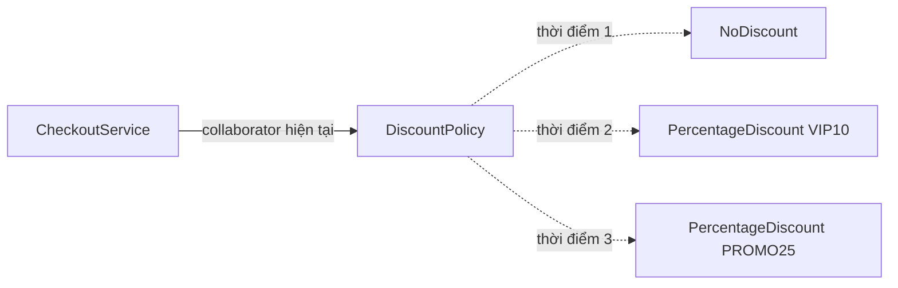

# Changing Collaborating Objects at Runtime in Java

With **composition**, an object performs work by holding references to other objects, called **collaborators** (*collaborator/dependency*), and delegating part of its behavior to them.

For example, a checkout service can use a `DiscountPolicy` object to determine discounts. With a well-designed contract, we can **change the discount policy while the program is running** without recreating the checkout service or rewriting its logic.

```java
checkout.setDiscountPolicy(new PercentageDiscount("VIP10", 10));
```

This is a major benefit of composition: we can change **how an object receives help performing its work** by replacing a collaborator instead of hardwiring every variant into an inheritance hierarchy.

> In this lesson, "changing at runtime" means replacing **a reference to an object that fulfills the same contract**. It does not mean editing Java source code or automatically loading new plugins. Concurrency, resource management, and ownership must be handled separately where relevant.

## 1. What Is a Collaborating Object?

Consider a service that accepts a fee policy:

```java
interface FeePolicy {
    long calculate(long subtotal);
}

final class OrderService {
    private FeePolicy feePolicy;

    OrderService(FeePolicy feePolicy) {
        this.feePolicy = feePolicy;
    }

    long total(long subtotal) {
        return feePolicy.calculate(subtotal);
    }
}
```

Here:

- `OrderService` is the **owning/coordinating object**, responsible for coordinating the fee calculation.
- `FeePolicy` is the **collaborator contract**.
- An object implementing `FeePolicy` performs the specific calculation.
- The `feePolicy` field stores a **reference** to the collaborator without knowing its concrete class.

If a controlled API permits replacing that reference, `OrderService` can behave differently on subsequent calls.



The diagram shows **the same `CheckoutService`** referencing different policy objects over time. It does not show three policies processing one order simultaneously; each operation uses the current collaborator according to the design.

## 2. Complete Java Example: Switching Discount Policies at Runtime

Business requirements:

1. Initially, checkout applies no discount.
2. When the VIP program is enabled, the service uses a 10% discount.
3. When switching to a promotion, the service uses a 25% discount.
4. The no-discount policy can be restored.
5. The checkout service **remains the same object**; only its collaborator changes.

Save all the following code in **`Main.java`** and run it with Java 17 or Java 21.

```java
import java.util.Objects;

record Order(long subtotalVnd) {
    Order {
        if (subtotalVnd < 0) {
            throw new IllegalArgumentException("Tiền hàng không được âm");
        }
    }
}

record Receipt(String policyCode, long subtotalVnd,
               long discountVnd, long totalVnd) {
}

// Hợp đồng mà CheckoutService cần từ collaborator.
interface DiscountPolicy {
    String code();

    // Phải trả giá trị trong khoảng [0, subtotalVnd].
    long discount(long subtotalVnd);
}

final class NoDiscount implements DiscountPolicy {
    @Override
    public String code() {
        return "NONE";
    }

    @Override
    public long discount(long subtotalVnd) {
        if (subtotalVnd < 0) {
            throw new IllegalArgumentException("Tiền hàng không hợp lệ");
        }
        return 0;
    }
}

final class PercentageDiscount implements DiscountPolicy {
    private final String code;
    private final int percent;

    PercentageDiscount(String code, int percent) {
        if (code == null || code.isBlank()) {
            throw new IllegalArgumentException("Mã chính sách không hợp lệ");
        }
        if (percent < 0 || percent > 100) {
            throw new IllegalArgumentException("Phần trăm phải từ 0 đến 100");
        }
        this.code = code;
        this.percent = percent;
    }

    @Override
    public String code() {
        return code;
    }

    @Override
    public long discount(long subtotalVnd) {
        if (subtotalVnd < 0) {
            throw new IllegalArgumentException("Tiền hàng không hợp lệ");
        }
        // Ví dụ tính trên VND nguyên, làm tròn xuống.
        return Math.multiplyExact(subtotalVnd, percent) / 100;
    }
}

final class CheckoutService {
    // Không final vì thiết kế này chủ ý cho phép thay collaborator.
    private DiscountPolicy discountPolicy;

    CheckoutService(DiscountPolicy initialPolicy) {
        this.discountPolicy =
                Objects.requireNonNull(initialPolicy, "initialPolicy");
    }

    // Điểm thay thế collaborator, có kiểm tra null.
    void setDiscountPolicy(DiscountPolicy nextPolicy) {
        this.discountPolicy =
                Objects.requireNonNull(nextPolicy, "nextPolicy");
    }

    Receipt checkout(Order order) {
        Objects.requireNonNull(order, "order");

        // Lấy một tham chiếu cho toàn bộ lần thanh toán.
        DiscountPolicy selected = discountPolicy;
        long subtotal = order.subtotalVnd();
        long reduction = selected.discount(subtotal);

        // Không tin mù quáng mọi implementation.
        if (reduction < 0 || reduction > subtotal) {
            throw new IllegalStateException(
                    "Chính sách trả giá trị giảm giá không hợp lệ");
        }

        return new Receipt(
                selected.code(),
                subtotal,
                reduction,
                subtotal - reduction
        );
    }
}

public class Main {
    private static void printReceipt(Receipt receipt) {
        System.out.printf("%s: %d VND%n",
                receipt.policyCode(), receipt.totalVnd());
    }

    public static void main(String[] args) {
        Order order = new Order(100_000);

        CheckoutService checkout = new CheckoutService(new NoDiscount());

        printReceipt(checkout.checkout(order));

        checkout.setDiscountPolicy(
                new PercentageDiscount("VIP10", 10));
        Receipt vipReceipt = checkout.checkout(order);
        printReceipt(vipReceipt);

        checkout.setDiscountPolicy(
                new PercentageDiscount("PROMO25", 25));
        printReceipt(checkout.checkout(order));

        checkout.setDiscountPolicy(new NoDiscount());
        printReceipt(checkout.checkout(order));

        // Biên lai cũ là dữ liệu riêng; đổi policy không sửa quá khứ.
        System.out.println("Biên lai VIP cũ: "
                + vipReceipt.totalVnd() + " VND");
    }
}
```

Compile and run:

```bash
javac Main.java
java Main
```

Output:

```text
NONE: 100000 VND
VIP10: 90000 VND
PROMO25: 75000 VND
NONE: 100000 VND
Biên lai VIP cũ: 90000 VND
```

**Analyzing the result:**

- `CheckoutService` is created **only once**.
- `setDiscountPolicy(...)` replaces the object referenced by the `discountPolicy` field; it does not replace the `Order` or the `CheckoutService` itself.
- Every `DiscountPolicy` has the same `discount(long)` method but applies different rules. The call `selected.discount(subtotal)` uses **polymorphism** to execute the current object's implementation.
- `vipReceipt` stores the computed result. Switching to `PROMO25` does not recalculate or modify the earlier receipt.
- `selected` is a local variable holding the collaborator chosen for one call. This makes `code()` and `discount()` use **the same policy object** instead of rereading the field multiple times.
- Neither example implementation changes internal state during checkout, so both can be reused without separate counters or sessions.

This monetary example uses integer VND amounts for clarity. Real financial systems need consistent currency units, rounding, taxes, and numeric bounds; `Math.multiplyExact` throws if multiplication overflows a `long`.

## 3. Why Does Composition Allow Collaborator Replacement?

The key is a field typed to a **shared contract**, rather than a fixed concrete class:

```java
private DiscountPolicy discountPolicy;
```

If we write:

```java
private PercentageDiscount discountPolicy;
```

we cannot assign `new NoDiscount()` to that field because `NoDiscount` is not a subtype of `PercentageDiscount`.

If we write:

```java
// Mã giả về hướng kế thừa trong một thiết kế khác:
// class VipCheckoutService extends BaseCheckoutService { ... }
```

This is **a conceptual illustration**, not a standalone runnable snippet. In the main example, `CheckoutService` is declared `final`, so Java **does not allow extending CheckoutService**.

If every policy variant is represented by a service subclass, switching policies may require creating **a new service** or adding branches in each subclass. The example instead uses composition to select discounts: `CheckoutService` **has a** `DiscountPolicy`; `CheckoutService` **is not a** kind of policy.

| Design approach | Where variants are represented | Runtime policy replacement |
| --- | --- | --- |
| `if/else` inside `CheckoutService` | Conditional branches and type codes | Requires changing code/state and branching accordingly |
| Subclasses `VipCheckoutService`, `PromoCheckoutService` | Service inheritance | Usually requires replacing the service object or more design work |
| Composition with `DiscountPolicy` | Objects implementing the interface | Replace the collaborator reference through a controlled API |
| Composition with a `final DiscountPolicy` field | Objects implementing the interface | Chosen at construction; cannot be changed with a setter |
| Composition + registry/factory | Configuration-based implementation selection | A new policy can be selected at a designated boundary |

**Composition does not automatically mean "replaceable at any time."** It depends on whether the reference field can change and whether the class exposes a replacement operation consistent with its contract.

## 4. Three Common Collaborator Lifecycle Choices

### 4.1. Select at Construction and Keep Fixed

```java
final class FixedCheckoutService {
    private final DiscountPolicy policy;

    FixedCheckoutService(DiscountPolicy policy) {
        this.policy = Objects.requireNonNull(policy);
    }

    Receipt checkout(Order order) {
        long reduction = policy.discount(order.subtotalVnd());
        // Xây Receipt và kiểm tra hợp đồng tương tự ví dụ chính.
        return new Receipt(
                policy.code(),
                order.subtotalVnd(),
                reduction,
                order.subtotalVnd() - reduction);
    }
}
```

This is the usual approach with **constructor injection**. It is simple: the field is never reassigned, and the service's dependency stays stable. In this shortened example, `FixedCheckoutService` does not yet validate the `reduction` range; production code would need validation like `CheckoutService`.

### 4.2. Replace Through a Setter or Business Method

```java
checkout.setDiscountPolicy(new PercentageDiscount("VIP10", 10));
```

This is useful when the owning/coordinating object is long-lived but a collaborator must change with sessions, operating conditions, or configuration.

The drawback is that the service gains more mutable state; callers must understand **who may replace the collaborator and when**. If replacement is unnecessary, keeping the dependency `final` is usually easier to reason about.

### 4.3. Select a Collaborator for Each Call

If policies differ **for each order**, there is no need to store them in a mutable field on a singleton service. Instead, pass one directly:

```java
final class PerRequestCheckout {
    Receipt checkout(Order order, DiscountPolicy policy) {
        Objects.requireNonNull(order, "order");
        Objects.requireNonNull(policy, "policy");

        long subtotal = order.subtotalVnd();
        long reduction = policy.discount(subtotal);
        if (reduction < 0 || reduction > subtotal) {
            throw new IllegalStateException("Giảm giá ngoài giới hạn");
        }

        return new Receipt(
                policy.code(), subtotal, reduction, subtotal - reduction);
    }
}
```

This avoids sharing a mutable policy field across requests. Per-request selection is especially useful in web applications where many users may need different policies **concurrently**.

| Requirement | Suitable organization |
| --- | --- |
| Policy selected only when the service is created | Constructor injection + `final` field |
| Administrative policy updates affect new calls | Controlled `set/replacePolicy` API |
| Every request has its own policy | Pass a policy parameter or resolve one through a request-scoped component |
| Policy selected from a configuration code | Factory/registry mapping codes to implementations |
| Policy owns resources that need closing | Define ownership and lifecycle management before replacing it |

## 5. Replacing an Object Versus Mutating Its State

These two operations have different meanings:

```java
DiscountPolicy selected = new PercentageDiscount("VIP10", 10);
checkout.setDiscountPolicy(selected);
```

Here, `CheckoutService` holds **a new reference**.

By contrast, if the collaborator is mutable:

```java
// Ví dụ khái niệm:
// mutablePolicy.setPercent(10);
```

we still have **the same collaborator**, but its internal state changes. Every other object referencing `mutablePolicy` may also observe that change.

This distinction matters in systems with multiple components:

- **Replacing the reference:** The service switches from policy A to B; other components still holding A do not automatically switch to B.
- **Mutating policy A:** Everyone sharing A may be affected.
- **Replacing the service:** A `new CheckoutService(...)` creates another coordinating object, which is different from the two cases above.

An immutable policy such as `PercentageDiscount` has an advantage: after construction, `percent` and `code` do not change. Switching policies by **creating a new object and replacing the reference** is often easier to reason about than mutating many fields on a shared collaborator.

## 6. Runtime Collaborator Replacement: Concurrency Considerations

The initial `CheckoutService` example mainly demonstrates sequential use. In a concurrent application, one thread might call `checkout()` while another calls `setDiscountPolicy()`.

An ordinary mutable field:

```java
private DiscountPolicy discountPolicy;
```

**does not guarantee visibility of updates across threads**. Depending on requirements, `volatile`, `synchronized`, or `AtomicReference` can publish a new collaborator safely.

### A Safe Way to Replace References: `AtomicReference`

The following standalone illustration focuses on selecting the current policy; it reuses the `Order`, `Receipt`, `DiscountPolicy`, `NoDiscount`, and `PercentageDiscount` types from the main example:

```java
import java.util.Objects;
import java.util.concurrent.atomic.AtomicReference;

final class ConcurrentCheckoutService {
    private final AtomicReference<DiscountPolicy> current;

    ConcurrentCheckoutService(DiscountPolicy initial) {
        this.current = new AtomicReference<>(
                Objects.requireNonNull(initial, "initial"));
    }

    void replacePolicy(DiscountPolicy next) {
        current.set(Objects.requireNonNull(next, "next"));
    }

    Receipt checkout(Order order) {
        Objects.requireNonNull(order, "order");

        // Một snapshot tham chiếu tại đầu lời gọi.
        DiscountPolicy selected = current.get();

        long subtotal = order.subtotalVnd();
        long reduction = selected.discount(subtotal);

        if (reduction < 0 || reduction > subtotal) {
            throw new IllegalStateException("Policy không hợp lệ");
        }

        return new Receipt(
                selected.code(), subtotal, reduction, subtotal - reduction);
    }
}
```

The guarantees here are:

1. `current.set(next)` updates the **reference** atomically with `AtomicReference` visibility semantics.
2. `current.get()` obtains **one** specific collaborator for the entire checkout calculation.
3. A call starting just before or during replacement may continue using **the old policy** it already obtained. Calls starting after `replacePolicy()` completes will read the new policy if no other update occurs.
4. `AtomicReference` **does not make a collaborator's internal state thread-safe**. If a policy modifies collections/counters inside `discount()`, that work requires separate synchronization.
5. `AtomicReference` also does not turn multiple business effects (calculating fees, writing to a database, publishing events) into one atomic transaction.

A simpler option when only whole-reference reads and writes are needed is:

```java
private volatile DiscountPolicy currentPolicy;
```

`volatile` may suffice for visibility and atomic reference reads/writes. `AtomicReference` also supports `compareAndSet`, `getAndSet`, and other conditional updates.

**Consistency scope must be explicit:** "After configuration changes, every in-progress request must immediately use the new policy" is **different** from "new requests use the new policy while in-progress requests finish with their old snapshot." The `AtomicReference` example supports per-call snapshots; it does not cancel already-started requests.

## 7. Collaborator Ownership and Lifecycle

Not every collaborator is an immutable object without resources. Some hold:

- Sockets or connections.
- Executors, worker threads, or off-heap memory.
- Sessions or clients that must be closed after use.
- Caches that need warming before a switch.
- State that must be synchronized or flushed.

For example, if a `Gateway` has a `close()` method, replacing it with:

```java
gateway = newGateway;
oldGateway.close();
```

**can be dangerous** if an in-progress request still uses `oldGateway`. Replacing the reference does not mean all existing calls have finished.

Before replacing a resource-owning collaborator, determine:

1. **Who owns it?** The service, DI container, or another component? A non-owner should generally not close it unilaterally.
2. **When is it ready?** Must the new connection be initialized and checked before publication?
3. **When can the old object close?** Are in-flight request counts, draining, timeouts, or transition periods needed?
4. **What if initialization fails?** Should the old policy/adapter continue serving requests?
5. **What if switching fails partway through?** Is there a clear rollback and error-reporting path?


This diagram illustrates **the required lifecycle-management process**; a setter or `AtomicReference.set()` does not implement every step automatically. Replacing a stateless, computation-only `DiscountPolicy` is usually much simpler.

## 8. A New Policy Must Honor the Existing Contract

When collaborators are replaceable, every implementation must honor the same **contract semantics**, not merely share method signatures.

In the example, `DiscountPolicy.discount(subtotalVnd)` must:

- Accept the subtotal as **integer VND**.
- Return a discount between `0` and `subtotalVnd`.
- Not arbitrarily switch units to percentages or another currency.
- Define clear behavior for invalid input.
- Be compatible with the documented concurrency model if used concurrently.

An implementation such as:

```java
final class BrokenDiscount implements DiscountPolicy {
    @Override
    public String code() {
        return "BROKEN";
    }

    @Override
    public long discount(long subtotalVnd) {
        return -100;
    }
}
```

**still compiles**, but `CheckoutService` throws `IllegalStateException` because the result violates the contract. Interfaces enable substitution at the **type level**, while the **Liskov Substitution Principle** requires new implementations to preserve behavior on which clients rely.

This matters especially for hot swapping: an incompatible implementation can cause subsequent requests to fail even if the reference switch succeeds.

## 9. Selecting Collaborators from a Factory or Registry

In real systems, administrators or requests often supply policy codes as `String` values, such as `"VIP10"`. A selection boundary can use a registry:

```java
import java.util.Map;

final class DiscountCatalog {
    private final Map<String, DiscountPolicy> policies = Map.of(
            "NONE", new NoDiscount(),
            "VIP10", new PercentageDiscount("VIP10", 10),
            "PROMO25", new PercentageDiscount("PROMO25", 25)
    );

    DiscountPolicy findRequired(String code) {
        DiscountPolicy policy = policies.get(code);
        if (policy == null) {
            throw new IllegalArgumentException(
                    "Mã chính sách không hỗ trợ: " + code);
        }
        return policy;
    }
}
```

Then:

```java
DiscountCatalog catalog = new DiscountCatalog();
checkout.setDiscountPolicy(catalog.findRequired("PROMO25"));
```

The snippet assumes `checkout` is the `CheckoutService` object created in the example. A registry separates **finding the correct implementation** from **using the collaborator**. `CheckoutService` need not know which class `"VIP10"` represents.

Depending on scale, `Map` can be replaced by `switch`, dependency injection, or another factory. If a policy is stateful and request-specific, the registry can hold **factories that create instances** rather than sharing one policy object.

**Do not let untrusted input choose arbitrary classes by name and instantiate them through reflection** without explicit restrictions and validation. An explicit registry permits only approved implementations.

## 10. When Is Collaborator Replacement Better Than Inheritance or Conditionals?

| Requirement | Approach to consider | Reason |
| --- | --- | --- |
| Change the discount formula but keep the checkout service | Composition + `DiscountPolicy` | Behavior can vary independently |
| A fixed workflow with a few extensible steps | Template Method / controlled inheritance | An inheritance contract may fit |
| Two fixed cases differ by one small condition | A clear `if` or `switch` | Avoids an unnecessary class hierarchy |
| Many concurrent requests need different policies | Select collaborators per call | Avoids conflicting shared mutable state |
| Shared configuration changes at runtime | Setter/replace API with `volatile` or `AtomicReference` for concurrency | Publishes new configuration for subsequent calls |
| Collaborators have their own state and resources | Composition + explicit lifecycle management | Avoids closing objects while in use |
| Combine auxiliary behaviors such as retry, caching, logging | Decorator/delegation | Allows flexible wrapper combinations |

Runtime collaborator replacement is often a variation of the **Strategy Pattern**: algorithms are encapsulated behind an interface, and strategies can be interchanged. Composition is the structure through which an object holds a collaborator; Strategy describes using that structure to replace an **algorithm or behavior**.

Not every collaborator is a Strategy. A repository, clock, event publisher, or HTTP client may also be swapped for testing or configuration, even if its role is not described as a "strategy."

## 11. Testing Collaborator Replacement

Test both **behavior before and after replacement** and whether existing objects remain unchanged as expected.

Example of a plain Java test, placed in a method where the classes from the main example are available:

```java
CheckoutService service = new CheckoutService(new NoDiscount());
Order order = new Order(100_000);

Receipt before = service.checkout(order);

service.setDiscountPolicy(new PercentageDiscount("VIP10", 10));
Receipt after = service.checkout(order);

if (before.totalVnd() != 100_000) {
    throw new AssertionError("Chính sách ban đầu sai");
}
if (after.totalVnd() != 90_000) {
    throw new AssertionError("Chính sách mới chưa có hiệu lực");
}
if (!"NONE".equals(before.policyCode())) {
    throw new AssertionError("Biên lai cũ bị thay đổi");
}
```

Other useful test cases:

- `setDiscountPolicy(null)` must be rejected so the service does not end up without a policy.
- A new policy returning a negative discount or more than the subtotal must be detected.
- Switching from A to B and back to A must produce correct results on each call.
- In a multithreaded system, each request must see a consistent collaborator under the chosen snapshot contract.
- When collaborators hold resources, replacement must not close resources still used by active requests.
- If a new policy fails to initialize, an unready object must not be published.

JUnit tests can use `assertEquals`, `assertThrows`, and fake `DiscountPolicy` implementations. The most valuable tests verify **business behavior after selecting a new collaborator**, not merely whether the setter was called.

## 12. Common Mistakes

| Mistake | Consequence | Remedy |
| --- | --- | --- |
| Typing a collaborator field to a concrete class instead of a needed interface | Cannot substitute unrelated implementations | Use a meaningful shared contract |
| Setter allows `null` | The next request may throw `NullPointerException` | Use `Objects.requireNonNull` or an explicit absence policy |
| Changing a shared singleton field for every request | One user's request can use another user's policy | Pass policies per request |
| Reading the collaborator repeatedly during an operation | Mid-call replacement can mix policy versions | Capture one local reference per operation |
| Assuming an ordinary reference swap is fully thread-safe | No guaranteed visibility or internal-state safety | Use correct synchronization/atomic publication and safe policies |
| Closing the old collaborator immediately after replacement | In-progress requests use a closed resource | Manage in-flight operations and ownership |
| New implementation changes units or returns invalid values | Violates substitutability | Contract tests and validation |
| Making every collaborator a Strategy without a replacement need | Unnecessary classes and complexity | Use a `final` field for fixed dependencies |
| Using reflection with a client-supplied class name | Configuration and security risks | Maintain an allowlist of implementations |
| Assuming a setter updates previously created results | Confuses current state with history | Store suitable values/versions in receipts |

## 13. Self-Check Questions

**Question 1.** After calling `checkout.setDiscountPolicy(new NoDiscount())`, is the `CheckoutService` object recreated?

**Answer:** No. Only the internal collaborator reference changes. The coordinating object remains the same.

**Question 2.** Why is `DiscountPolicy selected = discountPolicy;` assigned at the start of `checkout()`?

**Answer:** So `discount()` and `code()` use **one** selected policy. Changing the field at another moment will not accidentally make that call use two different collaborators.

**Question 3.** When a singleton `CheckoutService` serves users with individual discounts, should it call `setDiscountPolicy(...)` for every request?

**Answer:** Usually not; requests may overwrite one another's policies. Select policies through request parameters or an appropriate data scope.

**Question 4.** Does `AtomicReference<DiscountPolicy>` make every method in `DiscountPolicy` thread-safe?

**Answer:** No. It guarantees atomicity/visibility for **the reference**; the policy object's logic and state still require their own thread-safety design.

**Question 5.** If an old HTTP client is still processing requests, should `close()` be called immediately after switching to a new client?

**Answer:** Not by default. Determine who owns the client and when its active requests finish. Draining or a separate lifecycle-management mechanism may be necessary.

**Question 6.** Must composition always support runtime collaborator replacement?

**Answer:** No. Composition with a `final` collaborator fixed for its entire lifecycle is valid and usually simpler when replacement is unnecessary.

**Key takeaway:** Composition lets a coordinating object **delegate** to collaborators through clear contracts. When business needs require it, the object can **replace collaborators at runtime** to change its behavior without replacing itself. A sound design must also define *which calls a replacement affects*, *cross-thread consistency*, *implementation contracts*, and *resource lifecycles*—not merely add a setter.
