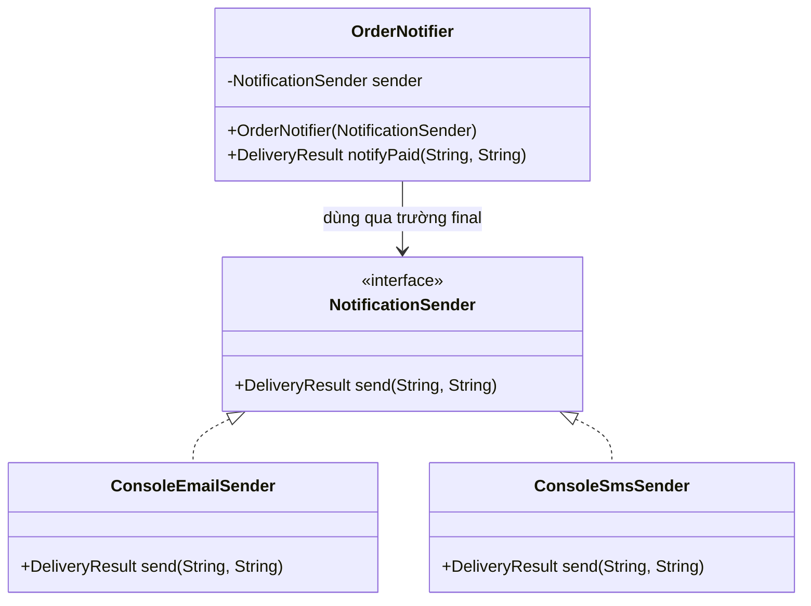
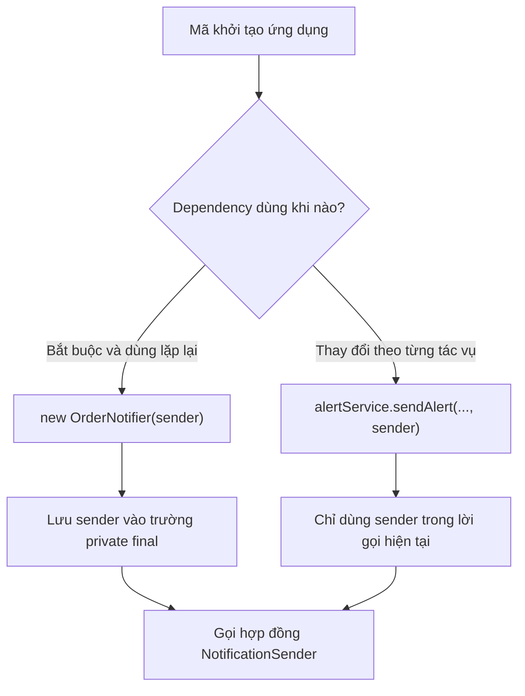
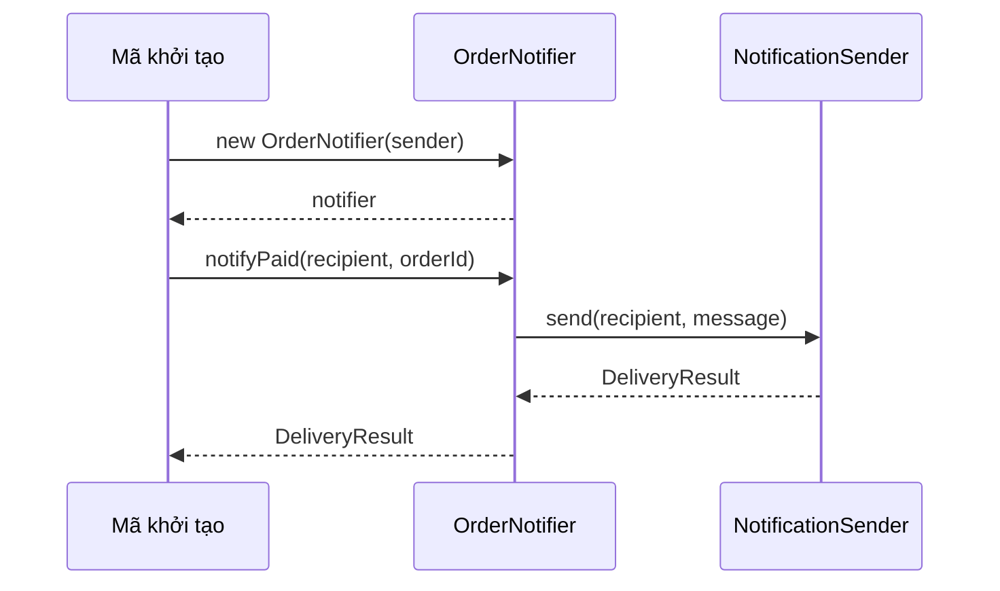

# Dependency Injection Through Constructors or Methods in Java

> **OOP → Composition.** An object often needs other objects to do its job: an order service needs a notification sender, a report exporter needs a formatter, and business logic needs data storage. **Dependency Injection (DI)** means *supplying* these collaborators from outside instead of having the consuming class create fixed implementations itself. Two direct Java techniques are **constructor injection** (passing dependencies through constructors) and **method injection** (passing dependencies as method parameters).

## 1. Why Use Dependency Injection?

Suppose an order-notification class creates its own email sender:

```java
class OrderNotifier {
    private final EmailSender sender = new EmailSender();

    void notifyPaid(String recipient) {
        sender.send(recipient, "Đơn hàng đã thanh toán");
    }
}
```

`EmailSender` is a hypothetical class name here. This approach forces `OrderNotifier` to know **the exact implementation** and how to instantiate it. Switching to SMS, changing email providers, or testing without sending real notifications would require modifying or somehow replacing that internal dependency.

Extract a notification-sending contract:

```java
interface NotificationSender {
    DeliveryResult send(String recipient, String message);
}
```

Then have the notification class **receive** a `NotificationSender`:

```java
class OrderNotifier {
    private final NotificationSender sender;

    OrderNotifier(NotificationSender sender) {
        this.sender = java.util.Objects.requireNonNull(sender);
    }
}
```

`OrderNotifier` **has a** notification sender (*has-a*), but it does not decide whether to use email or SMS. This is composition through a contract and a straightforward example of DI.

| Without dependency injection | With dependency injection |
|---|---|
| The class calls `new EmailSender()` within its logic | External code creates a sender and passes it in |
| Business logic is tied to one concrete implementation | Business logic depends on the `NotificationSender` contract |
| Replacing the sender during tests is difficult | A fake `RecordingSender` can be injected |
| Changing technology may require editing the business class | Implementations can be swapped at application assembly |

**Note:** DI does not require Spring or a DI container. Plain Java constructors and method parameters are sufficient.

## 2. Constructor Injection: Dependencies Needed Throughout an Object's Lifecycle

**Constructor injection** is suitable when a dependency is **required** and will be used by multiple methods throughout an object's lifetime.

```java
final class OrderNotifier {
    private final NotificationSender sender;

    OrderNotifier(NotificationSender sender) {
        this.sender = Objects.requireNonNull(sender, "sender");
    }

    DeliveryResult notifyPaid(String recipient, String orderId) {
        return sender.send(
            recipient,
            "Đơn hàng " + orderId + " đã thanh toán"
        );
    }
}
```

At the construction site:

```java
NotificationSender sender = new ConsoleEmailSender();
OrderNotifier notifier = new OrderNotifier(sender);
```

Key observations:

1. `sender` is required **when `OrderNotifier` is created**. If `null` is passed, the constructor rejects it before producing a valid object.
2. A `private final` field prevents reassignment of the sender reference after construction. It **does not make the sender object immutable or thread-safe**.
3. Business methods call only the `NotificationSender` contract; they do not need to know the concrete class.
4. External code determines the dependency's **configuration and lifecycle**. Do not unilaterally close a caller-owned dependency unless the contract permits it.



The `OrderNotifier → NotificationSender` arrow shows that **the source-code dependency points to an abstraction**. The two sender classes provide implementations and can substitute for each other as long as they honor the same contract.

## 3. Method Injection: Dependencies Chosen Per Call

**Method-parameter injection** is appropriate when behavior depends on **the context of each call** and the dependency need not be stored in a field.

For example, an alert-sending operation may select a different channel for each request:

```java
final class AlertService {
    DeliveryResult sendAlert(
            String recipient,
            String message,
            NotificationSender sender) {

        Objects.requireNonNull(sender, "sender");
        return sender.send(recipient, message);
    }
}
```

Usage:

```java
AlertService alerts = new AlertService();

alerts.sendAlert(
    "an@example.test",
    "Đơn hàng cần xác nhận",
    new ConsoleEmailSender()
);

alerts.sendAlert(
    "0900000000",
    "Mã xác nhận 123456",
    new ConsoleSmsSender()
);
```

With this approach, `AlertService` does not need a `NotificationSender` field. Every call supplies the dependency selected at that moment. This is **dependency injection through method parameters**; it is distinct from Spring's specialized `@Lookup` method-injection mechanism.

**Lifecycle differences:**



If the same sender must be passed through dozens of methods just to invoke it, constructor injection is usually more concise. Conversely, if a service selects independent sending channels for each request, storing one fixed sender may make the API less flexible.

## 4. Complete Java Example: Using Both Injection Approaches

The following example runs independently on **Java 17+** without Spring or real email/SMS services. The senders only print to the console to illustrate polymorphism and dependency flow.

Save as `DependencyInjectionDemo.java`:

```java
import java.util.Objects;

public class DependencyInjectionDemo {

    record DeliveryResult(String channel, boolean accepted) {
        DeliveryResult {
            Objects.requireNonNull(channel, "channel");
        }
    }

    interface NotificationSender {
        DeliveryResult send(String recipient, String message);
    }

    static String requireText(String value, String field) {
        if (value == null || value.isBlank()) {
            throw new IllegalArgumentException(field + " không hợp lệ");
        }
        return value;
    }

    // Implementation A: chỉ mô phỏng email bằng log console.
    static final class ConsoleEmailSender implements NotificationSender {
        @Override
        public DeliveryResult send(String recipient, String message) {
            requireText(recipient, "recipient");
            requireText(message, "message");
            System.out.println("[EMAIL] " + recipient + " <- " + message);
            return new DeliveryResult("EMAIL", true);
        }
    }

    // Implementation B: chỉ mô phỏng SMS bằng log console.
    static final class ConsoleSmsSender implements NotificationSender {
        @Override
        public DeliveryResult send(String recipient, String message) {
            requireText(recipient, "recipient");
            requireText(message, "message");
            System.out.println("[SMS] " + recipient + " <- " + message);
            return new DeliveryResult("SMS", true);
        }
    }

    // Constructor injection: dùng sender cố định trong vòng đời notifier.
    static final class OrderNotifier {
        private final NotificationSender sender;

        OrderNotifier(NotificationSender sender) {
            this.sender = Objects.requireNonNull(sender, "sender");
        }

        DeliveryResult notifyPaid(String recipient, String orderId) {
            requireText(recipient, "recipient");
            requireText(orderId, "orderId");
            return sender.send(
                recipient,
                "Đơn hàng " + orderId + " đã thanh toán"
            );
        }
    }

    // Method injection: sender có thể thay đổi theo từng lần gọi.
    static final class AlertService {
        DeliveryResult sendAlert(
                String recipient,
                String message,
                NotificationSender sender) {
            requireText(recipient, "recipient");
            requireText(message, "message");
            Objects.requireNonNull(sender, "sender");
            return sender.send(recipient, message);
        }
    }

    // Fake dùng để kiểm thử, không gửi email hoặc SMS thật.
    static final class RecordingSender implements NotificationSender {
        private int calls;
        private String lastRecipient;
        private String lastMessage;

        @Override
        public DeliveryResult send(String recipient, String message) {
            calls++;
            lastRecipient = recipient;
            lastMessage = message;
            return new DeliveryResult("FAKE", true);
        }

        int calls() {
            return calls;
        }

        String lastRecipient() {
            return lastRecipient;
        }

        String lastMessage() {
            return lastMessage;
        }
    }

    public static void main(String[] args) {
        // Tiêm qua constructor.
        OrderNotifier notifier =
            new OrderNotifier(new ConsoleEmailSender());

        DeliveryResult email = notifier.notifyPaid(
            "an@example.test",
            "ORD-101"
        );
        System.out.println("Email accepted: " + email.accepted());

        // Tiêm qua tham số của phương thức.
        AlertService alerts = new AlertService();
        DeliveryResult sms = alerts.sendAlert(
            "0900000000",
            "Mã xác nhận 123456",
            new ConsoleSmsSender()
        );
        System.out.println("SMS accepted: " + sms.accepted());

        // Thay dependency bằng fake mà không sửa OrderNotifier.
        RecordingSender fake = new RecordingSender();
        OrderNotifier testNotifier = new OrderNotifier(fake);
        testNotifier.notifyPaid("test@example.test", "ORD-TEST");

        if (fake.calls() != 1
                || !fake.lastRecipient().equals("test@example.test")
                || !fake.lastMessage().contains("ORD-TEST")) {
            throw new AssertionError("OrderNotifier dùng sai dependency");
        }
        System.out.println("Fake calls: " + fake.calls());
    }
}
```

Run:

```bash
javac DependencyInjectionDemo.java
java DependencyInjectionDemo
```

Expected output:

```text
[EMAIL] an@example.test <- Đơn hàng ORD-101 đã thanh toán
Email accepted: true
[SMS] 0900000000 <- Mã xác nhận 123456
SMS accepted: true
Fake calls: 1
```

This is **a console simulation**. `accepted=true` in the example only means the simulated implementation accepted the call; it does not prove a real email/SMS was sent or read. For real services, the contract should distinguish sent, pending, rejected, and connection-error states whenever they matter.

### Tracing One Call



`OrderNotifier` does not instantiate `ConsoleEmailSender`; `main` does that. Therefore, we can inject `RecordingSender` for testing without modifying `OrderNotifier` code.

## 5. Comparing Constructor, Method, and Setter Injection

Some documentation uses **method injection** to mean **setter injection** (injecting through a setter method), while other sources distinguish **method parameter injection** (passing a dependency directly to an operation). Specify which form you mean.

| Criterion | Constructor injection | Method parameter injection | Setter injection |
|---|---|---|---|
| Example | `new Service(repo)` | `service.run(repo)` | `service.setRepo(repo)` |
| When is the dependency received? | During object construction | On each method call | When the setter is called |
| Stored as a field? | Usually, optionally `final` | Usually unnecessary | Usually, typically not `final` |
| Best suited for | Required, stable dependencies | Per-request/per-task dependencies | Optional or reconfigurable dependencies |
| Risks | Too many constructor parameters | Repeating parameters across calls | An object may be unconfigured or changed mid-operation |
| Easy to fake in tests? | Yes | Yes | Yes, but configuration order must be controlled |

Setter injection can look like this:

```java
final class ConfigurableNotifier {
    private NotificationSender sender;

    void setSender(NotificationSender sender) {
        this.sender = Objects.requireNonNull(sender, "sender");
    }

    DeliveryResult notify(String recipient, String message) {
        if (sender == null) {
            throw new IllegalStateException("Chưa cấu hình sender");
        }
        return sender.send(recipient, message);
    }
}
```

This approach carries risks: if `notify()` is called before `setSender()`, the object is not ready. If multiple threads call the setter and notification method concurrently, synchronization and configuration-change rules also matter. Therefore, **prefer constructor injection for required dependencies**; use setters when replacement or an unconfigured state is a genuine requirement.

## 6. How Does Composition Differ from Inheritance Here?

In the example, the notifier/sender relationship is:

```text
OrderNotifier có một NotificationSender.
```

Not:

```text
OrderNotifier là một loại NotificationSender.
```

`OrderNotifier` **uses** a sender to fulfill its own responsibility. It does not need `extends ConsoleEmailSender` or `extends ConsoleSmsSender`. This is composition: collaborating objects perform independent responsibilities.

```java
// Đúng hướng: sử dụng một thành phần thông qua hợp đồng.
class OrderNotifier {
    private final NotificationSender sender;
    OrderNotifier(NotificationSender sender) {
        this.sender = sender;
    }
}

// Không nên kế thừa chỉ để tái sử dụng hàm send:
// class OrderNotifier extends ConsoleEmailSender { ... }
```

Composition allows notification delivery to change without distorting an inheritance hierarchy. It also suits objects with different lifecycles: a notifier may be long-lived while its sender is shared or has connection-closing rules defined by its API.

**Important:** Passing a dependency into an object does not guarantee correct concurrency or resource lifecycles. If a sender uses a connection or thread pool, decide who creates, owns, and closes those resources.

## 7. Injecting Interfaces Instead of Tying Code to Concrete Implementations

Both constructors below receive a dependency from outside:

```java
OrderNotifier(ConsoleEmailSender sender) { /* ... */ }
OrderNotifier(NotificationSender sender) { /* ... */ }
```

The second approach is more flexible because it accepts any implementation honoring `NotificationSender`.

When a business class only needs `send` behavior, it should not require provider-specific methods. The more closely a contract matches the caller's actual needs, the less coupling it introduces.

However, **not every class needs an interface**. If a component has one stable implementation and no useful substitution boundary, injecting a concrete class may be reasonable. What matters is who decides how the dependency is created and whether it is hardwired into business logic.

### Dependency Injection, Dependency Inversion, and IoC

These three related concepts are not interchangeable:

- **Dependency Injection (DI):** Supplies dependencies externally through constructors, methods, or setters.
- **Dependency Inversion Principle (DIP):** Higher-level code and implementations both depend on appropriate abstractions rather than higher-level code directly depending on low-level details.
- **Inversion of Control (IoC):** Moves control over object creation/provision or control-flow coordination to an external component; DI is a common technique for applying IoC.

DI does not require a DI container. In the example's `main`, the application initialization code acts as the **composition root**—the place where implementations are selected and assembled.

## 8. Choosing Injection Approaches Based on Requirements

Some illustrative situations:

| Situation | Typical approach | Reason |
|---|---|---|
| `OrderService` always needs `OrderRepository` to process requests | Constructor injection | Required and stable throughout the service lifecycle |
| `CheckoutService` always uses a configured `PaymentGateway` | Constructor injection | The service cannot operate correctly without a gateway |
| Export each report with a different `Formatter` | Method parameter injection | The formatter is a per-task strategy |
| A testing utility selects a notification channel on each call | Method parameter injection | The dependency varies with the call input |
| An optional feature can be configured later | Controlled setter injection | The dependency is not required from construction |
| Centralize creation and connection of application services | Composition root or DI container | One place manages assembly and lifecycles |

**Quick decision rule:** If a missing dependency makes an object **invalid or unusable**, put it in the constructor. If a dependency **is needed only for a specific operation and varies per operation**, consider a method parameter. If a dependency is truly **optional or reconfigurable**, a setter may fit, but define the object's state before and after configuration.

## 9. Common Mistakes

### Mistake 1 — Accepting a Dependency but Creating Another Internally

```java
class BadNotifier {
    private final NotificationSender sender;

    BadNotifier(NotificationSender sender) {
        this.sender = sender;
    }

    void notifyUser(String recipient, String message) {
        // Sai ý đồ injection: bỏ qua this.sender.
        new ConsoleEmailSender().send(recipient, message);
    }
}
```

Although the constructor accepts a parameter, the class remains hardwired to email. Fix it by calling `this.sender.send(...)`.

### Mistake 2 — Allowing a Required Dependency to Be Null

```java
class BadService {
    private NotificationSender sender;
    // Không có constructor/setter bảo đảm sender được gán.
}
```

Calling a method that uses the sender can then trigger `NullPointerException`. Prefer a constructor with `Objects.requireNonNull` or a controlled-state design if the dependency is genuinely optional.

### Mistake 3 — Constructors with Too Many Dependencies

```java
// Ví dụ minh họa dấu hiệu cần xem lại trách nhiệm:
Service(A a, B b, C c, D d, E e, F f, G g) { /* ... */ }
```

There is no universal parameter-count limit. But if a constructor has many unrelated dependencies, the class may have too many responsibilities. Revisit its responsibilities and separate services appropriately instead of automatically packing everything into a hard-to-manage `Dependencies` object.

### Mistake 4 — Method Injection Causes Dependencies to Spread Through APIs

If multiple calling layers all accept `NotificationSender` but intermediate layers only forward it, the dependency may have the wrong scope. Consider injecting it through the constructor of the component that actually uses it.

### Mistake 5 — Unclear Resource Ownership

An injected dependency may own network connections, executors, or streams. Code receiving a dependency **must not unilaterally close** externally managed resources unless the contract specifies it; if ownership is transferred, resources must be closed at the proper lifecycle endpoint. DI does not replace resource-management policies.

### Mistake 6 — Assuming Constructor Injection Guarantees Thread Safety

`private final NotificationSender sender` does not make `sender.send(...)` thread-safe. If multiple threads share a mutable sender, its implementation still needs thread-safety guarantees or an appropriate usage scope.

## 10. Practice Exercises

**Exercise 1 — Switch implementations.** Add `ConsolePushSender implements NotificationSender` that prints `[PUSH]`. Inject it into `OrderNotifier` instead of `ConsoleEmailSender` without editing `OrderNotifier`. Observe the output.

**Exercise 2 — Choose injection scopes.** A `ReportService` needs `DocumentRepository` on every call and a `ReportFormatter` that varies per report. Design a constructor accepting the repository and an `export(formatter)` method accepting the formatter. Explain the different scopes.

**Exercise 3 — Test with a fake.** Use `RecordingSender` to verify that `OrderNotifier.notifyPaid` passes the correct recipient and order ID and invokes `send` only once. Then pass `RecordingSender` to `AlertService.sendAlert` to test method injection.

**Exercise 4 — Unconfigured state.** Call `notify` on `ConfigurableNotifier` before `setSender`. Explain why setter injection can create an invalid/unready state and write a test for it.

**Exercise 5 — Dependency ownership.** A `SmtpSender` holds a connection that needs closing. When `OrderNotifier` receives a sender from the composition root, who should close the connection? Propose an explicit ownership contract instead of having every class using the sender close it.

**Key takeaway:** With composition, an object **receives and uses** collaborators instead of hardwiring their construction. **Constructor injection** works best for required, stable dependencies; **method parameter injection** suits per-task dependencies; and **setter injection** is appropriate only when later configuration or replacement is required and the unready state is managed. In each case, business logic only needs to know the required contract, making implementations easier to replace and test.
