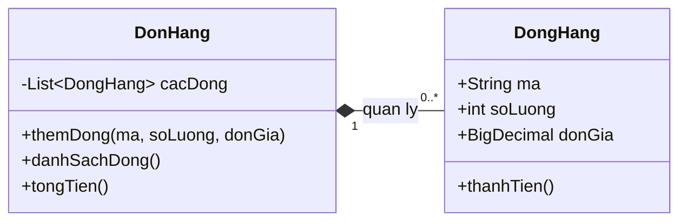
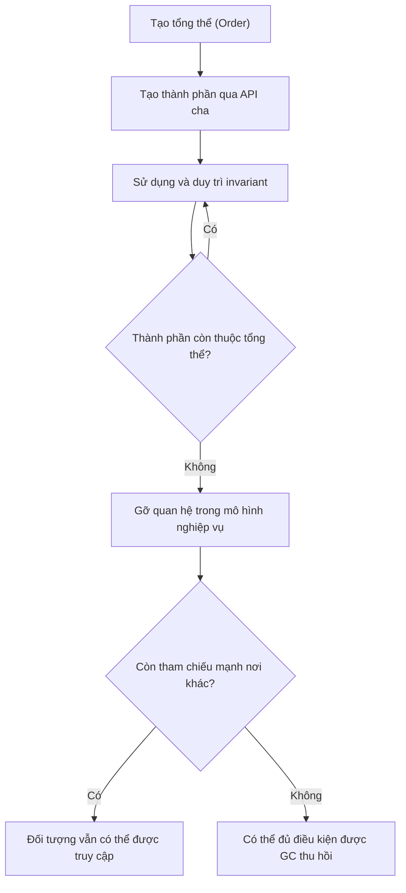

# Ownership and Lifecycle of Contained Objects in Java Composition

> **Context:** OOP → Composition. When an object contains other objects, the important design question is not just "what fields does it have?" but **who controls the creation, modification, sharing, and end of use of those components?**

## 1. Learning Objectives

After this lesson, you should be able to:

- Distinguish **ownership in object design**, **access through Java references**, and **responsibility for system resources**.
- Determine whether components may be shared among objects or must be managed by one parent object.
- Design APIs that preserve invariants when contained objects change.
- Use `AutoCloseable` and `try-with-resources` to control resource lifecycles when the containing object owns those resources.
- Avoid confusing garbage collection with closing files, connections, or execution workflows.

## 2. What Does Ownership Mean?

In **composition**, a containing object (*whole/owner*) manages its components (*parts*) to provide functionality and preserve the whole's valid state.

For example, `DonHang` manages its `DongHang` objects. The order determines when line items are added or removed, which quantities and prices are valid, and how the total is calculated. Code using `DonHang` must not modify its internal list to bypass those rules.



The filled diamond symbol (`*--`) in UML represents **composition**: a component is within the whole's lifecycle and management boundary according to **the domain model**.

However, Java **has no ownership keyword**. A `private DongHang dongHang;` field holds only **a reference** and does not automatically guarantee that the parent is the sole owner. Ownership must be enforced through constructor and method design, access control, and usage conventions.

### Three Easily Confused Concepts

| Concept | Key question | In Java |
|---|---|---|
| Domain-model ownership | Who decides to create, modify, or remove components? | APIs, invariants, encapsulation; not enforced by the JVM |
| Object references | Who has access paths to the same object? | Many variables may point to one instance; `private` and `final` do not prevent aliasing |
| Resource ownership | Who must close files/sockets/streams, and when? | API contracts, `AutoCloseable`, `try-with-resources` |

A child object may cease to belong to an order while remaining referenced elsewhere in the program. This **does not** mean Java immediately removes it from memory.

## 3. Decide Ownership Before Writing Code

For each field containing another object, answer:

1. **Who creates it?** Does the parent create it internally, receive data to copy, or accept an external instance?
2. **Who may modify it?** Must all changes pass through the parent's API, or may other classes modify it directly?
3. **Can it be shared?** Can a component serve multiple whole objects simultaneously?
4. **When does its use end?** When the parent leaves the domain, calls `close()`, or the entire application stops?
5. **Who cleans it up?** Define responsibility for limited resources such as connections, files, and threads.

| Situation | Typical design | Consideration |
|---|---|---|
| `DonHang` and its `DongHang` list | Composition; the parent controls adding/removing lines | Prevent list modification through getters |
| `HoaDon` and immutable `Money` values | Value objects may be shared safely | Copies are unnecessary if truly immutable |
| `NhanVien` and `PhongBan` | Association/aggregation often fits better | The department remains after an employee leaves |
| `ExportJob` opens its own `BufferedWriter` | The job owns the writer and must close it | Close using `try-with-resources` |
| Service supplied by a dependency-injection container | The container usually manages its lifecycle | Consumers must not close shared dependencies themselves |

**Practical rule:** The stronger the ownership, the more the component should be created/managed through the parent's API rather than freely replaced or modified externally.

## 4. Complete Example: An Order Manages Its Line Items

Save as `CompositionDemo.java` and run with **Java 17+**:

```java
import java.math.BigDecimal;
import java.util.ArrayList;
import java.util.List;
import java.util.Objects;

public class CompositionDemo {
    public static void main(String[] args) {
        Order order = new Order("DH-001");

        order.addLine("BOOK", 2, new BigDecimal("125000"));
        List<Order.Line> snapshot = order.lines();

        order.addLine("PEN", 3, new BigDecimal("10000"));

        System.out.println(snapshot.size());       // 1
        System.out.println(order.lines().size());   // 2
        System.out.println(order.total());          // 280000

        try {
            snapshot.clear();
        } catch (UnsupportedOperationException expected) {
            System.out.println("Khong the sua danh sach tu ben ngoai");
        }
    }

    static final class Order {
        private final String id;
        private final List<Line> lines = new ArrayList<>();

        Order(String id) {
            if (id == null || id.isBlank()) {
                throw new IllegalArgumentException("Ma don hang khong hop le");
            }
            this.id = id;
        }

        public void addLine(String sku, int quantity, BigDecimal unitPrice) {
            // Cha tao va kiem soat thanh phan con.
            lines.add(new Line(sku, quantity, unitPrice));
        }

        public List<Line> lines() {
            // Ban chup khong sua duoc; khong lo danh sach noi bo.
            return List.copyOf(lines);
        }

        public BigDecimal total() {
            return lines.stream()
                    .map(Line::amount)
                    .reduce(BigDecimal.ZERO, BigDecimal::add);
        }

        // Gia tri bat bien: String va BigDecimal cung bat bien.
        record Line(String sku, int quantity, BigDecimal unitPrice) {
            Line {
                if (sku == null || sku.isBlank()) {
                    throw new IllegalArgumentException("SKU khong hop le");
                }
                if (quantity <= 0) {
                    throw new IllegalArgumentException("So luong phai > 0");
                }
                Objects.requireNonNull(unitPrice, "unitPrice");
                if (unitPrice.signum() < 0) {
                    throw new IllegalArgumentException("Don gia am");
                }
            }

            BigDecimal amount() {
                return unitPrice.multiply(BigDecimal.valueOf(quantity));
            }
        }
    }
}
```

Run:

```bash
javac CompositionDemo.java
java CompositionDemo
```

Output:

```text
1
2
280000
Khong the sua danh sach tu ben ngoai
```

**How does this example actually manage its components?**

- `Order` creates each `Line` after validating its data. Every line-item addition goes through `addLine(...)`.
- The `lines` list is `private`; `lines()` returns a **list-level immutable snapshot**, so external calls to `clear()` or `add()` are rejected.
- `Line` is a `record` containing immutable values in this example. Exposing `Line` objects in the snapshot therefore does not leak mutable order state.
- `total()` is always calculated from data under `Order`'s control.

**Important limitation:** `List.copyOf(...)` makes only a *shallow* copy of the list structure. If elements are `MutableLine` objects with setters, snapshot recipients can still mutate those elements. Use appropriate deep copies, immutable DTOs, or an API exposing only necessary read operations.

Also, `final List<Line>` only prevents **reassigning the field**; it does not prevent `lines.add(...)`. Preserving invariants requires designing both the data structure and its access paths.

## 5. How Does a Child Object's Lifecycle Work?

We can distinguish the **domain lifecycle** from the **memory lifecycle** as follows:



For ordinary Java objects:

- **Creation:** A constructor or factory allocates the object and links it to the whole according to the API.
- **Use:** The whole manages modification rights; avoid aliases that let external code make unauthorized changes.
- **End of membership:** When a line item is removed or an order's domain lifecycle ends, the composition relationship ends according to domain rules.
- **Memory reclamation:** The JVM may collect the object when it is no longer reachable from GC roots. **The timing cannot be predicted**, and dropping a reference does not call `close()`.

If someone retains a `Line` from a snapshot, that `Line` still exists and can be read; however, it is no longer a current component of `Order` if the `Order` has removed it. This distinguishes **the modeled lifecycle** from **the lifecycle of an instance on the heap**.

## 6. Resource Lifecycle: The Creator Owns Cleanup

Another strong-ownership scenario is an object creating its own operating-system resource, such as one for CSV export. Java memory has a garbage collector, but **file handles must be closed explicitly**.

Save as `ExportDemo.java` (Java 17+):

```java
import java.io.BufferedWriter;
import java.io.IOException;
import java.nio.charset.StandardCharsets;
import java.nio.file.Files;
import java.nio.file.Path;

public class ExportDemo {
    public static void main(String[] args) throws IOException {
        Path output = Path.of("orders.csv");

        try (CsvExporter exporter = new CsvExporter(output)) {
            exporter.writeRow("DH-001", "280000");
            exporter.writeRow("DH-002", "50000");
        } // close() tu dong duoc goi, ke ca khi trong khoi co loi.

        System.out.println(Files.readString(output));
    }

    static final class CsvExporter implements AutoCloseable {
        private final BufferedWriter writer;
        private boolean closed;

        CsvExporter(Path output) throws IOException {
            // Exporter tu mo writer => exporter chiu trach nhiem dong.
            writer = Files.newBufferedWriter(output, StandardCharsets.UTF_8);
        }

        void writeRow(String id, String total) throws IOException {
            if (closed) {
                throw new IllegalStateException("Exporter da dong");
            }
            writer.write(id + "," + total);
            writer.newLine();
        }

        @Override
        public void close() throws IOException {
            if (!closed) {
                closed = true;
                writer.close();
            }
        }
    }
}
```

`CsvExporter` owns `BufferedWriter` because it **opens the writer itself**. From successful creation until `close()` completes, the exporter is responsible for cleanup. The `closed` flag prevents repeated closing in this sequential example; it **does not** make the class thread-safe. Multithreaded code needs a separate synchronization contract.

If the exporter **receives a `Writer` externally**, it should not close the writer unless the API explicitly transfers ownership:

```java
void renderPreview(java.io.Writer borrowedWriter) throws java.io.IOException {
    borrowedWriter.write("preview");
    borrowedWriter.flush();
    // Ben goi so huu borrowedWriter; phuong thuc nay khong close().
}
```

The key point is that **holding a resource reference does not imply permission to close it**. If two objects both close a shared connection or stream, one may disrupt the other's operation.

> In Spring applications, container-managed beans generally have lifecycles coordinated by the container (for example, a `@PreDestroy` callback). Components receiving beans through dependency injection must respect the container's lifecycle contract; a field reference alone does not grant permission to close the bean.

## 7. Three Common Mistakes and Their Fixes

### Mistake 1 — Exposing the Parent's Mutable State

```java
// Nguy hiem: nguoi goi co the them/xoa phan tu khong qua kiem tra.
public List<Line> getLines() {
    return lines;
}
```

If callers need read-only access, return `List.copyOf(lines)`. If children are mutable, also use a copying strategy or immutable DTO view; a shallow copy is insufficient.

### Mistake 2 — Retaining a Caller-Supplied Mutable Alias

```java
// Nguy hiem: caller van giu danh sach va co the sua truc tiep.
this.lines = incomingLines;
```

The fix depends on the contract:

```java
// Khi Line la value object bat bien:
this.lines = List.copyOf(incomingLines);
```

If the internal structure must remain mutable, `new ArrayList<>(incomingLines)` can be used, but each element's mutability must still be considered. Copying does not replace data validation.

### Mistake 3 — Equating All Lifecycles with Garbage Collection

```java
writer = Files.newBufferedWriter(path);
// Bo tham chieu va mong GC tu dong dong file: sai hop dong quan ly tai nguyen.
writer = null;
```

Fix it by using `try-with-resources` within the resource-owning scope. Do not rely on `finalize()` (an obsolete mechanism with no guaranteed execution time) to close files, sockets, or connections.

## 8. Composition Design Review Checklist

| Review question | Sign of good design |
|---|---|
| Who creates or receives components? | Constructor/factory documents ownership and validity conditions |
| Does a getter expose internals? | It does not grant unintended modification rights |
| Are there external mutable aliases? | Copy, use immutable types, or explicitly transfer ownership |
| Can components be shared with another owner? | Share only when lifecycle/contracts allow it |
| Can removing a component violate invariants? | Use domain methods and update state consistently |
| Does it contain `Closeable` objects/streams/sockets? | Exactly one clear closing responsibility; cleanup also handles failures |
| Is GC expected to trigger cleanup? | No; GC only concerns memory management |
| Is concurrency required? | Define thread confinement or separate synchronization |

## 9. Practice Exercises

**Exercise 1 — Design a shopping cart:** Build a `ShoppingCart` containing multiple `CartItem` objects. Allow additions only through `addItem(productId, quantity, price)`; reject negative/zero quantities; provide `items()` for reading and `total()` for calculating the amount. Explain why immutable `CartItem` objects help preserve ownership boundaries.

**Exercise 2 — Find the bug:** A constructor receives `List<MutableItem>`, stores it directly in a field, and returns that same field from a getter. Identify **two external paths** that can violate invariants. Propose fixes for both the list structure and its elements.

**Exercise 3 — Resource-closing rights:** Design two constructors or factories: `openOwned(Path)` creates its own writer, and `useBorrowed(Writer)` uses a caller-supplied writer. How do their `close()` contracts differ? Clearly describe ownership transfer if the exporter is expected to close a supplied writer.

### Key Takeaways

- **Composition is a design decision about boundaries and domain lifecycles.** Java does not require a child to have only one reference or destroy it automatically when the parent stops using it.
- **Encapsulation protects ownership:** Route changes through the owner and avoid exposing mutable lists or uncontrolled aliases.
- **GC does not replace cleanup:** Owned resources require explicit closing policies; `try-with-resources` is the standard mechanism with `AutoCloseable`.
