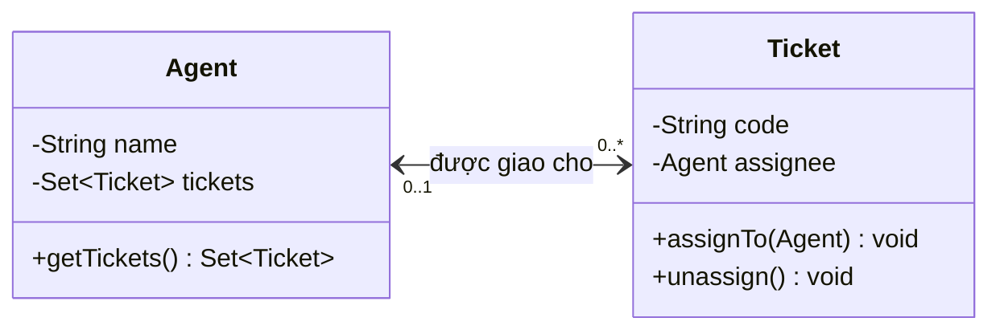
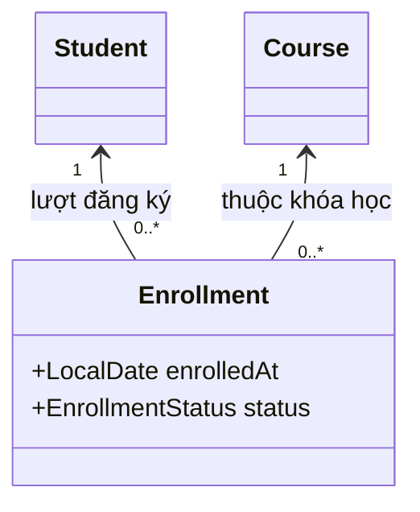

# Links between objects in OOP (Association)

## 1. What is a link between objects?

In object-oriented programming, a **link** is a concrete relationship between **existing objects** in a program. At the class-design level, this kind of relationship is commonly called an **association**.

For example, in a customer support system:

- A `Ticket` can be assigned to an `Agent` (support representative).
- An `Agent` can be assigned multiple `Ticket` objects.
- A ticket may exist without an assignee, and an agent may exist without any tickets.

If ticket `SUP-42` is currently assigned to Lan, that is a **specific link at runtime**. Reassigning the ticket to Minh changes the link without recreating the class or either object.

Distinguish two levels:

| Level | Question | Example |
|---|---|---|
| **Relationship between classes** | How *can* instances of the two classes relate? | `Ticket` may reference `Agent`. |
| **Link between objects** | *Which particular objects* are currently related? | Ticket `SUP-42` is assigned to the Lan object. |

Java commonly represents links through **object references** stored in fields, `List`/`Set` elements, or structures that manage relationships. Two variables referring to the same object **do not create two objects**.

## 2. Reading an association: navigability and multiplicity

An **association** answers "who is related to whom?" Two additional properties to define are **navigability** and **multiplicity**.

- **Unidirectional:** `Ticket` holds `Agent assignee`, but `Agent` does not store a list of tickets. A repository can be queried to find Lan's tickets.
- **Bidirectional:** In addition to `Ticket.assignee`, `Agent` holds a `Set<Ticket>`. Both directions must be synchronized when assigning, reassigning, or unassigning a ticket.

| Multiplicity | Meaning in the support model |
|---|---|
| `0..1` near `Agent` | A ticket may have no assignee or one agent |
| `0..*` near `Ticket` | An agent may handle zero or more tickets |

The multiplicity **written near an endpoint counts how many objects at that endpoint can relate to one object at the opposite end**. Other constraints such as `1`, `1..*`, `m..n`, and ways to implement 1–1/1–N/N–N are covered in **Multiplicity: one-to-one, one-to-many, and many-to-many**.



The diagram and bidirectional example below are consistent: `Ticket` can find its assignee, while `Agent` can find its assigned tickets. **Bidirectionality does not imply lifecycle ownership**: unassigning a ticket from Lan does not make the Lan object disappear.

## 3. Runnable Java example: a mutable bidirectional association

Create a file named `AssociationDemo.java`:

```java
import java.util.Collections;
import java.util.LinkedHashSet;
import java.util.Objects;
import java.util.Set;

public class AssociationDemo {

    static final class Agent {
        private final String name;
        private final Set<Ticket> tickets = new LinkedHashSet<>();

        Agent(String name) {
            this.name = Objects.requireNonNull(name, "name");
            if (name.isBlank()) {
                throw new IllegalArgumentException("name must not be blank");
            }
        }

        String getName() {
            return name;
        }

        // Trả về bản sao chỉ đọc để bên ngoài không phá quan hệ.
        Set<Ticket> getTickets() {
            return Collections.unmodifiableSet(
                    new LinkedHashSet<>(tickets));
        }
    }

    static final class Ticket {
        private final String code;
        private Agent assignee; // null: chưa có người phụ trách

        Ticket(String code) {
            this.code = Objects.requireNonNull(code, "code");
            if (code.isBlank()) {
                throw new IllegalArgumentException("code must not be blank");
            }
        }

        String getCode() {
            return code;
        }

        Agent getAssignee() {
            return assignee;
        }

        void assignTo(Agent next) {
            changeAssignee(Objects.requireNonNull(next, "next"));
        }

        void unassign() {
            changeAssignee(null);
        }

        private void changeAssignee(Agent next) {
            if (assignee == next) {
                return; // Giao lại cùng người: không làm gì.
            }

            Agent previous = assignee;
            if (previous != null) {
                previous.tickets.remove(this);
            }

            assignee = next;

            if (next != null) {
                next.tickets.add(this);
            }
        }
    }

    public static void main(String[] args) {
        Agent lan = new Agent("Lan");
        Agent minh = new Agent("Minh");
        Ticket ticket = new Ticket("SUP-42");

        ticket.assignTo(lan);
        System.out.println(ticket.getAssignee().getName()); // Lan
        System.out.println(lan.getTickets().contains(ticket)); // true

        ticket.assignTo(minh);
        System.out.println(lan.getTickets().contains(ticket)); // false
        System.out.println(minh.getTickets().contains(ticket)); // true

        ticket.unassign();
        System.out.println(ticket.getAssignee() == null); // true
        System.out.println(minh.getTickets().isEmpty()); // true
    }
}
```

Run with JDK 11 or later:

```bash
javac AssociationDemo.java
java AssociationDemo
```

Output:

```text
Lan
true
false
true
true
true
```

The key is `changeAssignee()`: when changing the assignee, we **remove the ticket from the previous agent's set**, update the reference, and then **add it to the new agent's set**. This preserves the rule:

```text
agent.getTickets().contains(ticket)
    == (ticket.getAssignee() == agent)
```

The example nests the two classes inside `AssociationDemo` so that the code fits in one file and the collections remain `private`. In a real project, they can be placed in separate files, with relationship updates coordinated through an internal API or domain service. External callers should not be allowed to call `getTickets().add(...)` to change only one side.

**Identity note:** The example stores `Ticket` objects in a `Set` using object identity because `Ticket` does not override `equals()/hashCode()`. If identity must be based on the ticket code, that code must remain stable and the equality/hash rules must be consistent; changing a property used for hashing after an object has been inserted into a `HashSet`/`LinkedHashSet` can break lookup and removal.

## 4. Unidirectional association: when is one reference enough?

If the only requirement is to "see who is assigned to a ticket," we can remove `Set<Ticket>` from `Agent`. Then:

```java
final class Agent {
    private final String name;
    Agent(String name) { this.name = name; }
    String getName() { return name; }
}

final class Ticket {
    private Agent assignee;

    void assignTo(Agent agent) {
        assignee = Objects.requireNonNull(agent);
    }

    Agent getAssignee() {
        return assignee;
    }
}
```

This version is simpler, but we cannot call `agent.getTickets()` directly. To find all of Lan's tickets, the application must scan its tickets or query a repository or database.

Choose a **unidirectional** association when reverse navigation is unnecessary; choose a **bidirectional** association when the business needs both directions and there is a clear owner for synchronization. "There is a business relationship" does not mean "both classes must have reference fields pointing to each other."

## 5. When links involve multiple objects or have their own data

- **One-to-one:** An `Employee` may have at most one `AccessCard` and vice versa, if policy requires it.
- **One-to-many:** An `Agent` can handle many `Ticket` objects, but each ticket has at most one assignee.
- **Many-to-many:** A `Student` takes many `Course` objects; a `Course` has many students.

When **the relationship itself** has an enrollment date, status, grade, or permissions, consider an intermediate `Enrollment(student, course, enrolledAt, status)` object instead of two separate `Set` collections. Each `Enrollment` connects exactly one `Student` and one `Course` while holding the data for that enrollment.



Do not infer multiplicity merely from the presence of a `List` or `Set`: define **both ends** and enforce limits through the API/database when necessary. The multiplicity lesson builds a runnable registry and checks for duplicate enrollments.

## 6. Distinguishing commonly confused relationships

| Concept | Diagnostic question | Example |
|---|---|---|
| **Association** | Does object A know object B or maintain an ongoing relationship with it? | A Ticket is assigned to an Agent. |
| **Dependency** | Does A use B only temporarily, for example as a method parameter? | `ReportService.export(Formatter formatter)`. |
| **Aggregation** | Does one object group other objects that can still exist independently? | A support team contains employees. |
| **Composition** | Is a part owned exclusively by a whole, with a tightly coupled lifecycle? | An order owns its order lines in the domain model. |
| **Inheritance** | Is B truly a kind of A (`is-a`)? | `EmailTicket extends Ticket`. |

Aggregation and composition model whole–part relationships; **a reference field or collection alone does not establish ownership and lifecycle rules**. Those are business rules that must be designed, enforced, and tested.

Do not use inheritance merely because one object "has" another: `Ticket extends Agent` is conceptually wrong because a ticket **is assigned to** an agent; it **is not** an agent.

## 7. Common association-design mistakes

**Updating only one side.** If you change `ticket.assignee` without updating `agent.tickets`, the two directions disagree. Use one controlled entry point for relationship updates.

**Returning a directly mutable collection.** If `getTickets()` exposes the internal `Set`, callers can break invariants by calling `clear()`. Use a read-only copy, a controlled add/remove API, or a unidirectional association.

**Leaving `null` and multiplicity undefined.** `0..1` allows no assignee; `1` requires rejecting missing values or ensuring an assignment is made before the object is considered valid.

**Maintaining both directions unnecessarily.** This increases memory usage, coupling between classes, and the number of places requiring updates. Start with actual queries and operations.

**Confusing an object in RAM with a database row.** Java references represent in-memory relationships; foreign keys represent relationships in a database. ORM tools (such as JPA) have their own loading, owning-side, cascade, and transaction rules. Do not assume that "both Java fields exist" means the two database sides synchronize automatically.

**Ignoring concurrency.** The example illustrates invariants in one thread. If several threads assign the same ticket concurrently, appropriate synchronization/transaction design is necessary; the `remove → assign → add` steps are not automatically atomic in a multithreaded environment.

## 8. Check your understanding

1. If `Ticket` has only `assignee` and `Agent` has no `tickets`, does the "ticket assigned to agent" relationship still exist? **Yes**: it is a unidirectional association.
2. When reassigning a ticket from Lan to Minh in the bidirectional example, what must change? **Remove it from Lan's set, change `assignee`, and add it to Minh's set.**
3. Does a ticket without an assignee violate `0..1`? **No**: zero is permitted.
4. When should you introduce `Enrollment` instead of two `Set` collections? **When each enrollment has its own properties, behavior, or rules**, such as a date, status, or grade.
5. Does declaring `private Agent assignee;` prove that `Agent` owns the lifecycle of `Ticket`? **No**: it is only a reference; lifecycle ownership is a separate modeling decision.

**Remember:** Association describes *who relates to whom*; multiplicity specifies *how many*; navigability specifies *which direction you can traverse*. In Java, encapsulate the creation, modification, and removal of links to ensure those rules always hold.
