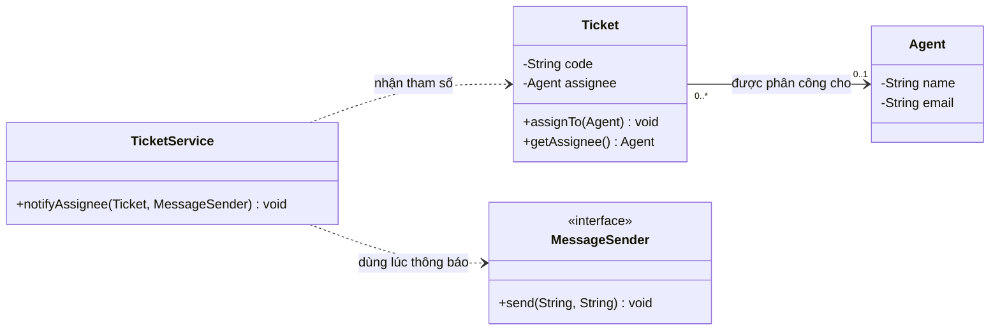

# Temporary dependencies and long-lived associations in OOP

## 1. Two different ways one object can "use" another

Consider a support-ticket management system:

- A ticket **is assigned to** a support agent. The system needs to remember the assignee for later queries, reassignments, and status displays.
- When sending an assignment notification, the system **uses** a message sender during that send operation. Once the notification is sent, the processing object does not necessarily retain the sender.

Both involve one object using another, but their **design implications differ**:

- A **temporary dependency** (in this example, a *method-level dependency*) arises when one class needs another to perform an operation, such as receiving a parameter, creating a local variable, or calling a static method. The user object need not retain that reference as long-lived state.
- A **long-lived association** models a relationship between objects, often represented by a reference or collection stored in a field. The link can be accessed at different points during an object's lifetime until it is changed or removed.

**"Temporary" and "long-lived" describe how an object uses or stores a relationship; they do not mean the referenced object must be created anew or destroyed when a method returns.** A message sender passed as a parameter could be an application-wide singleton; an association held in a field might change after only one second.

## 2. Recognizing them in UML and Java code

| Criterion | Temporary dependency | Long-lived association |
|---|---|---|
| Main question | "What does class A need B to **do**?" | "Which object B is object A **currently related to**?" |
| Common Java indicators | Method parameters, local variables, static method calls | Reference fields, collections of objects, link-management structures |
| When the reference is needed | While executing the relevant operation | Across multiple operations while the relationship remains in effect |
| UML | **Dashed arrow** from the using class to the used class | **Solid line**, optionally with multiplicities and navigability |
| Example | `TicketService` calls `MessageSender.send(...)` | `Ticket` holds `Agent assignee` |
| Typical consequence | Changing a parameter or implementation may change processing behavior | Changing the link changes business state |
| What must be designed | Inputs, API contract, call-time errors | Multiplicity, replacement/removal, consistency, business lifecycle |



Reading the diagram:

1. The **solid line** from `Ticket` to `Agent`: a ticket may retain a reference to its assignee; each ticket has `0..1` agents, and each agent may handle `0..*` tickets.
2. The **dashed line** from `TicketService` to `MessageSender`: the service needs to know *how to call* the sender while executing `notifyAssignee(...)`, but does not have to store it in a field.
3. `TicketService` also depends on `Ticket` through its method signature. A dependency does not necessarily imply a stored, long-lived association.

## 3. Runnable Java example

Create `RelationshipDemo.java` with the following contents (Java 11+):

```java
import java.util.Objects;

public class RelationshipDemo {

    // Đối tượng nghiệp vụ độc lập: một nhân viên có thể phụ trách nhiều ticket.
    static final class Agent {
        private final String name;
        private final String email;

        Agent(String name, String email) {
            this.name = Objects.requireNonNull(name, "name");
            this.email = Objects.requireNonNull(email, "email");
        }

        String getName() {
            return name;
        }

        String getEmail() {
            return email;
        }
    }

    static final class Ticket {
        private final String code;
        private Agent assignee; // Association: giữ tham chiếu sau khi assignTo() kết thúc.

        Ticket(String code) {
            this.code = Objects.requireNonNull(code, "code");
        }

        String getCode() {
            return code;
        }

        Agent getAssignee() {
            return assignee;
        }

        void assignTo(Agent agent) {
            assignee = Objects.requireNonNull(agent, "agent");
        }

        void unassign() {
            assignee = null;
        }
    }

    interface MessageSender {
        void send(String destination, String message);
    }

    static final class ConsoleSender implements MessageSender {
        @Override
        public void send(String destination, String message) {
            System.out.println("To: " + destination + " | " + message);
        }
    }

    static final class TicketService {
        void notifyAssignee(Ticket ticket, MessageSender sender) {
            Objects.requireNonNull(ticket, "ticket");
            Objects.requireNonNull(sender, "sender");

            Agent assignee = ticket.getAssignee();
            if (assignee == null) {
                throw new IllegalStateException("Ticket has no assignee");
            }

            // Dependency tạm thời: chỉ dùng sender trong lời gọi hiện tại.
            sender.send(
                    assignee.getEmail(),
                    "Bạn được giao ticket " + ticket.getCode()
            );
            // Service không lưu sender hoặc ticket vào field.
        }
    }

    public static void main(String[] args) {
        Agent lan = new Agent("Lan", "lan@example.test");
        Agent minh = new Agent("Minh", "minh@example.test");
        Ticket ticket = new Ticket("SUP-42");
        TicketService service = new TicketService();

        ticket.assignTo(lan);
        service.notifyAssignee(ticket, new ConsoleSender());

        // Liên kết Ticket -> Agent vẫn còn sau lần gửi thông báo.
        System.out.println("Phụ trách: " + ticket.getAssignee().getName());

        // Đổi liên kết nghiệp vụ; không thay code gửi thông báo.
        ticket.assignTo(minh);
        service.notifyAssignee(ticket, new ConsoleSender());

        ticket.unassign();
        System.out.println("Chưa phân công: " + (ticket.getAssignee() == null));
    }
}
```

Compile and run:

```bash
javac RelationshipDemo.java
java RelationshipDemo
```

Output:

```text
To: lan@example.test | Bạn được giao ticket SUP-42
Phụ trách: Lan
To: minh@example.test | Bạn được giao ticket SUP-42
Chưa phân công: true
```

### Analysis at each point in time

| Point in time | State of `ticket.assignee` | `sender` in `notifyAssignee` |
|---|---|---|
| Before `assignTo(lan)` | `null` | Not called yet |
| After `assignTo(lan)` | References the Lan object | Not called yet |
| During the first `notifyAssignee(...)` call | Still references Lan | Parameter holds a reference to `ConsoleSender` |
| After the first call | Still references Lan | `TicketService` does not retain a sender reference |
| After `assignTo(minh)` | References Minh | Dependency type is unaffected |
| After `unassign()` | `null` | Sender is unaffected |

Note: returning from a method **does not guarantee** that the `ConsoleSender` object is garbage-collected immediately. Other code may still hold references to it. The important point is that **`TicketService` does not store it for later calls**.

## 4. Three variations that clarify the difference

### A. Dependency through a method parameter

```java
void sendReceipt(Receipt receipt, MailGateway gateway) {
    gateway.send(receipt.email(), receipt.body());
}
```

`MailGateway` is called during one operation. The caller needs no `gateway` field. This is a straightforward method-level dependency. (The snippet assumes `Receipt` and `MailGateway` have already been declared.)

### B. An association stored as state

```java
final class ProjectTask {
    private final String code;
    private Agent owner;

    ProjectTask(String code) {
        this.code = code;
    }

    void assign(Agent newOwner) {
        owner = Objects.requireNonNull(newOwner);
    }

    Agent getOwner() {
        return owner;
    }
}
```

`ProjectTask` retains the `owner` reference after `assign(...)` returns. The owner can be accessed across different operations. This is a unidirectional object-level association.

### C. Constructor dependency injection: a design dependency with a field

```java
final class NotificationService {
    private final MessageSender sender;

    NotificationService(MessageSender sender) {
        this.sender = Objects.requireNonNull(sender);
    }

    void notify(String email) {
        sender.send(email, "Có thông báo mới");
    }
}
```

Here, `NotificationService` **depends on the `MessageSender` contract** and stores the reference injected through its constructor. Because it has a field, the reference relationship persists across method calls. In UML, depending on the diagram's level of detail, this may be shown as an association to the interface or a dependency on the abstraction.

Therefore, **do not mechanically apply "dependencies only last for one method" or "having a field means it is not a dependency."** Dependency is a broader concept: changing a class or interface definition can affect its users. Association describes a structural relationship between objects and is usually more specific.

## 5. Which representation should you choose in real designs?

Ask yourself:

1. **Will the relationship be queried after the current operation ends?** If you need to remember "who currently owns the ticket," model an association in object state or persistent storage.
2. **Is this business data or a tool for doing work?** A ticket's assignee is a business relationship; formatters, exporters, and senders are often collaborators used for operations.
3. **What does replacing the referenced object mean?** Changing `Agent` changes responsibility for the ticket; changing `MessageSender` from email to SMS mainly changes the notification channel.
4. **Who maintains the link?** A bidirectional association or a relationship with multiplicity constraints needs a consistent update mechanism. A parameter dependency does not require synchronizing two sides merely because a method uses the object.
5. **How frequent are calls, and what is the cost of passing parameters?** If most service methods need a stable collaborator, constructor injection may be more appropriate than repeatedly passing it. This is an API/DI choice, not necessarily a long-lived business relationship.

There is no rule that "long-lived associations are always better" or "short-lived dependencies always reduce coupling." Choose based on the data to retain, class responsibilities, access patterns, and testability.

## 6. Multiplicity, unlinking, and lifecycle

For the example's `Ticket -> Agent` relationship:

- `0..1` at the `Agent` end: a ticket has no assignee or exactly one.
- `0..*` at the `Ticket` end: multiple tickets may refer to the same agent.
- `assignTo(...)` changes the assignee; `unassign()` removes the link. **The Agent object is not deleted** when a ticket is unassigned.
- A Java field stores only **an object reference**, not a "copy" of the object, and does not automatically create a database constraint.

If only `Ticket` stores a field, the association is **unidirectional**. To retrieve tickets from `Agent`, query another data source or introduce reverse navigation. If both sides are stored, every assignment, reassignment, and removal must be synchronized to avoid:

```text
ticket.getAssignee() == lan
nhưng !lan.getTickets().contains(ticket)
```

Association is not the same as **composition**: a ticket referencing an agent does not make the ticket the owner of the agent's lifecycle. When a component's lifecycle belongs to a "whole," explicitly represent that ownership rule in the model and code.

## 7. Why is this distinction useful for testing and maintenance?

**Testing an operation-level dependency:** implement a fake/stub interface and pass it to the method to verify that a notification reaches the right destination without calling a real service. For example:

```java
// Minh họa bên trong phương thức kiểm thử cùng phạm vi các lớp demo.
class CapturingSender implements MessageSender {
    String destination;
    String message;

    @Override
    public void send(String destination, String message) {
        this.destination = destination;
        this.message = message;
    }
}

Ticket ticket = new Ticket("SUP-42");
ticket.assignTo(new Agent("Lan", "lan@example.test"));
CapturingSender sender = new CapturingSender();

new TicketService().notifyAssignee(ticket, sender);

if (!"lan@example.test".equals(sender.destination)) {
    throw new AssertionError("Wrong notification destination");
}
if (!sender.message.contains("SUP-42")) {
    throw new AssertionError("Missing ticket code");
}
```

**Testing an association across operations:** create a ticket, assign it to A, reassign it to B, then remove the assignment. Check `getAssignee()` after *each* step; maintaining or removing the link is business state that must be verified independently of notification success.

**Impact of design changes:** changing the `MessageSender` API may require changes to `TicketService` because of source-level dependency. Changing multiplicity or assignment rules affects the `Ticket` model, assignment API, storage, and business scenarios. These changes require different testing scopes.

## 8. Common mistakes

| Mistake | Consequence | Remedy |
|---|---|---|
| Storing every used object in a field | Redundant state and unclear relationships/lifecycles | Use parameters or locals for collaborators needed only during an operation |
| Passing a business object only as a parameter even when it must be remembered across operations | Relationship state is lost on subsequent operations | Store the link in an aggregate/domain model or repository |
| Assuming the end of a method destroys its argument object | Misunderstanding Java GC and shared references | Distinguish reference-variable scope from object lifecycle |
| Confusing a DI field with a business ownership relationship | Applying inappropriate composition/cascade rules | Separate service dependencies from domain associations |
| Storing a bidirectional association but updating only one end | Navigation in the two directions yields inconsistent results | Encapsulate assignment, reassignment, and unlinking |
| Treating dependency as identical to unidirectional UML association | Ambiguous diagrams missing multiplicity and state | Use dashed lines for usage dependencies and solid lines for modeled associations |

### Practice exercises

Design an invoice-export feature involving `Invoice`, `Customer`, and `PdfExporter`.

1. Each invoice belongs to one customer, whose information must be retrieved during later views. Which relationship is this? **Association** between `Invoice` and `Customer`.
2. On clicking Export PDF, a method receives `PdfExporter` to build the file but does not retain it. Which relationship is this? **Method-level dependency**.
3. What if `InvoiceService` receives `PdfExporter` in its constructor and stores it for repeated use? The service **depends on the exporter abstraction** while also keeping **a structural reference longer than one call**.
4. Does replacing the PDF exporter change the invoice's customer? **No**: these relationships serve different responsibilities.
5. Does removing the invoice–customer link imply deleting the customer object? **No**: association alone does not determine ownership or lifecycle.

**The essential distinction:** dependency answers "**who is needed to perform this operation?**" while association answers "**who is related as part of the model or state?**" In Java, examine where references are stored, their business purpose, and how long relationships must remain accessible; do not draw conclusions solely from an object's lifetime or the appearance of a type in source code.
