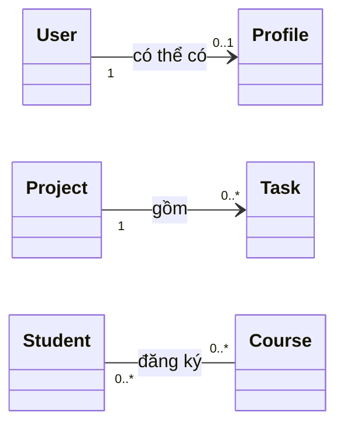
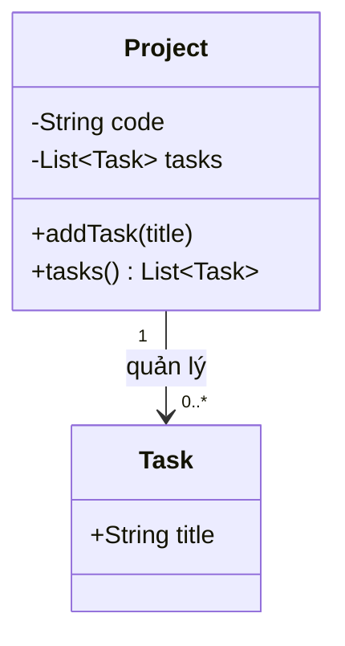
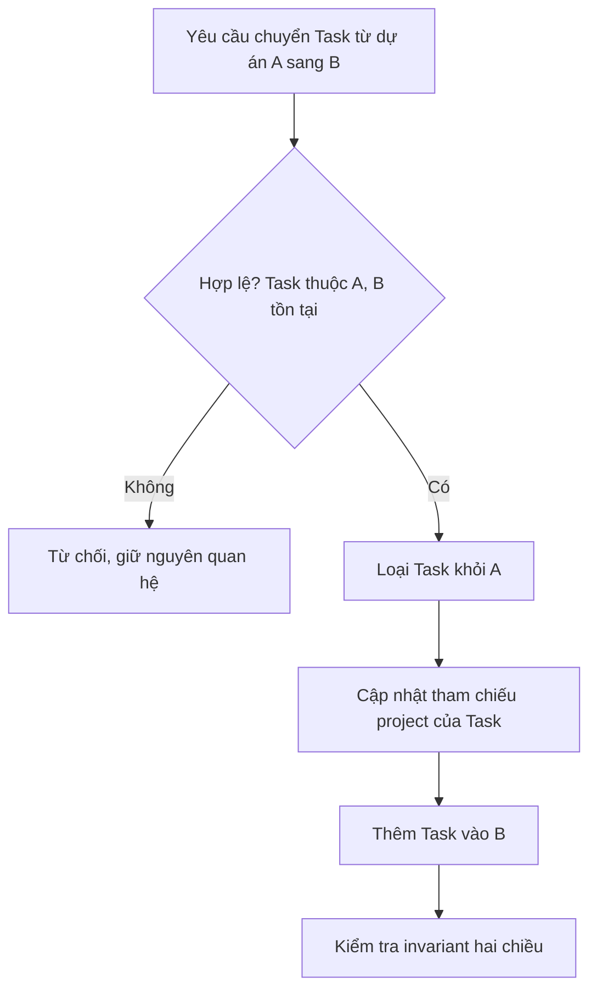
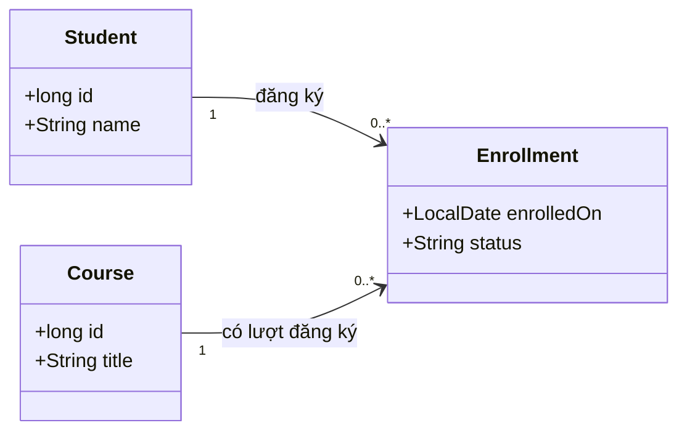

# Multiplicity in OOP relationships: one-to-one, one-to-many, and many-to-many

**Scope:** Relationships between objects in object-oriented programming (OOP), expressing their cardinalities using UML (*multiplicity/cardinality*), and implementing and maintaining business rules in Java.

A relationship such as "students take courses" is not enough to design classes. You must also ask: **how many courses may each student take, and how many students may take each course?** The cardinality at both ends determines data structures, update APIs, consistency safeguards, and sometimes persistence design.

## 1. Reading relationship multiplicity correctly

In UML, multiplicity appears **at the end near the class whose instances it counts**. For example, `Department "1" -- "0..*" Employee` means:

- A `Department` may be linked to **zero or more** `Employee` objects.
- Each `Employee` is linked to **exactly one** `Department` in this model.

| UML notation | Meaning | Example |
| --- | --- | --- |
| `1` | Exactly one | Each warranty record belongs to exactly one product in the chosen system |
| `0..1` | Zero or one | A user may not yet have created an extended profile |
| `0..*` (or `*`) | Zero or many | A new project may have no tasks |
| `1..*` | At least one | A team must have at least one member |
| `2..5` | From two to five | A table reservation covers 2–5 people under the application's booking rules |

`1`, `0..1`, and `0..*` are **cardinality constraints** in the model, not Java data types. A single field (`User owner`) or collection (`List<Task>`) is just an implementation choice; neither automatically enforces those constraints.

### Three familiar relationship types



| Type | From A's perspective | From B's perspective | Practical example |
| --- | --- | --- | --- |
| One-to-one (1–1) | Each A has at most/exactly one B, depending on the constraint | Each B has at most/exactly one A | An account has one profile issued by the system |
| One-to-many (1–N) | One A has many B objects | Each B belongs to one A within the model | A project has many tasks |
| Many-to-many (N–N) | One A relates to many B objects | One B relates to many A objects | Students enroll in multiple courses, each taken by many students |

**Note:** 1–1 does not always require `1` at both ends. `1`–`0..1` is often described as a one-to-one relationship that is *optional* at one end. Similarly, 1–N may mean `1`–`0..*` or `1`–`1..*`, depending on business rules.

## 2. One-to-one: exactly one or at most one?

For example, every `User` always has a `Profile` created at the same time. The intended relationship is `User (1) -> Profile (1)`. A reference variable conveniently represents one end:

```java
final class User {
    private final Profile profile;

    User(String displayName) {
        this.profile = new Profile(displayName);
    }

    Profile profile() {
        return profile;
    }
}

record Profile(String displayName) { }
```

Here, the `User` constructor always creates a `Profile`; after successful construction, `profile` cannot be reassigned. If the constructor instead accepts an external `Profile`, it must check for `null` and establish whether that `Profile` may be shared.

A `Profile profile` reference variable **does not guarantee system-wide uniqueness**. For example:

```java
Profile shared = new Profile("An");
// Hai object khác nhau vẫn có thể trỏ tới cùng shared
// nếu API cho phép truyền shared vào constructor.
```

If the rule is "each profile belongs to only one person," enforce it through APIs/domain services, a registry, or uniqueness constraints in storage. `private` and `final` only restrict access and reassignment at a particular location; they do not establish a global one-to-one rule.

**Optional `0..1` variation:** an account may not yet have a completed profile. You can allow `Profile profile` to be `null` under a clear contract, or use `Optional<Profile>` as the getter's **return type**. Do not mistake `Optional` for a uniqueness guarantee across all `User` objects.

## 3. One-to-many: a parent object and a collection of children

A `Project` has many `Task` objects; each `Task` belongs to exactly one project (under the example's rules).



A common representation on the one side:

```java
private final List<Task> tasks = new ArrayList<>();
```

For a one-to-many relationship, you need to address **two sets of rules**:

1. **Cardinality:** may a project have 0 tasks, or must it have at least 1? Is there a maximum?
2. **Integrity:** may tasks move between projects, who may add/delete them, and do tasks with identical contents count as two separate tasks?

If `getTasks()` returns a mutable internal list, callers can use `clear()` or `add()` to bypass business constraints. Prefer explicit operations on the managing object, such as `addTask`, `removeTask`, and `moveTask`, with only read-only lists or snapshots exposed.

| Structure | Suitable when | Watch out for |
| --- | --- | --- |
| `List<Task>` | Order matters and elements may duplicate according to `equals` | Check for duplicate IDs if required |
| `Set<Task>` | Duplicates should be excluded according to `equals/hashCode` | Define stable equality |
| `Map<TaskId, Task>` | Fast lookups and uniqueness by ID are needed | Keep keys consistent with object IDs |

**Bidirectional relationship:** if `Task` also has `Project project`, each task move must update **all of** `oldProject.tasks`, `newProject.tasks`, and `task.project` as one valid operation. Avoid allowing arbitrary callers to invoke a setter on just one side, which can produce "task points to A but appears only in B's list."



In transactional/database-backed applications, the entire update should be enclosed in an appropriate transaction to avoid partial state after a failure.

## 4. Many-to-many: choose the representation deliberately

For example, a `Student` may take many `Course` objects, and a `Course` may have many `Student` objects.

A straightforward in-memory representation uses two sets:

```java
class Student {
    Set<Course> courses = new HashSet<>();
}
class Course {
    Set<Student> students = new HashSet<>();
}
```

However, this sketch is not safe yet: who is authorized to update it? Adding to `student.courses` without updating `course.students` leaves the sides inconsistent; if `HashSet` is used, `equals/hashCode` must also remain stable. These fields also have default access and no business validation.

### Using an intermediate object when the relationship has its own data

Course enrollment often has `enrolledOn`, `status`, `grade`, and other properties. These are **attributes of the enrollment**, not of the student or course independently. Introduce `Enrollment` to give the relationship explicit identity and rules:



Each `Enrollment` is associated with exactly one `Student` and exactly one `Course`. The original N–N relationship is thus represented by **two 1–N relationships** involving the intermediate object.

Benefits include preventing duplicate enrollment for the `(studentId, courseId)` pair and storing enrollment dates, pending/confirmed status, grades, business history, or course-specific conditions.

In a relational database, the `enrollment` table typically has `student_id` and `course_id` foreign keys and a unique constraint on the pair if duplicate enrollment is forbidden. With JPA/Hibernate, `@ManyToMany` may be used for a pure link, but an `Enrollment` entity is usually clearer and easier to extend when the relationship has its own data. Annotations do not replace explicit rules for updating both sides or enforcing uniqueness.

## 5. Complete Java example of all three types

Place the following code in `MultiplicityDemo.java` (Java 17 or later). The example deliberately manages the many-to-many relationship in one registry; `Student` and `Course` do not each need separate lists that could become inconsistent.

```java
import java.time.LocalDate;
import java.util.ArrayList;
import java.util.LinkedHashMap;
import java.util.List;
import java.util.Map;
import java.util.Objects;

public class MultiplicityDemo {

    // 1–1 bắt buộc: mỗi User tạo đúng một Profile.
    static final class User {
        private final String email;
        private final Profile profile;

        User(String email, String displayName) {
            this.email = nonBlank(email, "email");
            this.profile = new Profile(nonBlank(displayName, "displayName"));
        }

        Profile profile() {
            return profile;
        }
    }

    record Profile(String displayName) { }

    // 1–N: mỗi Project quản lý từ 0 đến nhiều Task.
    static final class Project {
        private final String code;
        private final List<Task> tasks = new ArrayList<>();

        Project(String code) {
            this.code = nonBlank(code, "code");
        }

        void addTask(String title) {
            tasks.add(new Task(nonBlank(title, "title")));
        }

        List<Task> tasks() {
            return List.copyOf(tasks); // snapshot không thể chỉnh danh sách
        }
    }

    record Task(String title) { }

    record Student(long id, String name) {
        Student {
            if (id <= 0) throw new IllegalArgumentException("student id");
            name = nonBlank(name, "student name");
        }
    }

    record Course(long id, String title) {
        Course {
            if (id <= 0) throw new IllegalArgumentException("course id");
            title = nonBlank(title, "course title");
        }
    }

    // Khóa liên kết: cùng sinh viên + cùng khóa học => cùng một đăng ký.
    record EnrollmentKey(long studentId, long courseId) { }

    record Enrollment(Student student, Course course, LocalDate enrolledOn) {
        Enrollment {
            Objects.requireNonNull(student, "student");
            Objects.requireNonNull(course, "course");
            Objects.requireNonNull(enrolledOn, "enrolledOn");
        }
    }

    static final class EnrollmentRegistry {
        private final Map<EnrollmentKey, Enrollment> byPair =
                new LinkedHashMap<>();

        boolean enroll(Student student, Course course, LocalDate day) {
            Objects.requireNonNull(student, "student");
            Objects.requireNonNull(course, "course");
            Objects.requireNonNull(day, "day");

            EnrollmentKey key = new EnrollmentKey(student.id(), course.id());
            if (byPair.containsKey(key)) return false;

            byPair.put(key, new Enrollment(student, course, day));
            return true;
        }

        List<Enrollment> forStudent(Student student) {
            Objects.requireNonNull(student, "student");
            return byPair.values().stream()
                    .filter(e -> e.student().id() == student.id())
                    .toList();
        }

        int count() {
            return byPair.size();
        }
    }

    private static String nonBlank(String text, String field) {
        if (text == null || text.isBlank()) {
            throw new IllegalArgumentException(field + " must not be blank");
        }
        return text;
    }

    public static void main(String[] args) {
        User user = new User("an@example.com", "An");
        System.out.println(user.profile().displayName());

        Project project = new Project("P-01");
        project.addTask("Phan tich");
        project.addTask("Kiem thu");
        System.out.println(project.tasks().size());

        Student an = new Student(1, "An");
        Student binh = new Student(2, "Binh");
        Course java = new Course(10, "Java OOP");
        Course sql = new Course(11, "SQL");

        EnrollmentRegistry registry = new EnrollmentRegistry();
        System.out.println(registry.enroll(an, java, LocalDate.of(2026, 10, 1)));
        System.out.println(registry.enroll(an, java, LocalDate.of(2026, 10, 2)));
        registry.enroll(an, sql, LocalDate.of(2026, 10, 3));
        registry.enroll(binh, java, LocalDate.of(2026, 10, 3));

        System.out.println(registry.forStudent(an).size());
        System.out.println(registry.count());
    }
}
```

Run:

```bash
javac MultiplicityDemo.java
java MultiplicityDemo
```

Expected output:

```text
An
2
true
false
2
3
```

Explanation:

- `User` creates a `Profile` in its constructor. This implements a mandatory 1–1 relationship within the example's instances.
- `Project` has two `Task` objects; `List.copyOf` prevents callers from modifying the list through the getter. Because `Task` is a record with immutable `String` components, callers cannot directly modify the elements either.
- `EnrollmentRegistry` stores one link per ID pair. Repeating enrollment `(1, 10)` returns `false` and creates no new record.
- One student has 2 enrollments; the registry has 3 in total. Two students take the same `java` course, illustrating N–N.

**Demo limitations:** `EnrollmentRegistry` runs in memory, assumes student/course identifiers are unique, does not verify their existence in storage, and **is not thread-safe**. In a system handling concurrent requests, transactions and database uniqueness constraints are needed; checking `containsKey` and then calling `put` is not inherently atomic.

## 6. Multiplicity is not the same as ownership

Distinguish two independent questions:

- **Multiplicity:** **how many** objects may occur at each end?
- **Relationship type/lifecycle:** under what rules does one object **reference, share, manage, or own** the other?

For example, `Project 1 -- 0..* Task` could be modeled as an association in which tasks survive project reassignment, or as composition if tasks only make sense within a project's lifecycle. Both are 1–N, but deletion, transfer, and ownership behavior differ.

**Navigability** is also independent of multiplicity: `Project` may know its `Task` list, `Task` may know its `Project`, both may know each other, or a registry/query service may resolve the relationship. Having reference fields in both classes does not turn a 1–N relationship into N–N.

## 7. Invariants to maintain for each type

| Type | Important invariant | Where to enforce it |
| --- | --- | --- |
| Mandatory 1–1 | A has exactly one B, and B does not belong to two A objects if forbidden | Constructor/factory; domain checks; storage uniqueness |
| Optional 1–1 | A has at most one B; it may have none | Assignment/removal methods, uniqueness constraints, explicit nullability |
| 1–N | A child belongs to exactly one owner and never appears in two collections against the rules | Centralized add/move/remove operations |
| N–N | An A–B pair is valid and not duplicated if required | Association object/registry; unique composite key |
| All types | No orphaned, inconsistent, or bypassable links | Encapsulation, validation, transactions, tests |

Common mistakes include:

1. **Assuming `List` means many-to-many.** A `List` represents multiple objects at one end; whether the relationship is 1–N or N–N depends on the other end too.
2. **Assuming `@OneToOne` or a single field is enough.** Uniqueness and non-null constraints also depend on the model, API, and storage configuration.
3. **Omitting an intermediate object when the relationship has attributes.** `Enrollment.grade` is not a grade shared by every course or every student.
4. **Partially updating a bidirectional relationship.** Adding to only one collection makes in-memory data inconsistent.
5. **Exposing an internal mutable collection.** Callers may bypass minimum/maximum counts, uniqueness, or reverse-link rules.
6. **Using `Set` when `equals/hashCode` depends on mutable fields.** Changing such a field while the object is in a hash collection can break lookup and removal.
7. **Ignoring concurrency.** Two requests may both check that "no link exists" and then both write; suitable uniqueness constraints/transactions are required.

## 8. Application exercises

**Exercise A — Identify multiplicity.** Draw UML for these requirements:

- A customer may have zero or more delivery addresses; each address belongs to exactly one customer in the model.
- An employee may be issued zero or one access card; each card is assigned to exactly one employee.
- An author writes multiple books, and a book may have multiple authors.

**Exercise B — Implement bounded 1–N.** A `Team` has **1 to 5** members; duplicate member IDs are forbidden. Design `addMember`/`removeMember`. A team must initially have at least one member; removing the final member must either be rejected or dissolve the team according to business rules.

**Exercise C — Extend N–N.** Add `status` (`PENDING`, `ACTIVE`, `CANCELLED`) and `grade` to `Enrollment`. Decide whether re-enrolling in a cancelled course should *update the previous record* or *create a new enrollment*, then choose suitable keys/uniqueness constraints. The correct choice depends on history-retention rules.

**Exercise D — Code review.** Suppose `Course` contains `List<Student>` but `Student` stores no course list. Explain why the relationship **can still** be N–N; propose querying "courses taken by student X" through a repository/registry without maintaining two collections.

### Final design self-check

For each relationship, state two things: "**how many B objects can one A have?**" and "**how many A objects can one B have?**" Specify whether `0` is allowed, uniqueness requirements, how links are created/removed/moved, and where invariants are enforced. Only then choose a single field, `List`, `Set`, `Map`, or association class.
