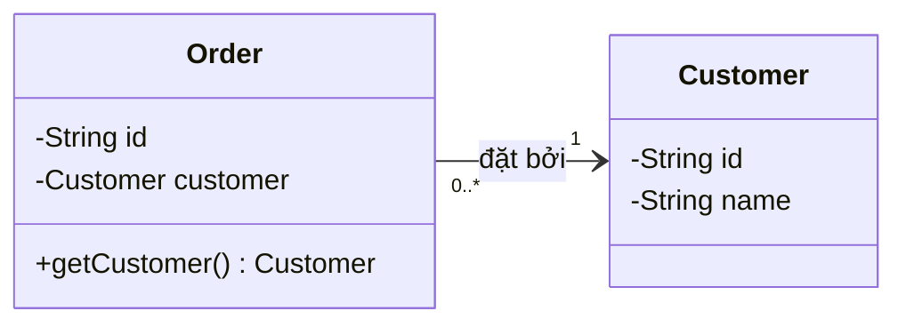
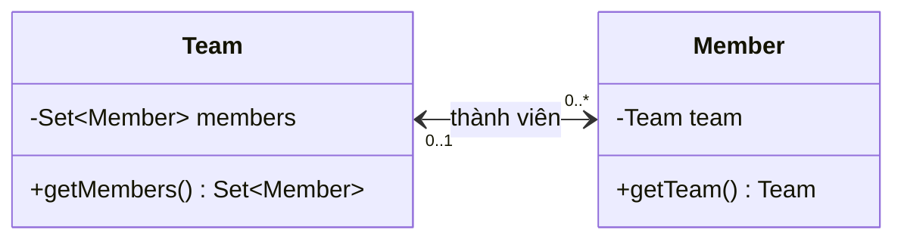
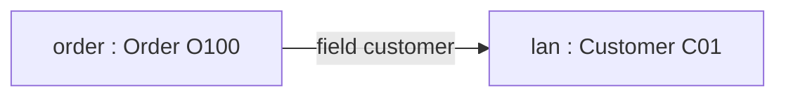
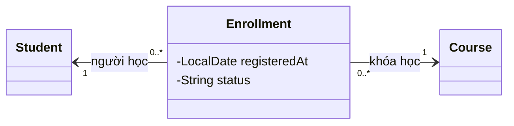
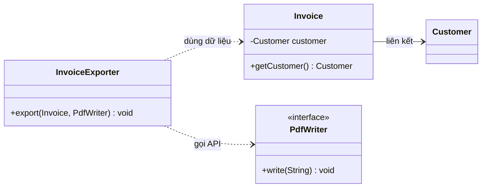

# Association direction and navigability in OOP

## 1. What is association direction?

In object-oriented modeling, an **association** describes a relationship between objects. **Navigability** indicates whether an object can **follow the relationship to reach an object at the other end**.

For example, consider a sales management system:

- From an order, we need to find the customer who placed it to display their name and delivery address.
- From a customer, we *may* need to list all of their orders.
- These two access requirements **are different**: implementing `Order → Customer` does not automatically provide `Customer → Order`.

Distinguish three concepts:

| Concept | Design question | Example |
|---|---|---|
| **Association** | What business relationship exists between the object types? | An order belongs to a customer. |
| **Navigability** | From object A, can we directly access object B through the relationship? | `order.getCustomer()`. |
| **Multiplicity** | How many objects on the other side can one object be related to? | An order has exactly one customer; a customer has many orders. |

**Association direction is not the direction of data flow, control flow, or object creation.** A customer may be created before an order, even if navigation is only possible from `Order` to `Customer`.

## 2. Reading UML notation

### Unidirectional association



Read the diagram as follows:

- A **solid line with an arrow `Order → Customer`**: from an order object, the customer object can be accessed.
- `1` near `Customer`: **each order is associated with exactly one customer**.
- `0..*` near `Order`: **each customer may have zero or more orders**.
- No `orders` field exists in `Customer`: reverse navigation is not directly available through a call on the `Customer` object. A repository or other structure may still provide the query.

**Multiplicity reading rule:** a label near *one endpoint* counts how many objects at that end can be associated with *one object at the opposite endpoint*.

### Bidirectional association



Reading the diagram:

- `Team` can locate its current `Member` objects.
- `Member` can locate the `Team` it currently belongs to.
- `0..1` next to `Team`: a member belongs to at most one team at a time.
- `0..*` next to `Member`: a team can have many members.

In UML, **an association line without arrows is not sufficient evidence that it is bidirectional**: depending on notation and diagram conventions, missing arrows may mean **navigability is unspecified**. If bidirectionality matters, explicitly model both directions or explain them in a note.

## 3. Unidirectional relationships in Java: store only the required path

Create `UnidirectionalDemo.java`:

```java
import java.util.Objects;

public class UnidirectionalDemo {

    static final class Customer {
        private final String id;
        private final String name;

        Customer(String id, String name) {
            this.id = Objects.requireNonNull(id);
            this.name = Objects.requireNonNull(name);
        }

        String getId() {
            return id;
        }

        String getName() {
            return name;
        }
    }

    static final class Order {
        private final String id;
        private final Customer customer;

        Order(String id, Customer customer) {
            this.id = Objects.requireNonNull(id);
            this.customer = Objects.requireNonNull(customer);
        }

        Customer getCustomer() {
            return customer;
        }

        String getId() {
            return id;
        }
    }

    public static void main(String[] args) {
        Customer lan = new Customer("C01", "Lan");
        Order order = new Order("O100", lan);

        // Điều hướng hợp lệ: từ Order đến Customer.
        System.out.println(order.getCustomer().getName()); // Lan
        System.out.println(order.getId());                 // O100

        // Không có lan.getOrders(): Customer không lưu chiều ngược.
    }
}
```

Run:

```bash
javac UnidirectionalDemo.java
java UnidirectionalDemo
```

Output:

```text
Lan
O100
```

What happens in memory?



`order` holds **a reference** to `lan`, not a copy of the `Customer`. In Java, a `Customer` object without an `orders` field **has no built-in reverse navigation in this design**. We can still find `Order` objects by customer through storage or by scanning a collection of orders.

**When this works well:** the application often needs to display a customer from an order; a purchase-history page can query a repository instead of loading/storing all orders inside each `Customer`.

## 4. If both directions are needed: synchronize one relationship correctly

For `Team ↔ Member`, each `Member` belongs to at most one `Team`. If `Member.team == t`, the `t.members` set must contain that member; moving teams requires **removing from the old team → changing the reference → adding to the new team**.

The Java 11+ example below uses a single update entry point and maintains both references in the same object graph. Save it as `BidirectionalNavigationDemo.java`:

```java
import java.util.LinkedHashSet;
import java.util.Set;

public class BidirectionalNavigationDemo {
    static final class Team {
        private final Set<Member> members = new LinkedHashSet<>();

        Set<Member> members() {
            return Set.copyOf(members);
        }
    }

    static final class Member {
        private Team team;

        Team team() {
            return team;
        }

        void moveTo(Team next) {
            if (team == next) return;
            if (team != null) team.members.remove(this);
            team = next;
            if (next != null) next.members.add(this);
        }
    }

    public static void main(String[] args) {
        Team first = new Team();
        Team second = new Team();
        Member member = new Member();

        member.moveTo(first);
        member.moveTo(second);

        System.out.println(first.members().isEmpty());       // true
        System.out.println(second.members().contains(member)); // true
        System.out.println(member.team() == second);          // true
    }
}
```

```bash
javac BidirectionalNavigationDemo.java
java BidirectionalNavigationDemo
```

Output: three lines containing `true`. The two nested types share an enclosing class, so Java allows them to access one another's `private` fields. `Member` is the sole update entry point; `Team.members()` returns a snapshot so callers cannot break links using external `add/remove` calls.

This is only a minimal single-threaded demonstration; it **lacks capacity validation, partial-failure handling, and concurrency locking**. The lesson **Bidirectional relationships and data consistency** extends the idea to departmental transfers with pre-update validation, full-department cases, invariant tests, and a JPA example. Do not add reverse navigation simply to "complete the diagram" when the application does not query in that direction.

## 5. Choosing one or two directions: follow actual queries

| Scenario | Direction to consider | Reason |
|---|---|---|
| Display an order's customer | `Order → Customer` | The order needs the customer; little extra state to manage |
| Display a customer's purchase history | Query a repository, or `Customer → Order` if appropriate | Not every order must be held in a customer's RAM |
| Members must know their team, and teams must list members for assignments | Bidirectional `Team ↔ Member` | Business operations frequently query both directions |
| Check a document's permissions through its owner | `Document → Owner` | The document contains enough information for the check |
| Many-to-many between learners and courses, with enrollment dates/status | Intermediate `Enrollment` object | The relationship has its own data and rules |

Use a bidirectional association when the domain genuinely needs it. However, **do not implement both directions merely because the logical relationship is symmetric**. Adding reverse fields comes at a cost: synchronization, potential reference cycles, and often tighter coupling between classes.

### Example: many-to-many and an association class

If a student enrolls in many courses and each course has many students, storing a `Set` on each side may suffice when the link is just a pair. But if an "enrollment" has `registeredAt`, `status`, or `finalGrade`, introduce `Enrollment`:



The `Enrollment` class holds information about **the association itself**. Whether Student or Course offers reverse navigation to Enrollment is still a separate decision based on fields and query design.

## 6. Two ways of providing access paths in a design

**Structural navigation in an object graph:** object A has a field referencing object B. For example, `member.getTeam()` works through `Member.team`.

**Repository-based query direction:** A does not store a B field/collection, but the application can still find B through a query. For example:

```java
interface OrderRepository {
    // Chỉ là contract minh họa, triển khai qua JDBC/JPA/...
    java.util.List<Order> findByCustomerId(String customerId);
}

// Ở service:
java.util.List<Order> orders = repository.findByCustomerId(customer.getId());
```

The above **does not automatically turn `Customer` into a bidirectional association in the object graph**; it only shows that a business operation can retrieve data in the reverse direction through another component. In practice, SQL/JPA mapping, lazy loading, and caching affect performance, but do not change what the direction means in an object diagram.

## 7. Are navigability and dependency the same thing?

No. UML distinguishes different kinds of relationships:

- **Association** (solid line): represents links between instances; navigability describes whether one end can be reached from the other.
- **Dependency** (dashed arrow): one component uses or depends on another component's definition, such as a service accepting an interface parameter.
- **Inheritance/generalization** (solid line with a hollow triangle pointing toward the parent): an "is-a" relationship, not a navigation path between two objects.

Example:



`InvoiceExporter` may use `Invoice` and `PdfWriter` in one call without retaining them as state. A dependency arrow does not imply a long-lived object link or that `PdfWriter` has reverse knowledge of the exporter.

## 8. Common navigability design mistakes

| Design mistake | Consequence | Improvement |
|---|---|---|
| Adding reverse fields without a query requirement | More state to synchronize and potential reference cycles | Use one direction plus a repository if sufficient |
| `getMembers()` returns a mutable internal collection | Callers bypass the update entry point | Return an appropriate snapshot or immutable view |
| Updating one side but not the other | `member.team` and `team.members` give different "truths" | One method coordinates the link |
| Two setters call each other unconditionally | Infinite recursion, possibly `StackOverflowError` | One side coordinates; internal helpers do not call back |
| Directly serializing `Team → Member → Team` | Cyclic object graphs may cause deeply recursive JSON | Use DTOs containing only the necessary data |
| Inferring ownership from a UML arrow | Mistakenly assuming changing a link deletes the other object | Separate navigability from lifecycle/cascade |
| Assuming JPA `mappedBy` automatically updates both Java sides | The two sides remain inconsistent until reloading | Synchronize the object graph; understand the owning side and transactions |

**Note:** a reference cycle between two objects does not itself cause a JVM memory leak; GC uses reachability from GC roots. However, retaining large collections and concurrently updating both directions still calls for suitable storage, locking, or transaction mechanisms. The next lesson shows concrete techniques for preserving invariants when operations may fail.

## 9. Design-check exercises

**Exercise 1.** Each warranty record belongs to one product. The system only opens records and views products, while the record list is queried from the database. Which navigation direction should be used?

**Hint:** `Warranty → Product` is sufficient in the object graph; the record list can be retrieved via a repository query using the product code.

**Exercise 2.** A library manages many books, and the application frequently asks "which library currently holds this book?" and "which books does this library currently manage?" Choose direction and multiplicity if books may be unassigned to any library.

**Hint:** `Library ↔ Book`: beside `Library`, put `0..1`; beside `Book`, put `0..*`. Moving a book from A to B requires removing it from A, updating its reference, and adding it to B.

**Exercise 3.** Identify the bug:

```java
// Giả sử Team có tập members, Member có field team.
member.setTeam(teamA);
teamB.getMembers().add(member);
```

**Hint:** the two sides are inconsistent, and unrestricted mutation APIs make the problem easier to introduce. Replace them with a controlled relationship operation that updates both sides correctly.

**Exercise 4.** Why can you call `findOrdersByCustomerId(id)` while still describing the `Order → Customer` object model as unidirectional?

**Hint:** the query lives in the repository and does not create a `Customer.orders` field. Application-level data access paths are broader than direct object references.

**Exercise 5.** Is a UML association without arrows necessarily bidirectional?

**Hint:** no. If a diagram must communicate navigability precisely, specify it explicitly or agree on conventions before interpreting the diagram.

---

**Key takeaway:** *Association* answers "who is related to whom?", *multiplicity* answers "how many objects can be related at each end?", and *navigability* answers "can this object directly reach the other one?" Implement only the directions actually needed, and if both ends are stored, preserve consistency through a controlled update API.
