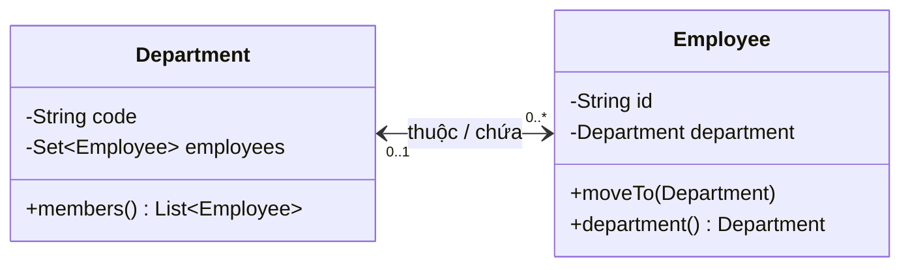
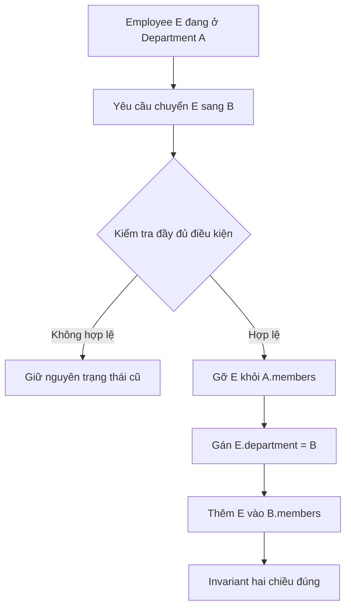
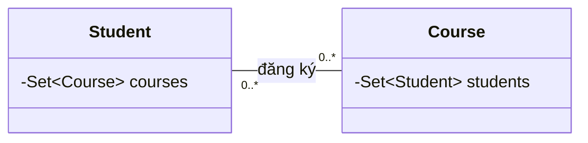

# Bidirectional relationships and data consistency in OOP (Java)

In object-oriented programming, a **bidirectional association** exists when two objects can each navigate to the object at the other end. For example, an employee knows their department, and a department knows its list of employees.

The difficult part is not adding two reference fields. It is **keeping both fields consistent with the same reality** after every link addition, removal, transfer, error, and database update.

This lesson focuses on Java implementation rules, with a standalone runnable example and practical notes about JPA/Hibernate.

## 1. Unidirectional and bidirectional relationships

Suppose each `Employee` belongs to at most one `Department`, while each `Department` may have many `Employee` objects.

**Unidirectional:** only the employee stores a `department` reference; a repository can be queried to find the department's employees. A collection in `Department` is not necessarily required.

**Bidirectional:** `Employee` stores `department` and `Department` stores an `employees` collection.



In the example, an employee may have no department (`0..1`), and a department may have no employees (`0..*`). **Multiplicity** and **navigability** are separate decisions: a 1–N relationship does not require bidirectional references.

| Design | Data stored in objects | Advantage | Cost |
| --- | --- | --- | --- |
| Unidirectional `Employee -> Department` | Each `Employee` knows one `Department` | Less duplicated state; simpler | Finding employees by department requires querying or scanning |
| Unidirectional `Department -> Employee` | The department stores an employee collection | Easy iteration over members | Cannot directly query an employee's department through a field |
| Bidirectional | Both sides store references | Fast navigation both ways in the object graph | Every update must synchronize both sides |
| IDs only, queried through a service | Object references need not be retained | Less coupling; convenient at system boundaries | Requires querying/caching and enforcing rules in the data layer |

**Do not choose bidirectionality just because it is possible:** adding a navigation path also increases the state that must be kept consistent.

## 2. Define invariants before writing code

For every `Employee e` and `Department d` within the same management scope:

```text
e.department == d   <=>   d.employees chứa đúng đối tượng e
```

This is a **bidirectional invariant**. It implies:

1. If `e.department == null`, `e` must not appear in any department's employee list.
2. If department `A` contains `e`, `e.department` must point back to `A`.
3. If an employee may belong to only one department, no other department may contain the employee simultaneously.
4. Additional constraints (capacity, active-employee status, unique employee IDs within a department, etc.) must also hold after a successful operation.

A common one-sided update mistake:

```java
// Giả sử employee đang thuộc phòng A:
employee.setDepartment(departmentB);

// Nếu A.employees vẫn chứa employee và B.employees chưa thêm,
// ba tham chiếu cùng mô tả ba trạng thái khác nhau.
```

Likewise, `departmentB.getEmployees().add(employee)` modifies only collection B, not `employee.department`. Two independent setters make it easy for callers to forget the other half.



The diagram illustrates the logical order within **one controlled operation**. If the operation can fail partway through or run concurrently, protect the entire update with suitable transactions, locks, or recovery mechanisms.

## 3. Three principles for API design

**One entry point for relationship updates.** Expose `employee.moveTo(newDepartment)`, `department.assign(employee)`, or a domain service authorized to update both ends. Do not expose multiple independent setters and expect callers to remember synchronization.

**Encapsulate collections.** `getEmployees()` should not return the internal mutable collection. Return read-only snapshots/DTOs so callers cannot perform `add/remove` operations outside validation. If the elements themselves are mutable, a collection snapshot does not make them immutable.

**Validate first, modify second.** Check that the destination department exists, has capacity, permits the transfer, and that the current bidirectional state is consistent before changing anything. If validation fails, **nothing should change**.

| Operation | Required updates | What to protect |
| --- | --- | --- |
| Assign an unassigned employee to A | Add to A; `employee.department = A` | No duplicates; capacity in A |
| Transfer from A to B | Remove from A; set B; add to B | E must not belong to both A and B |
| Unassign an employee | Remove from old department; set `null` | No stale reverse link remains |
| Reassign to the same department | Do nothing (*idempotent*) | No duplicate entry or event |
| Assignment fails because B is full | Preserve the existing link to A | Do not remove E from A before validating B |

## 4. Complete Java 17 example: consistent department transfers

The example below compiles independently without Spring or a database. Both ends are updated through **one `Employee.moveTo(...)` method**; the employee collection is not exposed for direct modification.

Create `BidirectionalAssociationDemo.java`:

```java
import java.util.LinkedHashSet;
import java.util.List;
import java.util.Objects;
import java.util.Set;

public class BidirectionalAssociationDemo {

    static final class Department {
        private final String code;
        private final int capacity;
        private final Set<Employee> employees = new LinkedHashSet<>();

        Department(String code, int capacity) {
            if (code == null || code.isBlank()) {
                throw new IllegalArgumentException("Department code is blank");
            }
            if (capacity < 1) {
                throw new IllegalArgumentException("Capacity must be positive");
            }
            this.code = code;
            this.capacity = capacity;
        }

        String code() {
            return code;
        }

        List<Employee> members() {
            // Snapshot: không trao cho caller quyền add/remove collection gốc.
            return List.copyOf(employees);
        }

        private void validateIncoming(Employee person) {
            Objects.requireNonNull(person, "person");

            if (employees.contains(person)) {
                throw new IllegalStateException("Already in target collection");
            }
            if (employees.size() >= capacity) {
                throw new IllegalStateException("Department is full: " + code);
            }

            // Đây là ví dụ domain rule: ID nhân viên không trùng trong phòng.
            for (Employee existing : employees) {
                if (existing.id().equals(person.id())) {
                    throw new IllegalArgumentException(
                            "Duplicate employee id in " + code);
                }
            }
        }
    }

    static final class Employee {
        private final String id;
        private Department department; // null = chưa thuộc phòng nào

        Employee(String id) {
            if (id == null || id.isBlank()) {
                throw new IllegalArgumentException("Employee id is blank");
            }
            this.id = id;
        }

        String id() {
            return id;
        }

        Department department() {
            return department;
        }

        void moveTo(Department destination) {
            Department source = department;

            // Lời gọi lặp lại phải vô hại.
            if (source == destination) {
                return;
            }

            // Precondition: trạng thái hiện tại phải đã đồng bộ.
            if (source != null && !source.employees.contains(this)) {
                throw new IllegalStateException(
                        "Source department is inconsistent");
            }

            // Kiểm tra trước khi thay đổi: nếu đích không hợp lệ,
            // employee vẫn còn nguyên trong source.
            if (destination != null) {
                destination.validateIncoming(this);
            }

            // Chỉ sau khi toàn bộ kiểm tra thành công mới sửa quan hệ.
            if (source != null) {
                source.employees.remove(this);
            }
            department = destination;
            if (destination != null) {
                destination.employees.add(this);
            }
        }
    }

    private static void verify(
            Department first, Department second, Employee... employees) {
        for (Employee e : employees) {
            boolean inFirst = first.employees.contains(e);
            boolean inSecond = second.employees.contains(e);
            if (inFirst && inSecond) {
                throw new AssertionError("Employee in both departments");
            }
            if (inFirst != (e.department() == first)
                    || inSecond != (e.department() == second)) {
                throw new AssertionError("Broken bidirectional invariant");
            }
        }
    }

    public static void main(String[] args) {
        Department engineering = new Department("ENG", 2);
        Department sales = new Department("SAL", 1);

        Employee an = new Employee("E-01");
        Employee binh = new Employee("E-02");
        Employee chi = new Employee("E-03");

        an.moveTo(engineering);
        binh.moveTo(engineering);

        // ENG đầy: thất bại không được làm thay đổi bên nào.
        try {
            chi.moveTo(engineering);
        } catch (IllegalStateException expected) {
            System.out.println(expected.getMessage());
        }

        an.moveTo(sales);       // gỡ khỏi ENG, thêm vào SAL
        chi.moveTo(engineering);
        an.moveTo(sales);       // gọi lặp, không nhân đôi quan hệ

        verify(engineering, sales, an, binh, chi);
        System.out.println("ENG = " + engineering.members().size());
        System.out.println("SAL = " + sales.members().size());
        System.out.println("An o " + an.department().code());

        an.moveTo(null);        // hủy phân phòng
        verify(engineering, sales, an, binh, chi);
        System.out.println("SAL sau go = " + sales.members().size());
    }
}
```

Run:

```bash
javac BidirectionalAssociationDemo.java
java BidirectionalAssociationDemo
```

Expected output:

```text
Department is full: ENG
ENG = 2
SAL = 1
An o SAL
SAL sau go = 0
```

### Why does this code preserve the invariant?

- `Employee.department` and `Department.employees` are both `private`; callers can update the relationship only through `moveTo`.
- `moveTo` returns immediately if the destination is already the current department.
- Existing-state and new-capacity checks occur **before** the three modification steps. If validation throws an exception, the original state remains unchanged.
- On success, the method removes the old reverse link, updates the forward reference, and creates the new reverse link.
- `members()` returns a collection snapshot, so external operations such as `members().clear()` cannot modify the actual collection. The `Employee` objects in the snapshot are still referenced objects, but callers have no arbitrary setter with which to break the association.
- `verify` checks consistency from both directions for employees included in the test.

**Intentional limitations:** this is a **single-threaded, in-memory** model. Two concurrent requests may both pass the capacity check and then both add employees. All participating objects must be managed within the same scope, and the operation must not be interrupted midway. For multithreading, synchronize the entire operation appropriately or move the invariant to a different transactional layer.

The example also uses **object identity** to compare employees because `Employee` does not override `equals/hashCode`. Checking for duplicate IDs within a department is an additional business rule; a real system usually needs globally unique IDs managed by a repository or database.

## 5. When a many-to-many relationship is bidirectional

With `Student` and `Course`, each student takes multiple courses and each course has multiple students. If both classes store `Set` collections referencing one another, enrollment must update **both sets**.



The idea behind a **centralized** method (illustrated with internally managed sets and stable identity rules):

```java
// Đoạn minh họa; studentCourses và courseStudents là các tập
// nội bộ được domain service sở hữu, không phải getter mutable.
void enroll(Student student, Course course) {
    validateEnrollment(student, course); // quyền, trùng, sĩ số...
    studentCourses(student).add(course);
    courseStudents(course).add(student);
}

void unenroll(Student student, Course course) {
    // Cũng phải kiểm tra và sửa hai phía trong cùng một thao tác.
    studentCourses(student).remove(course);
    courseStudents(course).remove(student);
}
```

Do not duplicate update methods on both ends and have them call each other without control: `student.addCourse(course)` calling `course.addStudent(student)` and vice versa can cause **infinite recursion**. One solution is to let one side coordinate while the other exposes an *internal helper* that updates only its local set. Update operations should check existing consistency before making changes if corrupt state is detected.

If the link has `enrolledAt`, `status`, `grade`, or enrollment history, an `Enrollment` class linking exactly one `Student` to exactly one `Course` often makes invariants easier to protect. It captures the state of **the relationship itself**, rather than placing association attributes on the wrong entity.

## 6. Bidirectional associations with JPA/Hibernate

In ORM, distinguish **two different meanings of "owner"**:

- **JPA owning side:** the side Hibernate/JPA uses to write the foreign key or association table to the database. `mappedBy` declares the *inverse side*.
- **Domain owner:** the component responsible for rules governing link additions, removals, and transfers. These two meanings do not necessarily coincide.

For `Department` 1–N `Employee`, a common design is:

```java
// Trong class Employee có @Entity:
@ManyToOne(fetch = FetchType.LAZY)
@JoinColumn(name = "department_id")
private Department department;

// Trong class Department có @Entity:
@OneToMany(mappedBy = "department")
private Set<Employee> employees = new HashSet<>();
```

`Employee.department` is the **owning side** of the `department_id` foreign key; `Department.employees` is the inverse collection used for navigation. If code only adds an `Employee` to `department.employees` without updating `employee.department`, the in-memory graph becomes inconsistent and the foreign key may not be persisted as expected.

Therefore, use a helper that synchronizes both sides:

```java
// Pseudo-implementation minh họa trong Department entity.
// Thực tế thêm validate, kiểm soát orphan và locking theo nghiệp vụ.
public void addEmployee(Employee e) {
    Objects.requireNonNull(e);
    if (e.getDepartment() == this) return;

    Department old = e.getDepartment();
    if (old != null) old.employees.remove(e);

    this.employees.add(e);
    e.assignDepartmentInternally(this);
}
```

In this helper example, `assignDepartmentInternally` has suitably restricted access and should not be invoked arbitrarily by application services. If a public setter remains available and used elsewhere, the invariant is still unprotected. The `old.employees.remove` and `this.employees.add` operations must also be managed in a transaction when the entities are persistent.

### What JPA does not solve automatically

| Feature | What does it provide? | What does it not guarantee automatically? |
| --- | --- | --- |
| `@OneToMany(mappedBy = "...")` | Identifies the inverse side and navigation mapping | Does not automatically synchronize two Java collections/fields during every operation |
| `@ManyToOne` and foreign key | Map the link stored on the child table | Do not prevent callers from corrupting the object graph before flush |
| `@Transactional` | Groups database writes into one transaction | Does not fix update logic that omits one end |
| `@Version` | Detects optimistic-locking conflicts when versions are checked/updated | Does not replace uniqueness constraints or necessarily detect every inverse-collection-only change |
| Unique/FK/check constraint | Prevents specific violations in database data | Does not immediately synchronize two already-loaded heap references |

**About `cascade` and `orphanRemoval`:** these are separate lifecycle/persistence policies. Do not apply `CascadeType.REMOVE` indiscriminately to shared relationships; removing one side could delete objects still in use elsewhere. `orphanRemoval = true` is appropriate only when the child truly depends on the owner's lifecycle according to business rules.

### Transferring departments within a transaction

An application service might execute:

```java
@Transactional
public void transferEmployee(Long employeeId, Long targetDepartmentId) {
    Employee e = employeeRepository.findById(employeeId)
            .orElseThrow();
    Department target = departmentRepository.findById(targetDepartmentId)
            .orElseThrow();

    // Helper domain cập nhật cả e.department và collection hai phía,
    // đồng thời áp dụng chính sách sức chứa/đủ điều kiện.
    e.moveTo(target);
}
```

This is **a hypothetical integration snippet** assuming an `Employee` entity with a helper and two suitable repositories; it is not a standalone Java file like the previous demo.

If the rule is "at most N people per department," two concurrent transactions may both see available capacity. Choose consistency mechanisms such as **pessimistic locking on the department record**, optimistic locking that updates the version protecting the constraint, or a suitable database constraint/strategy. Adding `@Transactional` alone is generally **not enough** to enforce a total membership limit under concurrency.

## 7. Common mistakes and how to detect them

### 7.1 A getter exposes a mutable collection

```java
// Sai: bỏ qua add/remove được kiểm soát
public Set<Employee> employees() {
    return employees;
}
```

Use a read-only snapshot, immutable DTO, or suitable immutable view. `Collections.unmodifiableSet(employees)` is a **live view** (it reflects internal updates); `Set.copyOf(employees)` is a **snapshot** of membership at call time. Both only prevent modification of **the collection through the returned reference**; neither makes mutable elements immutable.

### 7.2 Updating only JPA's inverse side

```java
department.getEmployees().add(employee);
// employee.department vẫn null hoặc trỏ về phòng cũ!
```

Update the owning side and the inverse side of the object graph so queries remain consistent within the transaction.

### 7.3 Removing a relationship but forgetting the reverse link

```java
employee.department = null;
// Phòng cũ vẫn chứa employee: còn dữ liệu "ma".
```

Remove the employee from the old department's set as part of the same operation.

### 7.4 `equals/hashCode` based on mutable fields

If an entity is stored in a `HashSet` and `hashCode()` depends on mutable properties such as `department` or name, changing them can break lookup/removal in the set. Use immutable identity or an equality strategy appropriate to the entity's lifecycle and ORM; do not arbitrarily include mutable associations in `equals/hashCode`.

### 7.5 Infinite recursion caused by symmetric updates

```text
A.addB(B) -> B.addA(A) -> A.addB(B) -> ...
```

Let **one side coordinate**, with the other exposing internal data-only update helpers, or add guards before operations. Do not depend on accidental call order.

### 7.6 Serializing reference cycles

```text
Department -> employees -> Employee.department -> Department -> ...
```

When returning entities directly as JSON, reference cycles can cause serialization errors, redundant data, or lazy loading outside a transaction. Design **DTOs** around API contracts (such as `DepartmentResponse(code, employeeIds)`) instead of exposing entire object graphs. JSON annotations may help but do not replace response-data design.

## 8. Strategies for testing consistency

Tests must check **both ends of the relationship** after every operation, including failed operations.

| Scenario | Expected checks |
| --- | --- |
| Assign an unassigned employee to A | `e.department == A` and `A.members` contains e |
| Transfer e from A to B | A does not contain e; B contains e; `e.department == B` |
| Transfer e to B again | Unchanged; no duplicate entry or unnecessary side effect |
| Unassign e from B | `e.department == null`; B does not contain e |
| B has reached its capacity limit | Rejected; A/B/e retain their exact pre-call states |
| Caller attempts to modify the returned list | Internal set remains unmodifiable from the outside |
| Two concurrent requests transfer/add employees | Total membership count and both ends remain valid afterward |
| Save/flush/clear/reload JPA entities | Reloaded relationships match database data |

An easy-to-read assertion example:

```java
// Giả sử employee đã chuyển từ oldDepartment sang newDepartment:
assert employee.department() == newDepartment;
assert !oldDepartment.members().contains(employee);
assert newDepartment.members().contains(employee);
```

In JPA tests, call `flush()` and `clear()`, then reload before asserting the database was updated: a correct object graph in the persistence context does not prove stored data is correct.

For concurrency, multithreaded tests or integration tests against a real database are more meaningful than repeated calls on a single thread. A sequential unit test does not prove a design is thread-safe.

## 9. Practice exercises

**Exercise 1 — School:** a `Classroom` contains many `Student` objects, and each `Student` belongs to one classroom at a time. Implement `transferTo(Classroom)` to synchronize both ends, enforce a limit of 40 students, and reject duplicate IDs. Test transfers from a full class to another, as well as transfers **into a full class** that must preserve the previous state.

**Exercise 2 — Many-to-many:** a `Developer` has many `Project` objects, and each `Project` has many `Developer` objects. Have a service control `joinProject`/`leaveProject`; test that both sets stay synchronized after joining, leaving, and repeated joins.

**Exercise 3 — JPA:** an `Order` contains many `OrderLine` objects, and each `OrderLine` references its `Order`. Choose the owning side, implement `addLine`/`removeLine` helpers, decide when `orphanRemoval` is appropriate, and verify against the database after `flush/clear`.

**Exercise 4 — Review a bug:** a system transfers an employee from A to B by calling `B.getEmployees().add(e)` and then `e.setDepartment(B)` without removing e from A. Identify the violated invariant, fix the API, and add tests for cases where B rejects the employee.

## 10. Bidirectional relationship design checklist

- Does the relationship **really need bidirectional navigation**, or is one direction plus querying enough?
- Have multiplicity, nullability, uniqueness, and relationship lifecycle been specified?
- **Who is the sole update entry point**, and do any mutable getters/setters bypass it?
- Do all add/remove/transfer operations **validate first and then update both ends completely**?
- If a transfer fails, is the previous state preserved?
- Do collection behavior and equality remain stable as entity fields change?
- With ORM, do owning side, `mappedBy`, `cascade`, and `orphanRemoval` match the business semantics?
- Does concurrent request handling require transactions, locks, uniqueness/foreign-key constraints, and concurrency tests?
- Have both directions been verified **after reloading from the database**, not just after in-memory object updates?

**Key point:** a bidirectional association is correct only when both directions represent **one consistent business state**. Manage changes through a centralized API, protect invariants, and verify both sides; with persistence or concurrent processing, add appropriate consistency mechanisms at the correct transaction boundaries.
