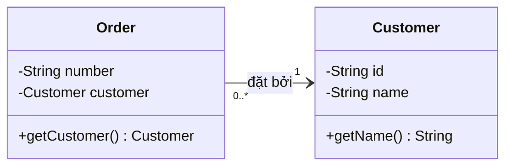
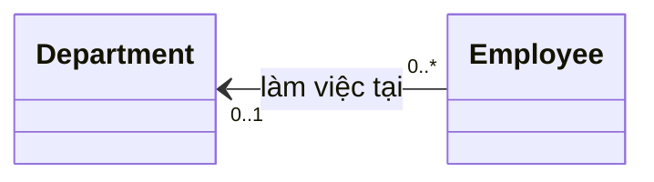
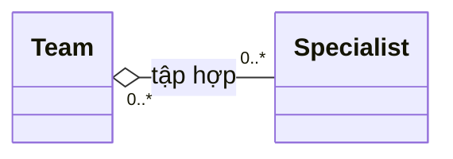
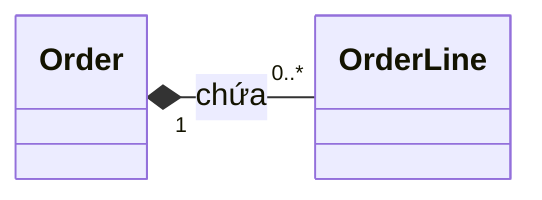
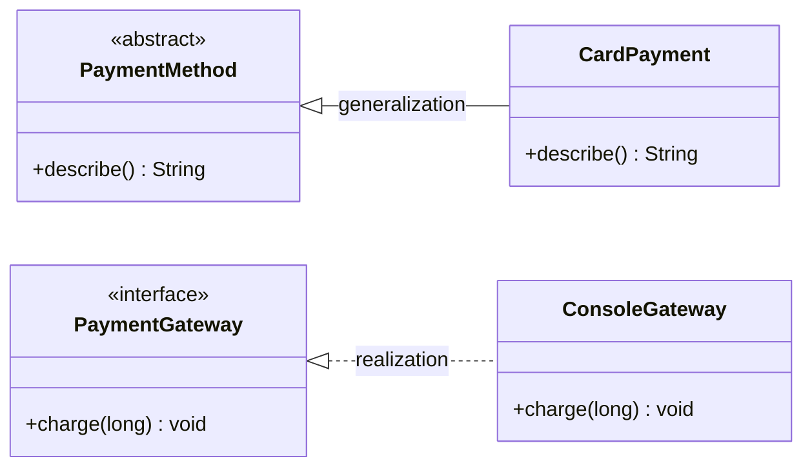
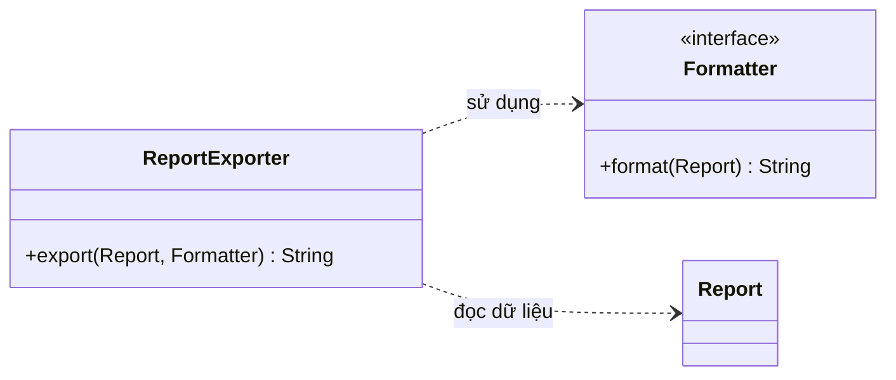
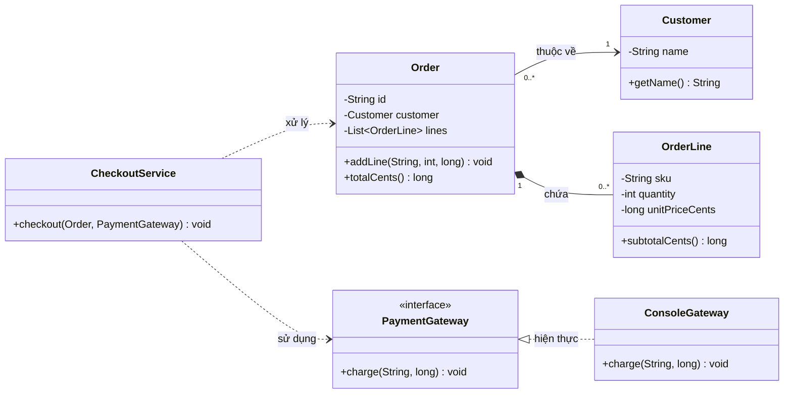
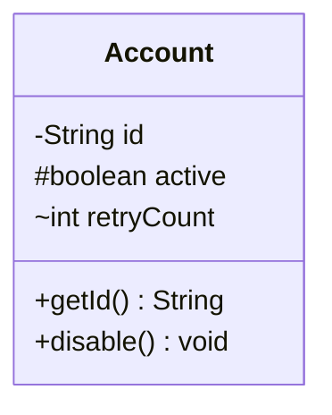
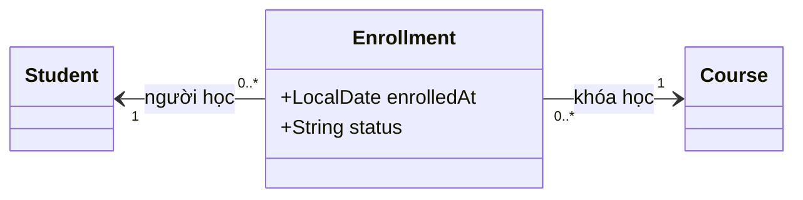

# Reading relationship notation in UML class diagrams

## 1. Reading a class diagram: where should you start?

A *UML class diagram* shows **object types**, their members, and **relationships between those types**. When you see two boxes connected by a line, do not immediately conclude that "the two classes call each other." Read all of the following:

1. **Line style and endpoint symbol:** solid or dashed; ordinary arrow, hollow triangle, hollow diamond, or filled diamond?
2. **Source and destination ends:** which class depends on another, which is the general type, and which is the *whole*?
3. **Multiplicity at both ends:** how many objects on one side can relate to an object on the other?
4. **Relationship/role names:** what meaning is added by terms such as "manages," "placed by," "member," or "owns"?
5. **Java implementation:** does it correspond to a field, collection, method parameter, `extends`, or `implements`?

Example:



The full interpretation is: **each `Order` is associated with exactly one `Customer`**, **each `Customer` may be associated with 0 or more `Order` objects**, and the arrow indicates navigation from `Order` to `Customer` in this model. In Java, this suggests a `private Customer customer;` field in `Order`. It does not mean every customer automatically stores an in-memory list of orders.

## 2. Quick reference: six important relationships

| Relationship | Visual cue | Meaning | Possible Java implementation |
|---|---|---|---|
| **Association** | **Solid** line; may have an arrow indicating navigability | Instances are related | Reference field, `List`/`Set`, or another linking mechanism |
| **Dependency** | **Dashed** line with an open arrow toward the used component | Component A needs B to perform work | Parameters, local variables, API calls, or types in signatures |
| **Aggregation** | Solid line with a **hollow diamond** at the whole end | Whole–part relationship whose parts can exist independently | A group holds references to its members |
| **Composition** | Solid line with a **filled diamond** at the whole end | Strong ownership; a part's lifecycle is linked to one whole in the model | Whole creates/manages parts and enforces lifecycle rules |
| **Generalization / inheritance** | Solid line with a **hollow triangle** pointing to the general type | A subclass *is a kind of* parent class | `extends` |
| **Realization** | Dashed line with a **hollow triangle** pointing to a specification/interface | A class implements an interface contract | `implements` |

These relationships can coexist in a system. For example, `CheckoutService` depends on `PaymentGateway`, `StripeGateway` realizes `PaymentGateway`, while `Order` composes `OrderLine` objects and is associated with `Customer`.

## 3. Association: reading arrows, role names, and multiplicity



Read **multiplicity at an endpoint as the number of objects there that may be linked to one object at the opposite end**:

- `0..1` next to `Department`: each `Employee` works in **0 or 1 department**.
- `0..*` next to `Employee`: each `Department` has **0 or more employees**.
- The `Employee → Department` arrow: an employee can find their department. This **does not** establish that `Department` stores an `employees` collection.
- The "works in" label is **the relationship name**, not an assignment or a required method name.

### Common multiplicities

| UML multiplicity | Precise interpretation | Example |
|---|---|---|
| `1` | Exactly one | Every valid order has exactly one customer |
| `0..1` | Zero or one | An employee may have no assigned department |
| `*` or `0..*` | Zero or many | A department may have no employees yet |
| `1..*` | At least one | A completed handover record requires at least one item |
| `2..5` | From two to five | A duty team has between two and five people |
| `3` | Exactly three | A product bundle must have three components |

Remember that multiplicity is **a model constraint**, not something Java automatically enforces because a `List<Employee>` was declared. To guarantee "at least one," "no more than five," or "exactly one," code or the persistence layer must enforce those rules.

### About navigation direction

- A solid line with an open arrow toward B generally means **you can navigate from A to B**.
- A navigability arrow **does not** mean "B is A's parent class."
- An association **without arrows** must be interpreted according to the diagram's conventions: its direction may be unspecified, so do not automatically assume bidirectionality.
- If both directions must be clear, draw or annotate them explicitly or show the corresponding properties in both classes.

Example Java code corresponding to `Employee → Department`:

```java
final class Department {
    private final String name;
    Department(String name) { this.name = name; }
    String getName() { return name; }
}

final class Employee {
    private Department department; // có thể null: 0..1

    void moveTo(Department next) {
        this.department = next;
    }

    Department getDepartment() {
        return department;
    }
}
```

There is no `Department.getEmployees()` because the example implements only employee-to-department navigation. If the application needs employee lists, it can query a repository; it need not add bidirectional links to every object.

## 4. The two diamonds: aggregation and composition

Both diamond symbols appear at **the whole end**, not the part end. This is an important rule when reading direction.

### Aggregation – hollow diamond



The **hollow diamond next to `Team`** identifies `Team` as the whole. A `Specialist` can exist independently of a team and can join multiple teams if business rules permit it. In this example, `0..*` at both ends indicates that one specialist may join several teams and one team may have several specialists.

```java
import java.util.ArrayList;
import java.util.List;

class Specialist {
    final String name;
    Specialist(String name) { this.name = name; }
}

class Team {
    private final List<Specialist> members = new ArrayList<>();

    void add(Specialist member) {
        members.add(member);
    }
}
```

Removing a Team from a management catalog does not automatically mean deleting its Specialist staff. Aggregation expresses grouping semantics; it **does not automatically create deletion/GC rules** in Java.

### Composition – filled diamond



The **filled diamond next to `Order`** identifies `Order` as **the whole that owns** the `OrderLine` objects. Each order line belongs to exactly one order in the model, while an order may contain several lines. In UML composition, a *part* belongs to at most one *composite* at a time; its lifecycle depends on the whole according to domain rules.

Implementations should create and modify order lines through the order:

```java
import java.util.ArrayList;
import java.util.List;
import java.util.Objects;

final class OrderLine {
    final String sku;
    final int quantity;

    OrderLine(String sku, int quantity) {
        this.sku = Objects.requireNonNull(sku);
        if (quantity <= 0) throw new IllegalArgumentException("quantity");
        this.quantity = quantity;
    }
}

final class Order {
    private final List<OrderLine> lines = new ArrayList<>();

    void addLine(String sku, int quantity) {
        lines.add(new OrderLine(sku, quantity));
    }

    int lineCount() {
        return lines.size();
    }
}
```

Note that **`OrderLine` is still an ordinary Java object**. The filled diamond does not make the JVM immediately delete it when `Order` becomes unreachable, nor does it prevent other code from holding references to it. API design, persistence constraints, and business rules enforce ownership semantics. Here, `Order` controls line creation; if strict ownership is required, further restrict exposure and transfer of lines across orders.

**Do not infer composition from a field alone:** `private Customer customer;` is not enough to establish composition. A customer normally exists independently of individual orders.

## 5. Hollow triangles: distinguishing extends and implements

A hollow triangle always points toward **the general type or contract**. Whether the line is **solid or dashed** determines the relationship.



- `PaymentMethod <|-- CardPayment`: the triangle near `PaymentMethod` with a solid line means `CardPayment` **inherits from** `PaymentMethod`.
- `PaymentGateway <|.. ConsoleGateway`: the triangle near `PaymentGateway` with a dashed line means `ConsoleGateway` **implements** the `PaymentGateway` contract.

Java mapping:

```java
abstract class PaymentMethod {
    abstract String describe();
}

final class CardPayment extends PaymentMethod {
    @Override
    String describe() {
        return "Thanh toán bằng thẻ";
    }
}

interface PaymentGateway {
    void charge(long cents);
}

final class ConsoleGateway implements PaymentGateway {
    @Override
    public void charge(long cents) {
        System.out.println("Charged: " + cents);
    }
}
```

Do not confuse *hollow triangles* with *navigability arrows*. They answer different questions:

- Generalization/realization: "**which type does this class extend or which contract does it implement?**"
- Association: "**which objects is this object linked to and able to navigate to?**"

## 6. Dashed lines with open arrows: dependency



Here `ReportExporter` *depends on* `Formatter` and `Report` to perform its operation. The `..>` notation represents a dependency arrow pointing **from the user to the used component**.

```java
interface Formatter {
    String format(Report report);
}

final class Report {
    final String title;
    Report(String title) { this.title = title; }
}

final class ReportExporter {
    String export(Report report, Formatter formatter) {
        return formatter.format(report);
    }
}
```

The exporter has no `formatter` or `report` fields. That fits the example of using objects through parameters, but **dependencies are not limited to parameter scope**: class A still depends on interface B if it stores B in a field or invokes B elsewhere. UML dependency describes design-level reliance; it does not imply that object B is short-lived.

## 7. Runnable combined example: multiple symbols in one business scenario

Build an order-payment model with:

- `Order → Customer`: a unidirectional association.
- `Order ◆— OrderLine`: composition; each line belongs to an order.
- `CheckoutService ⋯▷ PaymentGateway`: dependency; the service uses the payment gateway during checkout.
- `ConsoleGateway ⋯▷ PaymentGateway` with a hollow triangle: realization; an implementation of the interface.



Create a `RelationSymbolsDemo.java` file (JDK 11+):

```java
import java.util.ArrayList;
import java.util.List;
import java.util.Objects;

public class RelationSymbolsDemo {

    static final class Customer {
        private final String name;

        Customer(String name) {
            this.name = Objects.requireNonNull(name);
        }

        String getName() {
            return name;
        }
    }

    static final class OrderLine {
        private final String sku;
        private final int quantity;
        private final long unitPriceCents;

        // Chỉ Order tạo dòng thông qua addLine trong thiết kế ví dụ.
        private OrderLine(String sku, int quantity, long unitPriceCents) {
            this.sku = Objects.requireNonNull(sku);
            if (quantity <= 0 || unitPriceCents < 0) {
                throw new IllegalArgumentException("Invalid order line");
            }
            this.quantity = quantity;
            this.unitPriceCents = unitPriceCents;
        }

        long subtotalCents() {
            return Math.multiplyExact(quantity, unitPriceCents);
        }
    }

    static final class Order {
        private final String id;
        private final Customer customer; // Association: Order -> Customer
        private final List<OrderLine> lines = new ArrayList<>();

        Order(String id, Customer customer) {
            this.id = Objects.requireNonNull(id);
            this.customer = Objects.requireNonNull(customer);
        }

        void addLine(String sku, int quantity, long unitPriceCents) {
            // Composition: Order chịu trách nhiệm tạo/quản lý các dòng.
            lines.add(new OrderLine(sku, quantity, unitPriceCents));
        }

        String getId() {
            return id;
        }

        Customer getCustomer() {
            return customer;
        }

        long totalCents() {
            long result = 0L;
            for (OrderLine line : lines) {
                result = Math.addExact(result, line.subtotalCents());
            }
            return result;
        }
    }

    interface PaymentGateway {
        void charge(String orderId, long amountCents);
    }

    static final class ConsoleGateway implements PaymentGateway {
        @Override
        public void charge(String orderId, long amountCents) {
            System.out.println(
                    "Charge " + orderId + ": " + amountCents + " cents");
        }
    }

    static final class CheckoutService {
        void checkout(Order order, PaymentGateway gateway) {
            Objects.requireNonNull(order);
            Objects.requireNonNull(gateway);

            // Dependency: sử dụng gateway được truyền vào phương thức.
            gateway.charge(order.getId(), order.totalCents());
            System.out.println("Customer: " + order.getCustomer().getName());
        }
    }

    public static void main(String[] args) {
        Customer lan = new Customer("Lan");
        Order order = new Order("ORD-100", lan);
        order.addLine("BOOK-1", 2, 120_000L);
        order.addLine("PEN-5", 3, 10_000L);

        PaymentGateway gateway = new ConsoleGateway();
        new CheckoutService().checkout(order, gateway);
    }
}
```

Run:

```bash
javac RelationSymbolsDemo.java
java RelationSymbolsDemo
```

Output:

```text
Charge ORD-100: 270000 cents
Customer: Lan
```

From one diagram, we can identify which classes should hold **references**, which should **control their parts**, which need only **collaborator APIs**, and which must declare `implements`. A diagram guides structure; concrete behavior still needs to be implemented and tested to enforce constraints.

## 8. Symbols inside class boxes

To read relationships correctly, you also need to understand the information inside class boxes:



| Symbol | Meaning in UML | Common Java equivalent |
|---|---|---|
| `+` | Public | `public` |
| `-` | Private | `private` |
| `#` | Protected | `protected` |
| `~` | Package visibility | No modifier |
| Underlined name in UML | **Static** member | `static` |
| Italic name in UML | **Abstract** member | `abstract` |
| `operation(arg: Type): Result` | Method with parameter and return type | `Result operation(Type arg)` |

These symbols describe **access levels and members**, while the lines between boxes describe **relationships between classes**. A `-` before a field is **not** a dashed dependency; it means `private`.

## 9. Role names, constraints, and advanced details

In addition to an association name, a diagram may show a **role name** near an endpoint, such as `orders` near `Order` or `customer` near `Customer`. A role name expresses **the role of objects at that endpoint from the opposite end's perspective**; it may correspond to a field name in code.

Some constraints may appear beside an association or attribute:

- `{ordered}`: the order of associated objects matters.
- `{unique}`: the associated values/objects must not repeat according to the rule.
- `{readOnly}`: the association end/attribute does not allow reassignment in the stated context.

Do not mechanically equate UML `{ordered}` with `ArrayList` or `{unique}` with `HashSet`: these are **constraints that behavior must enforce**, and collection selection is only part of the implementation.

When **the association has its own data** (for example, a learner's enrollment has a date, status, and grade), use an **association class** in UML or introduce an intermediate domain class such as `Enrollment` in Java:



For readability, this Mermaid diagram uses **an ordinary intermediate class**; a standard UML association class has its own notation (the class is connected to the association line by a dashed line). Do not confuse intermediate-class notation with a dependency.

## 10. Common diagram-reading mistakes

| Misinterpretation | Correct reading |
|---|---|
| "The `1` next to Customer means each Customer has one Order." | `1` on the Customer end means **each Order has one Customer**; check the Order end to see how many orders each customer may have. |
| "Every arrow means inheritance." | Inheritance uses a **hollow triangle and solid line**; association uses a solid line with navigability arrows; dependency uses a dashed line and open arrow. |
| "The filled diamond belongs on the child class." | Diamonds belong at **the whole end** of whole–part relationships. |
| "Having `List<Child>` means composition." | A collection does not establish ownership or lifecycle; read and enforce domain rules. |
| "An arrowless association is definitely bidirectional." | Navigability may be **unspecified**; check the diagram's notes/conventions. |
| "A dependency line means each object has a reference field." | Dependencies may arise from parameters, local variables, or API calls; fields are not required. |
| "`extends` and `implements` use the same UML line style." | Generalization is **solid**, realization is **dashed**, and both use hollow triangles pointing to the general type/contract. |
| "UML makes the JVM delete parts when a whole is deleted." | UML models design rules; Java GC works through reference reachability and does not read diagrams. |

## 11. Self-check exercises

**Exercise 1.** The `Library "1" *-- "0..*" BookCopy` diagram has a filled diamond near `Library`. Interpret the roles, multiplicities, and lifecycle.

**Hint:** Library is the whole; each BookCopy belongs to one Library in the model, while a Library may have many BookCopy objects. Ownership/lifecycle rules must be enforced by business logic.

**Exercise 2.** `ReportGenerator ..> PdfWriter` is drawn with a dashed line and open arrow. Must `ReportGenerator` contain a `PdfWriter writer;` field?

**Answer:** No. `PdfWriter` may be used through a method parameter.

**Exercise 3.** In UML, how does `Gateway <|.. StripeGateway` differ from `Gateway <|-- StripeGateway`?

**Answer:** A dashed line with a hollow triangle means realization (typically `implements` an interface); a solid line with a hollow triangle means generalization (typically `extends`).

**Exercise 4.** Each employee may join up to three projects, and each project must have at least one employee. Supply the multiplicities for `Employee -- Project`.

**Answer:** Near `Project`, put `0..3`; near `Employee`, put `1..*`. Each label counts objects at its end associated with **one** object at the opposite end.

**Exercise 5.** Given `Course "0..*" -- "0..*" Student`, with each enrollment carrying a date, status, and grade, choose a suitable Java design.

**Hint:** Use an `Enrollment` class containing references to `Student` and `Course` plus enrollment data. Define a uniqueness constraint on the student–course pair if business rules require it.

---

**Remember when reading diagrams:** **Line style** identifies the relationship type; **arrows, triangles, and diamonds** determine direction and roles; **multiplicity** specifies object counts at each end; and **Java fields, collections, extends, implements, or parameters** reveal possible implementations. Interpret all these elements together before translating UML into code.
