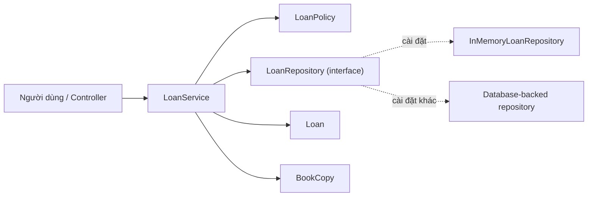
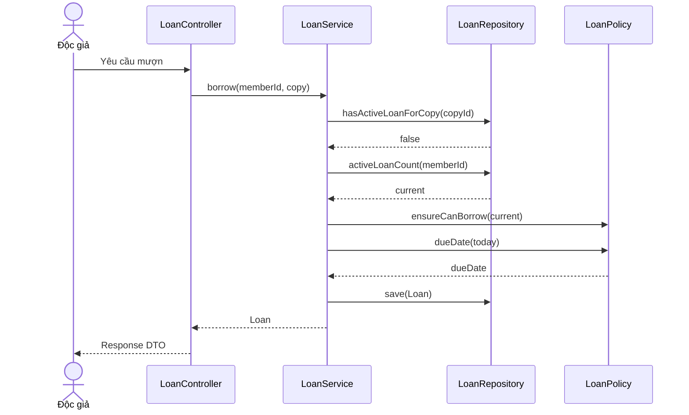

# Defining class responsibilities in OOP design (Java)

A system with many classes is not necessarily well designed. What matters is **which part of the problem each class owns, which rules it enforces, and which other classes it collaborates with**. Poor separation makes one class know too much, several classes change the same rule, and small changes trigger edits throughout the codebase.

This lesson shows how to derive class responsibilities from business requirements, distinguish responsibilities from technical operations, apply the **Single Responsibility Principle (SRP)** and **high cohesion/low coupling**, and validate the design with a standalone Java program.

## 1. What does a “class responsibility” mean?

A **responsibility** is something a class must **know** or **do** for the model to function correctly.

- **Information responsibilities (*knowing*)**: knowing a book-copy ID, order status, due date, product line items, and so on.
- **Behavioral responsibilities (*doing*)**: calculating totals, validating operations, changing state, coordinating workflows, storing/retrieving data, and so on.

In a good design, **closely related** data and behavior usually belong in the same class. If a class holds state but every important behavior lives in external “utilities,” business rules are easily duplicated or bypassed.

For example:

| Business requirement | Required responsibility | Possible owner |
| --- | --- | --- |
| A checked-out book copy cannot be borrowed again | Look up current loan status | Repository/transaction-management object |
| A borrower may have at most 2 active loans | Enforce the borrowing limit | `LoanPolicy` |
| A loan is due 14 days after checkout | Calculate the due date | `LoanPolicy` |
| A loan must have a valid borrower, copy, checkout date, and due date | Protect loan data | `Loan` |
| Borrowing requires validation followed by recording the result | Coordinate the borrowing workflow | `LoanService` |
| Loans must be stored and retrieved | Access persistent storage | `LoanRepository` |

These class names are merely **one reasonable design for this specific context**. There is no rigid rule that each line of requirements must become one class.

## 2. Responsibilities are not method lists

Naming operations makes responsibilities concrete, but **a class with many methods may still have just one responsibility**.

For example, `Money` may provide `add`, `subtract`, `multiply`, and `compareTo`; all serve the responsibility of representing and calculating monetary values. Conversely, a class with only two methods, `calculateSalary()` and `sendMarketingEmail()`, still has two unrelated business reasons to change.

A useful question to ask:

> **When a rule changes, which class should change because of that rule?**

If `LoanService` must change when the email protocol, SQL schema, due-date policy, or HTTP response shape changes, it likely owns responsibilities from several distinct concerns.

### SRP: One reason to change

The **Single Responsibility Principle** is often phrased as “a class should have only one reason to change.” “One reason” means **a cohesive set of responsibilities serving one stakeholder or related rule**, not “only one method.”

For example:

- When borrowing policies change → consider changing `LoanPolicy`.
- When persistence moves from memory to a database → change the `LoanRepository` implementation.
- When borrowing requires a new approval step → change or extend orchestration in `LoanService`.
- When HTTP request/response structures change → update the controller/DTO at the HTTP boundary.

SRP cannot be proved simply by counting lines or methods. A 200-line class can be cohesive; a 20-line class can still mix unrelated responsibilities.

## 3. Steps for deriving responsibilities from requirements

### Step 1 — Write use cases instead of guessing classes

For example: “A borrower selects a **specific, uniquely identified book copy**. The system rejects the request if that copy is already borrowed or the borrower has reached the loan limit, then creates a loan with a due date determined by the current policy.”

Break this down into events and rules:

1. Who performs the action? The borrower (`borrowerId`).
2. Which object is involved? A **specific book copy** (`BookCopy`), not just the book title (`BookTitle`).
3. Which state must be checked? Is there an active loan for this copy?
4. What are the rules? The borrowing limit and number of loan days.
5. What is the result? A new `Loan` is recorded.
6. What system constraints apply? Validation and recording must remain consistent, especially under concurrent requests.

### Step 2 — List responsibilities before assigning classes

| Responsibility | Required data/rules | Behavior category |
| --- | --- | --- |
| Identify a book copy | `copyId`, `title` | Domain data |
| Describe a loan | `borrowerId`, book copy, checkout date, due date | Domain entity/value |
| Enforce loan periods and limits | `loanDays`, `maxActiveLoans` | Domain policy |
| Query availability and record loans | The set of loans | Persistence abstraction |
| Coordinate a borrowing request | Repository + policy + current date | Application service |
| Display or receive HTTP data | Interface-specific input/output | Adapter/controller |

### Step 3 — Assign decisions to the object with sufficient information

This is the **Information Expert** approach: favor the object that knows the data needed to make a decision, provided dependency boundaries remain intact.

For example:

- `Loan` enforces its own invariants: the due date must come after the checkout date.
- `LoanPolicy` knows the due-date formula and borrowing threshold, so `LoanService` need not repeat the constant `14` in multiple places.
- `LoanRepository` knows current loan data, so the service queries it rather than maintaining a duplicate list.
- `LoanService` knows **the sequence** of operations without needing to know whether storage uses `HashMap`, SQL, or a REST API.

### Step 4 — Draw collaborations and verify dependency direction



`LoanService` depends on **the repository contract**, so business policy need not change merely because storage switches from memory to SQL. The control flow is the service calling the repository; the diagram does not imply that entities or policies should freely access HTTP, databases, loggers, and email.

### Step 5 — Choose APIs that fit responsibilities

A good class has not only appropriate methods; it also **avoids exposing state mutations that violate rules**. Constructors and public methods should have clear preconditions and postconditions. Return snapshots or read-only views when callers should not modify internal collections.

## 4. CRC cards: does a class take on too much?

CRC stands for **Class – Responsibilities – Collaborators**. A concise card for each class helps the team discuss design before coding:

| Class | Responsibilities | Collaborators |
| --- | --- | --- |
| `BookCopy` | Preserve the identity and title of a book copy | None |
| `Loan` | Represent a valid borrowing event | `BookCopy` |
| `LoanPolicy` | Determine loan limits and due dates | No repository needed |
| `LoanRepository` | Find active loans and record loan data | `Loan` |
| `LoanService` | Check eligibility and coordinate borrowing | Policy, repository, `Clock` |

If a card lists too many unrelated responsibilities, review the design. If two cards contain the same rule, identify **a single source of truth** to prevent inconsistent results.

## 5. Complete Java 17 example: borrowing based on responsibilities

The example divides classes according to **how their rules change**, while remaining simple enough to run in one file. A saved loan is treated as active; **returning a book** is outside this demo's scope.

Create `ClassResponsibilityDemo.java`:

```java
import java.time.Clock;
import java.time.Instant;
import java.time.LocalDate;
import java.time.ZoneOffset;
import java.util.LinkedHashMap;
import java.util.Map;
import java.util.Objects;

public class ClassResponsibilityDemo {

    // 1. BookCopy: danh tính một bản sách vật lý cụ thể.
    record BookCopy(String copyId, String title) {
        BookCopy {
            copyId = notBlank(copyId, "copyId");
            title = notBlank(title, "title");
        }
    }

    // 2. Loan: dữ liệu và bất biến của một lần mượn.
    record Loan(String borrowerId, BookCopy copy,
                LocalDate borrowedOn, LocalDate dueOn) {
        Loan {
            borrowerId = notBlank(borrowerId, "borrowerId");
            Objects.requireNonNull(copy, "copy");
            Objects.requireNonNull(borrowedOn, "borrowedOn");
            Objects.requireNonNull(dueOn, "dueOn");
            if (!dueOn.isAfter(borrowedOn)) {
                throw new IllegalArgumentException(
                        "Due date must be after borrowed date");
            }
        }
    }

    // 3. LoanPolicy: quyết định giới hạn mượn và thời hạn.
    record LoanPolicy(int maxActiveLoans, int loanDays) {
        LoanPolicy {
            if (maxActiveLoans <= 0 || loanDays <= 0) {
                throw new IllegalArgumentException(
                        "Policy values must be positive");
            }
        }

        void ensureCanBorrow(long activeLoans) {
            if (activeLoans >= maxActiveLoans) {
                throw new IllegalStateException("Borrowing limit reached");
            }
        }

        LocalDate dueDate(LocalDate borrowedOn) {
            return borrowedOn.plusDays(loanDays);
        }
    }

    // 4. LoanRepository: hợp đồng lưu/truy vấn, không đặt luật 14 ngày.
    interface LoanRepository {
        boolean hasActiveLoanForCopy(String copyId);
        long activeLoanCount(String borrowerId);
        void save(Loan loan);
    }

    // Cài đặt bộ nhớ dùng cho demo và unit test.
    static final class InMemoryLoanRepository implements LoanRepository {
        // Các Loan lưu trong ví dụ đều được xem là đang hoạt động.
        private final Map<String, Loan> activeByCopy = new LinkedHashMap<>();

        @Override
        public boolean hasActiveLoanForCopy(String copyId) {
            return activeByCopy.containsKey(copyId);
        }

        @Override
        public long activeLoanCount(String borrowerId) {
            return activeByCopy.values().stream()
                    .filter(loan -> loan.borrowerId().equals(borrowerId))
                    .count();
        }

        @Override
        public void save(Loan loan) {
            Objects.requireNonNull(loan, "loan");
            Loan existing = activeByCopy.putIfAbsent(
                    loan.copy().copyId(), loan);
            if (existing != null) {
                throw new IllegalStateException("Copy already borrowed");
            }
        }
    }

    // 5. LoanService: phối hợp quy trình, không tự tính ngày trả
    // hay quyết định nơi cất dữ liệu.
    static final class LoanService {
        private final LoanRepository repository;
        private final LoanPolicy policy;
        private final Clock clock;

        LoanService(LoanRepository repository, LoanPolicy policy, Clock clock) {
            this.repository = Objects.requireNonNull(repository);
            this.policy = Objects.requireNonNull(policy);
            this.clock = Objects.requireNonNull(clock);
        }

        Loan borrow(String borrowerId, BookCopy copy) {
            borrowerId = notBlank(borrowerId, "borrowerId");
            Objects.requireNonNull(copy, "copy");

            if (repository.hasActiveLoanForCopy(copy.copyId())) {
                throw new IllegalStateException("Copy already borrowed");
            }

            policy.ensureCanBorrow(
                    repository.activeLoanCount(borrowerId));

            LocalDate today = LocalDate.now(clock);
            Loan loan = new Loan(
                    borrowerId, copy, today, policy.dueDate(today));
            repository.save(loan);
            return loan;
        }
    }

    private static String notBlank(String value, String name) {
        if (value == null || value.isBlank()) {
            throw new IllegalArgumentException(name + " is blank");
        }
        return value;
    }

    public static void main(String[] args) {
        LoanRepository repository = new InMemoryLoanRepository();
        LoanPolicy policy = new LoanPolicy(2, 14);
        Clock clock = Clock.fixed(
                Instant.parse("2026-10-15T00:00:00Z"), ZoneOffset.UTC);
        LoanService service = new LoanService(repository, policy, clock);

        BookCopy copy1 = new BookCopy("COPY-01", "Effective Java");
        BookCopy copy2 = new BookCopy("COPY-02", "Clean Code");
        BookCopy copy3 = new BookCopy("COPY-03", "Java Concurrency");

        Loan first = service.borrow("MEM-01", copy1);
        System.out.println("Due: " + first.dueOn());

        try {
            service.borrow("MEM-02", copy1);
        } catch (IllegalStateException ex) {
            System.out.println(ex.getMessage());
        }

        service.borrow("MEM-01", copy2);
        try {
            service.borrow("MEM-01", copy3);
        } catch (IllegalStateException ex) {
            System.out.println(ex.getMessage());
        }

        System.out.println(
                "Active loans: " + repository.activeLoanCount("MEM-01"));
    }
}
```

Run:

```bash
javac ClassResponsibilityDemo.java
java ClassResponsibilityDemo
```

Output:

```text
Due: 2026-10-29
Copy already borrowed
Borrowing limit reached
Active loans: 2
```

### Mapping each responsibility to a concrete behavior

| When this changes... | Directly affected component | Why? |
| --- | --- | --- |
| Loan period changes from 14 to 21 days | Configuration used to construct `LoanPolicy`, not `LoanService.borrow` | The service only uses the policy |
| Due-date calculation switches to business days | `LoanPolicy` and a calendar dependency if needed | Date calculation belongs to the policy |
| Add validation for due dates | `Loan` | Invariants of the loan itself |
| Switch in-memory storage to SQL | `LoanRepository` implementation and connection configuration | The service only knows the interface |
| Add audit logging after borrowing | The workflow in `LoanService` or a new audit collaborator | This is orchestration behavior |
| Change the response JSON format for mobile | Controller/response DTO outside the example | JSON is not the responsibility of an entity or domain policy |

**Important concurrency note:** this demo runs sequentially in memory. The sequence “count loans → check the limit → save” **is not atomic** when concurrent requests occur. In production, validation and persistence must be protected by transactions/locks or another mechanism that enforces the limit, together with a database constraint preventing two active loans for the same copy. Correct responsibility boundaries **do not automatically** guarantee concurrent consistency.

If book returns are added, the repository must distinguish active from returned loans. The state transition might then belong in `Loan` or an appropriate aggregate, while the application service coordinates the workflow. This is a new business requirement; the current code should not be assumed to handle it.

## 6. Detecting classes with misplaced responsibilities

Consider a `LibraryManager` that handles everything:

```java
class LibraryManager {
    void borrow(String userId, String copyId) {
        // SQL query lay ban sach
        // Kiem tra gioi han muon
        // Tinh ngay tra
        // Ghi SQL
        // Gui email
        // Format JSON response
    }
}
```

This often becomes a **God Class**, or a service with too many reasons to change. A database schema update, library policy change, email template revision, or HTTP JSON adjustment could all require editing the same class.

The better approach is to place responsibilities at their proper boundaries:



A `Loan` knows whether its own data is valid; `LoanPolicy` knows the limits; `LoanRepository` knows how to access stored data; `LoanService` knows the order of operations. The controller only maps requests/responses and handles appropriate communication concerns.

There is no need to immediately split `EmailSender`, `LoanFactory`, `DateCalculator`, and `LoanValidator` into separate classes. Introduce an abstraction when it represents **an independent responsibility worth managing**, an explicit rule, or a real substitution/testing need.

## 7. High cohesion and low coupling

- **Cohesion:** how closely do fields and methods inside one class contribute to a shared purpose?
- **Coupling:** how much of other classes' implementation details must this class know, and how do changes elsewhere affect it?

| Indicator | Good design direction | Signal to reconsider |
| --- | --- | --- |
| Cohesion | Methods protect related data and rules | Email delivery, SQL, and business formulas in one class |
| Coupling | A service depends on a repository interface | A service directly constructs `new SqlLoanRepository(...)` inside business logic |
| Encapsulation | State changes through valid operations | Public setters allow bypassing validation |
| Knowledge | A class knows only what its responsibility requires | A method traverses `a.getB().getC().getD()` and mutates deep state |
| Testability | A policy can be tested independently; current time is injected through `Clock` | Logic directly accesses the real clock, database, and email system to evaluate rules |

Optimizing one metric is not the only goal. Splitting into dozens of “one-method” classes, for example, can create more confusing dependencies than the original design. Balance clarity, change cost, testability, and actual needs.

### “Who owns the data, and who owns the behavior?”

Some computations span multiple objects and require information that no single entity completely owns. Do not force every behavior into an entity.

- **Entity/value object:** maintains invariants tied to its own state.
- **Domain service/policy:** enforces business rules spanning multiple objects or needing an independent policy model.
- **Application service:** coordinates use cases, access control, transactions, repositories, and integration ports.
- **Infrastructure adapter:** communicates with databases, files, queues, or external APIs.
- **Presentation adapter:** accepts and returns data for HTTP/CLI/UI.

These are common divisions, **not mandatory rules**. Smaller systems may use fewer classes. Boundaries should follow actual responsibilities and reasonably expected changes.

## 8. When should you split a class, and when should it stay intact?

### Consider splitting when

1. A class's behaviors change for **independent groups of requirements** (such as calculating charges and emailing invoices).
2. The same business rule is duplicated across multiple locations.
3. Testing a simple calculation requires starting a database, HTTP server, or external service.
4. Numerous `if/switch` branches choose strategies/policies based on transaction type.
5. Small changes break unrelated functionality, suggesting overly broad coupling.

### Do not split merely because

1. A class has more than one method.
2. A class exceeds an arbitrary line-count threshold.
3. A helper could be named separately but has no independent rule.
4. You want interfaces for **every** class before there is a boundary that needs substitution.
5. You imagine many hypothetical future scenarios without clear requirements.

For example, `LoanPolicy` is a small record and can keep related rules together. There is no need to automatically split `MaxLoanPolicy` and `DueDatePolicy` just because it has two methods. If borrowing limits are managed by department A and due dates by department B, or each rule has distinct variants, then separation has a sound justification.

## 9. Refactoring a large class into classes with clear responsibilities

Suppose `LoanController` queries SQL, calculates due dates, and returns JSON in one method. It can be refactored incrementally:

1. **Capture existing behavior:** inputs, outcomes, and errors when a copy is already borrowed or the limit is reached. Add tests for important rules.
2. **Define invariants:** each book copy has at most one active loan, and borrowers never exceed their limits.
3. **Extract pure rules:** move due-date calculations and thresholds into `LoanPolicy` (without I/O dependencies).
4. **Extract persistence:** move SQL behind `LoanRepository`, define a clear contract, and test the adapter.
5. **Place the workflow in the service:** fetch data, invoke the policy, save the loan, and return the result.
6. **Simplify the controller:** map requests, handle errors/response DTOs, and call the service.
7. **Revalidate:** test success/failure scenarios and inspect transactions, saved data, logs, and unintended side effects.

Making small changes and verifying behavior at each step is usually safer than rewriting the entire system at once. Do not use “separating responsibilities” as a reason to delete existing validation or transactional safeguards.

## 10. Testing responsibilities rather than individual getters

| Test target | Key scenario | Evidence |
| --- | --- | --- |
| `BookCopy` | Blank ID or title | Constructor rejects it |
| `Loan` | Due date on or before the checkout date | Invariant is enforced |
| `LoanPolicy` | Loan limit reached; calculating due dates | Results independent of database and real clock |
| `LoanService` | Copy already borrowed; borrower over limit | Does not call `save` on rejection |
| `LoanService` | Valid request | Asks repository to save a loan with the correct dates |
| Repository adapter | Saving/looking up loans and unique constraints | Meets the storage contract |
| Integrated use case | Two concurrent requests for the same copy | Does not create two active loans |

One way to test the service is to use an in-memory **fake repository** or mock and assert behavior in each scenario, instead of mocking every internal method. Test policies with actual inputs and outputs. In larger systems, separate integration tests for transactions and unique constraints are necessary because unit tests cannot prove database consistency.

## 11. Class-design exercises

**Exercise A — Divide order-management responsibilities.** Requirements: a shopper adds items, the system calculates totals, applies coupons, checks inventory, saves orders, and emails confirmations. List the responsibilities and propose suitable classes/collaborators. Explain why email formatting should not belong in `Order`.

**Exercise B — Evaluate a class with many methods.** `BankAccount` provides `deposit`, `withdraw`, `balance`, `transferTo`, and `exportMonthlyCsv`. Which methods fit the responsibility of managing a balance, and which suggest reporting concerns? How should `transferTo` coordinate two accounts and a transaction?

**Exercise C — Extend the borrowing example.** Add `returnBook(copyId)`, `ACTIVE/RETURNED` status, and a rule prohibiting returning the same loan twice. Decide which entity owns state transitions, what repository queries are needed, and how the service coordinates them. Verify there are no active loans after return.

**Exercise D — Review design indicators.** One `ReportService` has 15 methods that all transform one report structure into related metrics; another `UserHelper` has only 3 methods for passwords, SQL, and email. Which merits review first? Explain using **reasons to change and cohesion**, not method count.

## 12. Self-assessment checklist for class design

- Can you describe **each class's main responsibility in one clear sentence**?
- Does each invariant/rule have one authoritative owner, avoiding conflicting versions?
- Do a class's fields and methods all support that responsibility?
- How many external details must the class know? Could it depend on an interface at a changing boundary?
- Does the service only orchestrate, or does it implement every policy, SQL operation, and UI formatting rule itself?
- Can getters, setters, or constructors expose ways to violate invariants?
- Do common changes affect only a few classes, in the appropriate responsibility area?
- Can pure logic be tested independently of databases, networks, and real time?
- Under concurrent requests, where do transactions and locks protect cross-class invariants?
- Does splitting/merging classes provide benefits that clearly outweigh added abstraction costs?

**Core takeaway:** divide classes by **responsibility and change boundaries**, and place behavior where the information needed to protect a rule is available. Good OOP design tells readers *which class to inspect when requirement X changes* and minimizes changes to unrelated classes.
