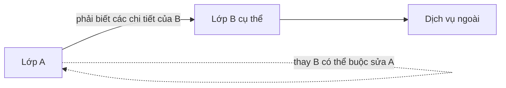
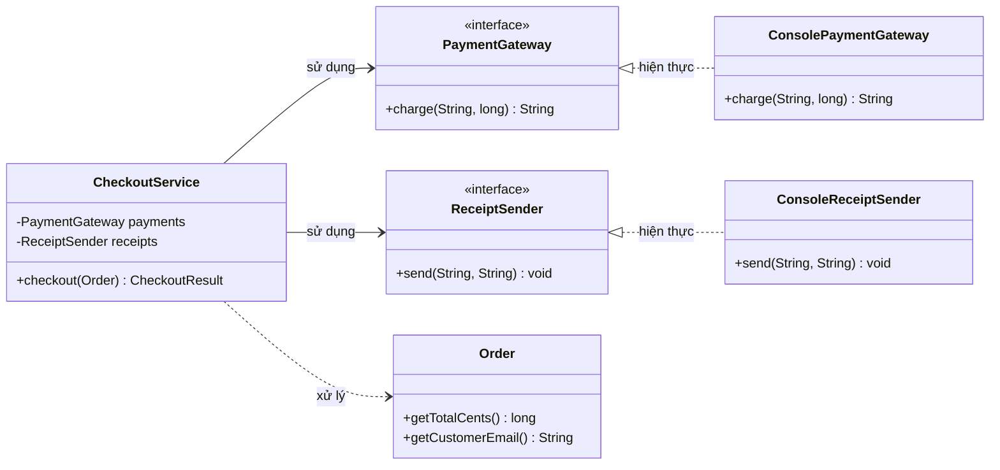
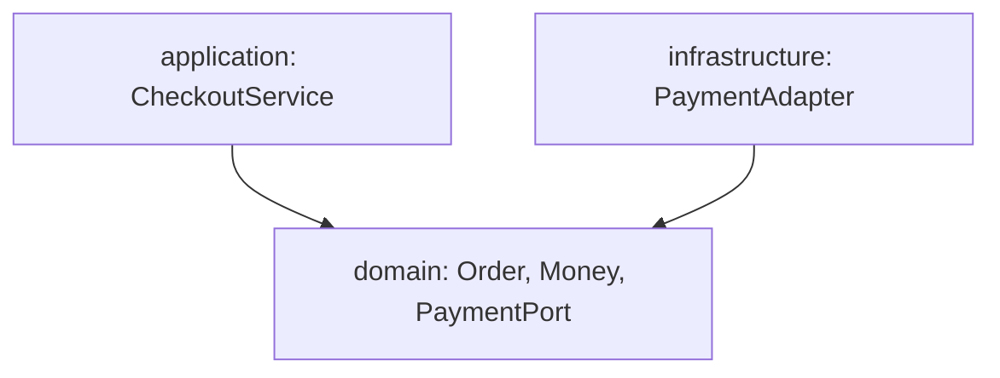

# Coupling between classes in OOP design

## 1. Why does coupling matter?

Suppose a retail application has a `CheckoutService` that handles checkout. Initially it uses one payment gateway and emails receipts. Later it must switch payment providers, add SMS, run tests without charging real money, or demonstrate the system offline.

If `CheckoutService` constructs a concrete payment gateway, calls HTTP directly, configures email, and knows the database table structure, a small external change may force many edits to `CheckoutService`.

This is **coupling**: how strongly one class or component **depends on another**. The tighter the dependence on frequently changing details, the harder modification, testing, substitution, and reuse generally become.

**Coupling is not just the number of imported classes.** Two classes may communicate without depending on each other's internals. Conversely, one dependency can be tightly coupled if the consumer makes many implicit assumptions about call order, state, and exceptions.

The practical goal is to **remove unnecessary dependencies and point dependencies toward stable contracts**, not to reduce every dependency count to 0.

## 2. Three perspectives: source code, runtime objects, and change

| Perspective | What to observe | Useful question |
|---|---|---|
| **Source-code dependency** | Imports, method signatures, field types, `extends`, `implements`, API calls | If B's API or type changes, must class A change or be recompiled? |
| **Runtime dependency** | A holds/needs an instance of B; configuration, networking, transactions, shared data | How is A affected when B fails or slows down? |
| **Change dependency** | Assumptions about data, call sequences, formats, business policies | Does changing one rule require edits to many classes? |

Two classes can be linked at runtime yet remain fairly substitutable through a small interface with a clear contract. Conversely, “magic” data strings can create hidden coupling even when the source code contains almost no mutual imports.

A simple illustration:



When B changes a method, return type, error format, or required call sequence, A may need to change as well. That propagation is a practical sign of coupling.

## 3. Two design approaches: tight and loose coupling

### 3.1. Tightly coupled example

```java
// Minh họa một thiết kế khó thay đổi, không phải chương trình đầy đủ.
final class CheckoutService {
    void checkout(Order order) {
        CardProcessor processor = new CardProcessor(
                "https://payment-provider.example/api", "merchant-001");
        String paymentId = processor.charge(
                order.getId(), order.getTotalCents());

        SmtpMailer mailer = new SmtpMailer("smtp.example", 587);
        mailer.sendReceipt(order.getCustomerEmail(), paymentId);
    }
}
```

Assume `CardProcessor`, `SmtpMailer`, and `Order` are already defined classes. The problems include:

- `CheckoutService` knows the **concrete classes** used for payments and messaging.
- The service **constructs its dependencies**, making it hard to inject fakes without calling real services.
- Server addresses and configuration reside in the business class.
- Changing providers or receipt-delivery channels forces service changes.
- The two side effects, “charge money” and “send mail,” are tied into one workflow and require appropriate failure handling.

Using `new` is not inherently wrong: creating `new Money(...)` or a DTO/value object inside the service is often reasonable. The issue is **directly constructing and depending on collaborators whose external implementation details are likely to change**.

### 3.2. Depend on contracts instead



`CheckoutService` now needs two **meaningful business contracts**: `PaymentGateway` and `ReceiptSender`. Their implementations are supplied externally, usually through constructor injection.

As a result, the service need not know which HTTP client, mock, queue, or vendor adapter the payment gateway uses. It still depends on *payment behavior*, but is insulated from most implementation details.

## 4. Complete runnable Java 11+ example with self-checks

Save the entire example as `CouplingDemo.java`:

```java
import java.util.Objects;

public class CouplingDemo {

    static final class Order {
        private final String id;
        private final String customerEmail;
        private final int quantity;
        private final long unitPriceCents;

        Order(String id, String customerEmail,
              int quantity, long unitPriceCents) {
            this.id = Objects.requireNonNull(id, "id");
            this.customerEmail = Objects.requireNonNull(
                    customerEmail, "customerEmail");
            if (quantity <= 0 || unitPriceCents < 0) {
                throw new IllegalArgumentException(
                        "Invalid quantity or unit price");
            }
            this.quantity = quantity;
            this.unitPriceCents = unitPriceCents;
        }

        String getId() {
            return id;
        }

        String getCustomerEmail() {
            return customerEmail;
        }

        long getTotalCents() {
            return Math.multiplyExact(quantity, unitPriceCents);
        }
    }

    // Hai hợp đồng nhỏ, được đặt theo nhu cầu của checkout.
    interface PaymentGateway {
        String charge(String orderId, long amountCents);
    }

    interface ReceiptSender {
        void send(String email, String paymentId);
    }

    static final class CheckoutResult {
        private final String paymentId;
        private final long totalCents;

        CheckoutResult(String paymentId, long totalCents) {
            this.paymentId = paymentId;
            this.totalCents = totalCents;
        }

        String getPaymentId() {
            return paymentId;
        }

        long getTotalCents() {
            return totalCents;
        }
    }

    static final class CheckoutService {
        private final PaymentGateway payments;
        private final ReceiptSender receipts;

        CheckoutService(PaymentGateway payments, ReceiptSender receipts) {
            this.payments = Objects.requireNonNull(
                    payments, "payments");
            this.receipts = Objects.requireNonNull(
                    receipts, "receipts");
        }

        CheckoutResult checkout(Order order) {
            Objects.requireNonNull(order, "order");
            long total = order.getTotalCents();

            String paymentId = payments.charge(order.getId(), total);
            receipts.send(order.getCustomerEmail(), paymentId);

            return new CheckoutResult(paymentId, total);
        }
    }

    // Adapter dùng cho demo.
    static final class ConsolePaymentGateway
            implements PaymentGateway {
        @Override
        public String charge(String orderId, long amountCents) {
            System.out.println("Paid " + orderId + ": "
                    + amountCents + " cents");
            return "tx-" + orderId;
        }
    }

    static final class ConsoleReceiptSender
            implements ReceiptSender {
        @Override
        public void send(String email, String paymentId) {
            System.out.println("Receipt for " + email
                    + ": " + paymentId);
        }
    }

    // Fake để kiểm thử không cần gọi HTTP/thanh toán thật.
    static final class FakePaymentGateway
            implements PaymentGateway {
        String receivedOrderId;
        long receivedAmountCents;

        @Override
        public String charge(String orderId, long amountCents) {
            receivedOrderId = orderId;
            receivedAmountCents = amountCents;
            return "fake-transaction";
        }
    }

    static final class RecordingReceiptSender
            implements ReceiptSender {
        String receivedEmail;
        String receivedPaymentId;

        @Override
        public void send(String email, String paymentId) {
            receivedEmail = email;
            receivedPaymentId = paymentId;
        }
    }

    public static void main(String[] args) {
        Order order = new Order("ORD-7", "buyer@example.test",
                2, 140_000L);

        CheckoutService actual = new CheckoutService(
                new ConsolePaymentGateway(),
                new ConsoleReceiptSender());

        CheckoutResult result = actual.checkout(order);
        System.out.println("RESULT " + result.getPaymentId());

        FakePaymentGateway fakePayment = new FakePaymentGateway();
        RecordingReceiptSender fakeReceipt =
                new RecordingReceiptSender();

        CheckoutService underTest = new CheckoutService(
                fakePayment, fakeReceipt);
        CheckoutResult tested = underTest.checkout(order);

        if (!"ORD-7".equals(fakePayment.receivedOrderId)
                || fakePayment.receivedAmountCents != 280_000L
                || !"buyer@example.test".equals(
                        fakeReceipt.receivedEmail)
                || !"fake-transaction".equals(
                        fakeReceipt.receivedPaymentId)
                || tested.getTotalCents() != 280_000L) {
            throw new AssertionError("Checkout behavior incorrect");
        }

        System.out.println("Fake checks passed");
    }
}
```

Run on JDK 11 or later:

```bash
javac CouplingDemo.java
java CouplingDemo
```

Expected output:

```text
Paid ORD-7: 280000 cents
Receipt for buyer@example.test: tx-ORD-7
RESULT tx-ORD-7
Fake checks passed
```

In this design:

1. **`CheckoutService` is responsible for coordinating checkout**; `Order` calculates totals, `PaymentGateway` performs charges, and `ReceiptSender` delivers receipts.
2. **Business code uses interfaces**, so replacing `ConsolePaymentGateway` with another adapter does not require changing `CheckoutService` if contractual behavior and guarantees remain the same.
3. **Constructor injection** allows fake implementations in tests. Tests verify order IDs, amounts, and recipients instead of only comparing code structure.
4. **Dependencies have not disappeared:** checkout still needs a charging capability and a receipt-sending service. The design only reduces coupling to their details.

This demonstrates **dependency design**, not a complete production payment workflow. If charging succeeds but receipt delivery fails, the charge cannot simply be “undone.” Real systems need explicit transaction states, idempotency, retry/outbox, or other mechanisms to avoid double charging. Reducing coupling isolates integration policies, but **does not solve distributed-system problems on its own**.

## 5. Commonly discussed forms of coupling

Some OOP and structured-design references distinguish these forms of dependency. This is **a classification for reasoning**, not an absolute ranking for every modern Java architecture.

| Form | Indicator | Example / drawback | Improvement when needed |
|---|---|---|---|
| **Content coupling** | A directly interferes with or relies on B's internal implementation | A changes B's private structure using reflection | Encapsulate state; provide behavior-oriented APIs |
| **Common coupling** | Multiple components depend on shared state | A mutable `static` variable or global cache is changed in many places | Limit ownership and mutation rights for shared state |
| **External coupling** | Several components depend on an external protocol/format | Each class parses a vendor's JSON response on its own | Use an adapter/anti-corruption layer, contracts, and versioning |
| **Control coupling** | A passes flags/codes to select B's internal branches | `process(order, true, 3)` with opaque flags | Use intention-revealing operations or a policy/strategy |
| **Stamp coupling** | A passes an entire complex structure when B only needs part | Passing `UserProfile` merely to extract an email address | Pass only the needed data or focused contract |
| **Data coupling** | Components exchange clearly defined data | `charge(orderId, amountCents)` | Often acceptable and easy to understand |
| **Message coupling** | Communication occurs through calls/message contracts with limited knowledge of internals | `gateway.charge(request)` through a small interface | Pay attention to contracts, errors, and versioning; dependencies still exist |

Context matters: passing `UserProfile` is not necessarily wrong when the callee genuinely needs **the whole profile**. Passing too many primitive arguments may also cause *primitive obsession*; a value object such as `Money` or `PaymentRequest` can express the contract better.

### An example of control coupling

```java
// Mã khó đọc: caller phải biết giá trị mode/flag mang ý nghĩa gì.
void publish(Document doc, int mode, boolean urgent) {
    // mode=1: email; mode=2: archive; ...
}
```

Replace it with intention-revealing operations or a clearly named policy:

```java
interface DocumentPublisher {
    void publish(Document document);
}

final class EmailPublisher implements DocumentPublisher {
    @Override
    public void publish(Document document) {
        // Gửi email theo hợp đồng của adapter.
    }
}
```

Assume `Document` and the implementation details exist elsewhere. Introduce multiple implementation classes only when independently substitutable behaviors exist; for two simple, stable branches, a clear enum and `switch` may suffice.

## 6. Principles for reducing coupling and their boundaries

### A. Information hiding – conceal implementation details

Do not expose an object's internal storage structure to external classes merely so they can perform a business operation:

```java
// Tránh:
// order.lines.add(new OrderLine(...));
// order.status = "PAID";

// Tốt hơn nếu thuộc trách nhiệm của Order:
order.addLine(productId, quantity);
order.markPaid(paymentId);
```

Callers know **the behavior Order promises** rather than the number of fields to modify. When internal storage changes from a List to a Map, the external API can stay the same.

### B. Dependency Inversion Principle (DIP)

High-level business modules should not be tied to volatile infrastructure details; both can depend on a suitable abstraction. In this example, `CheckoutService` and the payment adapter both know the `PaymentGateway` interface.

**DIP is not the same as dependency injection (DI).** DIP is a principle for organizing dependencies; DI is a technique for supplying collaborators from outside. Constructor injection can still depend on a concrete class that is hard to replace. Conversely, a small interface can be valuable without a DI framework.

### C. Interface Segregation Principle (ISP)

An overly broad interface also creates coupling. If `PaymentProvider` contains `charge`, `refund`, `issueCard`, `manageAccount`, and `generateReport`, a checkout-only service depends on capabilities it does not need.

Split contracts by consumer roles when the roles are genuinely independent:

```java
interface PaymentCharger {
    String charge(String orderId, long amountCents);
}

interface PaymentRefunder {
    void refund(String paymentId, long amountCents);
}
```

Do not split interfaces merely to create more files. If several operations always belong together and change together, one cohesive contract may be simpler to understand.

### D. Single responsibility and cohesion

**Coupling** concerns **relationships between classes**; **cohesion** concerns **responsibilities within the same class**.

A class that processes payments, sends email, reads SQL, and generates PDFs often has many reasons to change. Assigning responsibilities correctly can reduce harmful coupling and improve cohesion. However, wrapping a simple operation in dozens of classes so that “each class has one line” can make workflows harder to follow.

Evaluate design with a balance of **high cohesion, appropriate coupling**, and a manageable number of components.

### E. Law of Demeter and navigation chains

Be careful when a class reaches through many levels of another object's internals:

```java
// Ràng buộc vào nhiều nấc cấu trúc:
String city = order.getCustomer()
        .getAddress().getCity();
```

If “shipping city” is a stable order concept, consider:

```java
String city = order.getShippingCity();
```

But do not automatically replace every nested getter with a forwarding method. A presentation DTO or pure data query may legitimately use access chains. The key question is **whether this class knows internal structure it should not need to know**.

## 7. Coupling at package and module level

At the system level, dependencies can form cycles:


When all three modules import one another, changes and individual tests become hard to isolate. An alternative organization is:



In this structure, stable domain types and required contracts can live in the domain/application layer; infrastructure implements those contracts. The application bootstrap (*composition root*) connects adapters to services. **Source-code** dependencies point toward contracts, even though **runtime** calls still flow from services to infrastructure implementations.

Do not impose one rigid architectural diagram on every problem. Small projects can have simple packages; large systems with many integrations and distinct change cycles often benefit from explicit boundaries.

### What if two modules must communicate in both directions?

First verify whether responsibilities have been split incorrectly. You may extract a shared contract, use callbacks, or publish domain events. Events still create **message coupling**: consumers depend on schemas, timing, order, duplication, and failure handling. “No mutual imports” does not mean “no dependencies.”

## 8. How can we measure coupling?

Metrics can help identify problems, but must be interpreted alongside actual behavior.

| Metric / indicator | Interpretation | Limitation |
|---|---|---|
| **CBO (Coupling Between Objects)** | Number of classes a class relates to or depends on, per a tool's definition | Counting rules differ across tools; does not reveal which dependency is risky |
| **Fan-out** | Number of outgoing dependencies from a module | Many dependencies on stable APIs may be safer than one dependency on volatile details |
| **Fan-in** | Number of consumers depending on a module | High fan-in may indicate a useful shared component, but changes require care |
| **Dependency cycle** | A → B → C → A | May complicate layering and independent deployment |
| **Change coupling** | Files/classes often have to change together | Check change history; shared features can also explain correlated edits |
| **Difficulty testing in isolation** | Tests require databases, networks, or several services | May indicate broad boundaries, hidden dependencies, or missing abstractions |

For example, a `ReportService` using five small, immutable value objects with stable contracts is not necessarily worse off than a `CheckoutService` depending on a single large, frequently changing payment SDK.

Assess **change costs**, **testability**, **contract stability**, and **knowledge of external details** together. Do not simply count `import` statements or fields.

## 9. A practical workflow for tightly coupled classes

1. **Identify what varies:** provider, data source, object structure, business rule, message format, or delivery mechanism?
2. **Determine each class's required responsibility:** `CheckoutService` needs to “charge a payment,” not know a particular HTTP endpoint.
3. **Define a focused but complete contract:** parameters, results, exceptions, and preconditions/postconditions should be explicit.
4. **Isolate frequently changing details in separate implementations:** database, HTTP, email adapters, or business policies with multiple variants.
5. **Supply dependencies deliberately:** use constructor injection for required collaborators stable over the service lifecycle; use method parameters for per-operation dependencies.
6. **Test through contracts:** simulate interfaces at boundaries and verify observable behavior; add integration tests for real adapters when needed.
7. **Reassess complexity:** if a refactor adds many classes without making actual changes easier, the design may be prematurely abstracted.

Not every class needs an interface. `Money`, `OrderId`, `LocalDate`, and stable internal algorithms can often be used directly without creating `IMoneyFactoryAdapter` and layers of pointless wrappers.

## 10. Common misconceptions

| Incorrect claim | Correct interpretation |
|---|---|
| “Fewer dependencies are always better.” | Classes must collaborate; seek **intentional, manageable dependencies**. |
| “Importing only one class guarantees low coupling.” | One class may know extensive details and assumptions about a single dependency. |
| “Having an interface means loose coupling.” | If the interface copies an entire external SDK or changes constantly, the consumer remains tightly coupled. |
| “Dependency injection solves all coupling.” | DI makes supplying implementations and testing easier; the contract can still be poorly designed. |
| “Events/message brokers remove all coupling.” | Dependencies on schemas, delivery semantics, versions, and processing order remain. |
| “Static utilities are always a problem.” | Pure, stateless functions such as `Math.multiplyExact` are often fine; shared mutable state needs closer scrutiny. |
| “More classes always mean easier maintenance.” | Excess abstractions and wrappers make navigation and management harder. |
| “Low coupling implies high cohesion.” | They are independent dimensions: relationships across classes versus responsibilities within them. |
| “A test passing with a fake means production integration is safe.” | Fakes validate application logic; adapters, networks, databases, and failure modes still need appropriate verification. |

## 11. Practice exercises

### Exercise 1 – Identify strong coupling

```java
class MonthlyReportService {
    byte[] generate() {
        OracleConnection db = new OracleConnection("...");
        var rows = db.query("SELECT ...");
        return new VendorPdfWriter().render(rows);
    }
}
```

*This is illustrative code; vendor classes have not been declared.*

Question: if the application switches from Oracle to PostgreSQL or changes PDF export libraries, where must the code change? How can `MonthlyReportService` know less about those details?

**Hint:** identify contracts for obtaining report data and rendering documents (when there is a genuine need for substitution or independent testing). Move adapter configuration and construction out of the service; design queries around domain needs.

### Exercise 2 – Is an interface enough?

A project contains:

```java
interface HugePaymentSdkFacade {
    void connectWithVendorCertificate(...);
    void setVendorRegion(...);
    void callVendorEndpoint(...);
    void parseVendorResponse(...);
}
```

`CheckoutService` calls all these methods. Why is coupling still high despite the interface?

**Hint:** the interface exposes vendor-specific details; changing vendors still forces changes to business code. A better contract should express an operation such as `charge(request)` and domain-level rules for results and failures.

### Exercise 3 – Choose how to pass dependencies

A formatter is used only during one report export, while a repository is used in most operations of a service. Would you pass them as method arguments or through the constructor?

**Hint:** the formatter can be a parameter when it varies per request. A stable, required repository usually fits constructor injection. This choice depends on lifecycle and API design; there is no absolute rule.

### Exercise 4 – Detect change coupling

Changing an address format requires editing `Customer`, `Order`, `Invoice`, `EmailSender`, and `CsvExporter` because all of them read `address.line1` and `address.line2` and concatenate strings independently.

Which boundary would you introduce to reduce this change propagation?

**Hint:** model `Address` as a value object with appropriately owned behavior/formatting, or create context-specific formatters. Do not force different email, invoice, and CSV requirements into one output string.

### Exercise 5 – Test substitutability

Using `CouplingDemo.java`, create a `FailingPaymentGateway` that throws an exception in `charge()`. Verify that `RecordingReceiptSender` **is not called** when charging fails.

**Hint:** add a `boolean called` field to the sender; call `checkout()`, catch the expected error, and assert `called == false`. Extension: if the gateway charges successfully but the sender fails, how should the system track state and retry receipts without charging twice?

---

**Remember:** coupling describes how much one class must know about, rely on, and be affected by another. Good design maintains **clear responsibilities**, **stable contracts**, **substitutable details at appropriate boundaries**, and **testable behavior**. Reduce actual change propagation without introducing abstractions prematurely.
