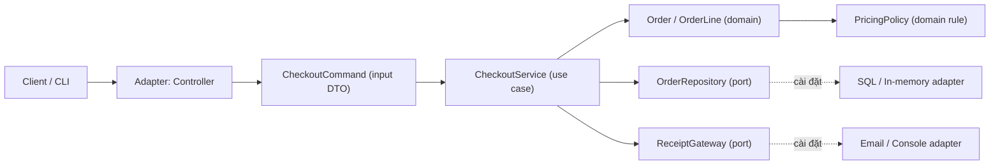
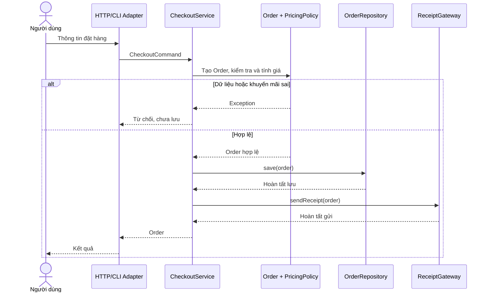

# Separating data, business logic, and external interactions in Java class design

An “order placement” feature may need to accept JSON, validate a cart, calculate an amount, save to a database, and email a confirmation. Putting everything in one class means that changes ranging from HTTP formats to promotion rules require editing the same place. Even testing a calculation would then require starting a database or email service.

The solution is to **establish clear boundaries among data, business logic, and interactions with the outside world**, and connect them through well-defined interfaces. The aim is to change and test each area without entangling core business rules.

## 1. Understanding three responsibility categories

| Category | Question the component answers | Examples | What to avoid |
| --- | --- | --- | --- |
| Data and domain model (*data/domain model*) | What state does an object have? Which values are valid? | `OrderLine`, `Order`, `Money` | Allowing arbitrary mutations that make an order invalid |
| Business logic (*business rules/use case*) | When may an order be placed? How are totals and discounts computed? What is the workflow? | `PricingPolicy`, `CheckoutService` | Embedding discount formulas directly in controllers/SQL/email |
| External interaction (*I/O, infrastructure, adapters*) | How are requests received, data stored, and notifications sent? | HTTP controller, JDBC repository, email gateway | Importing HTTP/SQL libraries into domain objects |

**Important clarification:** “separating data and business logic” **does not mean** entities become getter/setter containers while all rules move into services. Good domain entities can enforce invariants and expose valid behaviors. What must be separated is **core logic** from HTTP connections, databases, files, email, and other external systems.

For example, `OrderLine` knows that quantity must be positive and can calculate its line total. `Order` protects the validity of its total. `CheckoutService` coordinates creating and saving the order. `OrderRepository` defines the storage contract; only the JDBC implementation needs to know the actual SQL.

## 2. Why is mixing everything in one class problematic?

```java
// PSEUDOCODE: ví dụ cần cải tiến, không phải đoạn có thể chạy độc lập.
class CheckoutController {
    void checkout(HttpRequest request) {
        String customerId = request.json().get("customerId");
        long total = 0;

        // Vừa parse HTTP, vừa thực thi business rule.
        for (var item : request.json().items()) {
            total += item.quantity() * item.unitPriceCents();
        }
        if ("SAVE10".equals(request.json().promoCode())) {
            total = total - total / 10;
        }

        // Vừa làm I/O, vừa điều phối use case.
        database.execute("INSERT INTO orders ...");
        emailClient.send(customerId, "Order confirmed");
    }
}
```

The mixed dependencies cause several problems:

- Changing JSON request handling can affect pricing code.
- Testing a discount requires mocking HTTP, databases, and email.
- The same rule may be copied into a CLI, another API, or a background job.
- When saving succeeds but emailing fails, the system has no clear policy for the partial outcome.
- The controller has too many reasons to change, and errors in one layer are harder to detect with focused tests.

Separating responsibilities clarifies **who decides what** and **where errors are handled**. No single decomposition fits projects of every size.

## 3. Designing the dependency flow

A practical arrangement is that an adapter receives data, an application service coordinates, a domain model/policy enforces rules, and persistence/notifications are accessed through *ports* (interfaces).



Solid arrows show where one component invokes or uses another in the flow. **Source-code dependency direction** must be controlled: the business layer defines its required ports; external adapters implement those ports. The domain layer does not import controllers, JDBC, `System.out`, or email libraries.

Under the **Dependency Inversion Principle**, `CheckoutService` depends on `OrderRepository`/ `ReceiptGateway` *interfaces*; `JdbcOrderRepository` and `SmtpReceiptGateway` depend on their respective technologies.

### Commonly confused terms

| Term | Actual responsibility | Does it contain business rules? |
| --- | --- | --- |
| DTO / Command | Carries data across boundaries | Mostly input-format validation; not the source of truth for invariants |
| Value object | Represents a meaningful domain value | Can validate itself and perform value-specific operations |
| Entity / Aggregate | Protects state and valid transitions | Yes; often essential for preserving invariants |
| Domain policy/service | Handles rules not owned by one entity or needing independent configuration | Yes |
| Application service | Coordinates one use case and its collaborators | May check workflow conditions, but should avoid embedding complex domain formulas |
| Repository port | Contract for storing/querying domain objects | The interface contains no SQL knowledge |
| Adapter | Converts I/O into system contracts | Should not redefine pricing rules, limits, and so on |

A `Data class` is not necessarily a record; that is an implementation choice. Java `record` is useful for immutable data, whereas entities with lifecycles and state transitions may be better represented by classes with encapsulated fields and behavior.

## 4. Standalone Java 17 example: placing orders and sending receipts

Requirements:

- A customer may place an order with at least one line item.
- Each line has a product code, a positive quantity, and a nonnegative price in **cents**.
- The `SAVE10` code discounts the pre-discount total by 10%, **rounding down to cents**; no code means no discount.
- Unsupported promotion codes must be rejected **before the order is saved**.
- Orders are stored through `OrderRepository`; receipts are sent through `ReceiptGateway`.
- The example can run with an in-memory repository and a console-output gateway, without HTTP or a database.

Create **`SeparationOfConcernsDemo.java`**:

```java
import java.math.BigDecimal;
import java.util.ArrayList;
import java.util.LinkedHashMap;
import java.util.List;
import java.util.Map;
import java.util.Objects;
import java.util.Optional;

public class SeparationOfConcernsDemo {

    // INPUT DTO: biểu diễn dữ liệu mà một adapter chuyển cho use case.
    record LineInput(String sku, int quantity, long unitPriceCents) { }
    record CheckoutCommand(
            String customerId,
            List<LineInput> items,
            String promoCode) { }

    // DOMAIN: value object; dữ liệu và hành vi luôn đi cùng bất biến.
    record OrderLine(String sku, int quantity, long unitPriceCents) {
        OrderLine {
            if (sku == null || sku.isBlank()) {
                throw new IllegalArgumentException("SKU is required");
            }
            if (quantity <= 0 || unitPriceCents < 0) {
                throw new IllegalArgumentException("Invalid line values");
            }
        }

        long lineTotalCents() {
            // Phát hiện tràn số thay vì âm thầm cho kết quả sai.
            return Math.multiplyExact(quantity, unitPriceCents);
        }
    }

    // DOMAIN POLICY: quy tắc giá độc lập với cách nhận và lưu dữ liệu.
    interface PricingPolicy {
        long payableCents(long subtotalCents, String promoCode);
    }

    static final class StandardPricingPolicy implements PricingPolicy {
        @Override
        public long payableCents(long subtotalCents, String promoCode) {
            if (subtotalCents < 0) {
                throw new IllegalArgumentException("Negative subtotal");
            }

            if (promoCode == null || promoCode.isBlank()) {
                return subtotalCents;
            }
            if ("SAVE10".equals(promoCode)) {
                long discountCents = subtotalCents / 10; // làm tròn xuống
                return subtotalCents - discountCents;
            }
            throw new IllegalArgumentException("Unknown promotion");
        }
    }

    // DOMAIN: Order bảo vệ dữ liệu và invariant tổng tiền.
    static final class Order {
        private final String id;
        private final String customerId;
        private final List<OrderLine> lines;
        private final long subtotalCents;
        private final long payableCents;

        private Order(String id, String customerId,
                      List<OrderLine> inputLines, String promoCode,
                      PricingPolicy policy) {
            this.id = required(id, "order id");
            this.customerId = required(customerId, "customer id");
            Objects.requireNonNull(policy, "policy");

            this.lines = List.copyOf(inputLines);
            if (lines.isEmpty()) {
                throw new IllegalArgumentException("Empty order");
            }

            long sum = 0L;
            for (OrderLine line : lines) {
                sum = Math.addExact(sum, line.lineTotalCents());
            }
            this.subtotalCents = sum;

            long proposed = policy.payableCents(sum, promoCode);
            if (proposed < 0 || proposed > sum) {
                throw new IllegalArgumentException(
                        "Pricing policy returned invalid amount");
            }
            this.payableCents = proposed;
        }

        static Order place(String id, String customerId,
                           List<OrderLine> lines, String promoCode,
                           PricingPolicy policy) {
            return new Order(id, customerId, lines, promoCode, policy);
        }

        String id() { return id; }
        String customerId() { return customerId; }
        long subtotalCents() { return subtotalCents; }
        long payableCents() { return payableCents; }
        List<OrderLine> lines() { return lines; }
    }

    // PORTS: hợp đồng dịch vụ ngoài do use case cần.
    interface OrderRepository {
        void save(Order order);
        Optional<Order> findById(String id);
    }

    interface ReceiptGateway {
        void sendReceipt(Order order);
    }

    interface OrderIdGenerator {
        String nextId();
    }

    // APPLICATION: điều phối, không tự tính tiền hay biết SQL.
    static final class CheckoutService {
        private final PricingPolicy pricing;
        private final OrderRepository orders;
        private final ReceiptGateway receipts;
        private final OrderIdGenerator ids;

        CheckoutService(PricingPolicy pricing, OrderRepository orders,
                        ReceiptGateway receipts, OrderIdGenerator ids) {
            this.pricing = Objects.requireNonNull(pricing);
            this.orders = Objects.requireNonNull(orders);
            this.receipts = Objects.requireNonNull(receipts);
            this.ids = Objects.requireNonNull(ids);
        }

        Order checkout(CheckoutCommand command) {
            Objects.requireNonNull(command, "command");
            Objects.requireNonNull(command.items(), "items");

            // Chuyển từ input DTO sang domain value object.
            List<OrderLine> lines = new ArrayList<>();
            for (LineInput input : command.items()) {
                Objects.requireNonNull(input, "line input");
                lines.add(new OrderLine(
                        input.sku(),
                        input.quantity(),
                        input.unitPriceCents()));
            }

            Order order = Order.place(
                    ids.nextId(), command.customerId(),
                    lines, command.promoCode(), pricing);

            orders.save(order);
            receipts.sendReceipt(order);
            return order;
        }
    }

    // ADAPTER: thay bằng JDBC/JPA mà không thay code tính tiền.
    static final class InMemoryOrderRepository implements OrderRepository {
        private final Map<String, Order> data = new LinkedHashMap<>();

        @Override
        public void save(Order order) {
            Objects.requireNonNull(order, "order");
            if (data.putIfAbsent(order.id(), order) != null) {
                throw new IllegalStateException("Order id already exists");
            }
        }

        @Override
        public Optional<Order> findById(String id) {
            return Optional.ofNullable(data.get(id));
        }
    }

    // ADAPTER: tương tác console, không nằm trong entity Order.
    static final class ConsoleReceiptGateway implements ReceiptGateway {
        @Override
        public void sendReceipt(Order order) {
            String amount = BigDecimal
                    .valueOf(order.payableCents(), 2)
                    .toPlainString();
            System.out.println(
                    "Receipt " + order.id() + " = " + amount);
        }
    }

    private static String required(String text, String field) {
        if (text == null || text.isBlank()) {
            throw new IllegalArgumentException(field + " is required");
        }
        return text;
    }

    public static void main(String[] args) {
        InMemoryOrderRepository repository = new InMemoryOrderRepository();
        CheckoutService service = new CheckoutService(
                new StandardPricingPolicy(),
                repository,
                new ConsoleReceiptGateway(),
                () -> "ORDER-001");

        CheckoutCommand command = new CheckoutCommand(
                "CUSTOMER-01",
                List.of(
                        new LineInput("BOOK", 2, 120_00),
                        new LineInput("PEN", 3, 25_00)),
                "SAVE10");

        Order order = service.checkout(command);
        System.out.println(
                "Saved = " + repository.findById(order.id()).isPresent());

        try {
            service.checkout(new CheckoutCommand(
                    "CUSTOMER-02",
                    List.of(new LineInput("BOOK", 1, 120_00)),
                    "INVALID"));
        } catch (IllegalArgumentException expected) {
            System.out.println(expected.getMessage());
        }
    }
}
```

Compile and run with Java 17 or later:

```bash
javac SeparationOfConcernsDemo.java
java SeparationOfConcernsDemo
```

Output:

```text
Receipt ORDER-001 = 283.50
Saved = true
Unknown promotion
```

Manually: `2 × 120.00 + 3 × 25.00 = 315.00`; a 10% discount is `31.50`; the amount payable is `283.50`. The code stores monetary amounts in integer cents to avoid `double` rounding errors; its discount and rounding rules are explicit. Multi-currency systems need a `Money` model with appropriate currency, scale, and rounding modes.

### Why does this example separate responsibilities correctly?

- `CheckoutCommand`/`LineInput` are input data structures; they do not know SQL, email, or pricing rules.
- `OrderLine` is a **value object with behavior** that enforces invariants and calculates a line total.
- `Order` is a domain model that guarantees a nonempty list and an amount payable within valid bounds. `List.copyOf` snapshots the list; its elements are records with immutable components, so mutable state is not exposed.
- `StandardPricingPolicy` knows promotions, not request handling or database persistence.
- `CheckoutService` converts input into domain objects and coordinates persistence and receipt delivery. It neither writes SQL nor reimplements the `SAVE10` formula.
- `InMemoryOrderRepository` and `ConsoleReceiptGateway` are adapters. Switching storage or notification mechanisms does not require changes to `OrderLine` or `Order`.

**Demo limitations:** the in-memory repository is not thread-safe, and the fixed ID generator supports only one successful checkout. A real system must generate unique IDs and enforce uniqueness constraints in storage.

Moreover, `orders.save(order)` may succeed while `receipts.sendReceipt(order)` fails. Then **the order is saved but the caller may receive an exception**. That is why production systems often use transactional outboxes, queues, and idempotent processing to deliver receipts reliably after commit. Putting both operations into one method or merely adding `@Transactional` does not automatically establish an atomic transaction across a database and an email system.

## 5. Processing flow and test boundaries



### Domain unit tests without I/O

The pricing policy is a pure calculation from inputs to outputs. It can be tested independently without mocking network or database operations:

```java
PricingPolicy policy = new StandardPricingPolicy();

assert policy.payableCents(31_500, "SAVE10") == 28_350;
assert policy.payableCents(31_500, null) == 31_500;
assert policy.payableCents(0, "SAVE10") == 0;
```

Run with `java -ea` to enable Java `assert`, or use JUnit in a real project. Add tests for totals not divisible by 10, unsupported codes, negative prices, quantity 0 and `long` overflow to verify boundary cases.

### Workflow unit tests with fakes/mocks

For `CheckoutService`, a fake `OrderRepository` can record whether `save` was called with the right total; a fake `ReceiptGateway` can count deliveries. Important assertions include:

| Scenario | What to assert |
| --- | --- |
| Valid line items + valid promotion | Creates Order with the right total, saves once, requests delivery once |
| Blank SKU or nonpositive quantity | Rejected before `save` or `sendReceipt` |
| Unsupported promotion | Neither saves nor sends |
| Repository failure | Does not send a receipt; propagates failure to the use case |
| Gateway failure after saving | Handles persisted state according to retry/outbox design |
| Two requests with the same ID | Real repository must enforce uniqueness |

Do not retest the discount formula in the controller. Controller tests should cover mapping HTTP into commands and mapping errors into status codes and JSON; policy tests cover the formula separately.

## 6. The boundary between “data” and domain: avoid anemic models

A common mistake is creating entities with unrestricted setters and pushing all business rules into services:

```java
// Thiết kế dễ bị phá vỡ invariant.
class Order {
    public List<OrderLine> lines;
    public long totalCents;
}
```

Callers can change `totalCents` so it no longer matches the sum of the line items. Layer separation must not leave domain state uncontrolled.

A better approach uses constructors/factories, encapsulates fields, and allows only valid state-changing operations such as `addLine`, `confirm`, and `cancel`. In the demo, `Order` is constructed once and remains immutable. If an order has a changing lifecycle, place state and business transitions in the appropriate aggregate.

Distinguish among:

| Data type | Example | Rules to contain |
| --- | --- | --- |
| Request DTO | `CheckoutCommand` | Input shape; basic parsing/formatting |
| Domain value object | `OrderLine` | Valid SKU, quantity, and line-price calculation |
| Domain entity/aggregate | `Order` | Order invariants and state transitions |
| Persistence record | SQL row/JPA mapping | Conversion to/from stored form |
| Response DTO | `OrderResponse` | Shape of the data promised by the API |

Not every project needs separate DTOs and persistence models distinct from entities. Decide based on boundary complexity and change frequency. But when entities become tightly coupled to schemas or serialization, separating them often improves domain independence.

## 7. “Pure core, imperative shell” in OOP

Another perspective keeps logic with few side effects at the center and places I/O at the edges.

**Pure core:** the same input yields the same output without writing to files, logs, networks, or databases. For example, `PricingPolicy.payableCents`. This code is easy to test and rerun.

**Imperative shell:** receives requests, invokes domain logic, persists data, and sends notifications. `CheckoutService` coordinates ports, while adapters perform real I/O.

Not every domain method is a pure function: an entity may legitimately change state through `confirm()` or `cancel()`. The useful principle is to **isolate I/O and volatile dependencies**, not prohibit all state changes within objects.

Dependencies that complicate testing include:

- System clocks: replace direct calls to `LocalDate.now()` with an injected `Clock` when time affects a rule.
- Random values/UUIDs: use `OrderIdGenerator` or an ID source injected through the constructor.
- Environment/configuration: obtain these externally and convert them into explicit settings/policies.
- Email/HTTP/SQL: define ports with appropriate adapters.
- Database transactions: place them at a suitable use-case or unit-of-work boundary, not inside pricing calculations.

## 8. Applying this design with Spring Boot/JPA

A typical package structure:

```text
com.example.orders
├── domain
│   ├── Order.java
│   ├── OrderLine.java
│   └── PricingPolicy.java
├── application
│   ├── CheckoutService.java
│   ├── CheckoutCommand.java
│   ├── OrderRepository.java
│   └── ReceiptGateway.java
├── infrastructure
│   ├── JpaOrderRepositoryAdapter.java
│   ├── OrderJpaEntity.java
│   └── SmtpReceiptAdapter.java
└── web
    ├── CheckoutController.java
    └── CheckoutResponse.java
```

This is **one possible organization**. Small systems may use simpler packages; attractive package names cannot compensate for incorrect dependencies.

Example Spring dependency flow:

```java
// application port
public interface OrderRepository {
    void save(Order order);
}

// infrastructure adapter
@Repository
public class JpaOrderRepositoryAdapter implements OrderRepository {
    private final SpringDataOrderRepository jpa;

    public JpaOrderRepositoryAdapter(SpringDataOrderRepository jpa) {
        this.jpa = jpa;
    }

    @Override
    public void save(Order order) {
        // Map domain sang persistence entity, rồi gọi jpa.save(...)
    }
}
```

This only illustrates integration: `SpringDataOrderRepository`, entities, and mappers must be defined in the real application. Domain classes do not need HTTP annotations or email-sending code.

`@Transactional` on an application service may wrap database writes, but **does not** extend ACID transactions across a separate SMTP/HTTP system. When notifications must eventually be sent after orders are stored, an outbox entry can be saved within the same database transaction; a separate worker reads the outbox, sends notifications, retries, and handles duplicates. This is *eventual consistency*: notifications may arrive after an order is saved.

## 9. Signs of flawed design and appropriate fixes

| Symptom | Why is it harmful? | Appropriate remedy |
| --- | --- | --- |
| Controller runs SQL and calculates discounts | Mixes adapters with business logic | Controller creates command, invokes service; policy calculates prices |
| Entity emails users or calls HTTP | Domain depends on I/O | Publish a domain event or let a service call a port |
| Repository contains a “10% discount” rule | Business rule buried in persistence | Move it to a domain policy |
| DTO exposes a mutable list directly to domain logic | Callers can change state without validation | Convert/validate and make defensive copies |
| Service has hundreds of pricing/tax `if` branches | Policy changes affect the use case | Extract a clearly named policy |
| Service constructs `new Jdbc...` | Hard to replace adapters; tests need a database | Use constructor injection and a port |
| “An interface for every class,” including simple value objects | Adds abstractions without value | Use interfaces only for meaningful contracts or boundaries that change |
| Email sent before saving an order | May notify about an order that does not exist | Define reliable write/commit and notification flow |
| Catch every exception and return “success” | Hides failures and violates API guarantees | Classify errors, rollback/retry as appropriate, report accurate status |

**Do not mechanically split one class per method.** A class should have a coherent responsibility and enough behavior to fulfill it. A small module with two use cases and one database need not copy the entire layered architecture of a large system.

## 10. Handling a new requirement

Suppose the requirement is “offer free shipping on eligible orders.” Follow these steps:

1. **Specify the rule:** is the threshold measured before or after discounts? Which currency applies? From which date?
2. **Identify input data:** cart, destination, rate table, policy information.
3. **Assign responsibility:** fee/waiver calculations belong in an appropriate domain policy; invoke a shipping service through a port if I/O is truly required; the service coordinates execution order.
4. **Preserve boundaries:** request DTO carries an address; mapper builds domain objects; shipping adapter transforms third-party requests/responses.
5. **Test rules first:** below/above thresholds, stacked promotions, other currencies, rate-lookup failures.
6. **Test integration next:** database, transactions, retries, API contracts, repeated submissions of the same request.

With these boundaries, adding a fee calculation does not force changes to both the controller and SQL just because they participate in the same use case.

## 11. Practice exercises

**Exercise A — Split an overloaded class.** A `RegistrationController` directly validates emails, checks existing accounts with SQL, hashes passwords, saves to a database, sends welcome emails, and returns JSON. Design new components and choose where to enforce the “unique email” invariant. Identify which steps need a transaction and which should be asynchronous.

**Exercise B — Move time to a boundary.** A book-rental policy sets a due date 14 days after borrowing, accounting for holidays. Design a pure domain policy from `LocalDate` and a supplied holiday calendar, while an adapter or application service obtains the current date/calendar source.

**Exercise C — Test without I/O.** Test `StandardPricingPolicy` with subtotals of 1 cent, 9 cents, 10 cents, and a large value near the `long` limit. Explain the round-down rule; ensure `Order` uses `Math.addExact` instead of returning negative totals from overflow.

**Exercise D — Handle post-save failure.** In checkout, a repository saves successfully but the receipt gateway throws an exception. Propose a minimal outbox with `PENDING/SENT` states, idempotent retries, and a way for customers to check that their order was placed, without repeating checkout because email failed.

**Exercise E — Swap an adapter.** Replace `ConsoleReceiptGateway` with a fake that only records delivery counts; verify the pricing logic and repository need no modifications. Then sketch a `JdbcOrderRepositoryAdapter` and identify which classes **should not** change.

## 12. Class-design review checklist

- Can **domain** logic be tested without starting frameworks, HTTP, files, databases, or email?
- Are DTOs transformed into domain objects and invariants checked at appropriate boundaries?
- Do entities/value objects protect state with behaviors rather than uncontrolled public setters?
- Does the application service coordinate use cases through clear contracts?
- Does any class calculate domain rules while also writing SQL and formatting responses?
- Do domain dependencies point into specific frameworks or adapters?
- Are volatile inputs such as clocks, IDs, configuration, and randomness controlled for testing?
- Are transactions, idempotency, retries, and side-effect failures governed by clear policies?
- Is a new interface/adapter really needed, or would a simpler design still express responsibilities clearly?
- When pricing formulas, database schemas, or email protocols change, is the number of affected classes reasonable?

**Key takeaway:** separating data, business logic, and external interactions means separating **responsibilities and change boundaries**. Domain models preserve invariants, use cases coordinate behavior, and adapters deal with I/O technology. Business features can then evolve without every change touching the database, controller, or email code.
