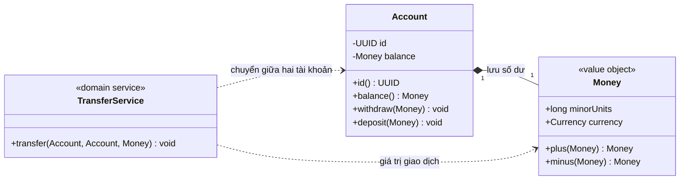
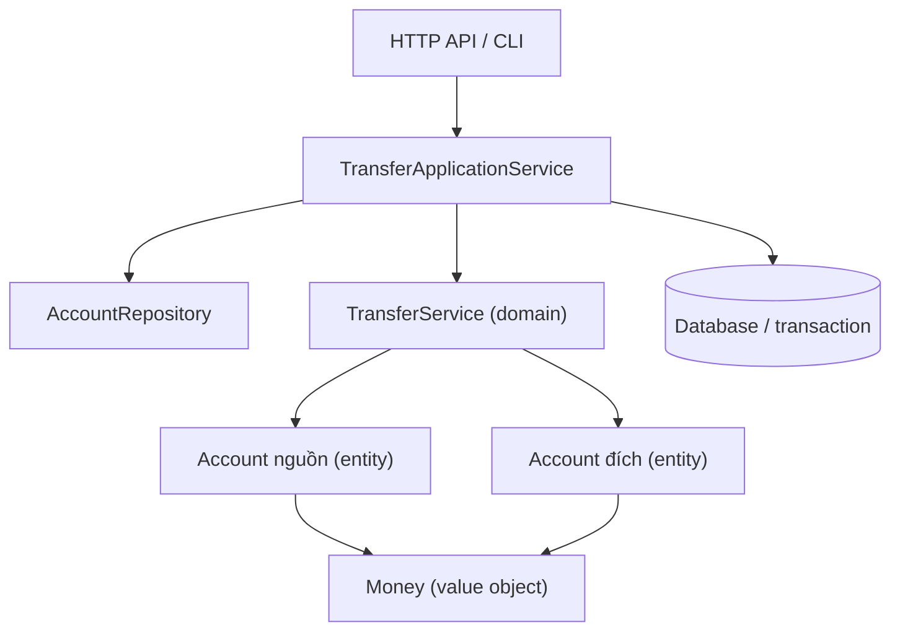
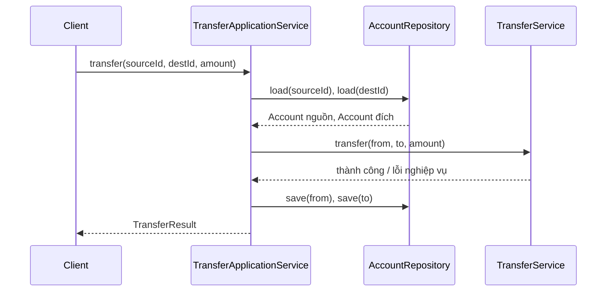

# Entities, value objects, and services in OOP class design

## 1. Three responsibility roles in a business domain model

Suppose we are designing a money-transfer application. It has **bank accounts**, **monetary amounts**, and the operation of **transferring money between accounts**. All three may be modeled as Java classes, but they differ in identity, lifecycle, and equality:

- **Entity:** has its own *identity* throughout its lifecycle. An account with ID `ACC-001` is still the same account after its balance changes.
- **Value Object:** is defined by *its constituent values*. Two objects representing the same 50.000 VND are equal by value without needing separate IDs.
- **Service:** provides *an operation or workflow* that does not naturally belong to one object. A transfer involves two accounts and can be coordinated by `TransferService`.

These are **design roles**, commonly used in Domain-Driven Design (DDD) and object-oriented domain modeling. They are not special Java keywords and do not automatically correspond to `@Entity`, `record`, or `@Service` framework constructs.

A useful guiding question is: **“Do we need to identify an individual object, represent a value, or carry out a behavior?”**

## 2. Comparison

| Criterion | Entity | Value Object | Service |
|---|---|---|---|
| Distinguishing feature | **Identity** distinguishes instances | **Attributes and values** determine equivalence | **Behavior/workflow** |
| Example | `Account`, `Customer`, `Order` | `Money`, `EmailAddress`, `DateRange` | `TransferService`, `ShippingFeeCalculator` |
| Equality | Usually based on a stable ID within the domain | Based on all semantically relevant components | Usually does not require domain-ID equality |
| State | May change through valid operations | Preferably *immutable* | Domain services often avoid mutable business state; application services may hold dependencies |
| Lifecycle | Create, modify, deactivate/delete; ID still identifies the entity | Can be replaced by another instance with the same value | Executes behavior when invoked |
| Logic ownership | Rules intrinsic to the entity | Validation and calculation rules of the value | Rules spanning objects or use-case coordination |
| Risk of misuse | Treating two entities as identical because names/balances match | Mutating a VO used as a Map/Set key | Creating a “god class” service containing all logic |

Not every **noun** should become an Entity, every **number/string** a Value Object, or every **verb** a Service. The role depends on business meaning and the need for identity, invariants, and transactions.

## 3. Diagram: how the three roles connect



In the diagram:

- `Account` has its own identity and holds **the current balance value**. When a balance changes, a new `Money` can be created.
- `Money` represents an amount in minor currency units and a currency code; *two equal Money values* do not make their owning accounts the same account.
- `TransferService` coordinates changes to two entities using a Money value as the transfer amount.

The diamond illustrates **ownership of the balance value as part of account state**; the model defines lifecycle and constraints, not the Java syntax itself. An immutable Value Object may safely be shared by multiple entities.

## 4. Entities: identity is fundamental

An `Account` has these attributes:

```text
id       = 4d3d... (định danh ổn định)
balance  = 100.000 VND
status   = ACTIVE
```

After the owner withdraws 30.000 VND, `balance` becomes 70.000 VND but `id` stays unchanged. It is **still the same account**.

Minimal example:

```java
import java.util.Objects;
import java.util.UUID;

final class Customer {
    private final UUID id;
    private String displayName;

    Customer(UUID id, String displayName) {
        this.id = Objects.requireNonNull(id, "id");
        rename(displayName);
    }

    UUID id() {
        return id;
    }

    String displayName() {
        return displayName;
    }

    void rename(String newName) {
        if (newName == null || newName.isBlank()) {
            throw new IllegalArgumentException("Name is required");
        }
        this.displayName = newName;
    }

    @Override
    public boolean equals(Object other) {
        return other instanceof Customer customer
                && id.equals(customer.id);
    }

    @Override
    public int hashCode() {
        return id.hashCode();
    }
}
```

Here, **two `Customer` instances with the same UUID represent one entity**, even when `displayName` differs (for example, snapshots taken before and after renaming). Including `displayName` in `hashCode()` would be dangerous if the name changes while the object is stored in a `HashSet`.

However, no one-size-fits-all rule for `equals()/hashCode()` applies to every system:

- **IDs assigned at creation** and immutable (UUID, ULID, domain IDs): stable ID-based equality as shown can work.
- **Database-generated IDs assigned on persistence:** unpersisted entities may have a `null` ID; careless ID equality can equate two new objects or change their hash after persistence.
- **ORM/JPA proxies and inheritance:** equality must suit persistence lifecycles and proxy types. Do not blindly copy `getClass()`/`instanceof` from examples into complex JPA entities.
- If *logical equality* between instances is unnecessary, consider comparing IDs explicitly instead of overriding equality.

Good entities usually **encapsulate state and valid state transitions**: `account.withdraw(...)`, `order.cancel(...)`, `customer.rename(...)`. Exposing only getters and setters scatters business logic.

## 5. Value Objects: equal by value, not identity

A `Money` value comprises **an amount in minor units** (*minor units*) and **a currency**:

- `new Money(10_000, VND)` is equal in value to another object with the same components.
- `new Money(10_000, USD)` **does not equal** Money denominated in 10.000 VND.
- For VND, the common minor unit is 1 dong (ISO 4217 specifies 0 decimal places). For USD, 1.999 minor units equal 19,99 USD (100 cents = 1 USD).
- Addition is valid only for matching currencies; conversions need an exchange rate and explicit rounding rules.

**Why use a Money class rather than a plain `long` or `double`?**

```java
double price = 0.1 + 0.2;
System.out.println(price == 0.3); // false
```

`double` represents binary floating-point numbers and cannot exactly represent many decimal monetary values. `long` with minor units or `BigDecimal` with explicit scale/rounding conventions is usually more suitable.

With **Java 17+**, a `record` offers a concise way to create shallowly immutable Value Objects:

```java
import java.util.Currency;
import java.util.Objects;

record Money(long minorUnits, Currency currency) {
    Money {
        Objects.requireNonNull(currency, "currency");
    }

    static Money vnd(long dong) {
        return new Money(dong, Currency.getInstance("VND"));
    }

    Money plus(Money other) {
        sameCurrency(other);
        return new Money(
                Math.addExact(minorUnits, other.minorUnits), currency);
    }

    Money minus(Money other) {
        sameCurrency(other);
        return new Money(
                Math.subtractExact(minorUnits, other.minorUnits), currency);
    }

    private void sameCurrency(Money other) {
        Objects.requireNonNull(other, "other");
        if (!currency.equals(other.currency)) {
            throw new IllegalArgumentException("Currency mismatch");
        }
    }
}
```

`record` generates `equals()`, `hashCode()`, and `toString()` from record components. For example:

```java
Money first = Money.vnd(50_000);
Money second = Money.vnd(50_000);

System.out.println(first == second);      // false: hai instance
System.out.println(first.equals(second)); // true: cùng giá trị
System.out.println(first.plus(second));   // Money[minorUnits=100000, currency=VND]
```

The `plus()` method **creates a new Money**, leaving the original untouched. `Math.addExact()` and `Math.subtractExact()` detect integer overflow rather than silently producing wrong results.

**Records are only shallowly immutable (*shallow immutability*)**. When a field holds a mutable `List` or nested mutable object, defensive copying and careful design are required. For example, `record Basket(List<Item> items)` can still be modified through `basket.items().add(...)` by default if the list is unprotected. In `Money`, `Currency` is immutable and safe to share.

**An important BigDecimal detail:** `new BigDecimal("10.0").equals(new BigDecimal("10.00"))` returns `false` because scales differ, even though `compareTo() == 0`. When modeling Money with BigDecimal, normalize/constrain scale in the constructor and define consistent equality and rounding.

## 6. Services: behavior belonging to neither a single entity nor a value object

An account can enforce **a nonnegative balance on withdrawals**. Money can ensure **matching currencies on addition**. But transferring funds from A to B involves **two Account** objects, so assigning the whole operation to `Account A` or `Account B` may distort one account's responsibility.

A **Domain Service** represents domain behavior spanning objects when there is **no single natural owner**. For example, `TransferService.transfer(from, to, amount)`. Domain services can often be stateless, but **that does not mean all services have no fields**.

An **Application Service** coordinates an entire *use case*: authentication/authorization, opening transactions, loading entities through repositories, invoking domain behavior, saving results, publishing events, or sending notifications. It should avoid replacing the rules that belong in entities or Value Objects.

An example showing both layers:



The `ApplicationService → repository/transaction` path separates loading/persisting from **transfer rules**. Very small applications need not give every layer its own class; correctly placed responsibilities and testability matter most.

## 7. Complete Java 17+ example: Account, Money, and TransferService

Save all the following code in `EntityValueServiceDemo.java`:

```java
import java.util.Currency;
import java.util.Objects;
import java.util.UUID;

public class EntityValueServiceDemo {

    // VALUE OBJECT: bằng nhau theo nội dung, bất biến.
    record Money(long minorUnits, Currency currency) {
        Money {
            Objects.requireNonNull(currency, "currency");
        }

        static Money vnd(long dong) {
            return new Money(dong, Currency.getInstance("VND"));
        }

        Money plus(Money other) {
            requireSameCurrency(other);
            return new Money(
                    Math.addExact(minorUnits, other.minorUnits),
                    currency);
        }

        Money minus(Money other) {
            requireSameCurrency(other);
            return new Money(
                    Math.subtractExact(minorUnits, other.minorUnits),
                    currency);
        }

        private void requireSameCurrency(Money other) {
            Objects.requireNonNull(other, "other");
            if (!currency.equals(other.currency)) {
                throw new IllegalArgumentException(
                        "Currency mismatch: " + currency
                                + " vs " + other.currency);
            }
        }
    }

    // ENTITY: định danh riêng, số dư thay đổi theo thời gian.
    static final class Account {
        private final UUID id;
        private Money balance;

        Account(UUID id, Money openingBalance) {
            this.id = Objects.requireNonNull(id, "id");
            this.balance = Objects.requireNonNull(
                    openingBalance, "openingBalance");
            if (balance.minorUnits() < 0) {
                throw new IllegalArgumentException(
                        "Opening balance must be nonnegative");
            }
        }

        UUID id() {
            return id;
        }

        Money balance() {
            return balance;
        }

        void deposit(Money amount) {
            requirePositive(amount);
            balance = balance.plus(amount);
        }

        void withdraw(Money amount) {
            requirePositive(amount);
            Money next = balance.minus(amount);
            if (next.minorUnits() < 0) {
                throw new IllegalStateException("Insufficient funds");
            }
            balance = next;
        }

        private static void requirePositive(Money amount) {
            Objects.requireNonNull(amount, "amount");
            if (amount.minorUnits() <= 0) {
                throw new IllegalArgumentException(
                        "Amount must be positive");
            }
        }

        @Override
        public boolean equals(Object other) {
            return other instanceof Account account
                    && id.equals(account.id);
        }

        @Override
        public int hashCode() {
            return id.hashCode();
        }
    }

    // DOMAIN SERVICE: quy tắc chuyển tiền qua hai Entity.
    static final class TransferService {
        void transfer(Account from, Account to, Money amount) {
            Objects.requireNonNull(from, "from");
            Objects.requireNonNull(to, "to");
            Objects.requireNonNull(amount, "amount");

            if (from.id().equals(to.id())) {
                throw new IllegalArgumentException(
                        "Cannot transfer to the same account");
            }

            if (amount.minorUnits() <= 0) {
                throw new IllegalArgumentException(
                        "Amount must be positive");
            }

            // Kiểm tra cả hai số dư trước khi bắt đầu thay đổi.
            Money sourceAfter = from.balance().minus(amount);
            if (sourceAfter.minorUnits() < 0) {
                throw new IllegalStateException("Insufficient funds");
            }
            to.balance().plus(amount); // Kiểm tra cùng currency và tràn số.

            from.withdraw(amount);
            to.deposit(amount);
        }
    }

    public static void main(String[] args) {
        Money a = Money.vnd(50_000);
        Money b = Money.vnd(50_000);
        System.out.println("Money equals: " + a.equals(b));

        Account source = new Account(
                UUID.fromString(
                        "00000000-0000-0000-0000-000000000001"),
                Money.vnd(100_000));
        Account destination = new Account(
                UUID.fromString(
                        "00000000-0000-0000-0000-000000000002"),
                Money.vnd(20_000));

        TransferService transfers = new TransferService();
        transfers.transfer(source, destination, Money.vnd(30_000));

        System.out.println("Source: "
                + source.balance().minorUnits() + " VND");
        System.out.println("Destination: "
                + destination.balance().minorUnits() + " VND");

        Account anotherSnapshot = new Account(
                source.id(), Money.vnd(999));
        System.out.println("Same Account identity: "
                + source.equals(anotherSnapshot));

        // Transfer không hợp lệ: source chỉ còn 70.000 VND.
        try {
            transfers.transfer(
                    source, destination, Money.vnd(90_000));
            throw new AssertionError("Expected insufficient funds");
        } catch (IllegalStateException expected) {
            System.out.println("Rejected: " + expected.getMessage());
        }

        System.out.println("Source after rejection: "
                + source.balance().minorUnits() + " VND");
    }
}
```

Compile and run with JDK 17 or later:

```bash
javac EntityValueServiceDemo.java
java EntityValueServiceDemo
```

Expected output:

```text
Money equals: true
Source: 70000 VND
Destination: 50000 VND
Same Account identity: true
Rejected: Insufficient funds
Source after rejection: 70000 VND
```

### Understanding the roles in the example

**`Account` is an Entity.** After the transfer, the balance falls from 100.000 VND to 70.000 VND, but `source.id()` remains unchanged. Two Account objects with the same UUID are treated as one *domain identity* under this example's convention, even if their balance snapshots differ. Do not freely update two independent snapshots bearing the same ID as though they were unrelated records.

**`Money` is a Value Object.** Two 50.000 VND Money values may be different instances yet equal under `equals()`. Addition/subtraction creates new Money values. `Money` enforces currency compatibility and detects overflow without knowing which account owns a balance.

**`TransferService` is a Domain Service.** It coordinates two accounts: prohibits transfers to the same account, requires a positive amount, checks sufficient funds and currency before invoking entity behavior. These are rules governing *an interaction*, not a natural responsibility of Money alone.

**Practical limitation:** the example models only **sequential in-memory** operations. Checking first and then calling `withdraw()` and `deposit()` **does not provide an atomic transaction** under multiple threads, processes, crashes, or databases. Real transfers require transactions, locking/optimistic concurrency, consistent balance checks in the database, idempotency, auditing, and failure recovery. The demo's preflight checks only avoid some failures before updates begin.

## 8. Where should each rule live?

Consider the order-management domain:

| Rule / behavior | Typical owner | Reason |
|---|---|---|
| Email must match the system's accepted format | `EmailAddress` (Value Object) | Invariant of the email value |
| Negative quantities cannot be added to orders | `Order.addLine()` or `OrderLine` | Invariant of an order entity/value |
| A cancelled order cannot become paid | `Order.pay()` | State-transition rule of the same Entity |
| Two Money amounts can be added only in one currency | `Money.plus()` | Mathematical rule of the value |
| Select a shipping charge by weight, region, and applicable policy | Possibly `ShippingFeeCalculator` (Domain Service) | The policy may not belong to any single entity |
| Load orders, authorize access, invoke payment, persist, publish events | `PlaceOrderApplicationService` | Coordinates use cases and infrastructure |
| Query orders by ID from a database | `OrderRepository` | Abstracts persistence rather than domain entities |
| Return display data as JSON to the client | DTO/Presenter/API layer | Communication responsibility, not domain entity behavior |

**Do not push every rule into services.** If `Order` only exposes getters/setters while checks such as “already cancelled?”, “can this be paid?”, and “can a line be added?” live across dozens of services, the result may be an *anemic domain model*. Simple CRUD applications can sometimes tolerate this, but domains with many invariants benefit from keeping behavior close to Entity/Value Object data.

**Do not force every function into an Entity either.** A shipping algorithm may combine rate policies, delivery regions, and service tiers. If no entity clearly owns it, a Domain Service is appropriate.

## 9. How do Domain Services and Application Services differ?

Both may end in `Service`, but their responsibilities differ.



An object-oriented design can define contracts such as:

```java
// Trích đoạn minh họa về cấu trúc tầng ứng dụng,
// giả định Account, Money và TransferService là các kiểu của domain.
interface AccountRepository {
    Account load(java.util.UUID id);
    void save(Account account);
}

final class TransferApplicationService {
    private final AccountRepository accounts;
    private final TransferService domainTransfers;

    TransferApplicationService(
            AccountRepository accounts,
            TransferService domainTransfers) {
        this.accounts = java.util.Objects.requireNonNull(accounts);
        this.domainTransfers =
                java.util.Objects.requireNonNull(domainTransfers);
    }

    void transfer(java.util.UUID sourceId,
                  java.util.UUID destinationId,
                  Money amount) {
        Account from = accounts.load(sourceId);
        Account to = accounts.load(destinationId);

        domainTransfers.transfer(from, to, amount);

        accounts.save(from);
        accounts.save(to);
    }
}
```

This fragment illustrates **responsibility allocation**, not production transaction handling. Two separate `save()` calls can fail between operations. In a database application, the *transaction boundary* usually belongs to the Application Service/infrastructure: both balance changes must commit or roll back together; distributed systems impose additional constraints.

The key distinction:

- **Domain Service:** expresses domain rules (*what makes a money transfer valid?*), testable with plain entities/VOs.
- **Application Service:** orchestrates user/system actions (*what to load, whom to authorize, which transaction to start, what to save and return?*).
- **Infrastructure Service/Adapter:** implements email delivery, database access, HTTP calls, file storage, or caching.

You do not need three separate service classes for every operation. When an Entity owns all required behavior, an Application Service may call it directly for simpler, clearer design.

## 10. Domain Entities versus JPA Entities

A class annotated with `@jakarta.persistence.Entity` is **a persistence entity** in JPA. That does not automatically make it a well-designed **Domain Entity**:

- JPA typically requires constructors, primary-key strategies, lazy loading, and session-management rules.
- A database ID is not necessarily the **domain identifier** exposed through the API or to users.
- A Domain Value Object may be mapped with `@Embeddable`, converters, or a different column representation.
- A Domain Entity may be persisted through repositories using JDBC, NoSQL documents, event stores, files, or even only in memory; it does not require `@Entity`.
- Spring's `@Service` is a stereotype annotation for bean discovery; it **does not determine** whether the bean represents a Domain Service or an Application Service.

An example of embedded values in JPA:

```java
// Pseudocode minh họa ý tưởng ánh xạ; cần JPA dependency/annotation
// và cấu hình phù hợp trong dự án thực.
@Embeddable
class MoneyEmbeddable {
    long minorUnits;
    String currencyCode;
}
```

Do not choose Entity versus Value Object **solely based on database storage**. Start with domain rules, then select an appropriate persistence mapping.

## 11. Common design mistakes

### Mistake 1: treating entities with matching attributes as the same entity

Two customers both named “Lan” and born on the same date are not necessarily the same person. Entity equality must use the correct business identity, not attributes that may be duplicated or changed.

### Mistake 2: storing a mutable Value Object as a Map key

```java
// Không nên: lớp địa chỉ có thể sửa và hashCode phụ thuộc thành phần.
Map<Address, Integer> counts = new HashMap<>();
counts.put(address, 1);
address.setStreet("Đường khác");
```

If the hash changes after insertion, `get(address)` can return unexpected results. Use immutable Value Objects; represent address changes with new instances.

### Mistake 3: using raw primitives for rule-heavy values

```java
void charge(double amount, String currency);
```

Callers may pass negative values, NaN, incorrect currencies, or inconsistent rounding. A `Money` Value Object with validation in its constructor and a clear arithmetic API is safer.

### Mistake 4: letting services read/change all internal fields

```java
// Tránh mở public field để service tự gán không có kiểm soát:
account.balance = account.balance.minus(amount);
```

Keep invariants with Entities and expose named behaviors. When logic spans Entities, a domain service **coordinates through valid entity APIs**, rather than breaking encapsulation.

### Mistake 5: creating a service for every calculation

If `Money.plus()` simply adds values and checks currency, a separate `MoneyAdditionService` is unnecessary. That logic belongs naturally in the Value Object.

### Mistake 6: turning every value into an Entity

If `EmailAddress("a@example.test")` has no independent lifecycle or identity, adding an `emailId` and repository for every email only complicates the model. Use an Entity when **independent identity and history really matter**.

### Mistake 7: assuming stateless services have no dependencies

```java
final class ShippingFeeService {
    private final FeePolicy policy;

    ShippingFeeService(FeePolicy policy) {
        this.policy = policy;
    }

    Money calculate(Shipment shipment) {
        return policy.feeFor(shipment);
    }
}
```

A service may retain **references to dependencies**, such as a fee policy, without storing **mutable business state specific to each calculation**. Stateless describes how runtime state is managed, not an absence of fields.

## 12. Six questions when designing a new class

1. **Does changing an attribute make this a different object?** If not, it may be an Entity. An order remains the same order after its status changes.
2. **Can two objects with the same content replace each other?** If so, and independent identity is unnecessary, favor a Value Object.
3. **Are validation or calculation rules closely tied to this data?** Put them in a VO or Entity rather than copying them among services.
4. **Does the behavior affect several Entities or a domain policy without one natural owner?** Consider a Domain Service.
5. **Does the behavior mainly coordinate transactions, repositories, permissions, or networks?** Consider an Application Service or infrastructure adapter.
6. **When a business rule changes, is there one obvious place to edit?** If you must search multiple controllers/services/mappers, the responsibility boundaries may be wrong.

## 13. Exercises and self-checks

**Exercise 1 — Customer and EmailAddress.** Each customer has a UUID and an email address. Customers can change their email.

- **Hint:** `Customer` is an Entity because its UUID remains stable; `EmailAddress` is an immutable VO, replaced by a new instance when email changes. Email changes should go through Customer behavior and appropriate uniqueness checks if the system requires them.

**Exercise 2 — Identical addresses.** Two different customers receive shipments at “12 Nguyen Hue Street, Ho Chi Minh City”.

- **Hint:** two Address VOs can be equal by value while the two Customer Entities remain distinct. Do not use an address as customer identity.

**Exercise 3 — Balance reduction on withdrawal.** Where should the “balance must not become negative” rule live?

- **Hint:** the `Account` Entity protects the balance invariant on withdrawal; `Money` protects currency and arithmetic. A domain service coordinates interactions among accounts.

**Exercise 4 — Payment followed by email.** `PayOrderApplicationService` needs to load an order, check authorization, call a payment gateway, save the state, and publish a notification.

- **Hint:** orchestration belongs in the Application Service. The `Order` Entity determines whether a transition to `PAID` is permitted; gateway/email code belongs in adapters. Avoid moving every decision into the service.

**Exercise 5 — Test the Java example.** Extend `EntityValueServiceDemo.java` to verify:

```java
// Đặt trong main, sau khi khởi tạo hai Account:
Money x = Money.vnd(5_000);
Money y = Money.vnd(5_000);
if (!x.equals(y) || x == y) {
    throw new AssertionError("Value Object equality failed");
}

Money beforeSource = source.balance();
Money beforeDest = destination.balance();
try {
    transfers.transfer(source, destination, Money.vnd(-10));
    throw new AssertionError("Negative amount must fail");
} catch (IllegalArgumentException expected) {
    // Thao tác không hợp lệ đã bị chặn.
}

if (!source.balance().equals(beforeSource)
        || !destination.balance().equals(beforeDest)) {
    throw new AssertionError("Invalid transfer changed balances");
}
```

This tests the rule that **negative input is rejected** in a sequential flow. Ensuring real transfers are atomic across multiple threads or processes requires transaction/concurrency tests against the persistence system.

---

**Remember:** an **Entity** is identified by *identity*, a **Value Object** by *value*, and a **Service** provides *behavior/coordination* appropriate to the domain or use-case boundary. Assigning roles correctly keeps invariants in the right place, reduces duplicated logic, and makes Java classes easier to change and test.
