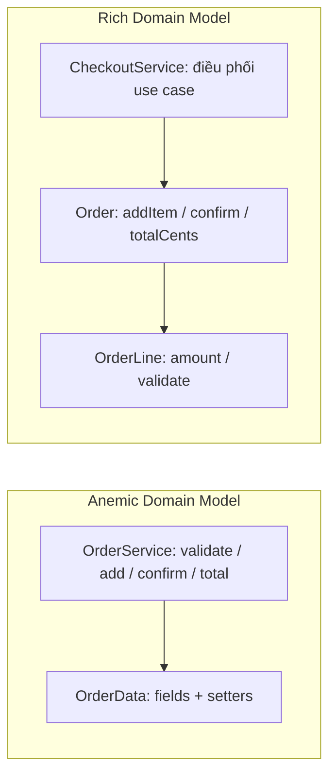
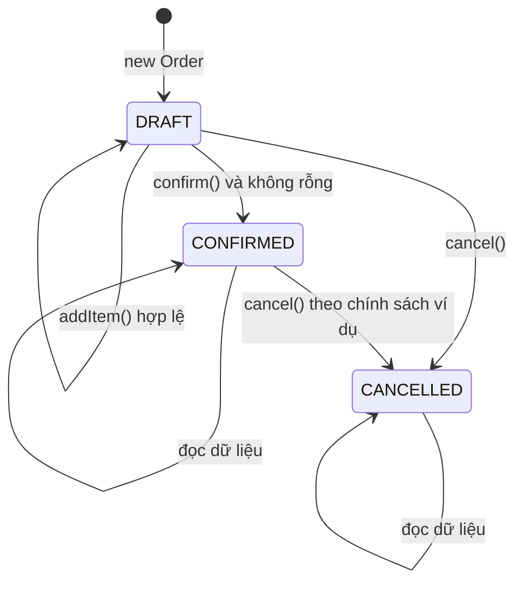
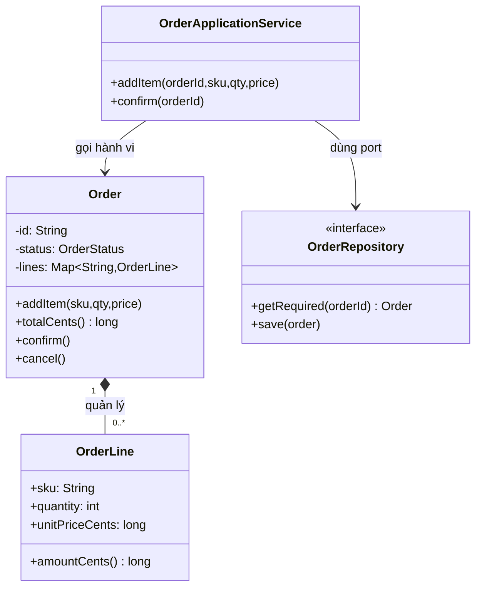

# Rich domain models and anemic data models in Java OOP

When designing classes, we often face a choice: should `Order` hold only `status`, `items`, `total`, and getters/setters, or should it know **how to add items, compute totals, confirm orders, and reject invalid changes**?

This is the core distinction between a **Rich Domain Model** and an **Anemic Domain Model** (usually mostly data). Both have classes representing data, but differ in **where business rules live, who can change state, and how invariants are enforced**.

This lesson aims to clarify the difference, guide correct Java modeling, select an approach based on business complexity, recognize when domain services are needed, and test valid states.

## 1. Two ways to model the same problem

Suppose a retail application has these rules:

1. An order starts in `DRAFT`.
2. Items may be added only while it remains `DRAFT`; each line has a positive quantity and nonnegative unit price.
3. An order may be confirmed only when it contains at least one line.
4. Items cannot be added after `CONFIRMED`.
5. The order total must always equal the sum of its line totals.

### Data-only (anemic) model

```java
// Minh họa một kiểu anemic có thể gây lỗi nếu mở setter công khai.
class OrderData {
    public String id;
    public String status;
    public java.util.List<OrderLineData> lines;
    public long totalCents;
}

class OrderLineData {
    public String sku;
    public int quantity;
    public long unitPriceCents;
}
```

Business logic is often pushed into services:

```java
// Phác thảo: toàn bộ nghiệp vụ ở service.
void confirm(OrderData order) {
    if (order.lines == null || order.lines.isEmpty()) {
        throw new IllegalStateException("Empty order");
    }
    order.status = "CONFIRMED";
}
```

Another caller can still directly assign `order.status = "CONFIRMED"` or `order.totalCents = -1` without invoking `confirm`. When many services independently perform these checks, rules are easily duplicated or become inconsistent.

**Not every data class is bad.** HTTP request/response DTOs, configuration objects, data-transfer records, and query results can reasonably contain only values. An “Anemic Domain Model” is concerning when **the business domain has many rules**, yet entities cannot protect their behavior or invariants.

### Rich domain model

```java
// API ở mức ý tưởng:
order.addItem("BOOK", 2, 120_00);
order.confirm();
long payable = order.totalCents();

// Không cung cấp order.setStatus(...) hoặc
// order.setTotalCents(...) cho bên ngoài gọi tùy ý.
```

Here, `Order` knows **which operations are valid for its own state**. Client code speaks in domain terms (`addItem`, `confirm`), rather than composing setters and hoping every caller remembers all the rules.



The diagram does not imply that a Rich Model contains **every** operation. Database writes, email delivery, and shipping API calls still belong to external components; they are not natural behaviors of an `Order` object.

## 2. Comparing important criteria

| Criterion | Rich Domain Model | Anemic Domain Model |
| --- | --- | --- |
| What does an entity contain? | Data, behaviors, and constraints together | Mainly fields, getters/setters, or records |
| Who enforces entity invariants? | Constructors/factories and domain methods | Usually external services; easy to bypass when mutation is exposed |
| How is state changed? | `order.confirm()`, `account.withdraw(amount)` | `order.setStatus(...)` or services changing fields |
| Cohesion | Behavior lives close to related data | Behavior may be separated from the data |
| Risk of duplicated rules | Lower when APIs protect state | Higher when multiple services mutate data |
| Initial simplicity | Requires designing domain APIs and state | Less code for simple data/CRUD |
| Best fit | Rule-heavy domains with states and transitions | DTOs, mapping, reporting, simple CRUD with few rules |
| Risks | Bloated entities, I/O inside domain, tricky ORM loading | Scattered “transaction scripts” and setters that break invariants |

**You cannot classify an architecture solely by whether getters/setters exist.** An entity may expose getters and controlled update methods while remaining rich. An immutable data class created by a service may be good design when business logic is genuinely simple.

## 3. Invariants: the most important criterion

An **invariant** is a condition that must hold in every publicly valid object state.

For orders:

- `lines` cannot contain a line with `quantity <= 0`.
- `totalCents` is nonnegative and equals the sum of `quantity × unitPriceCents` for all lines.
- `CONFIRMED` is reachable only when the order has line items.
- After `CONFIRMED`, `addItem` cannot succeed.
- State transitions follow only defined rules.

In a rich model, behaviors are designed around invariants:



In real projects, canceling a paid order may require refunds, shipment checks, and additional steps. The diagram only describes **a simple policy**. Define states and transitions for the actual domain instead of applying `CANCELLED` indiscriminately to every system.

## 4. Complete Java 17 example: Rich Domain Model

The following is **a standalone runnable Java file**, requiring no Spring, JPA, database, or external libraries. It contains distinct responsibilities:

- `OrderLine`: a value object holding line data and calculating the line amount.
- `Order`: an entity/aggregate managing line items, totals, state, and behavior.
- `OrderRepository`: a persistence/query port.
- `OrderApplicationService`: coordinates the use case.
- `ConsoleOrderNotifier`: an adapter demonstrating an external interaction.

Create `RichVsAnemicDemo.java`:

```java
import java.util.ArrayList;
import java.util.LinkedHashMap;
import java.util.List;
import java.util.Map;
import java.util.Objects;

public class RichVsAnemicDemo {

    enum OrderStatus {
        DRAFT, CONFIRMED, CANCELLED
    }

    // Value object: một dòng đơn hàng hợp lệ ngay từ lúc khởi tạo.
    record OrderLine(String sku, int quantity, long unitPriceCents) {
        OrderLine {
            if (sku == null || sku.isBlank()) {
                throw new IllegalArgumentException("SKU is required");
            }
            if (quantity <= 0) {
                throw new IllegalArgumentException("Quantity must be positive");
            }
            if (unitPriceCents < 0) {
                throw new IllegalArgumentException("Negative unit price");
            }
        }

        long amountCents() {
            return Math.multiplyExact((long) quantity, unitPriceCents);
        }
    }

    static final class Order {
        private final String id;
        private final Map<String, OrderLine> lines = new LinkedHashMap<>();
        private OrderStatus status = OrderStatus.DRAFT;

        Order(String id) {
            if (id == null || id.isBlank()) {
                throw new IllegalArgumentException("Order id is required");
            }
            this.id = id;
        }

        String id() {
            return id;
        }

        OrderStatus status() {
            return status;
        }

        List<OrderLine> lines() {
            // Chỉ trả snapshot; caller không thể sửa danh sách nội bộ.
            return List.copyOf(lines.values());
        }

        void addItem(String sku, int quantity, long unitPriceCents) {
            requireDraft();

            // Tạo value object sẽ tự kiểm tra số lượng/đơn giá.
            OrderLine incoming = new OrderLine(sku, quantity, unitPriceCents);
            OrderLine old = lines.get(incoming.sku());

            OrderLine candidate;
            if (old == null) {
                candidate = incoming;
            } else {
                if (old.unitPriceCents() != incoming.unitPriceCents()) {
                    throw new IllegalArgumentException(
                            "Different price for the same SKU");
                }
                int merged = Math.addExact(
                        old.quantity(), incoming.quantity());
                candidate = new OrderLine(
                        incoming.sku(), merged, incoming.unitPriceCents());
            }

            // Bảo đảm tổng tiền không tràn long trước khi sửa trạng thái.
            long oldAmount = old == null ? 0 : old.amountCents();
            long nextTotal = Math.subtractExact(totalCents(), oldAmount);
            Math.addExact(nextTotal, candidate.amountCents());

            lines.put(candidate.sku(), candidate);
        }

        long totalCents() {
            long total = 0;
            for (OrderLine line : lines.values()) {
                total = Math.addExact(total, line.amountCents());
            }
            return total;
        }

        void confirm() {
            requireDraft();
            if (lines.isEmpty()) {
                throw new IllegalStateException("Cannot confirm empty order");
            }
            status = OrderStatus.CONFIRMED;
        }

        void cancel() {
            if (status == OrderStatus.CANCELLED) {
                return; // gọi lặp giữ nguyên kết quả
            }
            // Chính sách demo cho phép hủy DRAFT và CONFIRMED.
            status = OrderStatus.CANCELLED;
        }

        private void requireDraft() {
            if (status != OrderStatus.DRAFT) {
                throw new IllegalStateException(
                        "Order is not editable: " + status);
            }
        }
    }

    // Port: hợp đồng lưu trữ, domain không biết JDBC hay SQL.
    interface OrderRepository {
        Order getRequired(String orderId);
        void save(Order order);
    }

    // Adapter trong bộ nhớ dùng cho ví dụ.
    static final class InMemoryOrderRepository implements OrderRepository {
        private final Map<String, Order> byId = new LinkedHashMap<>();

        @Override
        public Order getRequired(String orderId) {
            Order found = byId.get(orderId);
            if (found == null) {
                throw new IllegalArgumentException("Order not found");
            }
            return found;
        }

        @Override
        public void save(Order order) {
            Objects.requireNonNull(order, "order");
            byId.put(order.id(), order);
        }
    }

    interface OrderNotifier {
        void confirmed(Order order);
    }

    static final class ConsoleOrderNotifier implements OrderNotifier {
        @Override
        public void confirmed(Order order) {
            System.out.println("Notified: " + order.id());
        }
    }

    // Application service: phối hợp, không lặp quy tắc của Order.
    static final class OrderApplicationService {
        private final OrderRepository orders;
        private final OrderNotifier notifier;

        OrderApplicationService(
                OrderRepository orders, OrderNotifier notifier) {
            this.orders = Objects.requireNonNull(orders);
            this.notifier = Objects.requireNonNull(notifier);
        }

        void addItem(String orderId, String sku, int qty, long priceCents) {
            Order order = orders.getRequired(orderId);
            order.addItem(sku, qty, priceCents);
            orders.save(order);
        }

        void confirm(String orderId) {
            Order order = orders.getRequired(orderId);
            order.confirm();
            orders.save(order);
            notifier.confirmed(order);
        }
    }

    public static void main(String[] args) {
        InMemoryOrderRepository repository = new InMemoryOrderRepository();
        Order order = new Order("O-100");
        repository.save(order);

        OrderApplicationService service = new OrderApplicationService(
                repository, new ConsoleOrderNotifier());

        service.addItem("O-100", "BOOK", 2, 12_000);
        service.addItem("O-100", "PEN", 3, 2_500);

        System.out.println("Total cents: " + order.totalCents());
        service.confirm("O-100");
        System.out.println("State: " + order.status());

        try {
            service.addItem("O-100", "ERASER", 1, 500);
        } catch (IllegalStateException expected) {
            System.out.println(expected.getMessage());
        }

        try {
            Order empty = new Order("O-200");
            empty.confirm();
        } catch (IllegalStateException expected) {
            System.out.println(expected.getMessage());
        }

        order.cancel();
        System.out.println("After cancel: " + order.status());
    }
}
```

Compile and run:

```bash
javac RichVsAnemicDemo.java
java RichVsAnemicDemo
```

Expected output:

```text
Total cents: 31500
Notified: O-100
State: CONFIRMED
Order is not editable: CONFIRMED
Cannot confirm empty order
After cancel: CANCELLED
```

### Why is this a “rich” model?

1. **There are no `status` or `totalCents` setters.** State changes only through named methods with explicit rules.
2. **`OrderLine` enforces its own invariants.** A line item with quantity 0 or negative price cannot be validly created.
3. **`Order` enforces aggregate rules.** It controls when lines may be added, merges SKUs, rejects inconsistent prices, and refuses to confirm empty orders.
4. **Totals are calculated from the actual source data.** There is no mutable `totalCents` field that can disagree with order lines.
5. **Overflow is detected explicitly.** `Math.multiplyExact` and `Math.addExact` throw `ArithmeticException` rather than silently producing invalid totals. When a correct total cannot be computed, `addItem` does not update the new line.
6. **Internal collections are not exposed.** `lines()` returns a `List.copyOf` snapshot of immutable `OrderLine` objects; callers cannot add/remove or modify line items through the getter.

The application service is still valuable: it loads orders through a repository, invokes domain behavior, persists changes, and requests notifications. It need not repeat `if (status != DRAFT)` checks or calculate line totals itself.

### Limitations to understand

This example **runs sequentially in memory**. `InMemoryOrderRepository` holds a reference to the same `Order` instance; if `confirm()` succeeds but `save()` or the notifier fails, there is no transactional rollback. Real systems need suitable transactions, correct entity loading/saving, versioning/locking for concurrent updates, and notification-after-commit policies (such as a transactional outbox).

Integer `long` cents illustrate exact arithmetic and overflow limits; for multiple currencies and rounding modes, use a `Money` value object with amount, currency, and explicit scale/rounding policies. Do not use `double` to store monetary amounts requiring exactness.

`Order.cancel()` permits cancellation after confirmation in the demo. A real application may prohibit cancellation after shipping or require refunds and authorization. Such rules belong in the domain model or an appropriate responsible service.

## 5. What should remain outside an entity?

“Rich” means **rich in business behavior**, not an object that does everything.

| Behavior | Typical owner | Reason |
| --- | --- | --- |
| `Order.addItem` | `Order` | Modifies the order's own state and invariants |
| `Order.confirm` | `Order` | Transitions aggregate state |
| `OrderLine.amountCents` | `OrderLine` | Calculates from the line's own data |
| `CheckoutService.checkout` | Application service | Coordinates domain objects, repositories, and transactions |
| `PricingPolicy.calculate` | Domain policy/service | Pricing rule may be independent and require multiple inputs |
| `OrderRepository.save` | Persistence port + adapter | Interacts with databases/data storage |
| `EmailSender.send` | Email port + adapter | Communicates with external systems |
| Receiving JSON and returning an HTTP status | Controller / web adapter | API communication contract |
| Running `@Transactional` | Usually at an application boundary | Transaction scope of a use case |

A warning sign is `Order.confirm()` directly calling `new JdbcConnection(...)` or `smtp.send(...)`. That couples the entity to infrastructure, forces database/email dependencies into state-transition tests, and lets I/O failures complicate invariants. A domain method should usually change state or return domain values/events while external components perform side effects.

### A domain service does not imply an anemic model

Sometimes a rule does not clearly belong to **one** entity:

- Transferring funds between accounts requires validating both and recording changes atomically.
- Customer-tier promotions may involve `Customer`, `Order`, `Promotion`, and a policy.
- Seat allocation may involve flights, seating plans, and booking permissions.

Use a domain service/policy for rules requiring a separate context, while entities still enforce their own invariants. For example, a transfer service coordinates `source.withdraw(...)` and `destination.deposit(...)` within a transaction; `Account` ensures withdrawals do not produce negative balances when that is an account rule.

Conversely, placing all rules in one service and only calling `setBalance`, `setStatus`, and `setLines` often indicates that entities have lost control over their state.

## 6. Do not confuse this with DTOs, records, and POJOs

**Records are not automatically anemic.** A Java record can validate in a compact constructor and provide calculations or immutable behaviors:

```java
record Quantity(int value) {
    Quantity {
        if (value <= 0) {
            throw new IllegalArgumentException("Positive only");
        }
    }

    Quantity plus(Quantity other) {
        return new Quantity(Math.addExact(value, other.value));
    }
}
```

`Quantity` has only one field but meaningful behavior, making it a good value object. Conversely, `record CheckoutRequest(String sku, int quantity)` may only carry input data, which is perfectly reasonable.

**POJO** (*Plain Old Java Object*) means a Java class does not require special framework inheritance; it does not indicate whether it is rich or anemic. **Entity** concerns identity/lifecycle; **DTO** concerns transporting data; **Rich/Anemic** concerns ownership of business behavior. These are separate dimensions.

| Type | Main purpose | Must it be rich/anemic? |
| --- | --- | --- |
| HTTP request DTO | Receives data through APIs | Data-only representation is often appropriate |
| HTTP response DTO | Returns data to clients | Data-only representation is often appropriate |
| Value object `Money` | Valid monetary values and arithmetic | Should enforce invariants and provide useful behavior |
| Domain entity `Order` | Identity, lifecycle, order invariants | Rich behavior helps when there are rules/state |
| ORM persistence entity | Represents stored database data | May be separated from the domain depending on architecture |
| Projection/read model | Reports and query/read-only results | Mainly data is sufficient |
| Domain service | Business rules spanning objects | Has behavior; not necessarily extensive state |

A system can **combine both approaches**: rich models for complex transactions and records/DTOs for lookups, reporting, import/export, and read-only screens.

## 7. Evaluating changing business requirements

A good design proves its value when requirements change.

**Requirement A:** “Once an order is confirmed, its line items cannot be changed.”

- In a rich model, this rule lives in `Order.addItem` (and every equivalent mutation method).
- With a data-only model and public setters, all controllers/services/jobs must remember the check. Missing one write path corrupts data.

**Requirement B:** “Add `PAID` status and forbid canceling paid orders.”

- Rich: add a `markPaid()` transition, update `cancel()` conditions, and test the state machine.
- Anemic: several services may need updates if each checks status independently; centralized and strictly enforced state changes in a domain service can still maintain consistency.

**Requirement C:** “Switch order storage from database A to database B.”

- This is an adapter/repository change, not a reason to modify `Order.confirm()`.
- If an entity directly calls SQL, the boundaries are mixed regardless of how many methods it contains.

**Requirement D:** “Change tax calculations by region and third-party configuration.”

- Do not force entities to call an external tax provider over HTTP.
- An application service obtains inputs through an adapter and uses a domain `TaxCalculator` policy; a dedicated policy object can handle rules requiring multiple types of inputs.

## 8. When is an Anemic Model appropriate?

“Anemic” should not be used to dismiss every data-only class. It can be **a deliberate choice** when:

1. An application is mostly **simple CRUD**: storing/editing forms with few rules.
2. The class is a **DTO/projection** used to transfer or read data, not decide business state.
3. Logic is primarily **pipeline data transformation** with little identity/lifecycle; pure functions may be clearer than forcing behavior into objects.
4. Business operations are centrally controlled and callers cannot bypass rules via arbitrary setters.
5. This is simple internal supporting code where complex aggregates/policies/services would cost more than they help.

An example read-only model:

```java
record MonthlySalesReport(
        java.time.YearMonth month,
        long orderCount,
        long revenueCents) { }
```

It need not call SQL or decide how reports are aggregated: a query service creates `MonthlySalesReport`, which only holds results. This is a suitable data model, not an unfinished rich entity.

**The deciding factor:** with many invariants and state transitions spanning workflows, rich domain models often offer clear benefits. When code mostly reads/writes data without core behaviors worth encapsulating, DTO/data models may be simpler.

## 9. Mistakes in applying Rich Models

### Mistake 1 — Turning an entity into a God Object

```java
class Order {
    void confirm() { /* domain */ }
    void persistByJdbc() { /* SQL */ }
    void emailCustomer() { /* SMTP */ }
    void renderJson() { /* HTTP serialization */ }
}
```

This is not a healthy rich domain model. `Order` has absorbed I/O and presentation responsibilities. Move them to adapters and application services, keeping entity behavior related to its own state and rules.

### Mistake 2 — Calling a model “rich” just by adding forwarding getters

```java
class Order {
    long getTotal() { return total; }
    String getStatus() { return status; }
    void setStatus(String next) { status = next; }
}
```

Method count alone does not make a rich model. The API must express **business intent** and prevent invalid state.

### Mistake 3 — Partially relying on external state, then forgetting to revalidate

For example, `Order` cannot know actual inventory when it belongs to an external service. The application service or a policy with the appropriate data source must check/reserve inventory; `Order` only owns invariants it can enforce with available information.

### Mistake 4 — Putting every formula in an entity even when it does not belong there

Customer-contract discounts or country-specific taxes may require `PromotionPolicy`, `TaxPolicy`, or a domain service; embedding all of these in `Order` adds coupling and excessive knowledge.

### Mistake 5 — Forgetting database constraints and concurrency

`Order.confirm()` enforces state rules for **one instance**. If two requests load and modify the same order concurrently, updates may be lost (*lost update*). Persisting through JPA/SQL requires transactions, optimistic locking (such as `@Version`), or appropriate synchronization. A correct in-memory domain method **does not guarantee** consistency across distributed processes.

### Mistake 6 — Invoking external services from entities inside transactions

Sending email in `Order.confirm()` does not make database and SMTP commits atomic. If email succeeds but the database rolls back, users see confirmation for an order that was not stored. One solution is an outbox entry committed with the database, followed by post-commit delivery with retries and idempotency.

## 10. DDD aggregates, encapsulation, and Spring/JPA

In **Domain-Driven Design (DDD)**, an *aggregate root* governs invariants that must remain immediately consistent within a group of objects. `Order` may be an aggregate root with `OrderLine` as an internal component.



An **aggregate** does not mean every 1–N relationship is composition or that every object in the diagram must share one database table. Choose aggregate boundaries according to invariants that updates must preserve. For example, `Order` should not directly own all of `Customer` or `Product` merely because they are referenced.

A Spring Boot/JPA organization may include:

```text
orders/
  application/
    OrderApplicationService.java
  domain/
    Order.java
    OrderLine.java
    OrderStatus.java
    OrderRepository.java
    PricingPolicy.java
  infrastructure/
    JpaOrderRepositoryAdapter.java
    OrderJpaEntity.java
    OrderJpaMapper.java
    OutboxPublisher.java
  web/
    OrderController.java
    OrderRequest.java
    OrderResponse.java
```

There are two practical approaches:

- **Domain entity independent of JPA:** mappers convert between domain and persistence entities. Domain tests remain lightweight and framework-independent, and persistence changes are easier, at the cost of mapping code.
- **JPA entity also serving as domain entity:** reduces mapping, but requires care around ORM constructors, proxies, lazy loading, public setters, dirty checking, and `equals/hashCode` behavior. Whether using one class or two, public business methods should still enforce invariants.

Place `@Transactional` at an appropriate use-case boundary where several persistence steps must succeed together. It neither replaces domain-method rule enforcement nor extends a transaction automatically to mail servers or HTTP services.

**Appropriate testing strategy:**

| Test level | What to verify |
| --- | --- |
| Domain unit test | `Order.addItem` only works in `DRAFT`; invalid quantity/price is rejected; totals are correct |
| State-transition test | Empty orders cannot be confirmed; post-confirmation edits fail; cancellation follows policy |
| Application service test | Loads correct ID, invokes domain behavior, saves and requests notifications according to contract |
| Persistence integration test | Save/reload preserves invariants; verifies uniqueness, locking, and transactions |
| API test | JSON, input validation, HTTP statuses, and authorization |
| Concurrency/integration test | Two requests changing the same order do not silently overwrite each other's state |

## 11. Safely refactoring from an anemic to a rich model

Suppose the system uses `OrderData` with public fields while `OrderService` implements all the rules. There is no need to rewrite everything at once.

1. **Find every state-mutation path:** controllers, services, batch jobs, imports, message consumers; list where status, lines, and totals are assigned.
2. **Specify invariants:** valid states, confirmation conditions, total calculation, and quantity rules.
3. **Add tests for existing behavior:** cover valid flows, errors, and post-error states before moving code.
4. **Move behavior next to the data it protects:** add `Order.confirm()` and `Order.addItem()`, and create immutable `OrderLine` values.
5. **Migrate callers:** services replace `setStatus` or direct `List` mutations with domain operations.
6. **Narrow the API:** once callers have migrated, remove/restrict dangerous setters and getters exposing mutable collections.
7. **Keep orchestration in application services:** organize transactions, repositories, idempotency, and notifications at appropriate layers.
8. **Review persistence:** ORM mappings, migrations, concurrency, and reloading objects with older states.
9. **Stop where it adds value:** do not turn every DTO/report into a complex entity without business invariants to enforce.

These steps keep changes reviewable and verifiable. If legacy database records may violate new invariants, plan explicit remediation/migration instead of assuming new constructors can read every old record.

## 12. Review questions and exercises

### Exercise 1 — Spot the anemic model

```java
class BankAccount {
    public String id;
    public long balanceCents;
}
class TransferService {
    void transfer(BankAccount a, BankAccount b, long amount) {
        a.balanceCents -= amount;
        b.balanceCents += amount;
    }
}
```

Identify at least four problems: negative transfer amounts or an amount of 0, insufficient funds, overflow, null accounts, partial updates, or concurrency. Redesign `Account.withdraw`/`deposit` so each account protects its invariants. Decide where the transfer across **two** accounts belongs among application/domain services and transactions.

### Exercise 2 — Distinguish DTOs from rich entities

Using `CreateOrderRequest`, `Order`, `OrderLine`, and `OrderResponse`, identify which classes only transport data, which need behavior, and why. Do not let `OrderResponse` calculate totals instead of the domain.

### Exercise 3 — Add business rules

Extend the Java example: allow `cancel()` only in `DRAFT`; add `pay()` to transition from `CONFIRMED` to `PAID`; prohibit adding lines or canceling paid orders. Draw a state machine and test all valid and invalid transitions.

### Exercise 4 — Design inventory limits

A `Product` has stock that changes across thousands of orders. Should `Order` store the entire inventory? Propose `InventoryReservationService` or a separate inventory aggregate, and specify transactions/locking around reservations and order placement.

### Exercise 5 — Challenge an architectural choice

A screen only displays `MonthlySalesReport(month, totalOrders, revenue)` built from a SQL query without state transitions. What would a rich domain class add? Is it needed? Explain why a simple record/projection is appropriate.

## 13. Checklist for choosing rich or anemic models

- **Does the domain have many states/transitions?** If so, entities should provide behavior for those transitions.
- **Must invariants hold across every caller?** Enforce them in the responsible owner's constructor, factory, or domain methods.
- **Do multiple services repeat the same rule?** Choose one source of truth and eliminate invalid mutation paths.
- **Is the model only a DTO/projection or simple CRUD?** A data-only class may be sufficient and more readable.
- **Does behavior really belong to this object?** If it requires many entities or external policies, consider a domain service/policy.
- **Does the entity directly call SQL/email/HTTP?** Extract ports/adapters/application services to preserve boundaries.
- **Do public setters bypass invariants?** Narrow the API and expose domain-specific operations.
- **Are invariants protected during concurrency/persistence?** Use appropriate transactions, database constraints, locking, and tests as the design scales.
- **Is the resulting model easier to understand and test?** More classes with scattered rules do not achieve the goal.

**Conclusion:** Rich Domain Models fit domains where object state and rules need consistent protection; data-only models fit DTOs, projections, and simple business operations. Choose based on **actual responsibilities and invariant ownership**, not numbers of getters/setters or class length.
