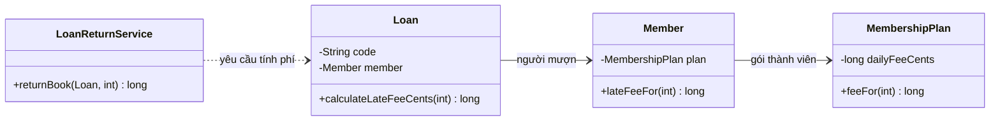
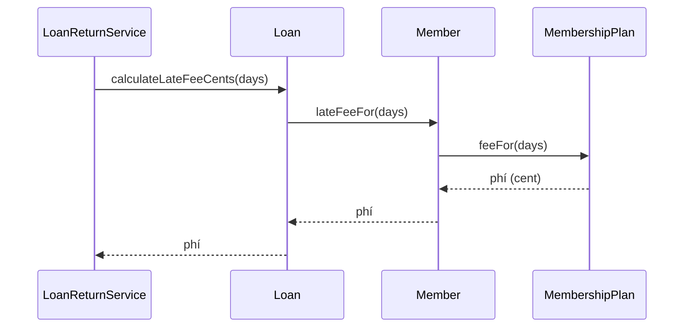

# Limiting deep object-chain navigation in OOP class design

## 1. The problem: a class “knows” too much about objects behind another object

Suppose a library application calculates late fees when borrowers return books past their due dates. This code is easy to write:

```java
long fee = loan.getMember()
               .getMembershipPlan()
               .getDailyLateFeeCents()
           * overdueDays;
```

The example assumes those getter methods exist. Although readable at first glance, `LoanReturnService` (where the code runs) must know **at least three levels of internal structure**:

1. `Loan` stores a borrower of type `Member`;
2. `Member` stores a `MembershipPlan`;
3. `MembershipPlan` holds the daily late-fee rate.

If fees later depend on book type, loan date, grace periods, or promotions, the service must dig further into other classes. Changes to `Member` or `MembershipPlan` internals may also break compilation or produce incorrect fees.

This is commonly called a **message chain**, a **train wreck** (a long dotted method-call chain), or a violation of the practical **Law of Demeter (LoD), the principle of least knowledge**.

A more behavior-rich design might look like:

```java
long fee = loan.calculateLateFeeCents(overdueDays);
```

Now the service asks for the business operation **“calculate this loan's late fee”**, while the loan and its immediate collaborators decide how. The service does not need to know *how many objects must be traversed to obtain the rate*.

> Key idea: a class should communicate through interfaces exposed by its direct collaborators, instead of traversing them to inspect and control distant objects.

## 2. What does the Law of Demeter actually say?

A common interpretation of LoD is to favor method calls on **closely related objects** (*friends*):

- the current object (`this`);
- parameters passed directly to the method;
- objects held in its immediate state (fields/direct collaborators);
- objects created within the method.

Avoid invoking methods on an object **just retrieved from another object**:

```java
// Cấu trúc sâu: a nhận b từ một object rồi tiếp tục điều khiển b.
a.getB().getC().perform();

// Gọi trực tiếp một hành vi được a cung cấp.
a.performRequiredOperation();
```

Strict formulations of LoD include variants and exceptions for globals, returned values, and data structures. These bullets therefore offer **practical design guidance**, not an absolute syntax-checking algorithm.

**One dot does not inherently create a problem, and multiple dots do not automatically prove a design is wrong.** The real question is whether a caller must **know too much about the structure and responsibilities of other objects**.

For example:

```java
// Không phải cứ có dấu chấm là vi phạm có ý nghĩa:
String normalized = input.trim().toLowerCase();

// Fluent API/query DSL chủ động thiết kế để gọi chuỗi:
query.select("name").from("customers").where("active = true");
```

Data-processing APIs and builders may intentionally return objects for further operations. LoD is most helpful when protecting **behavioral boundaries among objects with distinct responsibilities** in the business domain.

## 3. “Ask for data” versus “Tell, don't ask”

The same late-return task can be implemented in two ways:

| Approach | Example | Design consequence |
|---|---|---|
| **Dig into objects and implement the rule externally** | `loan.getMember().getPlan().getRate() * days` | Caller knows Loan, Member, and Plan structure and the business formula |
| **Request behavior** | `loan.calculateLateFeeCents(days)` | Caller depends on Loan's capability; details can remain encapsulated |
| **Pass necessary data to a collaborator** | `feePolicy.calculate(loanSnapshot, days)` | Useful when the fee is an independent policy rather than Loan's own responsibility |

The **“Tell, don't ask”** maxim encourages asking an object *to perform work it owns*, rather than retrieving all its state and manipulating it externally.

This relates to:

- **Encapsulation:** protects invariants and internal state, exposing intentional behavior.
- **Information hiding:** internal structure can change with minimal impact on external classes.
- **Coupling:** reduces how much callers must know about distant classes.
- **High cohesion:** keeps rules close to the data and concepts that own them.

However, **“Tell, don't ask” does not ban getters**. Reading data for a UI, serializing DTOs, computing reports, or working with intentionally exposed data structures can be entirely appropriate.

## 4. UML illustration: internal structure versus behavioral calls



The diagram shows `LoanReturnService` knowing `Loan` directly; `Loan` knows `Member`; `Member` knows `MembershipPlan`. Each class only invokes **its direct collaborators**.



Runtime execution still involves multiple calls. The difference is that **the service does not navigate directly to Plan** or interpret days and rates itself. Each step stays within its object's responsibility boundary.

**Important distinction:** LoD does not forbid layered object structures or multi-step internal execution. It discourages a *caller* from knowing and depending unnecessarily on distant structure.

## 5. Runnable Java example: calculating overdue-book fees

Amounts use minor currency units (cents), avoiding `double` for exact monetary arithmetic. Save as `DemeterDemo.java` and compile with JDK 11 or later:

```java
import java.util.Objects;

public class DemeterDemo {

    // Value object: mức phí theo ngày.
    static final class MembershipPlan {
        private final String name;
        private final long dailyLateFeeCents;

        MembershipPlan(String name, long dailyLateFeeCents) {
            this.name = Objects.requireNonNull(name, "name");
            if (dailyLateFeeCents < 0) {
                throw new IllegalArgumentException(
                        "Daily late fee cannot be negative");
            }
            this.dailyLateFeeCents = dailyLateFeeCents;
        }

        long feeFor(int overdueDays) {
            if (overdueDays < 0) {
                throw new IllegalArgumentException(
                        "Overdue days cannot be negative");
            }
            return Math.multiplyExact(dailyLateFeeCents, overdueDays);
        }
    }

    // Entity: thành viên biết gói của chính mình.
    static final class Member {
        private final String id;
        private MembershipPlan plan;

        Member(String id, MembershipPlan plan) {
            this.id = Objects.requireNonNull(id, "id");
            this.plan = Objects.requireNonNull(plan, "plan");
        }

        String id() {
            return id;
        }

        void changePlan(MembershipPlan next) {
            plan = Objects.requireNonNull(next, "next");
        }

        long lateFeeFor(int overdueDays) {
            return plan.feeFor(overdueDays);
        }
    }

    // Entity: phiếu mượn biết người mượn, bảo vệ trạng thái đã trả.
    static final class Loan {
        private final String code;
        private final Member borrower;
        private boolean returned;

        Loan(String code, Member borrower) {
            this.code = Objects.requireNonNull(code, "code");
            this.borrower = Objects.requireNonNull(borrower, "borrower");
        }

        long calculateLateFeeCents(int overdueDays) {
            if (returned) {
                throw new IllegalStateException(
                        "Loan already returned: " + code);
            }
            return borrower.lateFeeFor(overdueDays);
        }

        void markReturned() {
            if (returned) {
                throw new IllegalStateException(
                        "Loan already returned: " + code);
            }
            returned = true;
        }
    }

    // Application-level collaborator: chỉ biết hành vi công khai của Loan.
    static final class LoanReturnService {
        long returnBook(Loan loan, int overdueDays) {
            Objects.requireNonNull(loan, "loan");

            long fee = loan.calculateLateFeeCents(overdueDays);
            // Demo: giả định phí được thu/xác nhận thành công tại đây.
            loan.markReturned();
            return fee;
        }
    }

    public static void main(String[] args) {
        MembershipPlan basic = new MembershipPlan("Basic", 125);
        MembershipPlan premium = new MembershipPlan("Premium", 40);
        Member member = new Member("M001", basic);
        LoanReturnService returns = new LoanReturnService();

        Loan first = new Loan("L001", member);
        System.out.println(
                "First fee: " + returns.returnBook(first, 4)); // 500

        member.changePlan(premium);
        Loan second = new Loan("L002", member);
        System.out.println(
                "Second fee: " + returns.returnBook(second, 4)); // 160

        try {
            returns.returnBook(second, 2);
            throw new AssertionError("Expected already-returned error");
        } catch (IllegalStateException expected) {
            System.out.println("Rejected duplicate return");
        }
    }
}
```

Run:

```bash
javac DemeterDemo.java
java DemeterDemo
```

Expected output:

```text
First fee: 500
Second fee: 160
Rejected duplicate return
```

Observe:

1. `LoanReturnService` only invokes `loan.calculateLateFeeCents(...)` and `loan.markReturned()`. It needs neither `getBorrower()` nor `getPlan()` getters.
2. `Loan` invokes a method on its direct `borrower` field.
3. `Member` invokes a method on its direct `plan` field.
4. `MembershipPlan` owns the fee formula and validates the number of days. `Math.multiplyExact()` detects overflow.
5. Changing rates for a membership plan does not require caller changes to traverse different properties.
6. `Loan` owns the rule that a loan may be marked returned only once.

**Business limitation of the demo:** the calculation uses the member's *current* plan at return time. If the fee must use the plan *at loan creation time* (unaffected by a later upgrade), `Loan` must snapshot the rate schedule at creation or record the applicable policy. This is a business decision, not an automatic outcome of LoD.

**Implementation limitation:** the demo marks `returned` after calculating a fee and assumes charging succeeds. Real systems must coordinate payment state, transactions/idempotency, and concurrency; LoD does not provide those guarantees.

## 6. Why do internal structure changes have less impact?

Suppose tomorrow the penalty formula changes from “days × fee per day” to “first two days free, with a maximum charge.” Deep-navigation code in several services may look like:

```java
long fee = loan.getMember()
               .getMembershipPlan()
               .getDailyLateFeeCents() * overdueDays;
```

Each location must find and revise the same rule. With behavior-oriented design:

```java
long fee = loan.calculateLateFeeCents(overdueDays);
```

We can change `MembershipPlan.feeFor(...)` or substitute a suitable fee policy while **preserving Loan's contract** if its semantics and inputs remain unchanged.

For example, a different formula:

```java
long feeFor(int overdueDays) {
    if (overdueDays < 0) {
        throw new IllegalArgumentException("days");
    }

    int billableDays = Math.max(0, overdueDays - 2);
    long calculated = Math.multiplyExact(
            dailyLateFeeCents, billableDays);
    return Math.min(calculated, 2_000L);
}
```

This is **an alternative implementation** of the `feeFor` method above; do not declare both methods with identical signatures in the same class. The grace period and fee cap are illustrative; real projects should derive them from approved rules and tests.

An API at the right abstraction level reduces caller coupling to storage and calculation details.

## 7. Are getters always wrong?

**No.** Getters serve many valid purposes:

- Providing data to DTOs or presentation components.
- Exposing read-only state that callers legitimately need.
- Returning immutable Value Objects as inputs to other algorithms.
- Allowing tests to observe public outcomes.
- Navigating data-centric structures such as `record` types, JSON DTOs, or query results designed for traversal.

Be concerned when **getters couple callers to nested structure and spread business logic across the codebase**.

| Expression | Assessment |
|---|---|
| `order.getCustomer().getMembership().getPlan().getDiscountRate()` | Worth reviewing if a service uses it to apply discounts itself |
| `order.calculateTotalAfterDiscount()` | Appropriate when Order/domain owns the total-calculation rule |
| `address.getCity()` | Reasonable when `address` is a formatter's direct input |
| `dto.customer().address().city()` | May be fine in presentation code when DTOs intentionally expose their structure |
| `builder.withName("A").withEmail("b@c.test").build()` | Fluent builder, not traversal through domain entities |
| `users.stream().filter(...).map(...).toList()` | Stream API operations are designed to compose |
| `service.getDao().getConnection().getMetaData().getTables(...)` | Can couple callers to resource internals and connection lifecycles; reconsider the boundary |

A simple check: **if changing storage inside an intermediate class requires changing the caller, does the caller know details it should not need?** If so, consider moving behavior to the right owner or passing data through a clear contract.

## 8. Do not “fix” chains by adding countless forwarding getters

Suppose a service needs a postal code to calculate shipping charges:

```java
String postalCode = order.getCustomer()
                         .getAddress()
                         .getPostalCode();
```

You could add:

```java
String Order.getCustomerPostalCode() {
    return customer.getAddress().getPostalCode();
}
```

That shortens the caller's chain but **does not necessarily improve the model**. Adding dozens of methods such as `getCustomerCity()`, `getCustomerStreet()`, and `getCustomerDistrict()` can turn `Order` into a forwarding facade for every `Customer` field, without clarifying Order's real responsibility.

Two better approaches depend on the requirement:

**Approach A: Move behavior to the owner of the rule.** If Order is responsible for preparing its own shipping destination, `order.shippingLabel()` or `order.confirmDeliveryDestination()` may be suitable APIs. Internally it collaborates with nearby components.

**Approach B: Define a clear data boundary.** If `ShippingRateCalculator` needs multiple address fields, pass an immutable **`ShippingAddress` Value Object** directly, rather than making the calculator navigate Order → Customer → Address:

```java
record ShippingAddress(String city, String postalCode) {
    ShippingAddress {
        java.util.Objects.requireNonNull(city);
        java.util.Objects.requireNonNull(postalCode);
    }
}

interface ShippingRateCalculator {
    long rateCents(ShippingAddress destination, int grams);
}
```

The rate calculator depends on **the necessary input contract**, not the Order/Customer structure. `Order` or the application layer supplies the appropriate address according to business rules (for example, an address *snapshotted when an order was placed*, not the customer's current address).

**Trade-off:** passing a VO through the application layer makes sense for **independent data required for a calculation**. If every class merely distributes raw data so services can reimplement its business rules, the design becomes an anemic model again.

## 9. Distinguishing navigation-chain avoidance from dependency reduction

LoD **does not mean** “every method may contain only one dot.” Dot count is an initial indicator, not a complete measure of design quality.

| Problem | Law of Demeter suggests | What it does not guarantee |
|---|---|---|
| Callers traverse deeply into domain models | Communicate with the nearest object through its behavior | Does not automatically identify correct class responsibilities |
| Internal structure changes break callers | Hide internal navigation behind a stable contract | The contract may still be vague or too broad |
| Business logic is duplicated outside Entities | Move rules to their owners or a domain policy | Does not replace domain analysis |
| Tests require constructing deep object graphs | Choose suitable collaboration boundaries | Not every object requires an interface/mock |
| Nested queries perform poorly | Review data models and access strategies | Shorter Java chains do not remove database round trips |

LoD is closely related to **encapsulation**, but **the Single Responsibility Principle (SRP)** and **cohesion** also matter. Concentrating all system behavior in one “God Object” merely to avoid deep calls **is not** good LoD design.

## 10. “Friend” objects at method scope

The following example classifies how closely objects relate to one another:

```java
final class InvoiceMailer {
    private final MailGateway gateway; // Cộng tác viên trực tiếp.

    InvoiceMailer(MailGateway gateway) {
        this.gateway = gateway;
    }

    void send(Invoice invoice) { // invoice là tham số trực tiếp.
        String content = "Invoice " + invoice.number();

        MailMessage message = new MailMessage(
                invoice.recipientEmail(), content); // object vừa tạo.

        gateway.send(message); // gọi trực tiếp field gateway.
    }
}
```

Assume `Invoice`, `MailMessage`, and `MailGateway` have been defined. The calls use the `invoice` parameter, `message` created within the method, and direct `gateway` field, which generally follow the common LoD interpretation.

By contrast:

```java
// Mailer phải biết cấu trúc internal của invoice → customer → profile.
gateway.send(new MailMessage(
    invoice.getCustomer().getProfile().getPrimaryEmail(),
    "Invoice " + invoice.number()));
```

If an invoice's delivery address is part of the Invoice concept, expose `invoice.recipientEmail()`. This ensures the rule for selecting an invoice email address belongs to its appropriate owner: it may use the email confirmed at invoice creation rather than the customer's current email.

**Key point:** invoking methods on direct parameters is normal; reconsider calls where a caller keeps **digging into objects retrieved from parameters** to control their internals.

## 11. Optional, null, Stream, and builders

### Null checks do not solve coupling

```java
String zip = order != null
    && order.getCustomer() != null
    && order.getCustomer().getAddress() != null
    ? order.getCustomer().getAddress().getZip()
    : "";
```

Adding null checks may prevent `NullPointerException`, but the caller still depends on the entire traversal path. Repeated getter calls might also cause side effects or produce different snapshots when data changes.

Using `Optional` does not automatically fix this:

```java
Optional.ofNullable(order)
    .map(Order::getCustomer)
    .map(Customer::getAddress)
    .map(Address::getZip)
    .orElse("");
```

The `map` chain removes some manual null checks, but callers still know the `Order → Customer → Address` structure. If obtaining a postal code is a responsibility of the order, define the API at that boundary.

### Fluent APIs are intentionally different

```java
String output = "  HELLO  ".trim().toLowerCase();

List<String> names = users.stream()
    .filter(User::isActive)
    .map(User::getName)
    .toList();
```

`Stream.toList()` requires Java 16+; Java 11 can use `collect(Collectors.toList())`. These immutable/fluent APIs expose clear public protocols, and chaining calls is an appropriate use. No extra wrapper is needed just to reduce dots.

## 12. Special considerations with ORM and JPA/Hibernate

A chain such as:

```java
String country = order.getCustomer()
                      .getAddress()
                      .getCountryCode();
```

may involve more than coupling. If `customer` or `address` is a **lazy-loaded** ORM relationship, getter access may trigger SQL queries. In a loop over many orders, this can cause **N+1 queries**, or exceptions such as `LazyInitializationException` when the session is closed (depending on the mapping and state).

However:

- Moving the chain into `order.shippingCountryCode()` **does not automatically remove SQL queries**; it only changes where they run.
- Appropriate fetch strategies, query projections, entity graphs, batch fetching, and DTOs address retrieval costs.
- Do not add every bidirectional relationship merely to make navigation convenient.
- Avoid serializing entire JPA object graphs directly to JSON when bidirectional relationships or lazy proxies cause reference cycles, data leakage, or excessive loading. Explicit DTO/API contracts usually provide better control.

Evaluate **both object-oriented boundaries and data access** rather than treating LoD as an automatic performance optimization.

## 13. A process for refactoring deep navigation chains

Suppose you find this code:

```java
if (order.getCustomer().getMembership().getTier().isGold()) {
    total = total * 90 / 100;
}
```

Follow these steps:

1. **Name the business question:** “What discount does this order qualify for under membership rules?” instead of “is the tier GOLD?”
2. **Find the responsible owner:** if membership itself determines discounts, put `membership.discountFor(orderAmount)` there. For complex rules with several inputs, use a `DiscountPolicy` or domain service.
3. **Define a clear contract:** for example, `order.discountedTotal(policy)` or `policy.calculate(orderSnapshot)`; specify currency units, rounding, promotions, and snapshot timing.
4. **Protect domain invariants:** entities calculate valid totals, policies determine discount rules, and controllers do not directly multiply by `90 / 100`.
5. **Switch callers to the new API:** controllers/services obtain only the pricing result, not a traversal of the customer graph.
6. **Test behavior before and after:** GOLD, non-GOLD, no membership, rounding, policy changes, and prevention of negative prices.
7. **Remove unnecessary getters when safe:** reduce the public API without deleting getters needed for legitimate data queries.

**Do not assume** every deep navigation problem is solved by another “get” method. It may be better to **reassign business responsibilities** or extract a meaningful Value Object/policy.

## 14. Common mistakes and solutions

| Common mistake | Consequence | Better approach |
|---|---|---|
| Caller reads several nested levels to enforce a rule | Depends on deep structure; logic becomes scattered | Invoke behavior on the object owning the rule |
| Adding dozens of forwarding getters | Intermediate class grows; API becomes confusing | Expose the actual capability or an appropriate VO boundary |
| Removing every getter because “LoD forbids getters” | Presentation/data-query layers become hard to use | Distinguish domain behavior from data projections |
| Putting all rules into one giant Service | Anemic entities and poor cohesion | Keep invariants with entities/VOs; use services when necessary |
| Mocking entire nested object graphs in tests | Brittle tests tied to getter implementation details | Test public behavior through objects/collaboration ports |
| Moving a Java chain into one method without changing DB access | N+1/lazy-loading issues remain | Design appropriate fetch/projection/transaction boundaries |
| Hiding every chain with `Optional.map(...)` | Reduces null checks but leaves coupling unchanged | Reassess responsibilities and APIs |
| Applying LoD rigidly to builders, Streams, and DTOs | Creates needless wrappers and hard-to-read code | Allow chains with clear data/fluent contracts |
| Hiding fields behind APIs that still expose SDK table/column names | Only changes the form of coupling | Design contracts around stable business semantics |

## 15. Practice exercises

### Exercise 1: Identify the class that knows too much

```java
void sendReminder(Loan loan) {
    String email = loan.getMember()
                       .getProfile()
                       .getEmailAddress()
                       .getValue();
    mailGateway.send(email, "Please return the book");
}
```

**Question:** How many structure levels are exposed to the reminder-sending code? If the loan's contact email must be fixed at checkout time, what should change?

**Hint:** replace the chain with an API such as `loan.reminderRecipientEmail()` or a VO/DTO containing reminder information. If the address must remain fixed, store a snapshot or choose the recipient through a policy at the appropriate boundary. Do not confuse the profile's current email with the address used when the loan began.

### Exercise 2: LoD and Value Objects

```java
long cents = invoice.total().minorUnits();
```

**Question:** Should this expression be forbidden merely because it contains two dots?

**Hint:** `invoice.total()` returns immutable `Money`; presentation code converting it to JSON or text can reasonably read `minorUnits()`. If a business caller performs many primitive monetary calculations by hand, use behavior on Money/invoice rather than extracting primitive values.

### Exercise 3: Protect entity behavior

An `Order` has `status` and `paidAt`. The controller writes:

```java
if (order.getStatus().equals("NEW")) {
    order.setStatus("PAID");
    order.setPaidAt(Instant.now());
}
```

**Hint:** use `order.markPaid(paymentReference, paidAt)` (or a domain-appropriate API) and keep transition checks and payment-timestamp consistency inside Order. The rule that an order may be paid only once belongs with its state.

### Exercise 4: Extend the Java example

In `DemeterDemo`, add a policy where “Premium plans waive the first late day and charge starting on the second day,” and test fees for 0, 1, 2, 4 late days.

**Hint:** a `LateFeePolicy` Value Object or interface may fit when several policies actually exist; locate it near `MembershipPlan`. Keep the service call `loan.calculateLateFeeCents(days)` unchanged. Enforce nonnegative amounts and detect overflow.

### Exercise 5: Consider an exception

A reporting screen receives a DTO:

```java
String city = reportDto.customer()
                       .shippingAddress()
                       .city();
```

**Question:** Must it be changed to `reportDto.getShippingCity()`?

**Hint:** no. DTOs are often meant to expose readable data structures; consider whether the schema is a public contract and the UI is entitled to use those fields. Reconsider boundaries only if presentation code implements domain rules or is tied to persistence internals.

---

**Remember:** limiting deep navigation is not a contest to reduce dots. Let callers **request meaningful behavior** from direct collaborators, let data owners **enforce their own rules and invariants**, and expose data structure only when it is an intentional contract. That way, internal changes to one class are less likely to force changes throughout its neighbors.
