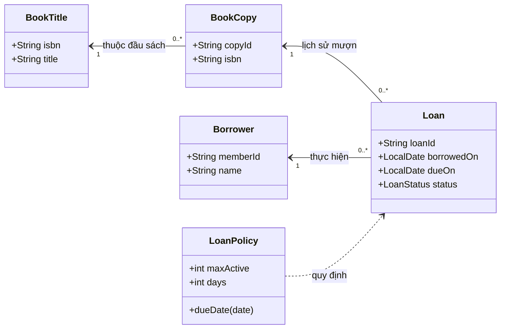
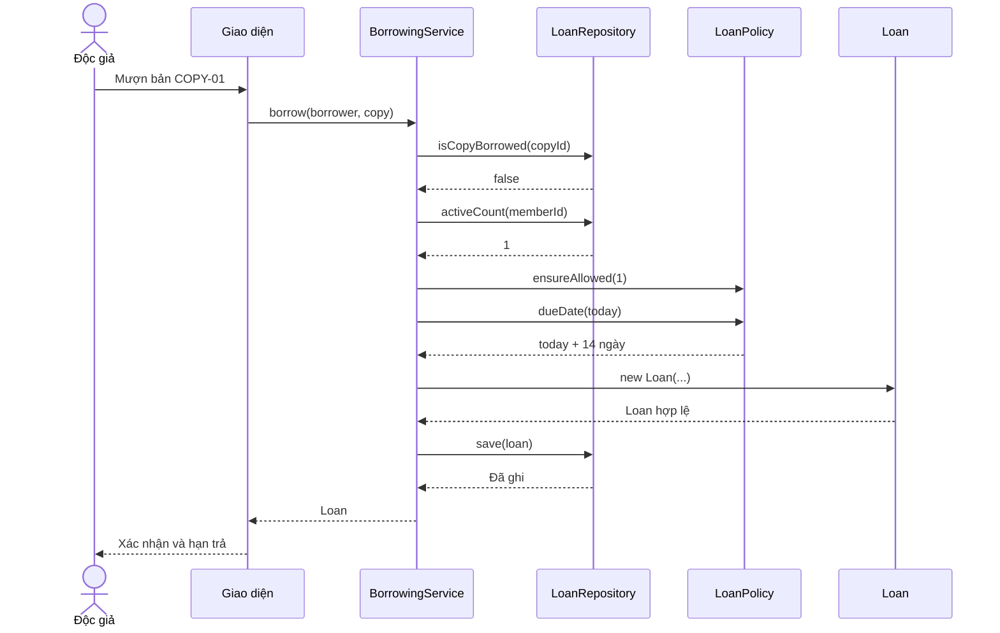
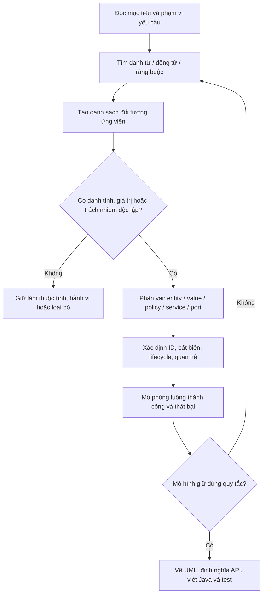

# Identifying Objects from Requirements in OOP (Java)

## The Modeling Challenge

Given a requirement such as “A member borrows a book copy; the system checks whether it is available, records the loan, and calculates a due date,” designers should not immediately write one class per noun. First identify **meaningful domain concepts**, the information they own, the behavior they govern, and the relationships that must stay consistent.

**Identifying objects from requirements** translates the user's language into *candidate objects*, evaluates each candidate's role, and proposes a class model. This is discovery and hypothesis validation, not a mechanical noun-finding exercise.

By the end, you should be able to:

- Read domain descriptions to extract objects, attributes, behavior, events, and rules.
- Distinguish **entities**, **value objects**, coordinating objects, and external dependencies.
- Discard misleading “classes” that are merely attributes, screens, roles, or technical implementation details.
- Validate models using domain scenarios, invariants, UML diagrams, and standalone runnable Java examples.
- Recognize when an unclear requirement or new rule calls for an object with an independent lifecycle.

## 1. Begin with Domain Language

Consider this sample requirement:

> “Members have member IDs and names. A library holds many book copies; each copy has a unique ID and belongs to one book title. Members may borrow at most two copies simultaneously. No copy may have two active loans. When a loan starts, the system records its start date and a due date 14 days later. Staff can search active loans.”

This is **an illustrative requirement** for analysis practice, not a universal library policy. The two-copy limit and 14-day term are example-specific rules.

Underline phrases that need clarification:

| Phrase in the requirement | Initial candidate | Question to confirm |
| --- | --- | --- |
| Member | `Borrower` | Does it have an independent ID, lifecycle, and history? |
| Member ID, name | Attributes of `Borrower` | Are special formatting rules or value types needed? |
| Book title | `BookTitle` or `Book` | Does it have ISBN, authors, and publication metadata? |
| Physical book copy | `BookCopy` | Does each copy have its own ID and independent lending availability? |
| Borrow a copy | `Loan` and `borrow(...)` behavior | Does each loan have distinct dates, state, and identity? |
| Two copies concurrently | `LoanPolicy` or a domain rule | Who is affected? Do member categories have exceptions? |
| Active loan | Status/condition on `Loan` | Does returning a copy close the loan or erase its history? |
| Borrow date, due date | Attributes of `Loan` | Use `LocalDate` or `Instant`? Which time zone applies? |
| Search | Use-case/query behavior | Is `LoanQueryService` needed, or just a repository query? |
| Library | Contextual concept | Does this feature actually require a `Library` object? |

**A book title and a physical copy are different concepts.** Three physical copies may share the same title. If the model only has `Book(title)` with no per-copy identity, it cannot identify which exact copy is on loan. This shows why domain questions must precede class selection.

## 2. The Noun–Verb–Rule Technique

Make three passes over the requirements:

1. **Nouns and noun phrases:** find entities, objects, documents, roles, and results with potential independent identity or value.
2. **Verbs:** identify actions such as *borrow*, *return*, *confirm*, *calculate*, *transfer*, *cancel*, and *search*.
3. **Conditions/constraints:** highlight *must*, *must not*, *at most*, *at least*, *only if*, *if... then...*, and *after ... days*.

Example:

```text
"Cá nhân [độc giả] mượn [bản sách]."
  Danh từ: độc giả, bản sách
  Động từ: mượn
  Câu hỏi: ai quyết định cho mượn, ai ghi nhận kết quả?

"Mỗi bản sách không có quá một [lượt mượn đang hoạt động]."
  Ứng viên: lượt mượn (Loan)
  Invariant: active-loan-count(copyId) <= 1

"Hạn trả sau 14 ngày."
  Dữ liệu: ngày mượn, hạn trả
  Quy tắc: dueDate = borrowedOn + 14 ngày
  Vị trí ứng viên: LoanPolicy hoặc nghiệp vụ tạo Loan
```

This technique only **generates candidates**. Do not apply “one noun → one class” or “one verb → one service.” A “borrow date” is often a `LocalDate` in `Loan`; a “check” may be a method rather than a `Check` class.

## 3. Classify Candidates with Testable Questions

A candidate deserves a class if it has **a distinct role** that would be lost or confused if merged with another class.

| Category | Recognition criteria | Example | Representation |
| --- | --- | --- | --- |
| Entity | Has identity and lifecycle; the same ID still identifies it when attributes change | `Borrower`, `BookCopy`, `Loan` | Class with ID, behavior, and invariants |
| Value object | Distinguished by value; usually immutable, no separate ID needed | `DateRange`, `Money`, `Address` | `record` or immutable class |
| Aggregate root | Controls invariants and updates of a set of objects | `Loan` or another borrowing coordinator, depending on design | Controlled mutation API |
| Domain policy/service | Rule requiring several inputs, not owned by one entity | `LoanPolicy` | Class/record with explicit behavior |
| Application service | Orchestrates a use case: loads data, applies policy, records result | `BorrowingService` | Service depending on ports |
| Repository/port | Contract for data access outside the domain | `LoanRepository` | Interface plus adapter |
| DTO/Command | Input/output carried across API, CLI, or message boundaries | `BorrowRequest` | Record/data carrier |
| Domain event | A significant event that has occurred | `LoanCreated` | Record/event object when needed |

You do not need every category. Small features can have only a few focused classes. **Entities, value objects, and services** are responsibility roles chosen for the problem, not labels every object must fit.

### Three Tests for a Candidate

- **Identity test:** if the name changes but the ID remains, is it still the same object? If so, it is probably an entity.
- **Responsibility test:** does this candidate own information or behavior that no other object should manage?
- **Lifecycle test:** must creation, changes, completion, or history be tracked independently?

A “loan” has a borrower, copy, start date, return date, and state. Its lifecycle differs from those of the book and borrower, making `Loan` meaningful as an object instead of storing `borrowerId` directly on `BookCopy` and losing history.

## 4. From Candidates to a Relationship Model

Ask questions at **both ends** of each relationship:

- How many copies can a book title have? How many titles can one copy belong to?
- How many loans can a member have? How many members does each loan belong to?
- How many loans can a copy have **historically**, and how many may be **active**?



**Do not misread multiplicities:** `BookCopy 1 <-- 0..* Loan` does not mean a copy can be loaned to many people simultaneously. It is the **historical number of loans**. The “at most one active loan per copy” constraint must be enforced separately by business logic and, in persistent systems, appropriate transactional/data constraints.

In UML, the arrow direction indicates a navigability decision. Not every class needs a bidirectional collection. If one traversal direction serves the use case, other directions can be queried through a repository.

## 5. Assign Attributes and Behavior to the Right Owner

Finding classes does not mean making every field public. Decide which class **knows** each fact, which class **may change it**, and which rules must hold throughout its lifecycle.

| Object | Meaningful data | Behavior or invariant |
| --- | --- | --- |
| `Borrower` | `memberId`, `name` | Valid ID; member status may be added if required |
| `BookTitle` | ISBN, title | Validate ISBN/metadata where requirements demand it |
| `BookCopy` | `copyId`, book-title ID | Nonblank copy ID; independent of copies sharing its title |
| `Loan` | Loan ID, borrower ID, copy ID, start and due dates | Due date after start date; valid state transitions |
| `LoanPolicy` | Loan-count limit, duration in days | Reject limit violations; calculate due dates |
| `BorrowingService` | Repository, policy, clock, ID generator | Coordinate eligibility checks, loan creation, persistence |
| `LoanRepository` | Interface need not hold state | Query active loans, count loans per borrower, and save |

**Information Expert principle:** place behavior where the information it needs is held. `Loan` knows its start and due dates and can enforce date ordering; `LoanPolicy` defines permitted terms. `BorrowingService` coordinates several components but should not duplicate date calculations in multiple places.

## 6. Complete Java 17 Example: Turning Requirements into an Object Model

To focus on object identification, the example is an **in-memory book-lending program**. Each valid borrow creates a `Loan`; the demo `LoanRepository` retains only active loans and does not yet implement returns or history. Borrowers, copies, policies, and loans own distinct responsibilities; the service coordinates them.

Create `IdentifyObjectsDemo.java`:

```java
import java.time.Clock;
import java.time.Instant;
import java.time.LocalDate;
import java.time.ZoneOffset;
import java.util.LinkedHashMap;
import java.util.Map;
import java.util.Objects;
import java.util.concurrent.atomic.AtomicInteger;

public class IdentifyObjectsDemo {

    private static String required(String value, String label) {
        if (value == null || value.isBlank()) {
            throw new IllegalArgumentException(label + " must not be blank");
        }
        return value;
    }

    // Entity ứng viên: có mã thành viên riêng.
    record Borrower(String memberId, String name) {
        Borrower {
            memberId = required(memberId, "memberId");
            name = required(name, "name");
        }
    }

    // Entity ứng viên: từng bản sách có mã độc lập với đầu sách.
    record BookCopy(String copyId, String title) {
        BookCopy {
            copyId = required(copyId, "copyId");
            title = required(title, "title");
        }
    }

    // Một lượt mượn có danh tính và ngày tháng riêng.
    record Loan(String loanId, String memberId, String copyId,
                LocalDate borrowedOn, LocalDate dueOn) {
        Loan {
            loanId = required(loanId, "loanId");
            memberId = required(memberId, "memberId");
            copyId = required(copyId, "copyId");
            Objects.requireNonNull(borrowedOn, "borrowedOn");
            Objects.requireNonNull(dueOn, "dueOn");
            if (!dueOn.isAfter(borrowedOn)) {
                throw new IllegalArgumentException(
                        "Due date must be after borrowed date");
            }
        }
    }

    // Domain policy: số lượt cho phép và thời hạn.
    record LoanPolicy(int maxActiveLoans, int loanDays) {
        LoanPolicy {
            if (maxActiveLoans <= 0 || loanDays <= 0) {
                throw new IllegalArgumentException("Policy must be positive");
            }
        }

        void ensureAllowed(int activeCount) {
            if (activeCount >= maxActiveLoans) {
                throw new IllegalStateException("Borrow limit reached");
            }
        }

        LocalDate dueDate(LocalDate borrowedOn) {
            return borrowedOn.plusDays(loanDays);
        }
    }

    // Port: service biết hợp đồng, không biết SQL/JPA.
    interface LoanRepository {
        boolean isCopyBorrowed(String copyId);
        int activeCount(String memberId);
        void save(Loan loan);
    }

    // Adapter trong bộ nhớ; dùng để minh họa và unit test tuần tự.
    static final class InMemoryLoanRepository implements LoanRepository {
        private final Map<String, Loan> activeByCopy = new LinkedHashMap<>();

        @Override
        public boolean isCopyBorrowed(String copyId) {
            return activeByCopy.containsKey(copyId);
        }

        @Override
        public int activeCount(String memberId) {
            int count = 0;
            for (Loan loan : activeByCopy.values()) {
                if (loan.memberId().equals(memberId)) count++;
            }
            return count;
        }

        @Override
        public void save(Loan loan) {
            Objects.requireNonNull(loan, "loan");
            if (activeByCopy.putIfAbsent(loan.copyId(), loan) != null) {
                throw new IllegalStateException(
                        "Copy " + loan.copyId() + " is already borrowed");
            }
        }
    }

    interface LoanIdSource {
        String nextLoanId();
    }

    // Application service: thực hiện trình tự của use case.
    static final class BorrowingService {
        private final LoanRepository loans;
        private final LoanPolicy policy;
        private final Clock clock;
        private final LoanIdSource ids;

        BorrowingService(LoanRepository loans, LoanPolicy policy,
                         Clock clock, LoanIdSource ids) {
            this.loans = Objects.requireNonNull(loans);
            this.policy = Objects.requireNonNull(policy);
            this.clock = Objects.requireNonNull(clock);
            this.ids = Objects.requireNonNull(ids);
        }

        Loan borrow(Borrower borrower, BookCopy copy) {
            Objects.requireNonNull(borrower, "borrower");
            Objects.requireNonNull(copy, "copy");

            if (loans.isCopyBorrowed(copy.copyId())) {
                throw new IllegalStateException(
                        "Copy " + copy.copyId() + " is already borrowed");
            }

            policy.ensureAllowed(loans.activeCount(borrower.memberId()));

            LocalDate today = LocalDate.now(clock);
            Loan loan = new Loan(
                    ids.nextLoanId(),
                    borrower.memberId(),
                    copy.copyId(),
                    today,
                    policy.dueDate(today));

            loans.save(loan);
            return loan;
        }
    }

    public static void main(String[] args) {
        Borrower an = new Borrower("MEM-01", "An");
        Borrower binh = new Borrower("MEM-02", "Binh");
        BookCopy copy1 = new BookCopy("COPY-01", "OOP Java");
        BookCopy copy2 = new BookCopy("COPY-02", "SQL");
        BookCopy copy3 = new BookCopy("COPY-03", "Algorithms");

        InMemoryLoanRepository repo = new InMemoryLoanRepository();
        LoanPolicy policy = new LoanPolicy(2, 14);
        Clock clock = Clock.fixed(
                Instant.parse("2026-10-15T00:00:00Z"),
                ZoneOffset.UTC);
        AtomicInteger seq = new AtomicInteger();
        LoanIdSource ids = () -> "LOAN-" + seq.incrementAndGet();

        BorrowingService service =
                new BorrowingService(repo, policy, clock, ids);

        Loan first = service.borrow(an, copy1);
        System.out.println(
                "Loan: " + first.loanId() + ", due " + first.dueOn());

        try {
            service.borrow(binh, copy1);
        } catch (IllegalStateException ex) {
            System.out.println(ex.getMessage());
        }

        service.borrow(an, copy2);
        System.out.println("Active of An: " + repo.activeCount(an.memberId()));

        try {
            service.borrow(an, copy3);
        } catch (IllegalStateException ex) {
            System.out.println(ex.getMessage());
        }
    }
}
```

Run:

```bash
javac IdentifyObjectsDemo.java
java IdentifyObjectsDemo
```

Expected output:

```text
Loan: LOAN-1, due 2026-10-29
Copy COPY-01 is already borrowed
Active of An: 2
Borrow limit reached
```

### Trace the Example Back to Requirements

| Requirement statement | Code component | Evidence |
| --- | --- | --- |
| Member has ID and name | `Borrower` | `record Borrower(memberId, name)` |
| Each copy has its own ID | `BookCopy` | `copyId` identifies the copy |
| System records a loan | `Loan` | Includes `loanId`, borrower, copy, and dates |
| One copy cannot be loaned twice at once | `LoanRepository`, `BorrowingService` | Check active status; `putIfAbsent` rejects duplication |
| At most two copies | `LoanPolicy` | `ensureAllowed(activeCount)` |
| Due 14 days later | `LoanPolicy` | `borrowedOn.plusDays(loanDays)` |
| Loan workflow requires several components | `BorrowingService` | Validate, construct Loan, persist |
| DB/time source should be replaceable | `LoanRepository`, `Clock` | Inject dependencies into the service |

The demo uses `record` for brevity and immutable data. **Entities need not be records**; they may require classes with state-transition methods when returns, renewals, lost copies, or cancellations are added. Here `Loan` has domain identity even though it is implemented as an immutable record.

**Technical limitation:** this example executes sequentially. Two concurrent requests may each see remaining borrower quota and both invoke `save`, exceeding the total limit; `LinkedHashMap` is not thread-safe either. Production requires appropriate transactions/locking or other atomicity mechanisms, validation that borrower/copy IDs actually exist, history retention on return, and database constraints preventing two active loans for a copy. **A good object model enables correctness but does not itself provide concurrency control.**

## 7. Simulate Collaboration to Validate the Model

After proposing classes, **walk through the use case on paper**. If no one can explain who owns a step or the design needs arbitrary access to others' data, the model is not ready.



This is a **successful path**. Also simulate failures: copy already on loan, borrower at limit, invalid input, or database save failure. Each path needs an accountable component and must not leave inconsistent state.

Do not let the UI override `LoanPolicy` and allow 3 copies. A UI may precheck to provide feedback, but authorized domain code must enforce the rule.

## 8. Signs of Incorrect Class Identification

### 8.1 Turning Every Noun into a Class

Words such as “borrow date,” “name,” and “quantity” often denote fields or familiar value types (`LocalDate`, `String`, `int`). Introduce domain-specific types only for **meaningful rules or semantics**, such as `MembershipId` with special formatting or `Money` with currency and operations.

### 8.2 Turning Every Verb into a Service Class

It is possible to create `AddItemService`, `SetDueDateService`, or `ChangeStatusService` for each tiny action, but if behavior belongs to an entity's state and invariants, an entity method is clearer. `Loan.extendDueDate(...)` may express an intrinsic renewal rule better, while `RenewalService` helps when renewal must coordinate inventory, accounts, and external policy.

### 8.3 Combining Concepts with Different Lifecycles

Combining “book title” and “copy” loses per-copy inventory and condition. Combining “borrower” and “loan” complicates history, renewal, and returns. Compare the **identity, lifetime, and reasons for change** of each concept.

### 8.4 Confusing Actors or Roles with Domain Objects

“Librarian” is a use-case actor. An entity `StaffMember` may be justified if staff schedules, identity, and permissions are in scope. But “staff clicks Search” alone does not justify a domain class `Librarian`. System roles and the internal domain model serve different scopes.

### 8.5 Making `System`, `Manager`, or `Helper` Responsible for Everything

A `LibrarySystem` that handles ISBN data, schedules, fees, and email is often a God Object. Ask which concept owns the information each action requires. A coordinating service may work with many components but should not own every internal domain rule.

### 8.6 Prematurely Designing Around Tables or Screens

A DB table with many columns is not necessarily one domain object. A “Member Details and Loan History” screen may aggregate data from several entities. Model the domain using **identity, behavior, and invariants** before deciding tables, screens, and DTOs.

## 9. Validate Candidates with a Brief CRC Exercise

After identifying candidate classes, try a **Class–Responsibilities–Collaborators (CRC)** pass: each candidate must own a distinct obligation and know only its necessary collaborators.

- `Borrower`: member identity; need not know inventory.
- `BookCopy`: physical copy identity; does not decide borrower loan limits.
- `Loan`: a lending event with dates, identity, and lifecycle.
- `LoanPolicy`: limits and due-date rules.
- `BorrowingService`: coordinates policy, repository, clock, and ID source.

Try **returning and reborrowing a copy**: which class closes the prior loan, protects availability, and retains history? If removing a candidate loses no concept or responsibility, it may only need to be a field or method.

This only *validates the discovered candidates*; the lesson **CRC cards: classes, responsibilities, and collaborators** covers full CRC card writing and collaboration role-play.

## 10. When New Requirements Change the Model

No model is fixed after the first reading. For example:

**New requirement: “Allow reservations while a copy is on loan.”** A `Reservation` concept emerges with queue position and status. Avoid storing the entire waitlist as a `nextBorrowerId` field on `BookCopy` if reservations have their own lifecycle.

**New requirement: “Renew at most twice, unless another member has reserved the copy.”** `Loan` may need `renewalCount` and renewal behavior; checking the queue requires `ReservationRepository`/policy data, not necessarily all queries inside the entity.

**New requirement: “Each copy has a history of repairs.”** A `MaintenanceRecord` with dates, costs, and defect categories may be required; a single `lastRepairDate` field cannot preserve historical records.

**New requirement: “Returns may incur a fine.”** `Fine` could be a monetary value object, a payment-obligation entity, or a temporary calculation result, depending on payment/refund tracking. The word “fine” alone is insufficient; ask about identity, status, and lifecycle.

| Requirement change | Signal of a new object | Question to ask |
| --- | --- | --- |
| Reserve a book | Waitlist entries with status and position | May a person reserve multiple times? When does a reservation expire? |
| Renew a loan | Loan has state changes/rules | Who may renew? Must renewal history be kept? |
| Repair a book copy | Dated events and per-repair costs | Are audits and multi-year queries required? |
| Fine | Amount, deadline, payment | Is this a calculated value or an ID-bearing debt? |
| Due-date reminder email | External/asynchronous operation | What triggers it? How do retry and idempotency work? |

Object identification is **iterative as domain understanding evolves**: use case → candidate classes → simulate collaboration → clarify questions → revise the model.

## 11. An Immediately Usable Analysis Workflow



During a real analysis session:

1. **Preserve the user's own wording.** Do not immediately translate domain language into technical terms such as “table,” “controller,” or “service.”
2. **List candidates with reasons.** Every proposed class should have one sentence explaining why it exists.
3. **Identify ambiguous terms.** Does “book” mean title or physical copy? Does “registration” mean an account or an enrollment in a course?
4. **Try contrasting scenarios.** One borrower takes two copies; two borrowers want one copy; a copy is returned and borrowed again.
5. **Choose the source of truth.** Is “on loan” derived from active loans or stored as a separate flag? If both, who keeps them consistent?
6. **Only then select Java types.** Consider `record`, classes, enums, interfaces, `List`, `Map`, repositories, and DTOs.
7. **Derive tests from requirements.** Name tests after policy, such as `cannotBorrowCopyAlreadyOnLoan`, not merely `testGetter`.

A good model need not contain many classes. It must capture the **important domain objects** with clear places to put behavior and constraints.

## 12. Questions for Requirements Stakeholders

When the model is unclear, ask questions that could alter its design:

- “Can a title have multiple independent physical copies? Is every copy ID globally unique?”
- “Must returned loans remain stored for historical lookup?”
- “Are loans of the same copy on different dates separate records or updates to the old loan?”
- “Does the two-copy limit apply to every member type or vary by group?”
- “Does a 14-day term mean calendar days, business days, or an exact elapsed duration?”
- “Can lost, damaged, or maintenance states make a copy unavailable despite no active loan?”
- “When two borrowing requests arrive together, what must be guaranteed by the database?”

These questions establish whether `BookCopy`, `Loan`, `LoanPolicy`, `CopyStatus`, and `Reservation` should remain separate concepts. Do not turn every “unknown” into a speculative abstraction.

## 13. Practice Exercises

### Exercise 1 — Cinema Ticketing

Requirement: “A moviegoer selects a screening and two available seats, pays, and receives tickets. One seat at a screening cannot be sold twice. A ticket has a QR code.”

Extract nouns, verbs, and constraints, then propose candidate classes. Distinguish `Movie` (film), `Screening` (showtime), `Seat` (physical seat), `SeatReservation` (per-screening reservation), and `Ticket` (ticket) when they have distinct lifecycles. Explain why “seat A5” cannot be permanently marked sold for every screening.

### Exercise 2 — Shopping Cart

Requirement: “Customers add products to carts, change quantities, view totals, and apply discount codes.”

Identify candidates `Cart`, `CartLine`, `Product`, `Money`, and `DiscountPolicy`. Explain when a “discount code” should be a `String`, value object, or separate entity. Define at least three `Cart` invariants.

### Exercise 3 — Course Management

Requirement: “Students enroll in multiple course sections; each section has at most 30 students, and no student can enroll twice in the same section.”

Identify `Student`, `Course`, `Section`, and `Enrollment`; decide whether `Course` and `Section` must be separate. Draw UML multiplicities and explain where the “at most 30” rule is enforced under concurrent enrollment.

### Exercise 4 — Critique a Class List

Someone proposes: `Library`, `Name`, `Borrow`, `Check`, `Date`, `Database`, `Screen`, `Book`, `Loan`.

Classify domain classes with justification, actions, attributes/standard value types, technical adapters, and candidates lacking sufficient information. Explain using **identity, responsibility, and lifecycle**, not merely “this is a noun.”

### Exercise 5 — Extend the Java Demo

Add `returnCopy(copyId, date)` while preserving history, preventing a loan from being returned twice, and allowing the same copy to be borrowed again after return. Decide whether `Loan` becomes a stateful entity or history gets a separate record; update the repository and test borrow → return → borrow again.

## 14. Checklist Before Finalizing the Model

| Question | Ready when |
| --- | --- |
| Does every candidate represent a distinct domain concept? | Its responsibility or identity is clear in one sentence |
| Have similar-sounding concepts with different lifecycles been separated? | Titles, physical copies, and loans are distinguished |
| Have mere words, properties, and actions been filtered out? | No meaningless empty classes |
| Are entities distinguished from value objects? | ID-based versus value-based equality is understood |
| Are invariants identified and assigned to enforcers? | “At most one active loan” has a clear enforcement point |
| Are relationships and multiplicities correct at both ends? | Counterexamples separate historical from current state |
| Is behavior placed where the information exists? | Entities protect invariants, policies encode rules, services coordinate |
| Is the model unnecessarily tied to HTTP/DB/UI? | Core logic is testable without starting external technologies |
| Can it handle errors and concurrency? | Transaction and constraint responsibilities are known |
| Can each requirement be traced to code/tests? | No rule disappears after implementation |

**Remember:** noun extraction is only **a starting point**. Appropriate objects have domain reasons for existing, corresponding data and behavior, clear relationships, and protected invariants. Simulate real scenarios and refine the model before writing large amounts of code.
