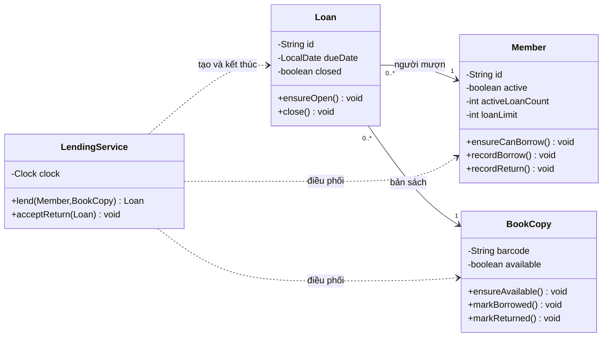
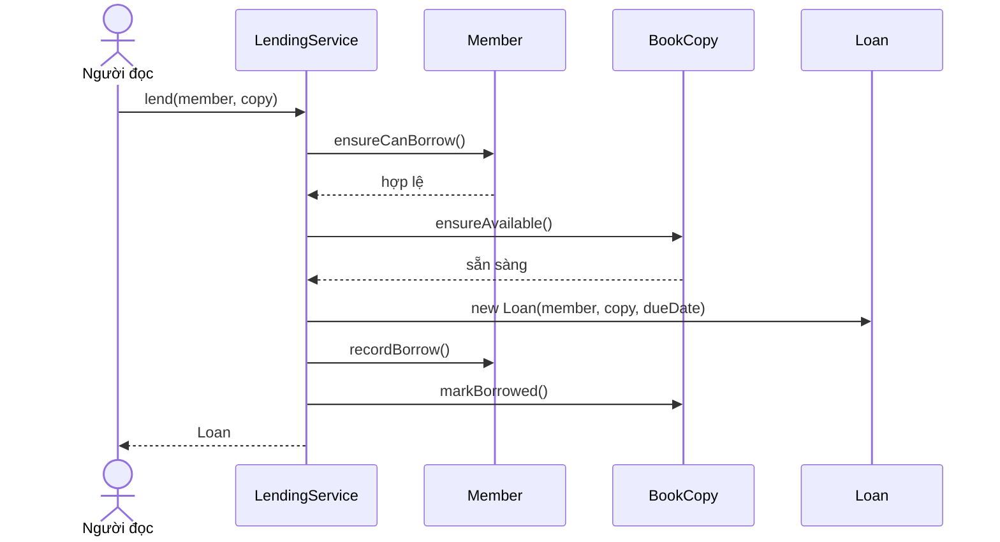
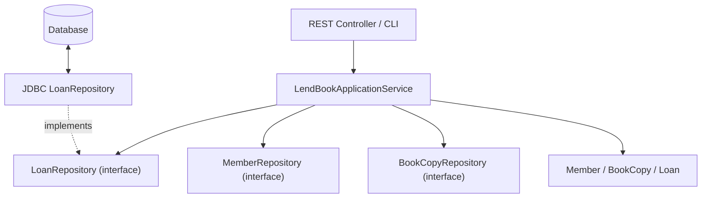

# Assigning Responsibilities and Collaborators in OOP Modeling

## 1. From Business Requirements to Collaborating Objects

Suppose you are developing a library system with this requirement:

> A member may borrow a book if the account is active, the loan limit has not been reached, and the copy is available. When borrowing, the system creates a loan with a due date. When returning, the loan closes, the copy becomes available again, and the member's active-loan count decreases.

One approach is to put every check and operation into a huge `LibraryService`. But when policies change, all parts of the service must understand `Member`, `BookCopy`, and `Loan` state. A better object-oriented model identifies:

- **Responsibility:** what must an object *know* and *do* to fulfill its role?
- **Collaborator:** which object provides information or behavior that lets another fulfill its responsibilities?
- **Boundary:** which invariants belong to one object, and which operations coordinate several objects?
- **Contract:** which calls, inputs, outputs, and error representations are expected from collaborators?

A good model does not require every class to do everything independently. It gives each responsibility **a clear owner** and enables meaningful collaboration through APIs.

### Two Kinds of Responsibility

| Kind | Question | Example |
|---|---|---|
| **Knowing** | Which data and relationships must the object know? | `BookCopy` knows its copy ID and whether it is available or already borrowed |
| **Doing** | Which action or rule does the object enforce? | `BookCopy.markBorrowed()` prevents borrowing a copy that is unavailable |

Objects often do both: `Member` tracks open loans and enforces limits; `Loan` knows its due date and permits closing a loan only once.

**Knowing data does not imply exposing every field for external modification.** Control state through meaningful behaviors rather than unrestricted public getters and setters.

## 2. Use CRC to Explore **Collaboration Flows**, Not Just Class Lists

A small CRC table helps identify “who asks whom” before drawing a sequence diagram:

| Class | Responsibility in borrow/return use cases | Collaborators |
|---|---|---|
| `Member` | Enforces borrowing eligibility and active-loan count | Need not know `BookCopy` |
| `BookCopy` | Enforces availability of one copy | Need not know `Member` quota |
| `Loan` | Controls a loan and the rule for closing it | References member/copy |
| `LendingService` | Coordinates those behaviors in the correct order | `Member`, `BookCopy`, `Loan`, `Clock` |

**Walkthrough:** the service asks the member to validate quota, asks the copy to confirm availability, creates a loan, and then updates state. If quota checking moves from `Member` to `BookCopy`, the copy must know unrelated data—a sign of misplaced responsibility.

The lesson **CRC cards: classes, responsibilities, and collaborators** covers detailed cards, role-play, and failure paths. Here the focus is **choosing the owner of each rule and designing calls among objects**.

## 3. Put Rules Where Their Data Is Owned

A rule that depends only on **one** object's state usually belongs in that object.

For example:

```java
// Kiểu thiết kế yếu: service tự đọc rồi sửa trạng thái của Member.
if (member.getActiveLoanCount() < member.getMaxLoans()) {
    member.setActiveLoanCount(
            member.getActiveLoanCount() + 1);
}
```

This design allows callers to bypass the limit, increment incorrect counts, or invoke setters at inappropriate times.

Instead:

```java
// API theo ý nghĩa nghiệp vụ:
member.recordBorrow();
```

`Member` checks the rule and performs the permitted change. When a rule is added that suspended accounts may not borrow, the modification point is clear.

Similarly, `BookCopy` should enforce “a copy cannot be marked borrowed twice before return,” while `Loan` should enforce “a loan cannot be closed twice.”

But **borrowing a book** affects the member, copy, and loan together. Do not force `Member` to access inventory databases directly just to complete the whole operation. A **coordinator object** is appropriate for collaboration.

## 4. Understand Relationships Through a UML Class Diagram



Read the diagram as follows:

- Each `Loan` is associated with exactly one `Member` and one `BookCopy`.
- A member or copy may appear on many loans **over time**. Availability is protected by state and invariants. Multiplicity `0..*` **does not** permit a copy to be borrowed concurrently more than once.
- `LendingService` receives objects and sends messages to them. A dashed dependency does not mean the service owns their lifecycles.
- `Clock` is a technical collaborator providing testable time, not a domain entity.

A **class diagram** shows who holds information and what methods exist. To validate actual collaboration, add a **sequence diagram**.

## 5. Sequence Diagrams: Each Object Performs Its Part



Each step has an owner. If `ensureCanBorrow()` rejects the request, the service stops without changing `BookCopy`. If `ensureAvailable()` rejects it, no loan is created.

The sequence diagram shows the **normal sequential in-memory flow**, not an atomic transaction across threads, processes, or databases. Production failures after state changes may require rollback or compensating actions, discussed later.

## 6. Runnable Java Example: Distinct Objects with Distinct Responsibilities

Save the complete code as `ResponsibilityDemo.java` (JDK 11+):

```java
import java.time.Clock;
import java.time.Instant;
import java.time.LocalDate;
import java.time.ZoneOffset;
import java.util.Objects;
import java.util.UUID;

public class ResponsibilityDemo {

    // Entity: biết và bảo vệ trạng thái mượn của thành viên.
    static final class Member {
        private final String id;
        private final int loanLimit;
        private boolean active;
        private int activeLoanCount;

        Member(String id, int loanLimit) {
            this.id = Objects.requireNonNull(id, "id");
            if (id.isBlank() || loanLimit < 1) {
                throw new IllegalArgumentException(
                        "Invalid member id or limit");
            }
            this.loanLimit = loanLimit;
            this.active = true;
        }

        void ensureCanBorrow() {
            if (!active) {
                throw new IllegalStateException("Member inactive");
            }
            if (activeLoanCount >= loanLimit) {
                throw new IllegalStateException("Loan limit reached");
            }
        }

        void recordBorrow() {
            ensureCanBorrow();
            activeLoanCount++;
        }

        void recordReturn() {
            if (activeLoanCount <= 0) {
                throw new IllegalStateException(
                        "No active loans to return");
            }
            activeLoanCount--;
        }

        int activeLoanCount() {
            return activeLoanCount;
        }

        void deactivate() {
            active = false;
        }
    }

    // Entity: một bản sách vật lý, có mã riêng.
    static final class BookCopy {
        private final String barcode;
        private boolean available = true;

        BookCopy(String barcode) {
            this.barcode = Objects.requireNonNull(
                    barcode, "barcode");
            if (barcode.isBlank()) {
                throw new IllegalArgumentException("Blank barcode");
            }
        }

        void ensureAvailable() {
            if (!available) {
                throw new IllegalStateException(
                        "Book copy is already on loan");
            }
        }

        void markBorrowed() {
            ensureAvailable();
            available = false;
        }

        void markReturned() {
            if (available) {
                throw new IllegalStateException(
                        "Book copy is not on loan");
            }
            available = true;
        }

        boolean isAvailable() {
            return available;
        }

        String barcode() {
            return barcode;
        }
    }

    // Entity: thông tin và vòng đời một lần mượn cụ thể.
    static final class Loan {
        private final String id;
        private final Member borrower;
        private final BookCopy copy;
        private final LocalDate dueDate;
        private boolean closed;

        Loan(String id, Member borrower, BookCopy copy,
             LocalDate dueDate) {
            this.id = Objects.requireNonNull(id, "id");
            this.borrower = Objects.requireNonNull(
                    borrower, "borrower");
            this.copy = Objects.requireNonNull(copy, "copy");
            this.dueDate = Objects.requireNonNull(
                    dueDate, "dueDate");
        }

        Member borrower() {
            return borrower;
        }

        BookCopy copy() {
            return copy;
        }

        LocalDate dueDate() {
            return dueDate;
        }

        void ensureOpen() {
            if (closed) {
                throw new IllegalStateException("Loan already closed");
            }
        }

        void close() {
            ensureOpen();
            closed = true;
        }

        boolean isClosed() {
            return closed;
        }
    }

    // Coordinator: không tự sửa các field riêng tư của entity.
    static final class LendingService {
        private final Clock clock;
        private final int loanDays;

        LendingService(Clock clock, int loanDays) {
            this.clock = Objects.requireNonNull(clock, "clock");
            if (loanDays < 1) {
                throw new IllegalArgumentException(
                        "loanDays must be positive");
            }
            this.loanDays = loanDays;
        }

        Loan lend(Member member, BookCopy copy) {
            Objects.requireNonNull(member, "member");
            Objects.requireNonNull(copy, "copy");

            // Kiểm tra trước khi bắt đầu thay đổi trạng thái.
            member.ensureCanBorrow();
            copy.ensureAvailable();

            Loan loan = new Loan(
                    UUID.randomUUID().toString(),
                    member,
                    copy,
                    LocalDate.now(clock).plusDays(loanDays));

            member.recordBorrow();
            copy.markBorrowed();
            return loan;
        }

        void acceptReturn(Loan loan) {
            Objects.requireNonNull(loan, "loan");
            loan.ensureOpen();

            loan.copy().markReturned();
            loan.borrower().recordReturn();
            loan.close();
        }
    }

    public static void main(String[] args) {
        Clock testClock = Clock.fixed(
                Instant.parse("2026-10-15T00:00:00Z"),
                ZoneOffset.UTC);

        Member lan = new Member("MEM-01", 1);
        BookCopy bookA = new BookCopy("COPY-A");
        BookCopy bookB = new BookCopy("COPY-B");
        LendingService lending = new LendingService(testClock, 14);

        Loan first = lending.lend(lan, bookA);
        System.out.println("Due: " + first.dueDate());
        System.out.println("Active loans: "
                + lan.activeLoanCount());
        System.out.println("Book A available: "
                + bookA.isAvailable());

        try {
            lending.lend(lan, bookB);
            throw new AssertionError(
                    "Expected loan-limit rejection");
        } catch (IllegalStateException expected) {
            System.out.println("Rejected: " + expected.getMessage());
        }

        System.out.println("Book B still available: "
                + bookB.isAvailable());

        lending.acceptReturn(first);
        System.out.println("After return, active loans: "
                + lan.activeLoanCount());

        Loan second = lending.lend(lan, bookB);
        System.out.println("Second loan due: "
                + second.dueDate());

        if (!first.isClosed() || bookB.isAvailable()
                || lan.activeLoanCount() != 1) {
            throw new AssertionError("State invariant failed");
        }
        System.out.println("State checks passed");
    }
}
```

Compile and run:

```bash
javac ResponsibilityDemo.java
java ResponsibilityDemo
```

Expected output:

```text
Due: 2026-10-29
Active loans: 1
Book A available: false
Rejected: Loan limit reached
Book B still available: true
After return, active loans: 0
Second loan due: 2026-10-29
State checks passed
```

### Noteworthy Design Decisions

**`Member` is the sole enforcer of the borrowing limit.** If the policy changes from one to three books, or members with outstanding fees must be blocked, that logic belongs in the member or its collaborating domain policy. `LendingService` does not read and compare `activeLoanCount` and `loanLimit` itself.

**`BookCopy` controls its own availability state.** Even if the service wants to lend it, the copy may reject `markBorrowed()` when unavailable. The service cannot simply set `available=false` through a public setter.

**`Loan` owns the loan's identity and due date.** Another `Loan` may refer to the same `BookCopy` historically, but only one active loan may occupy it at a given time.

**`LendingService` coordinates the steps.** It does not independently calculate a member's remaining quota or the copy's availability. It needs to know *whom to call* and *when*, not internal field layouts. An injected `Clock` makes due dates testable without using the system clock.

**This is a single-threaded domain-model demo.** The state changes `member.recordBorrow()` and `copy.markBorrowed()` are separate operations without a transaction or lock. Therefore the example is **unsafe for concurrent borrowing across threads/processes** and does not guarantee atomicity with a DB or failures between steps. Production requires transactions, data constraints, locking/optimistic concurrency strategies, and suitable notification timing.

## 7. Selecting Collaborators with GRASP

**GRASP** (*General Responsibility Assignment Software Patterns*) offers principles for deciding “who should own this responsibility?” Not every pattern needs a separate class, but these questions help with modeling.

| Principle | Question | Library application |
|---|---|---|
| **Information Expert** | Who owns the information needed to enforce the rule? | `Member` knows quota; `BookCopy` knows availability |
| **Creator** | Who should create an object because it has the necessary data/relationships? | Use case `LendingService` builds a `Loan` from the member, copy, and due date |
| **Controller** | Who receives a system/use-case event and coordinates it? | `LendingService.lend(...)` coordinates borrowing |
| **Low Coupling** | Can a class avoid knowing unrelated internals of others? | Service invokes named behavior rather than mutating fields |
| **High Cohesion** | Are a class's responsibilities focused and explainable? | `BookCopy` protects one copy's state |
| **Polymorphism** | Can behavior variants use one role-based contract? | Overdue-fee strategies may implement `LateFeePolicy` |
| **Indirection** | Is an intermediary needed to decouple tightly linked sides? | A notification port separates the domain from SMTP/HTTP |
| **Pure Fabrication** | Is there a technical responsibility that naturally belongs to no entity? | `LoanRepository` persists and loads loans |
| **Protected Variations** | Which changes should be hidden behind a stable contract? | `NotificationSender` abstracts email/SMS |

One GRASP principle does not always maximize another. It is fine for `LendingService` to have several collaborators because coordination inherently needs multiple objects; low coupling does not mean a service can know only one class.

## 8. Collaborate Through Behavior Instead of Fetching Data to Decide for Others

Compare two ways to verify borrowing eligibility.

**Approach A: service reads fields and decides for itself.**

```java
// Minh họa anti-pattern.
if (member.isActive()
        && member.getActiveLoanCount()
           < member.getLoanLimit()) {
    member.setActiveLoanCount(
            member.getActiveLoanCount() + 1);
}
```

This disperses logic: any controller or service can forget a condition.

**Approach B: delegate the rule to its owner.**

```java
member.recordBorrow();
```

A behavior-oriented API protects the rule within `Member`.

Sometimes a service digs too deeply:

```java
long fee = loan.getBorrower()
               .getMembershipPlan()
               .getLateFeePerDay()
           * overdueDays;
```

Instead, ask a responsible object to perform `loan.calculateLateFee(overdueDays)` or provide suitable data to a `LateFeePolicy`; callers then need not understand every layer of the object graph. This reflects the **Law of Demeter** and **Tell, Don't Ask**.

This does not prohibit getters entirely. Display DTOs, query data, immutable value objects, and fluent APIs can expose readable structure. Avoid **callers duplicating and owning rules that belong to another object**.

## 9. When Does Responsibility Belong to a Service Rather Than an Entity?

Put behavior into an entity or value object when its rule is **tightly coupled to that object's state and invariants**:

- `BookCopy.markBorrowed()` rejects borrowing when already loaned;
- `Member.recordBorrow()` prevents exceeding quota;
- `Loan.close()` prevents closing twice;
- `Money.plus()` rejects adding different currencies.

Use a **domain service** when behavior has clear domain meaning but **does not naturally belong to one object**. Examples include scheduling shifts across several employees or applying a fee policy to multiple member types.

Use an **application service/use-case controller** when the primary responsibility is coordination:

- check caller permissions;
- load entities from repositories;
- begin a transaction;
- ask domain objects to enforce rules;
- persist results, emit events, or coordinate notifications.

In this simple lending example, `LendingService` combines coordination in one class to make collaboration visible. A database-backed layered application may split `LendBookApplicationService` (load/save/transaction) from suitable domain logic. **Do not force the split** before the complexity justifies it.

## 10. Identify Stable Collaborators and Boundary Dependencies

Services often need infrastructure collaborators such as repositories, clocks, and notification senders. Domain entities should not need to know SQL, HTTP, or email construction.



A repository contract could be:

```java
interface LoanRepository {
    void save(Loan loan);
    java.util.Optional<Loan> findById(String loanId);
}

interface BookCopyRepository {
    BookCopy getByBarcode(String barcode);
    void save(BookCopy copy);
}
```

This is an **interface sketch**, assuming `Loan` and `BookCopy` belong to the same domain or are properly imported. Entities need not hold database connections; application/infrastructure layers can supply collaborators through constructors.

**Dependency injection** makes adapters replaceable and tests easier to isolate. But do not introduce an interface for every class from the beginning: `Member`, `BookCopy`, and stable value objects can be used directly. Interfaces are valuable where alternative implementations exist or infrastructure boundaries must be isolated.

## 11. Transactions: Correct Collaboration Still Requires Consistency

Imagine a real application's lending workflow:

1. Load `Member` and `BookCopy` from the database.
2. Check lending eligibility.
3. Create a `Loan` record.
4. Update active-loan count and copy status.
5. Commit the transaction.
6. Notify the member.

Another process may fetch the same `BookCopy` between checks and commit, with both believing it available (a *race condition*).

A complete application design must address:

| Risk | Mitigation to consider |
|---|---|
| Two requests borrow the same copy | Optimistic locking/versioning, suitable locks, conditional updates within a transaction |
| DB failure after some data has changed | Transaction commits or rolls back related updates together |
| Notification fails after DB commit | Post-commit outbox/events and controlled retries |
| User resends the same request | Idempotency key or domain constraints detecting duplicates |
| Loan is closed twice | Entity state protection plus relevant DB/concurrency constraints |
| Concurrent requests exceed borrower quota | Lock/version or conditional source-data update; recheck before commit |

**Avoid sending email inside a DB transaction if it holds locks too long.** DB-to-mail coordination often needs post-commit processing or an outbox. A coordinating controller must not bypass domain invariants by directly mutating state.

## 12. The Model Is Not a Copy of the Database

Many projects map every table to a class of getters/setters and put all business logic in `XYZService`. That may be adequate for simple CRUD, but a rule-rich domain becomes a collection of data bags without meaningful OOP collaboration.

Compare the approaches:

| Question | Table-driven design | Responsibility-driven design |
|---|---|---|
| Who enforces the borrowing limit? | Controller reads `member.limit` and counts loans | Domain behavior/policy protects quota with necessary data supplied by the application |
| Who permits returning a copy? | Service sets `available` and `returned` columns | Guarded `BookCopy.markReturned()` and `Loan.close()` |
| Who determines the due date? | Each caller adds days independently | One policy or coordinator uses `Clock` and due-date rules |
| Who accesses the database? | Entities open their own connections | Repositories/adapters are supplied at the application boundary |

Domain responsibilities may require data from multiple objects or DB queries. Use a suitable **domain policy/service** or **coordinator** rather than forcing every constraint into an entity without enough information.

## 13. Test the Design Against Change Scenarios

Which design adapts when requirements evolve?

**Requirement 1: Premium members may borrow more books.** If `Member` owns quota policy, the change belongs in the entity or a collaborating `BorrowingPolicy`. Avoid modifying each controller separately.

**Requirement 2: E-books have access rules different from physical copies.** Determine the real behavior differences. Introduce a `BorrowableItem` contract or policy if borrowing truly varies by resource type. Do not rush to subclass everything from `BookCopy`.

**Requirement 3: Send SMS instead of email.** If notifications use a `NotificationSender` port, replacing the adapter does not affect borrowing invariants.

**Requirement 4: Due dates vary by member category and holidays.** Extract `DueDatePolicy.calculate(member, copy, borrowedAt)` if appropriate and let the use case collaborate with that policy. A domain service/policy fits when the formula belongs to neither member nor copy alone.

**Requirement 5: Record an audit trail.** The domain may produce “LoanCreated” and “LoanReturned” events, while application logic persists or publishes them after the transaction. Do not make each entity open log files or call HTTP.

A useful change scenario **identifies the change location and necessary collaborators** instead of forcing every class to know more about the others.

## 14. Signs of Poor Responsibility Allocation

| Symptom | Common problem | Remedy to consider |
|---|---|---|
| `LibraryService` spans thousands of lines | Unrelated rules with different reasons to change are combined | Move invariants to entities/value objects; extract policies/use cases when meaningful |
| Entities expose only getters/setters | External logic can bypass domain invariants | Introduce guarded `borrow`, `return`, or `close` behavior |
| Class A calls `b.getC().getD().setX()` | A knows too much of collaborators' internal structure | Request behavior from a closer object or pass an appropriate value object/policy |
| Changing quota modifies many controllers | Rule is duplicated | Assign it to one explicit owner |
| Every class depends on DB/framework details | Domain logic is hard to test or run independently | Place repositories/adapters at boundaries |
| Two entities are updated separately with no transaction | Failures or races can leave inconsistent data | Define transaction boundaries, locking, and idempotency |
| Every small class has a matching interface | Unnecessary indirection/files obscure flows | Abstract only meaningful variation points and boundaries |
| An interface contains dozens of unrelated methods | Clients depend on unused capabilities | Split interfaces by collaboration roles |
| Multiple locations check and mutate one field | Rules lack ownership and become race-prone | Expose behavior that protects state and handle concurrency correctly |

## 15. Practice Exercises

### Exercise 1 – CRC Cards for Ticket Reservations

Requirement: a customer may reserve an available seat; events have capacity; successful reservations need IDs and confirmations.

Create CRC cards for `Customer`, `Seat`, `Reservation`, and `ReservationService`.

**Hints:**

- `Seat` owns the rule determining whether it can be reserved;
- `Reservation` records reservation identity and lifecycle;
- `ReservationService` coordinates the request;
- `Customer` knows customer-specific status or eligibility conditions if the domain requires them;
- a `NotificationSender` sends confirmations rather than making `Seat` send email.

### Exercise 2 – Who Owns the Rule?

In a commerce application, `Order` has a status and order lines. The service writes:

```java
if (!order.getStatus().equals("CANCELLED")) {
    order.getLines().add(line);
}
```

**Suggested answer:** `Order` should expose `addLine(...)` to protect its own status, quantity rules, pricing, and consistency. If external stock checks are needed, application/domain services collaborate with Inventory without directly modifying the order's internal collection.

### Exercise 3 – Sequence Diagram for a Failure Branch

In the library scenario, suppose `BookCopy.ensureAvailable()` throws `IllegalStateException`.

Draw the flow and identify which objects must remain unchanged. **Hint:** The service stops before constructing Loan or making either state mutation, so `Member.activeLoanCount` and `BookCopy.available` remain unchanged in the sequential flow.

### Exercise 4 – Extend the Program

In `ResponsibilityDemo.java`, add `Member.deactivate()` and then try to borrow an otherwise available copy.

Verify:

```java
Member blocked = new Member("MEM-02", 2);
blocked.deactivate();
BookCopy free = new BookCopy("COPY-Z");

try {
    lending.lend(blocked, free);
    throw new AssertionError("Expected inactive member rejection");
} catch (IllegalStateException expected) {
    // Đã bị từ chối tại Member.
}

if (!free.isAvailable() || blocked.activeLoanCount() != 0) {
    throw new AssertionError("Rejected request changed state");
}
```

Place the code inside the example's `main`, after creating the `lending` variable. Verify that **Member owns the rejection logic** and the service only invokes its contract.

### Exercise 5 – When Is Another Service Unnecessary?

A `Money` value object has an amount and currency. Should adding two Money values of the same currency belong to `Money.plus(other)` or `MoneyAdditionService.add(a, b)`?

**Hint:** Addition and currency checks naturally belong to Money, making `plus` clearer in most cases. A service fits when policy, exchange rates, or data outside one Money object are involved.

---

**Key takeaway:** class design extends beyond turning nouns into classes. **Assign responsibility to the object that owns the information and invariants**, identify the **minimal necessary collaborators**, and describe cooperation through messages, contracts, and sequence diagrams. Changes then tend to stay localized, code is easier to test, and classes remain focused.
