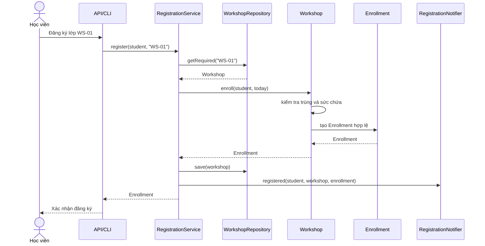
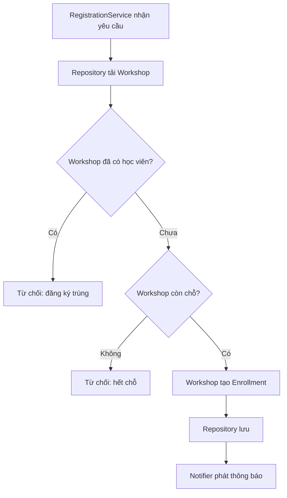
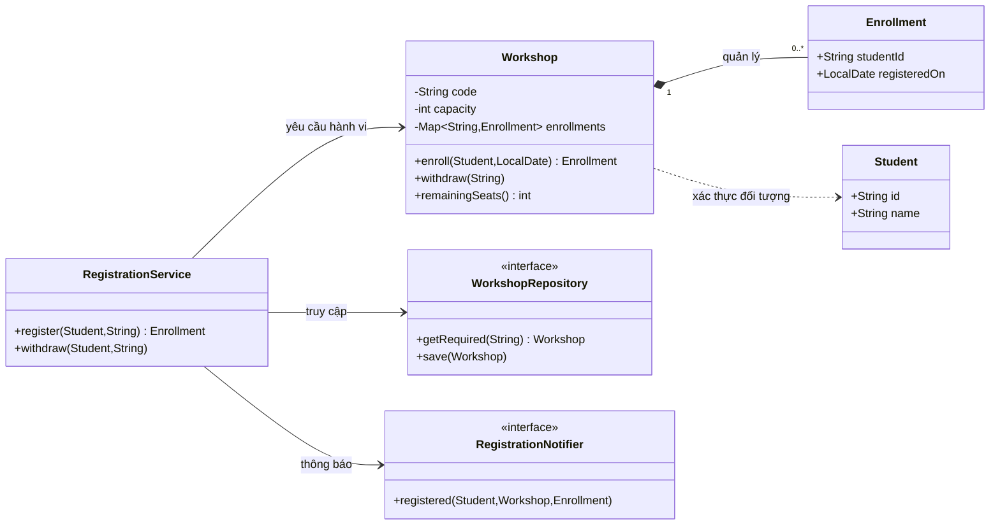
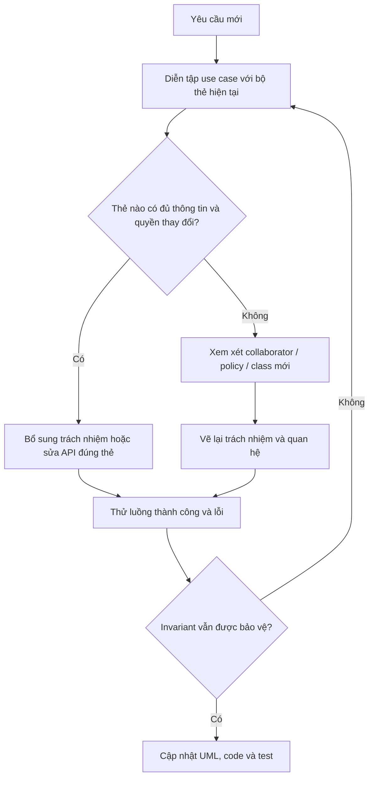

# CRC Cards: Classes, Responsibilities, and Collaborators in OOP Modeling

**CRC** cards (*Class–Responsibilities–Collaborators*) are an object-oriented analysis technique: each card identifies **which class**, **what it is responsible for**, and **which classes it collaborates with**. By arranging cards and role-playing business scenarios, teams discover missing, duplicated, or misplaced responsibilities before committing to code.

CRC is especially useful when user requirements have not yet been divided into Java classes. It addresses three recurring questions:

1. **Class:** Which concepts or roles genuinely need modeling?
2. **Responsibilities:** What must each class know or do to uphold business rules?
3. **Collaborators:** When a class lacks information to complete a task, which other class should it ask for help?

CRC explores **responsibilities and collaboration** rather than specifying every field, constructor, or method signature. Once responsibilities are stable, design the appropriate APIs, UML, and code.

## 1. Anatomy of a CRC Card

Each card has three sections:

```text
+-----------------------------------------------------+
| CLASS: Workshop                                     |
+-----------------------------+-----------------------+
| RESPONSIBILITIES            | COLLABORATORS         |
| - Biết mã lớp và sức chứa    | - Student             |
| - Quản lý người đã đăng ký   | - Enrollment          |
| - Chặn đăng ký trùng         |                       |
| - Chặn vượt sức chứa         |                       |
| - Cho hủy đăng ký hợp lệ     |                       |
+-----------------------------+-----------------------+
```

**Class:** a name expressing a specific contextual concept, such as `Workshop` or `Enrollment`, rather than `DataManager` or `Helper`.

**Responsibilities:** describe the class's **obligations** and **outcomes** in business terms: “reject duplicate registrations,” “enforce capacity,” or “calculate the due date.” Avoid only listing “has `setX`,” which is an implementation detail, not a responsibility.

**Collaborators:** classes it genuinely needs to communicate with—not every class in the project. A class with no collaborators may be perfectly valid, such as a value object validating itself.

| Card section | Review question | Warning sign |
| --- | --- | --- |
| Class | Is its role distinct and clearly different from other concepts? | `EverythingService`, `GeneralUtils` |
| Responsibilities | What business knowledge or behavior does it own? | Only getters/setters are listed |
| Collaborators | Who supplies information or performs other tasks? | Every class in the system is listed |
| Boundary | Which class should change first if this rule changes? | Same rule belongs to three classes |

CRC cards can be written on paper, whiteboards, Markdown, or design tools. Their physical form is secondary; **discussion and validation of responsibilities** provide the value.

## 2. A Practical Scenario for Building Cards

Scenario: “A training center runs workshops. Students choose a uniquely coded workshop to register for. Each workshop has limited seats. A student may register **only once** in a workshop. After valid registration, the system stores enrollment, records the registration date, and sends a notification. Students may withdraw to release seats.”

Capture at least these cases:

- **Success flow:** An registers for a Java workshop with available seats.
- **Duplicate registration:** An attempts to register again and is rejected.
- **Full workshop:** Chi requests a full workshop; reject without creating enrollment.
- **Withdrawal:** An enrolled student withdraws, increasing available seats.
- **Notification failure:** Enrollment persists, but notification fails; a policy must define how to handle it.
- **Concurrency:** Two students compete for the last seat; successful registrations cannot exceed capacity.

Do not decide SQL, REST APIs, or JPA yet. Look for responsibilities that remain **even if technology changes**.

### Candidate Classes

| Candidate | Why it appears | Preliminary conclusion |
| --- | --- | --- |
| `Student` | Has independent student identity | Domain class/record |
| `Workshop` | Has code, capacity, and enrollment list | Domain class enforcing rules |
| `Enrollment` | Each registration has its own student, date, and lifecycle | Domain class/record |
| `RegistrationService` | Coordinates lookup, registration, persistence, and notification | Application service |
| `WorkshopRepository` | Loads/persists workshop state | Data-access interface |
| `RegistrationNotifier` | Sends registration notifications | External interaction port |
| `RegistrationDate` | Registration date | No new class yet; use `LocalDate` |
| `RegisterButton` | UI button | Not a domain object needing CRC in this scope |
| `RegistrationValidator` | Tentative name for “validation” | Unnecessary if `Workshop` already owns and enforces the rule |
| `Database` | Persistence detail | Adapter/infrastructure rather than domain rule |

Candidates are not permanent decisions. If registration later includes `WAITLISTED` status, payment, or history, `Enrollment` may become a behavior-rich entity instead of an immutable result record.

## 3. Create an Initial Set of CRC Cards

These cards are hypotheses for **role-play**, not mandatory classes for every registration system.

| Class | Responsibilities | Collaborators |
| --- | --- | --- |
| `Student` | Maintains valid student identity | Not required |
| `Workshop` | Knows capacity; tracks enrollments; decides add/withdraw; prevents duplicates and oversubscription | `Student`, `Enrollment` |
| `Enrollment` | Represents valid enrollment with student and registration date | `Student` via ID |
| `RegistrationService` | Coordinates registration/withdrawal use cases; gets current date; loads/saves workshops; requests notification | `Workshop`, `WorkshopRepository`, `RegistrationNotifier`, `Clock` |
| `WorkshopRepository` | Provides retrieval and persistence of `Workshop` | `Workshop`; implementing adapter |
| `RegistrationNotifier` | Publishes registration details to an external channel | `Student`, `Workshop`, `Enrollment` |

**Observation:** Duplicate and capacity rules belong to `Workshop` because it manages all registrations for that workshop. `RegistrationService` should not mutate the collection or copy those checks. Conversely, `Workshop` need not know how to persist to a database or send email.

If `RegistrationService` is removed and `Workshop.register()` opens JDBC connections and sends SMTP itself, the domain class becomes technology-dependent; responsibilities are misplaced.

### CRC Is Not a Project Staffing Matrix

The `Workshop` card does not say “developer A is responsible.” It says “**the Workshop object** is responsible for preserving capacity.” CRC describes **software object roles**, not implementers.

A collaborator is not necessarily an owned component. `RegistrationService` uses `WorkshopRepository`, but this does not give the service ownership of the database lifecycle or the right to close shared connections.

## 4. Role-Playing CRC Cards

One person or card represents each class. The facilitator reads a scenario; the responsible object accepts a task and asks collaborators for needed data. This exposes missing steps and unnatural dependency loops.

**Scenario A — An Registers Successfully:**

1. The UI submits `register(student, workshopCode)` to `RegistrationService`.
2. `RegistrationService` asks `WorkshopRepository` to load `Workshop` by code.
3. The service gets the current date from `Clock` and asks `Workshop` to register.
4. `Workshop` checks duplicates and capacity, creates an `Enrollment`, and holds it.
5. The service asks the repository to persist the changed `Workshop`.
6. The service asks `RegistrationNotifier` to send confirmation.



**Scenario B — Duplicate Registration:** `Workshop` detects `studentId` already exists and rejects before changing state. The service neither invokes `save` nor sends success notification.

**Scenario C — Full Workshop:** `Workshop` sees enrollment count equals capacity and rejects. No `Enrollment` is created. The class enforcing the constraint also decides whether mutation is allowed.

**Scenario D — Withdrawal:** `RegistrationService` loads `Workshop`; `Workshop` confirms enrollment and removes the association; the service persists the result. Add notifier collaboration to the withdrawal flow if confirmation emails become required.



After each role-play, ask: “Who owns this step?”, “Which class handles failures?”, and “Does this require another collaborator or just a corrected card?” A card holding many unrelated behaviors indicates poor allocation.

## 5. From CRC Cards to Class Diagrams

CRC cards identify *responsibilities and collaborations*. UML class diagrams make associations, multiplicities, and APIs more concrete:



Some diagram choices are **specific to this example**: `Workshop` controls enrollment, and `Enrollment` belongs to its lifecycle. If canceled registration history must persist, revise classes and relationships. CRC **does not itself determine** composition, interfaces, transactions, or collection types; these emerge through further design.

### Turning Responsibilities into APIs

| CRC responsibility | Proposed Java API | Verification |
| --- | --- | --- |
| Valid student code and name | `Student` constructor | Empty ID/name rejected |
| Workshop capacity limit | `Workshop.enroll(...)` | Available seat accepted; full workshop rejected |
| No duplicate student registrations | `Workshop.enroll(...)` | Second request with the same ID rejected |
| Withdraw and release a seat | `Workshop.withdraw(...)` | Available seats increase |
| Find workshop by code | `WorkshopRepository.getRequired(...)` | Missing workshop produces an error |
| Coordinate a request | `RegistrationService.register(...)` | Calls correct steps and handles errors |
| Notify after registration | `RegistrationNotifier.registered(...)` | In the simple flow, runs only after a successful save |

This is **the bridge from CRC thinking to class design**. A single method can implement multiple aspects of a responsibility; there is no required one-to-one mapping between responsibilities and methods.

## 6. Complete Java 17 Program

Create `CrcCardsDemo.java`. The example uses an in-memory repository and console notifier to illustrate collaboration, with a fixed clock for reproducible output.

```java
import java.time.Clock;
import java.time.Instant;
import java.time.LocalDate;
import java.time.ZoneOffset;
import java.util.LinkedHashMap;
import java.util.List;
import java.util.Map;
import java.util.Objects;

public class CrcCardsDemo {

    // CRC: Student — giữ danh tính học viên hợp lệ.
    record Student(String id, String name) {
        Student {
            if (id == null || id.isBlank()) {
                throw new IllegalArgumentException("Student id is required");
            }
            if (name == null || name.isBlank()) {
                throw new IllegalArgumentException("Student name is required");
            }
        }
    }

    // CRC: Enrollment — thông tin hợp lệ của một lượt đăng ký.
    record Enrollment(String studentId, LocalDate registeredOn) {
        Enrollment {
            if (studentId == null || studentId.isBlank()) {
                throw new IllegalArgumentException("Student id is required");
            }
            Objects.requireNonNull(registeredOn, "registeredOn");
        }
    }

    // CRC: Workshop — điểm kiểm soát giới hạn và danh sách đăng ký.
    static final class Workshop {
        private final String code;
        private final int capacity;
        private final Map<String, Enrollment> enrollments =
                new LinkedHashMap<>();

        Workshop(String code, int capacity) {
            if (code == null || code.isBlank()) {
                throw new IllegalArgumentException("Workshop code is required");
            }
            if (capacity < 1) {
                throw new IllegalArgumentException(
                        "Workshop capacity must be positive");
            }
            this.code = code;
            this.capacity = capacity;
        }

        String code() {
            return code;
        }

        int remainingSeats() {
            return capacity - enrollments.size();
        }

        List<Enrollment> enrollments() {
            // Trả snapshot, không trao quyền sửa Map nội bộ.
            return List.copyOf(enrollments.values());
        }

        Enrollment enroll(Student student, LocalDate today) {
            Objects.requireNonNull(student, "student");
            Objects.requireNonNull(today, "today");

            // Các điều kiện được kiểm tra trước khi thay đổi dữ liệu.
            if (enrollments.containsKey(student.id())) {
                throw new IllegalStateException("Already registered");
            }
            if (enrollments.size() >= capacity) {
                throw new IllegalStateException("Workshop is full");
            }

            Enrollment enrollment = new Enrollment(student.id(), today);
            enrollments.put(student.id(), enrollment);
            return enrollment;
        }

        void withdraw(String studentId) {
            if (studentId == null || studentId.isBlank()) {
                throw new IllegalArgumentException("Student id is required");
            }
            if (!enrollments.containsKey(studentId)) {
                throw new IllegalStateException("Registration not found");
            }
            enrollments.remove(studentId);
        }
    }

    // CRC: WorkshopRepository — hợp đồng tìm và lưu lớp.
    interface WorkshopRepository {
        Workshop getRequired(String code);
        void save(Workshop workshop);
    }

    // Infrastructure adapter, thay được bằng một cài đặt JDBC/JPA.
    static final class InMemoryWorkshopRepository
            implements WorkshopRepository {
        private final Map<String, Workshop> workshops =
                new LinkedHashMap<>();

        @Override
        public Workshop getRequired(String code) {
            Workshop found = workshops.get(code);
            if (found == null) {
                throw new IllegalArgumentException("Workshop not found");
            }
            return found;
        }

        @Override
        public void save(Workshop workshop) {
            Objects.requireNonNull(workshop, "workshop");
            workshops.put(workshop.code(), workshop);
        }
    }

    // CRC: RegistrationNotifier — hợp đồng gửi thông báo.
    interface RegistrationNotifier {
        void registered(Student student, Workshop workshop,
                        Enrollment enrollment);
    }

    static final class ConsoleRegistrationNotifier
            implements RegistrationNotifier {
        @Override
        public void registered(Student student, Workshop workshop,
                               Enrollment enrollment) {
            System.out.println(
                    "Notified " + student.id() +
                    " for " + workshop.code() +
                    " on " + enrollment.registeredOn());
        }
    }

    // CRC: RegistrationService — điều phối use case qua collaborators.
    static final class RegistrationService {
        private final WorkshopRepository repository;
        private final RegistrationNotifier notifier;
        private final Clock clock;

        RegistrationService(WorkshopRepository repository,
                            RegistrationNotifier notifier, Clock clock) {
            this.repository = Objects.requireNonNull(repository);
            this.notifier = Objects.requireNonNull(notifier);
            this.clock = Objects.requireNonNull(clock);
        }

        Enrollment register(Student student, String workshopCode) {
            Objects.requireNonNull(student, "student");

            Workshop workshop = repository.getRequired(workshopCode);
            Enrollment result =
                    workshop.enroll(student, LocalDate.now(clock));
            repository.save(workshop);
            notifier.registered(student, workshop, result);
            return result;
        }

        void withdraw(Student student, String workshopCode) {
            Objects.requireNonNull(student, "student");

            Workshop workshop = repository.getRequired(workshopCode);
            workshop.withdraw(student.id());
            repository.save(workshop);
        }
    }

    public static void main(String[] args) {
        InMemoryWorkshopRepository repository =
                new InMemoryWorkshopRepository();
        Workshop java = new Workshop("WS-01", 2);
        repository.save(java);

        Clock clock = Clock.fixed(
                Instant.parse("2026-10-15T00:00:00Z"), ZoneOffset.UTC);
        RegistrationService service = new RegistrationService(
                repository, new ConsoleRegistrationNotifier(), clock);

        Student an = new Student("ST-01", "An");
        Student binh = new Student("ST-02", "Binh");
        Student chi = new Student("ST-03", "Chi");

        service.register(an, "WS-01");
        service.register(binh, "WS-01");

        try {
            service.register(an, "WS-01");
        } catch (IllegalStateException expected) {
            System.out.println(expected.getMessage());
        }

        try {
            service.register(chi, "WS-01");
        } catch (IllegalStateException expected) {
            System.out.println(expected.getMessage());
        }

        System.out.println("Remaining: " + java.remainingSeats());
        service.withdraw(binh, "WS-01");
        System.out.println("After withdrawal: " + java.remainingSeats());
    }
}
```

Compile and run:

```bash
javac CrcCardsDemo.java
java CrcCardsDemo
```

Output:

```text
Notified ST-01 for WS-01 on 2026-10-15
Notified ST-02 for WS-01 on 2026-10-15
Already registered
Workshop is full
Remaining: 0
After withdrawal: 1
```

### Map the Program Back to Each Card

- **`Student`** knows nothing about databases, workshop lists, or email delivery. Its identity and name are validated on construction.
- **`Enrollment`** records a dated registration; it is immutable within the demo scope.
- **`Workshop`** owns its enrollment set and rejects duplicates/full capacity; it provides no arbitrary collection setter.
- **`WorkshopRepository`** defines retrieval/persistence; `InMemoryWorkshopRepository` stores a `Map` without implementing capacity rules.
- **`RegistrationNotifier`** defines the notification port. `ConsoleRegistrationNotifier` prints to the console rather than deciding whether registration is valid.
- **`RegistrationService`** coordinates the repository, domain objects, clock, and notifier without calculating capacity or writing into `enrollments` itself.

Within `Workshop.enroll(...)`, duplicate/full checks occur **before modifying the Map**. `withdraw` rejects students who were not enrolled. Thus the single-threaded outcome follows the responsibilities assigned on the cards.

**Demo boundary:** `InMemoryWorkshopRepository` stores and returns the same `Workshop` reference; `enroll` mutates it before `save` is called. This is a sequential in-memory model for teaching responsibilities, **not a transaction with rollback**. Production requires coordinated checks and persistence under suitable synchronization/transactions to prevent concurrent oversubscription. If the notifier fails after persistence, define delivery retries, request state, and idempotency; a transactional outbox is a common solution.

## 7. Validate CRC Through Scenario Tests

A good CRC set should support deriving tests from responsibilities, especially when rules fail.

| Card | Test scenario | Required outcome |
| --- | --- | --- |
| `Student` | Blank ID or name | Constructor rejects |
| `Workshop` | Construct with capacity 0 | Constructor rejects |
| `Workshop` | First registration with a seat available | Adds an `Enrollment` |
| `Workshop` | Same student registers again | Reject; enrollment set unchanged |
| `Workshop` | Workshop is full | Reject; available seats never negative |
| `Workshop` | Withdraw a student not enrolled | Reject; state unchanged |
| `RegistrationService` | Valid registration | Load workshop, invoke behavior, persist, request notification |
| `RegistrationService` | Workshop rejects | Do not report success or request notification |
| Repository adapter | Workshop does not exist | Return an explicit error |
| Concurrent request integration | Two students request the last seat | At most one succeeds |

Extend the example with a fake `RegistrationNotifier` that counts calls; replace `ConsoleRegistrationNotifier` without changing `Workshop`. This directly tests **responsibility boundaries and coupling**.

Unit tests on `Workshop` verify sequential business rules, not thread safety. Add database-level integration and concurrency tests to validate system-wide invariants.

## 8. Assess CRC Card Quality

### Cohesion

Do responsibilities on one card serve the same purpose?

- Good: `Workshop` manages capacity, enrolled students, and registration validity.
- Reconsider: `Workshop` handles capacity while exporting PDF, connecting to SMTP, and parsing JSON.

### Coupling

Does the class depend on too many internal details of others?

- Good: `RegistrationService` uses the `WorkshopRepository` interface.
- Reconsider: the service knows repository SQL schemas and modifies `Workshop.enrollments` directly.

### Authoritative Rule Ownership

If capacity is enforced in `Workshop`, do not duplicate the formula in the controller, notifier, and repository. The UI may precheck for helpful feedback, but the authoritative invariant enforcement point must be clear.

### Adaptability

Try independent changes:

| Change | Which cards need review? | Which cards likely need no change? |
| --- | --- | --- |
| Workshop limit becomes 30 rather than 20 | `Workshop` configuration data | Notifier, repository interface |
| Switch console output to email | `RegistrationNotifier` implementation | `Workshop`, `Enrollment` |
| Switch in-memory persistence to PostgreSQL | `WorkshopRepository` adapter | `Workshop` registration rules |
| Introduce waiting lists | `Workshop`, possibly new `WaitlistEntry` | HTTP adapter may only need DTO changes |
| Require payment before confirmation | Workflow/service, payment port, enrollment state | Classes unrelated to payments |
| Grant priority to certain students | `RegistrationPolicy` or an appropriate domain rule | Notification adapter |

If an infrastructure change forces modifications across many domain classes, revisit collaborators and dependency direction.

## 9. Reassigning Responsibilities as Requirements Grow

CRC is a **living artifact** during modeling. New scenarios may revise cards rather than merely add methods.

**Scenario: “When a workshop is full, students join a time-ordered waitlist.”**

New questions: who tracks order, who gets invited after cancellation, and do offers expire? If entries have independent dates and states, consider `WaitlistEntry`. `Workshop` may coordinate seats and the queue or delegate priority decisions to a policy. Update CRC before adding arbitrary fields.

**Scenario: “Each student has a membership tier, and VIP members have priority.”**

Do not let the notifier decide admission just because it sees a VIP email. This is an **allocation rule**: consider an `AdmissionPolicy` collaborating with `Workshop` and student-tier information.

**Scenario: “Registration is valid only after payment.”**

`Enrollment` is no longer just a one-line immutable value. It may need an entity `Enrollment` with `PENDING_PAYMENT`, `CONFIRMED`, and `CANCELLED` states, plus `PaymentGateway`, timeouts, and seat-release rules. Define when a seat is reserved, what transaction grants entitlement, and how to handle repeated webhooks.

**Scenario: “Students cannot register for two overlapping workshops.”**

An individual `Workshop` cannot know other schedules. This rule needs a collaborator authorized to query a student's registrations/schedule or a policy/service at the appropriate boundary. It introduces responsibility **beyond one workshop**.



## 10. Common CRC Card Mistakes

**Mistake 1 — Turning every class into a service.** A `WorkshopService` “manages everything” while `Workshop` contains only setters. Move appropriate invariants back into `Workshop` and keep use-case coordination in the service, without forcing cross-aggregate rules into an entity lacking the data.

**Mistake 2 — Describing only methods and fields.** Listing `getCapacity`, `setCapacity`, and `getStudents` does not explain *who prevents oversubscription*. Write responsibilities first and derive the API later.

**Mistake 3 — Creating one class per noun.** “Registration date” does not necessarily require `RegistrationDateManager`; `LocalDate` may suffice. A new class needs distinct meaning, rules, or lifecycle.

**Mistake 4 — Listing every application dependency as a collaborator.** If a `Workshop` card names databases, REST controllers, logging frameworks, and email clients unrelated to its domain behavior, technical layers may be mixed into the wrong place.

**Mistake 5 — Two classes own the same decision.** If `RegistrationService` and `Workshop` each validate and update capacity differently, inconsistent outcomes can result. Choose the authority enforcing the invariant and define its contract.

**Mistake 6 — Role-playing only success.** Duplicates, full capacity, persistence failures, network loss, repeated cancellation, and concurrent requests expose missing responsibilities.

**Mistake 7 — Thinking CRC replaces detailed design.** CRC explores responsibilities and collaboration but **does not** prove code correctness, thread safety, table schemas, transactional outbox design, or permissions. These require APIs/UML, tests, reviews, and system verification.

**Mistake 8 — Automatically equating user actors with domain classes.** “Support staff sends notification” may describe a use-case role without requiring a `SupportStaff` object when staff identity/policy is outside scope.

## 11. CRC, UML, and Other Design Tools

| Tool | Main question answered | When to use it |
| --- | --- | --- |
| User story / use case | What outcome does the user want? When does it succeed/fail? | During requirements discovery |
| CRC cards | Which classes own which responsibilities, and whom do they consult? | During object/responsibility allocation |
| UML class diagram | What are classes, relationships, multiplicities, and APIs? | When precise structure is needed |
| UML sequence diagram | In what order do collaborators invoke one another? | When validating interaction flows |
| State machine | Which states and transitions can an object have? | For complex domain lifecycles |
| Unit/integration tests | Does implementation meet requirements? | To validate code and integration |

An effective progression is **use case → CRC role-play → UML at the needed level → Java/tests → revise cards as the domain becomes clearer**. CRC need not remain frozen while code and real operations evolve.

## 12. Practice Exercises

### Exercise 1 — CRC Cards for Movie Ticketing

Requirement: “A viewer selects a screening, holds seats for 5 minutes, pays, and receives tickets. A seat at a screening may not be sold to two people.”

Propose CRC cards for `Screening`, `SeatHold`, `Ticket`, `BookingService`, `PaymentGateway`, and `BookingRepository`. Identify who validates seat holds, who knows the hold expiration, and who coordinates payment confirmation.

### Exercise 2 — Identify Duplicated Responsibilities

A design includes `RegistrationController`, `RegistrationService`, `Workshop`, and `WorkshopRepository`; all four check “has the workshop reached 30 students?” Rewrite CRC cards to identify one source of truth, preserving needed boundary validation without duplicating business decisions.

### Exercise 3 — Role-Play a Failure Flow

Using the Java example's cards, suppose `save(workshop)` fails but the notifier still sends an “enrolled” email. Which cards need revised responsibilities or contracts? Propose suitable states, transactions, and retry policies. Explain why blindly retrying `register` is insufficient.

### Exercise 4 — Add a Waiting List

A workshop with 30 seats is full; the next student joins a waitlist. When someone withdraws, the first student on the waitlist receives an offer held for 15 minutes. Draw new CRC cards, describe `WAITING/OFFERED/CONFIRMED/EXPIRED` states, and assign expiration ownership.

### Exercise 5 — Turn CRC into Tests and Code

Add `registrationCount()`, test `Workshop` from 0 up to capacity, confirm duplicates do not change the count, and verify that withdrawal releases a seat. Write a fake notifier counting calls and check that `RegistrationService` never reports success after `Workshop` rejects.

## 13. CRC Design Completion Checklist

- Does each class have **a purpose expressible in business language**?
- Do responsibilities use meaningful verbs and describe **obligations**, not merely list methods?
- Is every “must/must not/at most/only if” condition assigned to a responsible enforcer?
- Are listed collaborators genuinely needed to fulfill responsibilities?
- Are there dependency cycles, excessive cross-references, or two classes claiming one rule?
- Can every class protect its invariants, or does it secretly mutate other classes' data?
- Have success, failure, and rollback-required flows been role-played?
- Have domain objects, policies, coordinators, repositories, and external adapters been distinguished?
- If requirements change, can you identify **which card must change** and why?
- Have responsibilities become explicit APIs/UML elements and test scenarios?
- With concurrent DB/network calls, are transaction, locking, retry, and idempotency boundaries identified?

**Remember:** a good CRC card is not better merely because it contains more classes or lines. It is useful when a reader can explain “who does what, why, and with whose help” and verify those answers using real scenarios and clear OOP code.
