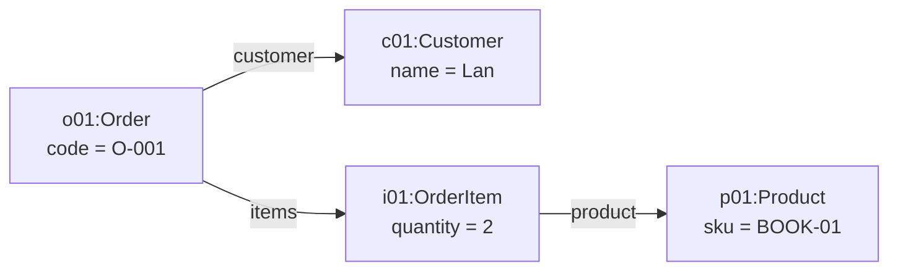
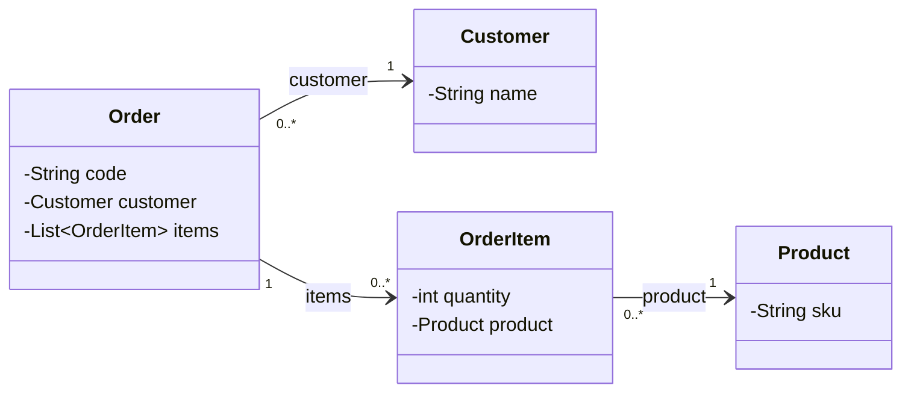
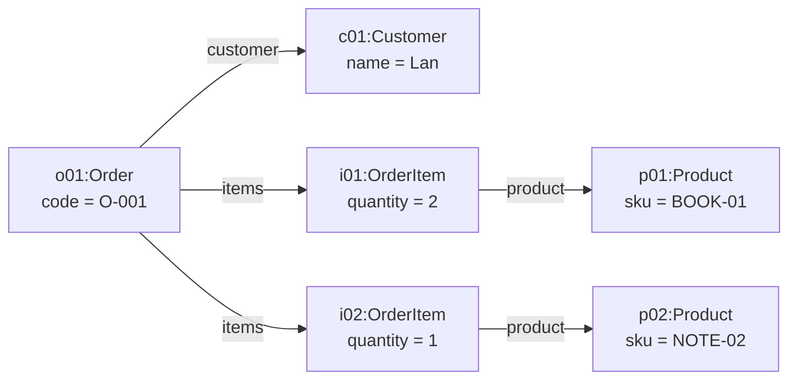
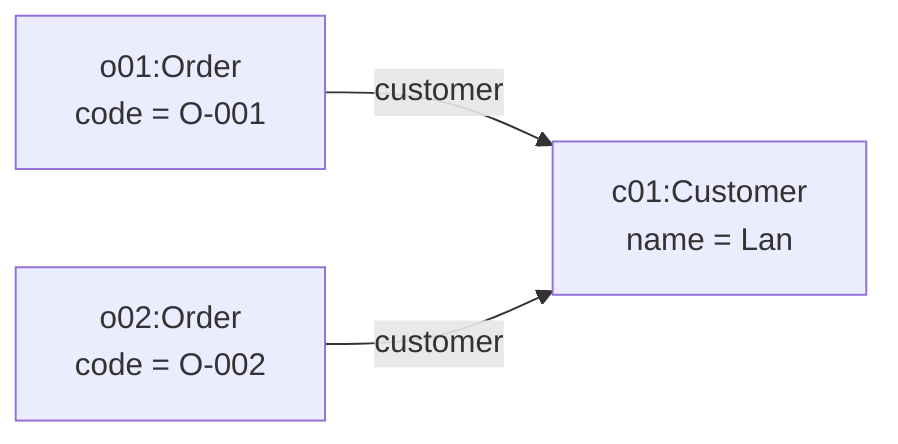

# Object Diagrams: Instances at a Point in Time

## 1. What Questions Do Object Diagrams Answer?

A **UML Object Diagram** depicts **specific objects, their attribute values, and links among them at a particular moment**. It is a snapshot of system state.

Consider an e-commerce system: class `Order` describes orders generally, but when Lan places order `O-001`, the program has **one concrete Order object** holding an order code and a reference to Lan's customer object. The order may contain `OrderItem` objects, each linking to a `Product` object.

Object diagrams answer concrete questions:

- At this moment, **which customer** does order `O-001` reference?
- **How many** items does the order currently contain, and which products do they reference?
- Do two items reference the same product instance or two different objects?
- How does the object graph change after adding an item?

Do not confuse class diagrams with instance snapshots: “An Order **may have** many OrderItems” describes a **type/class-level** rule; “object `o01` currently has items `i01` and `i02`” states an **instance-level** fact at a specific time.

## 2. UML Notation: Objects, Slots, and Links

A UML **object** is commonly drawn as a rectangle. Its heading has the form `tênĐốiTượng:TênLớp` and is **underlined** in standard notation. For example, `o01:Order` is an instance named `o01` of class `Order`. Use `:Order` when the object name is not important, or `o01` when its type is clear from context.

An object's body may show *slots*—attribute values at snapshot time:

```text
┌──────────────────────────────┐
│         o01:Order            │  ← Tiêu đề được gạch chân khi vẽ UML chuẩn
├──────────────────────────────┤
│ code = "O-001"               │
│ status = "DRAFT"             │
└──────────────────────────────┘
```

A **link** connects **two concrete objects**, representing an instance of an association. To clarify fields or roles, annotate links with `customer`, `items`, or `product`.

Distinguish these elements:

| Element | In a class diagram | In an object diagram |
|---|---|---|
| Type | `Order`, `Customer` | `o01:Order`, `c01:Customer` |
| Attribute | `code: String` | `code = "O-001"` |
| Relationship | `Order → Customer` | Link from `o01` to `c01` |
| Multiplicity | `0..*`, `1` across **all** valid instances | Number of objects/links **present** in the snapshot |
| Purpose | Declares possible structure | Shows an actual state at a particular moment |

Object labels and values are **human-readable identifiers for the diagram**; they need not be Java variable names or database primary keys.

## 3. Running Example: An Order at t0

Suppose these objects exist:

- `c01:Customer` — Lan, the customer.
- `o01:Order` — order `O-001`, belonging to Lan.
- `i01:OrderItem` — line number 1, quantity 2.
- `p01:Product` — product with SKU `BOOK-01`.

**Snapshot t0:** the order contains one item line.



The diagram uses a **Mermaid flowchart** for Markdown display; it is **an object-graph illustration with equivalent meaning**, not a full UML Object Diagram compiler. In formal UML, object headings are underlined and links are usually plain lines. The Mermaid arrows clarify **which references are followed**, not execution order, method calls, or data movement.

Trace one path through the diagram:

```text
o01 (Order) --items--> i01 (OrderItem) --product--> p01 (Product)
```

And another:

```text
o01 (Order) --customer--> c01 (Customer)
```

Crucially, **links connect instances**, such as `o01 → c01`, rather than generic concepts `Order` and `Customer`.

## 4. Which States Does a Class Diagram Permit?

Before drawing object diagrams, understand the structural rules imposed by classes and associations. For this example:



Read association multiplicities as follows:

- Each `Order` is linked to **1 Customer**; one `Customer` may be referenced by **0 or more Orders**.
- Each `OrderItem` belongs to **1 Order** by the domain model; an `Order` may contain **0 or more OrderItems**. The Java code below ensures each item is added to one order in this demo, but universal enforcement of “each item belongs to exactly one order” requires appropriate ownership and validation.
- Each `OrderItem` has **1 Product**; a `Product` may be referenced by **many items**.

At **t0**, the object diagram contains only *one* customer, *one* order, *one* item, and *one* product. That does not imply the entire application permits only four objects or one item per order.

**Object diagrams need not show every object in the JVM.** Usually they select just enough of an object graph to illustrate a scenario, invariant, or bug.

## 5. Runnable Java: Create an Object Graph and Capture Two Moments

Create `ObjectDiagramDemo.java`. No framework is needed; the example works with Java 11 or later.

```java
import java.util.ArrayList;
import java.util.List;
import java.util.Objects;

public class ObjectDiagramDemo {

    static final class Customer {
        final String label;  // Nhãn minh họa trên sơ đồ.
        final String name;

        Customer(String label, String name) {
            this.label = Objects.requireNonNull(label);
            this.name = Objects.requireNonNull(name);
        }
    }

    static final class Product {
        final String label;
        final String sku;

        Product(String label, String sku) {
            this.label = Objects.requireNonNull(label);
            this.sku = Objects.requireNonNull(sku);
        }
    }

    static final class OrderItem {
        final String label;
        final Product product;
        final int quantity;

        OrderItem(String label, Product product, int quantity) {
            this.label = Objects.requireNonNull(label);
            this.product = Objects.requireNonNull(product);

            if (quantity <= 0) {
                throw new IllegalArgumentException("quantity must be positive");
            }
            this.quantity = quantity;
        }
    }

    static final class Order {
        final String label;
        final String code;
        final Customer customer;
        final List<OrderItem> items = new ArrayList<>();

        Order(String label, String code, Customer customer) {
            this.label = Objects.requireNonNull(label);
            this.code = Objects.requireNonNull(code);
            this.customer = Objects.requireNonNull(customer);
        }

        void addItem(OrderItem item) {
            Objects.requireNonNull(item);
            if (items.contains(item)) {
                throw new IllegalArgumentException("Item already added");
            }
            items.add(item);
        }

        List<OrderItem> getItems() {
            return List.copyOf(items); // Không lộ collection sửa được.
        }
    }

    static void printSnapshot(String time, Order order) {
        System.out.println("=== " + time + " ===");
        System.out.println(order.label + ":Order code=" + order.code);
        System.out.println(order.label + " --customer--> " + order.customer.label);
        System.out.println(order.customer.label + ":Customer name=" + order.customer.name);

        for (OrderItem item : order.getItems()) {
            System.out.println(order.label + " --items--> " + item.label);
            System.out.println(item.label + ":OrderItem quantity=" + item.quantity);
            System.out.println(item.label + " --product--> " + item.product.label);
            System.out.println(item.product.label + ":Product sku=" + item.product.sku);
        }
    }

    public static void main(String[] args) {
        Customer c01 = new Customer("c01", "Lan");
        Product p01 = new Product("p01", "BOOK-01");
        Product p02 = new Product("p02", "NOTE-02");

        Order o01 = new Order("o01", "O-001", c01);
        OrderItem i01 = new OrderItem("i01", p01, 2);
        o01.addItem(i01);

        printSnapshot("t0", o01);

        OrderItem i02 = new OrderItem("i02", p02, 1);
        o01.addItem(i02);

        printSnapshot("t1", o01);

        // Những object cũ vẫn giữ nguyên danh tính tham chiếu.
        System.out.println("Same customer: " + (o01.customer == c01));
        System.out.println("Same first item: " + (o01.getItems().get(0) == i01));
    }
}
```

Compile and run:

```bash
javac ObjectDiagramDemo.java
java ObjectDiagramDemo
```

Output:

```text
=== t0 ===
o01:Order code=O-001
o01 --customer--> c01
c01:Customer name=Lan
o01 --items--> i01
i01:OrderItem quantity=2
i01 --product--> p01
p01:Product sku=BOOK-01
=== t1 ===
o01:Order code=O-001
o01 --customer--> c01
c01:Customer name=Lan
o01 --items--> i01
i01:OrderItem quantity=2
i01 --product--> p01
p01:Product sku=BOOK-01
o01 --items--> i02
i02:OrderItem quantity=1
i02 --product--> p02
p02:Product sku=NOTE-02
Same customer: true
Same first item: true
```

**Why is this a snapshot?** `printSnapshot("t0", o01)` observes the graph before `i02` is added. The second call observes **the same `o01` object** after a new link appears in its `items` list. Java does not need a new `Order` instance for a different snapshot.

Note: `label` maps instances to diagram names. Java uses **object references**; `==` in the final two lines confirms that two references point to **the exact same instance**. Two different objects may have equal `code` or `sku` values.

## 6. Snapshot t1: Same Order, More Links

After adding the second item, the graph looks like this:



*Both snapshots show only fields actually present in the illustrative Java code (`code`, `name`, `quantity`, `sku`) and links among instances. If the domain introduces `status`, add the Java field, snapshot value, and test instead of inventing an unimplemented state label.*

Comparison:

| Observation | Snapshot `t0` | Snapshot `t1` |
|---|---|---|
| `o01:Order` | Present | Same `o01` object |
| `c01:Customer` | Present | Same `c01` object |
| `i01:OrderItem` | Present, quantity = 2 | Still present, quantity = 2 |
| `i02:OrderItem` | Not linked to `o01`; not yet created in the demo | Present, quantity = 1 |
| Link `o01 → i01` | Present | Present |
| Link `o01 → i02` | Absent | Present |
| Classes `Order`, `OrderItem` | Unchanged | Unchanged |

Two static pictures **do not constitute a sequence diagram**. Snapshots show “before/after” states; sequence diagrams answer **who calls whom, what messages are exchanged, and in what order**.

## 7. Multiple References to One Object

An important use of object diagrams is illustrating **shared references (aliasing)**.

Suppose two different orders both belong to customer Lan:



There are **three objects**, not four: two `Order` objects and one `Customer` object. Both links point to `c01`. In Java:

```java
Customer c01 = new Customer("c01", "Lan");
Order o01 = new Order("o01", "O-001", c01);
Order o02 = new Order("o02", "O-002", c01);

System.out.println(o01.customer == o02.customer); // true
```

This snippet runs inside `main` of `ObjectDiagramDemo` using the declared nested classes. If you create **two** different `Customer` objects with the name “Lan,” the snapshot needs **two separate boxes**. Equal attribute values do not make two objects one instance.

This is helpful for debugging data updates: changing a shared object may be observed through multiple reference paths, whereas changing another object with equal values is not.

## 8. When Should You Use Object Diagrams?

**Clarify requirements and domain scenarios.** For reservations, snapshot `room01`, `booking17`, and `guest03` to discuss “who reserved this room at a specified moment.”

**Check constraints and multiplicities.** If a class diagram requires every `OrderItem` to have a `Product`, a snapshot with an item lacking a product is **a rule-violating state**. The diagram makes the counterexample visible.

**Explain aliasing and shared state.** Two links to one object clarify why a change can be observed through different objects.

**Debug object graphs.** When tests fail because an item belongs to the wrong order or a user retains outdated access, before/after diagrams reveal incorrect links. Heap graphs can differ from database relationships before flushing or because of caches.

**Design tests.** Define an expected input snapshot and a resulting post-operation snapshot. Assertions can verify link counts, identities, attribute values, and domain invariants.

### Verify the Snapshot with Java Tests

Add suitable checks at the end of the example's `main`:

```java
if (o01.getItems().size() != 2) {
    throw new AssertionError("Order must contain two items at t1");
}

if (o01.customer != c01) {
    throw new AssertionError("Order customer link is incorrect");
}

if (o01.getItems().get(1).product != p02) {
    throw new AssertionError("Second item points to wrong product");
}
```

These assertions verify relationships **at t1**. If requirements change to allow multiple customers per order, update class diagrams, object diagrams, and tests consistently.

## 9. Common Mistakes

| Mistake | Why it is wrong | Better approach |
|---|---|---|
| Drawing classes `Order`, `Customer` and calling it an object diagram | No concrete instances are shown | Show `o01:Order`, `c01:Customer` and their links |
| Writing `quantity: int` inside an instance box | This declares an attribute's type | Write `quantity = 2` to show current state |
| Drawing two boxes for the same instance | Suggests two separate objects | Use one box with multiple links to it |
| Assuming missing links are impossible | A snapshot may intentionally omit some graph portions | State snapshot scope and assumptions |
| Treating snapshots as an execution sequence | Object links have no individual timestamps | Draw separate t0/t1 snapshots; use sequence/activity diagrams for processing steps |
| Equating the `o01` label with Java variable or DB ID | Object identity differs from variable names and domain/DB keys | Define labeling conventions; check reference identity when needed |
| Drawing a state violating multiplicity without explanation | Misleads readers about domain rules | Mark it as invalid or fix the association |
| Treating Mermaid arrows as method calls | Links between objects represent associations | Use field/role labels; distinguish from sequence-diagram messages |

## 10. Practice Exercises

**Exercise 1 — identify instances:** The system has `Student` and `Course`. Students An and Binh both enroll in a Java course. How many student and course objects are needed?

**Hint:** Two distinct `Student` objects and **one** `Course` object linked to both, assuming they refer to the same Java course.

**Exercise 2 — class model to snapshot:** A class diagram shows `Library 1 — 0..* Book`. At snapshot time, library `L1` holds books `B1` and `B2`. Draw three instance boxes and two links. What changes when `B2` moves to library `L2`?

**Hint:** Before: `L1—B1` and `L1—B2`. After: `L1—B1` and `L2—B2`. Book objects may remain the original instances.

**Exercise 3 — detect an invalid state:** Every `OrderItem` must reference exactly one product. A snapshot shows `i03:OrderItem` without a link to `Product`. Can you conclude that it is definitely an error?

**Hint:** If the snapshot is **complete with respect to product links**, it violates the constraint; if it intentionally omits details, verify before concluding.

**Exercise 4 — are two pictures a sequence diagram?** One shows an order in `DRAFT`, the other in `PAID`. What do the images reveal, and what do they omit?

**Hint:** They show values at two moments but not which APIs were called, how transactions ran, or the order of messages among components.

**Exercise 5 — check identity:** Two orders reference `customerA` and `customerB`, both named Lan, but `customerA != customerB`. Draw the correct number of boxes and links.

**Hint:** Four objects—two orders and two customers—because the customers are separate instances.

---

**Remember:** Class diagrams describe *types and structural rules*, while object diagrams describe *instances, values, and links at a chosen moment*. State the snapshot time, graph scope, identity labels, and how each link corresponds to real program state.
