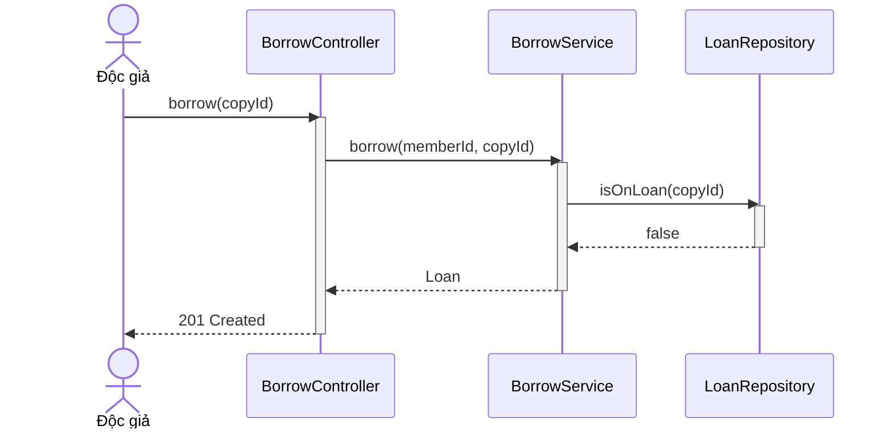
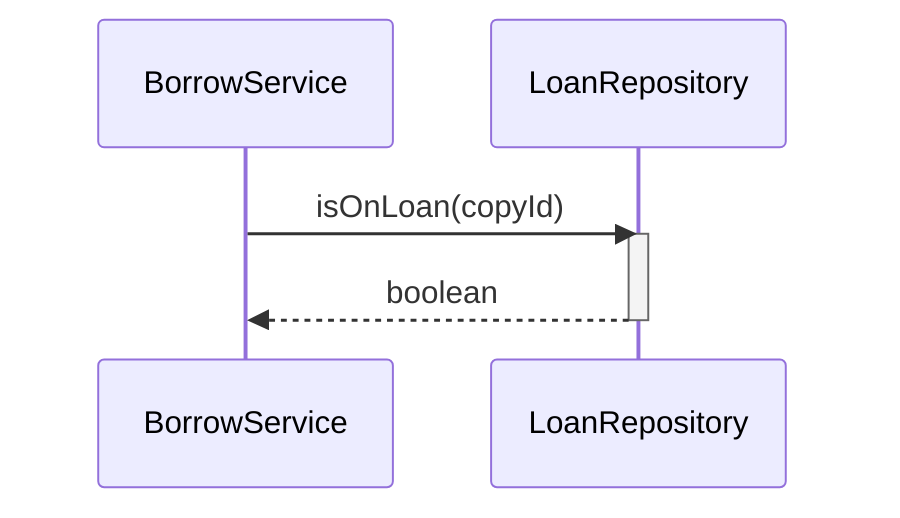
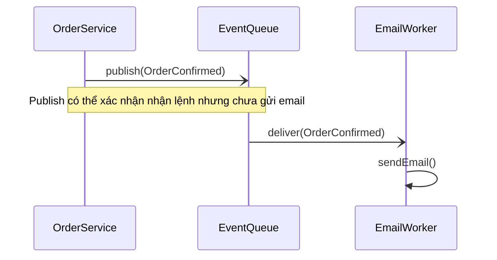
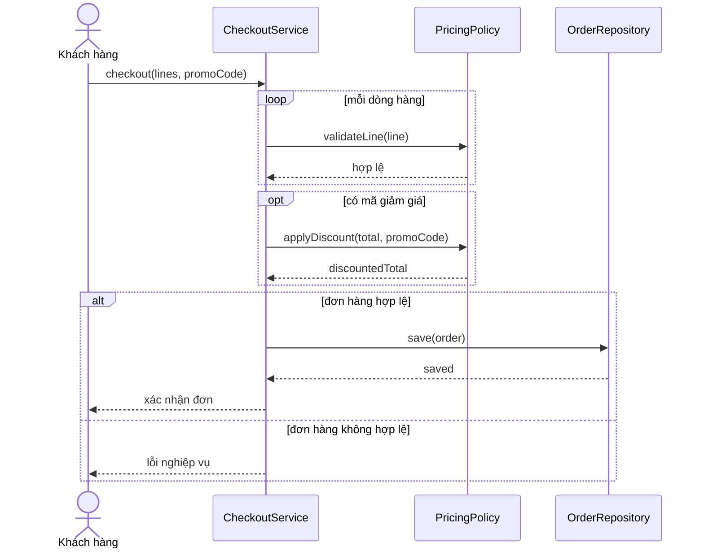
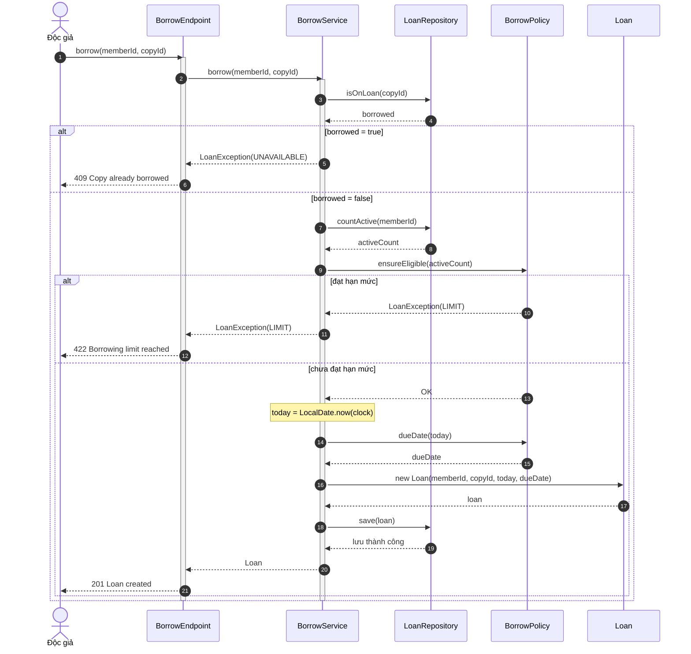
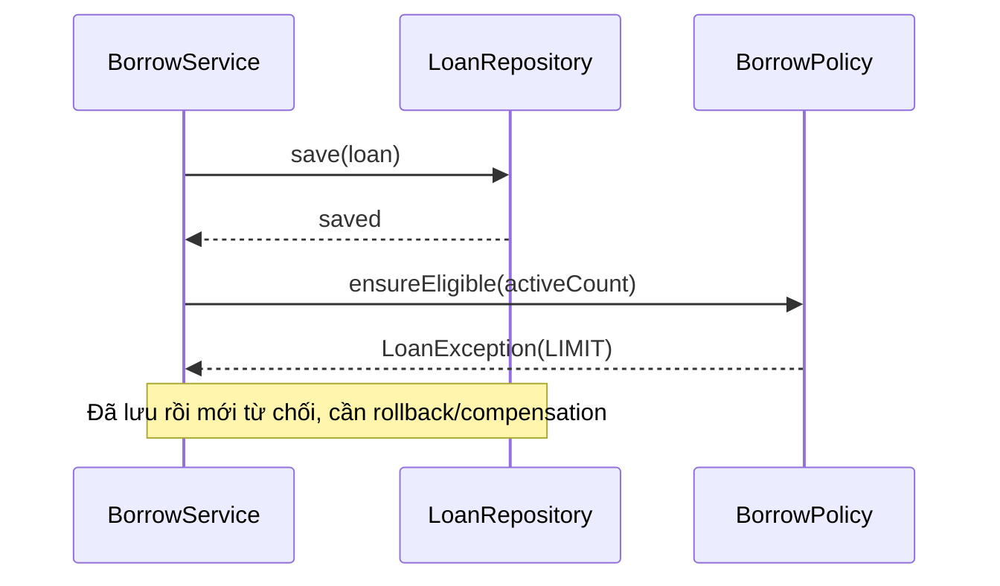

# Sequence Diagrams: Interaction Order in OOP

When a feature involves several objects, a class diagram shows **which objects are related**; a **UML sequence diagram** shows **who calls whom, in what order, and how results return** for a particular scenario.

For example, when a library member selects “Borrow Book,” the system checks copy availability, active-loan limits, due dates, and persistence before responding. A sequence diagram clarifies **who owns each step** and **which branch handles an invalid request**.

## 1. When Do You Need a Sequence Diagram?

Use sequence diagrams to answer:

- Which call originates from an actor, and which object receives it first?
- In what **order** does a use case pass through controller, service, repository, and domain objects?
- How is each call's result used to make decisions?
- Where does processing stop on failure? Is anything still persisted?
- Are there loops, optional calls, or parallel/asynchronous operations?
- Are responsibilities correctly placed, or does a controller/service do too much?

A diagram describes **one interaction or a group of scenarios for one behavior**, not necessarily the whole system. Start with **a use case that can be stated as a sentence**, such as “A member borrows a book copy.”

| Question | More suitable diagram type |
| --- | --- |
| Which classes have attributes, operations, and relationships? | Class diagram |
| Which steps and decision branches form an algorithm? | Activity diagram |
| Who sends which messages, and in what order? | **Sequence diagram** |
| Which states can an object transition through? | State machine |
| How are deployable components connected architecturally? | Component/deployment diagram |

Sequence diagrams help when objects collaborate, but adding one merely to document two numbers being added inside a method may be more complex than the code.

## 2. Elements and Top-to-Bottom Reading

A sequence diagram uses a **horizontal axis** for participants/lifelines and a **vertical axis** for message ordering. Messages lower on the diagram generally occur later in the scenario.



| Element | Meaning | Mermaid interpretation |
| --- | --- | --- |
| **Actor** | User or external system initiating interaction | `actor U as Độc giả` |
| **Participant** | Object, service, or component sending/receiving messages | `participant S as BorrowService` |
| **Lifeline** | Vertical line showing participant presence during interaction | Shown below participant label |
| **Message (call)** | Directed call or request from sender to recipient | `S->>R: isOnLoan(copyId)` |
| **Return message** | Result sent back, often drawn with a dashed arrow | `R-->>S: false` |
| **Activation** | Interval where a participant executes work in the interaction | `activate S`, `deactivate S` |
| **Combined fragment** | Box for branches, loops, options, parallel paths, etc. | `alt`, `opt`, `loop`, `par` |
| **Note** | Annotation for important rules or assumptions | `Note over S,R: ...` |

In standard UML, an *activation* is also called an **execution specification**. It represents an execution interval, **not necessarily** CPU time or measured duration. Lifelines are not necessarily separate threads.

**Important ordering note:** the diagram shows relative order of depicted interactions. The vertical distance between two arrows **does not automatically** represent elapsed milliseconds. Annotate durations, timeouts, or deadlines explicitly when needed.

## 3. Distinguish Message Types

### 3.1. Synchronous Calls and Returns

For an ordinary Java invocation:

```java
boolean borrowed = repository.isOnLoan(copyId);
```

The caller waits for completion or an exception before continuing along the same control flow. One common notation is:



In Mermaid, `->>` is a solid arrow and `-->>` a dashed return arrow; **synchronous versus asynchronous semantics depend on the message meaning as well as notation**, not one arrow character alone. Standard UML has distinct call/return message notation.

### 3.2. Asynchronous Calls

For example, an application enqueues an email-generation request and continues without waiting for the email to be sent:



Mermaid `-)` denotes an open arrowhead often used for asynchronous messages. However, **changing a diagram symbol cannot make Java code asynchronous**. Real mechanisms include queues, event buses, callbacks, `CompletableFuture`, workers, or nonblocking protocols.

Also, `publish(...)` may itself be a synchronous queue-client call that waits for broker acknowledgment, while **email processing** runs asynchronously. Distinguish *publishing/enqueuing an event* from *executing the task*.

### 3.3. Self-Messages, Creation, and Destruction

- **Self-message:** an object invokes another of its own methods, such as `validator.validateState()`.
- **Create message:** an object requests a new instance, such as `new Loan(...)`.
- **Destroy message:** indicates the end of an object's lifecycle in the interaction model.

Do not confuse the end of a lifeline with Java garbage collection. The JVM does not guarantee collection when a variable leaves scope, and `AutoCloseable` resources still need explicit closing policies.

## 4. Combined Fragments: Branches and Loops

Control fragments avoid separate diagrams for every outcome.

| Fragment | Meaning | Example |
| --- | --- | --- |
| `alt` | Mutually exclusive branches based on guards | Copy borrowed / copy available |
| `opt` | Optional block that may execute or be skipped | Apply discount only when code exists |
| `loop` | Repeated interaction block | Check each order line in turn |
| `par` | Segments may run concurrently/interleave | Two independent jobs overlap |
| `break` | Early exit from surrounding interaction on a guard | Stop after authentication failure |
| `critical` | Critical interaction region requiring no interleaving under the model constraint | Operation protected against concurrent updates |

Example of three common fragments:



**Do not treat `par` or `critical` as synchronization mechanisms already present in the application.** Fragments record design intent. Competing transactions still require locks, isolation, optimistic concurrency, unique constraints, or equivalent enforcement at appropriate boundaries.

## 5. Running Scenario: Borrowing a Book Copy

Requirements:

1. Member submits `memberId` and `copyId`.
2. System rejects if the copy is currently borrowed.
3. System rejects if the member has reached the active-loan limit.
4. If allowed, calculate the due date from the borrowing date and policy, create a loan, and persist the result.
5. Success responds with **201** and loan data; unavailable copy returns **409**; quota violation returns **422** (illustrative API choices, not mandatory for every API).

### Full-Flow Sequence Diagram



The diagram uses `autonumber` for **displayed message ordering**, not Java source lines or HTTP request counts. Exception arrows depict error responses across service/controller boundaries; Java exceptions **are not** ordinary return values.

When “copy already borrowed,” there is **no** `countActive` or `save` call. When “quota reached,” there is **no** `dueDate` or `save` call. These details validate call ordering and side effects, not merely final outcomes.

## 6. Runnable Java 17 Program Matching the Diagram

Put all code below in `SequenceDiagramDemo.java`:

```java
import java.time.Clock;
import java.time.Instant;
import java.time.LocalDate;
import java.time.ZoneOffset;
import java.util.LinkedHashMap;
import java.util.Map;
import java.util.Objects;

public class SequenceDiagramDemo {

    enum Reason { UNAVAILABLE, LIMIT }

    static final class LoanException extends RuntimeException {
        private final Reason reason;

        LoanException(Reason reason, String message) {
            super(message);
            this.reason = Objects.requireNonNull(reason);
        }

        Reason reason() { return reason; }
    }

    // Entity/value: bất biến nội tại được kiểm tra ở constructor.
    record Loan(String memberId, String copyId,
                LocalDate borrowedOn, LocalDate dueOn) {
        Loan {
            memberId = required(memberId, "memberId");
            copyId = required(copyId, "copyId");
            Objects.requireNonNull(borrowedOn, "borrowedOn");
            Objects.requireNonNull(dueOn, "dueOn");
            if (!dueOn.isAfter(borrowedOn)) {
                throw new IllegalArgumentException("dueOn must be later");
            }
        }
    }

    // Domain policy: luật hạn mức và hạn trả.
    record BorrowPolicy(int maxActive, int loanDays) {
        BorrowPolicy {
            if (maxActive <= 0 || loanDays <= 0) {
                throw new IllegalArgumentException("Invalid policy");
            }
        }

        void ensureEligible(long activeCount) {
            if (activeCount >= maxActive) {
                throw new LoanException(
                        Reason.LIMIT, "Borrowing limit reached");
            }
        }

        LocalDate dueDate(LocalDate start) {
            return start.plusDays(loanDays);
        }
    }

    // Port: hợp đồng truy vấn/lưu, không phụ thuộc database cụ thể.
    interface LoanRepository {
        boolean isOnLoan(String copyId);
        long countActive(String memberId);
        void save(Loan loan);
    }

    // Adapter cho demo: mỗi copyId có tối đa một Loan active.
    static final class InMemoryLoanRepository implements LoanRepository {
        private final Map<String, Loan> activeByCopy = new LinkedHashMap<>();

        @Override
        public boolean isOnLoan(String copyId) {
            return activeByCopy.containsKey(copyId);
        }

        @Override
        public long countActive(String memberId) {
            return activeByCopy.values().stream()
                    .filter(x -> x.memberId().equals(memberId))
                    .count();
        }

        @Override
        public void save(Loan loan) {
            Objects.requireNonNull(loan, "loan");
            if (activeByCopy.putIfAbsent(loan.copyId(), loan) != null) {
                throw new LoanException(
                        Reason.UNAVAILABLE, "Copy already borrowed");
            }
        }
    }

    // Application service: thứ tự gọi như trên sequence diagram.
    static final class BorrowService {
        private final LoanRepository loans;
        private final BorrowPolicy policy;
        private final Clock clock;

        BorrowService(LoanRepository loans, BorrowPolicy policy, Clock clock) {
            this.loans = Objects.requireNonNull(loans);
            this.policy = Objects.requireNonNull(policy);
            this.clock = Objects.requireNonNull(clock);
        }

        Loan borrow(String memberId, String copyId) {
            memberId = required(memberId, "memberId");
            copyId = required(copyId, "copyId");

            // Message 1: kiểm tra bản sách.
            if (loans.isOnLoan(copyId)) {
                throw new LoanException(
                        Reason.UNAVAILABLE, "Copy already borrowed");
            }

            // Message 2: truy vấn số lượt mượn của độc giả.
            long activeCount = loans.countActive(memberId);

            // Message 3: policy quyết định có được mượn thêm không.
            policy.ensureEligible(activeCount);

            // Message 4: thời gian được truyền từ ngoài để test ổn định.
            LocalDate today = LocalDate.now(clock);

            // Message 5: policy tính hạn trả, domain tạo đối tượng.
            Loan loan = new Loan(memberId, copyId,
                    today, policy.dueDate(today));

            // Message 6: repository ghi nhận.
            loans.save(loan);
            return loan;
        }
    }

    // Giao diện mô phỏng controller, không phụ thuộc HTTP framework.
    record Response(int status, String body) {
        @Override
        public String toString() {
            return status + " " + body;
        }
    }

    static final class BorrowEndpoint {
        private final BorrowService service;

        BorrowEndpoint(BorrowService service) {
            this.service = Objects.requireNonNull(service);
        }

        Response borrow(String memberId, String copyId) {
            try {
                Loan loan = service.borrow(memberId, copyId);
                return new Response(201,
                        "Loan created, due " + loan.dueOn());
            } catch (LoanException ex) {
                int status = ex.reason() == Reason.UNAVAILABLE ? 409 : 422;
                return new Response(status, ex.getMessage());
            }
        }
    }

    static String required(String s, String name) {
        if (s == null || s.isBlank()) {
            throw new IllegalArgumentException(name + " is required");
        }
        return s;
    }

    public static void main(String[] args) {
        Clock fixedClock = Clock.fixed(
                Instant.parse("2026-10-15T00:00:00Z"), ZoneOffset.UTC);

        LoanRepository repo = new InMemoryLoanRepository();
        BorrowPolicy policy = new BorrowPolicy(1, 14);
        BorrowEndpoint endpoint = new BorrowEndpoint(
                new BorrowService(repo, policy, fixedClock));

        System.out.println(endpoint.borrow("MEM-01", "COPY-01"));
        System.out.println(endpoint.borrow("MEM-02", "COPY-01"));
        System.out.println(endpoint.borrow("MEM-01", "COPY-02"));
        System.out.println(endpoint.borrow("MEM-02", "COPY-02"));
    }
}
```

Run:

```bash
javac SequenceDiagramDemo.java
java SequenceDiagramDemo
```

Expected output:

```text
201 Loan created, due 2026-10-29
409 Copy already borrowed
422 Borrowing limit reached
201 Loan created, due 2026-10-29
```

### Match Messages to Java Methods

| Logical order | Diagram arrow | Code invocation | Result / branch |
| --- | --- | --- | --- |
| 1 | Endpoint → Service | `service.borrow(memberId, copyId)` | Starts the use case |
| 2 | Service → Repository | `loans.isOnLoan(copyId)` | If true: throw `UNAVAILABLE` and stop |
| 3 | Service → Repository | `loans.countActive(memberId)` | Returns active loan count |
| 4 | Service → Policy | `policy.ensureEligible(activeCount)` | If over limit: throw `LIMIT` and stop |
| 5 | Service → Clock/Policy | `LocalDate.now(clock)`, `policy.dueDate(today)` | Calculate borrow/due dates |
| 6 | Service → Loan | `new Loan(...)` | Construct a valid Loan |
| 7 | Service → Repository | `loans.save(loan)` | Persist or reject if copy was taken |
| 8 | Service → Endpoint → Actor | `return loan` / `Response` | Success 201 or error 409/422 |

The diagram treats `Loan` as a participant to illustrate object creation. You need not give every `String`, `List`, or simple helper a lifeline. Show the participants important to **responsibility and communication** in the use case.

The example deliberately treats all loans in the repository as active. Returns, borrower authorization, and validation of genuine book-copy registration remain outside the model.

**Concurrency limitation:** the in-memory code demonstrates one sequential call, not multi-request transactions. Concurrent calls can both pass `countActive` and exceed one member's limit; `LinkedHashMap` is also not thread-safe. Production must check/enforce rules under suitable transactions, locks, or other invariant-preserving mechanisms with concurrency-safe repositories/databases. A sequence diagram describes interactions and **does not guarantee atomicity**.

## 7. Use Diagrams to Identify Design Defects

### Defect A: Wrong Call Order Causes Side Effects



If `save` has already committed, policy checks are too late. A correctly configured transaction may roll back after an exception, but the design should not assume transactions always exist.

### Defect B: Controller Duplicates Domain Rules

If a diagram shows `Controller -> Repository -> Controller -> Policy -> Controller -> Repository` with the controller calculating prices/quotas, responsibilities may be misallocated. An application or domain service may coordinate better. **Many arrows are not inherently bad**; the concern is business details leaking to the wrong layer.

### Defect C: Missing Failure Paths

A “save → success” diagram may omit validation, timeouts, or failed persistence. At least describe branches that affect the **use-case contract**: what the user sees, which later calls are skipped, and whether partial state remains.

### Defect D: Confusing Asynchronous Notification with Completion

If a service emits `OrderCreated` and returns success, it has completed its synchronous portion. Do not depict email as already sent unless the system waits for the result. With event buses, model retries, dead letters, and at-least-once guarantees where relevant.

## 8. From Requirements to Sequence Diagrams: 7 Steps

1. **Choose a specific scenario.** Capture inputs, preconditions, successful outcome, and significant failures.
2. **Identify real participants.** Actor, adapter/controller, application service, domain policy/entity, repository, and external service. Do not create a class just to draw another arrow.
3. **Draw the success flow first.** List actual calls top-to-bottom; each recipient should own the requested behavior.
4. **Include meaningful returns.** Show results or exceptions that change decisions, not every Java `return` statement.
5. **Add `alt`, `opt`, and `loop`.** Clarify conditions and stopping points without diagramming insignificant branches.
6. **Review side effects.** Are `save`, `publish`, `send`, and `charge` called only after appropriate checks? Is state valid on failure?
7. **Compare against code and tests.** Check diagram order against actual methods and update one or both as design evolves.

Diagrams support communication and design verification. They are most useful when precise enough to compare against source code yet concise enough to read.

## 9. Testing Interaction Order

Not every flow needs an assertion for **every** internal call order. Test order when it is part of a **behavioral requirement**:

- If a copy is already on loan, `save` must never be called.
- If a member is over quota, `save` must not be called.
- If validation fails, no success notification must be emitted.
- If events are published after commit, verify publishing relative to persistence (or an outbox).

A **spy repository** can record observable calls:

```java
// Minh họa ý tưởng spy; có thể viết thành class implements LoanRepository.
List<String> calls = new ArrayList<>();
// isOnLoan -> calls.add("isOnLoan")
// countActive -> calls.add("countActive")
// save -> calls.add("save")

// Với nhánh thành công, mong đợi:
List<String> expected =
        List.of("isOnLoan", "countActive", "save");
```

For the `UNAVAILABLE` branch, expect only `["isOnLoan"]`. For `LIMIT`, expect `["isOnLoan", "countActive"]`. Such tests assert the absence of **incorrectly ordered side effects** without freezing every implementation detail. JUnit/Mockito projects may use spies/mocks for interactions that form part of the protected contract.

Under concurrency, one sequential sequence diagram cannot prove ordering between independent requests. Add contention models, storage constraints, and integration/concurrency tests.

## 10. Avoiding Common UML Misinterpretations

| Common misconception | Correct interpretation |
| --- | --- |
| Every participant is a thread | Usually an instance or role, not necessarily a thread |
| A lower arrow means N milliseconds later | Vertical position indicates relative order, not measured delay |
| Dashed arrow means an “asynchronous” message | Return messages are often dashed; asynchronous messages have separate semantics |
| Adding `par` makes Java execute concurrently | Real parallel-execution mechanisms are required |
| `alt` means both branches run simultaneously | `alt` selects one conditional branch |
| Diagram must show every setter/getter | Show messages important to the scenario and its responsibility allocation |
| Sequence diagrams replace class diagrams | They answer complementary, different questions |
| Diagram shows successful persistence, therefore it is thread-safe | Enforce invariants with suitable transactions/locking/constraints |
| Every exception is drawn as a return value | Error paths may be modeled but differ from normal returns |

Label messages with **actual operations** such as `countActive(memberId)`, `save(loan)`, and `publish(event)` instead of vague “process,” “call,” or “return data.” Give each `alt` guard enough detail to distinguish paths.

## 11. Practice Exercises

**Exercise A — Login.** Draw a sequence diagram for an actor, `LoginController`, `AuthenticationService`, `UserRepository`, `PasswordVerifier`, and `TokenIssuer`. Show missing-user, incorrect-password, and successful-login branches. Issue tokens only after authentication; do not show real systems using `==` against plaintext passwords.

**Exercise B — Shopping Cart.** Draw a `loop` over cart lines, an `opt` for promotions, and an `alt` for valid/invalid orders. Match diagram arrows to methods on Java classes you design.

**Exercise C — Fix Incorrect Ordering.** A payment diagram calls `notifySuccess()` before `charge()` and calls `charge()` before `checkAvailability()`. Redraw the flow and explain why refunds/inventory reservations need an explicit policy after external side effects.

**Exercise D — Distinguish Synchronous from Asynchronous.** After persisting an order, the application enqueues an event and immediately returns `202 Accepted`. Show publishing separately from later consumer processing, annotate retries/idempotency, and specify when “email sent” is actually true.

**Exercise E — Test Against the Diagram.** Write a fake/spy `LoanRepository` for the Java example. Record call order for three cases: copy borrowed, member at quota, and successful borrow. Ensure neither rejected case invokes `save`.

### Sequence Diagram Completion Checklist

- Does the diagram serve a clearly stated scenario or use case?
- Does each participant have a specific role in source code/design?
- Do messages reach **the right recipient in the right order**?
- Does `alt` include necessary success and failure outcomes?
- Are returns/exceptions distinguished from asynchronous delivery?
- Are `loop`, `opt`, and `par` used only for business/execution reasons?
- Are side effects such as persistence, payments, and event publication correctly ordered?
- Does the diagram match code and test call order?
- Are transaction, concurrency, and timing assumptions explicit?

**Remember:** A sequence diagram tells the story of **one OOP behavior over time** through messages among objects. Its value lies not in arrow count but in exposing ordering errors, misplaced responsibilities, and missing failure paths before those defects enter the code.
