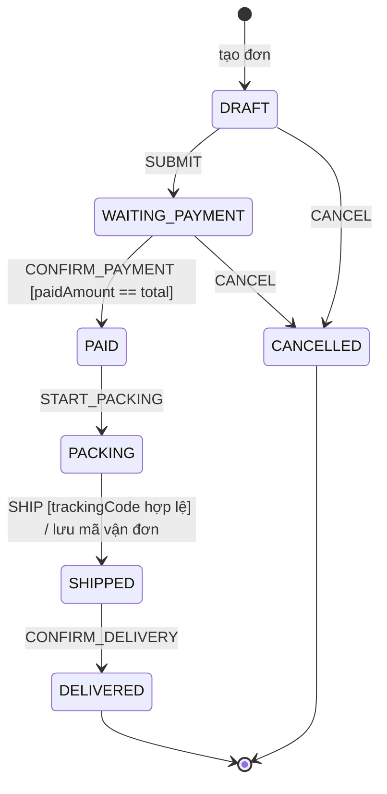
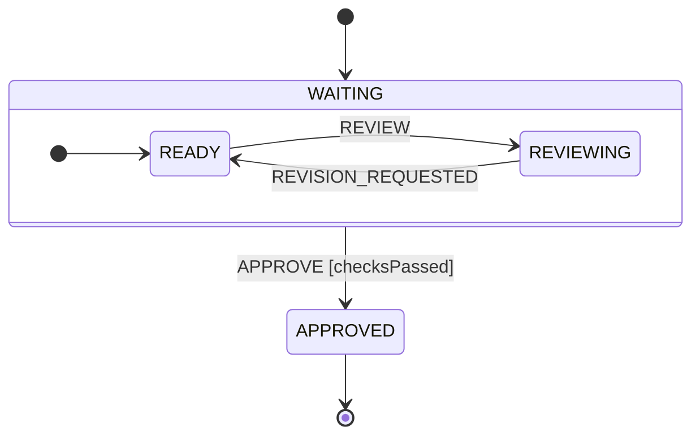
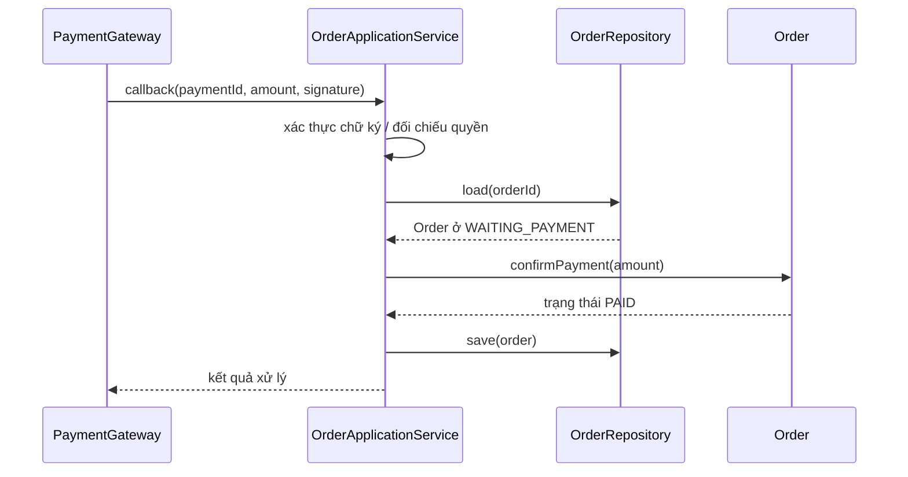
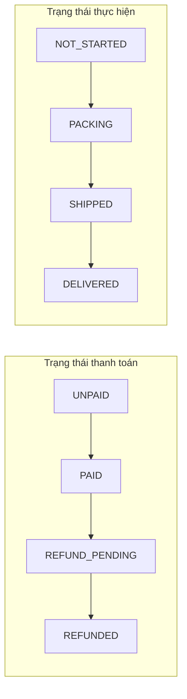
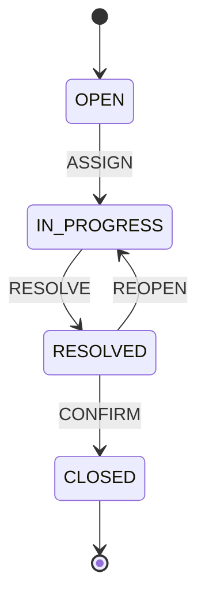

# State Diagrams: Valid State Transitions in OOP

## 1. Why Model State?

An object is not always allowed to perform every action. A new order may be submitted for payment; a paid order may proceed to packing; a delivered order cannot return to its newly created state just by assigning another value to `status`.

If you only use:

```java
order.setStatus("SHIPPED");
```

then any code can mark an order “shipped,” even before payment or without a tracking number. When rules are scattered across controllers, services, and repositories, new flows can easily introduce invalid states.

A **UML state machine/state diagram** describes **one object's lifecycle**: available states, events triggering transitions, required conditions, and actions performed upon transition.

This is useful for orders, support tickets, contracts, accounts, approval requests, shipments, and background jobs with clear lifecycles.

## 2. Five Elements of a State Diagram

| Element | Meaning | Order example |
|---|---|---|
| **State** | Situation in which the object exists, determining available behavior | `DRAFT`, `PAID`, `SHIPPED` |
| **Event/trigger** | Occurrence or request triggering a transition | `SUBMIT`, `CONFIRM_PAYMENT` |
| **Guard** | Boolean expression required to take a transition | `[paidAmount == total]` |
| **Effect/action** | Operation performed on a successful transition | Store tracking number; create domain data |
| **Transition** | Edge connecting a source state to a target state | `PAID --START_PACKING--> PACKING` |

A UML transition label commonly follows this form:

```text
event [guard] / effect
```

For example:

```text
PACKING --> SHIPPED : SHIP [trackingCode hợp lệ] / lưu trackingCode
```

Read it as: “If an order is in `PACKING` and receives `SHIP`, it may transition to `SHIPPED` only with a valid tracking number; the transition saves that number.”

A **failed guard** means this transition **cannot execute**. Define what happens to invalid requests: a business error, unchanged state, or another branch. In the Java example, we **throw an exception without changing state**.

## 3. Order Lifecycle State Diagram



In the diagram:

- **`[*]` on the left** denotes the initial pseudostate and entry into `DRAFT`.
- **Rounded rectangles** (state labels in Mermaid) are stable order states.
- **Arrows** depict transitions, with labels for events, guards, and actions where relevant.
- **`[*]` on the right** denotes the modeled lifecycle's final state. It **does not mean the Java object or database record is automatically deleted**.
- `CANCELLED` is reachable from `DRAFT` and `WAITING_PAYMENT` **in this example only**. After payment, refunds generally need a separate workflow rather than simply allowing `PAID → CANCELLED` and ignoring collected money.

The diagram quickly answers:

- Can a `DRAFT` order be submitted or canceled? **Yes.**
- Can a `PAID` order move directly to `SHIPPED`? **No;** it must enter `PACKING` first.
- Can a `SHIPPED` order be confirmed delivered? **Yes.**
- Can a `DELIVERED` order be canceled in this simple flow? **No.**

You need not draw every prohibited transition. **Missing edges are disallowed by default** in a closed-transition state machine unless the model specifies another treatment.

## 4. Transition Tables as Testable Contracts

| Current state | Event | Guard | Domain action/effect | Next state |
|---|---|---|---|---|
| `DRAFT` | `SUBMIT` | No additional guard | Record order submission | `WAITING_PAYMENT` |
| `DRAFT` | `CANCEL` | No additional guard | Record cancellation | `CANCELLED` |
| `WAITING_PAYMENT` | `CONFIRM_PAYMENT` | Confirmed amount equals order total | Accept verified payment | `PAID` |
| `WAITING_PAYMENT` | `CANCEL` | No additional guard | Record cancellation | `CANCELLED` |
| `PAID` | `START_PACKING` | No additional guard | Begin packing | `PACKING` |
| `PACKING` | `SHIP` | Tracking number contains valid content | Store tracking number | `SHIPPED` |
| `SHIPPED` | `CONFIRM_DELIVERY` | No additional guard in example | Record successful delivery | `DELIVERED` |

Every `(state, event)` combination absent from the table is **rejected**. Adding a state requires reviewing incoming/outgoing edges, guards, effects, and tests; adding an enum constant alone is insufficient.

Important rules:

1. **Guards are evaluated using current state and event data.** Avoid mutations during a “check-only” phase.
2. **Transitions are not arbitrary setters.** Events may need parameters: payment confirmation needs an amount, shipping needs a tracking number.
3. **Terminal states need an explicit policy.** Reading, exporting, or reporting may remain allowed; lifecycle-mutating events are restricted.
4. **State lists are only part of the model.** Event/guard/transition tables determine valid behavior.

## 5. Complete Java Example: Reject Invalid State Transitions

Save as `OrderStateMachineDemo.java`. This uses JDK 11+ and **no external dependencies**.

```java
import java.util.ArrayList;
import java.util.EnumMap;
import java.util.List;
import java.util.Map;
import java.util.Objects;

public class OrderStateMachineDemo {

    enum Status {
        DRAFT, WAITING_PAYMENT, PAID, PACKING,
        SHIPPED, DELIVERED, CANCELLED
    }

    enum Event {
        SUBMIT, CONFIRM_PAYMENT, START_PACKING,
        SHIP, CONFIRM_DELIVERY, CANCEL
    }

    static final class InvalidTransitionException
            extends IllegalStateException {
        InvalidTransitionException(Status from, Event event) {
            super(from + " --" + event + "--> không hợp lệ");
        }
    }

    static final class Order {
        // Tập các cạnh duy nhất được phép trong vòng đời.
        private static final Map<Status, Map<Event, Status>> RULES =
                new EnumMap<>(Status.class);

        static {
            for (Status status : Status.values()) {
                RULES.put(status, new EnumMap<>(Event.class));
            }

            allow(Status.DRAFT, Event.SUBMIT, Status.WAITING_PAYMENT);
            allow(Status.DRAFT, Event.CANCEL, Status.CANCELLED);
            allow(Status.WAITING_PAYMENT, Event.CONFIRM_PAYMENT,
                    Status.PAID);
            allow(Status.WAITING_PAYMENT, Event.CANCEL,
                    Status.CANCELLED);
            allow(Status.PAID, Event.START_PACKING, Status.PACKING);
            allow(Status.PACKING, Event.SHIP, Status.SHIPPED);
            allow(Status.SHIPPED, Event.CONFIRM_DELIVERY,
                    Status.DELIVERED);
        }

        private static void allow(
                Status from, Event event, Status to) {
            if (RULES.get(from).putIfAbsent(event, to) != null) {
                throw new IllegalStateException(
                        "Duplicate rule: " + from + " / " + event);
            }
        }

        private final String id;
        private final long totalCents;
        private final List<String> history = new ArrayList<>();
        private Status status = Status.DRAFT;
        private String trackingCode;

        Order(String id, long totalCents) {
            if (id == null || id.isBlank()) {
                throw new IllegalArgumentException("Blank order id");
            }
            if (totalCents <= 0) {
                throw new IllegalArgumentException(
                        "Total must be positive");
            }
            this.id = id;
            this.totalCents = totalCents;
        }

        String id() {
            return id;
        }

        Status status() {
            return status;
        }

        String trackingCode() {
            return trackingCode;
        }

        List<String> history() {
            return List.copyOf(history);
        }

        // Chỉ những hành vi được đặt tên mới thay đổi trạng thái.
        void submit() {
            advance(Event.SUBMIT);
        }

        void cancel() {
            advance(Event.CANCEL);
        }

        void confirmPayment(long paidAmountCents) {
            // Kiểm tra event hợp lệ với trạng thái trước.
            Status next = nextStatus(Event.CONFIRM_PAYMENT);

            // Guard phụ thuộc dữ liệu của event.
            if (paidAmountCents != totalCents) {
                throw new IllegalArgumentException(
                        "Payment amount mismatch");
            }

            change(Event.CONFIRM_PAYMENT, next);
        }

        void startPacking() {
            advance(Event.START_PACKING);
        }

        void ship(String newTrackingCode) {
            Status next = nextStatus(Event.SHIP);
            if (newTrackingCode == null
                    || newTrackingCode.isBlank()) {
                throw new IllegalArgumentException(
                        "Tracking code is required");
            }

            // Tất cả validation trước khi đổi trạng thái.
            trackingCode = newTrackingCode;
            change(Event.SHIP, next);
        }

        void confirmDelivery() {
            advance(Event.CONFIRM_DELIVERY);
        }

        private Status nextStatus(Event event) {
            Objects.requireNonNull(event, "event");
            Status next = RULES.get(status).get(event);
            if (next == null) {
                throw new InvalidTransitionException(status, event);
            }
            return next;
        }

        private void advance(Event event) {
            Status next = nextStatus(event);
            change(event, next);
        }

        private void change(Event event, Status next) {
            Status previous = status;
            status = next;
            history.add(previous + " --" + event + "--> " + next);
        }
    }

    public static void main(String[] args) {
        Order order = new Order("OD-100", 120_000L);
        order.submit();

        try {
            order.confirmPayment(99_000L); // Sai số tiền.
            throw new AssertionError("Must reject wrong amount");
        } catch (IllegalArgumentException expected) {
            System.out.println("Từ chối số tiền sai");
        }

        System.out.println(
                "Sau guard thất bại: " + order.status());

        order.confirmPayment(120_000L);
        System.out.println("Sau thanh toán: " + order.status());

        try {
            order.cancel(); // Không có cạnh PAID -> CANCELLED.
            throw new AssertionError("Must reject cancel");
        } catch (InvalidTransitionException expected) {
            System.out.println("Từ chối hủy: "
                    + expected.getMessage());
        }

        System.out.println("Sau event sai: " + order.status());

        order.startPacking();
        order.ship("VN123");
        order.confirmDelivery();

        System.out.println("Đã giao: " + order.status()
                + ", tracking=" + order.trackingCode());

        Order draft = new Order("OD-101", 50_000L);
        draft.cancel();

        try {
            draft.submit();
            throw new AssertionError("Cancelled order cannot submit");
        } catch (InvalidTransitionException expected) {
            System.out.println("Không gửi lại đơn đã hủy");
        }

        if (order.status() != Status.DELIVERED
                || order.history().size() != 5
                || draft.status() != Status.CANCELLED) {
            throw new AssertionError("Invalid state history");
        }

        System.out.println("Các chuyển trạng thái đều hợp lệ");
    }
}
```

Run:

```bash
javac OrderStateMachineDemo.java
java OrderStateMachineDemo
```

Expected output:

```text
Từ chối số tiền sai
Sau guard thất bại: WAITING_PAYMENT
Sau thanh toán: PAID
Từ chối hủy: PAID --CANCEL--> không hợp lệ
Sau event sai: PAID
Đã giao: DELIVERED, tracking=VN123
Không gửi lại đơn đã hủy
Các chuyển trạng thái đều hợp lệ
```

### How Are Valid States Enforced?

- `status` is `private`; there is no external `setStatus(...)`.
- `RULES` contains **only** permitted edges; arbitrary enum-to-enum transitions are impossible.
- `nextStatus(event)` fails if the corresponding edge does not exist.
- `confirmPayment(...)` and `ship(...)` validate data **before updating state**.
- `change(...)` centralizes state updates and history recording; callers use named business APIs.
- `history()` returns an unmodifiable snapshot so callers cannot arbitrarily rewrite internal history.

The sample `Order` is an **entity enforcing lifecycle invariants**. Payment gateways, repositories, caller authorization, and emails belong to collaborators; `Order` should not open HTTP/SQL connections to complete a transition.

**Technical limitation:** The demo's field/history mutations run sequentially in memory. They **do not** establish atomic cross-thread or database transactions; later sections discuss preserving state in real applications.

## 6. When to Use Enums, Transition Tables, State Pattern, or Workflow Engines

| Implementation | Appropriate when | Caveats |
|---|---|---|
| `enum Status` with domain methods | Few states, simple and stable rules | May grow into large `if/switch` blocks |
| Transition table (such as `RULES`) | Explicit edges with source/event/target validation | Data-dependent guards still require modeling |
| **State Pattern** | Each state has many distinct behaviors that evolve separately | Adds classes; unnecessary for simple 3–5-state workflows |
| State machine library | Many branches, guards, entry/exit actions, nested states | Understand its event, persistence, and idempotency semantics |
| Workflow/process engine | Long-running flows with several parties, retries/timers/approvals | Operational complexity; does not replace domain invariants |

A small **State Pattern** example:

```java
interface OrderState {
    void submit(OrderContext context);
    void cancel(OrderContext context);
}

final class DraftState implements OrderState {
    @Override
    public void submit(OrderContext context) {
        context.changeTo(new WaitingPaymentState());
    }

    @Override
    public void cancel(OrderContext context) {
        context.changeTo(new CancelledState());
    }
}
```

This snippet **only illustrates the pattern's structure**, assuming `OrderContext`, `WaitingPaymentState`, and `CancelledState` are defined separately. In a real project, every state implementation must reject unsupported events and the context must permit changes only through controlled transitions. There is no need for one class per state if an enum and transition table suffice.

## 7. Extended UML State Machine Notation

A state diagram can express more than a graph of enum constants. Important symbols include:

| Symbol / concept | Interpretation | Example use |
|---|---|---|
| Initial pseudostate | Default entry point for a state machine or region | A new order enters `DRAFT` |
| Final state | Completes the state machine or region | Order processing has ended |
| Self-transition | An event returns to the same state, possibly executing exit/entry behaviors | Receive updated details while awaiting approval |
| Internal transition | Handles an event *within* a state without exiting and re-entering | Update supporting details while waiting |
| Entry / exit / do activity | Behavior on entering, leaving, or remaining in a state | Start/stop a task based on state |
| Choice / junction | Branches or joins transitions | Decide based on an approval result |
| Composite state | A state containing substates | `PROCESSING` contains packing and verification |
| History pseudostate | Returns to a previously active substate of a composite state | Resume a paused workflow |
| Orthogonal regions | Several state regions progress concurrently | Payment and shipping are separate state dimensions |

Distinguish **self-transitions** from **internal transitions**: both may leave the *state name* unchanged, but entry/exit behavior can differ. Do not assume an event that leaves an enum constant unchanged means “nothing happened.”

Mermaid example showing entry/exit behavior:



This diagram uses a **composite state** `WAITING` with two substates, `READY` and `REVIEWING`. In larger workflows, nested states reduce duplicate conditions compared with forcing every variation into a flat enum.

## 8. Guards, Actions, Invariants, and Authorization Are Different Concerns

Do not collapse every rule into one vague `if`:

**Guard:** a condition required to take a specific transition, such as `paidAmount == total`.

**Action/effect:** a domain effect executed when the transition occurs, such as saving a tracking number, creating a domain event, or updating a confirmation timestamp.

**Invariant:** a condition that must always hold for an object in a valid state, for example:

- If `status == SHIPPED` or `DELIVERED`, a nonblank `trackingCode` must exist.
- If `status == PAID`, there must be a corresponding valid payment confirmation (in a real system).
- A terminal state cannot return to an unprocessed state without an explicitly defined transition.

**Authorization:** who may initiate an event? For example, warehouse staff may invoke `ship()`, while only a verified payment provider may request `confirmPayment()`. A transition **valid under state rules** can still be **forbidden for security reasons** if the caller lacks authorization. Authorization is generally checked at the application/API boundary using authenticated request information.

Each rule needs an explicit owner so that new APIs cannot bypass it.

## 9. State Diagrams Versus Class and Sequence Diagrams

| Diagram | Question answered | Application to orders |
|---|---|---|
| **Class diagram** | Which classes, fields, methods, and relationships exist? | `Order` has `status`, `totalCents`, `ship()` |
| **State diagram** | Which state is an object in, and which events permit transitions? | `PACKING --SHIP--> SHIPPED` |
| **Sequence diagram** | In a scenario, which objects call one another over time? | Controller → service → payment gateway → Order → repository |
| **Activity diagram** | How do activities and processing branches flow? | Verify payment, receive goods, pack, ship |

Example of coordinating payment confirmation:



A **state diagram** permits `WAITING_PAYMENT → PAID` when the guard holds; a **sequence diagram** shows *who* verifies the callback, loads the object, and persists the state. These diagrams complement rather than replace one another.

## 10. Real-World Failure Cases: Duplicate Callbacks, Concurrency, and Transactions

A diagram describes valid modeled transitions. When several requests affect the same database-backed object, additional mechanisms must preserve data consistency.

### Duplicate Payment Callbacks

A payment provider may resend callbacks. The first transitions the order from `WAITING_PAYMENT → PAID`; the second finds it already `PAID`. Repeated HTTP errors may lead the provider to retry indefinitely.

Apply **idempotency** at the event-handling layer:

1. Verify the signature and reconcile payment details.
2. Check whether the event ID/payment ID was already processed.
3. If the same event succeeded before, return an appropriate result **without recording payment again**.
4. For a new event, perform a valid transition within a transaction and store the idempotency key.
5. If an event has the same identifier but different content, treat it as an error or suspicious discrepancy.

Do not simply add `PAID --CONFIRM_PAYMENT--> PAID` while skipping validation; accepting an arbitrary self-transition can conceal invalid callbacks.

### Two Requests Processing the Same Stale State

Suppose two warehouse employees both load an order in `PACKING` and submit `SHIP`. Both in-memory objects see a valid event. Without version checks on the database update, a **lost update** may overwrite a tracking number or create duplicate shipping requests.

A common mechanism is **optimistic locking**:

```sql
-- Ví dụ giả định bảng orders có cột version.
UPDATE orders
SET status = 'SHIPPED',
    tracking_code = :trackingCode,
    version = version + 1
WHERE id = :orderId
  AND status = 'PACKING'
  AND version = :expectedVersion;
```

Only one request can update the expected version successfully. If the affected row count is 0, reload and report a conflict or retry according to policy. This SQL is illustrative; parameter binding depends on the library.

### Database Save Succeeds but Notification Fails

Updating state and persisting it should occur in a suitable transaction. External email/HTTP delivery **does not automatically participate in an ACID database transaction**. Often, an **outbox event** is stored within the transaction, then a worker delivers notifications after commit with retries/idempotency.

Avoid uncontrolled network operations inside state setters: failures halfway through may leave objects or stored data inconsistent.

## 11. Test State Transitions Using a Matrix

Rather than only testing “order delivered successfully,” cover **every valid edge** and important invalid events.

| Initial state | Operation | Expected result |
|---|---|---|
| `DRAFT` | `submit()` | `WAITING_PAYMENT` |
| `DRAFT` | `cancel()` | `CANCELLED` |
| `WAITING_PAYMENT` | `confirmPayment(total)` | `PAID` |
| `WAITING_PAYMENT` | `confirmPayment(wrongAmount)` | Error; remains `WAITING_PAYMENT` |
| `WAITING_PAYMENT` | `cancel()` | `CANCELLED` |
| `PAID` | `startPacking()` | `PACKING` |
| `PAID` | `cancel()` | Error; remains `PAID` |
| `PACKING` | `ship("")` | Error; remains `PACKING` |
| `PACKING` | `ship("VN123")` | `SHIPPED` and tracking number saved |
| `SHIPPED` | `confirmDelivery()` | `DELIVERED` |
| `CANCELLED` | `submit()` | Error; remains `CANCELLED` |
| `DELIVERED` | `confirmDelivery()` again | Error or idempotent result according to explicit policy |

For every invalid request, verify **that both state and related data remain unchanged unintentionally**. For instance, `ship("")` must not save an empty string before throwing.

### Additional Cases Worth Testing

- Boundary amounts `0`, negative and large values, and overflow risks.
- Tracking numbers containing only whitespace.
- Duplicate callbacks, out-of-order callbacks, and callbacks from unauthenticated sources.
- Concurrent requests transitioning the same order, especially with versioning.
- Reject operations by unauthorized users even when state otherwise permits the transition.
- Save state to the DB and load it again; verify persisted correctness and handle stale caches.
- Migrate from an earlier state machine version while orders are still in progress.

Edge-oriented testing can measure **state transition coverage** (edges exercised) and **negative transition coverage** (forbidden operations tested). You need not test infinitely many sequences; prioritize high-risk business edges and boundaries.

## 12. Avoiding State Explosion: Separate Independent Dimensions

An order may have **two relatively independent state dimensions**:

- Payment: `UNPAID`, `PAID`, `REFUND_PENDING`, `REFUNDED`.
- Fulfillment: `NOT_STARTED`, `PACKING`, `SHIPPED`, `DELIVERED`.

If you define `PAID_PACKING`, `PAID_SHIPPED`, `REFUNDED_PACKING`, and so on as enum members, combinations can grow rapidly.

Instead, model two state machines or orthogonal regions (*orthogonal regions*):



These are **two graphs illustrating state dimensions** using flowcharts, not complete UML orthogonal-region notation. Separating dimensions still requires **cross-state constraints**: do not begin packing before payment or automatically refund after delivery, for example.

Use a flat enum when the lifecycle is genuinely linear and easy to read; consider multiple state machines when state dimensions progress independently and create too many combinations.

## 13. Common Design Mistakes

| Mistake | Consequence | Recommended response |
|---|---|---|
| Only an enum and a public status setter | Any caller can perform invalid transitions | Use named behavior and transition rules/tables |
| Ignoring branches from the source state | Cancellation/recovery paths may be missed | Draw explicit source–event–target edges |
| Evaluating guards after state changes | Failure leaves partially modified state | Check first and update within appropriate transactions |
| Silently ignoring every event | Caller assumes success although nothing changed | Return a clear result/error; design idempotency deliberately |
| Performing side-effecting network I/O inside guards | Checks are hard to repeat or roll back | Separate data verification, effects, and orchestration |
| Treating final state as object deletion | Confuses state lifecycle with storage lifecycle | Define retention/archival independently |
| Combining payment and delivery into many compound states | State explosion and maintainability problems | Separate dimensions where useful and define cross-state constraints |
| Testing only the happy path | Forbidden edges, retries, and failed guards remain untested | Use transition matrices and negative tests |
| Assuming diagrams protect DB from concurrent updates | Race conditions and lost updates | Locks, versions, conditional updates, and transactions |
| Adding states without migrating older data | Persisted data may contain no-longer-valid states | Plan migration and backward compatibility |

## 14. Exercise: Modeling a Helpdesk Ticket

A helpdesk system has these requirements:

- A new ticket starts in `OPEN`.
- A support agent accepts a ticket: `IN_PROGRESS`.
- The agent resolves it: `RESOLVED`.
- The user confirms resolution: `CLOSED`.
- If dissatisfied, the user reopens it from `RESOLVED` to `IN_PROGRESS`.
- Unresolved tickets cannot be closed.

Draw your own diagram and compare it with this model:



Self-check questions:

1. **Why is there no `OPEN → CLOSED` transition?** The business requires resolution before closure.
2. **Should `CLOSED → IN_PROGRESS` be allowed?** Only if reopening closed tickets is permitted; define an event and authorization/deadline checks.
3. **Which guards might `RESOLVE` need?** An assigned agent, nonblank resolution details, and adequate permissions.
4. **What action belongs to `CONFIRM`?** Record confirmation time and possibly publish a domain event for notifications.
5. **What if the user confirms twice?** Define idempotency and an explicit response policy.
6. **What if one agent closes a ticket while another reopens it?** Use transactions/version checks to persist a single valid final state.
7. **How would adding `WAITING_CUSTOMER` affect the model?** Define new incoming/outgoing events and update tests, not just the enum.

## 15. State Machine Completion Checklist

- Each state has **a business-meaningful name** and explicit validity conditions.
- There is **an initial state**; final states are defined where needed.
- Each event has **valid source and target states**, clear guards, and effects distinguished from validation.
- Missing transitions are handled **explicitly**.
- No setters or exposed data permit bypassing invariants.
- Tests cover **successful flows, failed guards, and forbidden transitions**, confirming state remains unchanged on failure.
- Caller authentication and authorization are enforced at suitable boundaries.
- DB or multi-worker execution uses **transactions, concurrency control, and idempotency**.
- External side effects follow appropriate retry, after-commit, or outbox policies.
- Adding states/events includes a plan for old data and callbacks still in flight.

**Core takeaway:** state indicates “where the object is”; **transition + event + guard** determines “when it may move where”; **effect and transaction** determine “which changes commit successfully.” Java code should enforce the model with named behaviors, reject missing edges, and test valid and invalid cases.
