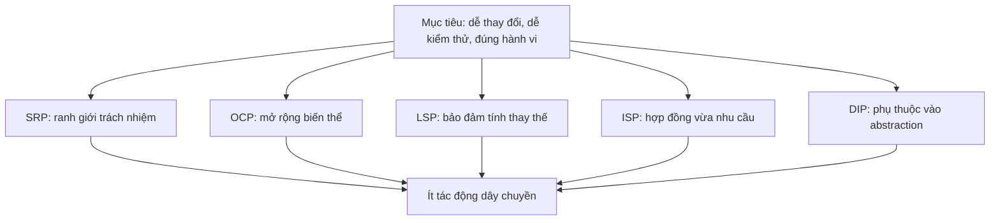
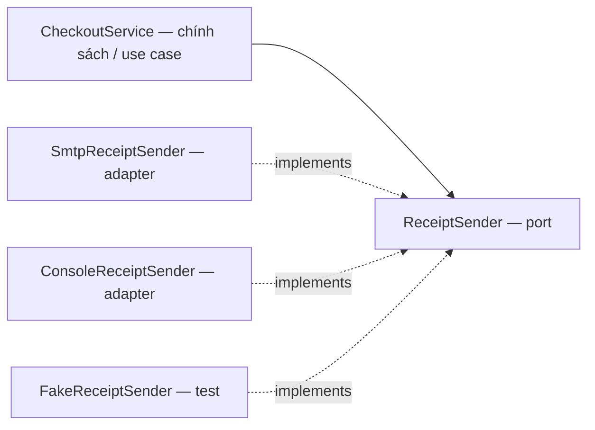
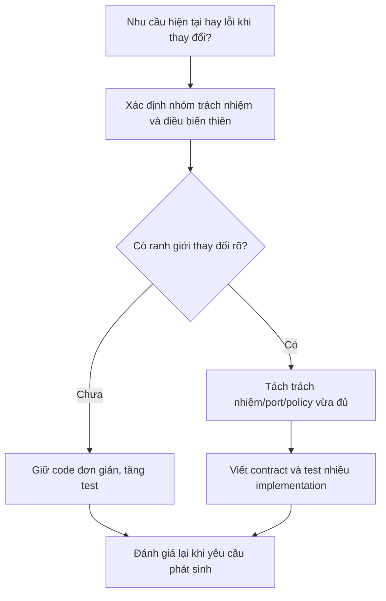

# SOLID in OOP: Purpose and Scope

**SOLID** comprises five object-oriented design principles that make software easier to change and test while reducing cascading effects as requirements evolve. These are **guiding principles**, not mandatory Java syntax, a formula that automatically yields good architecture, or a requirement for every class to have an interface.

This lesson focuses on two questions: **What problems does SOLID address?** and **How extensively should it be applied in a particular context?** Understanding that scope helps us decide how to use SRP, OCP, LSP, ISP, and DIP in a specific design.

## 1. Why Do We Need SOLID?

Imagine a sales application where one `CheckoutService` calculates totals, applies promotions, calls SQL directly, and sends emails. Changing discount rules means editing that service; migrating to PostgreSQL means editing it again; switching email providers means yet another edit. A small bug in any of these concerns can affect checkout.

SOLID aims for concrete outcomes:

- **Controlled change:** Updating one rule should not require rewriting unrelated components.
- **Reduced dependence on volatile details:** Business code need not know the exact SQL or SMTP library or storage mechanism.
- **Easier testing:** Calculations and rules can be tested with fake data without running every external service.
- **Contract preservation:** Different implementations of one abstraction must not unexpectedly break client code.
- **Clearer responsibilities:** When a bug or new requirement appears, it is easier to identify what to change and regression-test.

However, SOLID has **costs**: additional abstractions, coordinating classes, contracts, and effort to understand dependency flows. Applying it mechanically to small features can increase the class count without delivering practical benefits.

> SOLID seeks to manage **the cost of change over time** and the quality of contracts between components, not to maximize the number of interfaces or classes.

## 2. What Do the Five Letters in SOLID Mean?

| Letter | Principle | Self-check question | Risk if ignored |
| --- | --- | --- | --- |
| **S** | **Single Responsibility Principle (SRP)** — one primary responsibility | How many independent groups of requirements cause this class/module to change? | SQL, email, and business-rule changes all force edits to one class |
| **O** | **Open/Closed Principle (OCP)** — extensible with limited modification of stable code | Can a new calculation or strategy be added as a new implementation? | Each variant requires another `if/switch` branch in the core |
| **L** | **Liskov Substitution Principle (LSP)** — safe substitutability | Does the subtype implementation preserve the contract expected of its supertype? | Code using an interface unexpectedly fails with one implementation |
| **I** | **Interface Segregation Principle (ISP)** — interfaces based on client needs | Must a consumer depend on methods it never uses? | A class implements meaningless methods or throws `UnsupportedOperationException` |
| **D** | **Dependency Inversion Principle (DIP)** — inversion of source dependencies | Do high-level policies depend directly on technology details? | Domain/application logic becomes tied to a database, HTTP, or specific libraries |

The five principles **reinforce one another** rather than being entirely separate rules. A small interface supports ISP; an application service depending on an interface instead of a concrete SMTP implementation demonstrates DIP; interchangeable implementations honoring one contract relate to LSP; adding implementations with minimal changes to the main workflow supports OCP.



## 3. Understand the Scope Before Designing

SOLID often pays off in systems with **many rules, many variants, or multiple independent drivers of change**. Simple business rules, however, do not necessarily justify a complex layered architecture.

| Context | Appropriate degree of application | Rationale |
| --- | --- | --- |
| A `Money` value object only validates and adds/subtracts amounts | Keep data and behavior cohesive; avoid extra abstractions | Adding two monetary amounts does not need an interface |
| Internal CRUD with few rules and one fixed storage mechanism | Clear class responsibilities and sufficient validation | Excessive layering hurts readability with little benefit |
| Multiple frequently changing discount/shipping options | Policies/strategies with a shared contract | OCP and LSP support controlled variation |
| Use cases that read/write databases, send email, or call external APIs | Separate rules from adapters; define ports where replacement is needed | SRP, DIP, and ISP make logic easier to test |
| A library/SDK exposes public interfaces to many consumers | Small, precise, stable contracts | LSP and ISP are especially important for long-lived client dependencies |
| A system has multiple development teams and modules | Define ownership of changes and abstractions at change boundaries | Reduces cross-team impact during parallel development |
| A one-off script with no reusable rules | Prefer simplicity, correctness, and necessary checks | Design overhead outweighs benefits over its short lifetime |

Ask **"What actually changes?"** before **"Which interface should we create?"** For example, if there is one simple tax calculation and no regional variation, a clear `calculateTax(...)` function may suffice. Abstraction gains value when multiple regional policies exist and change frequently.

## 4. SRP: Defining Responsibility Boundaries

SRP is often explained as a class having **one reason to change**. "One" refers to a cohesive group of responsibilities serving the same business rules or stakeholders, **not one method**.

Consider a class that does everything:

```java
// Phác thảo một cách viết cần xem lại, không phải chương trình chạy độc lập.
class CheckoutManager {
    void checkout(Order order) {
        // Tự áp dụng discount
        // Tự tạo SQL và lưu đơn
        // Tự xây nội dung email rồi gửi SMTP
        // Tự chuyển kết quả sang JSON
    }
}
```

Changes to discount formulas, database schemas, email providers, and JSON formatting all affect `CheckoutManager`. Separate the roles:

- `Order` protects order invariants and calculates totals from line items.
- `DiscountPolicy` determines discounts according to a policy.
- `CheckoutService` coordinates the workflow.
- `OrderRepository` persists and queries orders through a contract.
- `ReceiptSender` sends receipts through an external port.
- A controller/API adapter handles HTTP and DTOs.

This does not mean **every line of code needs its own class**. Two methods serving one responsibility can belong together. Creating dozens of classes to achieve "one method per class" misapplies SRP.

## 5. OCP: Choosing the Right Extension Points

OCP is often phrased as: objects/modules should be **open for extension but closed for modification**. In practice, this does not mean "never edit source code." Bugs, incorrect contracts, and previously unforeseen requirements still demand changes. OCP targets **known dimensions of variation likely to grow**, so adding variants requires little modification of the stable core.

For example, when discounts have multiple policies:

```java
interface DiscountPolicy {
    long discountCents(long subtotalCents);
}

final class NoDiscount implements DiscountPolicy {
    public long discountCents(long subtotalCents) {
        return 0;
    }
}

final class TenPercentDiscount implements DiscountPolicy {
    public long discountCents(long subtotalCents) {
        return subtotalCents / 10;
    }
}
```

`CheckoutService` depends only on `DiscountPolicy`. To add a conditional discount, create another implementation and configure its selection rather than changing checkout's calculation logic.

**Note:** The place that **selects an implementation** may still need changes or configuration, whether it is a composition root, factory, Spring DI configuration, or policy selector. OCP does not eliminate all code changes; it **limits their scope**.

## 6. LSP: Shared Interfaces Must Preserve Shared Expectations

If `CheckoutService` accepts `DiscountPolicy`, every policy must honor its contract:

- A valid subtotal input is a nonnegative number of cents.
- The discount output is an amount in cents within `0..subtotal`.
- It must not unexpectedly create an order, write to a database, or return `null`.
- If callers expect a policy to handle valid subtotals, an implementation must not silently narrow the accepted input domain just because "this policy type does not support it."

An LSP violation:

```java
final class BrokenDiscount implements DiscountPolicy {
    @Override
    public long discountCents(long subtotalCents) {
        return subtotalCents + 100; // Giảm nhiều hơn giá trị đơn!
    }
}
```

Although Java compiles it, this implementation violates `DiscountPolicy`'s postcondition. Substituting it for another policy can make checkout calculate a negative amount due.

Safeguards include **documenting the contract**, running shared contract tests against implementations, and validating important invariants at boundaries—especially when plugins or external partners supply implementations.

LSP applies beyond `extends`: objects implementing an interface must be substitutable in **behavior**, not merely match method signatures.

## 7. ISP: Interfaces Small Enough for Their Clients

An interface that stores orders, sends email, exports PDFs, issues refunds, and produces statistics forces each implementation or consumer to depend on capabilities it does not need.

```java
// Dễ gây ép buộc không cần thiết:
interface BusinessGateway {
    void saveOrder(Order order);
    void emailReceipt(Order order);
    void exportMonthlyReport();
}
```

Rather than forcing a fake repository in a test to implement `emailReceipt`, split the contracts:

```java
interface OrderRepository {
    void save(Order order);
}

interface ReceiptSender {
    void sendReceipt(Order order, long payableCents);
}
```

A service that stores orders depends only on `OrderRepository`; the receipt-sending component only needs `ReceiptSender`. Small contracts also make tests easier to understand.

However, ISP **does not require endless splitting** into single-method interfaces. If several operations form one stable protocol and its clients need them together, a cohesive interface is still appropriate.

## 8. How Do DIP and Dependency Injection Differ?

**DIP** is a design principle about **dependency direction**: high-level policies should depend on abstractions describing their needs, and low-level details should implement those abstractions.

**Dependency Injection (DI)** is the technique of supplying a dependency from outside, for example through a constructor. DI often helps implement DIP, but **injecting a concrete technology class does not automatically satisfy DIP**.

```java
// Có constructor injection nhưng vẫn phụ thuộc chi tiết SMTP:
class CheckoutService {
    private final SmtpMailClient client;
    CheckoutService(SmtpMailClient client) {
        this.client = client;
    }
}
```

A design following DIP:

```java
interface ReceiptSender {
    void sendReceipt(Order order, long payableCents);
}

class CheckoutService {
    private final ReceiptSender sender;

    CheckoutService(ReceiptSender sender) {
        this.sender = sender;
    }
}
```

At runtime, we can supply `SmtpReceiptSender`, `ConsoleReceiptSender`, or a fake for testing. The service still requires "sending a receipt," but it is not coupled to a particular SMTP class.



Placing the interface in the business/application module or an appropriate contract module ensures **high-level source code does not import the adapter**. Do not infer dependency direction from runtime call order: calling an adapter through an interface does not mean the service module must know its implementation details.

## 9. Standalone Java 17 Example: SOLID at the Right Change Boundaries

Scenario: A simple checkout offers multiple discount programs and supports different storage and receipt-delivery mechanisms. **Money and valid order state** belong to the model; **coordination** belongs to the service; **external interactions** go through two small interfaces.

Create `SolidScopeDemo.java`. The program uses one main class with nested classes so it can be compiled with a single command.

```java
import java.util.LinkedHashMap;
import java.util.List;
import java.util.Map;
import java.util.Objects;
import java.util.Optional;

public class SolidScopeDemo {

    // Domain value object: trường hợp quantity > 0, unit price >= 0.
    record OrderLine(String sku, int quantity, long unitPriceCents) {
        OrderLine {
            if (sku == null || sku.isBlank()) {
                throw new IllegalArgumentException("SKU is required");
            }
            if (quantity <= 0 || unitPriceCents < 0) {
                throw new IllegalArgumentException("Invalid order line");
            }
        }

        long amountCents() {
            return Math.multiplyExact((long) quantity, unitPriceCents);
        }
    }

    // Domain model: luôn có ít nhất một dòng hợp lệ.
    record Order(String id, List<OrderLine> lines) {
        Order {
            if (id == null || id.isBlank()) {
                throw new IllegalArgumentException("Order id is required");
            }
            Objects.requireNonNull(lines, "lines");
            lines = List.copyOf(lines);
            if (lines.isEmpty()) {
                throw new IllegalArgumentException("Order must have items");
            }
        }

        long subtotalCents() {
            long sum = 0;
            for (OrderLine line : lines) {
                sum = Math.addExact(sum, line.amountCents());
            }
            return sum;
        }
    }

    // Contract: 0 <= discount <= subtotal với subtotal không âm.
    interface DiscountPolicy {
        long discountCents(long subtotalCents);
    }

    static final class NoDiscount implements DiscountPolicy {
        @Override
        public long discountCents(long subtotalCents) {
            if (subtotalCents < 0) {
                throw new IllegalArgumentException("Negative subtotal");
            }
            return 0;
        }
    }

    static final class PercentDiscount implements DiscountPolicy {
        private final int percent;

        PercentDiscount(int percent) {
            if (percent < 0 || percent > 100) {
                throw new IllegalArgumentException("Invalid percent");
            }
            this.percent = percent;
        }

        @Override
        public long discountCents(long subtotalCents) {
            if (subtotalCents < 0) {
                throw new IllegalArgumentException("Negative subtotal");
            }
            // floor(subtotal * percent / 100) không tràn ở phép nhân.
            long whole = (subtotalCents / 100) * percent;
            long fraction = ((subtotalCents % 100) * percent) / 100;
            return Math.addExact(whole, fraction);
        }
    }

    interface OrderRepository {
        void save(Order order);
        Optional<Order> findById(String id);
    }

    interface ReceiptSender {
        void sendReceipt(Order order, long payableCents);
    }

    record CheckoutResult(Order order, long discountCents, long payableCents) { }

    static final class CheckoutService {
        private final DiscountPolicy discount;
        private final OrderRepository repository;
        private final ReceiptSender sender;

        CheckoutService(DiscountPolicy discount,
                        OrderRepository repository,
                        ReceiptSender sender) {
            this.discount = Objects.requireNonNull(discount);
            this.repository = Objects.requireNonNull(repository);
            this.sender = Objects.requireNonNull(sender);
        }

        CheckoutResult checkout(Order order) {
            Objects.requireNonNull(order, "order");
            long subtotal = order.subtotalCents();
            long reduction = discount.discountCents(subtotal);

            // Thực thi contract của policy tại ranh giới.
            if (reduction < 0 || reduction > subtotal) {
                throw new IllegalStateException("Invalid discount policy");
            }

            long payable = subtotal - reduction;
            repository.save(order);
            sender.sendReceipt(order, payable);
            return new CheckoutResult(order, reduction, payable);
        }
    }

    // Adapter bộ nhớ — thay bằng JDBC mà không phải sửa policy.
    static final class MemoryOrderRepository implements OrderRepository {
        private final Map<String, Order> data = new LinkedHashMap<>();

        @Override
        public void save(Order order) {
            Objects.requireNonNull(order);
            if (data.putIfAbsent(order.id(), order) != null) {
                throw new IllegalStateException("Duplicate order id");
            }
        }

        @Override
        public Optional<Order> findById(String id) {
            return Optional.ofNullable(data.get(id));
        }
    }

    // Adapter console — thay bằng SMTP hoặc message bus khi cần.
    static final class ConsoleReceiptSender implements ReceiptSender {
        @Override
        public void sendReceipt(Order order, long payableCents) {
            System.out.println(
                    "Receipt " + order.id() + ": " + payableCents + " cents");
        }
    }

    public static void main(String[] args) {
        MemoryOrderRepository repository = new MemoryOrderRepository();
        ReceiptSender sender = new ConsoleReceiptSender();

        Order first = new Order("O-01", List.of(
                new OrderLine("BOOK", 1, 15_000),
                new OrderLine("PEN", 2, 2_500)));

        CheckoutService promotionalCheckout = new CheckoutService(
                new PercentDiscount(10), repository, sender);
        CheckoutResult result = promotionalCheckout.checkout(first);
        System.out.println("Discount: " + result.discountCents());
        System.out.println("Saved: " +
                repository.findById("O-01").isPresent());

        Order second = new Order("O-02", List.of(
                new OrderLine("NOTE", 1, 10_000)));

        CheckoutService normalCheckout = new CheckoutService(
                new NoDiscount(), repository, sender);
        normalCheckout.checkout(second);
    }
}
```

Run with JDK 17 or later:

```bash
javac SolidScopeDemo.java
java SolidScopeDemo
```

Expected output:

```text
Receipt O-01: 18000 cents
Discount: 2000
Saved: true
Receipt O-02: 10000 cents
```

The first order is calculated as `15_000 + 2 × 2_500 = 20_000` cents; a 10% discount is `2_000` cents, leaving `18_000` cents due.

**Limitations of the example:** It has no taxes, refunds, real payments, or database transactions. `MemoryOrderRepository` is not thread-safe and is only for demonstration. `CheckoutService` saves the order before sending the receipt; if sending fails, the order may **already be saved** even though the caller receives an exception. Production systems need explicit transaction, retry, and idempotency policies and might use a *transactional outbox* to publish notifications after commit. SOLID separates responsibilities but **does not automatically guarantee atomicity, concurrency correctness, or cross-system consistency**.

### Where Does Each Principle Appear in the Example?

| Principle | Evidence in Java | Practical value |
| --- | --- | --- |
| SRP | `Order` protects invariants/calculates totals; `CheckoutService` coordinates; adapters handle I/O | Changing storage does not affect the total calculation |
| OCP | `PercentDiscount` and `NoDiscount` both implement `DiscountPolicy` | Add policies through implementations rather than editing checkout |
| LSP | Every policy must return `0..subtotal` | Replacing policies does not make `CheckoutService` produce negative amounts |
| ISP | `OrderRepository` and `ReceiptSender` are small contracts | Test fakes implement only what they need |
| DIP | The service receives three interfaces through its constructor | No direct dependency on `MemoryOrderRepository`/`ConsoleReceiptSender` |

**One design can apply several principles at once** without naming each principle in a class. Clear contracts and unsurprising dependencies matter more than displaying all "five patterns" in code.

## 10. What Should We Test to Validate the Design?

Test both **behavior** and **substitutability**:

1. Policies of 0%, 10%, and 100% always return discounts within the allowed range.
2. For a `subtotal=1` cent at 10%, the discount must be `0` cent under the round-down rule.
3. `Order` rejects empty line lists, nonpositive quantities, negative prices, or values whose total overflows `long`.
4. If a policy violates the contract, checkout rejects it **before saving**.
5. If the repository rejects a write, `ReceiptSender` is not called in this implementation's flow.
6. Replacing `ConsoleReceiptSender` with a fake must not change price calculations or order storage.
7. Replacing the repository with another adapter should not require changes to `Order` or policy code.

A minimal fake sender for testing:

```java
class CountingReceiptSender implements SolidScopeDemo.ReceiptSender {
    int sends;

    @Override
    public void sendReceipt(
            SolidScopeDemo.Order order, long payableCents) {
        sends++;
    }
}
```

If testing this code **from another file**, the demo's nested types have *package-private* access: place the test in the same package (for example, the default package) or adjust visibility when moving to a real project. For automated tests, use JUnit 5 and assert results instead of relying on `System.out`.

Example of a policy contract test:

```java
// Phác thảo phép kiểm thử, thêm vào test/JUnit của dự án.
void assertPolicyContract(
        SolidScopeDemo.DiscountPolicy policy, long subtotal) {
    long discount = policy.discountCents(subtotal);
    if (discount < 0 || discount > subtotal) {
        throw new AssertionError("Policy violates contract");
    }
}
```

Running the same contract checks against every `DiscountPolicy` implementation is a practical way to maintain LSP. Correct promotional behavior also requires tests for formulas and numeric boundaries.

## 11. What Does SOLID Not Replace?

A SOLID-compliant design can still fail if it ignores:

- **Business correctness:** Time, currency units, promotional conditions, or return policies may be misunderstood.
- **Data encapsulation:** A public setter can violate invariants even when a service has well-factored interfaces.
- **Transactions and concurrency:** Two requests checking inventory/limits and then updating can race.
- **Security and authorization:** A small interface does not check who is allowed to perform an operation.
- **Performance:** Too many queries, sequential network calls, or allocations can still be slow.
- **Observability:** Logs, metrics, traces, and errors need explicit handling.
- **Data modeling:** SOLID does not create foreign keys, uniqueness constraints, or other database constraints.
- **Simplicity:** Sometimes a straightforward class or factory is easier to maintain than an unnecessary strategy system.

Therefore, SOLID is **one part** of good design, not the sole measure of code quality.

## 12. Signs of Overapplying SOLID

| Symptom | Why reconsider? | Simpler approach |
| --- | --- | --- |
| Every helper has an interface and a single `Impl` class | No real substitution boundary exists | A concrete class or pure function, with tests |
| Every small operation on `Money`/entities becomes a service | Separates behavior that protects the same invariant | Keep `add`, `subtract`, and `compareTo` on the value object |
| Deep inheritance hierarchies for variants that do not yet exist | Deep coupling, many overrides, and difficult contracts | Introduce composition/policies when needed |
| Stable modules are forbidden from changing even when contracts are wrong | Confuses OCP with "never edit code" | Fix the contract and run regression tests |
| Every minor variation needs dynamic plugin configuration | Design and operational cost exceeds the benefit | Use a clear `if/switch` for a small, stable set of variants |

Do not evaluate SOLID by counting classes or interfaces. The lesson **Balancing Principles Against Real-World Complexity** examines shipping as it grows from one policy to several and assesses the actual costs of extension and abstraction.

## 13. A Quick Process Before Adding Abstractions



1. **Identify real pressure:** Dependency-related bugs, many variants changing the same place, tests requiring infrastructure, or subclasses violating contracts.
2. **Choose what to protect:** Prioritize business/domain rules, data, and invariants; place SQL/SMTP details and specialized policies behind suitable boundaries.
3. **Extend in the right place:** Use OCP for variation points, DIP for dependency direction, ISP for client-facing APIs, LSP for substitutability, and SRP for responsibility.
4. **Preserve previous outcomes with tests:** Compare outputs, exceptions, and side effects for existing cases; test new cases, boundaries, and failures separately.
5. **Evaluate the cost:** Does the abstraction reduce required edits and improve testing/readability, or merely add another forwarding layer?

This is introductory guidance, not a procedure to follow mechanically every time. There is no interface-to-class ratio or required percentage of code reduction that proves SOLID has been applied correctly.

## 14. Practice Exercises

**Exercise 1 — Assess the scope.** A personal note-taking app only needs to create, edit, and delete notes stored in one JSON file. Describe two designs: a simple one and a fully layered one. Which is appropriate now? What conditions would justify a repository port or separate policy?

**Exercise 2 — SRP and DIP.** A `ReportService` aggregates figures, writes CSV, and uploads to cloud storage. Redesign its responsibilities and ports so aggregation can be tested without a network connection to the cloud.

**Exercise 3 — OCP and LSP.** Add `FixedAmountDiscount` with a maximum discount of 5.000 cents, capped at the subtotal. Write contract tests for subtotals of 0, 1.000, and 10.000. Explain why returning -100 or a discount greater than the subtotal violates LSP.

**Exercise 4 — ISP.** A system has `Device` with `print()`, `scan()`, and `fax()`; a basic printer supports only printing. Design separate capability interfaces so the printer does not need to throw `UnsupportedOperationException` for `scan/fax`.

**Exercise 5 — Validate the benefit.** Count how many files must change when adding a discount policy **before** and **after** refactoring. Also consider the cost of additional classes/interfaces and the design's readability. Fewer edited files alone do not prove success: behavior must remain correct and maintainers must understand the design.

**Exercise 6 — Examine side effects.** Suppose the repository saves an order but sending its receipt fails. Design the returned result, retry/idempotency policy, and appropriate transaction boundary. Distinguish what SOLID helps with from the additional consistency mechanisms required.

## 15. Checklist Before Applying SOLID to Code

- Which rules or components are **actually** likely to change?
- Does a class have multiple **independent reasons to change**, or simply several methods serving one purpose?
- Is there enough real variation to justify an abstraction?
- Does the interface describe what a consumer needs, or merely copy every method of an implementation?
- Do implementations share the same **semantics and contract**?
- Does high-level logic directly import or create hard-to-replace I/O clients?
- Can domain rules be tested through input/output without a database or HTTP?
- Are data and invariants protected beyond interface boundaries?
- Have transactions, concurrent updates, security, and external failures been considered separately?
- Do maintenance benefits outweigh the added classes, interfaces, and configuration?

**Key takeaway:** SOLID helps design *boundaries that should remain stable as requirements change*. Apply it selectively according to system responsibilities, variation, and dependencies. For a simple feature, one clear class may be better than many abstractions; for a large and frequently changing domain, small contracts and clear responsibilities offer lasting benefits.
