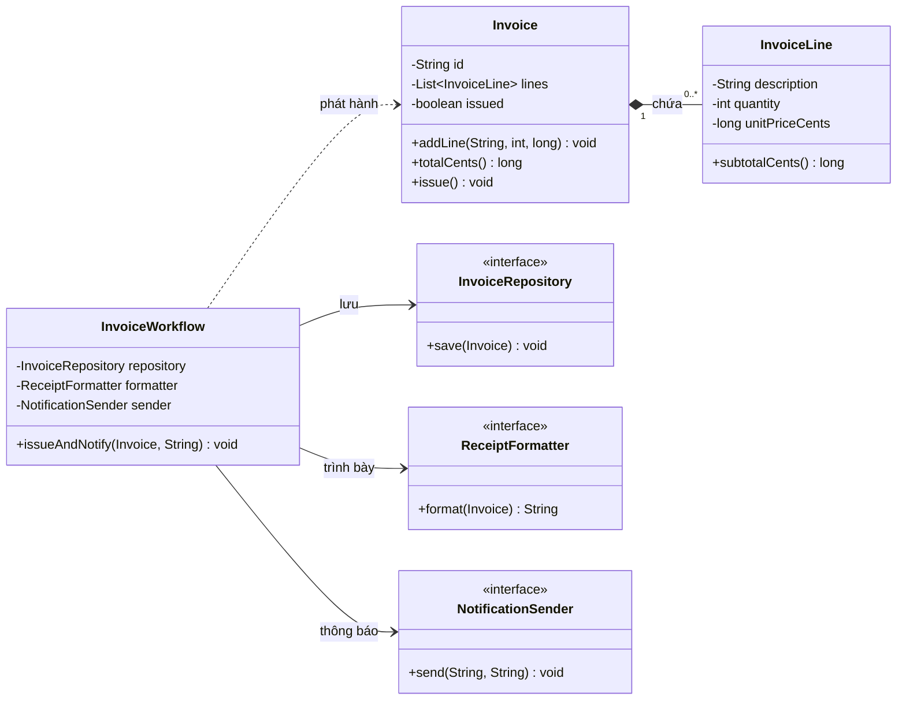
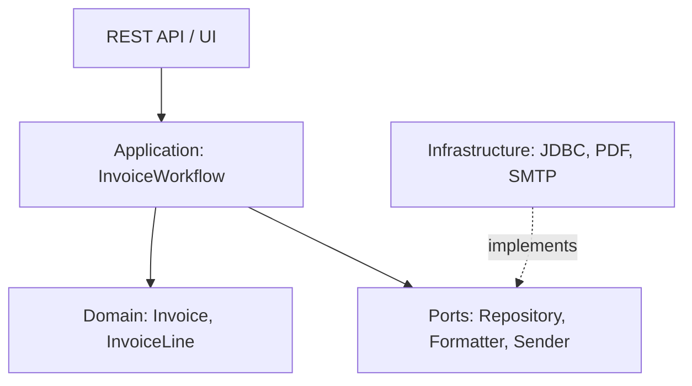

# Single Responsibility: One Group of Reasons to Change (Single Responsibility Principle – SRP)

## 1. What Does SRP Really Mean?

The **Single Responsibility Principle (SRP)** is the **S** in **SOLID**. Its familiar formulation is:

> A module/class should have one reason to change.

However, interpreting "one reason" as **one method**, **one line of functionality**, or "every class should do the smallest possible thing" can easily produce dozens of fragmented classes that are difficult to follow.

A more useful interpretation is that **a class should own one cohesive group of change requests sharing a purpose or source**. Robert C. Martin also explains SRP in terms of an *actor*: a group or department requesting changes. If unrelated groups of requirements cause a class to change, it may be combining multiple responsibilities.

For example, an `Invoice` class may need to:

- Add line items while the invoice is still a draft.
- Validate quantities and unit prices.
- Calculate the total from its line items.
- Issue the invoice and reject repeated issuance.

These behaviors differ, but they jointly protect **the lifecycle and correctness of an invoice**. Each validation does not need its own service just to achieve one method per class.

Conversely, if `Invoice` also generates PDFs, writes SQL, and sends email, it must change whenever *invoice rules*, *document layouts*, *database systems*, or *email providers* change. These independent groups of changes may belong to different responsibilities.

**SRP seeks to improve class cohesion and reduce unrelated changes that require editing the same place.** It does not prohibit multiple methods, fields, or collaborators in one class.

## 2. What Is "One Group of Reasons to Change"?

Consider an invoicing system:

| Change request | Who typically requests it? | Related responsibility |
|---|---|---|
| Issue invoices only when they contain line items | Invoicing business team | Invoice domain rules |
| Require valid unit prices and quantities | Business/accounting team | Invoice-line invariants |
| Change the title/logo on a receipt | Brand design or operations | Receipt formatting |
| Move storage from files to a database | Infrastructure operations | Persistence |
| Replace the email delivery service | Integrations/infrastructure team | Notification delivery |
| Require authorization for invoice issuance | Product owner/security | Use-case coordination and permissions |

This table **does not imply one class per row**. The groups help identify **which changes belong together** and where the appropriate model boundaries lie.

For example, "cannot issue an empty invoice" and "cannot add lines after issuance" both belong to **one group of invoice-lifecycle invariants**, even though they are distinct rules. They usually belong together in `Invoice`.

By contrast, changing the receipt logo should not require modifying `Invoice`'s state-transition rules.

### A Quick Thought Experiment

Ask: "If only the receipt format changes tomorrow, which class must be edited?" If the answer includes the class protecting invoice state, SRP may have been compromised.

Conversely: "If the conditions for issuing invoices change, how many places must be edited?" If controllers, renderers, and repositories all check status against the `"DRAFT"` string, the rule may be scattered across layers.

## 3. Signs That a Class Carries Too Many Responsibilities

Consider a design that puts everything in `InvoiceManager`:

```java
// Đoạn minh họa vấn đề, không phải chương trình độc lập.
class InvoiceManager {
    void issueInvoice(Invoice invoice) {
        // 1. Kiểm tra nghiệp vụ.
        if (invoice.getLines().isEmpty()) {
            throw new IllegalStateException("Empty invoice");
        }

        // 2. Tự tính tiền và chuyển trạng thái.
        long total = invoice.getLines().stream()
                .mapToLong(l -> l.getQuantity() * l.getPrice())
                .sum();
        invoice.setStatus("ISSUED");

        // 3. Tự dựng HTML/PDF và biết logo công ty.
        String html = "<h1>My Brand</h1><p>" + total + "</p>";

        // 4. Tự thực hiện câu lệnh SQL.
        // connection.prepareStatement("INSERT INTO invoices ...");

        // 5. Tự gọi hệ thống gửi email.
        // smtpClient.send(invoice.getCustomerEmail(), html);
    }
}
```

Problems with this design:

- **Low cohesion:** Domain validation, calculations, content generation, persistence, and email have independent drivers of change.
- **Unrelated changes interfere:** Editing HTML requires touching the class containing issuance logic.
- **Difficult testing:** Testing "an empty invoice cannot be issued" may require SQL/SMTP configuration.
- **Risk of inconsistency:** Other code may update `status` without validation.
- **Difficult integration substitution:** The class depends directly on multiple technologies.

Note: The snippet deliberately omits dependency class definitions to highlight the design problem. The complete program later demonstrates a separation of responsibilities and compiles on its own.

## 4. Split by Responsibility, Not by Statement Count

One suitable model:



The roles of each component:

- **`Invoice`** protects invoice state and invariants.
- **`InvoiceLine`** holds a line item's data and calculation.
- **`ReceiptFormatter`** transforms invoice content into a representation (text, HTML, PDF, etc.).
- **`InvoiceRepository`** is responsible for saving/loading invoices.
- **`NotificationSender`** handles communication with recipients.
- **`InvoiceWorkflow`** coordinates *the invoice-issuance use case*: invoking collaborators in sequence. Knowing about several collaborators is normal for a class specializing in **coordination**.

This is a responsibility model, not a requirement to create a framework or give every interface three implementations. These boundaries illustrate independent types of change.

## 5. Runnable Java 11+ Example

Create `SrpDemo.java` with the complete code below:

```java
import java.util.ArrayList;
import java.util.HashMap;
import java.util.List;
import java.util.Map;
import java.util.Objects;

public class SrpDemo {

    // Value Object: dữ liệu và phép tính của một dòng hóa đơn.
    static final class InvoiceLine {
        private final String description;
        private final int quantity;
        private final long unitPriceCents;

        InvoiceLine(String description, int quantity, long unitPriceCents) {
            if (description == null || description.isBlank()) {
                throw new IllegalArgumentException("Description required");
            }
            if (quantity <= 0 || unitPriceCents < 0) {
                throw new IllegalArgumentException(
                        "Invalid quantity or unit price");
            }
            this.description = description;
            this.quantity = quantity;
            this.unitPriceCents = unitPriceCents;
        }

        String description() {
            return description;
        }

        int quantity() {
            return quantity;
        }

        long unitPriceCents() {
            return unitPriceCents;
        }

        long subtotalCents() {
            return Math.multiplyExact(quantity, unitPriceCents);
        }
    }

    // Entity: sở hữu quy tắc và vòng đời hóa đơn.
    static final class Invoice {
        private final String id;
        private final List<InvoiceLine> lines = new ArrayList<>();
        private boolean issued;

        Invoice(String id) {
            if (id == null || id.isBlank()) {
                throw new IllegalArgumentException("Invoice id required");
            }
            this.id = id;
        }

        String id() {
            return id;
        }

        boolean isIssued() {
            return issued;
        }

        void addLine(String description, int quantity,
                     long unitPriceCents) {
            if (issued) {
                throw new IllegalStateException(
                        "Cannot modify an issued invoice");
            }
            lines.add(new InvoiceLine(
                    description, quantity, unitPriceCents));
        }

        List<InvoiceLine> lines() {
            // Không cho code bên ngoài sửa collection nội bộ.
            return List.copyOf(lines);
        }

        long totalCents() {
            long sum = 0L;
            for (InvoiceLine line : lines) {
                sum = Math.addExact(sum, line.subtotalCents());
            }
            return sum;
        }

        void issue() {
            if (issued) {
                throw new IllegalStateException(
                        "Invoice has already been issued");
            }
            if (lines.isEmpty()) {
                throw new IllegalStateException(
                        "Cannot issue an empty invoice");
            }
            totalCents(); // Phát hiện tràn số trước khi đổi trạng thái.
            issued = true;
        }
    }

    // Contract trình bày: có thể thay text bằng HTML/PDF adapter.
    interface ReceiptFormatter {
        String format(Invoice invoice);
    }

    static final class PlainTextReceiptFormatter
            implements ReceiptFormatter {
        @Override
        public String format(Invoice invoice) {
            Objects.requireNonNull(invoice);
            StringBuilder sb = new StringBuilder();
            sb.append("HOA DON ").append(invoice.id()).append("\n");

            for (InvoiceLine line : invoice.lines()) {
                sb.append(line.description())
                  .append(" x ")
                  .append(line.quantity())
                  .append(" = ")
                  .append(line.subtotalCents())
                  .append(" VND\n");
            }

            return sb.append("TONG: ")
                     .append(invoice.totalCents())
                     .append(" VND")
                     .toString();
        }
    }

    // Contract lưu trữ: logic miền không biết SQL/file/NoSQL.
    interface InvoiceRepository {
        void save(Invoice invoice);
    }

    static final class InMemoryInvoiceRepository
            implements InvoiceRepository {
        private final Map<String, Invoice> invoices = new HashMap<>();

        @Override
        public void save(Invoice invoice) {
            Objects.requireNonNull(invoice);
            invoices.put(invoice.id(), invoice);
        }

        int size() {
            return invoices.size();
        }
    }

    // Contract gửi thông báo: logic hóa đơn không biết SMTP.
    interface NotificationSender {
        void send(String recipient, String content);
    }

    static final class RecordingNotificationSender
            implements NotificationSender {
        private final List<String> recipients = new ArrayList<>();
        private final List<String> messages = new ArrayList<>();

        @Override
        public void send(String recipient, String content) {
            if (recipient == null || recipient.isBlank()) {
                throw new IllegalArgumentException("Recipient required");
            }
            recipients.add(recipient);
            messages.add(Objects.requireNonNull(content));
        }

        int sentCount() {
            return recipients.size();
        }

        String lastRecipient() {
            return recipients.get(recipients.size() - 1);
        }

        String lastMessage() {
            return messages.get(messages.size() - 1);
        }
    }

    // Application Service: một trách nhiệm là điều phối use case.
    static final class InvoiceWorkflow {
        private final InvoiceRepository repository;
        private final ReceiptFormatter formatter;
        private final NotificationSender sender;

        InvoiceWorkflow(InvoiceRepository repository,
                        ReceiptFormatter formatter,
                        NotificationSender sender) {
            this.repository = Objects.requireNonNull(repository);
            this.formatter = Objects.requireNonNull(formatter);
            this.sender = Objects.requireNonNull(sender);
        }

        void issueAndNotify(Invoice invoice, String recipient) {
            Objects.requireNonNull(invoice, "invoice");
            if (recipient == null || recipient.isBlank()) {
                throw new IllegalArgumentException("Recipient required");
            }

            invoice.issue();
            repository.save(invoice);
            sender.send(recipient, formatter.format(invoice));
        }
    }

    public static void main(String[] args) {
        Invoice invoice = new Invoice("INV-9");
        invoice.addLine("But", 2, 5_000L);
        invoice.addLine("So", 1, 25_000L);

        InMemoryInvoiceRepository repository =
                new InMemoryInvoiceRepository();
        RecordingNotificationSender sender =
                new RecordingNotificationSender();
        ReceiptFormatter formatter = new PlainTextReceiptFormatter();

        InvoiceWorkflow workflow = new InvoiceWorkflow(
                repository, formatter, sender);
        workflow.issueAndNotify(invoice, "buyer@example.test");

        System.out.println("Issued: " + invoice.isIssued());
        System.out.println("Total: " + invoice.totalCents());
        System.out.println("Saved invoices: " + repository.size());
        System.out.println("Recipient: " + sender.lastRecipient());
        System.out.println("Receipt has total: "
                + sender.lastMessage().contains("TONG: 35000 VND"));

        try {
            workflow.issueAndNotify(invoice, "buyer@example.test");
            throw new AssertionError(
                    "An issued invoice must not be reissued");
        } catch (IllegalStateException expected) {
            System.out.println("Duplicate issue rejected");
        }

        if (sender.sentCount() != 1
                || invoice.totalCents() != 35_000L) {
            throw new AssertionError("Unexpected invoice state");
        }
    }
}
```

Run with JDK 11 or later:

```bash
javac SrpDemo.java
java SrpDemo
```

Expected output:

```text
Issued: true
Total: 35000
Saved invoices: 1
Recipient: buyer@example.test
Receipt has total: true
Duplicate issue rejected
```

### Where Does SRP Appear?

1. Changing "empty invoices cannot be issued" or "lines cannot change after issuance" → inspect **`Invoice`**.
2. Changing line formatting, switching to HTML, or adding a receipt layout → inspect **`ReceiptFormatter`** and its implementations.
3. Moving storage from memory to a database → provide a new **`InvoiceRepository`** implementation.
4. Replacing email delivery with a notification queue → inspect **`NotificationSender`** and its adapter.
5. Changing use-case order or error-handling policy between steps → inspect **`InvoiceWorkflow`**.

Note that **`InvoiceWorkflow` can have three dependencies and still follow SRP**: all serve the responsibility of coordinating one use case. Counting fields or imports alone does not establish whether a class follows SRP.

### Limitations of the Example

The example runs **sequentially in memory**. If `invoice.issue()` succeeds but `repository.save(...)` or `sender.send(...)` fails, local state may indicate that the invoice was issued even though the notification was not sent. Real applications often need suitable transactions and outbox/retry/idempotency mechanisms to persist data and record events for notification delivery.

Also, `InMemoryInvoiceRepository` keeps direct references to objects. It does not simulate independent persistence, isolation, optimistic locking, concurrency, or entity reloads from a database. This example illustrates **responsibility boundaries**; it is not a production invoicing system.

## 6. How Do Cohesion and Coupling Relate to SRP?

**Cohesion:** Do a class's fields and methods serve one consistent purpose?

**Coupling:** How many details of other classes must a class understand or depend on?

SRP aims for *high cohesion* within a responsibility boundary. Sensible separation often reduces unrelated dependencies but does not automatically guarantee low coupling.

| Design | Cohesion | Coupling | Assessment |
|---|---|---|---|
| One class builds PDFs, calculates taxes, sends email, and writes SQL | Usually low | Usually high | Many sources of change in one place |
| `Invoice` protects line-item and issuance invariants | High | Potentially low/moderate | One group of domain responsibilities |
| A separate class has only `calculateTotal()` to forward to `invoice.totalCents()` | Apparently high | Adds indirection | Class separation offers no obvious value |
| `InvoiceWorkflow` calls a repository, formatter, and sender | High if dedicated to coordination | Has necessary dependencies | Multiple collaborators, but a clear purpose |
| One `Utils` class validates emails, formats JSON, calculates fees, and runs SQL | Low | Hard to control | The "Utils" name conceals multiple responsibilities |

Do not assume a class with **many behaviors** has poor cohesion. For example, `Invoice.addLine()`, `Invoice.totalCents()`, and `Invoice.issue()` all work with the same invoice invariants; that relationship is desirable.

## 7. Why Can "One Method per Class" Undermine SRP?

The operations `Invoice.addLine()`, `Invoice.totalCents()`, and `Invoice.issue()` protect **one group of invariants**. Splitting them into `AddLineService`, `TotalCalculatorService`, and `IssueService` solely to give each class one method forces callers to coordinate state and lifecycle logic across multiple places. This adds indirection and can weaken encapsulation.

Distinguish *multiple operations within one responsibility* from *multiple independent sources of change*: adding lines and issuing invoices belong to invoice rules, whereas building PDFs, writing SQL, and sending email are separate dimensions. Validate boundaries through change scenarios and tests, not method/import counts.

## 8. Should Responsibilities Belong to an Entity, Value Object, or Service?

A common approach to responsibility allocation in domain design:

| Responsibility | Typical location | Example |
|---|---|---|
| Protecting entity state and state transitions | Entity | `Invoice.issue()` |
| Calculations tied to an immutable value | Value Object | `Money.plus()` or `InvoiceLine.subtotalCents()` |
| Business rules spanning several objects without naturally belonging to one | Domain Service/policy | `TaxPolicy.calculate(invoiceSnapshot)` |
| Coordinating a use case: load, invoke domain logic, save, return results | Application Service | `InvoiceWorkflow` |
| Reading/writing persistent data | Repository/adapter | `SqlInvoiceRepository` |
| Converting data into a communication format | Formatter/Presenter | `PdfReceiptFormatter` |
| Integrating an external service | Adapter/gateway | `SmtpNotificationSender` |

These are **guidelines for finding boundaries**, not mandatory rules.

For instance, "invoice tax" might be a fixed calculation under one consistent policy, in which case `Invoice.totalTax()` could be appropriate. If taxes vary by region, date, product type, and independently updated regulations, a `TaxPolicy` becomes more compelling. Responsibilities follow **meaning and sources of change**, not class names.

## 9. SRP Matters at the Package and Module Levels Too

SRP is often discussed at the class level, but in larger systems, **modules and packages** can also contain too many independently changing responsibilities.

For example, a `billing` package containing invoice domain rules, database access, email, and UI may require edits whenever any of those concerns changes. It can be organized around boundaries:

```text
billing/
  domain/
    Invoice.java
    InvoiceLine.java
  application/
    InvoiceWorkflow.java
    InvoiceRepository.java
    ReceiptFormatter.java
    NotificationSender.java
  infrastructure/
    JdbcInvoiceRepository.java
    PdfReceiptFormatter.java
    SmtpNotificationSender.java
```

This is merely an illustrative organization. A small project can reasonably keep several classes in one package when their names, cohesion, and dependencies are clear.



Components should know what they need to fulfill their roles. **Changing SMTP should not force the domain model to compile against an SMTP library**, and changing issuance rules should not require editing the PDF renderer if the data contract remains compatible.

## 10. SRP and Other SOLID Principles: How Do They Overlap and Differ?

SRP relates to other principles but asks **its own question**:

| Principle | Central question | Example |
|---|---|---|
| **SRP** | Does the class have one coherent group of reasons to change? | An invoice does not handle SMTP itself |
| **OCP** | Can behavior variants be added with minimal changes to stable code? | Add a formatter implementation through an interface |
| **LSP** | Does the implementation honor the supertype/interface contract? | Every formatter returns a contractually valid string |
| **ISP** | Must a client depend on methods it does not use? | Avoid a `CommunicationManager` with 30 unrelated APIs |
| **DIP** | Does business code depend on abstractions rather than volatile details? | A workflow depends on `NotificationSender`, not an SMTP SDK |

Using interfaces **does not automatically satisfy SRP**. An `AllPurposeService` with ten interface dependencies might still decide taxes, UI layout, and permissions simultaneously. An entity without interfaces can satisfy SRP if its responsibility is clear.

## 11. Actors Help Identify Reasons to Change, Not Rigid Organizational Labels

Accounting, security, and operations may all request changes to the invoice-issuance process. **Three actors do not necessarily mean three classes**. Identify where each rule belongs:

- `Invoice` enforces "issued invoices cannot be edited"; this is an entity-lifecycle rule.
- The application/authorization boundary checks **who is allowed** to request issuance.
- An adapter/audit component records events under security policies without granting arbitrary permission to change `Invoice` state.

A valid change may still affect multiple layers at once (domain, API, storage). SRP reduces *unrelated reasons for change* within the same component; it does not promise every requirement will touch exactly one file.

## 12. Refactoring a Class That May Violate SRP

Suppose an `OrderService` has more than 1.000 lines: checking inventory, applying vouchers, calculating totals, writing to a database, and sending notifications.

### Step 1 – List Actual Reasons to Change

Identify changes that have happened or could occur independently: voucher policies, pricing formulas, inventory mechanisms, database technology, and email templates. Do not assume every method has its own reason to change.

### Step 2 – Find Each Object's Behaviors and Invariants

State and conditions belonging to an Order should remain near that Order. Inventory rules belong to inventory management; discount rules may belong to a policy. Avoid "utility services" that merely move getters/setters from one place to another.

### Step 3 – Define Meaningful Inputs and Contracts

For example, business logic needs `reserveStock(productId, quantity)`; it does not need to know SQL table names to issue `UPDATE warehouse_stock` itself. Specify outputs and errors clearly.

### Step 4 – Extract Valuable Boundaries Incrementally

Prioritize components with clear reasons to change and independent testing potential: email gateways, repositories, formatters, and discount policies. Do not introduce many classes at once without assessing the impact.

### Step 5 – Keep the Use Case Easy to Follow

An application service can coordinate components in sequence. This does not violate SRP when its cohesive responsibility is **completing one use case**.

### Step 6 – Test Behavior, Not Class Shape

Verify that:
- Empty invoices are rejected.
- Lines cannot be added after issuance.
- Totals are correct and numeric overflow is detected.
- Switching formatters does not change Invoice rules.
- Fake repositories and senders can be substituted.
- Storage/delivery failures are handled consistently with application policy.

### Step 7 – Evaluate After Refactoring

File count is not the KPI. Evaluate whether change requests now **land in the right place**, unnecessary integration tests have decreased, and newcomers can quickly identify each class's responsibility.

## 13. Testing in a Way That Serves SRP

Clear responsibility boundaries allow tests to focus on **observable behavior**, not getters or internal implementation details.

Example of a simple entity test:

```java
Invoice invoice = new Invoice("INV-TEST");
invoice.addLine("Notebook", 2, 18_000L);
invoice.issue();

if (invoice.totalCents() != 36_000L || !invoice.isIssued()) {
    throw new AssertionError("Invoice invariant failed");
}

try {
    invoice.addLine("Pen", 1, 2_000L);
    throw new AssertionError("Issued invoice was modified");
} catch (IllegalStateException expected) {
    // Hợp lệ: bất biến ngăn thay đổi sau phát hành.
}
```

The snippet above must be placed where `Invoice` is accessible, such as the `main` method of `SrpDemo`. It needs no database or email service.

Test the formatter independently:

```java
String receipt = new PlainTextReceiptFormatter().format(invoice);
if (!receipt.contains("TONG: 36000 VND")) {
    throw new AssertionError("Wrong total in receipt");
}
```

Use-case tests should verify correct interactions with the repository, sender, and formatter. Fakes or spies can be used at integration boundaries without mocking every small domain object.

**Limitation:** Separating classes does not automatically guarantee correctness. Real database/email integrations, network failures, transactions, and retries still need appropriate tests.

## 14. Checklist for Avoiding SRP Misconceptions

| Misconception | More accurate understanding |
|---|---|
| "A class should only have one method or one `if`." | Behaviors protecting the same invariant can belong in one class. |
| "Multiple dependencies/interfaces violate SRP." | An application coordinator may need several ports to complete **one use case**. |
| "The smaller the classes, the better." | Classes that merely forward calls increase coupling and complicate tracing. |
| "A large class proves SRP is violated." | Examine sources of change: are domain rules, formatting, storage, and integrations mixed? |
| "After extracting a formatter, domain changes never affect the UI." | Legitimate changes to data contracts may require updates to both. |
| "Separating the repository and sender automatically creates safe transactions." | SRP does not replace transactions, retries, idempotency, or data constraints. |

Assess designs through *responsibilities and the consequences of real requirements*, not just `Service` class names, file sizes, or import counts.

## 15. Self-Practice Exercises

### Exercise 1 – Identify Reasons to Change

A `UserManager` class has these methods:

```java
registerUser();
changePassword();
deactivateUser();
generateCsvExport();
sendWelcomeEmail();
```

Group them by responsibility.

**Hint:** Account state and rules may belong to the same domain; CSV exports and email commonly belong to presentation/infrastructure. However, examine whether `UserManager` is intentionally an application coordinator or is directly implementing CSV/SMTP details.

### Exercise 2 – Avoid Excessive Splitting

An immutable `Money` has `plus()`, `minus()`, `multiply()`, and `sameCurrency()`. Should these become four separate services?

**Hint:** Not if they all operate on and protect Money values. Separate behavior when it introduces a policy external to Money, such as exchange rates obtained from an external provider.

### Exercise 3 – Test Issuance Rules

Using `SrpDemo.java`, try issuing an `Invoice` with no lines and verify that `isIssued()` remains `false`. Then add a line, issue it, and confirm that lines can no longer be modified.

**Hint:** Both conditions protect invoice-lifecycle invariants; put them in `Invoice`, not separately in the formatter or email sender.

### Exercise 4 – Change Formatting Without Editing the Domain

Add `HtmlReceiptFormatter implements ReceiptFormatter`. Replace only the object passed to `InvoiceWorkflow`:

```java
ReceiptFormatter formatter = new HtmlReceiptFormatter();
```

If the contract is properly designed, `Invoice` does not change. Ensure the formatter properly escapes user-supplied fields such as product descriptions in generated HTML to prevent unintended markup injection.

### Exercise 5 – Identify a Genuine Reason to Split

An application has a `TaxCalculator` that only performs a fixed multiplication with no anticipated rules, and an `Invoice` with 12 methods all managing invoice lines and lifecycle.

**Question:** Which class is more likely to need its boundaries reconsidered first?

**Hint:** Method count alone cannot answer this. Consider sources of change, policies, data requiring protection, and scope of use. A cohesive `Invoice` may be excellent, while `TaxCalculator` can also make sense if tax policy changes independently and frequently.

### Exercise 6 – Production Scenario

`InvoiceWorkflow` invokes `invoice.issue()`, then saves the invoice and sends a notification. Suppose saving succeeds but email delivery fails.

**Question:** Should NotificationSender reset `invoice.issued = false` on its own?

**Hint:** No. The sender should not mutate invoice invariants. Define a transaction around persistence of state and the send event, then process notifications with an outbox/retry/idempotency policy. This illustrates why responsibility boundaries matter when failures occur.

---

**Key takeaway:** SRP calls for **one cohesive group of responsibilities sharing a purpose and source of change**, not "one class = one method." Keep invariants near their owners, separate presentation/storage/integration details that change independently, and let a coordinator orchestrate collaborators when needed. A design following SRP helps maintainers identify where changes belong without losing the domain model's natural cohesion.
