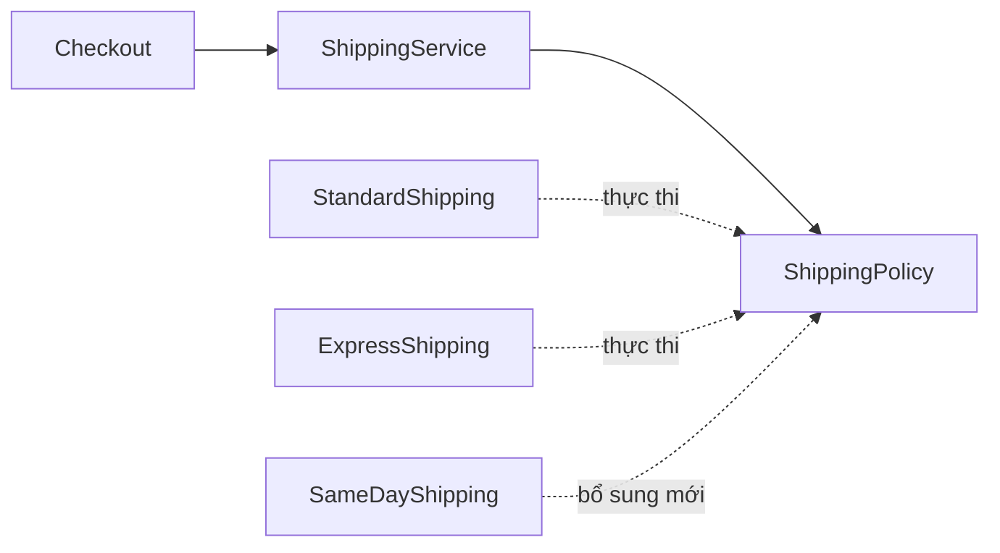
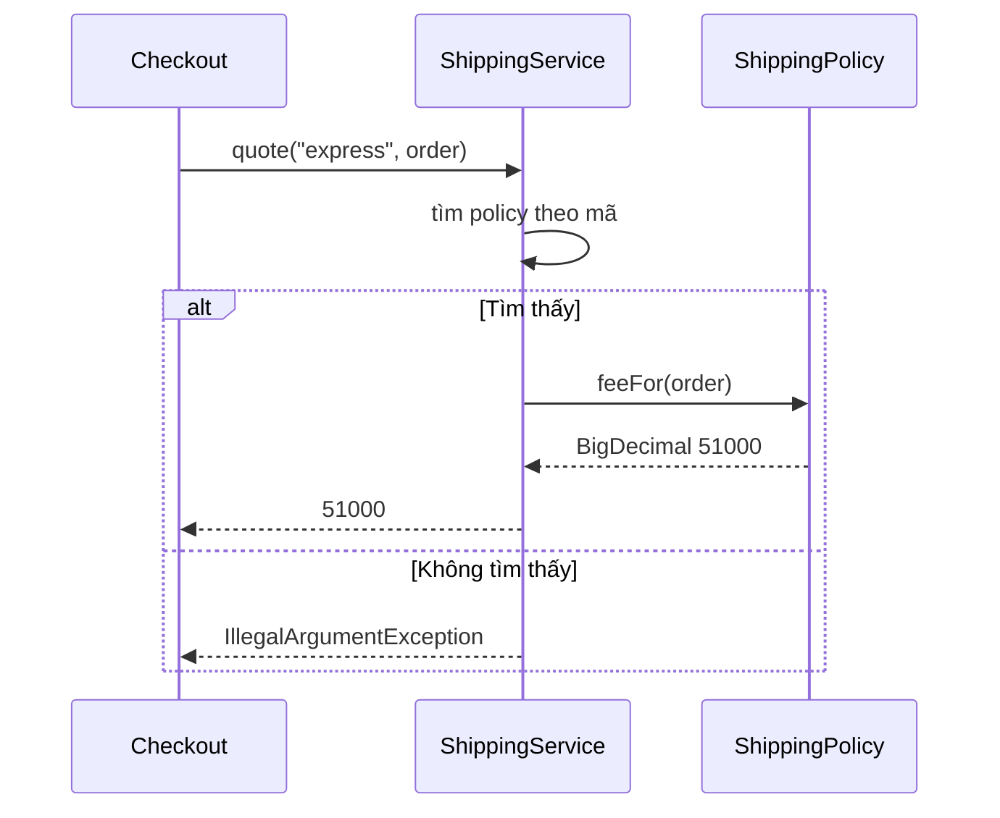

# Open/Closed Principle: Extending Behavior with Controlled Changes

> **Objective:** When a new business rule appears, introduce new behavior through an intentionally designed extension point without changing stable coordination code for each variant.

## 1. What Does OCP Really Say?

The Open/Closed Principle (OCP), the **O** in SOLID, is usually expressed as: a software component should be **open for extension** and **closed to modifications triggered by new variants**.

- **Open for extension:** New fee calculations, payment methods, report exporters, and so on can be introduced through contracts (interfaces/abstract classes), composition, or callbacks.
- **Closed to modification:** Stable core logic need not gain a new `if`, `switch`, or `instanceof` branch whenever another variant appears.
- **Controlled:** An extension-point contract defines inputs, outputs, exceptions, invariants, and how components are registered. Extension code must honor that contract; adding it must not inadvertently change existing behavior.

OCP **does not** mean "never edit a class once written." Bugs, unclear code, changes to fundamental requirements, and poorly designed abstractions still require edits. The goal is to minimize the affected code and regression risk **when adding an anticipated variant**.

### When Does the Problem Arise?

Suppose a sales system currently offers standard and express shipping, and a new delivery service is added every month. If one fee calculator contains every formula, each new service requires editing the same function and risks breaking existing rules.

```java
// Thiết kế ban đầu: thêm dịch vụ mới luôn phải sửa hàm này.
BigDecimal shippingFee(String service, int weightGrams) {
    if ("STANDARD".equals(service)) {
        return new BigDecimal("20000");
    } else if ("EXPRESS".equals(service)) {
        long kilograms = (weightGrams + 999L) / 1000;
        return new BigDecimal("35000")
                .add(new BigDecimal("8000")
                .multiply(BigDecimal.valueOf(kilograms)));
    }
    throw new IllegalArgumentException("Dịch vụ không hỗ trợ: " + service);
}
```

The problem is not `if/else` syntax itself. It is the **reason for change**: each service has independent rules, but all variants modify the same coordinating function. That increases conflicts among developers, regression-test effort, and the chance of missing a branch. If the set of options is small and fixed, a `switch` can still be reasonable.

## 2. Designing Extension Points with Strategy and Polymorphism

In the example below, `ShippingService` only knows the `ShippingPolicy` contract, not individual delivery providers' formulas. Each policy calculates fees and can be tested independently.



### Runnable Java 17 Example

Save the complete code below as `OpenClosedDemo.java` and run `javac OpenClosedDemo.java` followed by `java OpenClosedDemo`.

```java
import java.math.BigDecimal;
import java.util.Map;
import java.util.Objects;

public class OpenClosedDemo {

    // Hợp đồng ổn định: mỗi chính sách trả về phí giao hàng bằng VND.
    interface ShippingPolicy {
        BigDecimal feeFor(Order order);
    }

    record Order(BigDecimal subtotal, int weightGrams) {
        Order {
            Objects.requireNonNull(subtotal, "subtotal");
            if (subtotal.signum() < 0) {
                throw new IllegalArgumentException("subtotal phải >= 0");
            }
            if (weightGrams <= 0) {
                throw new IllegalArgumentException("weightGrams phải > 0");
            }
        }
    }

    static final class StandardShipping implements ShippingPolicy {
        @Override
        public BigDecimal feeFor(Order order) {
            Objects.requireNonNull(order, "order");
            return new BigDecimal("20000");
        }
    }

    static final class ExpressShipping implements ShippingPolicy {
        @Override
        public BigDecimal feeFor(Order order) {
            Objects.requireNonNull(order, "order");
            long kilograms = (order.weightGrams() + 999L) / 1000L;
            return new BigDecimal("35000")
                    .add(new BigDecimal("8000")
                    .multiply(BigDecimal.valueOf(kilograms)));
        }
    }

    // Ví dụ mở rộng: thêm một chính sách, không sửa ShippingService.
    static final class SameDayShipping implements ShippingPolicy {
        @Override
        public BigDecimal feeFor(Order order) {
            Objects.requireNonNull(order, "order");
            if (order.subtotal().compareTo(new BigDecimal("500000")) >= 0) {
                return new BigDecimal("45000");
            }
            return new BigDecimal("70000");
        }
    }

    static final class ShippingService {
        private final Map<String, ShippingPolicy> policies;

        ShippingService(Map<String, ShippingPolicy> policies) {
            Objects.requireNonNull(policies, "policies");
            // Bản sao không sửa được để tránh thay đổi đăng ký từ bên ngoài.
            this.policies = Map.copyOf(policies);
        }

        BigDecimal quote(String serviceCode, Order order) {
            Objects.requireNonNull(serviceCode, "serviceCode");
            Objects.requireNonNull(order, "order");
            ShippingPolicy policy = policies.get(serviceCode);
            if (policy == null) {
                throw new IllegalArgumentException(
                        "Dịch vụ không hỗ trợ: " + serviceCode);
            }
            BigDecimal amount = Objects.requireNonNull(
                    policy.feeFor(order), "ShippingPolicy returned null");
            if (amount.signum() < 0) {
                throw new IllegalStateException(
                        "ShippingPolicy returned a negative fee");
            }
            return amount;
        }
    }

    public static void main(String[] args) {
        ShippingService service = new ShippingService(Map.of(
                "standard", new StandardShipping(),
                "express", new ExpressShipping(),
                "same-day", new SameDayShipping()
        ));
        Order order = new Order(new BigDecimal("150000"), 1200);

        System.out.println(service.quote("standard", order)); // 20000
        System.out.println(service.quote("express", order));  // 51000
        System.out.println(service.quote("same-day", order)); // 70000
    }
}
```

Practical observations:

1. `ShippingPolicy` is **the variation point**. A new policy adds a class implementing this interface without requiring changes to `ShippingService`'s fee-calculation logic.
2. `ShippingService` is **the stable component**: it finds a policy, invokes `feeFor`, and rejects `null` or negative fees to protect the integration boundary. It does not use `instanceof` or inspect concrete types to branch.
3. `Map<String, ShippingPolicy>` provides **selection and registration**. When a service is added, updating the application assembly point (composition root: `main`, configuration, or a DI container) is intentional; OCP does not require zero changes anywhere in the system.
4. `BigDecimal` is better suited to money than `double` because it avoids binary floating-point errors. The example represents VND amounts as whole numbers and avoids arbitrary rounding in multiple places.
5. The `Order` object performs basic self-validation; new policies must return valid fees. Real projects may need `Money`/`Currency` types, rounding policies, weight limits, and specific fee bounds.

A good contract also states what **must not change**: `feeFor` must not return `null` or a negative fee, mutate `Order`, or use a different unit from VND; invalid-input behavior must be explicit. Method signatures alone cannot express all of this; documentation, contract tests, and reviews are necessary.

## 3. Change Impact: Before and After

| Scenario | Centralized `if/else` function | Design using `ShippingPolicy` |
|---|---|---|
| Add same-day delivery | Insert a branch in the common calculator | Implement `SameDayShipping` and register the policy |
| Update express-shipping fees | Edit the shared branch, potentially affecting other services | Edit `ExpressShipping` and its tests |
| Unit of testing | Many cases must be built around one function | Test policies separately under a shared contract |
| Code that should remain stable | Easily becomes a perpetual change hotspot | `ShippingService` and the `feeFor` call |
| Cost | Initially concise but grows with variants | Adds interfaces, classes, configuration, and lifecycle management |

Adding `SameDayShipping` still requires registration in `Map`. With Spring, each implementation may be a named bean, and `Map<String, ShippingPolicy>` can be injected into the service; Spring collects the corresponding beans. This is useful with many plugins but unnecessary for a plain Java application. Two simple formulas do not justify reflection or a plugin loader.

### Execution Flow Diagram



In the `quote` method, `if (policy == null)` remains because it **validates the request**. OCP does not forbid every `if`; it discourages coordinating behavior through an ever-growing list of concrete types.

## 4. What Should Be "Closed," and How Are Changes Controlled?

OCP is most valuable when **variation boundaries** are identified correctly:

- **Frequently changing behavior:** Fee calculations, promotion evaluation, notification delivery, etc. → candidates for interfaces.
- **Rarely changing or consistently shared behavior:** Invariants such as service-code validation, rejection of meaningless input, or error handling → keep in the coordinator.
- **Fundamental contract changes:** If all methods must accept a new `DeliveryContext`, interfaces and implementations may need updates. That is an intentional architectural change, not automatically an OCP violation.

For example, adding regional surcharges creates two distinct situations:

- If **each policy determines its own regional surcharge** and that logic varies by service, design the input contract (for example, add `Destination` to `Order` or `ShippingRequest`) and let each policy handle it.
- If **every policy always has the same base surcharge**, consider a shared service step or decorator around policies rather than duplicating the logic in every implementation.

Do not expand `ShippingPolicy` into an interface with dozens of speculative parameters for scenarios that do not yet exist. Every abstraction has costs: naming, contract documentation, testing, DI, dependency wiring, and debugging.

## 5. Advanced Extension Example Using Decorator

Suppose all services need a fixed **5.000 VND** surcharge for deliveries to remote areas. If the new requirement applies uniformly, existing policies can be wrapped instead of copying the surcharge formula into every service.

```java
static final class RemoteAreaSurcharge implements ShippingPolicy {
    private final ShippingPolicy delegate;

    RemoteAreaSurcharge(ShippingPolicy delegate) {
        this.delegate = Objects.requireNonNull(delegate);
    }

    @Override
    public BigDecimal feeFor(Order order) {
        return delegate.feeFor(order).add(new BigDecimal("5000"));
    }
}

// Ví dụ sử dụng trong cùng OpenClosedDemo:
ShippingPolicy policy =
        new RemoteAreaSurcharge(new ExpressShipping());
BigDecimal total = policy.feeFor(
        new Order(new BigDecimal("150000"), 1200));
// total = 56000
```

`RemoteAreaSurcharge` is written as **a nested class inside `OpenClosedDemo`**, so it can reuse `ShippingPolicy`, `Order`, and `ExpressShipping` from the previous example. This illustrates Decorator; in a real integration, wrap only shipments eligible for the remote-area surcharge (for example, at the composition root using validated addresses). Do not wrap every shipment indiscriminately.

This type of extension differs from subclassing `ShippingService` and overriding methods not designed for overriding. **Prefer composition when combining independent behaviors.** Do not treat inheritance as the default extension mechanism.

## 6. Testing to Protect the "Closed" Core

Extracting an interface alone does not guarantee safety. An implementation may silently violate its contract (return negative numbers or `null`, use the wrong unit, mutate input, or throw unexpected exceptions). Use two levels of tests:

**Policy-specific tests** (JUnit 5, assuming the example code resides in `OpenClosedDemo` and its nested types are accessible from a test in the same package):

```java
import static org.junit.jupiter.api.Assertions.*;
import java.math.BigDecimal;
import org.junit.jupiter.api.Test;

class ShippingPolicyTest {
    private final OpenClosedDemo.Order order =
            new OpenClosedDemo.Order(new BigDecimal("150000"), 1200);

    @Test
    void expressRoundsWeightUpToFullKilograms() {
        OpenClosedDemo.ShippingPolicy policy =
                new OpenClosedDemo.ExpressShipping();
        assertEquals(new BigDecimal("51000"), policy.feeFor(order));
    }

    @Test
    void aNewPolicyDoesNotChangeExistingExpressResult() {
        var policies = java.util.Map.<String, OpenClosedDemo.ShippingPolicy>of(
                "express", new OpenClosedDemo.ExpressShipping(),
                "same-day", new OpenClosedDemo.SameDayShipping()
        );
        var service = new OpenClosedDemo.ShippingService(policies);

        assertEquals(new BigDecimal("51000"), service.quote("express", order));
        assertEquals(new BigDecimal("70000"), service.quote("same-day", order));
    }
}
```

**Shared contract tests:** For **every** registered `ShippingPolicy`, test valid inputs and confirm non-`null`, nonnegative results with the correct units; specify behavior for rejected inputs. In a plugin system, `@ParameterizedTest` together with `@MethodSource` can run the same contract tests against all implementations. Checking only nonnegative results is insufficient: assert business checkpoints, weight boundaries, and each strategy's specific rules.

Integration tests should also confirm that new service names are registered and unknown service codes are rejected clearly. With a DI container, check duplicate bean names, missing beans, singleton lifecycles, and shared mutable state.

## 7. Pitfalls When Applying OCP

| Pitfall | Why it hurts | How to address it |
|---|---|---|
| Creating an interface for every class | Adds complexity without real variants | Create extension points where independent changes recur |
| Still checking each implementation with `instanceof` after extracting an interface | The service still changes for each new type | Put behavior in polymorphic interface methods |
| Putting all formulas and price tables in the service | The coordinator remains a hotspot for every new rule | Separate policies; use data/configuration where appropriate |
| Changing a public interface for every variant | Forces cascading changes to all implementations | Choose a stable contract; add separate capabilities for genuine differences |
| Deep inheritance hierarchies | Encourages implementation coupling and complicates behavior composition | Prefer small interfaces and composition/decorators |
| Hiding errors behind a default policy | Mistyped service codes may silently produce incorrect fees | Fail fast with clear messages or use a business-defined fallback |
| Ignoring the quality of new implementations | A faulty plugin breaks the shared workflow | Contract tests, logging, code review, and integration rules |
| Treating OCP as "never modify old code" | Preserves obsolete abstractions and encourages workarounds | Refactor carefully when evidence shows the contract must change |

**How OCP Relates to Other SOLID Principles:**

- **SRP:** Each policy has its own reason to change. A policy that calculates fees and sends emails has multiple responsibilities.
- **LSP:** An implementation must substitute for `ShippingPolicy` without breaking client assumptions. This is essential to safe extension.
- **ISP:** Small contracts prevent implementations from writing meaningless methods.
- **DIP:** `ShippingService` depends on the `ShippingPolicy` abstraction rather than a concrete class.

## 8. Refactoring Code That Violates OCP

1. **Identify variation:** List recent reasons for editing the same `if/switch`. Consider extraction if they are separate business rules.
2. **Extract a minimal contract:** Use domain names such as `ShippingPolicy.feeFor(Order)` and document invariants and error handling.
3. **Move behaviors individually:** Implement `StandardShipping` and `ExpressShipping` using existing logic and preserve previous results.
4. **Switch clients to the interface:** Inject a policy or registry; verify the service no longer inspects concrete types.
5. **Protect with tests:** Test previous results, edge cases, and the shared contract.
6. **Try adding a genuine variant:** Create `SameDayShipping`. If this still requires editing formulas in the service, the extension boundary is misplaced.
7. **Track complexity:** Evaluate class count, wiring, error observability, and real performance. Keep the simple design if abstraction costs exceed benefits.

### Self-Practice Exercises

**Exercise 1 – Payments.** The system currently handles `CASH` and `BANK_TRANSFER` with a `switch`. Design `PaymentMethod` with an explicit payment operation and result; add `QR_PAYMENT`. Distinguish shared concerns (validation, idempotency, logging) from method-specific behavior. Never log card numbers or sensitive information.

**Exercise 2 – Report export.** The system currently supports `PDF` and `CSV`. Refactor to `ReportExporter` with `export(ReportData)`. Add JSON without changing report-export coordination. Specify MIME types and error-handling rules.

**Exercise 3 – Critique the design.** A system has only two open/closed states that have remained stable for years. Would adding three interfaces, a registry, and a dynamic plugin loader help? Explain using change frequency, maintenance costs, and operational complexity.

## 9. Self-Check: Do You Understand OCP?

- Are the **stable components** and **dimensions of variation** clearly identified?
- Does adding a variant require editing stable coordination branches?
- Does the interface describe genuinely shared behavior clearly enough for contract tests?
- Can a new implementation replace an old one wherever clients expect it?
- Are registration/configuration explicit, fail-fast, and testable?
- Is added complexity proportional to how frequently changes are required?

**Key takeaway:** OCP is a decision about *change boundaries*. A good design puts frequently changing behavior behind stable contracts, enabling new behavior and focused testing while remaining willing to revise an abstraction when fundamental requirements actually change.
