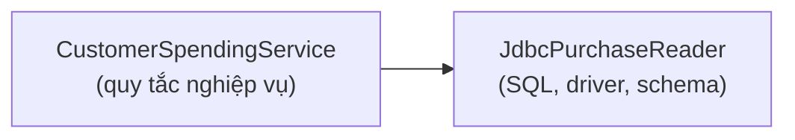
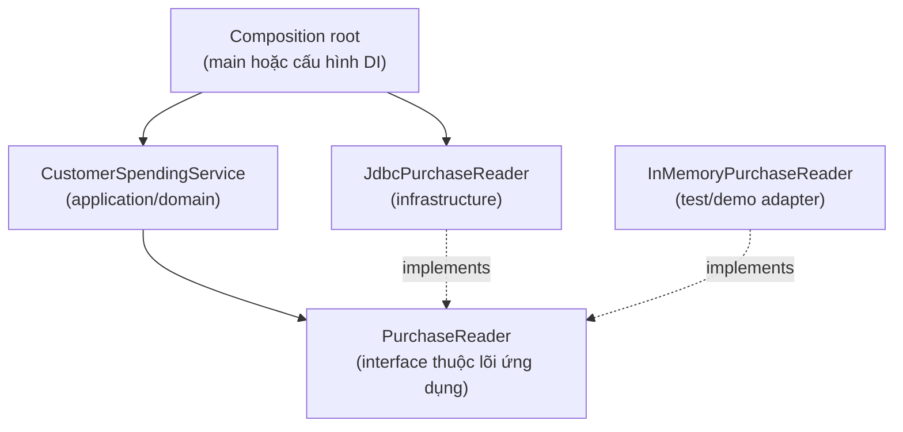
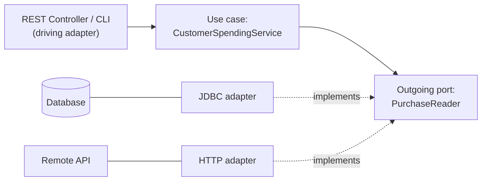

# Dependency Inversion Principle (DIP): Depending on Abstractions

> **Objective:** Design important business rules so they do not need to change whenever databases, external APIs, storage mechanisms, or notification tools change. By the end, you should be able to identify incorrect dependency directions, define interfaces at appropriate boundaries, and assemble implementations using Java/Spring.

## 1. What Is DIP?

The **Dependency Inversion Principle (DIP)** is the **D** in SOLID and contains two important statements:

1. **High-level modules should not depend on low-level modules; both should depend on abstractions.**
2. **Abstractions should not depend on implementation details; details should depend on abstractions.**

Here, a **high-level** component expresses business decisions, such as calculating a customer's valid spending. **Low-level** components implement technical details such as SQL/JDBC, HTTP clients, file reading, or caching. This distinction concerns **policy level and stability**, not which package is visually "higher."

DIP concerns **source-code dependency direction** (imports, type usage, module references, compile-time linkage). At runtime, business code may still *call through an interface* to execute JDBC/HTTP operations; that is ordinary execution flow and does not contradict DIP.

### Illustrating Dependency Direction

**Before – business logic knows technology details directly:**



An inflexible example:

```java
// Phác họa một thiết kế bị phụ thuộc hạ tầng.
// Giả sử JdbcPurchaseReader đã được định nghĩa ở nơi khác.
class CustomerSpendingService {
    private final JdbcPurchaseReader reader = new JdbcPurchaseReader();

    long totalSpentVnd(String customerId) {
        // Mọi xử lý nghiệp vụ giờ gắn cứng với JDBC.
        return reader.findByCustomer(customerId)
                .stream()
                .filter(p -> !p.refunded())
                .mapToLong(Purchase::amountVnd)
                .sum();
    }
}
```

Switching from a database to an API, or running unit tests without a database, then requires the business class to change how it creates/uses the dependency or to start real infrastructure. The snippet above is **illustrative**, not a standalone compilable example.

**After – both business logic and JDBC depend on a contract:**



The key point is that `CustomerSpendingService` knows only **which purchases it needs to read**, not whether data comes from JDBC, HTTP, or memory. The infrastructure implementation must satisfy that requirement.

## 2. Complete Java 17 Example: Total Spending Excluding Refunds

Business rule: Calculate a customer's total spending from **non-refunded** purchases, representing amounts as integer VND. The purchase data source may change, but the total calculation must remain the same.

Save the following example as `DipDemo.java` and run it:

```bash
javac DipDemo.java
java DipDemo
```

```java
import java.util.ArrayList;
import java.util.HashMap;
import java.util.List;
import java.util.Map;
import java.util.Objects;

public class DipDemo {

    // Dữ liệu nghiệp vụ: độc lập SQL, HTTP, Spring và driver.
    record Purchase(String customerId, long amountVnd, boolean refunded) {
        Purchase {
            Objects.requireNonNull(customerId, "customerId");
            if (customerId.isBlank()) {
                throw new IllegalArgumentException("customerId phải có giá trị");
            }
            if (amountVnd < 0) {
                throw new IllegalArgumentException("amountVnd không được âm");
            }
        }
    }

    // PORT/ABSTRACTION do phía ứng dụng định nghĩa.
    // Hợp đồng: trả List khác null, rỗng khi không có giao dịch,
    // chỉ chứa giao dịch của customerId tương ứng.
    @FunctionalInterface
    interface PurchaseReader {
        List<Purchase> findByCustomer(String customerId);
    }

    // Chính sách nghiệp vụ: chỉ phụ thuộc PurchaseReader.
    static final class CustomerSpendingService {
        private final PurchaseReader reader;

        // Constructor injection: caller cung cấp implementation.
        CustomerSpendingService(PurchaseReader reader) {
            this.reader = Objects.requireNonNull(reader, "reader");
        }

        long totalSpentVnd(String customerId) {
            Objects.requireNonNull(customerId, "customerId");
            if (customerId.isBlank()) {
                throw new IllegalArgumentException("customerId phải có giá trị");
            }

            long total = 0L;
            List<Purchase> purchases =
                    Objects.requireNonNull(reader.findByCustomer(customerId),
                            "PurchaseReader phải trả List khác null");

            for (Purchase p : purchases) {
                Objects.requireNonNull(p, "giao dịch không được null");
                if (!customerId.equals(p.customerId())) {
                    throw new IllegalStateException(
                            "PurchaseReader trả sai customerId");
                }
                if (!p.refunded()) {
                    total = Math.addExact(total, p.amountVnd());
                }
            }
            return total;
        }
    }

    // ADAPTER: dữ liệu bộ nhớ phục vụ demo và test.
    static final class InMemoryPurchaseReader implements PurchaseReader {
        private final Map<String, List<Purchase>> data;

        InMemoryPurchaseReader(Map<String, List<Purchase>> source) {
            Objects.requireNonNull(source, "source");
            Map<String, List<Purchase>> copy = new HashMap<>();
            source.forEach((customerId, purchases) ->
                    copy.put(customerId, List.copyOf(purchases)));
            this.data = Map.copyOf(copy);
        }

        @Override
        public List<Purchase> findByCustomer(String customerId) {
            return data.getOrDefault(customerId, List.of());
        }
    }

    // COMPOSITION ROOT: là nơi duy nhất ví dụ biết implementation cụ thể.
    public static void main(String[] args) {
        PurchaseReader reader = new InMemoryPurchaseReader(Map.of(
            "KH01", List.of(
                new Purchase("KH01", 250_000, false),
                new Purchase("KH01", 100_000, true),
                new Purchase("KH01", 80_000, false)
            )
        ));

        CustomerSpendingService service = new CustomerSpendingService(reader);
        System.out.println(service.totalSpentVnd("KH01")); // 330000
        System.out.println(service.totalSpentVnd("KH02")); // 0
    }
}
```

**Why Does This Follow DIP?**

- `CustomerSpendingService` contains the calculation and the `refunded` filtering rule. It imports no JDBC classes, constructs no concrete repository, and has no framework dependency.
- `PurchaseReader` expresses **the business data requirement** using simple Java types without exposing `ResultSet`, `Connection`, `ResponseEntity`, or `HttpResponse`.
- `InMemoryPurchaseReader` **depends back on the contract** through `implements PurchaseReader`. SQL/REST adapters can be added later without changing the spending calculation.
- `main` knows concrete classes because it **assembles the system**. This is intentional at the composition root and does not violate DIP in the service.
- `Math.addExact` throws `ArithmeticException` if a `long` total overflows. Multicurrency finance or fractional amounts may require `Money`/`BigDecimal` with explicit units and rounding rules.

DIP does not make infrastructure code disappear. It **creates boundaries** so infrastructure knowledge stays in the right place.

## 3. DIP, DI, and IoC Are Not Three Names for the Same Thing

| Concept | Question | How it appears in the example |
|---|---|---|
| **DIP** — architectural principle | Which **abstraction** does the use-case code depend on, and does the adapter depend on it in reverse? | `CustomerSpendingService → PurchaseReader ← InMemoryPurchaseReader` |
| **DI** — assembly technique | How is a concrete dependency **supplied to an object**? | `new CustomerSpendingService(reader)` |
| **IoC** — broader inversion of control | Does an external component control creation, call flow, or callbacks? | `main` or the Spring container creates and connects objects |
| **Composition root** | Where does the application select actual implementations? | `main`, Spring configuration, or bootstrap |

```java
// DI có, nhưng DIP chưa đạt nếu nghiệp vụ phụ thuộc hạ tầng cụ thể:
class BadService {
    private final JdbcPurchaseReader jdbc;
    BadService(JdbcPurchaseReader jdbc) { this.jdbc = jdbc; }
}
```

A constructor accepting `PurchaseReader` and receiving `InMemoryPurchaseReader` or a SQL adapter **uses DI and supports DIP**, provided the abstraction resides at the correct package/module boundary. Spring is not required. For required dependencies, constructor injection and `final` fields are usually clearest; setter/field injection introduces initialization-state concerns. The deeper lesson **Distinguishing Dependency Inversion from Dependency Injection** covers standalone payment code, Spring `@Bean` configuration, fake tests, injection styles, and confusion between DI and DIP.

## 4. Applying the Design with JDBC: Swap Data Sources, Keep the Calculation

The following adapter assumes a `purchases` table with three columns: `customer_id`, `amount_vnd`, and `refunded`. It uses standard Java JDBC; give `Purchase` and `PurchaseReader` suitable public/package access when splitting files across packages.

```java
import java.sql.*;
import java.util.ArrayList;
import java.util.List;
import java.util.Objects;
import javax.sql.DataSource;

// Phác họa adapter thực tế; Purchase/PurchaseReader dùng chung
// hợp đồng từ ví dụ phần 2.
final class JdbcPurchaseReader implements PurchaseReader {
    private final DataSource dataSource;

    JdbcPurchaseReader(DataSource dataSource) {
        this.dataSource = Objects.requireNonNull(dataSource);
    }

    @Override
    public List<Purchase> findByCustomer(String customerId) {
        String sql = """
            SELECT customer_id, amount_vnd, refunded
            FROM purchases
            WHERE customer_id = ?
            """;
        List<Purchase> result = new ArrayList<>();

        try (Connection connection = dataSource.getConnection();
             PreparedStatement stmt = connection.prepareStatement(sql)) {
            stmt.setString(1, customerId);
            try (ResultSet rs = stmt.executeQuery()) {
                while (rs.next()) {
                    result.add(new Purchase(
                        rs.getString("customer_id"),
                        rs.getLong("amount_vnd"),
                        rs.getBoolean("refunded")
                    ));
                }
            }
        } catch (SQLException ex) {
            throw new IllegalStateException("Không thể đọc giao dịch", ex);
        }
        return List.copyOf(result);
    }
}
```

In a real application, adapters should **map** infrastructure failures to suitable application-level errors (such as `PurchaseReadException`), and provide metrics, timeouts, connection pooling, and safe logging. If SQL columns can contain `NULL`, define the policy and check `ResultSet.wasNull()` when reading primitive types; this example assumes the database enforces `NOT NULL`. Use `PreparedStatement` for parameter binding rather than concatenating `customerId` into SQL.

**After introducing `JdbcPurchaseReader`:** Switch assembly from `new InMemoryPurchaseReader(...)` to `new JdbcPurchaseReader(dataSource)`. `CustomerSpendingService` remains unchanged. For the real integration, database configuration and table definitions belong to infrastructure, not `PurchaseReader`.

### Where to Place Abstractions

One common package layout:

```text
com.example.shop
├── application
│   ├── CustomerSpendingService.java
│   └── port
│       └── PurchaseReader.java
├── domain
│   └── Purchase.java
├── infrastructure
│   ├── jdbc
│   │   └── JdbcPurchaseReader.java
│   └── memory
│       └── InMemoryPurchaseReader.java
└── bootstrap
    └── Application.java
```

The `application` layer may depend on `domain`; `infrastructure` knows `application` contracts; `bootstrap` knows implementations for assembly. Application code should not import infrastructure. If the project uses Maven/Gradle **modules**, verify module dependencies rather than relying on package names alone.

Note: DIP does not require every interface to live in the domain. Place it **with the component that owns the need**: a data-fetching contract for a use case might belong in `application.port`, while pure domain rules belong in `domain`. Putting everything in one enormous "common" module can create hard-to-manage shared dependencies.

## 5. DI with Spring: The Framework Manages Assembly

With Spring Boot and Spring JDBC, an adapter can receive `JdbcTemplate` through its constructor while the service still knows only `PurchaseReader`.

```java
// Ví dụ dạng nhiều file trong project Spring Boot có spring-jdbc.
// Imports rút gọn: @Repository/@Service/JdbcTemplate/List.

@Repository
class SpringJdbcPurchaseReader implements PurchaseReader {
    private final JdbcTemplate jdbc;

    SpringJdbcPurchaseReader(JdbcTemplate jdbc) {
        this.jdbc = jdbc;
    }

    @Override
    public List<Purchase> findByCustomer(String customerId) {
        return jdbc.query(
            "SELECT customer_id, amount_vnd, refunded " +
            "FROM purchases WHERE customer_id = ?",
            (rs, rowNum) -> new Purchase(
                rs.getString("customer_id"),
                rs.getLong("amount_vnd"),
                rs.getBoolean("refunded")
            ),
            customerId
        );
    }
}

@Service
class CustomerSpendingService {
    private final PurchaseReader reader;

    CustomerSpendingService(PurchaseReader reader) {
        this.reader = reader;
    }

    // totalSpentVnd(...) giữ nguyên nghiệp vụ ở phần 2.
}
```

Spring injects an implementation automatically when exactly **one suitable `PurchaseReader` bean** exists. With multiple candidates, choose explicitly using `@Qualifier`, `@Primary`, `@Bean` configuration, or `@Profile`. This is a **wiring/deployment** concern; do not put `if (isProduction) new Jdbc...` inside the service.

**Compilation note:** This sketches classes in separate files and requires imports for `org.springframework.stereotype.Repository`, `org.springframework.stereotype.Service`, `org.springframework.jdbc.core.JdbcTemplate`, Java `List`, and appropriate declarations for `Purchase`/`PurchaseReader`. It cannot simply be pasted next to same-named nested classes in `DipDemo.java`. The plain Java example in section 2 is directly runnable without Spring.

For even greater decoupling, keep the service as plain Java without `@Service` and register it in configuration:

```java
@Configuration
class SpendingConfiguration {
    @Bean
    CustomerSpendingService customerSpendingService(PurchaseReader reader) {
        return new CustomerSpendingService(reader);
    }
}
```

The service then needs no Spring imports. Choose based on project scale and framework-independence goals; either design can follow DIP when dependency direction is correct.

## 6. Testing: A Measurable Benefit of DIP

Unit tests need no database connection: supply a simple `PurchaseReader` implementation. Because the interface has only one method, a Java lambda can provide a **fake/stub**.

JUnit 5 example (place the test in the same package and reference the nested `DipDemo` types from section 2):

```java
import static org.junit.jupiter.api.Assertions.*;
import java.util.List;
import org.junit.jupiter.api.Test;

class CustomerSpendingServiceTest {
    @Test
    void ignoresRefundedPurchases() {
        DipDemo.PurchaseReader fake = customerId -> List.of(
            new DipDemo.Purchase(customerId, 90_000, false),
            new DipDemo.Purchase(customerId, 40_000, true),
            new DipDemo.Purchase(customerId, 10_000, false)
        );

        var service = new DipDemo.CustomerSpendingService(fake);
        assertEquals(100_000L, service.totalSpentVnd("KH01"));
    }

    @Test
    void returnsZeroForCustomerWithoutPurchases() {
        DipDemo.PurchaseReader fake = customerId -> List.of();
        var service = new DipDemo.CustomerSpendingService(fake);

        assertEquals(0L, service.totalSpentVnd("UNKNOWN"));
    }

    @Test
    void rejectsWrongCustomerReturnedByAdapter() {
        DipDemo.PurchaseReader faulty = customerId ->
            List.of(new DipDemo.Purchase("KH_KHAC", 50_000, false));
        var service = new DipDemo.CustomerSpendingService(faulty);

        assertThrows(IllegalStateException.class,
            () -> service.totalSpentVnd("KH01"));
    }
}
```

Adequate testing requires three different levels:

| Test level | What it verifies | Real DB required? |
|---|---|---|
| **Service unit tests** | Refund filtering, correct totals, input validation, broken-contract handling | No; use a fake `PurchaseReader` |
| **JDBC adapter integration tests** | Correct SQL, mapping of `NULL`/data types, transactions, connection errors, and ordering when required | Yes; use a test database/Testcontainers where appropriate |
| **Application wiring tests** | Container/`main` chooses the correct bean/adapter, dependencies are present, configuration works | Depends on scope; infrastructure may be mocked |

DIP reduces infrastructure requirements for **unit tests** but does not replace integration tests. Correct results from a fake do not prove that SQL was written correctly.

## 7. Good Contracts Invert Dependencies Without Leaking Details

An interface serving DIP should describe **the capability the business needs**, rather than copying a technical API.

| Infrastructure-leaking contract | Application-oriented contract | Reason |
|---|---|---|
| `ResultSet executeQuery(String sql)` | `List<Purchase> findByCustomer(String id)` | The use case need not know SQL or connection lifecycles |
| `HttpResponse<byte[]> fetch(String url)` | `ExchangeRate getRate(CurrencyPair pair)` | Hides URLs, status codes, and parsing |
| `void sendSmtp(MimeMessage message)` | `void notifyOrderConfirmed(OrderConfirmation confirmation)` | The use case need not construct SMTP messages |
| `RedisTemplate getCache()` | `Optional<Product> findProduct(ProductId id)` | Application logic is not forced to depend on Redis |

When designing a port, specify:

1. **Units and invariants:** `amountVnd` is a nonnegative integer VND amount; do not silently mix VND and USD.
2. **Missing data:** No purchases means an empty list, not `null`. Distinguish "not found" from "infrastructure failed."
3. **Result semantics:** Return purchases belonging to the correct customer, define inclusion of refunded transactions, and specify ordering when necessary.
4. **Failure behavior:** Timeouts, retries, exception types, and safe repeatability. Do not turn every database failure into an "empty list."
5. **Time and consistency:** For period-based or multisource reports, define time zones, snapshots, consistency levels, and pagination.
6. **Safety and security:** Authentication/data authorization belong at appropriate boundaries; having an interface does not prevent SQL injection or data exposure.

If a use case needs large-scale pagination, returning all results as `List` may cause memory issues. Design a suitable `Page`/`Cursor` for the real use case, but avoid pulling framework-specific pagination classes into the core when framework independence is required.

## 8. DIP and Ports & Adapters (Hexagonal Architecture)

DIP is **a principle governing dependency direction**. Ports & Adapters is an architectural organization that helps implement it.



At runtime, `CustomerSpendingService` calls `findByCustomer` and Java dynamic dispatch executes the selected implementation, but the service's **source dependency** points only to `PurchaseReader`.

Clean Architecture applies DIP similarly, although layer names and interface locations vary across organizations. Adopting a complete hexagonal architecture is not required to use DIP; even a small application can isolate one highly volatile dependency.

**When Should You Avoid Creating a Port?**

- For pure computation that rarely changes, a direct class/function may be simpler.
- For stable data objects or utilities that are not external technology boundaries, arbitrary interfaces complicate navigation.
- With one implementation but volatile infrastructure or unit tests requiring isolation, a port may still have strong value.
- If interfaces merely reproduce a library's public methods (for example, `IJdbcTemplate` with every operation) without expressing a business-owned contract, the boundary is not meaningful.

Practical rule: introduce abstractions when they **protect stable policies from volatile details** or enable valuable isolated tests. Do not evaluate DIP by interface count.

## 9. Mistakes That Make Dependency Inversion Ineffective

| Symptom | Root cause | Fix |
|---|---|---|
| `new JdbcPurchaseReader()` or `JdbcTemplate` inside a use case | Policy code imports technical details directly | Inject an application-owned `PurchaseReader` port |
| Constructor injection uses a `JdbcPurchaseReader` type | Assembly changed, but dependency direction did not | Type parameters/fields using the port |
| A port returns `ResultSet`, `ResponseEntity`, or `EntityManager` | Infrastructure leaks through signatures | Return application-domain models/results |
| The port lives in the infrastructure module | The core still imports a lower layer | Move the port to application/domain or a suitable contract module |
| An adapter returns `List.of()` after a DB failure | Confuses "no data" with "cannot read" | Distinguish failures using explicit exceptions/results |
| Fake tests pass but JDBC violates the contract | Only business logic was tested with fake data | Add adapter contract and integration tests |
| Creating interfaces for every helper | Abstraction overhead creates no stable boundary | Keep concrete classes/pure functions in low-variation areas |

A small `PurchaseReader` port supports ISP; adding adapters without editing policies supports OCP; returning the correct customer's records and non-null results supports LSP. **DIP does not replace contracts, input validation, transactions, or authorization.**

## 10. Safely Refactoring a Concrete Dependency

1. **Identify logic to protect:** For example, `CustomerSpendingService.totalSpentVnd` expresses a business rule.
2. **List tightly coupled details:** `JdbcTemplate`, `DataSource`, SQL, HTTP SDKs, and construction methods.
3. **Propose a port based on use-case needs:** `PurchaseReader.findByCustomer` with clear models and data-result rules.
4. **Make the existing adapter implement the port:** Move SQL/HTTP code into infrastructure and map data to shared models.
5. **Inject through the use-case constructor:** Remove adapter construction from the business class.
6. **Assemble at the composition root:** Select adapters per environment through explicit configuration.
7. **Preserve behavior with tests:** Unit tests for business rules, integration tests for adapters, and wiring tests when DI is used.
8. **Assess remaining coupling:** Package imports, return types, errors, transactions, logging, test fixtures, and adapter replaceability.
9. **Add abstractions only when worthwhile:** Evaluate reasons for changing the use case, test independence, and flexibility to change infrastructure.

### Practice Exercises

**Exercise 1 – Switch adapters:** Write `CsvPurchaseReader implements PurchaseReader` to read a sample CSV file (clearly define delimiters, UTF-8 encoding, required columns, and format errors). Keep `CustomerSpendingService` and its unit tests unchanged.

**Exercise 2 – Order notifications:** Initially, `OrderService` calls `SmtpClient` directly. Design an `OrderNotificationPort` matching business needs with `EmailNotificationAdapter` and `FakeNotificationAdapter` implementations. Explain where beans are created, how sending failures are handled, and how retries avoid duplicate notifications.

**Exercise 3 – Critique:** A developer creates `IStringFormatter` for every `String.format` call and calls it DIP. Analyze whether business logic actually depends on volatile details and whether the new interfaces provide any practical benefit.

**Exercise 4 – Multimodule architecture:** Design Maven/Gradle dependencies for `domain`, `application`, `infrastructure`, and `bootstrap`. Draw build-time dependency arrows and demonstrate that `application` must not import the `infrastructure` package.

## 11. Self-Assessment Checklist

- [ ] I can identify **high-level policies** and **low-level details** in the design.
- [ ] The service does not invoke `new` on a concrete adapter or import infrastructure libraries.
- [ ] Abstractions express *business needs* without unnecessary technical APIs.
- [ ] Adapters implement contracts, and adapter selection happens at the composition root.
- [ ] I can distinguish DIP (principle), DI (technique), and IoC (control).
- [ ] Unit tests use simple fakes, and integration tests verify real adapters.
- [ ] Contracts define empty results, errors, units, consistency, and edge cases.
- [ ] The level of abstraction is proportional to change costs and maintainability.

**Key takeaway:** DIP does not mean "always use interfaces or Spring." It means **details must conform to the needs of stable business logic**, so technology can change within controlled boundaries while important logic remains understandable and testable.
