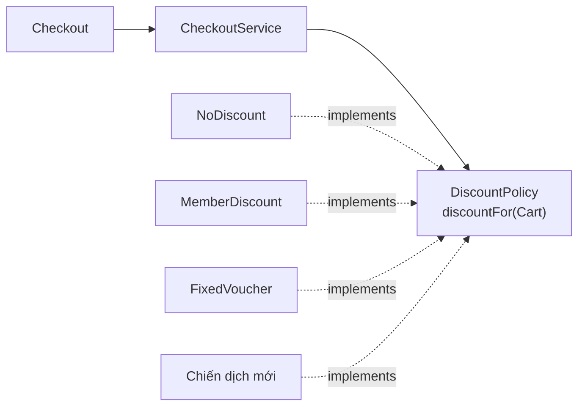
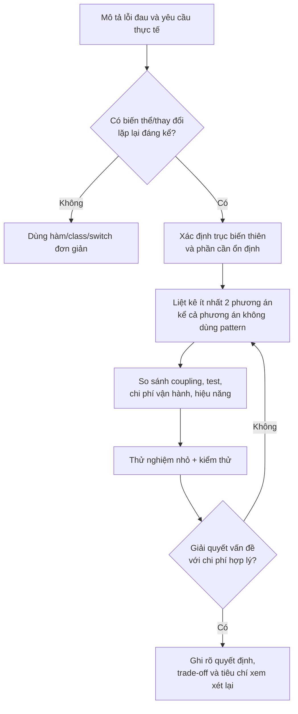

# Design Patterns: Problems, Context, and Trade-offs

> **Learning objective:** Go beyond memorizing Design Pattern names: analyze the problem at hand, understand its context and constraints, compare alternatives, choose an appropriate design pattern, and measure the actual impact of that choice through Java code and tests.

## 1. What Problems Do Design Patterns Solve?

**Design Pattern** refers to an established way of organizing collaboration among objects or components to address **a recurring design problem in a particular context**.

A design pattern **is not**:
- A class, library, or code snippet that can be copied unchanged into every project.
- A mandatory requirement for object-oriented programming.
- Automatic proof of good architecture, high performance, or maintainability.
- A substitute for understanding the domain, data design, security, transactions, and testing.

A thorough description of a pattern typically covers:

| Element | Question to answer |
|---|---|
| **Name / intent** | What kind of problem does this pattern address? |
| **Problem** | What currently makes changes or replacements difficult, introduces errors, or duplicates code? |
| **Context** | How many variants does the system have, how often do they change, who uses them, and what constraints apply? |
| **Forces / tensions** | Which goals compete: flexibility versus simplicity, reuse versus isolation, performance versus comprehensibility? |
| **Solution** | Which objects fulfill which roles, and where are the relationships and variation points? |
| **Consequences** | Where is coupling reduced, which abstractions are added, and what are the runtime and testing costs? |
| **Applicability** | What signals indicate a suitable pattern, and when would a simpler approach be preferable? |

**Decision framework:** concrete problem + real-world context + acceptable trade-offs → **design decision**. The pattern name is merely shorthand for discussing an already understood decision.

### Example Problem Statements

Vague statement: “Our discount calculation module needs the Strategy Pattern.”

Testable statement:

> “We have four independent groups of discount rules, with more planned for each campaign. Each new rule currently requires changing `CheckoutService` by adding an `if/else` branch. We want to add rules without changing the checkout algorithm and to test each rule independently.”

The second statement clarifies the **pain point**, **motivation for change**, and **success criteria**. Only then does Strategy become an option worth considering.

## 2. Context Determines Which Pattern Fits

Two programs may look alike in a class diagram yet warrant different patterns. Before choosing, ask:

1. **What changes?** The number of processing types, algorithms, formats, states, external APIs, or object lifecycles?
2. **How often does it change, and who owns it?** Does one rule change a few times per year, or do multiple teams add variants every week?
3. **What must stay stable?** The public contract, payment calculation results, schema, latency, error handling, or release process?
4. **What is the call path?** Is processing synchronous or asynchronous; are threads, transactions, or networks involved?
5. **What is the organizational cost?** Can the team easily trace execution through an interface/DI registry? Can an operator identify the implementation actually running?
6. **How observable and testable is it?** Are there tests for existing rules, contract tests for new implementations, and sufficient logging/metrics for troubleshooting?
7. **Which problems do not yet need solving?** Avoid adding extension points for dozens of merely imagined possibilities.

Four signals often suggest considering a pattern:

- A behavior-selection branch keeps growing, and each branch represents an **independent rule** → consider **Strategy**.
- Complex objects can be created in several ways, and clients should not depend on concrete classes → consider **Factory Method / Abstract Factory**.
- You must interact with an API that exposes a different contract or wrap additional behavior around an object → consider **Adapter / Decorator**, depending on the goal.
- Several components must react when an event or state changes → consider **Observer** or an appropriate event-notification mechanism.

These are **diagnostic clues**, not rigid rules. The same problem might be solved more simply with a pure function, a `switch`, a data table, ordinary composition, or a separate module.

## 3. A Running Example: Calculating Checkout Discounts

Suppose a sales system offers three options:

- No discount.
- Members receive **5% of the cart value** as a discount.
- A fixed voucher of **30.000 VND**, capped at the cart value.

In this example, the cart is represented by a whole-number total in VND; percentage discounts are rounded to the nearest VND using `HALF_UP`. Each checkout applies **one selected policy**. This is a business assumption that keeps the example clear, not a claim that every commerce system permits only one promotion.

### 3.1. A Simple Approach for Few, Stable Variants

```java
enum DiscountKind { NONE, MEMBER, VOUCHER }

static long discountVnd(long subtotalVnd, DiscountKind kind) {
    if (subtotalVnd < 0) {
        throw new IllegalArgumentException("Tổng tiền không được âm");
    }
    return switch (kind) {
        case NONE -> 0L;
        // Ví dụ số nguyên gần đúng: phải thận trọng với quy tắc làm tròn,
        // overflow và đơn vị tiền khi xây dựng hệ thống thật.
        case MEMBER -> java.math.BigDecimal.valueOf(subtotalVnd)
                .multiply(new java.math.BigDecimal("0.05"))
                .setScale(0, java.math.RoundingMode.HALF_UP)
                .longValueExact();
        case VOUCHER -> Math.min(30_000L, subtotalVnd);
    };
}
```

A `switch` here **is not wrong**. If the three options are stable, owned by one team, and all rules are concise, this may be the best design: fewer classes, easier call tracing, and fewer configuration points. Do not automatically replace every `switch` with Strategy.

### 3.2. When Variants Represent a Real Axis of Change: Strategy

When several teams add discount types and each type has its own tests, the rules can be separated into policies that share a contract.



A **standalone Java 17** example: save it as `PatternDecisionDemo.java`, then run `javac PatternDecisionDemo.java` and `java PatternDecisionDemo`:

```java
import java.math.BigDecimal;
import java.math.RoundingMode;
import java.util.Objects;

public class PatternDecisionDemo {

    record Cart(BigDecimal subtotalVnd) {
        Cart {
            Objects.requireNonNull(subtotalVnd, "subtotalVnd");
            if (subtotalVnd.signum() < 0 ||
                    subtotalVnd.stripTrailingZeros().scale() > 0) {
                throw new IllegalArgumentException(
                        "subtotalVnd phải là số nguyên VND không âm");
            }
        }
    }

    // Hợp đồng nhỏ, diễn đạt một khả năng thay đổi độc lập.
    interface DiscountPolicy {
        BigDecimal discountFor(Cart cart);
    }

    static final class NoDiscount implements DiscountPolicy {
        @Override
        public BigDecimal discountFor(Cart cart) {
            Objects.requireNonNull(cart, "cart");
            return BigDecimal.ZERO;
        }
    }

    static final class MemberDiscount implements DiscountPolicy {
        @Override
        public BigDecimal discountFor(Cart cart) {
            Objects.requireNonNull(cart, "cart");
            return cart.subtotalVnd()
                    .multiply(new BigDecimal("0.05"))
                    .setScale(0, RoundingMode.HALF_UP);
        }
    }

    static final class FixedVoucher implements DiscountPolicy {
        private final BigDecimal amountVnd;

        FixedVoucher(BigDecimal amountVnd) {
            Objects.requireNonNull(amountVnd, "amountVnd");
            if (amountVnd.signum() < 0 ||
                    amountVnd.stripTrailingZeros().scale() > 0) {
                throw new IllegalArgumentException(
                        "amountVnd phải là số nguyên VND không âm");
            }
            this.amountVnd = amountVnd;
        }

        @Override
        public BigDecimal discountFor(Cart cart) {
            Objects.requireNonNull(cart, "cart");
            return amountVnd.min(cart.subtotalVnd());
        }
    }

    // Không hỏi cụ thể từng kiểu chính sách.
    static final class CheckoutService {
        private final DiscountPolicy policy;

        CheckoutService(DiscountPolicy policy) {
            this.policy = Objects.requireNonNull(policy, "policy");
        }

        BigDecimal payableFor(Cart cart) {
            Objects.requireNonNull(cart, "cart");
            BigDecimal discount = Objects.requireNonNull(
                    policy.discountFor(cart), "discount không được null");

            // Bảo vệ invariant của phần điều phối.
            if (discount.signum() < 0 ||
                    discount.compareTo(cart.subtotalVnd()) > 0 ||
                    discount.stripTrailingZeros().scale() > 0) {
                throw new IllegalStateException(
                        "Chính sách trả mức chiết khấu không hợp lệ");
            }
            return cart.subtotalVnd().subtract(discount);
        }
    }

    public static void main(String[] args) {
        Cart cart = new Cart(new BigDecimal("400000"));

        CheckoutService member = new CheckoutService(
                new MemberDiscount());
        CheckoutService voucher = new CheckoutService(
                new FixedVoucher(new BigDecimal("30000")));
        CheckoutService none = new CheckoutService(
                new NoDiscount());

        System.out.println(member.payableFor(cart));  // 380000
        System.out.println(voucher.payableFor(cart)); // 370000
        System.out.println(none.payableFor(cart));    // 400000
    }
}
```

**Roles in the Strategy pattern:**

| Element | Role | Rationale |
|---|---|---|
| `DiscountPolicy` | Strategy interface | Defines the shared operation and input/output expectations |
| `MemberDiscount`, `FixedVoucher`, `NoDiscount` | Concrete strategies | Each encapsulates an independent formula |
| `CheckoutService` | Context | Coordinates checkout, invokes the strategy, and enforces invariants |
| `main` | Composition root | Selects which strategy to use when assembling objects |

**Extending behavior:** add `SeasonalDiscount implements DiscountPolicy` without adding another branch to `CheckoutService`. If users can choose a discount type through a UI, the **wiring** must still map campaign codes to strategies or obtain them through an appropriate registration mechanism; this change is expected.

**Actual trade-off:** more classes, an additional interface, strategy-selection configuration, and the need for a strict contract across implementations. The principal benefits are separating variants, reducing changes to orchestration code, and testing strategies independently; this does not inherently make the program faster.

### 3.3. Compare Before Deciding

| Criterion | Centralized `switch` | Strategy |
|---|---|---|
| Three short rules that rarely change | Usually simpler and clearer | May introduce unnecessary abstraction |
| Adding new rules frequently | Requires changing the `switch` | Add an implementation and wiring |
| Testing each rule | Possible, usually within the same code unit | Easier to isolate each strategy |
| Tracing execution | Read one function | Follow the interface, implementation, and assembly |
| Supporting plugins/other teams adding rules | Harder to separate ownership | Better suited when the contract is clear |
| Cognitive cost | Low initially, but may grow with the number of branches | Higher initially, more stable with many variants |
| System risks | Large function; a new branch may affect others | Wrong strategy configuration or implementations violating the contract |

Do not choose Strategy simply because you see an `if`. Show that **the processing approach is an axis of variation** with sufficient frequency and independence.

## 4. Trade-offs: A Pattern Resolves One Tension and Creates Another

Design principles often conflict:

- **Less coupling** to implementations ↔ **more indirection** (extra layers to navigate).
- **Extension through new classes** ↔ **more object types and configuration** to maintain.
- **Hiding infrastructure details** ↔ **less visibility into the actual implementation** when DI/registry configuration is opaque.
- **Flexible composition** ↔ **component assembly order** may affect behavior.
- **Decoupled event notifications** ↔ **harder to determine ordering, failures, and consistency**.
- **Object creation through a factory** ↔ **additional concentration of object-selection logic in the factory**.

A pattern succeeds when its new costs are **consciously accepted** and outweighed by the pain it addresses. In a design review, asking “Where does this pattern move responsibility and cost?” is often more useful than asking “Which category does this pattern belong to?”

## 5. Common Pattern Categories

The classic **Gang of Four (GoF)** catalog groups 23 patterns into three categories by intent. The table below selects representative patterns only; classification cannot replace analysis of the specific situation.

| Category | Pattern | When to consider it | Trade-off to remember |
|---|---|---|---|
| **Creational** | Factory Method | Defer concrete class selection to subclasses or an object-creation extension point | Adds hierarchy and indirection |
| **Creational** | Abstract Factory | Create consistent **families** of related objects (for example, a Windows/Mac UI suite) | Hard to add a *new product type* to every factory |
| **Creational** | Builder | An object has many options or a complex construction process that should remain readable | Adds a builder/state and validation step |
| **Creational** | Singleton | A single instance is truly required within a defined scope | Global state, coupling, and testing difficulty; a DI singleton scope differs from a private constructor |
| **Structural** | Adapter | A caller needs one interface while an external library exposes another API | Adds a conversion layer and may lose information or semantics |
| **Structural** | Decorator | Add behavior around an object while keeping the same interface | Wrapping order matters; multiple layers are harder to trace |
| **Structural** | Facade | Several complex subsystem APIs should have one simple entry point | A facade can grow too large and hide specialized capabilities |
| **Behavioral** | Strategy | Several algorithms need to be interchangeable by context | Multiple implementations and a suitable selection mechanism |
| **Behavioral** | Observer | One change must notify multiple observers | Ordering, subscription lifecycle, callback failures, and backpressure |
| **Behavioral** | Command | Represent a request as an object for queuing, logging, undo, or retry | Adds objects/data structures; retries require idempotency management |
| **Behavioral** | State | Behavior depends on state, and transitions are complex | Multiple state classes; valid transitions must be controlled |
| **Behavioral** | Template Method | A fixed algorithm skeleton has steps specialized through inheritance | Inheritance coupling; substitution is harder than composition |

**Distinguish the scope:** GoF Design Patterns generally describe collaboration among objects; **architectural patterns** (such as Layered Architecture and Hexagonal Architecture) affect boundaries across an entire system. An **idiom** is a language-specific coding convention (such as `try-with-resources` in Java). Do not apply a pattern at every level merely because its name is familiar.

## 6. Choosing the Right Pattern for the Same Requirement

Suppose you need to integrate a new provider's messaging service. If the goal is adapting its SDK interface to an internal contract:

```java
interface SmsSender {
    void send(String phoneNumber, String message);
}

// API nhà cung cấp bên ngoài có chữ ký khác.
final class VendorSmsSdk {
    void dispatchText(String destination, String payload) {
        // Gọi API thực tế, xử lý HTTP/auth tại adapter.
    }
}

// Adapter biến lời gọi nội bộ thành lời gọi SDK.
final class VendorSmsAdapter implements SmsSender {
    private final VendorSmsSdk sdk;

    VendorSmsAdapter(VendorSmsSdk sdk) {
        this.sdk = java.util.Objects.requireNonNull(sdk);
    }

    @Override
    public void send(String phoneNumber, String message) {
        sdk.dispatchText(phoneNumber, message);
    }
}
```

This is an **Adapter**: it changes the *contract's shape* while hiding the vendor API. It does not automatically handle retries, SMS charges, security, or phone-number validity.

If the `SmsSender` contract is already suitable but you want to **add metrics** to every send operation:

```java
interface SendMetrics {
    void countSuccess();
    void countFailure();
}

final class MeteredSmsSender implements SmsSender {
    private final SmsSender delegate;
    private final SendMetrics metrics;

    MeteredSmsSender(SmsSender delegate, SendMetrics metrics) {
        this.delegate = java.util.Objects.requireNonNull(delegate);
        this.metrics = java.util.Objects.requireNonNull(metrics);
    }

    @Override
    public void send(String phoneNumber, String message) {
        try {
            delegate.send(phoneNumber, message);
            metrics.countSuccess();
        } catch (RuntimeException e) {
            metrics.countFailure();
            throw e;
        }
    }
}
```

This is a **Decorator**: it preserves the same interface and wraps extra behavior around the delegate's processing. The Java snippets in this section are **examples intended for separate files or assembly within a package** to illustrate the structure; the complete standalone, compilable `main` appears in section 3.

**Different problems call for different patterns:**

| What needs to change | Option to consider | Why |
|---|---|---|
| Replace a vendor API with the application's shared contract | Adapter | Converts the interface |
| Add metrics, tracing, or surrounding behavior | Decorator | Wraps an object while retaining its interface |
| Choose among SMS/email/push channels | Strategy | Interchanges algorithms or sending approaches |
| Several systems need to react after an order is approved | Observer or event messaging | Notifies interested consumers |
| Package a resend request as a queueable/retryable job | Command/job object | Represents the request as transferable data |

If notifications require transactional guarantees and reliable network delivery, **in-process Observer** is insufficient: message brokers, outboxes, retries, idempotency, and partial failures must be addressed. A pattern does not replace distributed-systems requirements.

### Wrapping Order Changes the Result

```text
new RetrySender(new MeteredSmsSender(actual, metrics))
    → metrics ghi nhận từng attempt được retry

new MeteredSmsSender(new RetrySender(actual), metrics)
    → metrics ghi nhận một lần gửi logic sau retry
```

Both compositions can be valid; choose according to the measurement requirements. This illustrates a **Decorator/composition** consequence, rather than complete `RetrySender` code.

## 7. A Process for Choosing Patterns in Real Situations



Apply the process to a concrete situation:

1. **Record recent changes:** count modifications to the module over the past 3–6 months, independent branches, and regressions (rather than relying entirely on intuition).
2. **Separate the “what” from the “how”:** what behavior does the business policy require, and which techniques does the implementation use?
3. **State mandatory constraints:** correctness, security, latency, thread safety, transactions, and backward compatibility.
4. **Compare the baseline with candidates:** first try better naming, method extraction, or data mappings; introduce Strategy/Factory/Observer only when beneficial.
5. **Build a small spike:** can a completely new variant be added with few changes to the core? Does debugging become unreasonably difficult?
6. **Define the contract and tests:** specify results, exceptions, invariants, limits, and concurrency.
7. **Write a short design decision:** include context, alternatives considered, reasons for selection, consequences, and conditions for reconsideration.
8. **Reassess with evidence:** retain, simplify, or replace the pattern as the context changes.

### Example Architecture Decision Record (ADR)

```markdown
# ADR: Tách chính sách chiết khấu khỏi CheckoutService

Trạng thái: Chấp nhận (ví dụ minh họa)

Bối cảnh:
- Có nhiều chương trình khuyến mãi được phát triển độc lập.
- Phần điều phối checkout phải ổn định và dùng chung validation.
- Các quy tắc cần unit test riêng, thêm mới thường xuyên.

Phương án:
1. Duy trì switch tập trung.
2. Dùng bảng cấu hình nếu mọi quy tắc thuần dữ liệu.
3. Dùng DiscountPolicy (Strategy) cho quy tắc có hành vi khác nhau.

Quyết định:
- Chọn Strategy cho các chiến dịch có thuật toán khác biệt.
- Composition root ánh xạ mã chiến dịch sang implementation.

Hệ quả:
+ Ít sửa luồng checkout khi thêm chiến dịch.
+ Test được từng chính sách riêng.
- Thêm interface, class và cấu hình.
- Phải kiểm tra contract: mức giảm nằm trong [0, subtotal].

Xem xét lại khi:
- Các chiến dịch chủ yếu chuyển thành cấu hình dữ liệu,
  hoặc số chiến dịch giảm và rất hiếm thay đổi.
```

## 8. Test Patterns Through Behavior and Contracts

A good pattern should help **control change** without breaking invariants. In the Strategy example, prioritize these tests:

- When `subtotalVnd = 400000`, a member receives a 20000 VND discount.
- For a cart worth 20000 VND, a 30000 VND voucher discounts at most 20000 VND; the payable amount is 0.
- With `subtotalVnd = 0`, the payable amount is 0 for every valid policy.
- Reject a new implementation that returns a negative discount, one larger than the cart total, or `null`.
- With a dynamic registry/DI, an unknown policy code must produce a clear error instead of silently selecting another policy.

JUnit 5 example: put the test class in the same package as `PatternDecisionDemo`:

```java
import static org.junit.jupiter.api.Assertions.*;
import java.math.BigDecimal;
import org.junit.jupiter.api.Test;

class PatternDecisionDemoTest {

    @Test
    void memberDiscountIsFivePercent() {
        var cart = new PatternDecisionDemo.Cart(
                new BigDecimal("400000"));
        var checkout = new PatternDecisionDemo.CheckoutService(
                new PatternDecisionDemo.MemberDiscount());

        assertEquals(new BigDecimal("380000"),
                checkout.payableFor(cart));
    }

    @Test
    void fixedVoucherNeverMakesPayableNegative() {
        var cart = new PatternDecisionDemo.Cart(
                new BigDecimal("20000"));
        var checkout = new PatternDecisionDemo.CheckoutService(
                new PatternDecisionDemo.FixedVoucher(
                        new BigDecimal("30000")));

        assertEquals(BigDecimal.ZERO,
                checkout.payableFor(cart));
    }

    @Test
    void invalidStrategyIsRejected() {
        PatternDecisionDemo.DiscountPolicy bad =
                cart -> new BigDecimal("-1");
        var checkout = new PatternDecisionDemo.CheckoutService(bad);

        assertThrows(IllegalStateException.class,
                () -> checkout.payableFor(
                        new PatternDecisionDemo.Cart(
                                new BigDecimal("100000"))));
    }
}
```

These tests demonstrate the correctness of **behavior currently in use**. They do not prove that all future campaigns will be correct; add shared contract tests, boundary tests, and specific tests for new algorithms. If the system combines multiple voucher types, define their order, compatibility, and mutually exclusive rules. **Do not arbitrarily apply multiple Strategies in sequence** unless the contract permits it.

## 9. Common Mistakes When Learning Design Patterns

| Mistake | Why it causes harm | How to fix it |
|---|---|---|
| Memorizing names and then looking for places to apply them | Adds code and abstractions without solving a problem | Start with actual risks from change |
| Treating `if/switch/new` as an absolute code smell | Discards an already correct, concise solution | Evaluate variant frequency, complexity, and ownership |
| Adding multiple interfaces for one fixed case | Adds indirection and navigation costs | Keep the design simple until a need emerges |
| Using Singleton to share mutable data | Increases global coupling, race conditions, and interdependent tests | Manage lifecycles explicitly; prefer immutable data/dependency injection |
| Adapting APIs by renaming methods but losing errors or semantics | Misleads clients about the third-party contract | Define data mapping, timeouts, exceptions, and limits explicitly |
| Failing to test Decorator wrapping order | Metrics, retries, caches, or transactions take on different meanings | Test composition order and side effects |
| Assuming Observer callbacks are always safe | One observer's failure may affect the publisher; unsubscribe may be forgotten | Design error, lifecycle, ordering, and backpressure policies |
| Having factories return objects incompatible with the contract | Errors only surface at runtime | Validate types, invariants, and compatibility |
| Combining patterns into dependency cycles | Complicates initialization and maintenance, obscures lifecycles | Diagram dependencies; separate boundaries |
| Measuring “quality” by pattern count | Makes code harder to maintain despite its architectural appearance | Measure bug-fix time, tests, coupling, and debuggability |

**One important question:** If the kind of change a pattern supports **stopped occurring** tomorrow, would the architecture still make sense? If not, revisit the cost of the abstraction.

## 10. Questions That Distinguish Similar Patterns

**Strategy or State?** Both may use interfaces and composition, but their purposes differ. Strategy interchanges **algorithms/policies**; State represents the **current state and valid transitions**, where an object's behavior depends on a state machine. Switching classes at runtime alone does not make something State.

**Adapter or Decorator?** Adapter enables communication between incompatible interfaces. Decorator generally retains the **same interface** while adding behavior around the wrapped object. A real system may need both.

**Factory Method or a factory function?** The GoF Factory Method relies on an object-creation method that subclasses can specialize; a **static factory method** in Java (such as `Color.of(...)`) is not automatically the GoF Factory Method pattern. Avoid conflating the terms in design reviews.

**Observer or event bus?** Observer models a publisher–subscriber relationship within an application or among objects. An event bus/message broker may use publish–subscribe concepts but must also address delivery, retries, ordering, distribution, and idempotency.

**Builder or constructor?** Builder suits numerous optional parameters or a multistep construction process requiring validation. For a record with two clear required parameters, a constructor may be easier to understand.

## 11. Applied Exercises

### Exercise 1 – Choose Strategy or Do Without It

A service-pricing system has two fixed rules that change only once a year. Implement two alternatives: one using a `switch` and one using Strategy. Estimate their class counts, change points, and situations in which the second approach would become more useful. Explain your final choice.

### Exercise 2 – Adapter by Contract

An external provider returns temperatures in Fahrenheit, but the domain needs Celsius. Design a `TemperatureProvider` that returns degrees Celsius, an adapter for the external SDK, and a rule for handling invalid values. Test the boundaries 32°F → 0°C and 212°F → 100°C; distinguish unit conversion in the adapter from temperature-alert rules.

### Exercise 3 – Decorator and Ordering

Design a `Notifier` wrapped with retries and metrics. Explain how placing `RetryNotifier` **outside** versus **inside** `MetricsNotifier` affects the counts. If a send operation ultimately fails, which composition counts attempts and which counts a single business request?

### Exercise 4 – Diagnose the Context

A team wants Observer to “send an email after successful payment.” Analyze a system where payments and emails run in separate processes, networks can fail, duplicate sends are forbidden, durable storage is required, and retries are necessary. Explain why an in-memory synchronous Observer is insufficient and propose additional mechanisms.

### Exercise 5 – Write an ADR

Choose an existing Java code fragment with many conditionals. Write a brief ADR covering the actual problem, context, two options (including a simple one), decision, benefits, risks, and conditions for review. Do not conclude merely with “because SOLID”.

## 12. Checklist Before Introducing a Pattern into Production Code

- [ ] There is a **measurable or observable problem**, beyond merely wanting to use a pattern.
- [ ] The context, change frequency, and performance/security limits are understood.
- [ ] There is a **simple alternative** for comparison.
- [ ] **Stable points** are distinguished from **extension points**.
- [ ] The pattern's benefits outweigh the additional classes, configuration, and debugging costs.
- [ ] The interface/contract specifies valid values, errors, and side effects.
- [ ] Tests cover current behavior, edge cases, and implementations.
- [ ] Registration, initialization, lifecycle management, and object tracking are planned.
- [ ] The review can explain **why to choose** the pattern and **when to remove** it.

**Remember:** good design does not mean using the greatest number of patterns. A pattern is worthwhile when it addresses a problem **that exists in a specific context**, offers enough long-term benefit, and has trade-offs that are understood, tested, and explicitly accepted.
