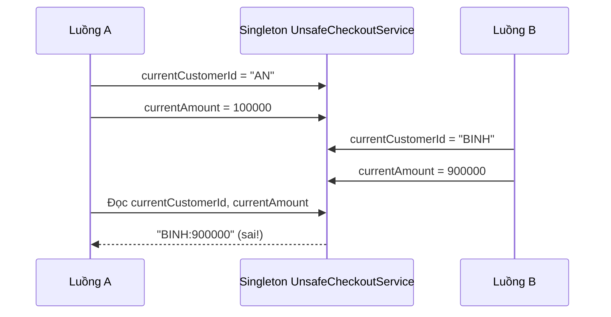
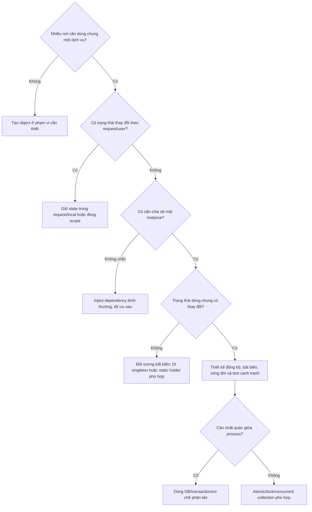

# Singleton and the Risks of Shared State in Java

**Context:** An application has many components that need to use shared configuration, a logger, or a common coordinator. We want to avoid redundant object creation. But what happens when a single object also stores data that changes per user or per request while multiple threads access it?

This lesson explains the actual scope of **Singleton**, Java implementation options, why **one instance does not imply thread safety**, how to design safe shared state, and when to prefer **dependency injection (DI)** over a global variable.

## 1. What Is Singleton?

**Singleton** is a *creational design pattern* with two goals:

1. Control creation so that only one instance of a type exists within a **defined scope**.
2. Provide access to that instance for components that need it.

The classic definition usually includes a global access point. In larger applications, however, global access hides dependencies; it is often preferable for a DI container to manage the lifecycle and supply dependencies explicitly.

Suitable examples include **read-only configuration after startup**, immutable rule sets, or a shared service that uses a specific resource with an explicit synchronization policy.

Error-prone examples include a cart being processed, the current logged-in user, a request ID, the current order total, or an object holding a temporary buffer that changes after each request. Such data belongs to **request/session scope or local variables**, not to a global Singleton.

### The Scope of “One Instance” Is Not Absolute

- For a Java Singleton based on `static`, there is usually **one instance per class loader** that loads the class. Different class loaders can have separate copies.
- When an application runs in multiple processes, containers, or pods, each process has its own Singleton. Singleton **does not** guarantee one instance across a cluster.
- In Spring, a `singleton`-scoped bean is **one instance per bean definition per IoC container**; this is different from claiming that a class has only one object throughout the JVM.
- If the business requires system-wide coordination (for example, transaction sequence numbers unique across machines), use a suitable mechanism such as **database sequences, transactions, distributed locks, or coordinators**, rather than an in-memory Singleton.

## 2. Read-Only Singleton Example: Initialization-on-Demand Holder

When static access is genuinely needed, a **static holder** is a concise and generally safe Java option. Java guarantees synchronized class initialization according to its class-initialization rules.

Create `AppSettings.java`:

```java
import java.util.Map;

public final class AppSettings {
    private final Map<String, String> properties;

    private AppSettings() {
        // Giả lập cấu hình cố định đã được nạp.
        this.properties = Map.of(
                "currency", "VND",
                "region", "VN",
                "supportEmail", "support@example.com"
        );
    }

    // Holder chỉ được khởi tạo khi AppSettings.getInstance()
    // truy cập Holder.INSTANCE lần đầu tiên.
    private static final class Holder {
        private static final AppSettings INSTANCE = new AppSettings();
    }

    public static AppSettings getInstance() {
        return Holder.INSTANCE;
    }

    public String get(String key) {
        return properties.get(key);
    }

    public static void main(String[] args) {
        AppSettings a = AppSettings.getInstance();
        AppSettings b = AppSettings.getInstance();

        System.out.println(a == b);                // true
        System.out.println(a.get("currency"));       // VND
    }
}
```

Run with Java 17+:

```bash
javac AppSettings.java
java AppSettings
```

**Key points:**

- A `private` constructor prevents ordinary external Java code from calling `new AppSettings()`.
- A `final` class prevents ordinary subclassing.
- The `Holder` class provides **lazy initialization** and safe publication of the instance through class initialization, without manually adding a `synchronized` block to `getInstance()`.
- `Map.of(...)` creates a map whose entries cannot be modified. `String` is also immutable, so the example's configuration values do not change during use.
- A `private final Map` **is not sufficient** to guarantee immutability if initialized from a `HashMap` whose contents external code can still mutate. `final` only prevents reassigning the **reference**; it does not freeze the referenced object's state.

This illustrates a technique; it is not advice to put every configuration value in a `static` class. In production, inject configuration into the components that need it for easier testing and environment-specific changes.

## 3. One Instance Does Not Imply Thread Safety

These are distinct concepts:

| Property | Question it addresses | What it **does not** guarantee |
|---|---|---|
| Singleton | How many instances exist within the managed scope? | Are concurrent method calls safe? |
| Thread safety | Do concurrent operations preserve invariants, ordering, and valid visibility? | Only one instance exists throughout the program |
| Immutability | Can state change after construction? | Every referenced dependency is immutable |
| Safe publication | Can other threads see a properly initialized state? | Subsequent updates are atomic |
| Transaction/concurrency control | Do multistep changes preserve business rules? | Adding `volatile` alone is sufficient |

### Counterexample: Storing Request State in a Singleton

```java
import java.math.BigDecimal;

final class UnsafeCheckoutService {
    // Nếu class này chỉ có một instance và phục vụ nhiều request,
    // các trường này sẽ bị mọi request chia sẻ.
    private String currentCustomerId;
    private BigDecimal currentAmount;

    String prepareReceipt(String customerId, BigDecimal amount) {
        currentCustomerId = customerId;
        currentAmount = amount;

        // Thực tế có thể có I/O hoặc scheduler chuyển luồng ở đây.
        return currentCustomerId + ":" + currentAmount;
    }
}
```

Suppose thread A processes customer `AN`, 100.000 VND, and thread B processes customer `BINH`, 900.000 VND:



This is a **possible interleaving**, even before considering the Java Memory Model. Without synchronization, visibility across threads can be even more complex. `Thread.sleep` cannot “fix” this situation.

The bug is independent of whether the Singleton uses a holder, `enum`, `synchronized getInstance()`, a Spring bean, or constructor injection. **If request-dependent mutable state lives in a shared object, the design remains unsafe.**

### Correct Fix: Use Local Variables and Properly Scoped Dependencies

```java
import java.math.BigDecimal;
import java.util.Objects;

public final class SafeCheckoutService {
    private final PaymentGateway gateway;

    public SafeCheckoutService(PaymentGateway gateway) {
        this.gateway = Objects.requireNonNull(gateway, "gateway");
    }

    public Receipt checkout(String customerId, BigDecimal amount) {
        Objects.requireNonNull(customerId, "customerId");
        Objects.requireNonNull(amount, "amount");

        if (customerId.isBlank() || amount.signum() <= 0) {
            throw new IllegalArgumentException("Thông tin đơn hàng không hợp lệ");
        }

        // Không có currentCustomerId/currentAmount làm field.
        // Mỗi lời gọi chỉ dùng tham số và biến cục bộ của chính nó.
        String confirmationCode = gateway.charge(customerId, amount);
        return new Receipt(customerId, amount, confirmationCode);
    }

    public interface PaymentGateway {
        String charge(String customerId, BigDecimal amount);
    }

    public record Receipt(String customerId,
                          BigDecimal amount,
                          String confirmationCode) {}

    public static void main(String[] args) {
        PaymentGateway fakeGateway = (id, amount) -> "CONFIRMED-" + id;
        SafeCheckoutService service = new SafeCheckoutService(fakeGateway);

        System.out.println(service.checkout("AN", new BigDecimal("100000")));
        System.out.println(service.checkout("BINH", new BigDecimal("900000")));
    }
}
```

`SafeCheckoutService` can be shared by multiple requests **because it has no request-specific mutable state of its own**. However, `gateway.charge(...)` must also be safe under concurrent calls; the safety of dependencies must be evaluated separately. In production, payments also require idempotency keys, timeouts, controlled retries, and avoiding sensitive data in logs.

**Practical principle:** request-specific data → parameters, local variables, or correctly scoped dependencies. Shared immutable data → may live in long-lived objects. Shared mutable data → requires explicit invariants, synchronization strategy, and test plan.

## 4. When a Singleton Must Hold Mutable State

Some state has a legitimate reason to be shared: in-process metrics, caches, resource pools, or work queues. In those cases, the main question becomes “are all updates correct under concurrency?” rather than “how do we obtain the instance?”

### Incorrect: Nonatomic Increment

```java
final class UnsafeCounter {
    private long total = 0L;

    public void increment() {
        total++; // Đọc -> cộng -> ghi: nhiều bước, có thể mất cập nhật.
    }

    public long get() {
        return total;
    }
}
```

Even with exactly **one** `UnsafeCounter`, two threads can read `total = 5`, both write `6`, and lose an increment. Declaring `volatile long total` only improves visibility/ordering for that variable; `total++` still is not atomic.

### Correct for an In-Process Counter: AtomicLong

Create `CounterDemo.java`:

```java
import java.util.ArrayList;
import java.util.List;
import java.util.concurrent.Callable;
import java.util.concurrent.ExecutorService;
import java.util.concurrent.Executors;
import java.util.concurrent.Future;
import java.util.concurrent.atomic.AtomicLong;

public class CounterDemo {
    enum RequestCounter {
        INSTANCE;

        private final AtomicLong count = new AtomicLong();

        public long incrementAndGet() {
            return count.incrementAndGet();
        }

        public long get() {
            return count.get();
        }
    }

    public static void main(String[] args) throws Exception {
        int workers = 8;
        int incrementsPerWorker = 10_000;
        ExecutorService executor = Executors.newFixedThreadPool(workers);

        try {
            List<Callable<Void>> jobs = new ArrayList<>();
            for (int worker = 0; worker < workers; worker++) {
                jobs.add(() -> {
                    for (int i = 0; i < incrementsPerWorker; i++) {
                        RequestCounter.INSTANCE.incrementAndGet();
                    }
                    return null;
                });
            }

            List<Future<Void>> futures = executor.invokeAll(jobs);
            for (Future<Void> future : futures) {
                future.get(); // Chờ tác vụ hoàn tất và nhận lỗi nếu có.
            }

            System.out.println(RequestCounter.INSTANCE.get());
            // 80000 khi chạy một lần trong một JVM mới, không có caller khác.
        } finally {
            executor.shutdown();
        }
    }
}
```

`enum RequestCounter` provides a compact Singleton: Java initializes enum constants safely, applies special enum serialization semantics, and prevents ordinary reflection-based enum instantiation. `AtomicLong` makes **each increment** atomic. However:

- The counter belongs to **one JVM/class loader**; it does not aggregate metrics from other pods.
- The value is lost on process restart; do not use it as a durable unique transaction ID.
- If several fields must remain consistent with one another, a single `AtomicLong` does not solve multistep transactions.
- `enum` does not make arbitrary state held within it thread-safe.

This example demonstrates that Singleton creation and state updates are **two independent design decisions**.

## 5. Common Concurrency Pitfalls

| Problem | Example | Mitigation |
|---|---|---|
| Lost update | `count++` across threads | `AtomicLong`, `synchronized`, or `Lock`, depending on invariants |
| Visibility | One thread writes a flag that another never sees | `volatile`, locks, atomics, or appropriate synchronization |
| Concurrent collection mutation | Multiple threads write to a `HashMap` | `ConcurrentHashMap` or locking around access |
| Multiple steps must remain consistent | Decrement inventory, then persist an order | Transaction/CAS/lock, with an explicit atomicity boundary |
| Request data leaks | Fields such as `currentUser`, `currentOrder` | Local variables, parameters, or correct scope |
| Non-thread-safe dependency | A Singleton holds an object with unsafe internal state | Use a thread-safe API, protect it with locks, or avoid sharing it |
| State persists between tests | Test A increments a counter, but test B expects zero | Inject a fresh instance, isolate fixtures, avoid global mutable state |
| Conflicts across application instances | Each pod issues the same sequence number 101 | Coordinate identity/synchronization in the data or distributed layer |

In particular, `ConcurrentHashMap` makes individual operations safe under concurrency, but **does not turn a sequence of `get` + calculation + `put` into one atomic transaction**. To increment a counter by key, use suitable `merge` or `compute` operations:

```java
import java.util.concurrent.ConcurrentHashMap;

final class OperationMetrics {
    private final ConcurrentHashMap<String, Long> counts =
            new ConcurrentHashMap<>();

    void record(String operation) {
        counts.merge(operation, 1L, Long::sum);
    }

    long count(String operation) {
        return counts.getOrDefault(operation, 0L);
    }
}
```

Here a single `merge` call performs an atomic update for the corresponding key under the `ConcurrentHashMap` contract. Reading several keys consecutively still **does not** produce a consistent snapshot of the entire map. Accurate same-instant reporting or DB-transaction consistency requires a different mechanism.

### Why Doesn't `synchronized getInstance()` Protect Other Methods?

```java
public static synchronized SharedState getInstance() {
    // Chỉ tuần tự hóa việc truy cập phương thức getInstance().
    return INSTANCE;
}
```

The snippet above does not protect operations such as `getInstance().addItem()` or `getInstance().updateBalance()` **unless those operations themselves** are appropriately synchronized. If double-checked locking is required for lazy initialization, the instance field must follow proper memory-visibility rules (such as `volatile`). In most cases, a holder or DI is simpler and less error-prone.

## 6. Singleton in Spring: Scope and State

By default, Spring uses `singleton` bean scope, meaning injection points for the same bean definition within an application context receive the same object. Spring manages lifecycle, injection, and proxies according to configuration; this scope **does not guarantee one object across all contexts/JVMs**.

Example of a service bean without request-specific state:

```java
import java.math.BigDecimal;
import org.springframework.stereotype.Service;

@Service // Mặc định scope singleton trong Spring
public class PriceService {
    public BigDecimal total(BigDecimal unitPrice, int quantity) {
        if (unitPrice == null || unitPrice.signum() < 0 || quantity < 0) {
            throw new IllegalArgumentException("Giá hoặc số lượng không hợp lệ");
        }
        // Chỉ dùng tham số và kết quả cục bộ.
        return unitPrice.multiply(BigDecimal.valueOf(quantity));
    }
}
```

When concurrent HTTP requests call `PriceService.total(...)`, there are no request-specific temporary fields that overwrite one another. A singleton works here because the code is **stateless**.

Conversely, the following approach is dangerous:

```java
@Service
public class BadCartService {
    private String activeUserId; // Dữ liệu của request hiện tại!

    public void setActiveUser(String id) {
        activeUserId = id;
    }

    public String activeUser() {
        return activeUserId;
    }
}
```

Do not attempt to “patch” this with `synchronized` when the data fundamentally belongs to a user/request. A global lock reduces throughput and can still produce incorrect behavior when requests make several separate calls.

### Choosing the Right Scope and Lifecycle

| Data/Component | Usually appropriate scope | Notes |
|---|---|---|
| Stateless business service | Spring singleton | Internal dependencies must also be safe |
| Data used only within one call | Local variables, parameters | Simple and avoids unintended sharing |
| State of one HTTP request | `request` scope or explicit parameter passing | Request scope requires a web-aware context |
| State associated with an HTTP session | `session` scope or suitable storage | Concurrent access is possible when one session opens multiple tabs |
| An object must be new on each retrieval | `prototype` scope | Injecting a prototype directly into a singleton does not create a new instance each time it is used |
| Shared cache/pool | Singleton with thread-safe primitives/design | Requires size limits, timeouts, eviction, and monitoring |
| Durable transactional data | Database/transaction | Do not keep the sole authoritative copy in a bean field |

When a singleton bean needs a request-scoped bean, Spring requires a way to obtain the instance for the active context (for example, a scoped proxy, `ObjectProvider`, or dependency passing from the request layer). Adding scope annotations arbitrarily does not solve session rules, security, or asynchronous handling.

## 7. Singleton and Dependency Injection: Testing Concerns

A major risk of `GlobalState.getInstance()` is its **hidden dependency**. The class constructor does not reveal its reliance on global facilities, tests may become order-dependent, and replacing an implementation for a test environment is difficult.

**Example of a hidden dependency:**

```java
final class NotificationService {
    void sendWelcome(String email) {
        GlobalMailClient.getInstance().send(email, "Welcome!");
    }
}
```

The code above retrieves a global service directly. Unit tests cannot easily supply an independent fake client or verify calls precisely without manipulating global state.

**Design with constructor injection:**

```java
import java.util.Objects;

interface MailClient {
    void send(String recipient, String message);
}

final class NotificationService {
    private final MailClient mailClient;

    NotificationService(MailClient mailClient) {
        this.mailClient = Objects.requireNonNull(mailClient);
    }

    void sendWelcome(String email) {
        mailClient.send(email, "Welcome!");
    }
}

final class FakeMailClient implements MailClient {
    int sent = 0;

    @Override
    public void send(String recipient, String message) {
        sent++;
    }
}
```

Here each test can create `new NotificationService(new FakeMailClient())`. The fake's `sent` variable **belongs only to that test's fixture**; it need not be shared throughout the application or synchronized when each test calls it sequentially. In production, a container may manage `MailClient` as a singleton if its implementation is suitable.

**Do not automatically equate these concepts:**

- Singleton pattern: a class controls its own instance and usually provides a global access point.
- DI container singleton scope: the container decides to share one bean instance; consuming code may only know an injected interface.
- Global state: widely accessible data or services, which may or may not be managed through Singleton. The key concerns are scope, mutability, and control.

A completely stateless component usually does not need the traditional Java Singleton pattern; instance reuse can be chosen by the DI container or composition root.

## 8. Testing Singleton Safety

Tests should start from specific **business invariants**, rather than merely calling `getInstance()` twice.

### Check Identity Within the Same Class Loader

```java
import static org.junit.jupiter.api.Assertions.*;
import org.junit.jupiter.api.Test;

class AppSettingsTest {
    @Test
    void returnsSameInstanceWithinTestClassLoader() {
        assertSame(AppSettings.getInstance(), AppSettings.getInstance());
    }

    @Test
    void exposesExpectedImmutableConfiguration() {
        assertEquals("VND", AppSettings.getInstance().get("currency"));
    }
}
```

`assertSame` verifies single-instance behavior **within that test context**. It does not verify that every Singleton method is thread-safe, nor does it prove that only one instance exists across a distributed cluster.

### Test Updates Under Concurrent Load

The `CounterDemo` example in section 4 runs multiple tasks incrementing an `AtomicLong` and waits for every `Future`. In production, also test exceptions, timeouts, executor shutdown, and invariants involving multiple fields.

Important: a race-condition unit test can pass even when code is incorrect, because thread interleavings are nondeterministic. Latches/barriers can coordinate competing operations and repeated tests, but **tests cannot replace reasoning about synchronization**. Avoid assertions based on `sleep(...)` or arbitrary timing.

When tests run in parallel, a globally mutable Singleton can make results unstable. Prefer to **inject a new stateful collaborator per test**, or design a controlled reset mechanism with guaranteed ordering if absolutely necessary.

## 9. Lifecycle and Resource Management Are Also Responsibilities

Long-lived Singletons often hold resources: connection pools, file watchers, schedulers, thread pools, or caches. Consider:

- **Close resources** at application shutdown (`AutoCloseable`, container lifecycle callbacks such as `@PreDestroy`).
- **Avoid long-lived references** to requests/sessions/users that prevent data from being released.
- **Bound memory usage** in caches (TTL, entry count, size, and eviction).
- **Avoid overly broad locks** around long-running I/O, which reduce throughput or cause deadlocks.
- **Do not use Singleton as a substitute for DB transactions** across processes or when durability is required.
- **Do not assume one object guarantees exactly-once processing**: retries, crashes, and multiple workers require separate idempotency design.

A Singleton containing dependencies with different lifecycles and state characteristics is particularly difficult to operate. Separating responsibilities, reducing state, and managing lifecycles in a container often improves observability.

## 10. When Should You Use Singleton?



**Signs to avoid a manual Singleton:** number of active users; current context; mutable data from HTTP requests; objects that must be replaced with fakes in tests; multi-instance deployment requirements; classes that know too many dependencies; globals that introduce initialization-order dependence.

**Potentially valid cases:** configuration loaded once and kept immutable, a read-heavy/rarely updated registry with explicit synchronization, a facade for a long-lived resource managed by the container, or local in-process metrics using `AtomicLong` with defined lifecycle semantics.

## 11. Applied Exercises

### Exercise 1 – Detect a Race Condition

A singleton service declares:

```java
private String currentOrderId;

public void process(String orderId) {
    currentOrderId = orderId;
    audit(currentOrderId);
}
```

Describe an interleaving of two requests that makes `audit` receive the wrong order ID. Refactor the method to use local parameters rather than storing request data in a shared field. Explain why `synchronized process` can work mechanically but does not address the proper ownership of the data.

### Exercise 2 – Design a Counter

Implement `RequestMetrics` to count requests by type. Propose two alternatives:

- Use `ConcurrentHashMap<String, AtomicLong>` or `ConcurrentHashMap.merge` for per-key updates.
- Store metrics in a database or metrics service when aggregating across containers.

Analyze differences in reset behavior, snapshot accuracy, and durability.

### Exercise 3 – Refactor for Testability

An `InvoiceService` calls `TaxRules.getInstance()` in every method. Switch to a `TaxCalculator` interface injected through the constructor; implement a fake tax calculator for tests. Explain how an immutable `TaxRules` can still reuse one instance without exposing `getInstance()` to clients.

### Exercise 4 – Spring Scope

A singleton `OrderService` receives a mutable prototype `ShoppingCart` through constructor injection. Explain why this **does not** guarantee a fresh cart per request, and propose passing the cart as a parameter or using an appropriate scope/instance-creation mechanism.

## 12. Questions to Check Before Designing

1. Is “one” instance scoped to a **class loader, IoC container, process, or entire cluster**?
2. Does the object have only stateless processing methods or hold mutable state? Who owns that state?
3. If two threads call the same method, which fields do they touch? Are updates atomic?
4. Which **specific invariant** is being protected by the chosen `final`, `volatile`, `synchronized`, `AtomicLong`, or concurrent collection?
5. With multiple servers, power failures, or restarts, must data persist or remain consistent?
6. Can tests create separate dependencies and run independently and in parallel?
7. Who owns initialization, configuration, resource cleanup, and error monitoring?

**Remember:** Singleton only answers questions about **instance count and access within a scope**. Sharing safety depends on **state, concurrency contracts, lifecycles, and deployment boundaries**. Prefer local data, immutable objects, and dependency injection; use intentional shared state only after defining suitable synchronization and tests.
