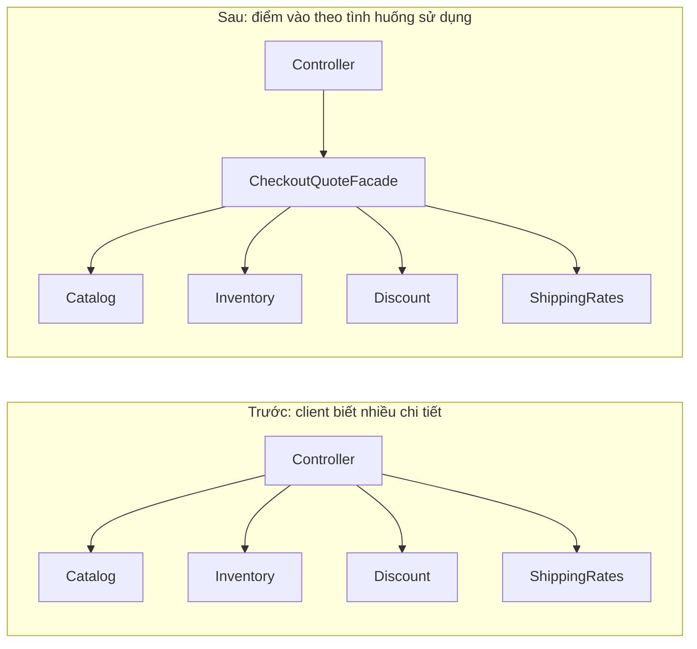
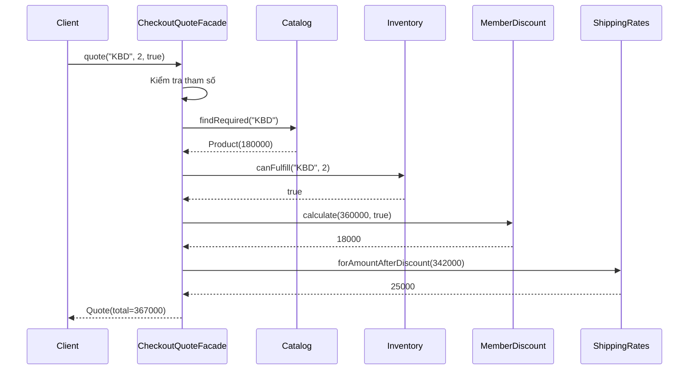

# Facade Pattern: Simplifying Access to a Multi-Component System

> **Topic:** Facade and simplifying usage (Design Patterns – OOP).  
> **Objective:** Recognize when clients depend on too many subsystem classes, design a concise, intentional high-level entry point, implement Facade in Java, test its contract, and understand trade-offs involving coupling, boundaries, and error handling.

## 1. The Problem Facade Solves

In a real application, a user operation often requires coordinating several services or subsystem libraries. For example, to **quote a shopping cart**, controller code may need to:

1. Look up product information.
2. Check inventory.
3. Calculate merchandise prices.
4. Apply member discounts.
5. Calculate shipping charges.
6. Assemble the resulting quote.

If controllers, batch jobs, and partner APIs each perform this sequence themselves, every client must know several classes, call order, error rules, and result construction. Even a small change in the order in which fees are applied may force multiple clients to change.

**Facade** is a *structural pattern* that provides **a unified, more convenient high-level interface** to a subsystem that otherwise exposes many separate interfaces.

- **Intent:** simplify access to a particular subsystem capability.
- **Role:** the client invokes the Facade, which coordinates subsystems to complete a high-level operation.
- **Benefit:** reduce the number of dependencies clients must know and centralize a shared usage workflow.
- **Limitation:** Facade does not make underlying classes “disappear” or automatically guarantee transactions, retries, concurrency safety, business correctness, or security.

A good problem statement is: “Multiple clients need to know and repeat the **coordination workflow** among subsystem classes; we need a simple, stable API for common operations.”

### Before and After Introducing a Facade



In the second design, **the subsystem's total complexity does not automatically decrease**. That complexity is **encapsulated behind a boundary**, so client code becomes shorter and needs less internal knowledge.

## 2. Facade Pattern Participants

| Component | Responsibility | What should it know? |
|---|---|---|
| **Client** | Performs a user operation by calling the high-level API | Quotation needs, inputs, and results |
| **Facade** | Coordinates common steps and appropriately handles/maps errors | Subsystem contracts and the high-level workflow |
| **Subsystem classes** | Perform specialized operations | Catalog, inventory, pricing policies, shipping rates |
| **Composition root / DI container** | Creates and wires dependencies | Which implementations are used in the current environment |

Facade commonly uses **composition**: it holds references to subordinate objects without inheriting from them.

A good Facade API expresses an explicit purpose, such as `quote(sku, quantity, member)`; it should not merely expose dozens of getters like `getCatalog()`, `getInventory()`, and `getDiscountCalculator()`. Such getters leave clients deeply dependent on the subsystem.

## 3. Standalone Java 17 Example: Checkout Quotation

**Example context:** an order contains one product type, priced in **whole VND**. A member receives a 5% discount on merchandise; shipping costs 25.000 VND and is free when **the merchandise total after discounts** reaches at least 500.000 VND. A quote only **checks** current stock; it neither reserves nor deducts inventory.

These rules must be clear before implementing the Facade: if shipping depends on the amount *before* discounts, or orders may contain multiple products, both the API and algorithm must change according to business requirements.

Create `FacadeDemo.java`, then run:

```bash
javac FacadeDemo.java
java FacadeDemo
```

```java
import java.math.BigDecimal;
import java.math.RoundingMode;
import java.util.Map;
import java.util.Objects;

public class FacadeDemo {

    // ----- Các loại dữ liệu công khai ở mức ví dụ -----
    record Product(String sku, BigDecimal unitPriceVnd) {
        Product {
            Objects.requireNonNull(sku, "sku");
            Objects.requireNonNull(unitPriceVnd, "unitPriceVnd");
            if (sku.isBlank() || unitPriceVnd.signum() < 0 ||
                    unitPriceVnd.stripTrailingZeros().scale() > 0) {
                throw new IllegalArgumentException(
                        "SKU phải có giá trị, đơn giá là số nguyên VND không âm");
            }
        }
    }

    record Quote(
            BigDecimal subtotalVnd,
            BigDecimal discountVnd,
            BigDecimal shippingVnd,
            BigDecimal totalVnd) {}

    // ----- Các subsystem độc lập -----
    static final class Catalog {
        private final Map<String, Product> products;

        Catalog(Map<String, Product> products) {
            this.products = Map.copyOf(Objects.requireNonNull(products));
        }

        Product findRequired(String sku) {
            Product product = products.get(sku);
            if (product == null) {
                throw new IllegalArgumentException(
                        "Không tìm thấy sản phẩm: " + sku);
            }
            return product;
        }
    }

    static final class Inventory {
        private final Map<String, Integer> availableUnits;

        Inventory(Map<String, Integer> availableUnits) {
            this.availableUnits =
                    Map.copyOf(Objects.requireNonNull(availableUnits));
        }

        boolean canFulfill(String sku, int quantity) {
            return availableUnits.getOrDefault(sku, 0) >= quantity;
        }
    }

    static final class MemberDiscount {
        BigDecimal calculate(BigDecimal subtotalVnd, boolean isMember) {
            Objects.requireNonNull(subtotalVnd, "subtotalVnd");
            if (!isMember) {
                return BigDecimal.ZERO;
            }
            return subtotalVnd.multiply(new BigDecimal("0.05"))
                    .setScale(0, RoundingMode.HALF_UP);
        }
    }

    static final class ShippingRates {
        BigDecimal forAmountAfterDiscount(BigDecimal amountVnd) {
            Objects.requireNonNull(amountVnd, "amountVnd");
            return amountVnd.compareTo(new BigDecimal("500000")) >= 0
                    ? BigDecimal.ZERO : new BigDecimal("25000");
        }
    }

    // ----- FACADE: một thao tác cấp cao dễ dùng -----
    static final class CheckoutQuoteFacade {
        private final Catalog catalog;
        private final Inventory inventory;
        private final MemberDiscount discounts;
        private final ShippingRates shipping;

        CheckoutQuoteFacade(
                Catalog catalog,
                Inventory inventory,
                MemberDiscount discounts,
                ShippingRates shipping) {
            this.catalog = Objects.requireNonNull(catalog);
            this.inventory = Objects.requireNonNull(inventory);
            this.discounts = Objects.requireNonNull(discounts);
            this.shipping = Objects.requireNonNull(shipping);
        }

        Quote quote(String sku, int quantity, boolean isMember) {
            Objects.requireNonNull(sku, "sku");
            if (sku.isBlank() || quantity <= 0) {
                throw new IllegalArgumentException(
                        "SKU phải có giá trị và quantity phải > 0");
            }

            // Client không phải tự gọi các bước này.
            Product product = catalog.findRequired(sku);
            if (!inventory.canFulfill(sku, quantity)) {
                throw new IllegalStateException("Không đủ hàng cho " + sku);
            }

            BigDecimal subtotal = product.unitPriceVnd()
                    .multiply(BigDecimal.valueOf(quantity));
            BigDecimal discount =
                    discounts.calculate(subtotal, isMember);
            BigDecimal amountAfterDiscount = subtotal.subtract(discount);
            BigDecimal delivery =
                    shipping.forAmountAfterDiscount(amountAfterDiscount);
            BigDecimal total = amountAfterDiscount.add(delivery);

            return new Quote(subtotal, discount, delivery, total);
        }
    }

    // ----- Composition root: nơi biết các lớp cụ thể -----
    public static void main(String[] args) {
        Catalog catalog = new Catalog(Map.of(
                "KBD", new Product("KBD", new BigDecimal("180000"))));
        Inventory inventory = new Inventory(Map.of("KBD", 10));

        CheckoutQuoteFacade checkout = new CheckoutQuoteFacade(
                catalog, inventory,
                new MemberDiscount(), new ShippingRates());

        Quote twoItems = checkout.quote("KBD", 2, true);
        System.out.println(twoItems);
        // Quote[subtotalVnd=360000, discountVnd=18000,
        //       shippingVnd=25000, totalVnd=367000]

        Quote threeItems = checkout.quote("KBD", 3, true);
        System.out.println(threeItems.totalVnd()); // 513000
        // 540000 - 27000 = 513000, đạt ngưỡng miễn phí giao
    }
}
```

This is a self-contained example requiring neither Spring, a database, nor libraries beyond JDK 17. Nested classes in `FacadeDemo` have scopes suitable for the example; in a real project, place each class in the appropriate file/package and expose the APIs clients need.

### Why Is This Example a Facade?

1. **One high-level operation:** the client calls only `checkout.quote(...)` to obtain a quote.
2. **Hides coordination order:** product lookup, inventory checking, discount calculation, and shipping are all coordinated by the Facade.
3. **Reuses existing responsibilities:** `Catalog` handles product lookup, and `Inventory` reports availability; the Facade does not reimplement these details.
4. **Returns only necessary results:** `Quote` represents quotation details without exposing the inventory `Map` or catalog structure.
5. **External assembly:** the Facade receives constructor-injected dependencies; choosing implementations in `main` enables adapters, mocks, or fakes in tests.

**Key point:** Facade may serve as an entry point and coordinate business operations, but the **Facade pattern itself** means **providing a simpler interface to a subsystem**. It does not determine whether a class is a Domain Service, Application Service, or transaction boundary.

## 4. Execution Flow of One Call



Errors are handled at appropriate boundaries: an unknown SKU results in `IllegalArgumentException`, while insufficient stock results in `IllegalStateException`. An external API (such as a REST controller) may map these to suitable HTTP statuses. The demo's two exception types are not mandatory conventions; production code should use a clearer, testable business-error model with stable error codes.

**Error path:** if a product is missing or stock is insufficient, the Facade stops before further pricing. Do not silently map an inventory-service timeout to `false`: **out of stock** and **unable to check inventory** are different conditions.

## 5. Where Does Facade Simplify the API?

Before Facade, several clients may repeat this workflow (illustrative code; dependencies are assumed to be initialized):

```java
Product product = catalog.findRequired(sku);
if (!inventory.canFulfill(sku, quantity)) {
    throw new IllegalStateException("Không đủ hàng");
}
BigDecimal subtotal = product.unitPriceVnd()
        .multiply(BigDecimal.valueOf(quantity));
BigDecimal discount = discounts.calculate(subtotal, isMember);
BigDecimal net = subtotal.subtract(discount);
BigDecimal fee = shipping.forAmountAfterDiscount(net);
Quote quote = new Quote(subtotal, discount, fee, net.add(fee));
```

After Facade:

```java
Quote quote = checkoutQuoteFacade.quote(sku, quantity, isMember);
```

The benefit is not merely **fewer lines of code**. More significantly, clients **do not need to know** the order of discounts and fees, how the catalog is queried, or each subsystem's API.

When the rule “calculate shipping after discounts” changes because of a deliberate business decision, one coordination point can be updated and tested centrally. Facade reduces **client coupling to coordination details**, even though the Facade itself still depends on its subsystems.

### Two Kinds of Simplification to Distinguish

- **Interface simplification:** fewer calls, task-oriented API names, and more understandable inputs/outputs.
- **Architectural simplification:** not guaranteed. The catalog, inventory, discounts, and shipping still exist, along with many business rules.

A poorly designed Facade can become a new bottleneck if every use case and every rule is pushed into it.

## 6. How Does Facade Differ from Adapter, Decorator, Proxy, and Mediator?

These patterns can all involve an object “in the middle,” but their **intentions** differ.

| Pattern | Primary intent | Typical structure | Example |
|---|---|---|---|
| **Facade** | Provide a simple API for several components/subsystems | `checkout.quote(...)` coordinates four subsystems | A unified shopping-cart quotation API |
| **Adapter** | Convert an **incompatible interface** to one required by clients | `VendorSmsAdapter implements SmsSender` invokes an SDK with different method names | Hide differences among provider APIs |
| **Decorator** | Add behavior while preserving the wrapped object's contract | `CachedCatalog implements CatalogReader` delegates to the source | Add controlled caching, metrics, or logging |
| **Proxy** | Stand in for an object to manage access, lifecycle, or calls | `RemoteImageProxy` delays loading or enforces authorization | Lazy loading, remote proxies, protection proxies |
| **Mediator** | Centralize interactions among multiple collaborating objects | `DialogMediator` coordinates buttons, input fields, and notifications | Reduce cross-callbacks among UI controls |

**Identify the pattern by asking:**

- “Must clients invoke **too many steps** in a subsystem?” → Facade.
- “Does this library have **a different API** from the interface the application needs?” → Adapter.
- “Do we need to **wrap extra behavior** around the same interface?” → Decorator.
- “Do we need to **control access** to an object?” → Proxy.
- “Do multiple objects **call each other through a tangled network of relationships**?” → Mediator.

A class can play several roles in practice, but when describing the design, name it after **the main reason** it exists. Merely “having an intermediary class” is insufficient to call something Facade.

## 7. Is Facade the Same as an Application Service, Domain Service, or Controller?

They are not equivalent.

- A **Controller** accepts HTTP/requests, parses inputs, handles authentication/authorization at the appropriate layer, and transforms responses. It may use a Facade to perform a high-level business operation.
- An **Application Service** coordinates a use case, enforces transaction boundaries, and applies application-flow policies. It may **also act as a Facade** when exposing a simple API over several subsystems, but not every Application Service should be named `Facade`.
- A **Domain Service** contains business rules that do not naturally belong to a particular entity/value object. A domain should not depend on SQL/HTTP merely to introduce a Facade.
- **Facade** concerns **reducing the complexity of client interaction with a subsystem**. It does not prescribe the architectural layer, framework, transactions, or placement of business invariants.

Example package organization:

```text
application/
  CheckoutQuoteFacade.java   # API báo giá cấp cao
domain/
  Product.java
  PricingPolicy.java
infrastructure/
  JdbcCatalog.java
  WarehouseInventoryClient.java
bootstrap/
  Configuration.java         # Lắp dependency
web/
  CheckoutController.java    # HTTP ↔ API ứng dụng
```

Do not copy this package structure mechanically. A small system may need only a few classes and one Facade; a larger system may place Facade in a separate **API module** that depends on application-owned ports/contracts.

## 8. Organizing Dependencies for Testable, Technology-Independent Facades

In the demo, the Facade receives `Catalog`, `Inventory`, and two calculator classes directly. In a real application, the catalog might read MySQL, inventory may come from HTTP, or a partner API may have multiple environments. When these details vary, use interfaces that describe the capabilities clients need.

```java
// Phác họa khi tách các class ra package rõ ràng:
interface ProductLookup {
    Product findRequired(String sku);
}

interface StockAvailability {
    boolean canFulfill(String sku, int quantity);
}

// CheckoutQuoteFacade phụ thuộc các interface,
// JdbcProductLookup/HttpStockAvailability implements interface.
```

With Spring, dependencies can be constructor-injected and the Facade declared as a bean:

```java
// Phác họa với Spring Boot. Imports tương ứng:
// org.springframework.stereotype.Service
@Service
public class CheckoutQuoteFacade {
    private final ProductLookup catalog;
    private final StockAvailability inventory;

    public CheckoutQuoteFacade(
            ProductLookup catalog, StockAvailability inventory) {
        this.catalog = catalog;
        this.inventory = inventory;
    }

    // quote(...) phối hợp thêm các pricing policy liên quan.
}
```

The Spring code is an **architectural sketch**, not code to paste unchanged into `FacadeDemo`, which already contains a nested class of the same name. If several beans implement the same interface, configure implementation selection explicitly (`@Qualifier`, `@Primary`, `@Bean`, etc.).

**Facade does not require an interface.** If there is one orchestration path and no reason to replace the Facade, a regular `CheckoutQuoteFacade` class is appropriate. Creating `ICheckoutQuoteFacade` merely to increase the interface count does not improve the design; abstraction helps when it shields clients from volatile dependencies or specifies a meaningful contract for multiple implementations.

## 9. Trade-offs and Limitations

| Benefit | Cost / risk |
|---|---|
| Clients need to remember only a few high-level operations | Adds a class and indirection; trace calls from clients through the Facade |
| Reduces direct coupling between clients and subsystems | The Facade can become a central dependency and grow too large |
| Centralizes call ordering and error policies for common operations | An overly broad Facade may affect many clients when one use case changes |
| Makes it easier to fake/mock the client boundary | Requires tests for the Facade contract and its subsystem coordination |
| Hides technical details irrelevant to API consumers | May conceal timeouts, partial failures, and data semantics |
| Helps standardize a module's public API | Makes versioning and backward compatibility explicit responsibilities |
| Allows specialized subsystems to remain available for direct use | Can be misused as an “only path” that forbids advanced use cases |

### Facade Does Not Create Distributed Transactions

The **quotation** example above intentionally avoids writes: checking inventory provides only a **point-in-time snapshot**, not a reservation. Two customers might both receive “available” quotes, yet only the first to place an order succeeds. This does not violate the contract when the API is explicitly named **quote**, rather than **reserve/order**.

If a `placeOrder(...)` Facade reserves inventory, takes payment, and sends a notification:

- These operations may span **multiple systems** without a shared DB transaction.
- Failure after payment can leave a partially completed state.
- Design **idempotency keys**, order states, saga/compensation, or outbox mechanisms as appropriate.
- Retries must distinguish transient failures from business failures; do not assume retrying a charge is safe.

Facade supplies a **coordination point**. It does not make network operations an atomic transaction. Never swallow partial failures and report success.

### Latency Does Not Disappear Automatically

A call to `facade.quote` may still trigger four underlying DB/API calls. Fewer calls **from clients** do not guarantee lower total latency:

```text
Tổng thời gian xấp xỉ:
  validation + catalog + inventory + discount + shipping + overhead

Nếu các thành phần gọi dịch vụ từ xa, network latency,
timeout, số lần retry và contention thường chi phối kết quả.
```

Parallelize only steps that are **truly independent**, with a clear understanding of consistency limits. For example, shipping calculated from a discounted price depends on the discount result; do not run every operation concurrently without analysis.

## 10. When to Use Facade and When to Avoid It

**Strong use cases:**

- A subsystem exposes many small APIs, while most clients need only 2–3 high-level operations.
- Several clients repeat the same ordered sequence of calls.
- Controllers/API consumers should know less about a module's internal structure.
- A library/SDK exposes a complex API that needs an entry point for common business operations.
- You want to limit the impact of subsystem changes while keeping the external contract stable.

**Consider a simpler approach when:**

- Clients invoke only one simple API and do not repeat an orchestration flow.
- The Facade merely forwards an identical call without a useful abstraction or boundary.
- Different clients have entirely different workflows; forcing them into one Facade produces many client-type `if` branches.
- Responsibilities cannot be clearly described, leading to a “God Facade” that prices orders, writes DB records, sends emails, runs reports, and does everything else.
- The Facade hides infrastructure failures behind incorrect defaults, making users believe data is certain.

### Designing a Good Facade API

Practical guidelines:

1. **Name operations by intent:** `quote`, `previewInvoice`, `generateReport`, `startCheckout`. Avoid names like `processEverything`.
2. **Keep inputs/outputs stable:** use appropriate DTOs/value objects; avoid returning raw infrastructure types such as `ResultSet`, `Connection`, and `HttpResponse`.
3. **Avoid arbitrarily exposing internal objects:** if a client must call `getInventoryService()` to continue coordination itself, the Facade has not simplified the workflow.
4. **Split Facades by client group/use case when needed:** `CheckoutQuoteFacade` and `AdminPricingFacade` may share subsystems while exposing different APIs.
5. **Do not put every business formula inside the Facade:** keep specialized rules/algorithms in the classes that own them, and let the Facade coordinate.
6. **Specify errors and states explicitly:** not found, out of stock, stale price, timeout, and permission denied are distinct cases.
7. **Design thread safety:** singleton-style Facades should avoid request-specific mutable fields; the demo uses local variables within `quote`.
8. **Provide operational observability:** log/trace high-level operation boundaries without logging payment data or other sensitive information.

## 11. Testing Facade: Verify Outcomes and Coordination Order

Unit tests should do more than verify that a class exists. They must assert **the contract from the client's perspective**, including successful paths, failures, and invariants.

JUnit 5 example: put the test in the same package as `FacadeDemo` (its nested types have package-level visibility):

```java
import static org.junit.jupiter.api.Assertions.*;
import java.math.BigDecimal;
import java.util.Map;
import org.junit.jupiter.api.Test;

class FacadeDemoTest {

    private FacadeDemo.CheckoutQuoteFacade newFacade(int stock) {
        var catalog = new FacadeDemo.Catalog(Map.of(
                "KBD", new FacadeDemo.Product(
                        "KBD", new BigDecimal("180000"))));
        var inventory =
                new FacadeDemo.Inventory(Map.of("KBD", stock));
        return new FacadeDemo.CheckoutQuoteFacade(
                catalog, inventory,
                new FacadeDemo.MemberDiscount(),
                new FacadeDemo.ShippingRates());
    }

    @Test
    void memberQuoteIncludesDiscountAndShipping() {
        var quote = newFacade(10).quote("KBD", 2, true);

        assertEquals(new BigDecimal("360000"), quote.subtotalVnd());
        assertEquals(new BigDecimal("18000"), quote.discountVnd());
        assertEquals(new BigDecimal("25000"), quote.shippingVnd());
        assertEquals(new BigDecimal("367000"), quote.totalVnd());
    }

    @Test
    void freeShippingUsesAmountAfterDiscount() {
        var quote = newFacade(10).quote("KBD", 3, true);
        assertEquals(BigDecimal.ZERO, quote.shippingVnd());
        assertEquals(new BigDecimal("513000"), quote.totalVnd());
    }

    @Test
    void insufficientStockStopsQuote() {
        assertThrows(IllegalStateException.class,
                () -> newFacade(1).quote("KBD", 2, false));
    }

    @Test
    void invalidQuantityIsRejected() {
        assertThrows(IllegalArgumentException.class,
                () -> newFacade(10).quote("KBD", 0, true));
    }
}
```

These tests use small, real in-memory subsystems and run quickly. When underlying components access databases/HTTP, **fake the ports** in unit tests and add separate integration tests for real adapters.

**About ordering:** the example has an explicit data dependency: discounts must be calculated first to obtain the discounted amount needed for shipping. Asserting `513000` and `shippingVnd = 0` tests this ordering's business meaning. If steps have **side effects**, tests should verify that payment/DB writes do not happen after validation failure, and validate rollback/compensation policies as required. Avoid over-testing “exactly four methods called in an exact order” when such ordering is an implementation detail irrelevant to client behavior.

### Testing Quality Checklist

| Case | Expected outcome |
|---|---|
| Product exists, stock suffices, customer is a member | Correct merchandise, discount, shipping, and total amounts |
| Customer is not a member | No discount; shipping is based on the corresponding amount |
| Missing SKU or invalid quantity | Clear input error without an incorrect quote |
| SKU not found | “Not found” error, never assume a zero price |
| Insufficient stock | No successful quote |
| External inventory/pricing service times out | Proper data-access error; do not convert it into out-of-stock |
| Free-shipping boundary | Amounts just below, at, and just above the threshold |
| Concurrent requests are required | Request data is not stored in shared fields |
| A new subsystem implementation is added | Facade contract remains stable and core tests still pass |

## 12. Refactoring Toward Facade Step by Step

Suppose a controller has become long because it calls five subsystems. A safe migration process is:

1. **Scope one concrete use case:** “view quote,” rather than starting with “collect all services into a Facade.”
2. **List operations and conditions:** specify inputs, order, error types, returned data, side effects, and invariant boundaries.
3. **Introduce one high-level method:** `Quote quote(String sku, int quantity, boolean member)`.
4. **Move coordination logic:** leave the controller to pass inputs and map responses; business rules remain in appropriate classes.
5. **Constructor-inject dependencies:** create/wire objects at the composition root or DI container.
6. **Preserve behavior through tests:** compare before/after outputs for boundary and failure cases.
7. **Migrate clients gradually:** avoid changing every major flow simultaneously before checking compatibility.
8. **Remove duplicate orchestration** after all relevant clients use the new API and the old dependency is gone.
9. **Reassess complexity:** client coupling, API surface, test/debug time, latency, and error rates.
10. **Review the scope:** if the Facade accumulates too many unrelated methods, consider splitting it by use case.

A Facade can coexist with **direct** subsystem access for clients needing advanced functionality. **Prohibiting all other access** is a module/API decision, not a mandatory Facade Pattern rule.

## 13. Practice Exercises

**Exercise 1 – Report-export Facade.** The system has `DataFetcher`, `SalesAggregator`, `CsvRenderer`, and `FileStore`. Implement `SalesReportFacade.exportMonthlyReport(YearMonth month)`; specify how time zones and file formats are passed, how large files are handled, and how write failures are reported. There is no need to expose every query function through the Facade's public API.

**Exercise 2 – Refactor a controller.** An `OrderController` directly invokes `Catalog`, `Inventory`, `Discount`, and `ShippingRates`. Extract the Java example's quotation API into a Facade, write tests comparing outcomes, and identify which responsibilities remain in the controller.

**Exercise 3 – Distributed failure.** Replace quoting with real order placement that reserves inventory, charges payment, and sends notifications. Design a minimal order-state table and discuss successful payment followed by notification failure. Which **API coordination** belongs to Facade, and which parts require outbox/saga/idempotency?

**Exercise 4 – Compare patterns.** An external payments library provides `payWithRawSdkRequest(...)`. The application wants `PaymentGateway.pay(PaymentRequest)` and a `Checkout.placeOrder()` API coordinating inventory, gateway, and invoices. Identify which component should be an **Adapter** and which should be a **Facade**.

**Exercise 5 – Design review.** A `SystemFacade` class has 45 methods covering email, CSV import, point calculation, invoicing, image downloads, and password changes. Why might this become a God Object? Propose splitting APIs by capability or bounded context, and explain the consequences for clients.

## 14. Self-Check: Do You Understand Facade?

- [ ] I can describe the **specific problem**: clients know too many APIs or repeat coordination sequences.
- [ ] I can design a **meaningful high-level API** with few parameters and the required return data.
- [ ] I understand how Facade uses **composition** to coordinate subsystems.
- [ ] I can distinguish Facade from Adapter, Decorator, Proxy, and Mediator.
- [ ] I do not treat Facade as an automatic solution for transactions, network latency, caching, or thread safety.
- [ ] I make business invariants, error handling, tests, and observability explicit.
- [ ] I know when a Facade class becomes too broad and should be split.
- [ ] I am willing to keep a simpler solution when a client needs only one direct call.

**Remember:** Facade is useful when it provides a **simple, stable, meaningful entry point** to a capability that requires coordinating many details. It reduces the knowledge clients must carry and moves orchestration into one testable, maintainable boundary.
