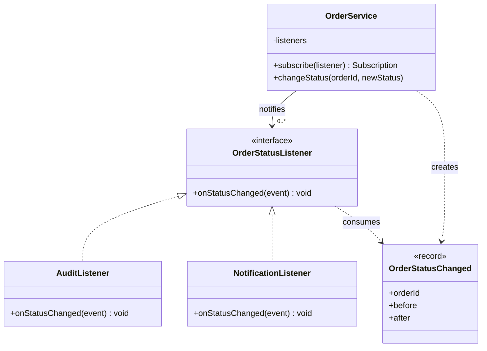
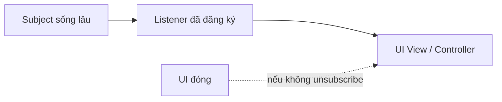
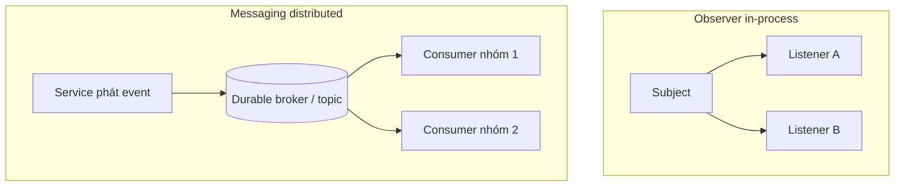
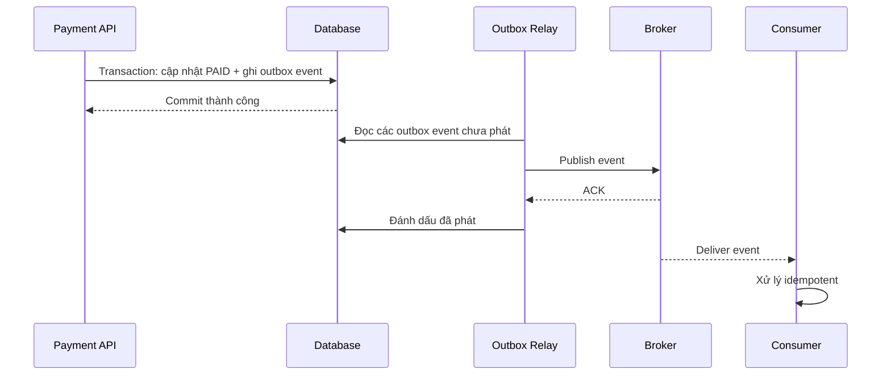

# Observer Pattern – Notifying When State Changes

> **Topic:** Observer and change notifications, a *behavioral design pattern*. This lesson explains **when Observer is useful**, how to design event contracts and subscription lifecycles, implement them in Java, test behavior, and recognize risks when moving from in-process callbacks to distributed systems.

## 1. The Problem: One Change, Many Interested Components

Suppose an order moves from `CREATED` to `PAID`. Several components may need to react:

- The user interface updates its status label.
- An audit system records the state transition.
- A notification module alerts the customer.
- An analytics component updates metrics.

One implementation has `OrderService` invoke each component directly:

```java
// Mã minh họa vấn đề coupling; các tên bên dưới giả định đã có class.
void markPaid(String orderId) {
    repository.updateStatus(orderId, "PAID");
    auditLogger.record(orderId, "PAID");
    emailSender.sendPaymentConfirmation(orderId);
    dashboard.refresh(orderId);
}
```

These calls may be reasonable in a very small application, but when reactions frequently change, `OrderService` must know more and more services. Adding an auxiliary feature (metrics, notifications, UI) requires editing the code that produces the state change.

**Observer Pattern** lets a source object (*Subject/Publisher*) maintain a list of interested objects (*Observers/Subscribers*). When a relevant change occurs, the source **notifies** them through a common contract, and each observer decides how to react.

The essentials of Observer are:

1. An Observer can **subscribe** to a type of change.
2. When a change occurs, Subject **publishes a notification**.
3. The Observer receives the notification and performs its own reaction.
4. The Observer can **unsubscribe** to avoid retained references and unwanted events.

Observer **reduces direct coupling** between event producers and secondary reactions. It **does not eliminate** all dependencies or guarantee that notifications are durable or reach another system after failures.

## 2. Roles and Structure

| Role | Function | Example |
|---|---|---|
| **Subject / Publisher** | Manages subscriptions and publishes notifications | `OrderService` emits `OrderStatusChanged` |
| **Observer / Listener** | Contract for receiving notifications | `OrderStatusListener` |
| **Concrete observers** | React for their specific purposes | Audit, email notifications, UI updates |
| **Event payload** | Describes *what happened*, usually with immutable data | `OrderStatusChanged(orderId, before, after)` |
| **Subscription** | Represents one registration and allows cancellation | `Subscription.close()` |



**A common misconception:** the diagram describes a collaboration contract; Observer does not require inheriting from a heavyweight abstract class. In modern Java, a **functional interface** suffices for simple listeners.

## 3. Complete Java 17 Example: Subscribe, Publish, and Unsubscribe

This example simulates order-state changes in **one execution thread**. Valid state progression is `CREATED → PAID → SHIPPED`. Updating to the current state emits no event; invalid transitions are rejected.

The event uses an immutable `record`, and registration returns a `Subscription` object tied to that specific registration.

Create `ObserverDemo.java` and run:

```bash
javac ObserverDemo.java
java ObserverDemo
```

```java
import java.util.HashMap;
import java.util.Map;
import java.util.Objects;
import java.util.concurrent.CopyOnWriteArrayList;

public class ObserverDemo {

    enum OrderStatus { CREATED, PAID, SHIPPED }

    // Payload chỉ đọc: observer không thể thay đổi trạng thái event.
    record OrderStatusChanged(
            String orderId,
            OrderStatus before,
            OrderStatus after) {
        OrderStatusChanged {
            Objects.requireNonNull(orderId, "orderId");
            Objects.requireNonNull(before, "before");
            Objects.requireNonNull(after, "after");
        }
    }

    @FunctionalInterface
    interface OrderStatusListener {
        void onStatusChanged(OrderStatusChanged event);
    }

    // AutoCloseable, nhưng close() không ném checked exception.
    @FunctionalInterface
    interface Subscription extends AutoCloseable {
        @Override
        void close();
    }

    static final class OrderService {
        private final Map<String, OrderStatus> orders = new HashMap<>();
        private final CopyOnWriteArrayList<Registration> listeners =
                new CopyOnWriteArrayList<>();

        // Một token riêng cho mỗi lần đăng ký: cùng listener có thể
        // đăng ký nhiều lần nhưng hủy đúng subscription tương ứng.
        private static final class Registration {
            private final OrderStatusListener listener;

            private Registration(OrderStatusListener listener) {
                this.listener = listener;
            }
        }

        void createOrder(String id) {
            requireId(id);
            if (orders.putIfAbsent(id, OrderStatus.CREATED) != null) {
                throw new IllegalArgumentException(
                        "Đơn hàng đã tồn tại: " + id);
            }
        }

        Subscription subscribe(OrderStatusListener listener) {
            Objects.requireNonNull(listener, "listener");
            Registration registration = new Registration(listener);
            listeners.add(registration);
            return () -> listeners.remove(registration);
        }

        void changeStatus(String id, OrderStatus next) {
            requireId(id);
            Objects.requireNonNull(next, "next");
            OrderStatus current = orders.get(id);

            if (current == null) {
                throw new IllegalArgumentException(
                        "Không tìm thấy đơn hàng: " + id);
            }

            if (current == next) {
                return; // Không có sự thay đổi: không phát event.
            }

            boolean allowed =
                    current == OrderStatus.CREATED &&
                            next == OrderStatus.PAID
                    || current == OrderStatus.PAID &&
                            next == OrderStatus.SHIPPED;

            if (!allowed) {
                throw new IllegalStateException(
                        "Không thể chuyển từ " + current + " sang " + next);
            }

            orders.put(id, next);
            OrderStatusChanged event =
                    new OrderStatusChanged(id, current, next);

            // Best effort, đồng bộ, trong tiến trình.
            for (Registration r : listeners) {
                try {
                    r.listener.onStatusChanged(event);
                } catch (RuntimeException ex) {
                    // Demo: một listener lỗi không chặn listener còn lại.
                    // Production: log/metrics, error policy rõ ràng.
                    System.err.println(
                            "Listener gặp lỗi: " + ex.getMessage());
                }
            }
        }

        OrderStatus statusOf(String id) {
            requireId(id);
            OrderStatus status = orders.get(id);
            if (status == null) {
                throw new IllegalArgumentException(
                        "Không tìm thấy đơn hàng: " + id);
            }
            return status;
        }

        private static void requireId(String id) {
            Objects.requireNonNull(id, "orderId");
            if (id.isBlank()) {
                throw new IllegalArgumentException(
                        "orderId không được rỗng");
            }
        }
    }

    public static void main(String[] args) {
        OrderService orders = new OrderService();
        orders.createOrder("DH-100");

        Subscription audit = orders.subscribe(event ->
                System.out.printf(
                        "AUDIT %s: %s -> %s%n",
                        event.orderId(),
                        event.before(),
                        event.after()));

        Subscription notification = orders.subscribe(event -> {
            if (event.after() == OrderStatus.PAID) {
                System.out.println(
                        "NOTIFY: Đã thanh toán " + event.orderId());
            }
        });

        orders.changeStatus("DH-100", OrderStatus.PAID);
        // AUDIT DH-100: CREATED -> PAID
        // NOTIFY: Đã thanh toán DH-100

        notification.close(); // Dừng listener notification.
        orders.changeStatus("DH-100", OrderStatus.SHIPPED);
        // AUDIT DH-100: PAID -> SHIPPED

        orders.changeStatus("DH-100", OrderStatus.SHIPPED);
        // Không có thay đổi, không có thông báo mới.

        audit.close();
        System.out.println(orders.statusOf("DH-100")); // SHIPPED
    }
}
```

### Important Design Decisions in the Example

- **No audit/email logic inside `OrderService`:** the service knows only `OrderStatusListener`; it does not import email SDKs or dashboard classes.
- **The event carries sufficient data:** observers know which order changed and the before/after states without inferring the difference from global state.
- **No event without a change:** the `SHIPPED → SHIPPED` call is a no-op, avoiding duplicate side effects in this example.
- **`Subscription` manages lifecycle:** `close()` removes exactly one registration. Repeated `close()` calls are harmless. Subject need not expose a global observer-removal API.
- **`CopyOnWriteArrayList` snapshots iteration:** subscribing/unsubscribing during dispatch does not throw `ConcurrentModificationException`. A listener registered or removed during dispatch may or may not receive *the event currently in progress*, depending on the snapshot. Do not assume immediate callback effects.
- **Error handling is a design choice:** the demo catches `RuntimeException` and continues notifying other listeners, writing errors only to stderr. Production requires error classification, metrics, and retry/investigation policies.
- **Single-threaded order-state updates only:** `HashMap` and the read–validate–write sequence are unsynchronized. `CopyOnWriteArrayList` supports concurrent listener-list changes but **does not** make `OrderService` thread-safe.

**The demo is not a production ordering system**: it has no DB persistence or transactions, cannot safely coordinate concurrent updates to one order, and cannot replay notifications after process failure.

## 4. Invocation Order and Event Timing

```mermaid
sequenceDiagram
    participant U as Client
    participant S as OrderService
    participant A as AuditObserver
    participant N as NotificationObserver
    U->>S: changeStatus("DH-100", PAID)
    S->>S: Validate transition
    S->>S: Lưu PAID
    S->>A: onStatusChanged(event)
    A-->>S: Return
    S->>N: onStatusChanged(event)
    N-->>S: Return
    S-->>U: Return
    Note over S,N: Dispatch đồng bộ; callback chậm làm chậm caller
```

In the example, **registration order** is usually also the `CopyOnWriteArrayList` iteration order during one dispatch. However, the application should not depend on “Observer A always runs before Observer B” for critical business rules. An observer may be registered, removed, slow, faulty, or may trigger nested dispatch.

If A must complete successfully **before** B for correctness, that is generally **mandatory workflow coordination** belonging to the use case/workflow, not an implicit guarantee of Observer order.

### Push or Pull?

There are two ways to structure event payloads:

- **Push model:** the publisher sends relevant data through `OrderStatusChanged`, as in the example. Processing is straightforward, but the event contract needs careful design and versioning.
- **Pull model:** the publisher only announces “something changed,” and the observer queries Subject for current state. Payloads are smaller, but coupling increases and the observer may read a later state after further changes.

For audit events or reactions tied to a particular transition, **an immutable payload describing what happened** is generally easier to test and less vulnerable to timing races.

## 5. Testing Observer: Subscription, Cancellation, State, and Errors

Observer tests should prove behavior from the client perspective, not merely that “a listener was called.”

JUnit 5 example: place `ObserverDemoTest.java` in the same package as `ObserverDemo`:

```java
import static org.junit.jupiter.api.Assertions.*;
import java.util.ArrayList;
import java.util.List;
import org.junit.jupiter.api.Test;

class ObserverDemoTest {

    @Test
    void notifiesOnceForRealChange() {
        var service = new ObserverDemo.OrderService();
        service.createOrder("DH-1");

        List<ObserverDemo.OrderStatusChanged> received =
                new ArrayList<>();
        service.subscribe(event -> { received.add(event); });

        service.changeStatus("DH-1", ObserverDemo.OrderStatus.PAID);
        service.changeStatus("DH-1", ObserverDemo.OrderStatus.PAID);

        assertEquals(1, received.size());
        assertEquals("DH-1", received.get(0).orderId());
        assertEquals(ObserverDemo.OrderStatus.CREATED,
                received.get(0).before());
        assertEquals(ObserverDemo.OrderStatus.PAID,
                received.get(0).after());
    }

    @Test
    void unsubscribeStopsFutureNotifications() {
        var service = new ObserverDemo.OrderService();
        service.createOrder("DH-2");
        List<ObserverDemo.OrderStatusChanged> events =
                new ArrayList<>();

        ObserverDemo.Subscription sub =
                service.subscribe(event -> { events.add(event); });
        service.changeStatus("DH-2", ObserverDemo.OrderStatus.PAID);
        sub.close();
        sub.close(); // idempotent
        service.changeStatus("DH-2", ObserverDemo.OrderStatus.SHIPPED);

        assertEquals(1, events.size());
    }

    @Test
    void invalidTransitionDoesNotNotifyOrChangeState() {
        var service = new ObserverDemo.OrderService();
        service.createOrder("DH-3");
        List<ObserverDemo.OrderStatusChanged> events =
                new ArrayList<>();
        service.subscribe(event -> { events.add(event); });

        assertThrows(IllegalStateException.class,
                () -> service.changeStatus(
                        "DH-3", ObserverDemo.OrderStatus.SHIPPED));

        assertEquals(ObserverDemo.OrderStatus.CREATED,
                service.statusOf("DH-3"));
        assertTrue(events.isEmpty());
    }

    @Test
    void brokenObserverDoesNotBlockOtherObservers() {
        var service = new ObserverDemo.OrderService();
        service.createOrder("DH-4");
        List<ObserverDemo.OrderStatusChanged> received =
                new ArrayList<>();

        service.subscribe(event -> {
            throw new IllegalStateException("Lỗi mô phỏng");
        });
        service.subscribe(event -> { received.add(event); });

        service.changeStatus("DH-4", ObserverDemo.OrderStatus.PAID);
        assertEquals(1, received.size());
        assertEquals(ObserverDemo.OrderStatus.PAID,
                service.statusOf("DH-4"));
    }
}
```

The last test illustrates **the error policy selected in this demo**: one listener throws `RuntimeException`, but subsequent listeners still run. If production needs *fail-fast* behavior or must tell the caller that notification failed, adjust the **contract** and tests accordingly without misrepresenting the domain state.

Other useful tests include registering the same callback twice, unsubscribing inside a callback, publishing only after successful changes, handling very slow subscribers, and multithreaded behavior. A mock framework is unnecessary for testing this simple mechanism.

## 6. Subscription Lifecycles and Memory Leaks

Subjects usually **hold strong references** to listeners. If a listener refers to a UI controller or large object no longer needed, but remains registered with a long-lived Subject, garbage collection may **fail to reclaim** those associated objects.



Prevention measures:

- Return a **subscription token** and invoke `close()` when the object no longer observes changes.
- Tie subscriptions to the lifecycle of the UI, request scope, or component.
- For asynchronous APIs/frameworks, use framework-supported disposal/unsubscription mechanisms.
- Avoid repeatedly registering the same listener after every render/request without bounding registration counts.
- Test repeated open/close operations to detect leaks and duplicate events.

**Weak references** can help in certain frameworks but may let observers be collected unexpectedly if no strong reference keeps them alive; they are not a general replacement for explicit lifecycle management.

## 7. Synchronous Callbacks, Concurrency, and Reentrancy

Observer Pattern describes a subscription–notification relationship; it **does not inherently mean “asynchronous execution.”**

| Property | Synchronous in-process (example) | Asynchronous dispatch via queue/executor |
|---|---|---|
| Processing time | Immediately on the publisher thread | On another thread/task |
| Publisher latency | Sum of observer execution times | May reduce waiting, but adds enqueueing/coordination |
| Ordering | One dispatch can follow listener order, but this should not become a business rule | Depends on queue, workers, partitions, and concurrency |
| Listener errors | May propagate up the call stack or be caught by publisher | Need recording, retry, and dead-letter handling |
| Backpressure | A slow listener blocks the publisher | Queues may fill, consume memory, or reject tasks |
| Lifecycle | In-process memory | Requires executor/queue management and shutdown |

### Special Cases Requiring Explicit Decisions

**Reentrancy:** a listener may call `changeStatus` again while Subject is dispatching. The new call then runs inside the original; another observer might receive the newer event before the older one unless ordering is designed explicitly. Prevent infinite self-triggering callbacks. If order matters, coordinate changes using a queue or state machine with explicit serialization.

**Race condition:** two threads reading the same `CREATED` and updating it can cause lost updates or incorrect events. Locks, transactions, or optimistic locking must protect **the whole read–validate–update operation**, not only the listener list. `CopyOnWriteArrayList` does not make updates to `HashMap` safe.

**Slow callbacks:** sending email or invoking REST directly inside a synchronous listener can prolong API response times. Moving side effects to tasks/jobs requires handling full queues, retries, error visibility, and safe shutdown.

**Errors:** three common policies are *fail-fast*, *continue and aggregate errors*, or *best effort with error reporting*. No policy fits every application. Callers must know whether the main update succeeded and what notification guarantees exist.

**Ordering and at-most-once:** never assume Observer means “each recipient gets exactly one event.” Failures, retries, and nested callbacks can lead to missing or duplicate deliveries.

## 8. How Do Observer, Event Bus, and Publish–Subscribe Differ?

**Observer** in object-oriented design usually connects a source directly to its registered listeners within one process.

An **in-process event bus** adds an intermediary for receiving and routing events by type. Producers know only the bus, while handlers subscribe through it. This reduces direct references but can make it harder to identify which handlers consume which events when configuration is scattered.

**Publish–subscribe through a message broker** (such as Kafka or RabbitMQ) separates producers from consumers across networks and time. This introduces distributed-systems concerns: durable messages, acknowledgments, retries, ordering, consumer groups, poison messages, and idempotency.



| Question | In-process Observer | Distributed messaging |
|---|---|---|
| Uses a network? | Usually no | Yes |
| Requires a separate broker? | No | Usually |
| Are notifications automatically durable? | No | Depends on configuration and write/read acknowledgments |
| What if a process stops mid-dispatch? | Remaining observers may miss the event | Replay may be possible under system delivery semantics |
| Must duplicates be handled? | Depends on code and retries | Idempotent consumers are usually needed |
| Who manages lifecycle? | Subject and subscriptions | Broker/client/consumer group and application |
| Is end-to-end “exactly once” guaranteed? | No | Not by default; depends on transaction scope and side effects |

Do not call Kafka messaging “Observer over Kafka” as if it were just a listener list replaced by a topic. It is a **different architectural level** with additional operational and consistency requirements.

## 9. Domain Events and Publishing Timing with Databases

Suppose payment processing uses a transaction:

1. Validate the order and transition preconditions.
2. Persist `PAID` to the database.
3. Commit.
4. Notify email/audit/analytics components.

If an event is published **before commit**, listeners may observe state that was never committed or receive “paid” even after rollback. Publishing **after commit** through an in-memory call creates a failure window: the DB commits but the process dies before publishing, losing the notification.

When reliability matters, consider a **Transactional Outbox**:



Outbox addresses **the gap between DB updates and message writes** when both are recorded in one database transaction. But a relay may duplicate publication if it crashes after publishing but before marking the outbox row as sent; consumers still need **idempotency**. Do not assume global event ordering or exactly-once processing.

Events should describe **facts that already occurred** using past-tense names such as `OrderPaid` and `OrderShipped`. A command such as `SendEmail` expresses **work being requested**; distinguishing events from commands clarifies the contract.

### Minimum Requirements for Shareable Events

- Unique event ID `eventId` for deduplication.
- `aggregateId`/`orderId` identifying the business entity.
- Event type and occurrence time `occurredAt`, with UTC time-zone considerations.
- Schema version when long-lived contracts need to evolve.
- Minimal payload without unnecessary sensitive data.
- Backward-compatibility rules and conditions under which consumers can retry safely.

These fields are **recommendations for durable/distributed events**, not mandatory for every local observer in this lesson.

## 10. Comparing Observer with Related Design Patterns

| Pattern / mechanism | Intent | Key distinction |
|---|---|---|
| **Observer** | A changing source notifies registered listeners | Mainly one-to-many reactions after a change |
| **Strategy** | Swaps algorithms/policies for a task | Usually chooses *one processing strategy* rather than notifying multiple interested parties |
| **Mediator** | Centralizes interactions among collaborators | Manages complex/two-way coordination, not merely “change triggers notification” |
| **Command** | Encapsulates a request for action as an object | Commands express *what is requested*; events express *what happened* |
| **Decorator** | Adds behavior through a wrapper preserving the same interface | Wraps one object/call path rather than building a subscriber list |
| **Single callback** | Invokes one function when an operation completes | May be part of Observer but need not have a registry or lifecycle |

For example, clicking Place Order may use a **Command** named `PlaceOrder`, a discount algorithm selected with **Strategy**, and **Observer** notifications to views/audit after state changes. Patterns can collaborate, but each must solve a specific problem.

## 11. Not Every Reaction Should Be an Observer

Distinguish **actions required for correctness** from **secondary reactions**:

| Situation | Design to consider |
|---|---|
| Inventory must be decremented before confirming an order | Explicit workflow/use case with transaction or saga; do not rely on implicit listener order |
| Update the UI when ViewModel state changes | Observer/property listeners are well suited |
| Record best-effort metrics after processing | Observer/listener may be suitable |
| Confirmation email may be slow and requires retries | Job queue, outbox, or durable consumer |
| Audit records must never be lost | Persist audit in the same transaction or an equivalent durable mechanism |
| Two classes make a simple one-to-one call | A direct method call may be clearer |
| Thousands of event types have uncontrolled registrations everywhere | Need event catalog, tracing, schema, and subscription permissions |

An **observer failure after the publisher has already changed state** must be defined in advance. If an observer failure must fail the entire business operation, synchronous rollback/compensation may be required; never assume “event published” means “all side effects completed.”

## 12. Techniques for Maintainable Observer APIs

**Use domain names.** `OrderStatusChanged` is more meaningful than a vague `SomethingUpdated` event if consumers depend on business semantics. Avoid an `Object payload` that requires `instanceof` casts everywhere.

**Keep payloads immutable.** Java `record` is convenient for small records but guarantees only *shallow immutability*. If a record contains mutable `List` values or mutable classes, make defensive copies (`List.copyOf`) and use immutable element types.

**Define subject scope.** Does `OrderService` belong to one order or observe all orders? Each design affects event filtering, lifecycle, access control, and memory.

**Define duplication policy.** To emit an event *for every attempted operation* even when state does not change, use an “attempted action” event rather than pretending it is `StatusChanged`. If the same callback can be registered multiple times, specify whether duplicate subscriptions are allowed.

**Manage unsubscription.** When views close, sessions expire, or modules unload, release subscriptions. Java `AutoCloseable` works well with `try-with-resources` for short scopes:

```java
try (ObserverDemo.Subscription sub =
         service.subscribe(event -> System.out.println(event))) {
    service.changeStatus("DH-10", ObserverDemo.OrderStatus.PAID);
}
// sub.close() tự gọi khi ra khỏi khối
```

The small snippet assumes `service` already exists and has an order `DH-10` in `CREATED` state; it cannot run independently.

**Observe event handling.** Production systems should measure observer counts, callback duration, callback errors, queue lag, and correlation IDs. Avoid unnecessary personal or payment details in logs.

**Avoid unbounded slow I/O in synchronous listeners.** Network requests can hang callbacks, delaying all listeners and the caller. Use timeouts, circuit breakers, and/or queues where needed, based on product requirements.

## 13. Refactoring from Hardcoded Calls to Observer

1. **Identify a meaningful change:** for example, transitioning an order to `PAID`.
2. **Classify reactions:** actions required to commit successfully differ from secondary metrics/UI/notification tasks.
3. **Define the event contract:** `OrderStatusChanged` contains the minimum data observers need.
4. **Create the listener contract:** such as `onStatusChanged(event)`; Subject should not know concrete listener classes.
5. **Choose dispatch policy:** synchronous or async, effect of observer failures on the caller, and whether ordering is guaranteed.
6. **Create registry/subscriptions:** support cancellation and prevent retaining listeners too long.
7. **Publish only after meaningful valid changes:** do not create “ghost events” for failed commands.
8. **Write contract tests:** actual changes, no-ops, invalid transitions, multiple observers, listener failure, and unsubscription.
9. **Evaluate durability for DB/network systems:** transaction boundaries, outbox, retries, idempotency, and consumer lag.
10. **Monitor and simplify:** when tracing becomes difficult, use consistent event naming/catalogs or move mandatory steps back into application services.

## 14. Common Pitfalls

| Pitfall | Symptom | Resolution |
|---|---|---|
| Missing unsubscription | Each UI reopen creates multiple callbacks for one event | Return a subscription handle tied to lifecycle |
| Slow I/O in callbacks | One observer delays the entire request | Suitable dispatch, queues/timeouts |
| Observer A calls Subject recursively | Nested events, unpredictable ordering, or recursion | Limit reentrancy; queue events if necessary |
| Catch and ignore every exception | Notifications disappear without visibility | Logging/metrics/alerts and a defined error policy |
| Observers can mutate the shared event payload | Later listeners see changed content | Immutable events and defensive collection copies |
| Treat `CopyOnWriteArrayList` as making all domain state thread-safe | Order states race | Locks/transactions/CAS around state updates |
| Depend on registration order for business decisions | Configuration changes break workflows | Move mandatory steps into explicit orchestration |
| Publish before commit | Observers receive events even if the transaction rolls back | Publish after commit or use an appropriate outbox |
| Publish after commit in RAM and assume it is durable | A crash between commit and publish loses the event | Transactional Outbox where durability matters |
| Assume exactly-once | Consumers repeat side effects on redelivery | Event IDs, deduplication, idempotent consumers |
| Overly generic events such as `onChange(Object)` | Runtime casts and implicit coupling | Typed events with clear schemas |
| Use Observer for every call | Difficult debugging and dependency tracing | Keep direct calls for clear mandatory interactions |

## 15. Practical Exercises

**Exercise 1 — Track price changes:** Build `PriceCatalog` emitting `PriceChanged(sku, oldPrice, newPrice)`. One observer updates the UI while another records metrics. Emit no event if the price is unchanged; test subscription and unsubscription.

**Exercise 2 — Duplicate subscriptions:** Invoke `subscribe` twice with the same listener. Determine how many notifications arrive. Cancel one `Subscription` and verify the other remains active. Explain why each registration needs its own identity token.

**Exercise 3 — Observer failure:** One listener throws an exception while another records the event in a list. Test the chosen policy (continue, fail-fast, or aggregate errors). Describe what business state the caller observes after the failure.

**Exercise 4 — Concurrency:** Two threads both attempt to change an order from `CREATED` to `PAID`. Propose a conditional update with DB or locking, and publish only **one** event for the successful transition. Explain the risk if the process dies after commit but before publish.

**Exercise 5 — Reliable email:** Extend the order example with the requirement “an email notification must not be lost after transaction commit; duplicates must be handled safely.” Diagram the outbox, relay, broker, and consumer, and propose an `eventId`/idempotency key.

## 16. Self-Check: Do You Understand Observer?

- [ ] I can identify Subject, Observer, events, subscriptions, and publish timing.
- [ ] I know how **change notifications** differ from **required operations**.
- [ ] I can distinguish synchronous Java callbacks from broker-based pub/sub.
- [ ] I can handle unchanged state, invalid transitions, and faulty listeners.
- [ ] I understand memory-leak risks when Subjects outlive their UI listeners.
- [ ] I do not confuse listener-list safety with safe business-state updates.
- [ ] I can choose policies for ordering, reentrancy, latency, errors, and retries.
- [ ] I understand why outbox/idempotency is needed for reliable event delivery between services.

**Remember:** Observer lets *one changing source notify multiple interested objects* without directly knowing all their reactions. A good design manages subscription lifecycles, event contracts, error handling, and notification guarantees appropriate to its context—especially when moving from local callbacks to distributed systems.
