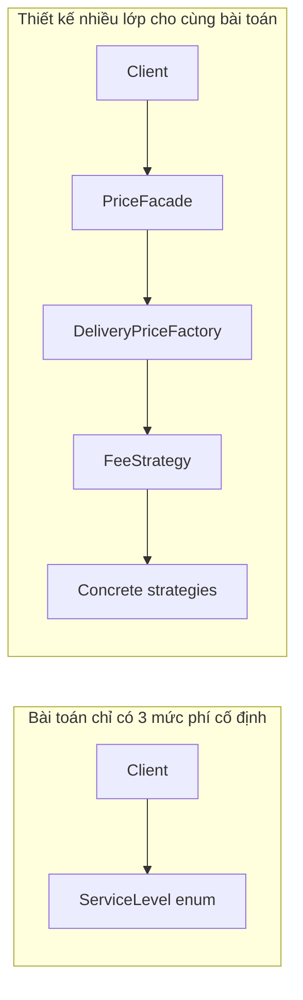
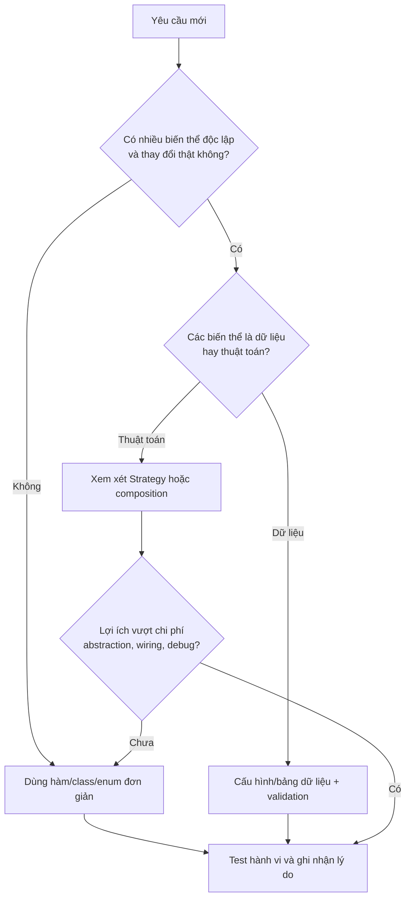

# When Design Patterns Make a System More Complex Than Necessary

> **Topic:** Design Patterns in OOP — identifying and addressing *overengineering*.  
> **Objective:** Distinguish genuinely necessary flexibility from speculative abstractions; evaluate a Design Pattern's costs, choose a sufficiently simple solution, test it, and refactor when evidence shows that the current architecture is too heavy.

## 1. Why Can a Textbook Design Pattern Still Be Poor Design?

**Design Pattern** is a reusable way to solve a recurring design problem in an appropriate context. It is not a goal in itself. A `Factory` class, `Strategy` interface, chain of `Decorator` instances, or `Observer` may all be structurally correct yet make the application harder to understand when the problem they address **does not yet exist or is too small**.

Imagine the requirement: “An internal application must export a CSV string with three columns.” A design might include `IExporterFactory`, `AbstractExportBuilder`, `ExporterRegistry`, `CsvExportStrategy`, and `ExportFacade`. But with only one format, one caller, and stable rules, a well-tested CSV export function is usually easier to read, modify, and operate.

**Overengineering** occurs when structural costs (classes, interfaces, configuration, and orchestration) outweigh the expected benefits in the current and reasonably foreseeable context. This does not mean “fewer classes are always better”; an abstraction can sometimes reduce the system's overall complexity. The right question is:

> Do the improvements a pattern provides in *changeability, testability, or safety* outweigh the added difficulty of *navigation, configuration, and predicting behavior*?

### Costs That Are Often Overlooked

| Cost | Practical symptom |
|---|---|
| **Cognitive load** | Understanding one calculation requires opening an interface, three implementations, a factory, a registry, and a configuration file |
| **Navigation** | The call site does not reveal which class executes; developers must trace DI container configuration/annotations |
| **Maintenance** | Changing one data type requires synchronizing several abstractions and tests |
| **Testing** | Tests use many mocks for a simple workflow and verify calls more readily than behavior |
| **Configuration** | Incorrect bean names, keys, or decorator order cause runtime failures |
| **Contract risks** | A new implementation returns invalid values or different semantics despite sharing the same interface |
| **Performance** | Depending on the design, additional indirection, allocations, lookups, remote calls, or serialization; many pure-Java patterns have negligible overhead |
| **Ownership** | The team cannot tell whether a rule belongs in the core, adapter, or factory |
| **Operations** | Hard to identify the active implementation, source of failures, configuration, and monitoring |

Do not claim that “Design Patterns always slow programs down.” The JVM can often optimize a Java interface call; much greater costs may come from networks, databases, or algorithm design. **Measure actual performance** if it is part of the decision.

## 2. Recognizing Premature Abstraction

Several strong warning signs:

1. **An interface has exactly one implementation**, without a real need for substitution, infrastructure isolation, or a module boundary.
2. **A factory merely calls one constructor**, with no object-creation decision or invariant to protect.
3. **The pattern is selected before the problem is described**: a meeting calls for “applying GoF” without identifying a difficult change.
4. **Classes merely forward unchanged** parameters and results through three or four layers, adding no policy, boundary, or variability.
5. **Extension points are opened for unverified assumptions**, such as building a plugin system for an application with one processing mechanism.
6. **More configuration combinations exist than actual use cases**, creating invalid states that are difficult to test.
7. **A small change touches too many classes**, even though the original goal was “easy extensibility.”
8. **Debugging requires tracing a long event/callback chain**, making ordering and missing errors difficult to understand.

Each sign **is not conclusive evidence**. An interface with one implementation can still make sense as a port keeping business logic independent of a database/SDK or as a module's public contract. A factory producing one class can still provide valuable validation or lifecycle control. What matters is **why it exists and its total cost**.

### Do Not Confuse Simplicity with Brevity

A 200-line method full of boolean flags and hidden state is not necessarily simpler than five small classes with clear responsibilities. Conversely, five classes that merely wrap an addition are not inherently better than a function.

- **Simple:** easy to understand conditions and verify correctness, with little state and few hidden assumptions.
- **Short:** fewer lines of code or files.
- **Flexible:** a variation point allows one kind of behavior to be replaced.
- **Maintainable:** common changes affect few places, tests are meaningful, and failures are observable.

These four qualities may reinforce each other, but they are **not equivalent**.

## 3. Java 17 Example: Do “Three Fee Levels” Need Strategy and Factory?

The problem: an internal delivery application has three predetermined service levels:

| Code | Fee in VND |
|---|---:|
| `STANDARD` | 20.000 |
| `EXPRESS` | 35.000 |
| `PRIORITY` | 50.000 |

Current requirement: look up a fee by code. There are no independent algorithms, external plugins, or frequent tariff changes. The input is one of the three enum values.

### 3.1. A Design That Is Too Complex for This Problem

The example below is a **sketch** illustrating the roles and amount of indirection:

```java
interface DeliveryPriceStrategy {
    long calculateFeeVnd();
}

final class StandardStrategy implements DeliveryPriceStrategy {
    public long calculateFeeVnd() { return 20_000L; }
}

final class ExpressStrategy implements DeliveryPriceStrategy {
    public long calculateFeeVnd() { return 35_000L; }
}

final class PriorityStrategy implements DeliveryPriceStrategy {
    public long calculateFeeVnd() { return 50_000L; }
}

interface DeliveryPriceFactory {
    DeliveryPriceStrategy create(String code);
}

final class DefaultPriceFactory implements DeliveryPriceFactory {
    public DeliveryPriceStrategy create(String code) {
        return switch (code) {
            case "STANDARD" -> new StandardStrategy();
            case "EXPRESS" -> new ExpressStrategy();
            case "PRIORITY" -> new PriorityStrategy();
            default -> throw new IllegalArgumentException("Mã không hỗ trợ");
        };
    }
}

final class PriceFacade {
    private final DeliveryPriceFactory factory;

    PriceFacade(DeliveryPriceFactory factory) {
        this.factory = factory;
    }

    long quote(String code) {
        return factory.create(code).calculateFeeVnd();
    }
}
```

All the classes above could be valid, but they **do not address any additional real requirement**. Even with three strategies and a factory, adding a new code still requires modifying `DefaultPriceFactory`. The fee calculation is just one constant per code. `PriceFacade` also simply forwards a call.

### 3.2. A Sufficiently Simple, Independently Compilable Solution

Create the file `SimpleDeliveryPricing.java`:

```java
public final class SimpleDeliveryPricing {

    public enum ServiceLevel {
        STANDARD(20_000),
        EXPRESS(35_000),
        PRIORITY(50_000);

        private final long feeVnd;

        ServiceLevel(long feeVnd) {
            if (feeVnd < 0) {
                throw new IllegalArgumentException("Phí không được âm");
            }
            this.feeVnd = feeVnd;
        }

        public long feeVnd() {
            return feeVnd;
        }
    }

    public static long quote(ServiceLevel level) {
        if (level == null) {
            throw new IllegalArgumentException(
                    "Mức giao hàng không được null");
        }
        return level.feeVnd();
    }

    public static void main(String[] args) {
        System.out.println(quote(ServiceLevel.STANDARD)); // 20000
        System.out.println(quote(ServiceLevel.EXPRESS));  // 35000
        System.out.println(quote(ServiceLevel.PRIORITY)); // 50000
    }
}
```

Run:

```bash
javac SimpleDeliveryPricing.java
java SimpleDeliveryPricing
```

**Why does this approach fit?**

- `enum` provides a finite set of values, helping prevent misspelled strings in core logic.
- Each level's fee appears beside its name and can be read directly in one file.
- There is no need to create a strategy object for every quote.
- Adding or changing a fee is a direct change where the price table is owned, with corresponding tests.
- Logic is framework-independent and needs no DI/registry.

This approach **is not the universal solution for pricing tables**. If prices must vary by date or region or be configured by business users, hardcoded enum values become limiting. Then consider **configuration/database data** or an appropriate pricing-rule system. There is no need to jump directly to Strategy when the variations are merely data values.

## 4. A Situation Where Strategy Is Worth Using

Suppose new requirements arrive:

- STANDARD: a fixed 20.000 VND.
- EXPRESS: 35.000 VND plus 8.000 VND per kilogram, with weight rounded up to the nearest kilogram.
- PRIORITY: a 50% discount on the base fee when the order value reaches 1 million VND.
- Different teams develop rules, with new variants likely to be added frequently.

Now **the calculation behavior differs**, rather than just constants in a table. Strategy can separate these algorithms from orchestration.

Standalone Java 17 example, saved as `FlexibleDeliveryPricing.java`:

```java
import java.util.Map;
import java.util.Objects;

public final class FlexibleDeliveryPricing {

    record Shipment(long orderValueVnd, int weightGrams) {
        Shipment {
            if (orderValueVnd < 0 || weightGrams <= 0) {
                throw new IllegalArgumentException("Dữ liệu đơn không hợp lệ");
            }
        }
    }

    @FunctionalInterface
    interface FeePolicy {
        long feeVnd(Shipment shipment);
    }

    static final class QuoteService {
        private final Map<String, FeePolicy> policies;

        QuoteService(Map<String, FeePolicy> policies) {
            this.policies = Map.copyOf(Objects.requireNonNull(policies));
        }

        long quote(String code, Shipment shipment) {
            Objects.requireNonNull(code, "code");
            Objects.requireNonNull(shipment, "shipment");
            FeePolicy policy = policies.get(code);
            if (policy == null) {
                throw new IllegalArgumentException(
                        "Dịch vụ không hỗ trợ: " + code);
            }
            long result = policy.feeVnd(shipment);
            if (result < 0) {
                throw new IllegalStateException(
                        "FeePolicy không được trả phí âm");
            }
            return result;
        }
    }

    public static void main(String[] args) {
        FeePolicy standard = shipment -> 20_000L;
        FeePolicy express = shipment -> {
            long kilograms = (shipment.weightGrams() + 999L) / 1000L;
            return Math.addExact(
                    35_000L, Math.multiplyExact(kilograms, 8_000L));
        };
        FeePolicy priority = shipment ->
                shipment.orderValueVnd() >= 1_000_000L
                        ? 25_000L : 50_000L;

        QuoteService service = new QuoteService(Map.of(
                "STANDARD", standard,
                "EXPRESS", express,
                "PRIORITY", priority
        ));

        Shipment shipment = new Shipment(1_200_000L, 1_500);
        System.out.println(service.quote("STANDARD", shipment)); // 20000
        System.out.println(service.quote("EXPRESS", shipment));  // 51000
        System.out.println(service.quote("PRIORITY", shipment)); // 25000
    }
}
```

**Contextual difference:** the `FeePolicy` interface now represents a real algorithm; the policies use different inputs, have their own tests, and have independent reasons to change. `QuoteService` need not accumulate expressions or type checks when more policies are added. `Map` handles **registration** and could be replaced with DI/container wiring as the project grows. Adding a policy still requires updating that wiring, which is normal.

**Example limitations:** it uses integer VND amounts; `Math.multiplyExact`/`addExact` prevent arithmetic overflow in the EXPRESS calculation, and positive `weightGrams` allows rounding by the formula safely within the `int` range. Currencies with fractional amounts, multiple currencies, or multi-package quotes require suitable value types and rounding rules. Do not treat these demonstration formulas as real shipping policy.

### Benefits Compared with Costs

| Criterion | Enum-based fee table | Algorithm-based Strategy |
|---|---|---|
| The rules are only three constants | Short, clear, with few mechanisms | Unnecessary classes/selection layers |
| Several independent formulas exist | The `enum` may accumulate more and more logic | Each algorithm owns its behavior |
| Another team adds an algorithm | May require editing a shared file | Add a `FeePolicy` and update registration |
| Testing | Verify fee values | Test each policy and shared contract |
| Finding the runtime implementation | Look up the enum directly | Inspect the map/DI configuration |
| Admin-entered prices, no new algorithms | Configuration data may be better | Strategy alone does not solve configurability |

We cannot conclude that Strategy has become universally “better” merely because the context changed. The lesson is that **architecture should follow a real axis of variation**.

## 5. Read Dependency Diagrams to Understand Indirection Costs



The diagram does not claim “fewer arrows = better.” It illustrates **how many places must be inspected to understand a call**. If every layer provides a genuine independent boundary and has its own reason to change, the arrows may be justified. If every layer merely forwards calls, they add cost without meaning.

## 6. Patterns Commonly Applied Too Broadly

| Pattern | Sign of overuse | When it actually fits |
|---|---|---|
| **Strategy** | Interfaces and multiple classes for constants or two unchanging branches | Several independently evolving algorithms |
| **Factory Method / Abstract Factory** | Factory only wraps `new SimpleClass()` without a reason to create other objects | Complex creation or related product families that must remain compatible and vary by environment |
| **Builder** | An object has two clear required parameters but uses a multistep builder | Many optional choices, validation of construction invariants, avoiding unreadable constructors |
| **Singleton** | A mutable global singleton is used merely for convenient dependency access | One instance truly needs management within a defined scope, with clear lifecycle/concurrency rules |
| **Observer** | A mandatory operation is hidden in a hard-to-trace callback with only one consumer | Several independent components react to one change, with explicit event/lifecycle policies |
| **Decorator** | Four layers of wrappers where each only invokes `delegate` | Cross-cutting behavior with explicit contract and composition order |
| **Adapter** | Two compatible APIs are wrapped despite no boundary needing protection | Convert an incompatible external API to a client-side contract |
| **Facade** | A class forwards identical parameters to one simple method | A client must coordinate several complex subsystems |
| **Template Method** | Inheritance shares only two lines of code across a deep hierarchy | A genuinely stable algorithm skeleton with specialized steps |
| **Command** | Every method call gets a command class, handler, and dispatcher without other requirements | Queues, undo, retry, persistent history, or object-based request dispatch |
| **State** | Only two states and one unchanging conditional | Complex transitions, with state-specific behavior and transition rules |

Note: the middle column contains **signals to review**, not automatic verdicts. For example, `Command` can still make sense for one task type if the application needs durable commands for later processing.

## 7. Principles for Keeping a Design Appropriately Simple

### YAGNI – You Aren't Gonna Need It

**Do not implement features just because “they might be needed someday.”** Without a real runtime-plugin requirement, avoid building a complex plugin loader. Without multiple algorithms, start with a short function and extract variants when they actually arise.

YAGNI does not mean ignoring known requirements or major risks. If a public API is difficult to change after release, creating a sensible boundary early may cost less than breaking compatibility later.

### KISS – Keep It Simple

Choose the **simplest solution that still meets all constraints**. Simplicity includes correctness, security, testability, and safety, not merely a small file count.

An exhaustive `switch` over an enum, a pure data method, and a few clear tests can be good design. If the `switch` grows into dozens of algorithms maintained by multiple teams, revisit it.

### DRY – Avoid Duplicating *Knowledge*, Not Every Syntax Fragment

Do not abstract two similar code fragments when they express **business rules that may change independently**. Combining them too early often leads to boolean parameters, special cases, and artificial coupling.

Conversely, an invariant such as rejecting negative fees, repeated throughout a codebase, may deserve enforcement in a value type or suitable shared boundary.

### Rule of Three – A Heuristic, Not a Law

After **several genuine similar cases** exist, identifying commonality and variation is more reliable than abstracting from a single example. Do not wait for exactly three repetitions when requirements are already clear or future architectural changes would be very costly.

### Prefer Reversible Changes

For internal application code, a small class followed by later refactoring may be inexpensive. For public APIs, event formats consumed by third parties, or durable stored data, the wrong decision can be expensive: consider boundaries, versioning, and compatibility early.

## 8. Do Not Confuse Extensibility with Interface Count

An “extensible” architecture should answer:

- **Which new variations can be added without breaking stable parts?**
- **Who owns the shared contract and its invariants?**
- **Where are new implementations registered?**
- **Can logs/metrics identify the implementation currently running?**
- **How much damage can a faulty implementation cause?**
- **Which tests protect existing behavior when adding a new option?**

If these questions cannot be answered, a collection of interfaces may amount to **coupling hidden behind DI**.

### Is an Interface with One Implementation Always Wrong?

No. For example, `PaymentGateway` with one `BankApiGateway` may be a real infrastructure boundary: a use case needs to process payments without importing an HTTP SDK and can use a fake in unit tests. Define the contract **according to business needs**, rather than copying SDK methods into the interface.

Conversely, `IPriceAdder` with one `PriceAdderImpl` that merely calls `a + b`, both in the same package and with no variation boundary, is usually unnecessary indirection.

## 9. Recognizing God Factories, God Facades, and Overly Broad Registries

Another mistake is applying a legitimate pattern but **expanding its responsibility too far**:

- **God Factory:** knows how to create every kind of object throughout the system and changes constantly for unrelated domains.
- **God Facade:** groups authentication, payments, shipping, notifications, and reporting into one large API.
- **Unbounded Generic Repository:** tries to hide all query types behind an API with dozens of options and hard-to-verify dynamic queries.
- **Event bus everywhere:** replaces explicit calls with anonymous events that obscure outcomes and failures.
- **String-based DI registry:** invalid keys only fail at runtime, and configuration becomes a secondary programming language that is difficult to debug.

When a “central” class has many unrelated reasons to change, the solution may be **splitting by use case, bounded context, or capability**, rather than adding yet another coordination layer.



This flowchart offers a decision process for one axis of variation; more complex situations must also consider concurrency, security, compatibility, and data durability.

## 10. Good Tests Do Not Require Complex Patterns

JUnit 5 example for the enum design in section 3: place `SimpleDeliveryPricingTest.java` beside `SimpleDeliveryPricing.java` in the same package:

```java
import static org.junit.jupiter.api.Assertions.*;
import org.junit.jupiter.api.Test;

class SimpleDeliveryPricingTest {
    @Test
    void quotesEachSupportedServiceLevel() {
        assertEquals(20_000L,
                SimpleDeliveryPricing.quote(
                        SimpleDeliveryPricing.ServiceLevel.STANDARD));
        assertEquals(35_000L,
                SimpleDeliveryPricing.quote(
                        SimpleDeliveryPricing.ServiceLevel.EXPRESS));
        assertEquals(50_000L,
                SimpleDeliveryPricing.quote(
                        SimpleDeliveryPricing.ServiceLevel.PRIORITY));
    }

    @Test
    void rejectsNullServiceLevel() {
        assertThrows(IllegalArgumentException.class,
                () -> SimpleDeliveryPricing.quote(null));
    }
}
```

When using Strategy, add **contract tests** for every implementation: nonnegative results, no input mutation, proper VND units, and agreed error behavior. But avoid building a complicated set of mocks solely to assert that “the factory was called exactly once” if the user requirement is simply **correct fee calculation**.

### Testing When Simplifying Existing Code

When refactoring away unnecessary Factory/Decorator/Observer layers, write or retain tests **at behavioral boundaries**:

1. Valid inputs produce the same outputs.
2. Invalid inputs produce equivalent error types and semantics.
3. Required side effects and ordering remain unchanged.
4. For public APIs, signatures and compatibility are preserved or migrated according to a plan.
5. For concurrent objects, concurrency behavior and lifecycles do not change silently.

There is no need to test whether an intermediary class still exists: that is an implementation detail being intentionally changed.

## 11. How to Safely Refactor a Design with Too Many Patterns

Suppose the current flow is:

`OrderController → QuoteFacade → PricingFactory → StrategyRegistry → FixedPriceStrategy`

and the whole system has only one fixed pricing rule used in one place. Do not delete several layers simultaneously and hope all clients continue to behave correctly. Instead:

1. **Verify usage:** find every caller, object-creation path, public API, bean configuration, reflection/serialization usage, and dependent systems outside the module.
2. **Lock in behavior with tests:** verify current results, errors, and side effects, including boundary cases.
3. **Choose a clear target API:** for example, `PricingService.quote(Order)`, or a pure function when state is unnecessary.
4. **Move logic to its owner:** remove forwarding-only classes while preserving business rules and necessary infrastructure adapters.
5. **Migrate callers incrementally:** keep a temporary thin compatibility adapter if necessary; do not establish a permanent parallel system.
6. **Remove obsolete configuration:** delete mappings, beans, registries, and reflection rules after verifying that no callers depend on them.
7. **Run appropriately scoped tests:** unit, integration, and public-contract tests as applicable.
8. **Measure the result:** number of edit points for a rule change, call-stack depth, files required to understand the flow, build/test time, and runtime error rates.
9. **Record the refactoring rationale:** benefits, costs, and criteria for reopening extension points if genuine requirements arise later.

Simplification should **reduce knowledge and state that developers must manage**, rather than merely rename or merge files. Removing an abstraction that protects a contract used by several teams may create more coupling than it removes.

## 12. Two Misguided Ways to Simplify

### Putting Everything into One Class

A 1,000-line class handling everything may use fewer files but increases independent reasons to change and regression risk. Removing a pattern still requires **clear responsibilities** and separation of genuinely independent rules.

### Removing an Interface Just to Call the Implementation Directly

If removing an interface forces application code to import an SQL driver or HTTP SDK, you may be **leaking infrastructure** into business logic. Evaluate whether the port meets actual needs, rather than removing interfaces based on a count.

A sensible approach is to retain application-owned `PaymentGateway` while removing `GatewayFactoryFactory` and `GatewayProviderAdapterBuilder` layers that merely forward calls. This can **preserve DIP while reducing overengineering**.

## 13. Comparing Expected Costs with a Decision Table

For a module that may add new pricing methods:

| Question | If the answer is “yes” | Decision impact |
|---|---|---|
| Is each variant a different algorithm tested independently? | Yes | Supports Strategy |
| Do only a few constants differ, updated by admins? | Yes | Favors data/configuration |
| Do several teams develop implementations concurrently? | Yes | Favors stable contracts |
| Is the API already public to third parties? | Yes | Consider long-term compatibility |
| Does the rule change once per year, with three clear branches? | Yes | Favors a direct solution |
| Is there a risk of configuring the wrong implementation? | Yes | Increases Strategy/registry costs |
| Does the implementation depend on a database or external service? | Yes | Consider a port/adapter to isolate infrastructure |
| Must operators know the exact runtime execution path? | Yes | Prefer explicit wiring and logs/traces |

You do not need an artificial score to “prove” which pattern wins. A short **Architecture Decision Record (ADR)** is often enough for a decision with long-term consequences.

```markdown
# ADR: Giữ bảng phí giao hàng dưới dạng enum

Bối cảnh:
- Có ba mức phí cố định, hiếm thay đổi.
- Không có thuật toán theo đơn hàng hay plugin bên ngoài.
- Nhóm cần dễ đọc và dễ kiểm tra.

Các phương án:
1. Strategy + Factory + Registry.
2. Enum chứa phí và một hàm quote.

Quyết định:
- Chọn phương án 2.

Lý do:
- Chi phí cấu hình và số lớp của phương án 1 chưa tạo ra lợi ích.
- Test có thể kiểm tra toàn bộ mức phí trực tiếp.

Hệ quả:
+ Ít code, dễ truy vết.
- Muốn thêm thuật toán phức tạp sau này sẽ phải refactor.

Xem xét lại khi:
- Phí tính theo trọng lượng/vùng hoặc nhiều đội bổ sung thuật toán.
- Phí trở thành dữ liệu do người dùng quản lý, cần chuyển sang config/DB.
```

## 14. Practical Exercises

**Exercise 1 — Choosing an abstraction.** An application has two fixed shipping fees and expects no changes. Implement one version using `enum` and another using Strategy. Compare edit points when adding a fee level, class counts, testing approaches, and call-path clarity.

**Exercise 2 — When requirements change.** Add “8.000 VND/kg, rounded up” pricing and a service discount when the order total exceeds a threshold. Refactor `SimpleDeliveryPricing` into `FlexibleDeliveryPricing`, retaining tests for existing levels before replacement and adding threshold-boundary tests.

**Exercise 3 — God Facade.** A team has an `ApplicationFacade` class with 50 methods handling invoices, users, search, and shipping. Propose grouping APIs by responsibility; identify when to retain a small facade and when to call an application service directly.

**Exercise 4 — “Automatic” does not mean simple.** A team proposes using `Observer` to publish “order paid” and then send a mandatory email. Analyze listener failures, DB commit failures, and duplicate events; identify when explicit workflow orchestration or a transactional outbox is needed.

**Exercise 5 — Real maintenance costs.** Choose a module with at least three consecutive abstraction layers. Draw its call graph, list why each layer exists, and write an ADR deciding whether to keep/remove each. Refactor only after tests confirm existing behavior.

## 15. Checklist Before Introducing a Design Pattern

- [ ] I can explain the actual problem without mentioning a pattern name.
- [ ] I can identify **which kinds of change** are expected and support their frequency with evidence.
- [ ] I have a **simple alternative** that meets correctness requirements for comparison.
- [ ] Every new abstraction adds a useful responsibility or boundary rather than merely forwarding calls.
- [ ] I understand the added costs of classes, DI/configuration, callbacks, debugging, and testing.
- [ ] I know whether the solution remains easy to use with only one implementation.
- [ ] I have considered error handling, concurrency, and side effects beyond the core functionality.
- [ ] I have behavioral and contract tests for current cases.
- [ ] I know the concrete conditions that would require revisiting this design decision.
- [ ] I can explain the choice to teammates without merely saying “because GoF/SOLID”.

**Remember:** A Design Pattern is a **tool with trade-offs**. Apply a pattern when it solves **a real problem** involving change, collaboration, or responsibilities and its benefits outweigh structural costs. Keep the solution simple while requirements are simple; refactor with tests when the context changes. Good architecture helps a system evolve safely, not accumulate the greatest number of pattern names.
