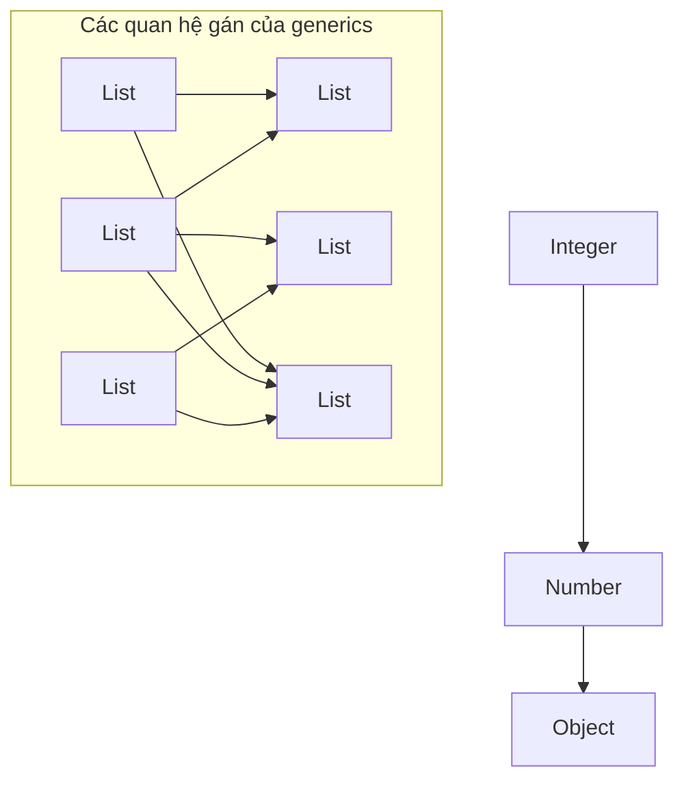
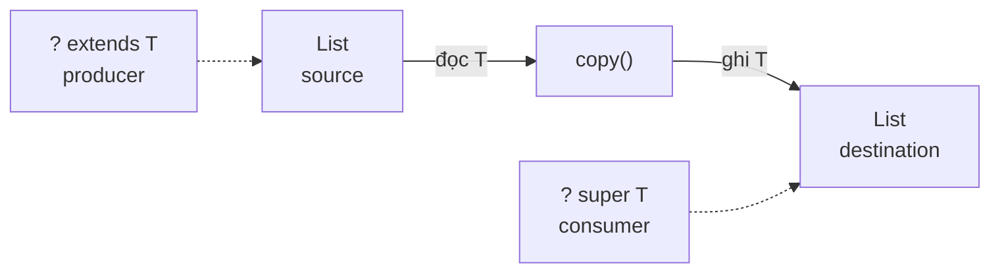

# Type relationships in generic constructs in Java (Generic Type Relationships)

> **Scope:** Java language mechanics, especially *generics*: subtype relationships among parameterized types, *invariance*, wildcards `? extends`/`? super`, *bounded type parameters*, generic inheritance, and *type erasure*. The goal is to read API signatures correctly, explain what compiles, and write type-safe generic methods.

## 1. What are “generic constructs” and “type relationships”?

In Java, generics let classes, interfaces, and methods describe algorithms/contracts using **types that have not yet been fixed**:

```java
final class Box<T> {
    private T value;

    Box(T value) { this.value = value; }
    T get() { return value; }
    void set(T value) { this.value = value; }
}
```

- `Box<T>` is a generic declaration; `T` is a **type parameter**.
- `Box<String>` and `Box<Number>` are **parameterized types**; `String` and `Number` are **type arguments**.
- `List<Integer>`, `List<? extends Number>`, and `List<?>` are all parameterized types, but with different read/write capabilities and assignment relationships.
- **Subtype** (`A <: B`) means values of type `A` can be used where `B` is required without unsafe casts. For example, `Integer <: Number <: Object`.

A key question: if `Integer` is a subtype of `Number`, is `List<Integer>` also a subtype of `List<Number>`? **No.** Relationships between *type arguments* do not automatically carry over to *entire parameterized types*.

### An intuitive diagram



The arrows in the generics diagram indicate **assignment compatibility** (a value `x` with the type on the left can be assigned to the type on the right), not inheritance between `Integer` and `Number` in generic declarations.

## 2. Generic type arguments are invariant by default

For the same generic declaration `G<T>`, Java generally **does not permit this inference**:

`A <: B` ⟹ `G<A> <: G<B>`.

An example that **does not compile**:

```java
List<Integer> integers = new ArrayList<>();
List<Number> numbers = integers; // COMPILE ERROR!
```

Why? Suppose Java allowed that assignment:

```java
List<Integer> integers = new ArrayList<>();
List<Number> numbers = integers;  // Giả sử được, nhưng thực tế bị cấm
numbers.add(3.14);                // Hợp lệ đối với List<Number>
Integer value = integers.get(0);  // Có thể gặp Double: sai type!
```

Then the same list could claim to “contain only Integer” while permitting insertion of `Double`. The compiler blocks **the assignment**, rather than waiting for a runtime `ClassCastException`.

| Source type | Target type | Result |
|---|---|---|
| `Integer` | `Number` | Valid: class inheritance |
| `ArrayList<Integer>` | `List<Integer>` | Valid: `ArrayList<E> implements List<E>` |
| `List<Integer>` | `List<Number>` | **Invalid**: generic invariance |
| `List<Integer>` | `List<Object>` | **Invalid** |
| `List<Number>` | `List<Number>` | Valid |
| `List<Integer>` | `List<? extends Number>` | Valid |
| `List<Number>` | `List<? super Integer>` | Valid |
| `List<String>` | `List<?>` | Valid |

**Two different dimensions:**

1. **Inheritance across generic class/interface declarations:** `ArrayList<String>` is a subtype of `List<String>` because `ArrayList<E>` implements `List<E>`.
2. **Changing the argument within one generic:** `List<String>` is not a subtype of `List<Object>` even though `String` is a subtype of `Object`.

This is one of the most common mistakes when interpreting Java generic APIs.

## 3. Three wildcard forms: `?`, `? extends U`, `? super L`

Wildcards do not create new “runtime classes.” They describe **sets of acceptable parameterized types** at the usage site (*use-site variance*).

### 3.1. `List<?>` — list with an unknown element type

```java
static void printAny(List<?> values) {
    for (Object value : values) {
        System.out.println(value);
    }
}
```

Both `printAny(List.of(1, 2))` and `printAny(List.of("a", "b"))` work because the method does not assume a concrete element type.

With a `List<?> list` variable:
- `list.get(0)` can safely be read as `Object`.
- You **cannot** invoke `list.add("x")`, `list.add(12)`, or `list.add(new Object())`: the actual element type is unknown.
- `list.add(null)` is type-correct, but **the collection may forbid null or mutation**; wildcards do not make a collection immutable.
- `list.clear()` can compile because it does not insert wrongly typed values; runtime success still depends on whether the collection is mutable.

**`List<?>` is not `List<Object>`.** A mutable `List<Object>` can accept any object, whereas `List<?>` merely says the element type argument is unknown.

### 3.2. `? extends U` — upper bound, safely read as U

```java
static double sum(List<? extends Number> values) {
    double total = 0.0;
    for (Number n : values) {
        total += n.doubleValue();
    }
    return total;
}
```

This method accepts `List<Integer>`, `List<Double>`, `List<BigDecimal>`, and `List<Number>`, all containing `Number` values or subtypes.

```java
List<Integer> ints = new ArrayList<>(List.of(2, 4, 6));
List<? extends Number> source = ints;

Number n = source.get(0); // HỢP LỆ: phần tử là Number
// source.add(10);        // COMPILE ERROR
// source.add(3.5);       // COMPILE ERROR
```

Why can't we add an `Integer` even when the declaration says “extends Number”? `source` **could refer to `List<Double>`**, so Java disallows non-`null` additions without knowing the concrete element type. `extends` is a **type bound**, not a “read-only collection” directive; operations such as `remove` and `clear` may still be allowed on mutable collections.

### 3.3. `? super L` — lower bound, safely write L

```java
static void addDefaults(List<? super Integer> destination) {
    destination.add(10);
    destination.add(20);

    // Integer i = destination.get(0); // COMPILE ERROR
    Object value = destination.get(0);  // Đọc dưới Object
}
```

A `List<? super Integer>` reference may point to:
- `List<Integer>`;
- `List<Number>`;
- `List<Object>`.

All those lists can hold `Integer`, so Java allows adding `Integer`. When reading, however, the shared guaranteed type is only `Object` because the list could be `List<Object>`.

**Do not infer that `List<? super Integer>` contains only Integers.** If its actual type is `List<Object>`, it may already contain `String` values and others.

### Read/write reference table

| Reference type | Safe read type | Safe additions |
|---|---|---|
| `List<Integer>` | `Integer` | `Integer` or `null` if permitted by the collection |
| `List<Number>` | `Number` | `Number` and its subtypes |
| `List<?>` | `Object` | No non-`null` elements |
| `List<? extends Number>` | `Number` | No non-`null` elements |
| `List<? super Integer>` | `Object` | `Integer` and subtypes of `Integer` (in practice `Integer` is final) |

“Reading” refers to the **type guaranteed by the compiler**, not the only runtime type possible. “Adding” refers to **compile-time type checks**; an unmodifiable collection can still throw `UnsupportedOperationException` at runtime.

## 4. PECS: Producer Extends, Consumer Super

**PECS** is a guideline for parameters acting as data sources or destinations.

- **Producer extends:** when an argument produces values to read, use `? extends T`.
- **Consumer super:** when an argument receives values of type `T` to write, use `? super T`.
- If a parameter must both read **exactly T** and write **T**, use `List<T>` or another generic method where appropriate. Do not force wildcards into every API.

An example `copy` method:

```java
static <T> void copy(
        List<? super T> destination,
        List<? extends T> source) {
    for (T value : source) {
        destination.add(value);
    }
}
```

- `source` produces values of type `T` ⇒ `? extends T`.
- `destination` consumes values of type `T` ⇒ `? super T`.

```java
List<Integer> source = List.of(1, 2, 3);
List<Number> destination = new ArrayList<>();
copy(destination, source); // Hợp lệ: Integer -> Number
```

Java also provides `Collections.copy(List<? super T> dest, List<? extends T> src)`, but its **behavior differs**: it **replaces existing positions**, and the destination must already contain enough elements; unlike the sample above, it does not `add` to grow the list.

### Data flow



**A `List` is not inherently always a producer or a consumer.** The designation describes **its role in a particular method**. A `List<Integer>` may be read and written in another context.

## 5. Standalone, compilable Java 17 example

The example combines a generic `Box<T>` class, `ArrayList<Integer> → List<Integer>` inheritance, bidirectional wildcards, a generic copy method, and a maximum-selection method bounded by `Comparable`.

Save as `GenericTypeRelationsDemo.java`:

```java
import java.util.ArrayList;
import java.util.List;
import java.util.Objects;

public class GenericTypeRelationsDemo {

    static final class Box<T> {
        private T value;

        Box(T value) {
            this.value = Objects.requireNonNull(value);
        }

        T get() { return value; }

        void set(T value) {
            this.value = Objects.requireNonNull(value);
        }
    }

    static double total(List<? extends Number> values) {
        Objects.requireNonNull(values);
        double sum = 0.0;
        for (Number value : values) {
            sum += Objects.requireNonNull(value).doubleValue();
        }
        return sum;
    }

    static void addDefaults(List<? super Integer> destination) {
        Objects.requireNonNull(destination);
        destination.add(10);
        destination.add(20);
    }

    static <T> void copy(
            List<? super T> destination,
            List<? extends T> source) {
        Objects.requireNonNull(destination);
        Objects.requireNonNull(source);
        for (T item : source) {
            destination.add(item);
        }
    }

    static <T extends Comparable<? super T>> T maximum(
            List<? extends T> values) {
        Objects.requireNonNull(values);
        if (values.isEmpty()) {
            throw new IllegalArgumentException("Danh sách rỗng");
        }
        T best = Objects.requireNonNull(values.get(0));
        for (int i = 1; i < values.size(); i++) {
            T item = Objects.requireNonNull(values.get(i));
            if (item.compareTo(best) > 0) {
                best = item;
            }
        }
        return best;
    }

    public static void main(String[] args) {
        Box<String> text = new Box<>("Java");
        // Box<Object> bad = text; // ERROR: generics bất biến
        Box<Object> objectBox = new Box<>(text.get());
        System.out.println(objectBox.get()); // Java

        ArrayList<Integer> concrete = new ArrayList<>(List.of(2, 3, 5));
        List<Integer> integers = concrete; // Cùng type argument
        List<? extends Number> reader = integers;
        Number first = reader.get(0);
        System.out.println(first);         // 2
        System.out.println(total(integers)); // 10.0

        List<Number> numbers = new ArrayList<>();
        List<? super Integer> writer = numbers;
        addDefaults(writer);
        Object unknown = writer.get(0);
        System.out.println(unknown); // 10

        copy(numbers, integers);
        System.out.println(numbers); // [10, 20, 2, 3, 5]

        System.out.println(maximum(List.of(7, 3, 9)));       // 9
        System.out.println(maximum(List.of("An", "Binh")));   // Binh
    }
}
```

Run on JDK 17 or later:

```bash
javac GenericTypeRelationsDemo.java
java GenericTypeRelationsDemo
```

**Why does `maximum` use `Comparable<? super T>`?**

A value of type `T` must be comparable to another `T`, but `Comparable` may be implemented for **a supertype of T**. The bound `T extends Comparable<? super T>` is more flexible than `T extends Comparable<T>` and still allows `item.compareTo(best)`. This is another example of “consumer super”: `compareTo` **consumes** the value being compared.

In this example, `List.of(...)` returns an unmodifiable list; calls to `total` and `maximum` only read it. The `copy` method requires a mutable destination because it invokes `add`.

## 6. Declaration-site bounds versus use-site wildcards

A type parameter's bound specifies **which APIs the algorithm can use on T**:

~~~java
class NumericBox<T extends Number> {
    private final T value;
    NumericBox(T value) { this.value = value; }
    double asDouble() { return value.doubleValue(); }
}
~~~

`NumericBox<Integer>` is valid; `NumericBox<String>` does not compile. A type parameter can have multiple upper bounds such as `<T extends Number & Comparable<T>>`, with the class bound before interfaces. `? extends Number & Comparable<?>` **is not** valid Java syntax.

Unlike declaration-site bounds, `List<? extends Number>` and `List<? super Integer>` are **use-site wildcards** expressing assignment/read/write relationships. The **Type parameter bounds** lesson covers intersections, `Comparable<? super T>`, recursive bounds, and erasure of individual bounds in depth. Here the key is that **bounding T does not make List<T> covariant**.

## 7. Generic classes extending generic classes/interfaces

Consider two distinct relationships:

```java
interface Store<T> {
    T find();
}

class MemoryStore<T> implements Store<T> {
    private final T item;

    MemoryStore(T item) { this.item = item; }

    @Override
    public T find() { return item; }
}

class StringStore extends MemoryStore<String> {
    StringStore(String s) { super(s); }
}
```

Therefore:

- `MemoryStore<String>` **is** a `Store<String>`.
- `StringStore` **is** a `MemoryStore<String>` and `Store<String>`.
- `Store<String>` **is not** a `Store<Object>`.
- `StringStore` can be assigned to `Store<? extends CharSequence>` because `String` implements `CharSequence`.

```java
Store<String> a = new MemoryStore<>("abc");
Store<String> b = new StringStore("xyz");
Store<? extends CharSequence> c = b;
CharSequence x = c.find();

// Store<Object> invalid = b; // COMPILE ERROR
```

In `Store<? extends CharSequence>`, calling `find()` safely returns `CharSequence`. Although `Store<T>` here **only exposes reads**, why doesn't `Store<String>` automatically become `Store<Object>`? Java does not infer covariance by inspecting an interface's read-only methods; the declaration `Store<T>` remains invariant. Express covariance with use-site wildcards.

### Inherited generic signatures with a fixed T

If a subclass fixes `T` to `String`, the compiler treats its `find()` return type as `String`, consistent with the declaration. This is compiler-verified typing, not an arbitrary runtime cast.

A class cannot implement the same generic interface with incompatible type arguments along one inheritance tree, such as both `Comparable<String>` and `Comparable<Integer>`; erasure makes those superinterfaces conflict too.

## 8. Wildcard type relationships are not arbitrary substitutions

The following table explains common assignments:

| Assignment | Result | Explanation |
|---|---|---|
| `List<Integer> → List<? extends Number>` | Allowed | Integer is a subtype of Number |
| `List<Double> → List<? extends Number>` | Allowed | Double is a subtype of Number |
| `List<Number> → List<? extends Object>` | Allowed | Number is a subtype of Object |
| `List<Integer> → List<? super Integer>` | Allowed | The lower bound may be Integer |
| `List<Number> → List<? super Integer>` | Allowed | Number is a supertype of Integer |
| `List<Object> → List<? super Integer>` | Allowed | Object is a supertype of Integer |
| `List<String> → List<? extends Number>` | **Not allowed** | String is not a subtype of Number |
| `List<Object> → List<? extends Number>` | **Not allowed** | Object may contain non-Number types |
| `List<Number> → List<? super Number>` | Allowed | Number satisfies the lower bound |
| `List<Integer> → List<? super Number>` | **Not allowed** | Integer is not a supertype of Number |
| `List<Integer> → List<Number>` | **Not allowed** | Invariance |
| `List<?> → List<Object>` | **Not allowed** | Actual type argument is unknown |

**Mind the assignment direction:** a `List<? extends Number>` variable may refer to different source types, but cannot itself be assigned to `List<Number>`: it might refer to `List<Integer>`. Likewise, `List<? super Integer>` is not equivalent to `List<Integer>`.

### A wildcard covering multiple types is not a union type

`List<? extends Number>` uses an existential wildcard with one bound. It is not `List<Integer | Double>` and does not reveal one concrete runtime element type to the caller. An API may use only what the bound guarantees.

Nor does `? super Integer` test whether “values must be Number/Object.” It constrains the *collection's* type argument; existing elements may be of different types when the actual argument is `Object`.

## 9. Wildcard capture: why is a helper sometimes needed?

A `List<?>` has a **concrete element type that the compiler has not named**. *Capture conversion* lets a generic helper temporarily name it and safely operate on that type.

For example, swap the first two elements of a mutable list:

```java
static void swapFirstTwo(List<?> values) {
    if (values.size() < 2) {
        return;
    }
    swapCaptured(values);
}

private static <T> void swapCaptured(List<T> values) {
    T first = values.get(0);
    values.set(0, values.get(1));
    values.set(1, first);
}
```

`swapFirstTwo(new ArrayList<>(List.of("A", "B")))` is valid. `swapCaptured` ensures both values have **the same type T as the source list**. In the outer method handling `List<?>`, directly writing `values.set(0, values.get(1))` may produce a capture error because the compiler cannot prove that the unnamed wildcard expressions share the necessary type. A helper makes that relationship explicit.

Java's `Collections.swap(List<?>, int, int)` already solves this case; no custom helper is needed just to exchange elements.

**Limitation:** compilation does not guarantee mutability. `List.of("A", "B")` can still throw `UnsupportedOperationException` on `set`; use `new ArrayList<>(...)` when modification is needed.

## 10. Wildcards versus generic-method return types

Compare:

```java
static Object takeUnknown(List<?> items) {
    return items.get(0);
}

static <T> T takeTyped(List<T> items) {
    return items.get(0);
}
```

With `List<String> strings`:
- `takeUnknown(strings)` has return type `Object`.
- `takeTyped(strings)` returns `String` because the compiler infers `T = String`.

When an API must **preserve the relationship between input and output types**, a named type parameter is generally more appropriate than a wildcard.

For an API selecting the first element from two lists, shared `T` requires care; if the lists have different generic types, the compiler may infer **a common supertype**, and only that type is guaranteed in the result. Type inference reduces syntax, not type-safety requirements.

## 11. Arrays and generics follow different type relationships

Java arrays are **covariant**:

```java
Integer[] numbers = new Integer[2];
Number[] refs = numbers;     // Biên dịch được
refs[0] = 3.14;              // Runtime: ArrayStoreException
```

Arrays preserve their component type at runtime, so the JVM can detect attempts to store a `Double` in an `Integer[]` array.

Generics are **invariant** by default:

```java
List<Integer> integers = new ArrayList<>();
// List<Number> refs = integers; // Lỗi lúc biên dịch
```

There is no equivalent runtime warning for an array created as `new List<String>[10]` because **you cannot create such a generic array**. Java forbids arrays with non-reifiable generic component types:

```java
// List<String>[] a = new List<String>[10]; // COMPILE ERROR
// T[] values = new T[10];                   // COMPILE ERROR
```

Combining arrays, varargs, and generics can lead to **heap pollution** if warnings are ignored or raw types are used. Prefer `List<T>` in collection APIs instead of mixing generic arrays with uncontrolled casts.

## 12. How type erasure affects assignments

```java
List<String> a = new ArrayList<>();
List<Integer> b = new ArrayList<>();
System.out.println(a.getClass() == b.getClass()); // true
```

Java checks generic types at compile time but does not create a separate runtime class for every type argument. Thus `instanceof List<String>`, overloads differing only in `List<String>`/`List<Integer>`, and `new List<String>[10]` are invalid. `instanceof List<?>` can be used, with individual elements validated when data comes from untrusted APIs.

~~~java
List<String> names = new ArrayList<>();
List raw = names;       // Legacy raw type.
raw.add(42);           // Unchecked warning: mất kiểm tra kiểu.
String first = names.get(0); // ClassCastException khi đọc Integer.
~~~

**Heap pollution** occurs when a parameterized-type variable refers to data containing incompatible elements, often through raw/unchecked operations. Type erasure does not prevent compile-time checking of properly typed generic calls; the risk arises where those checks are bypassed.

The introductory **Generic types and parameterized classes** lesson covers `Supplier<T>` and reflection metadata; this lesson focuses on assignment and read/write relationships the compiler can prove.

## 13. Choose signatures based on actual reads and writes

| Client requirement | Suitable signature | Guaranteed type |
|---|---|---|
| Print all elements without a concrete type | `printAll(List<?>)` | Reads `Object` |
| Sum different numeric types | `sum(List<? extends Number>)` | Reads `Number` |
| Insert `Integer` into different destinations | `seed(List<? super Integer>)` | Adds `Integer`, reads `Object` |
| Copy between compatible lists | `<T> copy(List<? super T>, List<? extends T>)` | Compiler checks source/destination type relationships |
| Preserve input type in a result | `<T> T first(List<T>)` | Returns `T` |
| Swap two elements of one `List<?>` | Helper `<T>` captures a hidden type | `set` is valid on mutable lists |

If `average(List<Number>)` only reads, it **does not** accept `List<Integer>`; change the parameter to `List<? extends Number>`. If `seed(List<? extends Number>)` tries to `add(1)`, it does not compile because the actual subtype could be `Double`; use `List<? super Integer>` when writing is the goal.

Reason from *producer/consumer* roles instead of just memorizing PECS. Assignment safety is distinct from mutability, null policies, thread safety, and business contracts.

## 14. A small JUnit 5 test suite

The following tests use the standalone `GenericTypeRelationsDemo` class from section 5. Put `GenericTypeRelationsDemoTest.java` in the same package and add the appropriate JUnit Jupiter dependency to the build.

```java
import static org.junit.jupiter.api.Assertions.*;
import java.util.ArrayList;
import java.util.List;
import org.junit.jupiter.api.Test;

class GenericTypeRelationsDemoTest {

    @Test
    void sumReadsNumbersOfDifferentTypes() {
        assertEquals(6.0,
                GenericTypeRelationsDemo.total(List.of(1, 2, 3)));
        assertEquals(4.0,
                GenericTypeRelationsDemo.total(List.of(1.5, 2.5)));
    }

    @Test
    void canCopyIntegerValuesIntoNumberList() {
        List<Integer> source = List.of(7, 8);
        List<Number> destination = new ArrayList<>();

        GenericTypeRelationsDemo.copy(destination, source);

        assertEquals(List.of(7, 8), destination);
    }

    @Test
    void lowerBoundDestinationAcceptsIntegers() {
        List<Object> destination = new ArrayList<>();
        GenericTypeRelationsDemo.addDefaults(destination);
        assertEquals(List.of(10, 20), destination);
    }

    @Test
    void maximumPreservesElementType() {
        String best =
                GenericTypeRelationsDemo.maximum(List.of("A", "Z"));
        assertEquals("Z", best);
    }

    @Test
    void maximumRejectsEmptyInput() {
        assertThrows(IllegalArgumentException.class,
                () -> GenericTypeRelationsDemo.maximum(
                        List.<Integer>of()));
    }
}
```

To test **noncompiling code** (such as assigning `List<Integer>` to `List<Number>`), do not place a compilation error directly in an ordinary Java test and expect the test suite to run. Instead use documented snippets or a compile-testing tool when a project genuinely needs compiler-error tests.

## 15. Common mistakes and remedies

| Symptom | Cause | Remedy |
|---|---|---|
| `List<Integer> cannot be converted to List<Number>` | Generic invariance | Use `List<? extends Number>` if only reading |
| Cannot `add(Integer)` to `List<? extends Number>` | Actual element type is unknown | Consider `List<? super Integer>` for writes |
| Cannot assign a result from `List<? super Integer>` directly to `Integer` | It could be a Number/Object list | Read as `Object` or redesign the contract |
| Treating `List<?>` as `List<Object>` | Wildcard does not specify a concrete argument | Follow the method's real read/write needs |
| Compiler reports `capture of ?` | Cannot prove an operation preserves one unnamed type | Use a `<T>` helper to capture |
| `new T()` or `new T[]` fails to compile | Type erasure / generic arrays | Suppliers/factories, collections, or carefully created arrays |
| Overloads on different `List<T>` arguments cause a name clash | Same signature after erasure | Rename or distinguish API contracts |
| Casting to a raw type to silence an error | Defeats generic checking | Remove raw types; correct bounds/adapters |
| Overusing `<T>` in every method | Long signatures and difficult inference | Name T only when connecting positions |
| `List.of(...)` fails when adding an element | The collection is unmodifiable; unrelated to variance | Use `new ArrayList<>(...)` for mutations |
| Assuming wildcards enforce synchronization/immutability | Generics only check types | Review concurrency and mutability separately |
| Treating `extends`/`super` as ordinary object inheritance | Confuses type-argument constraints with collection subtyping | Draw source/destination types and identify reads/writes |

## 16. Practice analyzing type relationships

**Exercise 1 — Choose the proper parameter type.** Given `List<Integer>`, `List<Double>`, and `List<Number>`, write a sum method accepting all three without casts or raw types. Explain why `List<Number>` is insufficiently general.

**Exercise 2 — Move values.** Write `<T> void moveAll(List<? super T> dst, List<? extends T> src)` that appends source elements to the destination. Explain what can go wrong if src and dst refer to the same list while iterating and adding; choose a snapshot or document preconditions. Consider whether the source is mutable.

**Exercise 3 — Fix a signature.** An API declares `void addScores(List<Number> xs)`, but its caller has `List<Object>` and only wants to append Integer values. Rewrite the signature to express that intent and check safe reads.

**Exercise 4 — Predict compile errors.** Given `List<Integer> a` and `List<Number> b`:

```java
List<?> x = a;
List<? extends Number> y = a;
List<? super Integer> z = b;
// b = a;                // ?
Object o = x.get(0);     // ?
Number n = y.get(0);     // ?
// y.add(3);             // ?
z.add(3);                // ?
Object p = z.get(0);     // ?
```

Explain each line using **source type, destination type, and read/write capabilities**. Answers: `b = a` and `y.add(3)` do not compile; the other lines compile, assuming a list contains elements when `get(0)` is executed.

**Exercise 5 — Generic inheritance.** Define `Repository<T>` and `InMemoryRepository<T> implements Repository<T>`. Identify valid assignments among `InMemoryRepository<String>`, `Repository<String>`, `Repository<Object>`, and `Repository<?>`.

**Exercise 6 — Compare with arrays.** Why can `Integer[]` be assigned to `Number[]` but produce `ArrayStoreException`, whereas `List<Integer>` cannot be assigned to `List<Number>`? Relate compile-time versus runtime element checks.

## 17. Checklist before designing a generic API

- [ ] I can distinguish **inheritance between type declarations** from **relationships between type arguments**.
- [ ] I understand Java generics are normally **invariant**.
- [ ] I use `? extends T` when a parameter **provides data of type T** to read.
- [ ] I use `? super T` when a parameter **accepts data of type T** to write.
- [ ] I use `<T>` to relate types across parameters or to return values.
- [ ] I do not mistake wildcards for read-only/immutable collections.
- [ ] I separately check mutability, null, thread safety, exceptions, and business rules.
- [ ] I understand erasure, raw types, generic arrays, and runtime-checking limits.
- [ ] My API examples include tests for supported subtypes and supertypes.
- [ ] I can explain **why** an assignment or call compiles, not just recite PECS.

**Remember:** `Integer <: Number` **does not imply** `List<Integer> <: List<Number>`. Generic type relationships in Java depend on inheritance among **generic declarations**, bounds on **type parameters**, and wildcards at **use sites**. Design around data *read*, data *written*, and the type relationships the compiler can prove safe.
