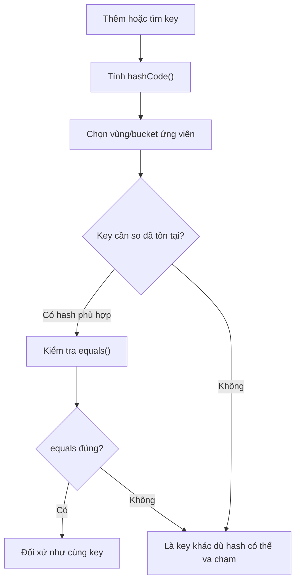
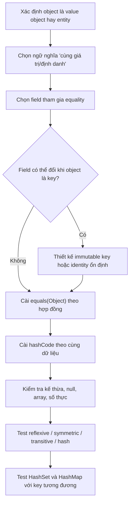

# Equality and hash-code contracts in Java: `equals()` and `hashCode()`

> **Topic:** Java language mechanics — defining when “two objects are equal,” ensuring `equals(Object)` and `hashCode()` are consistent, and safely using objects as `HashSet` elements or `HashMap` keys. This lesson uses Java 17.

## 1. When are two objects considered “equal”?

With Java objects, at least three distinct questions arise:

- **Same reference?** Do both variables point to the same heap object?
- **Value/semantic equality?** Do two different objects represent the same business value or identifier?
- **Equal in ordering?** Does a `Comparator` or `Comparable` return `0` for the pair?

Do not assume these three relationships are equivalent.

```java
String a = new String("java");
String b = new String("java");

System.out.println(a == b);      // false: hai object riêng
System.out.println(a.equals(b)); // true: String so sánh ký tự
```

On object references, `==` checks **identity**; `equals` is an overridable method for **semantic equality**. On primitives, `==` instead compares primitive values under Java's conversion rules, not addresses.

An object may use:
- **Identity equality:** true only when variables point to the same object. This is the default behavior of `Object.equals`.
- **Value equality:** compares properties defined in a contract; for example, two `CustomerId("KH-01")` values represent the same logical identifier.
- **Domain-specific equality:** depends on business needs; an account with a stable ID should not be compared through its entire balance or current address.

**First design question:** Which properties define the same value or identity, and which may change without making the entity a different entity?

## 2. The formal `equals(Object)` contract

Under `java.lang.Object.equals`, equality between non-null objects must satisfy:

| Property | Intuitive expression | Meaning |
|---|---|---|
| **Reflexive** | `x.equals(x) == true` | An object equals itself |
| **Symmetric** | `x.equals(y) == y.equals(x)` | If A equals B, B must also equal A |
| **Transitive** | If A = B and B = C, then A = C | Equality cannot form contradictory groups |
| **Consistent** | Repeated calls agree when comparison data is unchanged | Do not depend on random values, clocks, or volatile conditions |
| **Non-null** | `x.equals(null) == false` | Objects do not equal null |

Do not call `null.equals(x)` because `null` has no methods; it throws `NullPointerException`. For null-safe comparison, use `Objects.equals(a, b)`, which returns `true` if both arguments are null or `a.equals(b)` is true.

### Equality does not always compare every field

For example, `CustomerId` contains only a customer ID string. This ID determines identity; display names, email, update timestamps, and caches are not part of equality. Comparing all entity fields can break when fields are mutable or object relationships are cyclic.

For Value Objects such as `Money(100_000, "VND")`, both the amount and currency may contribute to equality. `100_000 VND` cannot be considered equal to `100_000 USD` automatically.

## 3. The `hashCode()` contract

`hashCode()` returns an `int` used for grouping and lookup in hash-based collections.

Important requirements:

1. If `a.equals(b)` is `true`, then **`a.hashCode() == b.hashCode()` is required**.
2. If equality-relevant properties remain unchanged, repeated `hashCode()` calls must return the same value during one application run.
3. If `a.equals(b)` is `false`, hashes **need not differ**; **hash collisions** are valid.
4. Different JVM runs need not produce the same hashCode for the same object or value. **Do not use `hashCode()` as a persistent identifier**, cross-network key, or security checksum.

```text
equals(a, b) == true  =>  hash(a) == hash(b)       (BẮT BUỘC)
hash(a) != hash(b)    =>  equals(a, b) == false    (SUY RA)
hash(a) == hash(b)    =>  equals(a, b) ?           (CHƯA BIẾT)
equals(a, b) == false =>  hash(a) == hash(b) ?     (CÓ THỂ)
```

This implication is **one-way**: equal hashes do not prove equal objects.

### Hash collision example

```java
System.out.println("FB".hashCode()); // 2236
System.out.println("Ea".hashCode()); // 2236
System.out.println("FB".equals("Ea")); // false
```

Different strings can have the same hash. `HashMap` uses **both hashCode and equals** to determine duplicate keys; the hash only narrows down candidates.

## 4. How do `HashSet` and `HashMap` behave?

At the API level:



This is a mental model; actual algorithms and internal bucket structures may differ across JDK versions. Do not depend on iteration order, bucket indices, or tree structures as public contracts.

- `HashSet.add(x)` uses equality to determine whether an element already exists.
- `HashMap.put(key, value)` uses equality to find the matching key and replace its associated value.
- `HashSet.contains(x)` and `HashMap.get(key)` require appropriate `hashCode` values to reach candidate keys.
- Overriding `equals` without `hashCode` can place logically equal objects in different lookup regions, producing behavior that contradicts domain intent.

**Key point:** `HashMap` does not check `equals` on every key for every lookup; it identifies candidates by hash first and compares equality when needed.

## 5. A typical mistake: overriding `equals` but not `hashCode`

The following example is intentionally wrong:

```java
final class BrokenCustomerId {
    private final String value;

    BrokenCustomerId(String value) {
        this.value = value;
    }

    @Override
    public boolean equals(Object other) {
        return other instanceof BrokenCustomerId id
                && java.util.Objects.equals(value, id.value);
    }

    // Thiếu hashCode(): kế thừa Object.hashCode()
}
```

```java
var x = new BrokenCustomerId("KH-01");
var y = new BrokenCustomerId("KH-01");

System.out.println(x.equals(y)); // true
System.out.println(x.hashCode() == y.hashCode());
// Không có bảo đảm true: VI PHẠM HỢP ĐỒNG
```

The default `Object.hashCode` is not based on the `value` field, so it fails to guarantee equal objects have equal hashes. Do not infer the default `hashCode` behavior from a single run where hash values happened to match or differ.

When a key's equality contract is broken, `HashSet.contains` or `HashMap.get` may fail to locate an equivalent key.

## 6. Complete Java 17 example: immutable Value Object with correct `equals` and `hashCode`

Design a `CustomerId` type:
- A customer ID must be non-null and nonblank.
- Equality is based on the ID value.
- Instances cannot change after construction.
- `hashCode` uses exactly the field included in equality.

Save as `EqualityHashDemo.java` and run:

```bash
javac EqualityHashDemo.java
java EqualityHashDemo
```

```java
import java.util.HashMap;
import java.util.HashSet;
import java.util.Map;
import java.util.Objects;
import java.util.Set;

public class EqualityHashDemo {

    static final class CustomerId {
        private final String value;

        CustomerId(String value) {
            Objects.requireNonNull(value, "value");
            if (value.isBlank()) {
                throw new IllegalArgumentException(
                        "CustomerId không được rỗng");
            }
            this.value = value;
        }

        String value() {
            return value;
        }

        @Override
        public boolean equals(Object other) {
            if (this == other) {
                return true;
            }
            if (!(other instanceof CustomerId that)) {
                return false;
            }
            return value.equals(that.value);
        }

        @Override
        public int hashCode() {
            return value.hashCode();
        }

        @Override
        public String toString() {
            return "CustomerId[" + value + "]";
        }
    }

    // Record tự tạo equals/hashCode/toString từ components.
    record Money(long amountVnd, String currency) {
        Money {
            Objects.requireNonNull(currency, "currency");
            if (amountVnd < 0 || currency.isBlank()) {
                throw new IllegalArgumentException(
                        "Số tiền/đơn vị không hợp lệ");
            }
        }
    }

    public static void main(String[] args) {
        CustomerId a = new CustomerId("KH-01");
        CustomerId b = new CustomerId("KH-01");
        CustomerId c = new CustomerId("KH-02");

        System.out.println(a == b);             // false
        System.out.println(a.equals(b));        // true
        System.out.println(a.hashCode() ==
                           b.hashCode());       // true
        System.out.println(a.equals(c));        // false

        Set<CustomerId> ids = new HashSet<>();
        ids.add(a);
        ids.add(b);
        ids.add(c);
        System.out.println(ids.size());         // 2
        System.out.println(ids.contains(
                new CustomerId("KH-01")));      // true

        Map<CustomerId, String> names = new HashMap<>();
        names.put(a, "An");
        System.out.println(names.get(b));       // An

        Money m1 = new Money(100_000, "VND");
        Money m2 = new Money(100_000, "VND");
        Money m3 = new Money(100_000, "USD");
        System.out.println(m1.equals(m2));      // true
        System.out.println(m1.hashCode() ==
                           m2.hashCode());      // true
        System.out.println(m1.equals(m3));      // false
    }
}
```

**Noteworthy design choices:**

1. `CustomerId` is `final` to prevent subclasses from changing equality semantics and breaking symmetry/transitivity.
2. The `value` field is `final`, and `String` is immutable, so the hash remains stable while the object serves as a key.
3. `equals(Object)` matches `Object`'s signature; `instanceof CustomerId that` pattern matching is available in Java 17.
4. `hashCode()` depends only on `value` because `equals` also depends only on `value`.
5. A separately created `CustomerId` can retrieve a value through `HashMap.get` if its ID matches; that demonstrates value equality in practice.
6. `Money` uses a `record` to illustrate component-based equality; real applications must agree on monetary units and rules. `Money(100_000, "VND")` differs from `Money(100_000, "USD")`.

The example preserves IDs verbatim: `"kh-01"` and `"KH-01"` **differ**. If business rules require case-insensitive IDs, define and **normalize IDs in the constructor** under an explicit domain policy (such as `Locale.ROOT` when appropriate) before applying equality; do not silently impose a rule the rest of the system does not share.

### Why not use `Objects.hash(value)` here?

`Objects.hash(value)` can also produce consistent hashes but includes varargs processing; `value.hashCode()` is simpler for one required non-null field. For multiple fields, `Objects.hash(field1, field2)` can keep the formula clear.

## 7. Standard approach for multiple fields

For an immutable type, clearly identify the fields that define value equality:

```java
final class ProductKey {
    private final String shopId;
    private final String sku;

    ProductKey(String shopId, String sku) {
        this.shopId = java.util.Objects.requireNonNull(shopId);
        this.sku = java.util.Objects.requireNonNull(sku);
    }

    @Override
    public boolean equals(Object other) {
        if (this == other) return true;
        if (!(other instanceof ProductKey that)) return false;
        return shopId.equals(that.shopId)
                && sku.equals(that.sku);
    }

    @Override
    public int hashCode() {
        return java.util.Objects.hash(shopId, sku);
    }
}
```

**The same semantically relevant equality data** must inform both methods. Comparing `shopId + sku` while hashing only `sku`? Strictly, hashing a subset of equality fields **can satisfy the contract** if equal objects always hash alike, but causes more collisions and often obscures intent. Conversely, hashing **an additional field outside equals** can make equal objects hash differently and **violate the contract**.

```java
// Sai nếu "displayName" không được dùng trong equals():
@Override
public int hashCode() {
    return java.util.Objects.hash(shopId, sku, displayName);
}
```

For primitives:
- `int`, `long`: use `Integer.hashCode`, `Long.hashCode`, or `Objects.hash`.
- `boolean`: use `Boolean.hashCode`.
- `double`/`float`: carefully handle floating-point representations, `NaN`, `+0.0`, and `-0.0`. `Double.compare` and `Double.hashCode` provide consistent boxed-double semantics but do not always match primitive `==`.
- `String`/enum/immutable Value Objects: use appropriate `equals` and `hashCode` methods.
- Arrays: `Objects.equals(arrayA, arrayB)` compares **array references**, not individual elements.

## 8. Arrays and collections: compare structures correctly

If a class has `byte[]` or `int[]` and needs equality based on **element contents**, use suitable APIs:

```java
import java.util.Arrays;

byte[] a = {1, 2, 3};
byte[] b = {1, 2, 3};

System.out.println(a.equals(b));               // false
System.out.println(Arrays.equals(a, b));       // true
System.out.println(Arrays.hashCode(a) ==
                   Arrays.hashCode(b));         // true
```

| Data | Content equality | Suitable hash |
|---|---|---|
| One-dimensional `byte[]`, `int[]`, `String[]` | `Arrays.equals(a,b)` | `Arrays.hashCode(a)` |
| Nested arrays | `Arrays.deepEquals(a,b)` | `Arrays.deepHashCode(a)` |
| `List<E>` | `List.equals` compares elements in order | Corresponding `List.hashCode` |
| `Set<E>` | `Set.equals` compares members regardless of order | Corresponding `Set.hashCode` |
| `Map<K,V>` | `Map.equals` compares key/value mappings | Corresponding `Map.hashCode` |

If a Value Object **contains a mutable array**, defensively copy it in the constructor and when returning getters to preserve immutability:

```java
final class BinaryKey {
    private final byte[] bytes;

    BinaryKey(byte[] bytes) {
        this.bytes = java.util.Arrays.copyOf(
                java.util.Objects.requireNonNull(bytes), bytes.length);
    }

    byte[] bytes() {
        return java.util.Arrays.copyOf(bytes, bytes.length);
    }

    @Override
    public boolean equals(Object other) {
        return other instanceof BinaryKey that
                && java.util.Arrays.equals(bytes, that.bytes);
    }

    @Override
    public int hashCode() {
        return java.util.Arrays.hashCode(bytes);
    }
}
```

Notably, **a record with a `byte[]` component does not automatically compare array contents**. Its generated `equals`/`hashCode` use component equality/hash; arrays use reference equality. For content-based semantics, implement the appropriate methods and defensive copies.

## 9. Mutable keys: correct `hashCode` but broken `HashMap` lookups

An object may implement `equals`/`hashCode` correctly as formulas **yet still be unsuitable as a key** if a hash-relevant field changes after insertion.

A counterexample:

```java
import java.util.HashMap;
import java.util.Map;
import java.util.Objects;

final class MutableUserKey {
    String username;

    MutableUserKey(String username) {
        this.username = username;
    }

    @Override
    public boolean equals(Object other) {
        return other instanceof MutableUserKey key
                && Objects.equals(username, key.username);
    }

    @Override
    public int hashCode() {
        return Objects.hashCode(username);
    }
}

class MutableKeyProblem {
    public static void main(String[] args) {
        MutableUserKey key = new MutableUserKey("A");
        Map<MutableUserKey, String> map = new HashMap<>();
        map.put(key, "admin");

        key.username = "B"; // Thay field dùng làm hash sau put()
        System.out.println(map.get(key)); // Có thể null: key sai bucket
    }
}
```

The map stores key location information when inserting a key. If the key's hash changes, a later lookup may search another bucket and miss the existing entry. This is **a logic bug caused by an unstable key**, not something fixed by “recalculating hashCode perfectly.”

**Correct approach:** Use immutable Value Objects or stable IDs throughout the key's lifetime in a hash collection. If the key-defining information must change, **remove the entry using the old key before modifying it, then insert it again** (or construct a new key).

Also avoid including lazily loaded or mutable relationship fields such as `List<OrderItem>` in an ORM entity's hash. JPA entities need identity policies suitable for their lifecycle and framework proxies; do not blindly copy one `getClass() + id` formula into every project.

## 10. Inheritance can break symmetry

Suppose a `Point` class compares only `x` and `y`, while `ColoredPoint` adds `color`:

```java
class Point {
    final int x, y;

    Point(int x, int y) {
        this.x = x; this.y = y;
    }

    @Override
    public boolean equals(Object other) {
        return other instanceof Point p
                && x == p.x && y == p.y;
    }

    @Override
    public int hashCode() {
        return java.util.Objects.hash(x, y);
    }
}

class ColoredPoint extends Point {
    final String color;

    ColoredPoint(int x, int y, String color) {
        super(x, y);
        this.color = color;
    }

    @Override
    public boolean equals(Object other) {
        return other instanceof ColoredPoint p
                && super.equals(p)
                && java.util.Objects.equals(color, p.color);
    }

    @Override
    public int hashCode() {
        return java.util.Objects.hash(super.hashCode(), color);
    }
}
```

```java
Point plain = new Point(1, 2);
Point red = new ColoredPoint(1, 2, "red");

System.out.println(plain.equals(red)); // true
System.out.println(red.equals(plain)); // false
```

**This violates symmetry.** The parent accepts subclasses through `instanceof Point`, but the child requires an additional `color` match.

Several strategies exist; **no single trick fits every hierarchy**:

1. **Prefer composition and `final` for Value Objects.** `ColoredPoint` can contain a `Point` instead of extending it when equality requires extra components.
2. **Use `getClass()` to require exactly matching runtime classes** in hierarchies sharing that rule; this may not fit **ORM proxies** or hierarchies requiring substitutability.
3. Some models use `canEqual` to enforce symmetry, but that adds contractual complexity; test symmetry/transitivity across class pairs.
4. For **entities**, consider persistent identity and unsaved state; do not decide solely because “two objects share a name” or “both IDs default to null.”

**Why does `final` help?** Without subclasses, `instanceof CustomerId` checks the expected type; no child can add equality conditions that contradict the parent.

## 11. Does `record` eliminate handwritten `equals`/`hashCode`?

Yes. For ordinary **records**, Java generates `equals`/`hashCode` and `toString` from components:

```java
record Coordinate(int row, int column) {}

Coordinate p = new Coordinate(2, 4);
Coordinate q = new Coordinate(2, 4);

System.out.println(p.equals(q)); // true
System.out.println(p.hashCode() == q.hashCode()); // true
```

Records help with **shallowly immutable data**, especially small DTOs/Value Objects. However:
- Records cannot extend ordinary classes (records are implicitly `final`), reducing subclass-related equality risks.
- Mutable collection/array components prevent deep immutability.
- With array components, default equality **does not compare array elements**.
- If equality should include only a subset of components or follow special semantics (code normalization, excluding timestamps), consider another class or a consistent custom contract.
- Records include all components in default equality, so they may not fit mutable entities or objects identified by one field.

Do not claim “records always perform deep equality.” For `record Snapshot(List<String> items)`, `List.equals` compares ordered elements, but if a mutable list is still shared and modified, the record's equality/hash may change.

## 12. `BigDecimal`: `equals` differs from `compareTo`

This matters greatly for money:

```java
import java.math.BigDecimal;

BigDecimal a = new BigDecimal("1.0");
BigDecimal b = new BigDecimal("1.00");

System.out.println(a.compareTo(b)); // 0: cùng giá trị số học
System.out.println(a.equals(b));    // false: khác scale
System.out.println(a.hashCode() == b.hashCode()); // thường false
```

`BigDecimal.equals` checks **both value and scale**. `compareTo` checks numeric value.

Consequences for collections:

```java
var hashSet = new java.util.HashSet<BigDecimal>();
hashSet.add(new BigDecimal("1.0"));
hashSet.add(new BigDecimal("1.00"));
System.out.println(hashSet.size()); // 2

var treeSet = new java.util.TreeSet<BigDecimal>();
treeSet.add(new BigDecimal("1.0"));
treeSet.add(new BigDecimal("1.00"));
System.out.println(treeSet.size()); // 1
```

`HashSet` uses `equals`/`hashCode`, while `TreeSet` uses `compareTo` or `Comparator` to distinguish elements. Different cardinalities can be **correct under their respective contracts**.

If a domain treats `1.0` and `1.00` as equal, normalize scale under a defined policy or use a custom Value Object with explicit equality. Do not apply `stripTrailingZeros()` indiscriminately without agreeing on representation, currencies, and monetary rules: `new BigDecimal("1000").stripTrailingZeros()` may produce scientific notation/negative scale.

### Consistency of ordering in sorted collections

For `TreeSet` and `TreeMap`, comparators consistent with `equals` are **strongly recommended** to match the general `Set`/`Map` conventions. If `compare(a,b)==0` but `!a.equals(b)`, a sorted collection may treat two keys as one although `HashMap` treats them as distinct.

```java
record Person(String id, String name) {}

var byName = java.util.Comparator.comparing(Person::name);
var people = new java.util.TreeSet<>(byName);
people.add(new Person("1", "An"));
people.add(new Person("2", "An"));

System.out.println(people.size()); // 1 theo comparator
```

Two people with different `id` values but the same `name` compare as equivalent. To retain both, use an `id` tie-breaker, such as `comparing(Person::name).thenComparing(Person::id)`.

## 13. `Objects.equals`, `Objects.hash`, and `identityHashCode`

Several standard utilities are useful:

| API | Meaning | Caution |
|---|---|---|
| `Objects.equals(a,b)` | Null-safe equality using the object's `equals` | Does not automatically perform deep equality |
| `Objects.deepEquals(a,b)` | Supports deep content comparison when both objects are arrays | Use only with suitable semantics |
| `Objects.hash(f1,f2)` | Produces a hash from multiple fields | Include the fields used in equality |
| `Objects.hashCode(x)` | Null-safe, returns 0 for null | Useful for a nullable single field |
| `Arrays.equals(a,b)` | Compares array elements | Unlike an array's `a.equals(b)` |
| `Arrays.hashCode(a)` | Hash based on array elements | Pair with `Arrays.equals` |
| `System.identityHashCode(x)` | Identity hash using default behavior | Neither unique nor persistent as an identifier |

```java
String nullable = null;
System.out.println(java.util.Objects.equals(nullable, null)); // true
System.out.println(java.util.Objects.hashCode(nullable));     // 0
```

**Warning:** `System.identityHashCode(x)` may collide across distinct objects and must not be used as a unique ID. When `hashCode()` is overridden, `System.identityHashCode` bypasses that override to return the identity hash; this does not prove whether objects have identical identities.

## 14. Choosing fields and keys

Before implementing equality for a key type, ask:

1. Should distinct instances with the same **business identifier** count as equal?
2. Is the identifier **unique within the right scope**? For example, `customerId` might need `tenantId` as well.
3. Are equality-relevant fields **stable** for as long as the object remains in a hash collection?
4. Must data be **normalized** (case, whitespace, Unicode normalization, time zones, monetary units)?
5. Which fields may be null, and should two nulls mean the “same value”?
6. Could subclasses/ORM proxies change the meaning of `instanceof` or `getClass`?
7. Must ordering be defined by `Comparable`/`Comparator` and kept consistent with equality?

A multitenant example:

```java
record CustomerKey(String tenantId, String customerId) {
    CustomerKey {
        java.util.Objects.requireNonNull(tenantId);
        java.util.Objects.requireNonNull(customerId);
        if (tenantId.isBlank() || customerId.isBlank()) {
            throw new IllegalArgumentException("ID không được rỗng");
        }
    }
}
```

Comparing only `customerId` can merge customers from different tenants. Equality should use **actual domain identity**, not simply a conventionally named field.

## 15. ORM/JPA entity equality needs care

Entities differ from Value Objects through **identity and lifecycle**:

- Newly created entities may **lack database IDs**.
- The database may generate and assign an ID after persistence.
- ORMs may use **proxy subclasses** for lazy loading.
- Bidirectional relationships may create recursion if every field participates in `equals`/`hashCode`.
- Changing a hash after an entity is inserted in a `HashSet` can break lookups.

Thus no single “all JPA entities use `Objects.hash(id)`” formula always works. Some projects use **immutable business keys**, others use **post-persistence IDs** with special hash rules, and all must account for proxies/lifecycles.

One approach uses database-key equality for persisted entities but **reference equality** for transient ones; this still requires consistent `hashCode` and runtime-class behavior with proxies. Do not copy framework-specific code without testing create–persist–load–detach, hash collections, and proxies.

**Favor immutability for plain Java Value Objects**. For entities, start with domain identity definitions and the actual ORM documentation.

## 16. Testing equality contracts with JUnit 5

After creating `EqualityHashDemo.java` in section 6, place `EqualityHashDemoTest.java` in the same package and use JUnit Jupiter 5:

```java
import static org.junit.jupiter.api.Assertions.*;
import java.util.HashMap;
import java.util.HashSet;
import java.util.Map;
import java.util.Set;
import org.junit.jupiter.api.Test;

class EqualityHashDemoTest {

    @Test
    void equalityIsReflexiveSymmetricTransitiveAndNullSafe() {
        var a = new EqualityHashDemo.CustomerId("KH-01");
        var b = new EqualityHashDemo.CustomerId("KH-01");
        var c = new EqualityHashDemo.CustomerId("KH-01");
        var other = new EqualityHashDemo.CustomerId("KH-02");

        assertEquals(a, a);  // Reflexive
        assertEquals(a, b);
        assertEquals(b, a);  // Symmetric
        assertEquals(b, c);
        assertEquals(a, c);  // Transitive
        assertNotEquals(a, other);
        assertNotEquals(null, a);
    }

    @Test
    void equalValuesHaveEqualHashesAndWorkAsKeys() {
        var a = new EqualityHashDemo.CustomerId("KH-01");
        var b = new EqualityHashDemo.CustomerId("KH-01");

        assertEquals(a, b);
        assertEquals(a.hashCode(), b.hashCode());

        Set<EqualityHashDemo.CustomerId> ids = new HashSet<>();
        ids.add(a);
        ids.add(b);
        assertEquals(1, ids.size());

        Map<EqualityHashDemo.CustomerId, String> names =
                new HashMap<>();
        names.put(a, "An");
        assertEquals("An", names.get(b));
    }

    @Test
    void currencyIsPartOfMoneyValueEquality() {
        var a = new EqualityHashDemo.Money(100_000L, "VND");
        var b = new EqualityHashDemo.Money(100_000L, "VND");
        var c = new EqualityHashDemo.Money(100_000L, "USD");

        assertEquals(a, b);
        assertEquals(a.hashCode(), b.hashCode());
        assertNotEquals(a, c);
    }
}
```

These tests cover **representative cases**, not every possible object. For equality with many fields, complicated inheritance, or random data, property-based testing can exercise more cases and verify reflexivity, symmetry, transitivity, and hash consistency **across generated inputs**.

### Suggested test-case matrix

| Scenario | What to verify |
|---|---|
| Same reference | `x.equals(x)` is `true` |
| Separate instances with matching equality fields | Both directions of `equals` return true; hashes match |
| One meaningful field differs | `equals` is false |
| A non-equality field changes | Equality/hash remains unchanged according to the contract |
| `null` or another object type | `equals` returns false without unnecessary exceptions |
| Three equal-valued objects | Transitivity |
| Insert equivalent key into `HashSet` | Size does not increase |
| Look up `HashMap` with a new equivalent key | Retrieves the stored value |
| Object contains arrays | Content equality when the domain requires it |
| Parent and subclass | Symmetry/transitivity preserved |
| Immutable key | Hash stays stable throughout use in a collection |

Do not assert that **unequal** objects must have different hashes. No such guarantee exists; collisions are valid.

## 17. Common mistakes

| Mistake | Consequence | Remedy |
|---|---|---|
| Overriding `equals` without `hashCode` | `HashSet`/`HashMap` may miss equivalent keys | Override both using matching equality fields |
| Writing `boolean equals(CustomerId x)` instead of `equals(Object)` | Overloads, leaving `Object.equals` as identity equality | Use `@Override` with the correct signature |
| Comparing one set of fields but hashing extra fields | Equal objects can have different hashes | Align equality/hash input fields |
| Treating equal hashes as proof of object equality | Collisions cause incorrect matches | Confirm with `equals` |
| Mutating a hash-relevant key field during collection membership | Existing entries become unreachable | Use immutable keys or remove/reinsert |
| Using `==` for `String`/Value Objects | Compares references, not values | Use `equals`/`Objects.equals` |
| Using `array.equals` for array contents | Compares array identity | Use `Arrays.equals`/`deepEquals` and matching hash |
| Subclassing with additional equality conditions per class | Can violate symmetry/transitivity | Prefer final Value Objects/composition or a clear protocol |
| Equating `BigDecimal.compareTo` with `equals` | `HashSet`/`TreeSet` may behave differently | Define normalization/equality/comparators for the domain |
| Using `hashCode` as an ID/security checksum | Collisions and instability across runs | Use suitable IDs or cryptographic hashes |
| Assuming records with mutable lists/arrays are deeply immutable | Hashes change or equality surprises | Defensive copying and immutable components |
| Including every ORM entity field in equality | Reference cycles, lazy loading, hash changes | Model identity and ORM lifecycle |
| Overusing `Objects.hash` in performance-critical logic | Potential boxing/varargs overhead | Benchmark before optimizing |

## 18. Workflow for designing and reviewing `equals`/`hashCode`



Suggested sequence:

1. Define domain equality in one sentence: “Two `CustomerKey` values are equal when both `tenantId` and `customerId` match.”
2. Decide whether values need constructor normalization and invariant validation.
3. For Value Objects, prefer a `record` or immutable `final class` with nonmutable fields.
4. Select comparison methods: primitives use suitable rules, references use `Objects.equals`/`equals`, arrays use `Arrays.equals` when content semantics apply.
5. Implement `hashCode` consistently with equality, without assuming collisions never occur.
6. Review inheritance and ORM proxies, particularly for entity types.
7. Test contractual properties and hash-collection behavior.
8. Assess stability for objects used as long-lived keys or cache entries.
9. With Lombok/IDE generated code, **still review the selected fields**; tools generate code according to configuration, not domain semantics.

## 19. Practice exercises

**Exercise 1 – Multitenant product keys.** Implement `record ProductKey(String tenantId, String sku)` and test two products with the same SKU but different tenants in `HashMap`. Insert a second instance with equivalent values and explain the entry count.

**Exercise 2 – Email types.** Build an immutable `EmailAddress` and specify canonicalization rules (for example, domains may be case-insensitive, local-parts require explicit policy). Implement `equals`/`hashCode` and test nonnormalized inputs. Do not assume every email is case-insensitive without product requirements.

**Exercise 3 – An array-containing class.** Write an `ImageFingerprint` with a `byte[]` field and content-based equality. Defend against modifications to the source array and the array returned from a getter. Test hash collections after modifying input arrays.

**Exercise 4 – Inheritance bug.** With `Point` and `ColoredPoint`, explain why `plain.equals(red)` differs from `red.equals(plain)`. Redesign with composition or a final class and discuss trade-offs.

**Exercise 5 – BigDecimal.** Compare `1.0` and `1.00` using `equals`, `compareTo`, `HashSet`, and `TreeSet`. If the domain requires monetary values with 2 decimal places, propose a normalization step before creating Value Objects.

**Exercise 6 – Generated-ID entities.** Sketch transient → persisted → detached lifecycles. Consider null IDs, proxy classes, and hash stability. Design at least two equality strategies and explain strengths, weaknesses, and tests before real use.

## 20. Review checklist

- [ ] `==` on objects means **same reference**; `equals` may express **value equality**.
- [ ] `equals` satisfies **reflexivity, symmetry, transitivity, consistency, and non-null behavior**.
- [ ] **`equals(a,b)` true ⇒ `hash(a) == hash(b)`**, but the converse is false.
- [ ] I do not use hash codes as unique IDs or security hashes.
- [ ] Equality/hash fields stay stable while the object is a key.
- [ ] I implement `equals(Object)` and `hashCode()` with `@Override`.
- [ ] I distinguish `String`, arrays, collections, `BigDecimal`, and floating-point comparisons.
- [ ] I pay particular attention to inheritance and ORM entities.
- [ ] I test `HashSet`/`HashMap` behavior as well as contractual properties.
- [ ] I use records/IDEs/Lombok deliberately; the domain still defines equality semantics.

**Remember:** `equals` defines what “same value” means; `hashCode` must align with that meaning for hash-based structures to work. The most important quality is not a complicated hashing formula, but **a clear, consistent, stable contract**.
