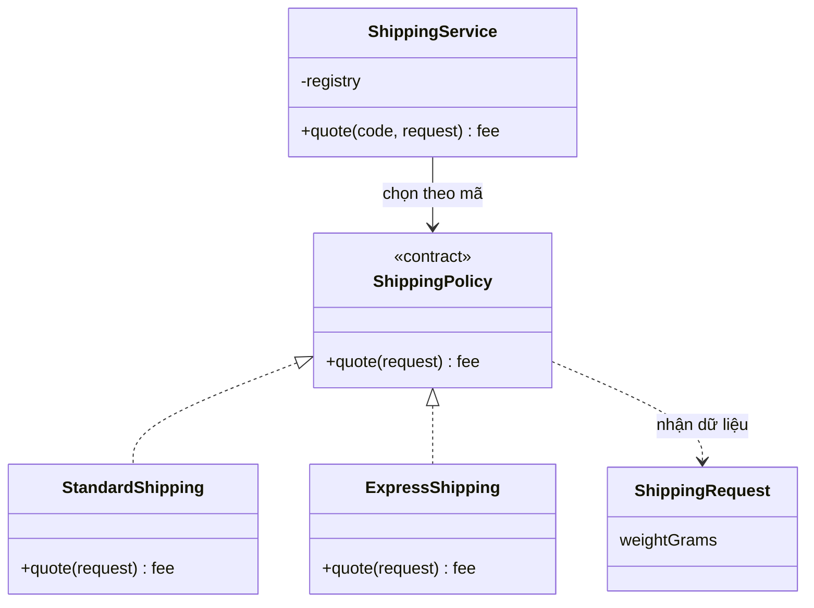
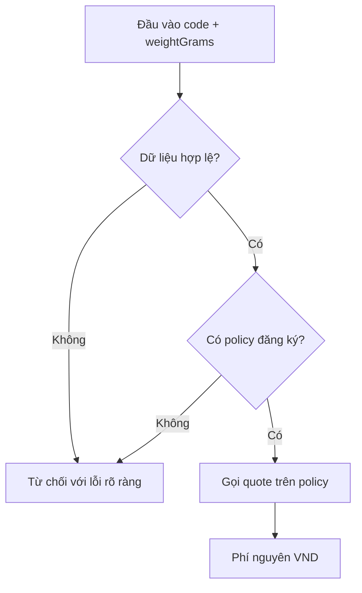

# Language differences when implementing the same OOP design

**One object-oriented design can preserve its intent while taking very different forms in Java, Kotlin, Python, TypeScript, and C#.** Some languages require explicit interface declarations; others accept objects with the expected methods. Some check types primarily at compilation, others at runtime. Both approaches can support sound OOP systems when business contracts remain intact.

This lesson follows **one shipping-fee design** across examples. The goal is to distinguish OOP design decisions from language mechanics and avoid mistakes when porting designs between ecosystems.

## 1. Preserve the problem, not every line of code

An order-management system calculates shipping fees by service code:

| Service | Rule |
|---|---|
| `standard` | Fixed fee of **20.000 VND** |
| `express` | **35.000 VND + 8.000 VND × kilograms rounded up** |

Input weight is an **integer number of grams**, valid from **1 to 100.000 grams**. The returned fee is **an integer VND amount**, not a fractional floating-point currency value. Unsupported service codes or invalid weights must be rejected explicitly.

For example, 1.200 grams is billed as 2 kg; `express` returns `35.000 + 8.000 × 2 = 51.000 VND`.

Identify three roles:

1. **Request:** holds input data and validation rules.
2. **ShippingPolicy:** a fee calculation contract with multiple implementations.
3. **ShippingService:** selects a policy by code and invokes the contract without embedding formula details.



The diagram shows **a conceptual design** rather than requiring identical class counts in every language. Choosing interfaces, protocols, function types, records, or data classes depends on each language's features and idioms.

## 2. Java: nominal interfaces, explicit types, and polymorphism

In Java, a class declares `implements ShippingPolicy` to formally implement that interface under *nominal typing*. Calling `policy.quote(request)` dynamically dispatches to the actual implementation.

Runnable **Java 17+** example. Save it as `ShippingDemo.java`:

```java
import java.util.Map;
import java.util.Objects;

public class ShippingDemo {
    record ShippingRequest(int weightGrams) {
        ShippingRequest {
            if (weightGrams < 1 || weightGrams > 100_000) {
                throw new IllegalArgumentException(
                        "Trọng lượng phải từ 1 đến 100000 gram");
            }
        }
    }

    interface ShippingPolicy {
        long quote(ShippingRequest request);
    }

    static final class StandardShipping implements ShippingPolicy {
        @Override
        public long quote(ShippingRequest request) {
            return 20_000L;
        }
    }

    static final class ExpressShipping implements ShippingPolicy {
        @Override
        public long quote(ShippingRequest request) {
            long kilograms = (request.weightGrams() + 999L) / 1_000L;
            return 35_000L + 8_000L * kilograms;
        }
    }

    static final class ShippingService {
        private final Map<String, ShippingPolicy> policies;

        ShippingService(Map<String, ShippingPolicy> policies) {
            this.policies = Map.copyOf(
                    Objects.requireNonNull(policies, "policies"));
        }

        long quote(String code, ShippingRequest request) {
            Objects.requireNonNull(code, "code");
            Objects.requireNonNull(request, "request");

            ShippingPolicy policy = policies.get(code);
            if (policy == null) {
                throw new IllegalArgumentException(
                        "Dịch vụ không hỗ trợ: " + code);
            }
            return policy.quote(request);
        }
    }

    public static void main(String[] args) {
        var service = new ShippingService(Map.of(
                "standard", new StandardShipping(),
                "express", new ExpressShipping()
        ));
        var request = new ShippingRequest(1_200);

        System.out.println(service.quote("standard", request)); // 20000
        System.out.println(service.quote("express", request));  // 51000
    }
}
```

Run:

```bash
javac ShippingDemo.java
java ShippingDemo
```

Important choices:

- `interface` specifies the contract; `implements` explicitly declares a type relationship.
- `record` (Java 16+) generates accessors, `equals`, `hashCode`, and `toString` from components; compact constructors reject invalid weights upon request creation. A `record` provides **shallow immutability**, not automatic immutability for nested references.
- `final` on an implementation prevents subclassing it, not implementing the same interface elsewhere.
- `Map.copyOf` produces an unmodifiable map through standard APIs, preventing callers from changing the policy registry externally after construction. It does not make the contained `ShippingPolicy` objects thread-safe.
- `long` covers the defined fee range; fractional monetary values may require `BigDecimal` and explicit rounding policies.

**Core OOP insight:** `ShippingService` depends on `ShippingPolicy`. Adding `SameDayShipping implements ShippingPolicy` extends behavior without embedding another fee formula branch in policy selection.

## 3. Kotlin: similar design, more concise syntax

Kotlin also uses nominal typing for interfaces/classes, but offers `data class`, concise property syntax, and compile-time null safety. Kotlin classes are `final` by default, unlike ordinary Java classes.

Kotlin/JVM example in `ShippingDemo.kt`:

```kotlin
data class ShippingRequest(val weightGrams: Int) {
    init {
        require(weightGrams in 1..100_000) {
            "Trọng lượng phải từ 1 đến 100000 gram"
        }
    }
}

interface ShippingPolicy {
    fun quote(request: ShippingRequest): Long
}

class StandardShipping : ShippingPolicy {
    override fun quote(request: ShippingRequest): Long = 20_000L
}

class ExpressShipping : ShippingPolicy {
    override fun quote(request: ShippingRequest): Long {
        val kilograms = (request.weightGrams.toLong() + 999L) / 1_000L
        return 35_000L + 8_000L * kilograms
    }
}

class ShippingService(policies: Map<String, ShippingPolicy>) {
    private val registry = policies.toMap()

    fun quote(code: String, request: ShippingRequest): Long {
        val policy = registry[code]
            ?: throw IllegalArgumentException("Dịch vụ không hỗ trợ: $code")
        return policy.quote(request)
    }
}

fun main() {
    val service = ShippingService(
        mapOf(
            "standard" to StandardShipping(),
            "express" to ExpressShipping()
        )
    )
    val request = ShippingRequest(1_200)
    println(service.quote("standard", request)) // 20000
    println(service.quote("express", request))  // 51000
}
```

Differences from Java:

- `data class` generates `equals`/`hashCode`/`toString` and `copy` from primary-constructor properties.
- `val` prevents property reassignment by callers but **does not guarantee deep immutability**. `registry = policies.toMap()` produces an ordinary map copy; Kotlin's `Map` interface is read-only from the API perspective, not proof of absolute immutability in every scenario.
- `ShippingPolicy` is non-`null` by default; nullable references require `ShippingPolicy?`. This prevents some errors in pure Kotlin, but Java interop, reflection, and external data still need attention.
- `override` is required to implement interface methods. Object construction needs no `new`.

A **function type** can replace interfaces for extensions requiring just one operation:

```kotlin
typealias FeeRule = (ShippingRequest) -> Long

val expressRule: FeeRule = { request ->
    35_000L + 8_000L * ((request.weightGrams.toLong() + 999L) / 1_000L)
}
```

The same idea of “supplying behavior to a service” works without a class per policy. Where policies need separate configuration, dependencies, logging, or multiple methods, interfaces/classes can express responsibilities better. No reason exists to force every OOP design into one syntax.

## 4. Python: Protocol, duck typing, and runtime checks

Python supports polymorphism via **duck typing**: an object works when it provides the needed operation at call time. `Protocol` describes a **structural typing** contract for tools such as mypy or Pyright; Python generally does not enforce type annotations at runtime.

Example for **Python 3.10+**, saved as `shipping_demo.py`:

```python
from dataclasses import dataclass
from typing import Mapping, Protocol


@dataclass(frozen=True, slots=True)
class ShippingRequest:
    weight_grams: int

    def __post_init__(self) -> None:
        # bool là subclass của int trong Python: từ chối True/False.
        if type(self.weight_grams) is not int:
            raise ValueError("Trọng lượng phải là số nguyên")
        if not 1 <= self.weight_grams <= 100_000:
            raise ValueError("Trọng lượng phải từ 1 đến 100000 gram")


class ShippingPolicy(Protocol):
    def quote(self, request: ShippingRequest) -> int:
        ...


class StandardShipping:
    def quote(self, request: ShippingRequest) -> int:
        return 20_000


class ExpressShipping:
    def quote(self, request: ShippingRequest) -> int:
        kilograms = (request.weight_grams + 999) // 1_000
        return 35_000 + 8_000 * kilograms


class ShippingService:
    def __init__(self, policies: Mapping[str, ShippingPolicy]) -> None:
        self._registry = dict(policies)

    def quote(self, code: str, request: ShippingRequest) -> int:
        if code not in self._registry:
            raise ValueError(f"Dịch vụ không hỗ trợ: {code}")
        return self._registry[code].quote(request)


if __name__ == "__main__":
    service = ShippingService({
        "standard": StandardShipping(),
        "express": ExpressShipping(),
    })
    request = ShippingRequest(1_200)
    print(service.quote("standard", request))  # 20000
    print(service.quote("express", request))   # 51000
```

Run `python shipping_demo.py`.

Distinctive aspects:

- `StandardShipping` and `ExpressShipping` **need not inherit** `ShippingPolicy`. They satisfy the protocol through expected signatures and behavior, which optional type checkers can analyze.
- `@dataclass(frozen=True)` prevents ordinary field reassignment after construction, but provides only shallow immutability. `__post_init__` validates weight at runtime.
- `int` supports arbitrary-precision integers subject to memory limits, unlike 64-bit `long` in Java/Kotlin/C#.
- `//` uses floor division; for validated positive inputs, the rounding-up formula matches Java.
- The annotation `request: ShippingRequest` does not prevent callers from passing an incompatible object at runtime. An error may appear only when a missing attribute/method is accessed.

Do not interpret Python's flexibility as an absence of contracts. Because the interpreter does not precheck all call paths, **boundary validation and contract tests** are especially valuable.

## 5. TypeScript: structural interfaces erased at runtime

TypeScript also supports structural typing: an object with the necessary members usually satisfies an interface without explicitly declaring `implements`. However, most type declarations are **erased when compiled to JavaScript**. Thus API/JSON objects require runtime validation; neither `interface` nor `Readonly` performs it automatically.

Save the example as `shipping_demo.ts`:

```typescript
type ShippingRequest = Readonly<{ weightGrams: number }>;

interface ShippingPolicy {
  quote(request: ShippingRequest): number;
}

class StandardShipping implements ShippingPolicy {
  quote(_request: ShippingRequest): number {
    return 20_000;
  }
}

class ExpressShipping implements ShippingPolicy {
  quote(request: ShippingRequest): number {
    return 35_000 + 8_000 * Math.ceil(request.weightGrams / 1_000);
  }
}

class ShippingService {
  private readonly registry: ReadonlyMap<string, ShippingPolicy>;

  constructor(policies: ReadonlyMap<string, ShippingPolicy>) {
    this.registry = new Map(policies);
  }

  quote(code: string, request: ShippingRequest): number {
    // TypeScript không kiểm tra dữ liệu JSON bên ngoài tại runtime.
    if (!Number.isSafeInteger(request.weightGrams) ||
        request.weightGrams < 1 || request.weightGrams > 100_000) {
      throw new RangeError("Trọng lượng phải từ 1 đến 100000 gram");
    }

    const policy = this.registry.get(code);
    if (policy === undefined) {
      throw new Error("Dịch vụ không hỗ trợ: " + code);
    }
    return policy.quote(request);
  }
}

const service = new ShippingService(
  new Map<string, ShippingPolicy>([
    ["standard", new StandardShipping()],
    ["express", new ExpressShipping()],
  ])
);

const request: ShippingRequest = { weightGrams: 1_200 };
console.log(service.quote("standard", request)); // 20000
console.log(service.quote("express", request));  // 51000
```

After installing the TypeScript compiler, you can run:

```bash
tsc shipping_demo.ts --strict --target ES2020 --module commonjs
node shipping_demo.js
```

An object literal can satisfy the contract without a class:

```typescript
const weekendPolicy: ShippingPolicy = {
  quote: (_request) => 40_000
};
```

Important distinctions:

- TypeScript checks types **before execution**; the JavaScript runtime does not retain a `ShippingPolicy` interface for `instanceof ShippingPolicy`.
- `readonly` on types and ordinary `private` are primarily TypeScript compiler constraints, not runtime guarantees of immutability or access control. JavaScript `#field` private fields use a distinct runtime mechanism.
- `number` uses IEEE 754. With the sample weight limit of 100.000 grams and these fees, integer calculations remain exact within the safe-integer range. For large monetary amounts, exchange rates, or fractions, choose a suitable representation (such as validated integer minor units, compatible `bigint`, or a decimal library).
- `ReadonlyMap` describes a read-only TypeScript API; `new Map(policies)` gives the service a copy of the registry. Do not assume type declarations protect server data at runtime.
- The JavaScript event loop also does not guarantee that shared state is safe: asynchronous steps may interleave over time.

**Cross-language pitfall:** In Java, the compiler can detect classes missing required interface implementations. For arbitrary JSON in TypeScript, the compiler cannot verify actual HTTP response objects. Validate at input boundaries.

## 6. C#: nominal interfaces, record structs, and decimal

C# has nominal interfaces like Java, properties and access modifiers, and its own generics and records. This is a **.NET 8** console example, placed in a console project's `Program.cs`:

```csharp
using System;
using System.Collections.Generic;

var service = new ShippingService(
    new Dictionary<string, IShippingPolicy>(StringComparer.Ordinal)
    {
        ["standard"] = new StandardShipping(),
        ["express"] = new ExpressShipping()
    }
);

var request = new ShippingRequest(1_200);
Console.WriteLine(service.Quote("standard", request)); // 20000
Console.WriteLine(service.Quote("express", request));  // 51000

public readonly record struct ShippingRequest(int WeightGrams);

public interface IShippingPolicy
{
    long Quote(ShippingRequest request);
}

public sealed class StandardShipping : IShippingPolicy
{
    public long Quote(ShippingRequest request) => 20_000L;
}

public sealed class ExpressShipping : IShippingPolicy
{
    public long Quote(ShippingRequest request)
    {
        long kilograms = (request.WeightGrams + 999L) / 1_000L;
        return 35_000L + 8_000L * kilograms;
    }
}

public sealed class ShippingService
{
    private readonly Dictionary<string, IShippingPolicy> _registry;

    public ShippingService(Dictionary<string, IShippingPolicy> policies)
    {
        _registry = new Dictionary<string, IShippingPolicy>(
            policies, StringComparer.Ordinal);
    }

    public long Quote(string code, ShippingRequest request)
    {
        if (request.WeightGrams < 1 || request.WeightGrams > 100_000)
            throw new ArgumentOutOfRangeException(nameof(request));

        if (!_registry.TryGetValue(code, out IShippingPolicy? policy))
            throw new ArgumentException(
                "Dịch vụ không hỗ trợ: " + code, nameof(code));

        return policy.Quote(request);
    }
}
```

Create a project using `dotnet new console -n ShippingDemo`, replace `Program.cs`, and run `dotnet run` from the project folder.

Noteworthy differences:

- `: IShippingPolicy` declares interface implementation; interface calls dispatch dynamically much like Java.
- `readonly record struct` is a **value type**; passing the small value as a parameter copies its value semantics. By contrast, Java `record` is a **reference type** with component-based `equals`.
- This C# example deliberately validates inputs in `ShippingService`, ensuring valid arguments for `Quote`. However, `new ShippingRequest(0)` can still be constructed. For creation-time invariants as in Java/Kotlin/Python, use an appropriate constructor/factory.
- C# `decimal` represents base-10 decimals with its own precision and limits; switching `long` to `decimal` alone does not remove the need for rounding, currency, and overflow rules.
- `readonly` on `_registry` prevents reassigning the field reference but **does not** make every dictionary value immutable. The internal dictionary is copied once and the service exposes no mutation methods.

When using ASP.NET Core, a DI container may create `ShippingService` and its policies. Do not confuse DI lifetimes with choices between records/classes or safety of mutable state.

## 7. Direct comparison: same roles, different mechanisms

| Question | Java | Kotlin | Python | TypeScript | C# |
|---|---|---|---|---|---|
| Behavioral contract | `interface` | `interface` or function type | `Protocol`, ABC, or duck typing | `interface` or type/function | `interface` or delegate |
| When a class satisfies the contract | Must `implements` (nominal) | Must declare `: Interface` (nominal) | `Protocol` may match structurally; runtime duck typing | Structural match at compile time | Must declare `: Interface` (nominal) |
| Type checking | Mostly compile-time plus runtime type checks | Mostly compile-time plus runtime type checks | Hints do not enforce runtime types; optional type checkers | Compile-time; most types erased on transpilation | Compile-time plus runtime CLR type metadata |
| Request data representation | `record` or class | `data class` | `dataclass` | Object + `type`/`interface` | `record`/`record struct`/class |
| Nullable values | References may be `null`; annotations depend on tooling | `T` differs from `T?` | `None`, annotation `T \| None` | `null`/`undefined`, `strictNullChecks` | Nullable references: `T?` |
| Integer monetary fees | `long` is 64-bit | `Long` is 64-bit | `int` has flexible precision | `number` has a safe-integer range | `long` is 64-bit |
| Interfaces at runtime? | Runtime type exists | JVM runtime type exists | `Protocol` is mainly static; runtime behavior depends on checks | No; interface erased in JS | CLR runtime type exists |
| Runtime validation of external inputs | Required | Required | Required | Especially important with JSON/`unknown` | Required |

**Note:** The table summarizes common behavior under the described language/runtime configurations. Some details depend on compilers, platforms, or libraries; do not assume every program in a language shares all these properties.

### Object identity versus value equality

Two objects storing the same weight may be **equal by data** yet **not be the same object**. This distinction is easy to miss when porting OOP code.

| Language | Value comparison | Identity/reference comparison |
|---|---|---|
| Java | `a.equals(b)` (generated for `record`) | `a == b` for two references |
| Kotlin | `a == b` uses null-safe equality | `a === b` |
| Python | `a == b` invokes `__eq__` | `a is b` |
| TypeScript/JavaScript | `===` compares primitive values; objects by identity | `a === b` for objects |
| C# | Depends on overloaded `==`/`Equals`; records support value equality | `ReferenceEquals(a,b)` for references |

In Java, `new ShippingRequest(1200).equals(new ShippingRequest(1200))` evaluates to `true`, whereas `==` between two newly created records is `false`. In TypeScript, comparing separate object literals `{weightGrams: 1200}` with `===` is `false`. Map keys, caching, deduplication, and tests can behave differently if **identity** and **value equality** are confused.

## 8. Which design decisions must survive translation between languages?

The part that cannot be “translated mechanically” is that **observable contracts** matter more than class names.



**The following contracts must remain unchanged:**

- Weight must be an integer in the range `[1, 100000]` grams. Note that Python's `bool` is a subclass of `int`; TypeScript may receive values outside static types when reading untrusted input.
- `standard` returns `20000` for every valid weight.
- `express` returns `35000 + 8000 × ceil(weightGrams / 1000)`.
- Unknown registry codes fail; do not silently return 0 or switch to a default service.
- The service selects and invokes implementations without embedding their formulas.
- Every implementation returns valid fees, leaves inputs unchanged, and uses VND units.

What **may differ**: validation location (constructors or services), interface syntax, numeric types, naming conventions, exception classes, registry syntax, object creation, immutability style, and DI frameworks.

### Shared test matrix for all five versions

| Case | `standard` | `express` | Explanation |
|---|---:|---:|---|
| 1 gram | 20.000 | 43.000 | Minimum billable 1 kg |
| 1.000 grams | 20.000 | 43.000 | Exactly 1 kg |
| 1.001 grams | 20.000 | 51.000 | Crosses threshold, billed for 2 kg |
| 1.200 grams | 20.000 | 51.000 | Rounds up to 2 kg |
| 100.000 grams | 20.000 | 835.000 | Maximum 100 kg |
| 0 or 100.001 grams | Error | Error | Input contract violation |
| `unknown` code | Error | Error | Policy not registered |

For the 100.000-gram case, the calculation is `35.000 + 8.000 × 100 = 835.000`. Any differing result indicates a translation/implementation logic defect, even if the syntax looks “properly object-oriented.”

Test more than successful calls. Check type boundaries (such as Python `true`, JavaScript `NaN`, and noninteger numbers), invalid data, and missing registrations. The goal is **behavioral parity**, not identical class counts or method names.

## 9. When is an interface too much?

The example has two shipping policies to demonstrate polymorphism. In practice, the service may only need **a function**:

- Java: `ToLongFunction<ShippingRequest>` (account for code selection and caller dependencies).
- Kotlin: `(ShippingRequest) -> Long`.
- Python: `Callable[[ShippingRequest], int]`.
- TypeScript: `(request: ShippingRequest) => number`.
- C#: `Func<ShippingRequest, long>`.

These still express **dependency inversion toward supplied behavior**. Use classes/interfaces when a policy has meaningful identity, multiple methods, dependencies, a lifecycle, or a stable public contract. Use functions when behavior is small, independent, and readable.

Java can also accept rules as functions:

```java
import java.util.Map;
import java.util.function.ToLongFunction;

// Dùng record ShippingRequest của ví dụ Java ở trên.
Map<String, ToLongFunction<ShippingRequest>> rules = Map.of(
    "standard", request -> 20_000L,
    "express", request -> 35_000L
        + 8_000L * ((request.weightGrams() + 999L) / 1_000L)
);

long fee = rules.get("express").applyAsLong(
        new ShippingRequest(1_200)); // 51000
```

This is **an illustrative snippet within scope of `ShippingRequest`**. In real applications, verify a code exists before calling `applyAsLong`; `rules.get(...)` returns `null` for missing keys. Function types reduce class count but do not solve validation, registries, logging, or failure policy on their own.

## 10. Differences in encapsulation, inheritance, and polymorphism

Sound OOP design specifies **who owns state** and **what outsiders may do**, since languages enforce those boundaries differently.

**Encapsulation:**

- Java/C#: `private`, `protected`, and other access levels are enforced by language/runtime mechanisms. Reflection and exceptional access mechanisms need separate consideration.
- Kotlin: `private`, `protected`, `internal`, `public`; `internal` serves module boundaries at language level, with compilation/interoperability details to consider.
- Python: `_field` usually signals an internal API convention; `__field` uses *name mangling* to reduce naming conflicts, not create a security boundary.
- TypeScript: `private` is generally compiler-checked; JavaScript `#field` has runtime privacy. Do not rely on `readonly` to secure untrusted data.

**Inheritance:**

- Java, Kotlin, C#, TypeScript: classes typically inherit directly from **one base class** but can implement multiple interfaces; default implementations differ by language.
- Python: supports multiple class inheritance with **MRO** (*method resolution order*). This is powerful but can be confusing when base classes define the same methods.

**Polymorphism:**

- Java/Kotlin/C#: declared class/interface relations are central to static typing.
- Python: runtime dispatch uses actual objects; `Protocol` lets static tooling describe expectations.
- TypeScript: the compiler checks object shapes and JavaScript invokes actual object methods; interfaces have no runtime identity.

Do not copy deep Java class hierarchies into Python/TypeScript mechanically. Functions, composition, protocols, or object literals may preserve **the same responsibilities and contracts** with clearer structures.

## 11. Risks when porting OOP designs between languages

| Scenario | Common mistake | Better approach |
|---|---|---|
| Copying `(w + 999) / 1000` | Forgetting integer versus floating-point division | Java/Kotlin/C# use integer division for integral operands; Python `//`; TypeScript `Math.ceil` |
| Assuming annotations prevent runtime invalid input | Malformed JSON reaches TypeScript/Python | Validate boundaries; test `NaN`/`bool`/out-of-range values |
| Treating `==`/`===` as equivalent across languages | Confusing identity with value equality | Test semantics of each type and language |
| Believing `readonly`/`final` guarantee deep immutability | Inner collections still mutate | Defensive copying, immutable data, clear ownership |
| Translating classes 1:1 mechanically | Excessive boilerplate or non-idiomatic code | Preserve responsibilities, contracts, and dependency direction |
| Using inheritance for every kind of reuse | Couples implementations and creates unpredictable overrides | Favor composition and interfaces/function types where appropriate |
| Assuming DI singleton means thread-safe | Service stores per-request mutable fields | Design stateless services or control concurrency explicitly |
| Ignoring failure handling and lifecycle | Leaks resources, inconsistent retries/APIs | Specify errors, transactions, closing/disposal, and integration tests |

A hidden reason why “the same code behaves differently” is the **execution ecosystem**: Java/JVM, Kotlin's various targets, Python runtimes, Node/browser JavaScript engines, and .NET CLR differ in I/O, GC, scheduling, reflection, serialization, and package models. Do not infer performance, thread safety, or resource cleanup from class diagrams alone.

Java uses `AutoCloseable`/try-with-resources; C# uses `IDisposable`/`using`; Python uses context managers/`with`; TypeScript/JavaScript commonly uses `try/finally` and related close/dispose APIs. **The intent** is still responsible resource cleanup, but **the mechanism** depends on runtime.

## 12. A controlled approach to porting designs

Suppose a team already has the Java version and wants to implement an equivalent TypeScript service:

1. **Specify contracts first:** inputs, units, ranges, formulas, failures, state, and concurrency expectations.
2. **Translate roles:** Request, Policy, Service. Only then decide between `class`, functions, and object literals.
3. **Choose data representations intentionally:** Java `long` to TypeScript `number` is safe only when value limits are established; add runtime checks.
4. **Validate actual boundaries:** HTTP JSON does not carry TypeScript interfaces; validate before entering the domain.
5. **Run the shared test matrix:** VND values and failure outcomes must agree despite different exception classes.
6. **Review runtime and lifecycles:** can registry state be modified externally, do async steps interleave state mutations, how are resources released?
7. **Assess idiomatic code:** preserve the design intent while remaining understandable to target-language developers.

### Exercises

**Exercise 1:** Add fixed-price `same-day` at 70.000 VND in two of the five implementations. Do not change `ShippingService` formulas; write and register a new policy. Explain which languages require an explicit interface declaration.

**Exercise 2:** Replace `ShippingRequest` with an object containing `List<String> notes` or a notes array. Compare “immutability” of Java records, Kotlin data classes, Python frozen dataclasses, TypeScript Readonly, and C# records when inner collections remain mutable.

**Exercise 3:** Create two requests of the same weight, 1.200 grams, and compare equality versus identity in Java, Kotlin, Python, TypeScript, and C#. Explain the results; do not assume `==` means the same thing in every language.

**Exercise 4:** Examine two JSON inputs: `{"weightGrams": 1200}` and `{"weightGrams": "1200"}`. Decide where parsing/validation should happen to avoid ambiguous coercion of strings into numbers. Write tests preventing both TypeScript and Python from accepting unintended data types.

**Self-assessment:** If you remove `interface`, `Protocol`, `data class`, and `record` labels from a description, can you still explain who calculates fees, who selects policies, which contracts must hold, and how to verify them? If so, you understand **OOP design independent of syntax**.

**Remember:** OOP designs are defined by **responsibilities, contracts, state boundaries, and object collaboration**. Java, Kotlin, Python, TypeScript, and C# offer different tools to express those decisions. Successful porting preserves behavior and domain invariants while using the target language's type system, runtime mechanisms, and idioms correctly.
