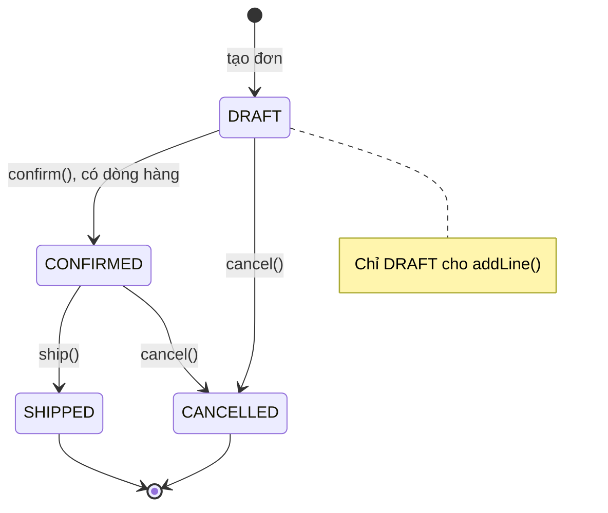
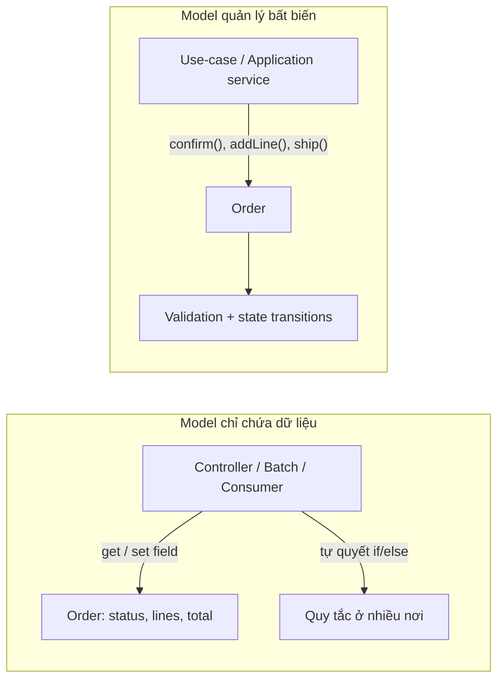
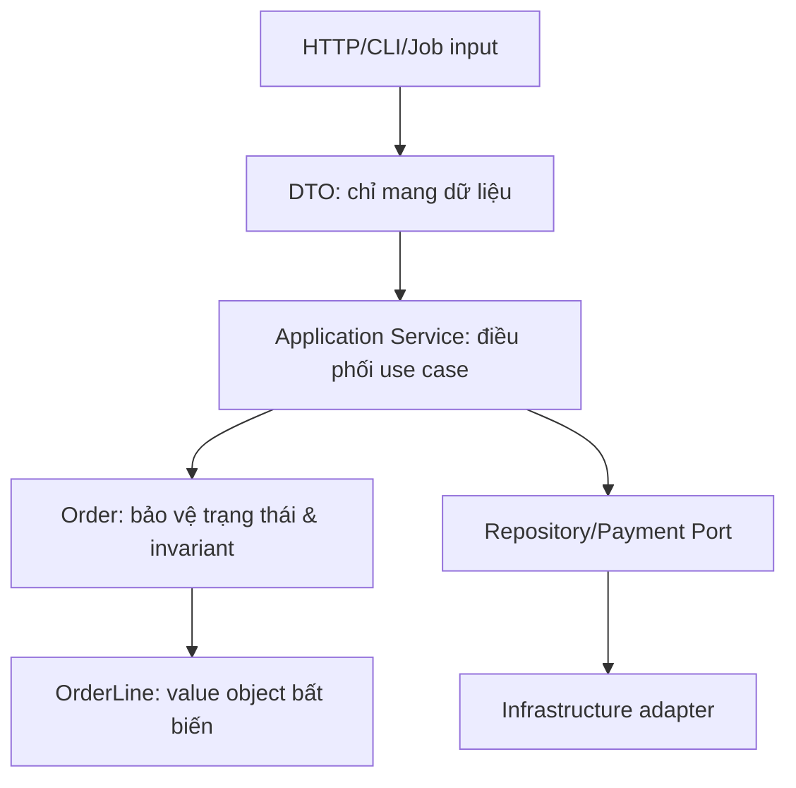

# Excessive getters and setters without behavior: recognizing and fixing an OOP design pitfall

> **Topic:** A design pitfall in object-oriented programming: objects are created mainly to hold data while business decisions are pushed outside them. The goal is to distinguish appropriate getters/setters from an **Anemic Domain Model**, understand why **encapsulation** means more than declaring fields `private`, and refactor toward behavior-oriented methods while preserving business rules.

## 1. Where is the real problem?

Consider an `Order` class with fields `status`, `totalVnd`, and `items`, and methods `getStatus()`, `setStatus()`, `getTotalVnd()`, `setTotalVnd()`, `getItems()`, and `setItems()`. Syntactically this is still a **valid Java class**. But if decisions such as "when may an order be confirmed," "can a shipped order be canceled," and "how is the total calculated" all live in a controller or another service, the `Order` object is merely a **data bag**.

The issue is not whether a method name starts with `get` or `set`. It is that **authority over state changes and responsibility for enforcing business rules** reside in the wrong place.

Distinguish these two design styles:

- **Anemic Domain Model:** entities/domain objects contain data and simple accessors; external services own most of the business rules governing that data.
- **Rich Domain Model:** objects contain or collaborate on behaviors and invariants they own; meaningful changes are expressed in domain language.

Do not take "rich" to mean **one class must contain all business logic**. Rules spanning multiple entities or external systems may belong in a domain service, application service, or workflow. Good design means **assigning responsibilities appropriately**, not stuffing all code into an entity.

### Easily recognized symptoms

| Symptom | Why reconsider it? |
|---|---|
| Domain class with dozens of getters/setters and almost no domain methods | Clients must know how to make valid state changes themselves |
| A service uses `if (order.getStatus() == ...)` then `order.setStatus(...)` in many places | State-transition rules are scattered and easy to update inconsistently |
| `setTotalVnd` lets callers assign an arbitrary total | Computed data may disagree with line items |
| `getItems()` directly returns an internal `ArrayList` | Clients can add/remove order lines, bypassing validation |
| Each controller decides independently when to cancel, confirm, or ship | One use case may enforce different rules from another |
| All fields are `private`, but setters are unconditionally `public` | Syntactic encapsulation does not protect invariants |
| Unit tests call `setX` then merely check that `getX` returns X | Business rules and forbidden states remain untested |

**Encapsulation** places **state and the behavior managing that state** behind a clear contract, limiting the actions external code is allowed to perform. Declaring fields `private` and exposing setters for every field may merely change access from `order.status = ...` to `order.setStatus(...)` without actually restricting clients.

## 2. Counterexample: "OOP" with only getters/setters

Suppose orders have these states:

- `DRAFT`: being created; products may be added.
- `CONFIRMED`: confirmed; order lines may no longer change.
- `SHIPPED`: shipped; cannot be canceled under this example's rules.
- `CANCELLED`: canceled; cannot be confirmed or shipped.

Each order line has an SKU, an integer VND unit price, and a positive quantity.

An anemic model often looks like this (illustrative; remaining imports/getters omitted):

```java
class Order {
    private String id;
    private String status;
    private long totalVnd;
    private java.util.List<OrderLine> lines;

    String getStatus() { return status; }
    void setStatus(String status) { this.status = status; }

    long getTotalVnd() { return totalVnd; }
    void setTotalVnd(long totalVnd) { this.totalVnd = totalVnd; }

    java.util.List<OrderLine> getLines() { return lines; }
    void setLines(java.util.List<OrderLine> lines) {
        this.lines = lines;
    }
}
```

A controller might perform this logic itself:

```java
// Phác họa service dùng model ở trên.
if ("DRAFT".equals(order.getStatus())) {
    order.setStatus("CONFIRMED");
}
```

While another location might call:

```java
order.setStatus("SHIPPED");    // Bỏ qua bước CONFIRMED?
order.setTotalVnd(-100_000L);  // Tổng tiền âm?
order.getLines().clear();      // Xóa hàng mà không cập nhật tổng?
```

These calls demonstrate **an overly broad API**: the class exposes operations that should be restricted by state and business rules. The danger is that an object can enter an invalid state **without a single enforcement point**.

Adding an `if` to the current controller is insufficient. A batch job, message consumer, or second API may forget the same condition. A more robust design makes **invalid operations unavailable through any legitimate public path**, or at least has the object reject them.

## 3. Rethinking the API: from "change this field" to "perform this behavior"

Replace:

- `setStatus(CONFIRMED)` with `confirm()`.
- `setStatus(SHIPPED)` with `ship()`.
- `setStatus(CANCELLED)` with `cancel()`.
- `getLines().add(line)` with `addLine(sku, unitPriceVnd, quantity)`.
- `setTotalVnd(...)` with `totalVnd()` **computed from source data**.

Each behavior can:
1. Check preconditions (*precondition*).
2. Reject invalid transitions.
3. Change state according to one consistent rule.
4. Preserve conditions that must always hold (*invariants*).
5. Return a meaningful result or raise a meaningful error.

This principle is often called **Tell, Don't Ask**: instead of external code querying state and then modifying data itself, **ask the object to perform a meaningful action**.

However, Tell, Don't Ask **does not prohibit state queries**. UIs must show totals, APIs must serialize information, and reports must read state. Read-only getters and query methods are perfectly reasonable when required.

### A new contract in domain language

| Data-oriented API | Behavior-oriented API | Protected rule |
|---|---|---|
| `setStatus(CONFIRMED)` | `confirm()` | Confirm only `DRAFT` orders with at least one line |
| `setStatus(SHIPPED)` | `ship()` | Ship only `CONFIRMED` orders |
| `setStatus(CANCELLED)` | `cancel()` | Do not cancel shipped orders; repeated cancellation may be a no-op |
| `getLines().add(...)` | `addLine(...)` | Modify lines only in `DRAFT`; prices/quantities must be valid |
| `setTotalVnd(x)` | `totalVnd()` | Compute totals from line items instead of accepting arbitrary values |
| `getLines()` returns a mutable list | `lines()` returns an unmodifiable snapshot | Clients cannot mutate internal data through a reference |

A behavior-oriented API is often clearer: `order.confirm()` expresses **a business decision**, whereas `order.setStatus(OrderStatus.CONFIRMED)` merely expresses **a data assignment**.

## 4. Diagram: an object controls its own lifecycle



The arrows represent **allowed state transitions**, not every transition that a setter could create. In this example:

- `ship()` is forbidden while the order is `DRAFT`.
- `confirm()` cannot be called twice.
- Order lines cannot be added after reaching `CONFIRMED`.
- `cancel()` is forbidden after `SHIPPED`.
- Canceling an already `CANCELLED` order is designed as a no-op (*idempotent*) so repetition is harmless.

The "no cancellation after shipping" rule is **an assumption of this example**, not a universal rule for commerce systems. Another product might allow returns/refunds after delivery, but those need their own behaviors and states rather than reopening a setter.

## 5. Complete Java 17 example: keeping invariants in `Order`

Save the following as `BehaviorRichOrderDemo.java`. It compiles and runs with only the JDK:

```bash
javac BehaviorRichOrderDemo.java
java BehaviorRichOrderDemo
```

```java
import java.util.ArrayList;
import java.util.List;
import java.util.Objects;

public final class BehaviorRichOrderDemo {

    enum Status {
        DRAFT, CONFIRMED, SHIPPED, CANCELLED
    }

    // Value object bất biến cho một dòng hàng.
    record OrderLine(String sku, long unitPriceVnd, int quantity) {
        OrderLine {
            Objects.requireNonNull(sku, "sku");
            if (sku.isBlank()) {
                throw new IllegalArgumentException("SKU không được rỗng");
            }
            if (unitPriceVnd < 0) {
                throw new IllegalArgumentException(
                        "Đơn giá không được âm");
            }
            if (quantity <= 0) {
                throw new IllegalArgumentException(
                        "Số lượng phải dương");
            }
        }

        long amountVnd() {
            return Math.multiplyExact(unitPriceVnd, (long) quantity);
        }
    }

    static final class Order {
        private final String id;
        private final List<OrderLine> lines = new ArrayList<>();
        private Status status = Status.DRAFT;

        Order(String id) {
            Objects.requireNonNull(id, "id");
            if (id.isBlank()) {
                throw new IllegalArgumentException("ID không được rỗng");
            }
            this.id = id;
        }

        String id() {
            return id;
        }

        Status status() {
            return status;
        }

        // Snapshot không cho client sửa danh sách nội bộ.
        List<OrderLine> lines() {
            return List.copyOf(lines);
        }

        // Giá trị suy ra, không cung cấp setTotalVnd(...).
        long totalVnd() {
            long result = 0L;
            for (OrderLine line : lines) {
                result = Math.addExact(result, line.amountVnd());
            }
            return result;
        }

        void addLine(String sku, long unitPriceVnd, int quantity) {
            requireDraft();
            OrderLine line = new OrderLine(sku, unitPriceVnd, quantity);

            // Kiểm trước phép cộng/tràn số để không thêm dòng lỗi.
            long nextTotal = Math.addExact(totalVnd(), line.amountVnd());
            if (nextTotal < 0L) {
                throw new IllegalStateException("Tổng không hợp lệ");
            }
            lines.add(line);
        }

        void confirm() {
            requireDraft();
            if (lines.isEmpty()) {
                throw new IllegalStateException(
                        "Không thể xác nhận đơn trống");
            }
            // Kiểm tra tổng để lỗi được phát hiện trước đổi status.
            totalVnd();
            status = Status.CONFIRMED;
        }

        void ship() {
            if (status != Status.CONFIRMED) {
                throw new IllegalStateException(
                        "Chỉ gửi được đơn đã xác nhận");
            }
            status = Status.SHIPPED;
        }

        void cancel() {
            if (status == Status.CANCELLED) {
                return; // Hủy lặp lại được định nghĩa là no-op.
            }
            if (status == Status.SHIPPED) {
                throw new IllegalStateException(
                        "Đơn đã gửi không được hủy");
            }
            status = Status.CANCELLED;
        }

        private void requireDraft() {
            if (status != Status.DRAFT) {
                throw new IllegalStateException(
                        "Chỉ sửa/xác nhận đơn đang DRAFT");
            }
        }
    }

    public static void main(String[] args) {
        Order order = new Order("DH-100");
        order.addLine("KB-01", 120_000L, 2);
        order.addLine("MS-02", 80_000L, 1);

        System.out.println(order.totalVnd()); // 320000
        System.out.println(order.status());   // DRAFT

        order.confirm();
        System.out.println(order.status());   // CONFIRMED

        // Bên ngoài không thể gọi order.setStatus(...).
        // order.lines().clear(); // UnsupportedOperationException.

        order.ship();
        System.out.println(order.status());   // SHIPPED
        System.out.println(order.lines().size()); // 2
    }
}
```

### Design explanation

**1. State cannot be assigned freely.** The `status` field is `private` and **has no `setStatus`**. Only `confirm()`, `ship()`, and `cancel()` change state, and each method validates its own preconditions.

**2. Rules are not scattered.** When a REST controller, batch job, or consumer wants to confirm an order, all call `order.confirm()`. They do not need to duplicate the `DRAFT` and "nonempty" checks in three places.

**3. Internal lists are not exposed.** `lines()` returns `List.copyOf(lines)`. Since `OrderLine` is a record with immutable components (`String`, `long`, `int`), callers cannot silently mutate an element and corrupt the `Order` state. `List.copyOf` creates a *shallow* snapshot; more design work is needed for mutable elements.

**4. There is one source of truth for the total.** Without a `totalVnd` field that clients can set directly, we avoid cases where "order lines total 320.000 but the stored total says 100.000." Applications with very large lists may cache the total **internally**, updating it consistently through every operation; this is a conditional optimization, not a reason to expose `setTotalVnd`.

**5. Integer overflow is never silently accepted.** `Math.multiplyExact` and `Math.addExact` throw `ArithmeticException` on overflow of `long`. `addLine` calculates the new total before appending a line, so a calculation failure cannot leave partially added data.

**6. The object does not do everything.** The demo manages only the internal rules of one order. It does not call a database, a REST API, a payment system, or a shipping-label generator. Those external side effects belong in an appropriate application service or adapter.

### What the example deliberately leaves out

- Real pricing may depend on currency, taxes, coupons, delivery charges, exchange rates, or quote time; the example assumes integer VND values and valid supplied prices.
- `Order` does not authenticate whether a caller may modify an order; authorization needs enforcement at a suitable application boundary.
- The example uses `ArrayList` and a mutable object without protection against concurrent multithreaded access.
- There is no durable storage or locking when two requests modify the same order.
- Payment, inventory reservation, refunds, and consistency across services are not addressed.

An OOP lesson should not equate **proper state encapsulation** with having solved **transactions, concurrency, and distributed consistency**.

## 6. From an "anemic model" to a "rich model": comparing responsibilities



| Aspect | Excessive getters/setters | An object with appropriate behavior |
|---|---|---|
| Who may change `status`? | Any code with access to the setter | Only guarded domain methods |
| Who enforces the total? | Each client or a separate service | Order lines and shared invariants |
| Adding a new entry point | Risks duplicating validation | Calls the established behavior API |
| Code readability in use cases | Many steps that query and then change fields | Usually one clearly named request |
| Ability to test rules | Requires the corresponding service/controller | Can test `Order` directly |
| Risk of invalid data | High with many setters or mutable references | Reduced when all mutation paths use safe APIs |
| Cost | Simple classes initially | Requires boundary design and behavior tests |
| Limitation | Business logic is scattered | Does not automatically solve infrastructure dependencies |

An object with many **query methods** is not necessarily anemic. If its mutations are controlled and it fulfills its contract, read-only accessors such as `status()`, `totalVnd()`, and `lines()` are entirely consistent with encapsulation.

## 7. Testing behavior and forbidden states

Testing that `setStatus(CONFIRMED)` followed by `getStatus()` returns `CONFIRMED` only proves that assignment works; it **does not establish that the order is valid**. Good tests must also exercise rejected operations.

With JUnit 5, place `BehaviorRichOrderDemoTest.java` in the same package as the demo:

```java
import static org.junit.jupiter.api.Assertions.*;
import java.util.List;
import org.junit.jupiter.api.Test;

class BehaviorRichOrderDemoTest {

    @Test
    void cannotConfirmEmptyOrder() {
        var order = new BehaviorRichOrderDemo.Order("DH-1");

        assertThrows(IllegalStateException.class, order::confirm);
        assertEquals(BehaviorRichOrderDemo.Status.DRAFT,
                order.status());
    }

    @Test
    void confirmedOrderCannotReceiveNewLines() {
        var order = new BehaviorRichOrderDemo.Order("DH-2");
        order.addLine("A", 10_000, 2);
        order.confirm();

        assertThrows(IllegalStateException.class,
                () -> order.addLine("B", 5_000, 1));
        assertEquals(20_000L, order.totalVnd());
        assertEquals(1, order.lines().size());
    }

    @Test
    void cannotShipBeforeConfirm() {
        var order = new BehaviorRichOrderDemo.Order("DH-3");
        order.addLine("A", 10_000, 1);

        assertThrows(IllegalStateException.class, order::ship);
        assertEquals(BehaviorRichOrderDemo.Status.DRAFT,
                order.status());
    }

    @Test
    void shippedOrderCannotBeCancelled() {
        var order = new BehaviorRichOrderDemo.Order("DH-4");
        order.addLine("A", 10_000, 1);
        order.confirm();
        order.ship();

        assertThrows(IllegalStateException.class, order::cancel);
        assertEquals(BehaviorRichOrderDemo.Status.SHIPPED,
                order.status());
    }

    @Test
    void cancelledOrderCanBeCancelledAgain() {
        var order = new BehaviorRichOrderDemo.Order("DH-5");
        order.cancel();
        order.cancel(); // Idempotent theo hợp đồng demo.

        assertEquals(BehaviorRichOrderDemo.Status.CANCELLED,
                order.status());
    }

    @Test
    void callersCannotMutateInternalLineList() {
        var order = new BehaviorRichOrderDemo.Order("DH-6");
        order.addLine("A", 10_000, 1);

        List<BehaviorRichOrderDemo.OrderLine> snapshot = order.lines();
        assertThrows(UnsupportedOperationException.class,
                snapshot::clear);
        assertEquals(1, order.lines().size());
    }

    @Test
    void invalidAdditionDoesNotChangeOrder() {
        var order = new BehaviorRichOrderDemo.Order("DH-7");
        order.addLine("A", 10_000, 1);

        assertThrows(IllegalArgumentException.class,
                () -> order.addLine("B", -1, 3));
        assertEquals(10_000L, order.totalVnd());
        assertEquals(1, order.lines().size());
    }
}
```

These tests check **observable rules**, not whether the implementation uses `ArrayList` or another storage type. If a refactoring caches the total internally, the behavior tests can remain unchanged.

### Test failure paths too

When an operation fails, the object should generally retain its state. **Validate first, mutate second** helps achieve this for in-memory logic. But if a method performs external side effects (HTTP calls, file writes, or updates across aggregates), appropriate transactions or workflows are required; naming a method "confirm" does not guarantee atomicity across systems.

## 8. Are getters and setters ever entirely appropriate?

**Yes.** Avoid the extreme rule that "good OOP has no getters/setters."

| Object type / context | Are getters/setters appropriate? | Notes |
|---|---|---|
| **Request/Response DTO** | Usually | Mainly carries data; may use `record`; rich behavior is optional |
| **Configuration properties** | Possibly | Framework binding, input validation, and control of mutable configuration |
| **JavaBeans used by frameworks** | May be required by convention | Prefer package/protected setters or suitable mapping mechanisms where possible |
| **JPA entity** | Depends on mapping strategy | JPA can use field access; there is no general requirement for public setters everywhere |
| **View model / UI form** | May be needed for data binding | Distinguish display/input state from domain invariants |
| **Immutable value object** | Read-only getters are usually appropriate | Do not expose setters that change identity/value after construction |
| **Domain entity with many invariants** | Public setters for every field are suspicious | Prefer domain actions such as `confirm()`, `changeAddress()`, `allocateStock()` |
| **Data-oriented API library** | May intentionally expose data | Judge by its contract; not every object needs algorithms |

For example, a suitable **DTO**:

```java
record ChangeEmailRequest(String newEmail) {}
```

This is HTTP request data; a record without `confirmEmailChange()` **is not a design flaw**. At the application boundary, validate the input DTO, check permissions, and turn it into a business request handled by the appropriate object or service.

**Separating domain models from DTOs** avoids exposing an entire entity graph through APIs and letting clients control internal fields through JSON binding. "Excessive getters/setters" is a smell only when an object expected to **manage state and rules** does not do so.

## 9. Domain-named methods can still be disguised setters

A meaningful name does not guarantee good encapsulation:

```java
void changeStatus(Status status) {
    this.status = status;
}
```

Despite its name, `changeStatus` is still an unrestricted setter if it assigns any state. A good method enforces relevant rules:

```java
void confirm() {
    if (status != Status.DRAFT) {
        throw new IllegalStateException("Chỉ xác nhận DRAFT");
    }
    if (lines.isEmpty()) {
        throw new IllegalStateException("Đơn không có sản phẩm");
    }
    status = Status.CONFIRMED;
}
```

Conversely, not every `setX` is bad. `setDisplayName(String)` may be valid behavior if the domain allows changing display names at any time and the method checks values/authorization appropriately. The issue is the **operation contract**, not the `set` prefix.

## 10. Tell, Don't Ask does not mean eliminating every query

A command should live close to the data it changes when the rule belongs to that object. For example:

```java
order.confirm();
```

Compare with:

```java
if (order.status() == Status.DRAFT && !order.lines().isEmpty()) {
    order.setStatus(Status.CONFIRMED);
}
```

But these pure queries still have a role:

```java
Status status = order.status();
long total = order.totalVnd();
```

UIs must display data, reports must read it, and application services must make decisions **spanning multiple aggregates**. Forcing every query into an unnatural method can produce an object with too many responsibilities. Ask "**Who owns this rule?**" rather than "Does the code contain `get`?"

### Distinguishing internal behavior from external orchestration

| Task | Typically appropriate owner |
|---|---|
| Prevent confirmation of an empty order | `Order.confirm()` |
| Prevent adding lines after confirmation | `Order.addLine()` |
| Calculate totals from order lines | `Order.totalVnd()` or a related domain value/policy |
| Check whether the current user is authorized | Application/security boundary; do not put an HTTP principal into the entity casually |
| Load/save orders from a database | Infrastructure repository/adapter |
| Charge through a payment gateway | Application workflow and payment gateway |
| Send email after confirmation | Workflow/event handling according to reliability requirements |
| Maintain consistency across aggregates | Application service plus an appropriate transaction |

A good **rich domain model** does not become a "God Object" handling business logic, SQL, HTTP, logging, email, retries, and caching. Objects should preserve **the rules governing their own state** and collaborate with other services when work crosses those boundaries.

## 11. Checking invariants through the Order domain API

In section 5's demo, the `Order` must enforce these rules: nonblank ID; valid SKU, nonnegative price, and positive quantity; no overflow of `long` totals; only `DRAFT` can accept new lines; only a nonempty order can be confirmed; only `CONFIRMED` can be shipped; `SHIPPED` cannot be canceled.

Unlike exposing getters/setters, **each named behavior protects the relevant part of its invariants**. `addLine()` validates state, data, and total before appending; `confirm()` checks that lines exist; `ship()` and `cancel()` validate state transitions. `totalVnd()` is a source-data query, not a setter for an arbitrary total.

| Path to block | How the demo blocks it |
|---|---|
| Client calls `setStatus(SHIPPED)` without confirmation | No setter; only `ship()` checks for `CONFIRMED` |
| Client calls `getLines().clear()` after confirmation | `lines()` returns a `List.copyOf` snapshot with immutable `OrderLine` elements |
| Client assigns a total contradicting the lines | `totalVnd()` recalculates it; no `setTotalVnd` |
| A calculation exceeds numeric limits | `Math.addExact`/`Math.multiplyExact` fails before appending a line |

This comparison is about **behavior and authority to mutate**, not another lesson on copying collections. The detailed analysis of constructor/getter aliases, shallow versus deep copies, and ways to break invariants is in *Exposed state and broken invariants*. Copying a collection cannot replace control over domain behavior.

## 12. Anemic Domain Model and Transaction Script are not always wrong

A small CRUD application that only displays and updates data, with few business rules, can reasonably use **transaction scripts** in services with relatively thin DTOs/entities. Creating a rich domain model for every database table can be **overengineering**.

What matters is complexity and frequency of change:

| Context | Typically suitable approach |
|---|---|
| Simple admin CRUD with no cross-field rules | DTO/boundary validation and controlled service updates |
| Many states with forbidden transitions | Domain object/state machine with explicit behavior |
| Several entry points (API, batch, queue) enforce the same rules | Centralize invariants in a model or domain service |
| Workflow spanning DB/payment/email | Coordinate through application service/saga/outbox; objects need not do everything |
| External integration with a fixed request/response | A thin data carrier fulfills its role |
| Pure algorithmic task without object state | Pure functions may be simpler and easier to test |

A balanced rule: **do not add behavior to objects just to "look OOP"**, and do not scatter critical invariants among clients just to keep entities "simple."

## 13. Refactoring getters/setters into behavior without breaking the system

A safe process can proceed in this order:

1. **Identify sensitive setters:** for example, `setStatus`, `setBalance`, `setTotal`, and `setItems`. Not all setters need immediate removal.
2. **Find every caller:** controllers, scheduled jobs, message listeners, mapping frameworks, serialization, tests, and administrative commands.
3. **Document current business rules:** describe valid states, allowed transitions, returned errors, and required side effects.
4. **Freeze behavior with tests:** include success, failure, and unchanged-state checks after errors.
5. **Introduce meaningful methods:** `confirm`, `ship`, `cancel`, `addLine`, etc.; keep invariant checks in one place.
6. **Migrate callers in groups:** business code calls behaviors; avoid breaking framework-dependent setters in the same uncontrolled change.
7. **Narrow the public API:** make setters `private`/package-private or remove them once no legitimate access paths remain; initialize data through constructors/mappers.
8. **Protect mutable fields:** return snapshots and prevent clients from holding and mutating internal collections.
9. **Review persistence boundaries:** an ORM may reconstruct objects through field access or appropriate constructors; validate input and legacy data during loading/migration.
10. **Rerun tests and assess impact:** unit, integration, API contract, mapping/serialization, and concurrency tests where applicable.

### Special care with JPA/Hibernate

JPA may use **field access** or **property access** depending on mapping declarations; there is no universal requirement for entities to expose **public setters for every field**. However, ORMs often require suitable constructors, proxies, and lifecycle handling.

One approach:
- Expose only valid domain behaviors publicly.
- Use field access or suitably scoped accessors for JPA mapping as supported by the framework.
- Application code should not call sensitive setters merely because the persistence layer has an internal assignment path.
- Add integration tests for entity save/load, lazy loading, optimistic locking, and state transitions.

**Automatically converting every setter to `private` cannot solve every problem** when current serializers, mappers, or frameworks depend on conventions; investigate real dependencies before refactoring.

## 14. Concurrent state: proper encapsulation can still leave race conditions

An in-memory order updated through `confirm()` is not automatically thread-safe when two threads act on the same instance. For example:

- Thread A reads `status == DRAFT`.
- Thread B also reads `status == DRAFT`.
- Both pass the check and update status; events or side effects may occur twice.

Database-backed systems usually need an appropriate mechanism such as **optimistic locking** (a version column), row-level locking, or the required transaction isolation. For objects shared among threads within one process, use synchronization/CAS or avoid shared mutable state.

**Encapsulation protects the paths through which rules are enforced**, while **concurrency control protects simultaneous operations**. Both matter when there are concurrent writers.

If the business requires "charge only once," correct domain methods alone are insufficient; use idempotency keys, transactions, and side-effect controls at the relevant boundaries.

## 15. Exceptions and business results

The example throws `IllegalStateException` or `IllegalArgumentException` on invalid operations to keep the code explicit. Real applications may use:

- Domain exceptions such as `InvalidOrderTransitionException` with stable error codes.
- A result type `Result<Success, DomainError>` if the team prefers explicit error handling.
- API validation errors translated into appropriate responses without leaking stack traces or sensitive data.

**Whatever mechanism you choose**, do not partially mutate state and only then discover an error: validate before mutation, or use transactions/compensation for complex operations.

Preventing callers from directly invoking `setStatus` **does not rule out every "admin override."** If operations need manual incident recovery, provide **a dedicated controlled behavior with auditing and authorization**, not a generic setter for every caller.

## 16. Distinguishing Entity, Value Object, DTO, and Application Service

A system can contain several object types with different levels of behavior:



**Entity/aggregate:** has an identity and lifecycle; valid state changes are usually expressed through behaviors. Example: `Order`.

**Value object:** defined by its value, typically immutable, and may contain validation and calculation behavior. Example: `OrderLine.amountVnd()`.

**DTO:** carries data across system boundaries; getters, constructors, or setters for serialization are not inherently bad.

**Application Service:** coordinates loading entities, invoking domain operations, committing through repositories, and sending commands/events without repeating every internal `if` from Order.

Do not force a class to perform all four roles. An object becomes harder to maintain as it takes on unrelated responsibilities.

## 17. When should a method return a new value instead of mutating an object?

For an operation such as changing a shipping address, there are several choices depending on the model:

1. **Mutable entity with behavior:** `order.changeShippingAddress(newAddress)` validates state and updates safely.
2. **Immutable aggregate:** `Order updated = order.withShippingAddress(newAddress)` returns a new instance after validation; the repository/workflow ensures the correct version is persisted.
3. **Domain event/command:** `ChangeAddress` enters a workflow when multiple conditions and asynchronous side effects are involved.

No single choice suits every system. The question remains **who owns and enforces the invariant**, not whether the object must be mutable.

For a value object (such as `Address`), consider an immutable constructor/record:

```java
record Address(String street, String city) {
    Address {
        if (street == null || street.isBlank()
                || city == null || city.isBlank()) {
            throw new IllegalArgumentException("Địa chỉ không hợp lệ");
        }
    }
}
```

A `changeShippingAddress(Address)` method is more meaningful than two independent setters `setStreet` and `setCity` because it avoids half-completed updates.

## 18. Common mistakes during refactoring

| Wrong fix | Why it falls short | Better approach |
|---|---|---|
| Only rename `setStatus` to `changeStatus` | Still allows arbitrary state assignment | Define behavior and validate preconditions |
| Remove every getter | UI/serialization/reports lose valid read access | Keep necessary queries/read-only views |
| Put SQL, email, and payment logic in the entity | Turns the model into a God Object and adds infrastructure coupling | Keep orchestration/I/O in application services and adapters |
| Let controllers validate in place of entities | Another entry point can bypass invariants | Domain operations enforce the final rule |
| Getter directly returns a mutable `List` | Clients bypass the API and mutate data | Suitable snapshots, unmodifiable views, and immutable elements |
| Expose a public setter for derived fields such as totals | Data loses its single source of truth | Compute from source data or update internally and consistently |
| Domain throws an error after partially modifying state | Failure leaves objects inconsistent | Validate before mutation; use transactions when needed |
| Assume records automatically enforce all data relationships | Records only provide shallow immutability, not aggregate rules | Validate/copy and assign behavior at the appropriate level |
| Catch every error and ignore it | Clients believe an operation succeeded | Proper error contracts, logs, and rollback |
| Automatically create domain methods for every table | Overengineering for simple CRUD | Choose architecture based on actual complexity |
| Treat private fields as thread-safe | Concurrent updates still race | Control concurrency independently of access modifiers |

## 19. Practical exercises

### Exercise 1 – Bank account

A `BankAccount` class exposes `getBalance`/`setBalance`. Design `deposit(amount)` and `withdraw(amount)` with these rules: amounts must be positive, withdrawals must not exceed the balance, and arithmetic must not overflow. Explain what concurrency safeguards are needed if two operations arrive simultaneously. Test that failed withdrawals leave the balance unchanged.

### Exercise 2 – Shopping cart

`ShoppingCart` has a getter returning `ArrayList<CartItem>`. Refactor it so clients only use `addItem`, `removeItem`, and `changeQuantity`, while `items()` returns a safe list. Test negative quantities, unknown SKUs, and that the returned list cannot be modified directly.

### Exercise 3 – Order states

Using the example `Order`, add a `RETURNED` state with the assumption "only `SHIPPED` orders can request a return." Design `requestReturn()` and explain why giving every caller `setStatus(RETURNED)` is insufficient. If refunds need another API, explain what belongs in Order and what belongs in the workflow.

### Exercise 4 – DTO or domain model?

Consider three classes: `CreateOrderRequest`, `Order`, and `MonthlySalesReportRow`. Choose which can be pure data holders and which need invariant-preserving behavior. Explain based on **purpose, lifecycle, and risk of invalid state**, not getter/setter counts.

### Exercise 5 – Refactoring a system with ORM

A JPA entity has public setters for `status` and `total`, with 12 callers. Propose a stepwise refactoring plan with tests for mapping, transactions, and rollback; how can the framework continue loading/saving the entity without allowing the application layer to assign those two fields freely?

## 20. Code-review checklist

- [ ] I have identified the **business invariants** the object must enforce itself.
- [ ] No public setter allows callers to bypass those invariants.
- [ ] State transitions use methods named for **domain behavior**, not merely field assignments.
- [ ] Every update method validates before mutation when possible.
- [ ] Derived fields have a clear single source of truth.
- [ ] No collection or mutable reference leaks so clients can make unauthorized changes.
- [ ] Unit tests cover successful flows **and forbidden states**, including state preservation after errors.
- [ ] Read-only getters and DTOs are retained where they serve legitimate roles.
- [ ] External services orchestrate I/O, while objects/domain services enforce the rules they own.
- [ ] I have considered concurrency, transactions, and persistence boundaries where needed.
- [ ] Refactoring preserves framework mappings and existing API callers.
- [ ] The new design expresses **what actions are allowed**, not merely **what data exists**.

**Remember:** **OOP is more than putting data in a class and generating getters/setters**. Objects are most useful when they can protect their meaningful state, expose valid behaviors, and avoid forcing each caller to relearn every business rule. However, keep DTOs and simple data models simple when that is all the context requires.
