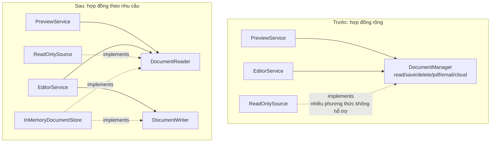
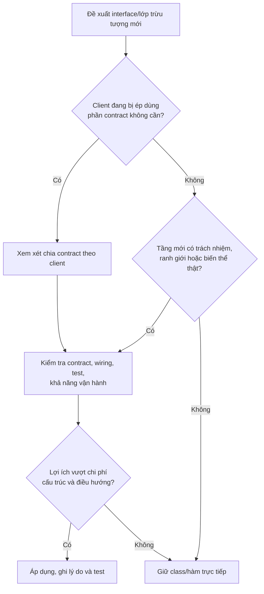

# Oversized interfaces or too many abstraction layers: recognizing and fixing OOP design problems

> **Topic:** OOP design pitfalls: an interface that forces clients to depend on too many operations, or a proliferation of interfaces, factories, facades, providers, and adapters that increases the number of classes to read without a real benefit. The lesson aims to identify both problems, examine each client's responsibilities, apply the **Interface Segregation Principle (ISP)** appropriately, and avoid **over-abstraction**.

## 1. Two different problems that often appear together

Two kinds of unnecessary complexity are often confused:

**Oversized interfaces (*fat interface*, *bloated interface*)** expose a contract with too many unrelated capabilities. A client needs only a small subset but must see or depend on the full contract; implementations may also be required to declare operations they cannot support.

**Too many abstraction layers (*over-abstraction*, *needless indirection*)** arise when classes/interfaces/intermediate layers add no worthwhile responsibility boundary, substitutability, or rule. A request passes through several objects that merely forward identical data.

These problems can occur separately:

- A `DocumentManager` with 20 methods has **an oversized interface**, even if there is only one interface.
- A `readDocument(id)` call passes through `ReaderFactory → ReaderProvider → ReaderFacade → ReaderAdapter → Store`: **too many abstractions**, even if each interface has just one method.
- A system with one enormous `IDocumentManager` and five decorator/provider layers has **both problems**.

**Core point:** neither a small method count nor a small class count determines quality. What matters is **whether responsibilities are coherent**, **what clients need to know**, **whether every implementation honors the contract**, and **which real changes an abstraction protects against**.

### A familiar example

A document-management application has users who only **view documents** and others who **edit documents**. One team defines an interface:

```java
interface DocumentManager {
    Document findById(String id);
    void save(Document document);
    void delete(String id);
    byte[] exportPdf(String id);
    void emailTo(String id, String recipient);
    void syncToCloud(String id);
}
```

Viewers need only `findById` but depend on a contract that also exposes writes, deletes, PDF exports, emails, and cloud sync. A read-only source implementing `DocumentManager` must instead define many methods that throw `UnsupportedOperationException`. That signals a contract poorly aligned with **client needs**, rather than merely an interface with "too many lines."

## 2. Why are oversized interfaces harmful?

### 2.1. Clients depend on more than they need

Suppose `DocumentPreviewService` only displays document content. If its constructor accepts `DocumentManager`, changes to email or delete APIs can still affect the shared contract, test stubs/mocks, or modules depending on that interface.

In a large codebase, a "god interface" can force unrelated feature teams to update together. Change velocity slows because editing the common interface risks affecting many consumers.

### 2.2. Implementations are forced to lie

```java
// Phản ví dụ, không phải thiết kế nên làm:
class ReadOnlyDocumentSource implements DocumentManager {
    public Document findById(String id) { /* ... */ return null; }

    public void save(Document document) {
        throw new UnsupportedOperationException("Chỉ đọc");
    }

    public void delete(String id) {
        throw new UnsupportedOperationException("Chỉ đọc");
    }

    public byte[] exportPdf(String id) {
        throw new UnsupportedOperationException("Không hỗ trợ");
    }

    public void emailTo(String id, String recipient) {
        throw new UnsupportedOperationException("Không hỗ trợ");
    }

    public void syncToCloud(String id) {
        throw new UnsupportedOperationException("Không hỗ trợ");
    }
}
```

In this sketch, `findById` has no implementation and returns `null` only to illustrate the structure; it is **not production code**. The problem is that operations the contract **promises to support** always fail in an otherwise valid implementation. That may violate the **Liskov Substitution Principle (LSP)** if clients are entitled to expect these methods to work.

`UnsupportedOperationException` is not universally wrong in Java: some collections have optional operations in the Java Collections Framework contract. But if a use case needs `save` and the interface does not document it as optional, making a read-only source implement a combined read/write interface is **a surprising design**.

### 2.3. Access rights and responsibilities are mixed

If document-display code receives an object capable of `delete` or `syncToCloud`, it may inadvertently perform actions outside its purpose. Segregating contracts **reduces the API surface visible to a client** but **does not replace security**: enforce authorization at trusted boundaries, rather than relying on interface names to stop a user from calling another API.

### 2.4. Tests become harder to mock

Even if a mock framework easily mocks a 20-method interface, its contract and fixtures may expand unnecessarily. Reading tests may need to understand unrelated methods or break when shared mock interfaces change. Watch for tests coupled to **structure unrelated to the behavior under test**.

## 3. What does the Interface Segregation Principle (ISP) address?

**ISP** in SOLID is often stated as:

> Clients should not be forced to depend on methods they do not use.

Rather than one contract encompassing every imaginable operation, identify **coherent capability groups that each client actually needs**.

Starting from the `DocumentManager` interface above, a design might define:

```java
interface DocumentReader {
    Optional<Document> findById(String id);
}

interface DocumentWriter {
    void save(Document document);
}
```

A document-preview service needs only `DocumentReader`. An editing service may need **both** `DocumentReader` and `DocumentWriter`. If PDF export and email are real workflows, establish their boundaries after understanding the use cases; not every method needs its own interface.

### How do dependency arrows change?



**The key:** the two interfaces **do not require separate storage objects**. An `InMemoryDocumentStore` or database adapter may implement **both**, while each client sees only its permitted portion of the contract.

## 4. Complete Java 17 example: small contracts and implementations with real capabilities

The example demonstrates two needs:

1. `PreviewService` only reads documents and creates previews.
2. `EditorialService` reads existing documents and replaces content.

An in-memory store supports both reading and writing; a static documentation source only supports reading. Neither implementation is forced to declare unsupported operations.

Create `InterfaceDesignDemo.java`:

```java
import java.util.HashMap;
import java.util.Map;
import java.util.Objects;
import java.util.Optional;

public class InterfaceDesignDemo {

    // Value object bất biến, không lộ mutable state.
    record Document(String id, String content) {
        Document {
            Objects.requireNonNull(id, "id");
            Objects.requireNonNull(content, "content");
            if (id.isBlank()) {
                throw new IllegalArgumentException("id không được rỗng");
            }
        }
    }

    // Hợp đồng nguồn dữ liệu chỉ đọc.
    @FunctionalInterface
    interface DocumentReader {
        Optional<Document> findById(String id);
    }

    // Hợp đồng nơi nhận tài liệu cần lưu.
    @FunctionalInterface
    interface DocumentWriter {
        void save(Document document);
    }

    // Implementation có cả hai khả năng.
    static final class InMemoryDocumentStore
            implements DocumentReader, DocumentWriter {

        private final Map<String, Document> documents = new HashMap<>();

        @Override
        public Optional<Document> findById(String id) {
            Objects.requireNonNull(id, "id");
            return Optional.ofNullable(documents.get(id));
        }

        @Override
        public void save(Document document) {
            Objects.requireNonNull(document, "document");
            documents.put(document.id(), document);
        }
    }

    // Implementation chỉ đọc, không có save() giả.
    static final class StaticDocumentReader implements DocumentReader {
        private final Map<String, Document> documents;

        StaticDocumentReader(Map<String, Document> documents) {
            this.documents = Map.copyOf(
                    Objects.requireNonNull(documents, "documents"));
        }

        @Override
        public Optional<Document> findById(String id) {
            Objects.requireNonNull(id, "id");
            return Optional.ofNullable(documents.get(id));
        }
    }

    static final class PreviewService {
        private final DocumentReader reader;

        PreviewService(DocumentReader reader) {
            this.reader = Objects.requireNonNull(reader, "reader");
        }

        String preview(String id, int maxChars) {
            if (id == null || id.isBlank() || maxChars < 0) {
                throw new IllegalArgumentException("Input không hợp lệ");
            }

            Document document = reader.findById(id)
                    .orElseThrow(() -> new IllegalArgumentException(
                            "Không tìm thấy tài liệu: " + id));

            String content = document.content();
            // Demo cắt theo số đơn vị UTF-16 của String.
            return content.substring(0, Math.min(maxChars, content.length()));
        }
    }

    static final class EditorialService {
        private final DocumentReader reader;
        private final DocumentWriter writer;

        EditorialService(DocumentReader reader, DocumentWriter writer) {
            this.reader = Objects.requireNonNull(reader, "reader");
            this.writer = Objects.requireNonNull(writer, "writer");
        }

        void replaceContent(String id, String newContent) {
            if (id == null || id.isBlank()) {
                throw new IllegalArgumentException("id không hợp lệ");
            }
            Objects.requireNonNull(newContent, "newContent");

            // Trong demo, chỉ cho sửa tài liệu đã tồn tại.
            reader.findById(id).orElseThrow(
                    () -> new IllegalArgumentException(
                            "Không tìm thấy tài liệu: " + id));
            writer.save(new Document(id, newContent));
        }
    }

    public static void main(String[] args) {
        InMemoryDocumentStore store = new InMemoryDocumentStore();
        store.save(new Document("DOC-1", "Xin chào Java"));

        PreviewService preview = new PreviewService(store);
        System.out.println(preview.preview("DOC-1", 8)); // Xin chào

        EditorialService editor = new EditorialService(store, store);
        editor.replaceContent("DOC-1", "Nội dung mới");
        System.out.println(preview.preview("DOC-1", 20)); // Nội dung mới

        DocumentReader helpSource = new StaticDocumentReader(Map.of(
                "HELP", new Document("HELP", "Hướng dẫn người dùng")
        ));
        PreviewService helpPreview = new PreviewService(helpSource);
        System.out.println(helpPreview.preview("HELP", 9)); // Hướng dẫn
    }
}
```

Run with JDK 17 or later:

```bash
javac InterfaceDesignDemo.java
java InterfaceDesignDemo
```

### Why does this example fix the actual problem?

- `PreviewService` **does not have** a `save` API in its dependency type; it only knows how to find documents.
- `StaticDocumentReader` implements its real read capability, without methods that throw `UnsupportedOperationException` to fill gaps.
- `EditorialService` declares its actual needs: reading and saving documents; its constructor shows precisely which two contracts it uses.
- `InMemoryDocumentStore` can implement both capabilities without forcing clients to depend on the same "super-interface."
- `Document` is a shallowly immutable record with immutable `String` components; returned data cannot directly mutate the store.
- If preview presentation changes, `PreviewService` changes. If the store moves to a DB, replace the injected adapter; SQL does not belong in the preview service.

**Demo limitations:** `HashMap` is not thread-safe; `EditorialService`'s "check existence → write document" sequence has no transaction and may race under concurrent edits. A production system might need an atomic repository operation such as `replaceIfVersionMatches` with optimistic locking. Splitting interfaces **does not automatically solve consistency or authorization**.

The `substring` example uses simple API logic and operates in **UTF-16 code units**; safely truncating by Unicode code points, grapheme clusters, or display rules requires an appropriately designed formatter. Do not assume every arbitrary character length avoids splitting emoji or combining characters.

## 5. Segregate by client, not "one interface per method"

ISP can easily be taken to the opposite extreme:

```java
interface FindDocumentByIdUseCase {
    Optional<Document> findById(String id);
}

interface FindDocumentTitleUseCase {
    String findTitle(String id);
}

interface FindDocumentContentUseCase {
    String findContent(String id);
}

interface FindDocumentAuthorUseCase {
    String findAuthor(String id);
}
```

If real clients **always need a title, content, and author together in one read operation**, splitting them into four tiny interfaces may only increase dependencies, calls, and configuration. In particular, if each interface has a separate adapter querying the DB, I/O costs and inconsistent snapshots may increase.

**Split interfaces around the roles clients need**, not around method counts:

- A **read-only** client needs a query contract.
- A **write-only** client needs a command contract.
- A **read/write** client may accept two interfaces or a meaningful composite contract if they always belong together.
- Complex PDF export might deserve a separate application service rather than living in a repository.
- A database adapter can still implement multiple relevant interfaces.

### When is a composite contract useful?

If a client frequently needs reading and writing within **one consistent transaction**, an API might expose:

```java
interface DocumentRepository
        extends DocumentReader, DocumentWriter {
}
```

Or, better yet, if the actual requirement is an atomic operation, express that directly:

```java
interface VersionedDocumentStore {
    boolean replaceIfVersionMatches(
            String id, long expectedVersion, String newContent);
}
```

Do not combine interfaces just to have "fewer constructor parameters," or split them because "smaller interfaces are always more SOLID." Choose according to **contracts and types of change** that must be protected.

## 6. How can too many abstraction layers cause harm?

Consider this document-reading flow:

```text
Controller
  → PreviewFacade
    → PreviewProvider
      → PreviewFactory
        → DocumentReaderProxy
          → DocumentReaderAdapter
            → DatabaseDocumentReader
```

If each layer only does:

```java
String preview(String id) {
    return delegate.preview(id);
}
```

and adds no necessary security, transaction, caching, tracing, type conversion, error policy, or implementation selection boundary, that is **indirection without value**.

A more reasonable flow might be:

```text
Controller
  → PreviewService
    → DocumentReader (port)
      → JdbcDocumentReader (adapter)
```

Each component now has a clear responsibility:
- The controller handles HTTP input/output.
- PreviewService implements the presentation use case.
- DocumentReader expresses the application's query needs.
- JdbcDocumentReader implements queries and data mapping.

**Do not judge only by call-stack depth.** A proxy may enforce access rights, a decorator may add metrics, a factory may manage lifecycles, and an adapter may hide a vendor API. Multiple layers are appropriate when each has **its own contract, reason to change, and tests**. But if most layers only forward calls without purpose, reconsider them.

### Decision-point diagram



## 7. Is the number of interfaces a measure of SOLID?

**No.** SOLID does not require an `IClass` for every class or an interface for every method.

Distinguish these cases:

| Situation | Reasonable assessment |
|---|---|
| `PaymentGateway` has one real implementation but hides a bank SDK from the application | The interface provides a valuable infrastructure boundary and supports fakes/tests |
| `PriceCalculator` calculates only two fixed numbers, without changing dependencies | A direct class/function may be simpler than an interface |
| `DocumentManager` has 30 methods, but document viewers only need one | Review ISP and split by needed capabilities |
| Three interfaces are always used together by **every** client, have one implementation, and have identical lifecycles | They may be over-segregated |
| A Java class has many methods serving one coherent abstraction | Method count alone does not violate ISP |
| One-method interface forces callers through unnecessary factories/providers/service locators | This may be over-abstraction |
| An application module must select implementations by environment | A composition root/DI can be a legitimate boundary |

A better indicator than "interface count" is **change propagation**: does adding a feature force updates to unrelated clients, more empty adapters, or layers that simply forward calls?

## 8. How ISP relates to SRP, LSP, and DIP

### ISP — each client depends only on what it uses

`PreviewService` depends on `DocumentReader` instead of the combined `DocumentManager`. That is the core oversized-interface problem.

### SRP — concerns with different reasons to change are not forced together

Document reading, email delivery, and PDF export may change for different actors. Combining them in one interface **may** increase coupling across reasons for change. However, SRP concerns module/class responsibilities; it does not require every method to live in a different interface.

### LSP — implementations must honor their promises

If a read-only source implements an interface requiring `save` but always throws `UnsupportedOperationException`, clients cannot safely substitute implementations. Separating `DocumentReader` lets the read-only source honor its entire contract.

### DIP — high-level policy does not depend on infrastructure details

A document-reading application can depend on `DocumentReader`, implemented by `JdbcDocumentReader`. But **DIP does not require additional layers**. One purpose-built interface may provide the necessary boundary.

**A healthy combination:** use **enough** abstractions to protect independent responsibilities and real changes; avoid adding them merely to "meet SOLID."

## 9. A dangerous problem: vague contracts and "unsupported" methods

Interface quality depends on **semantics**, not just size:

```java
interface Storage {
    Object execute(String operation, Object payload);
}
```

Even with **one method**, this interface can be worse than a contract with several well-defined methods:

- Clients must remember which "operation" values are valid.
- Incorrect types are only detected at runtime.
- Errors, null policies, atomicity, and side effects are unspecified.
- Widespread `if/switch` statements and casts become likely.

Instead of one multipurpose method, choose a typed contract with clear meaning:

```java
interface DocumentReader {
    Optional<Document> findById(String id);
}
```

**ISP does not mean minimizing method count at all costs.** A single-method API with unlimited meanings may be **an enormous interface hidden inside its parameters**.

### Warning signs of APIs with too many flags

```java
// Khó hiểu, nhiều nhánh theo cờ:
Document process(
        Document d,
        boolean readOnly,
        boolean exportPdf,
        boolean notifyOwner,
        boolean forceSync);
```

One method handles multiple use cases with different side effects. Replace it with domain operations, keep genuine shared logic in appropriate collaborators, and avoid one generic method with many flags.

## 10. Do not use inheritance to force every object to share a capability

A related mistake is stuffing operations into an **abstract base class** so every subclass can use them:

```java
abstract class ContentHandler {
    abstract String read(String id);
    abstract void write(String id, String value);
    abstract void delete(String id);
    abstract void exportPdf(String id);
}
```

If read-only handlers must override three methods just to throw errors, the inheritance hierarchy describes **the wrong relationship**. Use capability interfaces such as `DocumentReader` and `DocumentWriter` so implementations support only what they can do.

But do not automatically create `CanRead`, `CanOpen`, `CanClose`, `CanWrite`, and `CanDelete` interfaces for every object without genuinely different clients. Group capabilities by **cohesion** and **use case**.

### Interfaces extending interfaces

Java allows broader contracts to be composed from smaller ones:

```java
interface ReadWriteDocuments
        extends DocumentReader, DocumentWriter {
}
```

If clients genuinely need complete read/write capabilities, this combined contract may help. Expose it only where appropriate so every client does not end up depending on the large contract again.

## 11. Do Java default methods fix fat interfaces?

Not necessarily.

For example:

```java
interface DocumentManager {
    Document read(String id);

    default void delete(String id) {
        throw new UnsupportedOperationException("Không hỗ trợ");
    }
}
```

A `default` method can help evolve an API without forcing existing implementations to add code, but **it does not automatically correct misplaced responsibilities**. Clients still see `delete` and may call it without knowing whether the implementation supports it.

**A default method is a language feature, not a substitute for contract design.**

For truly optional features, consider:
- Splitting out a capability interface.
- Moving the operation to a separate service.
- Using explicit capability negotiation when the domain genuinely needs dynamic support checks.
- Documenting and testing unsupported-operation failures if the API intentionally permits optional operations.

Avoid adding default no-ops that report fake "success" merely to make every implementation compile.

## 12. Testing small APIs: verify behavior, not only easier mocking

Here is a JUnit 5 example for `InterfaceDesignDemo` from section 4. Put `InterfaceDesignDemoTest.java` in the same package:

```java
import static org.junit.jupiter.api.Assertions.*;
import java.util.Map;
import java.util.Optional;
import org.junit.jupiter.api.Test;

class InterfaceDesignDemoTest {

    @Test
    void previewNeedsOnlyReader() {
        InterfaceDesignDemo.DocumentReader fake = id ->
                Optional.of(new InterfaceDesignDemo.Document(
                        id, "Hello, world"));

        var preview = new InterfaceDesignDemo.PreviewService(fake);

        assertEquals("Hello", preview.preview("DOC-1", 5));
    }

    @Test
    void readOnlySourceDoesNotNeedUnsupportedMethods() {
        var reader = new InterfaceDesignDemo.StaticDocumentReader(
                Map.of("DOC-1", new InterfaceDesignDemo.Document(
                        "DOC-1", "Chỉ đọc")));
        var preview = new InterfaceDesignDemo.PreviewService(reader);

        assertEquals("Chỉ đọc", preview.preview("DOC-1", 20));
    }

    @Test
    void editorCanReplaceExistingDocument() {
        var store = new InterfaceDesignDemo.InMemoryDocumentStore();
        store.save(new InterfaceDesignDemo.Document("A", "Cũ"));
        var editor = new InterfaceDesignDemo.EditorialService(store, store);

        editor.replaceContent("A", "Mới");

        assertEquals("Mới", store.findById("A").orElseThrow().content());
    }

    @Test
    void editorRejectsUnknownDocument() {
        var store = new InterfaceDesignDemo.InMemoryDocumentStore();
        var editor = new InterfaceDesignDemo.EditorialService(store, store);

        assertThrows(IllegalArgumentException.class,
                () -> editor.replaceContent("UNKNOWN", "Nội dung"));
        assertTrue(store.findById("UNKNOWN").isEmpty());
    }

    @Test
    void previewRejectsNegativeLimit() {
        var store = new InterfaceDesignDemo.InMemoryDocumentStore();
        var preview = new InterfaceDesignDemo.PreviewService(store);

        assertThrows(IllegalArgumentException.class,
                () -> preview.preview("A", -1));
    }
}
```

The lesson: `PreviewService` tests can use a **lambda** `DocumentReader` without mocking save/delete/export/email. `StaticDocumentReader` need not implement empty methods. The contract closely reflects actual needs.

A real integration boundary still needs testing: when production uses JDBC, REST, or cloud storage, fakes cannot guarantee SQL, transactions, timeouts, or permissions behave correctly. Adapter integration/contract tests are still required. Having an interface does not eliminate runtime failures.

## 13. When should a concrete class be kept instead of adding an interface?

A class with a short algorithm, one implementation, no infrastructure leakage, and no role as a public API can be used directly:

```java
final class TitleFormatter {
    String format(String title) {
        if (title == null) {
            throw new IllegalArgumentException("title không được null");
        }
        return title.trim();
    }
}
```

Creating `ITitleFormatter`, `DefaultTitleFormatter`, `TitleFormatterFactory`, and `TitleFormatterProvider` for this function usually adds no practical benefit.

When is an interface worthwhile?

- To **separate business logic from SDK/DB/network dependencies**.
- When multiple implementations honor the same real contract.
- When a module deliberately provides an extension point to other teams.
- When a client must see only a constrained set of capabilities.
- When tests must isolate slow/unreliable dependencies and the interface represents a meaningful independent capability.
- When a replacement is planned or changing a widely used technology would be costly.

Not all criteria are required; **one compelling reason** can justify an interface. Conversely, "future extensibility" is weak unless **what will change and who will change it** are identified.

## 14. Comparing two kinds of design cost

| Criterion | Oversized interface | Too many abstractions |
|---|---|---|
| Main issue | Clients depend on unused capabilities | Tasks traverse too many indirect layers |
| Warning signs | `UnsupportedOperationException` in many implementations; frequently changed interface | Classes only delegate; factories only call `new`; complicated wiring |
| Consequences | Widespread coupling, difficult substitution, potential LSP violations | Reading/debugging/configuration costs, circular dependencies, and hidden control flow |
| Typical fix | Segregate contracts by client/capability | Remove redundant forwarding layers; use classes or ports directly |
| Risk of going too far | Dozens of one-method interfaces without cohesion | Consolidating everything into a God Class |
| Success criterion | Clients see only what they need; implementations fulfill the complete contract | Remaining classes have clear responsibilities/boundaries and workflows are easy to follow |

**Look from the client's perspective** to diagnose effectively: map which service methods, results, and error types are used, and which classes a use case must know about.

## 15. How can "too large" and "too many" be measured?

There is no fixed rule such as "no more than 5 interface methods" or "no more than 3 layers." Those numbers do not measure responsibility.

Use observable indicators:

1. **Client usage matrix:** list the interface methods each client actually calls. If most clients use different subsets, splitting by capability group may help.
2. **Implementation support matrix:** which implementations require stubs, no-ops, or unsupported-operation errors?
3. **Change ripple:** does updating one capability require unrelated code or tests to change?
4. **Indirection audit:** how many layers merely call `return delegate.call(args)` without adding value?
5. **Wiring complexity:** is it difficult to determine which bean/adapter executes?
6. **Behavior testability:** can public-boundary tests run without constructing unrelated services?
7. **Operations:** which layer fails, where are timeouts applied, and can tracing distinguish steps?
8. **Ownership:** does one interface represent a capability group with a shared owner/reason to change or several unrelated feature groups?

These are **decision-support data**, not a mechanical pass/fail score. For example, an interface with 12 methods describing a coherent parser API may be entirely appropriate, while two unrelated methods may be too many.

### Simple usage matrix

| Client | Read | Save | Delete | Export PDF | Email |
|---|---:|---:|---:|---:|---:|
| Preview page | Yes | — | — | — | — |
| Content editor | Yes | Yes | — | — | — |
| Admin cleanup | Yes | — | Yes | — | — |
| Report exporter | Yes | — | — | Yes | — |

If all these clients depend on `DocumentManager`, the combined interface burdens clients using only small subsets. Separating **Read**, **Write**, and other use-case operations may reduce coupling. But do not automatically create five microinterfaces: group by responsibilities and preserve data/transaction semantics at a reasonable cost.

## 16. Refactoring a large interface without breaking its users

A practical refactoring plan:

1. **Inventory clients and implementations.** Identify who calls which methods, and which parts are public APIs or external compilation dependencies.
2. **Build a use-case–capability matrix.** Group methods that genuinely belong in one contract. Identify implementations that support only a subset.
3. **Write behavior tests first.** Cover current scenarios with unit and contract tests, including failure cases.
4. **Introduce smaller contracts.** Create `DocumentReader` and `DocumentWriter` around actual needs; avoid creating a slightly smaller "God Interface."
5. **Make existing implementations fulfill new contracts.** Update adapters carefully without changing error or data semantics.
6. **Migrate clients incrementally.** Inject only the reader into previews and the actual capabilities into editors. Remove setters/stubs no longer required by contracts.
7. **Preserve compatibility if needed.** Public libraries may temporarily retain deprecated old interfaces/adapters with a versioning and migration plan.
8. **Review transactions.** If two operations must be atomic, splitting an interface must not turn one transaction into two racy calls; design atomic methods where appropriate.
9. **Review the architecture.** Remove purposeless providers/factories/delegates while keeping the composition root understandable.
10. **Measure outcomes.** Did unrelated client changes, implementation replacement, and reading/debugging costs improve?

**Important:** splitting or changing a public interface can be **a source/binary breaking change** for external implementers and callers. Published libraries need versioning/migration strategies. Do not delete a widely integrated interface immediately just because its design is currently weak.

## 17. Beware seemingly reasonable "solutions"

### 17.1. Create an interface for every unit test

A stable, pure calculation class without side effects is often easiest to test directly. An interface is useful for a collaborator worth replacing/isolating, not as decoration for every class.

### 17.2. Split an interface into dozens of method-level interfaces

A consumer constructor might receive 12 dependencies instead of 1, complicating wiring without improving real extensibility. A cohesive `DocumentReader` contract with related queries may suffice.

### 17.3. Make every interface extend a common base interface

```java
interface BaseService {
    void initialize();
    void validate();
    void close();
}
```

If a pure string service needs no `close` but a network adapter requires `close`, forcing both to extend `BaseService` creates a **fat interface** at the base. Use `AutoCloseable` or explicit lifecycle boundaries when needed; avoid a universal base for superficial uniformity.

### 17.4. Use generic repositories for every use case

A `GenericRepository<T>` with many customizable queries may expose too broad an API. A use-case-specific port (such as `FindActiveOrders`) can better express specialized business queries. But for simple CRUD, a standard repository can be economical; do not mandate an interface for every query.

### 17.5. Hide unsupported operations behind runtime flags

```java
if (documentManager.supportsDelete()) {
    documentManager.delete(id);
}
```

When client/implementation types have distinct capabilities, capability interfaces may provide stronger compile-time checking. But plugin systems can have dynamically changing capabilities, where flags/negotiation are genuine requirements. **Specify the contract** rather than applying one rule to every architecture.

### 17.6. Assume interface segregation provides security automatically

A variable typed `DocumentReader` prevents code from calling `save` through that variable, but an untrusted caller may still access another endpoint. Enforce permissions at the boundary with authentication, authorization, and data-access controls.

## 18. Record design decisions briefly

When debating "split the interface or keep it?", document a few lines in an **Architecture Decision Record (ADR)**:

```markdown
# ADR: Tách hợp đồng đọc/ghi tài liệu

Bối cảnh:
- UI preview chỉ cần đọc.
- Adapter tài liệu hướng dẫn chỉ hỗ trợ đọc.
- Contract cũ có save/delete/export/email và ép nhiều stub.

Phương án:
1. Giữ DocumentManager chung.
2. Tách DocumentReader/DocumentWriter theo client.
3. Tách từng method thành một interface độc lập.

Quyết định:
- Chọn phương án 2. Export/email thuộc use case khác.

Lợi ích:
- Preview không phụ thuộc capability ghi/xóa.
- Adapter chỉ đọc không phải ném UnsupportedOperationException.
- Test preview dùng fake chỉ đọc.

Đánh đổi:
- Cần cập nhật constructor và wiring.
- Những workflow đọc-rồi-ghi có thể cần operation atomic riêng.

Xem xét lại khi:
- Nhiều client cùng cần một bộ capability ổn định,
  hoặc persistence/transaction boundary thay đổi.
```

A good decision has **reasons and review conditions**, not merely the slogan that "ISP requires every interface to be small."

## 19. Analysis exercises

**Exercise 1 – Find the fat interface.** Given `EmployeeSystem` with `findEmployee`, `updateSalary`, `sendBirthdayEmail`, `exportPayrollCsv`, and `deleteEmployee`, list HR, payroll, employee self-service, and email-scheduler clients and determine their actual method needs. Propose contracts without creating 5 interfaces merely to have "one method per interface."

**Exercise 2 – Refactor a read-only source.** `ReportRepository` exposes `load`, `save`, and `delete`, but `RemoteReportArchive` may only fetch reports and throws on writes. Extract a suitable contract, update the dashboard report dependency, and test that neither write/delete method needs mocking.

**Exercise 3 – Audit forwarding layers.** A request traverses `PriceFacade → PriceProvider → PriceFactory → PriceCalculator`. Explain the purpose of each layer. Remove layers without unique responsibilities while preserving behavior and tests; give a case where a factory is needed (multiple implementations chosen by runtime configuration).

**Exercise 4 – Atomicity requirement.** An editor uses `DocumentReader` and `DocumentWriter`, reads version 2, and overwrites it with version 3 while another user edits concurrently. Propose `replaceIfVersionMatches` or transactions/locking; explain why interface segregation does not ensure concurrency safety.

**Exercise 5 – Balance ISP with complexity.** An application has three interfaces `ReadTitle`, `ReadContent`, and `ReadAuthor`; every caller uses all three and their implementation is identical. Propose a more cohesive contract and assess reduced class count and testing impact.

## 20. Review checklist before adding or splitting abstractions

- [ ] I can identify clients that **do not need** part of the current interface.
- [ ] No implementation is forced to create fake methods or violate its contract.
- [ ] Every interface expresses capabilities **meaningful to its clients**.
- [ ] I do not split into "one method per interface" by a fixed formula.
- [ ] I identify forwarding-only layers and have a clear reason to keep or remove them.
- [ ] I know which technology/use-case changes the abstraction will protect.
- [ ] I do not pull SQL/HTTP/SDK into business code merely to reduce class count.
- [ ] I consider transactions, errors, authorization, lifecycle, and operations separately.
- [ ] I have behavior tests, integration tests where needed, and migration plans for public APIs.
- [ ] I do not use interface/class count as an OOP quality metric.

**Remember:** a good interface need not be the shortest; it must offer **the right capabilities to the right clients**. A useful abstraction creates a meaningful boundary without appearing everywhere. **Separate what clients do not need**, **group operations belonging to one real contract**, and **remove intermediary layers lacking clear responsibilities or adaptation value**.
