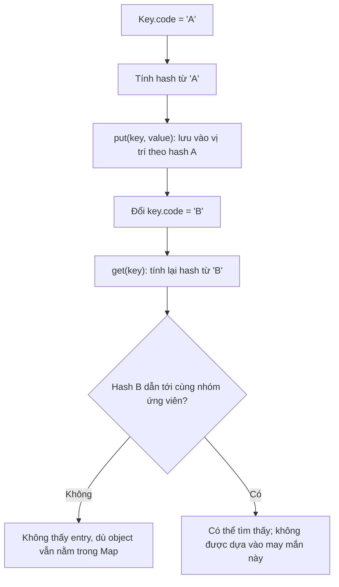
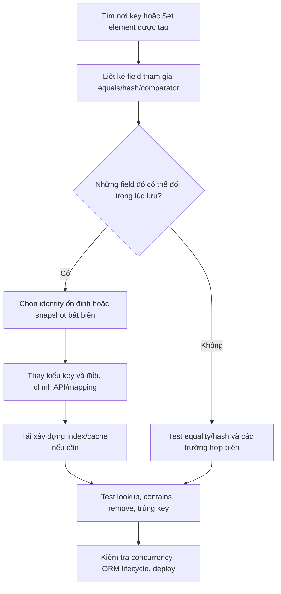

# Mutable objects breaking equality or hash codes

> **Topic:** An OOP design pitfall where changes to object state affect `equals()`, `hashCode()`, or comparison ordering. This Java 17 lesson examines hash-based and sorted collections, stable identity, and safeguards against subtle bugs.

## 1. The practical issue: why is a key "still there" but not found?

You insert a `CustomerKey` into a `HashMap` and then change that object's `code` field. Later, `map.get(key)` can return `null` even though you still hold **the very same reference used during insertion**.

At first this seems impossible: "I did not create a new object, so why can't the Map find it?"

A hash-based data structure first uses **a hash to locate candidates**, then **equality to identify a key**. If a stored key's hash changes, later lookups may search a different location from where the entry was inserted.



**Central rule:** Do not mutate information determining an object's `equals()` or `hashCode()` **while that object is an element of a `HashSet` or a key in a `HashMap`**.

The `hashCode()` formula is not necessarily "wrong." It may be valid for each state, but **using an unstable key violates the collection's assumptions**.

## 2. Revisiting the `equals()` and `hashCode()` contracts

### What `equals(Object)` means

For non-`null` objects, equality must satisfy:

| Property | Requirement | Design risk |
|---|---|---|
| Reflexivity (*reflexive*) | `x.equals(x)` is always `true` | Comparison depends on inappropriate conditions |
| Symmetry (*symmetric*) | `x.equals(y)` and `y.equals(x)` agree | Inheritance causes asymmetric comparisons |
| Transitivity (*transitive*) | If `x = y` and `y = z`, then `x = z` | Inconsistent equality criteria |
| Consistency (*consistent*) | Results remain stable **while comparison-relevant information is unchanged** | Clock, randomness, or unstable fields |
| Non-`null` | `x.equals(null)` is `false` | Failure to handle null |

The bold condition matters: **`equals` need not return the same result after you deliberately mutate comparison-relevant state**. Such mutation may be valid for mutable objects generally, but **invalid while they serve as collection keys**.

### `hashCode()` must be compatible with `equals()`

- If `a.equals(b)` is `true`, `a.hashCode() == b.hashCode()` **must also be true**.
- While data used by `equals()` remains unchanged, repeated calls to `hashCode()` must be consistent within one application execution.
- Two **unequal objects** may **have identical hashes**. Hash collisions are normal.
- An object is not guaranteed the same hash across JVM runs.
- `hashCode` is not a unique ID or security checksum and cannot substitute for a database key.

```text
a.equals(b) == true  =>  a.hashCode() == b.hashCode()   [BẮT BUỘC]
a.hashCode() != b.hashCode()  =>  a.equals(b) == false  [SUY RA]
a.hashCode() == b.hashCode()  =>  CHƯA THỂ KẾT LUẬN a.equals(b)
```

A related but **different error from mutable keys** is overriding `equals` based on content but forgetting `hashCode`, producing unequal hashes for objects considered equal. Test the two problems separately.

## 3. Java counterexample: a mutable field used for equality and hashing

Consider `MutableCustomerKey` with an editable `code` field:

```java
import java.util.HashMap;
import java.util.Map;
import java.util.Objects;

final class MutableCustomerKey {
    private String code;

    MutableCustomerKey(String code) {
        this.code = Objects.requireNonNull(code);
    }

    void rename(String newCode) {
        this.code = Objects.requireNonNull(newCode);
    }

    @Override
    public boolean equals(Object other) {
        return other instanceof MutableCustomerKey that
                && code.equals(that.code);
    }

    @Override
    public int hashCode() {
        return code.hashCode();
    }

    @Override
    public String toString() {
        return code;
    }
}

class BadKeyExample {
    public static void main(String[] args) {
        MutableCustomerKey key = new MutableCustomerKey("A");
        Map<MutableCustomerKey, String> map = new HashMap<>();
        map.put(key, "Hồ sơ khách hàng");

        int before = key.hashCode();
        key.rename("B");
        int after = key.hashCode();

        System.out.println(before); // 65
        System.out.println(after);  // 66
        System.out.println(map.get(key));
        // Có thể trả null: hash dùng để tìm không còn khớp
        // với hash được dùng lúc đưa entry vào Map.
    }
}
```

`"A".hashCode()` is `65`, while `"B".hashCode()` is `66`. In typical JDK 17 `HashMap` implementations, these hashes place entries in different candidate groups at suitable table sizes, so `get(key)` often returns `null` after mutation.

**The API does not guarantee** that "every mutated key makes `get` return `null`." With particular old/new hashes, collisions, or implementations, lookups may occasionally succeed. That does not make the design safe.

### Why can lookup fail even with the identical reference?

One might assume `map.get(key)` recognizes identity using `==`. But `HashMap` **does not scan the entire Map for that reference** on every lookup; it first determines candidate entries using the supplied key's hash. If the old entry is outside that bucket, identical references cannot help.

### Can changing the name back fix it?

In a particular case, restoring `code` to its previous value may restore `hashCode` and make lookup succeed again. But this is not a designed recovery mechanism; after `put`/`remove`/`rehash` operations while the key was mutated, the structure and data semantics may already have changed.

**Never rely on restoring the old value as a repair strategy.**

## 4. Concrete consequences in different collections

| Collection/mechanism | Modified field | Possible consequence |
|---|---|---|
| `HashMap<K,V>` | A **key** field involved in hashing | `get`/`containsKey`/`remove` may fail to locate the key |
| `HashSet<E>` | An **element** field involved in hashing | Unexpected `contains`/`remove` results; adding an equal element again may be possible |
| `LinkedHashMap`, `LinkedHashSet` | Hash/equality-relevant field | Similar lookup failures; insertion order does not fix them |
| `ConcurrentHashMap` | Hash-relevant key field | Map concurrency control **does not protect external key mutations** |
| `WeakHashMap` | Mutable key | Weak references affect GC but **do not eliminate hash/equality requirements** |
| `TreeMap`/`TreeSet` | Field used by `compareTo`/`Comparator` | Stored sort order no longer matches updated ordering, breaking lookups/traversal |
| `ArrayList` | Field used by `equals` | `contains`/`indexOf` generally scan current values; no stale bucket, though collection semantics change |
| `HashMap<K,V>` | **Value** field unrelated to the key | Does not directly break key lookup; application semantics/thread safety still matter |

**Distinction:** an object may be mutable and still serve as a key if equality/hash-relevant data **stays unchanged** while it is stored. The issue is not the label `mutable` itself, but mutations to **fields defining identity or comparisons**.

### Can a `HashSet` hold "the same object twice"?

A surprising behavior may occur:

1. Add `key` to the Set while its hash is A.
2. Change a field so its hash becomes B.
3. Call `set.add(key)` again.
4. If the Set cannot locate the original entry among B's candidates, it may add another entry holding **the same object reference**.

Then `set.size()` can exceed the count of objects distinct under current equality. This does not mean the Set contract permits duplicates; **mutating the key violated the assumptions of the hash structure**.

As behavior depends on internal state and hash codes, do not treat this as a feature for storing one object more than once.

## 5. Runnable example: immutable keys and mutable profiles

A common OOP solution is to **separate stable identity from mutable attributes**.

- `CustomerId`: immutable value object used as the key.
- `CustomerProfile`: object with editable data such as `displayName`, but a fixed `id`.
- Profile equality, if defined, should use the chosen identity rather than **arbitrarily incorporating frequently changing fields**.
- `Map<CustomerId, CustomerProfile>`: lookup uses `CustomerId`, so changing display names does not alter buckets.

Save the following as `StableKeyDemo.java` and run with JDK 17:

```bash
javac StableKeyDemo.java
java StableKeyDemo
```

```java
import java.util.HashMap;
import java.util.Map;
import java.util.Objects;

public final class StableKeyDemo {

    // Record với thành phần String bất biến.
    record CustomerId(String value) {
        CustomerId {
            Objects.requireNonNull(value, "value");
            if (value.isBlank()) {
                throw new IllegalArgumentException(
                        "CustomerId không được rỗng");
            }
        }
    }

    // Profile có thuộc tính mutable, ID luôn ổn định.
    static final class CustomerProfile {
        private final CustomerId id;
        private String displayName;

        CustomerProfile(CustomerId id, String displayName) {
            this.id = Objects.requireNonNull(id, "id");
            changeDisplayName(displayName);
        }

        CustomerId id() {
            return id;
        }

        String displayName() {
            return displayName;
        }

        void changeDisplayName(String newName) {
            Objects.requireNonNull(newName, "newName");
            if (newName.isBlank()) {
                throw new IllegalArgumentException(
                        "Tên hiển thị không được rỗng");
            }
            displayName = newName;
        }

        // Trong ví dụ, profile so sánh theo định danh ổn định.
        @Override
        public boolean equals(Object other) {
            return this == other
                    || other instanceof CustomerProfile p
                    && id.equals(p.id);
        }

        @Override
        public int hashCode() {
            return id.hashCode();
        }
    }

    public static void main(String[] args) {
        CustomerId id = new CustomerId("KH-001");
        CustomerProfile profile =
                new CustomerProfile(id, "Nguyễn An");

        Map<CustomerId, CustomerProfile> customers = new HashMap<>();
        customers.put(id, profile);

        // Dữ liệu hồ sơ thay đổi, ID không đổi.
        profile.changeDisplayName("Nguyễn An Bình");

        // Tạo một ID mới nhưng có cùng giá trị:
        CustomerId equivalent = new CustomerId("KH-001");

        System.out.println(
                customers.get(equivalent).displayName());
        // Nguyễn An Bình

        System.out.println(
                customers.containsKey(equivalent)); // true

        CustomerProfile another =
                new CustomerProfile(equivalent, "Tên khác");
        System.out.println(profile.equals(another)); // true
        System.out.println(
                profile.hashCode() == another.hashCode()); // true
    }
}
```

### Why does this design preserve the contract?

**`CustomerId` is a record containing an immutable `String`.** Java generates `equals`/`hashCode` based on the `value` component, which cannot change after construction. Two `CustomerId("KH-001")` instances with the same value are treated as one key by the Map.

**`CustomerProfile` separates identity fields from display fields.** `changeDisplayName` is allowed but does not change `id`; therefore, profile equality/hash remain stable when names change.

**Do not identify people by display names.** Different people may share names, and one person may change theirs. Using `displayName` as the key invites business collisions and mutable-hash failures.

**Limitations:** `CustomerProfile` equality based on ID is **a domain decision**; not every entity needs ID-based equality overrides. If IDs are generated during persistence, consider states before/after saving and ORM proxies. The example assigns IDs at object creation.

### An entity can mutate while its key remains stable

A practical rule:

> **Let objects perform valid state changes, but keep their identity key stable throughout the collection-managed lifecycle.**

The whole application need not be immutable. Protect identity/equality-related information.

## 6. Subtle pitfall: records do not imply deep immutability

Java records prevent **component fields from reassignment**, but do not automatically make referenced objects immutable.

For example:

```java
import java.util.ArrayList;
import java.util.List;

record FilterKey(List<String> tags) {}

List<String> tags = new ArrayList<>(List.of("java"));
FilterKey key = new FilterKey(tags);

int before = key.hashCode();
tags.add("oop");
int after = key.hashCode();

System.out.println(before == after);
// Giá trị có thể thay đổi vì List.hashCode phụ thuộc phần tử.
```

`FilterKey` is a record, but its `tags` component still points to **the same mutable ArrayList**. Record-generated `equals`/`hashCode` use the `List`'s content-based equality/hash. Thus "records make good keys" holds only when **their equality/hash-relevant components also remain stable**.

### Protecting state with `List.copyOf`

```java
import java.util.List;
import java.util.Objects;

record SafeFilterKey(List<String> tags) {
    SafeFilterKey {
        Objects.requireNonNull(tags, "tags");
        tags = List.copyOf(tags);
    }
}
```

The compact constructor reassigns the `tags` parameter before component initialization, ensuring the record stores a list snapshot that cannot be mutated through ordinary collection APIs. Since `String` is immutable, the example's elements are stable too.

```java
List<String> callerTags = new java.util.ArrayList<>(List.of("java"));
SafeFilterKey key = new SafeFilterKey(callerTags);

callerTags.add("oop");       // Không thay đổi key.tags()
System.out.println(key.tags()); // [java]

// key.tags().add("spring"); // UnsupportedOperationException
```

**Note:** `List.copyOf` takes a **shallow** snapshot. If the list contains a mutable class such as `Address` with setters, mutating an element can still change equality/hash. Use immutable elements, suitable deep copies, or a different key.

**Another note:** `List.copyOf` rejects `null` elements. If null is valid in the domain, define a normalization policy or another structure instead of blindly copying and encountering unexpected errors.

## 7. The array pitfall in value objects

A similar but more subtle issue: `byte[]` is mutable, and a `record` with an array component **does not automatically generate element-wise equality**:

```java
record RawToken(byte[] bytes) {}

RawToken a = new RawToken(new byte[]{1, 2});
RawToken b = new RawToken(new byte[]{1, 2});

System.out.println(a.equals(b)); // false, khác array reference
```

If the business defines "tokens with identical byte sequences are equal," implement **content-based equality/hash** and **defensive copying** so the key stays stable.

Example `BinaryKey` class:

```java
import java.util.Arrays;
import java.util.Objects;

final class BinaryKey {
    private final byte[] bytes;

    BinaryKey(byte[] bytes) {
        Objects.requireNonNull(bytes, "bytes");
        this.bytes = Arrays.copyOf(bytes, bytes.length);
    }

    byte[] bytes() {
        return Arrays.copyOf(bytes, bytes.length);
    }

    @Override
    public boolean equals(Object other) {
        return this == other
                || other instanceof BinaryKey key
                && Arrays.equals(bytes, key.bytes);
    }

    @Override
    public int hashCode() {
        return Arrays.hashCode(bytes);
    }
}
```

Choosing `class final` here avoids surprises from default record equality for arrays; both the constructor and getter copy the bytes. `Arrays.equals` and `Arrays.hashCode` use byte contents, keeping the contract consistent.

Security note: if the byte array contains secrets, `Arrays.equals` may be inappropriate for defending against *timing side channels*. Key/hash design does not replace dedicated security protocols.

## 8. Not all mutations are equally dangerous

The following example **does not change** the hash because `equals`/`hashCode` only use `id`:

```java
final class UserKey {
    private final String id;
    private String displayName;

    UserKey(String id, String displayName) {
        this.id = java.util.Objects.requireNonNull(id);
        this.displayName = displayName;
    }

    void renameDisplay(String name) {
        displayName = name;
    }

    @Override
    public boolean equals(Object other) {
        return other instanceof UserKey that
                && id.equals(that.id);
    }

    @Override
    public int hashCode() {
        return id.hashCode();
    }
}
```

Changing `displayName` does not affect this type's equality, making it **safer for hash-key stability** than changing `id`. Still ask:
- Is mutable data shared among threads?
- Does renaming require validation/auditing/authorization?
- If clients sort/filter by name, must the result set be refreshed?
- Is `id` actually unique within the business scope (tenant, organization, data partition)?

**Lesson:** *Immutability* is a powerful tool for protecting keys, but the precise requirement is **stability of attributes used by equality, hashing, and comparators while an object belongs to the relevant structure**.

## 9. Changing `equals` while using different fields in `hashCode` is also a bug

This is an independent problem to avoid during refactoring:

```java
final class BrokenProduct {
    String sku;
    String description;

    @Override
    public boolean equals(Object other) {
        return other instanceof BrokenProduct p
                && java.util.Objects.equals(sku, p.sku);
    }

    @Override
    public int hashCode() {
        return java.util.Objects.hash(sku, description);
    }
}
```

Two products with the same `sku` but different `description` values satisfy `equals() == true` while their `hashCode` values may differ. That **violates the contract even for immutable objects**.

If only `sku` identifies products, `hashCode` must depend only on information guaranteed equal for equal objects, such as `Objects.hashCode(sku)`. Hashing **a subset** of equality fields can be valid but may cause more collisions; hashing fields **outside equality** risks breaking the contract.

Distinguish:

| Situation | Problem |
|---|---|
| `equals` uses `sku` while `hashCode` uses `sku + description` | An immediate equality/hash contract violation |
| `equals` and `hashCode` both use `sku`, but `sku` changes after insertion into Map | State-based contract may be valid, but the **stored key is unstable** |
| `equals`/`hashCode` use `id final` while `displayName` changes | Potentially safe for hash/equality |
| `hashCode` returns a constant and `equals` is correct | Contract may hold, but collisions and performance may suffer |
| `equals` is correct but `hashCode` is inherited from `Object` | Equal objects may have different hashes, violating the contract |

Do not assume every changing hash means "Java itself is wrong," or that matching hashes establish equality.

## 10. Sorted collections have a related failure mode

`TreeSet` and `TreeMap` use **`compareTo` or `Comparator`**, not hash buckets, to determine search order.

For example:

```java
import java.util.Comparator;
import java.util.TreeSet;

final class RankedItem {
    int priority;
    final String id;

    RankedItem(String id, int priority) {
        this.id = id;
        this.priority = priority;
    }
}

class TreeSetProblem {
    public static void main(String[] args) {
        TreeSet<RankedItem> set = new TreeSet<>(
                Comparator.comparingInt(item -> item.priority));

        RankedItem a = new RankedItem("A", 10);
        RankedItem b = new RankedItem("B", 20);
        set.add(a);
        set.add(b);

        a.priority = 30; // Đổi trường quyết định thứ tự.
        System.out.println(set);
        // Cấu trúc đã được xây theo thứ tự cũ, không tự sắp xếp lại.
    }
}
```

Two problems arise:

1. **Ordering no longer matches the comparator** after changing the `priority` field of an object already stored in the tree.
2. The demo comparator **only compares priority**. Different `id` values with equal priority are treated as equivalent by TreeSet (`compare == 0`), even if they are distinct entities.

To sort by both `priority` and `id`, use:

```java
Comparator<RankedItem> ordering =
        Comparator.comparingInt((RankedItem item) -> item.priority)
                  .thenComparing(item -> item.id);
```

But **adding a tie-breaker does not fix a mutable comparator key**. When `priority` must change, remove the object **before** editing it and reinsert under appropriate transaction/synchronization. Or sort **immutable snapshots** and rebuild the set/snapshot when needed.

### What must stay stable in hash-based and sorted collections?

| Structure | Attributes that must stay stable while storing keys |
|---|---|
| `HashMap`/`HashSet` | Data used for hashing and determining equality |
| `TreeMap`/`TreeSet` | Data used for comparator/order and comparator-based equivalence |
| `PriorityQueue` | Mutating an enqueued element's priority does not rebuild the heap; remove/reinsert or use a suitable update strategy |

Do not treat `PriorityQueue` as a queue that automatically reorders itself when an object changes externally.

## 11. Repairing data already stored under mutable keys

If an object was modified after insertion into a Map/Set, **do not** merely call `map.remove(mutatedKey)` and assume it works: hash-based lookup may already be broken.

Recovery depends on data scope:

- **Original value still known:** remove the key **before mutation**, then create and insert a new key, respecting concurrency and atomicity.
- **Only mutated keys remain:** if entries can be reached through an iterator, **collect data and rebuild a collection** with immutable keys. Define how to resolve keys that now compare equal.
- **Another authoritative source exists:** reload from the DB/source of truth, construct semantically correct keys, and rebuild indexes/caches.
- **Cache replicated across nodes:** local key repair may not update other caches; use appropriate invalidation, snapshots, or versions.

**Thought experiment:** Suppose `map` stored an entry with code `"A"`, then the key became `"B"`. Iterating `entrySet()` may still show it. But that does not justify the design: lookups may now violate expectations, so rebuild from a consistent state instead of patching individual lookups.

If two previously distinct keys **both become `"B"`** when rebuilding the map, the business must decide which entry wins or whether to reject a collision. Hashing cannot determine that policy.

## 12. Java ORM/JPA: IDs generated after persistence

A common case is a JPA entity whose ID comes from the database during persistence:

```java
// Phác họa về lifecycle, không phải entity JPA hoàn chỉnh.
class OrderEntity {
    Long id;       // null trước persist, có giá trị sau persist
    String status;
}
```

If `hashCode()` depends directly on `id`, the hash may change between transient (ID null) and persisted (ID assigned) states, breaking lookup if the entity is already in a `HashSet`.

But this does not mean "every entity must use `getClass()` and constant hashes":

- **Transient objects:** two new entities with `id == null` are not necessarily equal.
- **Proxies:** ORMs may return proxy subclasses; blindly comparing `getClass()` can reject two objects representing one database row.
- **Business keys:** immutable, unique business identifiers may provide equality in an appropriate model.
- **Lifecycle:** test equality across managed, detached, and merged states.
- **Collections:** if an entity remains in a hash collection during persistence, its hash must stay stable or the collection must be rebuilt.

Some strategies use reference identity before persistence and ID identity afterward; others avoid using entities as Map keys and use immutable `EntityId` values; others choose ORM-specific stable hashing. **No single formula works for every JPA model**.

One clear risk reduction is storing `Map<OrderId, OrderData>` with immutable `OrderId` instead of managed entities as keys when application semantics allow.

## 13. Lombok, generated methods, and linked data

Code-generating annotations such as `@Data` and `@EqualsAndHashCode` may include mutable fields or bidirectional associations in equality/hash depending on configuration.

Before relying on generated code:
1. Confirm **which fields** are selected.
2. Check whether those fields change after insertion into a collection.
3. Check for lazy-loaded or cyclic associations.
4. Examine how subclasses/ORM proxies affect symmetry and equality.
5. Test objects before/after mutations and before/after persistence.

**Generators only create comparisons from configuration; they cannot decide domain semantics for "the same entity."**

Records holding mutable `List` data and Lombok generating `hashCode` from mutable fields share the same root cause: **unstable values used in comparisons**.

## 14. Should hash codes be cached?

For large immutable value objects, caching `hashCode` results can save work, subject to conditions:

- Hash-related fields must remain **semantically immutable**.
- Cache initialization/reads must be concurrency-safe when multiple threads are involved.
- Do not assume "0 means not computed" without considering legitimate hash 0 values or acceptable recomputation.
- Benchmark actual benefit; hashing a short string or small record is rarely the bottleneck.

**Never assume "caching hashCode" makes a mutable key safe.** When fields used by `equals` change but hashes remain fixed, formerly unequal objects may become equal with different hashes, violating the contract. Or previously equal objects can become unequal while collections retain old state.

The proper fix is **a stable identity or immutable equality-relevant data**, not hiding mutations through caching.

## 15. Concurrency: `ConcurrentHashMap` does not rescue mutable keys

`ConcurrentHashMap` supports concurrent Map operations under its contract, but if one thread mutates key fields while another calls `get`:
- The key's hash may change between operations.
- Unsynchronized fields can introduce visibility bugs and races.
- `equals` may observe inconsistent state when reading multiple mutable fields.
- Lookups/inserts may surprise users even if the collection's concurrent structure remains sound.

**Collection thread safety differs from key semantic safety.**

When entity data must change, retain immutable keys and store mutable details in **values** or objects managed by appropriate services/lifecycles. For atomic updates, apply transactions, locks, or compare-and-set as needed; swapping containers alone cannot fix the problem.

## 16. Testing the flaw and its remedy

Include tests for **the equality/hash contract** and **collection-key usage**.

### JUnit 5 with the safe model

Place tests in the same package as `StableKeyDemo.java`:

```java
import static org.junit.jupiter.api.Assertions.*;
import java.util.HashMap;
import java.util.Map;
import org.junit.jupiter.api.Test;

class StableKeyDemoTest {

    @Test
    void equivalentImmutableIdsRetrieveSameEntry() {
        var id1 = new StableKeyDemo.CustomerId("KH-01");
        var id2 = new StableKeyDemo.CustomerId("KH-01");

        assertEquals(id1, id2);
        assertEquals(id1.hashCode(), id2.hashCode());

        Map<StableKeyDemo.CustomerId, String> map = new HashMap<>();
        map.put(id1, "An");
        assertEquals("An", map.get(id2));
    }

    @Test
    void profileNameChangeDoesNotChangeIdentityOrHash() {
        var id = new StableKeyDemo.CustomerId("KH-02");
        var profile = new StableKeyDemo.CustomerProfile(id, "Tên cũ");
        var sameId = new StableKeyDemo.CustomerProfile(
                new StableKeyDemo.CustomerId("KH-02"), "Tên khác");

        int originalHash = profile.hashCode();
        profile.changeDisplayName("Tên mới");

        assertEquals(originalHash, profile.hashCode());
        assertEquals(profile, sameId);
        assertEquals(sameId, profile);
    }

    @Test
    void changingValueDoesNotBreakLookupByStableId() {
        var id = new StableKeyDemo.CustomerId("KH-03");
        var profile = new StableKeyDemo.CustomerProfile(id, "A");
        Map<StableKeyDemo.CustomerId,
                StableKeyDemo.CustomerProfile> map = new HashMap<>();
        map.put(id, profile);

        profile.changeDisplayName("B");

        var equivalentId = new StableKeyDemo.CustomerId("KH-03");
        assertSame(profile, map.get(equivalentId));
        assertEquals("B", map.get(equivalentId).displayName());
    }
}
```

### How should the counterexample be tested?

Do not write a universal Java test asserting `map.get(mutatedKey) == null` on **every** JDK and hash state; that is not the API contract. Instead:

- Use `BadKeyExample` to **demonstrate** the risk on a particular JDK.
- Confirm in the example that mutating the field changes `hashCode` (code `"A"` → `"B"`).
- Design real keys with **no setters for identity fields**.
- Positive test: allow non-key data changes while lookup by immutable `CustomerId` stays correct.
- For architecture enforcement, check access modifiers, perform code reviews, or apply static analysis to prohibit unwanted setters.

Likewise, a `HashSet` may happen to find a mutated element; a passing contains test **does not prove** the design is safe.

## 17. Refactoring a design that uses mutable keys



Proceed carefully:

1. **Locate all uses of `equals`/`hashCode`/`Comparator`:** Maps, Sets, caches, deduplication, ORM, serializers.
2. **List compared fields:** include fields in nested objects, collections, arrays, and those auto-selected by Lombok/generators.
3. **Find mutation paths:** setters, direct changes through getters, reflection/frameworks, ORM-generated IDs, asynchronous events, and concurrency.
4. **Define domain identity:** an ID scoped by `tenantId + customerId`, or globally unique? Avoid display names and frequently updated fields.
5. **Design immutable value objects:** records with immutable components or final classes with defensive copies for mutable data.
6. **Migrate maps/sets to new keys:** rebuild incorrectly stored data from authoritative sources instead of merely replacing a class.
7. **Regression-test.** Equality/hash properties, get/contains/remove, duplicate prevention, null/empty boundaries, and concurrency when required.
8. **Review external APIs and persistence:** key-type changes can affect JSON, cache keys, DB indexing, message schemas, and compatibility.
9. **Monitor post-deployment:** log duplicate key counts, abnormal cache misses, and mapping conflicts while avoiding sensitive data exposure.

### A decision can be captured in a short ADR

```markdown
# ADR: Không dùng CustomerProfile mutable làm HashMap key

Bối cảnh:
- Profile có displayName và preferences được cập nhật thường xuyên.
- Lookup chỉ dựa trên customerId duy nhất trong tenant.
- Hiện có nguy cơ field trong equals/hash thay đổi sau put.

Quyết định:
- Dùng CustomerKey(tenantId, customerId) bất biến.
- Map giữ CustomerKey → CustomerProfile.
- Không dùng displayName/preferences trong key.

Hệ quả:
+ Lookup ổn định khi hồ sơ thay đổi.
+ Quy tắc cùng khách hàng được thể hiện rõ.
- Phải cập nhật các API đang nhận profile làm key.
- Cần di trú/xây lại cache nếu key cũ không tương thích.

Xem xét lại khi:
- Quy tắc định danh khách hàng hoặc phạm vi tenant thay đổi.
```

## 18. Common misconceptions

| Mistaken belief | Correct interpretation |
|---|---|
| "`equals` must remain unchanged forever for every mutable object." | The contract requires consistency **while relevant data is unchanged**; mutable equality may be unsafe for keys. |
| "`HashMap` uses `==`, so the same object will always be found." | It uses a hash to find candidates before relevant equality/identity checks. |
| "Equal hashes mean the same object." | Collisions happen; `equals` must confirm equality. |
| "To modify a key, call `remove` after changing it." | `remove` may fail after the hash changes; remove first or rebuild. |
| "Records are always deeply immutable." | Records can contain mutable collections, arrays, and objects. |
| "`List.copyOf` makes every element immutable too." | It makes a shallow snapshot; mutable elements still need protection. |
| "Changing a Map value field breaks key hashes." | Changing values does not directly change key hashes, though concurrency/business rules still matter. |
| "`ConcurrentHashMap` fixes mutable keys." | A thread-safe collection cannot guarantee that external keys stay stable. |
| "Caching hashCode solves the problem." | Caching hashes while equality changes can violate the contract. |
| "TreeSet uses no hashes so any field can change." | Comparator/order consistency breaks when sort keys mutate. |
| "For generated JPA IDs, always use `Objects.hash(id)`." | IDs changing from null to assigned may change hashes; lifecycle/proxies matter. |
| "More elaborate hashCode means fewer bugs." | **Correct contracts and stable data** matter most; hash distribution is separate. |

## 19. Practice exercises

**Exercise 1 – Find the `HashSet` bug.** Create `Student` with mutable `studentCode` and `name`, both used by `equals`/`hashCode`. Insert into `HashSet`, rename via `name`, and examine `contains`. Explain the possible failure and refactor to stable-code equality or `StudentId`.

**Exercise 2 – Safe snapshot.** Create `SearchFilterKey(List<String> tags)`, store it in Map, apply `List.copyOf` in its constructor, and test after the caller edits the source list. If elements are `MutableTag`, explain why the snapshot is insufficient.

**Exercise 3 – Binary key.** Create immutable `BinaryKey(byte[])` using `Arrays.equals`, `Arrays.hashCode`, and copies in constructor/getter. Test that editing the input array or an array returned from the getter **does not change** the key's hash.

**Exercise 4 – TreeSet ordering.** A `Task` is sorted by `priority`, which users may change while it resides in a `TreeSet`. Design a safe priority update using removal/reinsertion or snapshots, and test ordering after edits and equal-priority tasks.

**Exercise 5 – JPA-generated ID.** Sketch an entity through transient → persisted → detached states. Compare post-persist generated IDs with immutable business keys. Test new entities, null IDs, matching IDs after loading, proxies, and `HashSet.contains` before/after persistence.

**Exercise 6 – Concurrency.** A Map uses keys based on `tenantId + customerId`. What keeps keys stable? What prevents races in profile updates? Explain why these are distinct problems and recommend locking/versioning.

## 20. Quick review checklist

- [ ] I have defined **equality semantics** for the domain type without relying on vague field names.
- [ ] All fields used in hashing/equality **remain stable while objects serve as keys or Set elements**.
- [ ] Equal objects always have equal hashes; I do not assume the reverse.
- [ ] Immutable keys contain no unprotected mutable references.
- [ ] Records containing lists/arrays have been checked for shallow immutability and default equality.
- [ ] Getters do not leak mutable state that can invalidate keys; arrays/collections use suitable defensive copies.
- [ ] Value mutation is not confused with key mutation.
- [ ] With `TreeSet`/`TreeMap`, comparator fields cannot change outside the collection's control.
- [ ] With JPA/ORM, IDs before/after persistence, proxies, and lifecycles are tested.
- [ ] With concurrency, mutable data has an independent thread-safety design.
- [ ] Unit tests cover contract properties and lookup by equivalent keys.
- [ ] Corrupted Map/Set/cache data has a rebuild plan using authoritative sources.

**Remember:** an object **may be mutable**, but it **must not change every attribute in every role**. In `HashMap`/`HashSet`, information determining `equals` and `hashCode` must remain stable while the object is a key or element. Choose **immutable identity**, protect referenced data, and test lookups after domain updates to prevent silent failures.
