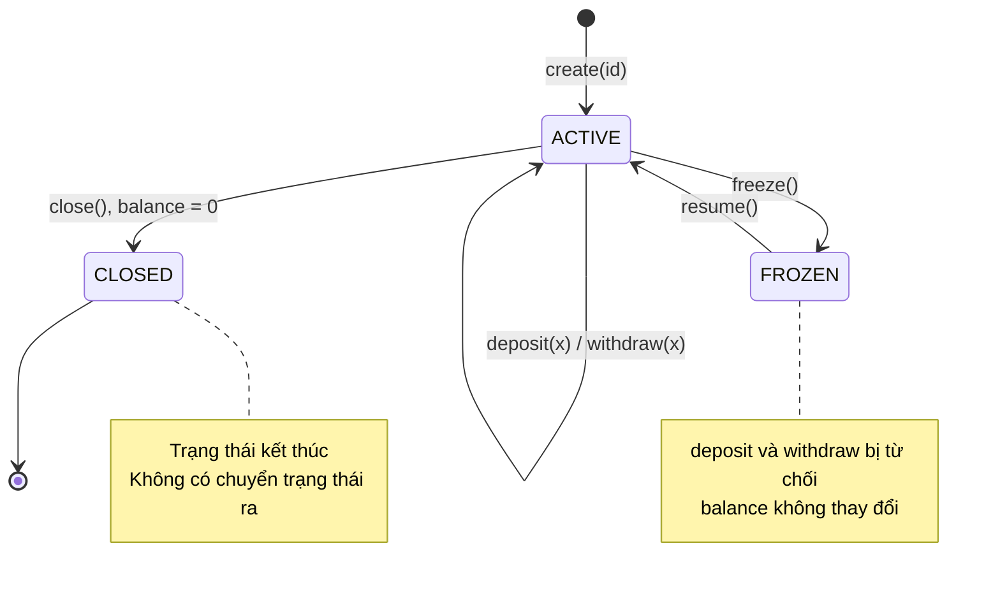
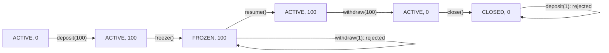
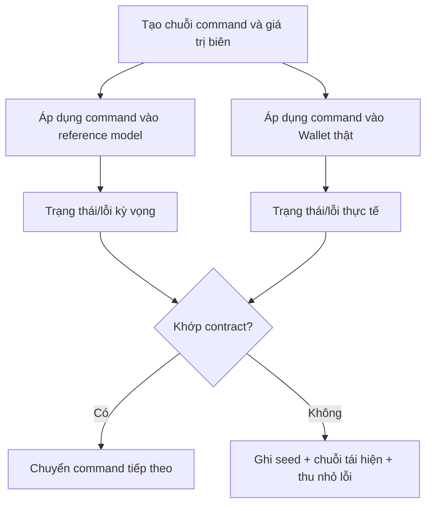

# Testing Invariants and State Transitions in OOP

> **Learning objective:** Design tests for objects **whose state changes over time**; distinguish *invariants*, *preconditions*, *postconditions*, and *state transitions*; verify both successful and rejected operations; prove that objects remain valid after failures. Examples use Java 17 and JUnit 5 without Spring.

## 1. Why Is Checking One Method's Return Value Insufficient?

A simple test might assert:

```java
wallet.deposit(100_000);
assertEquals(100_000, wallet.balanceVnd());
```

But an object managing money must guarantee much more:

- Can the balance become negative?
- Can a withdrawal exceed the balance?
- After the wallet is **closed**, can more money be deposited?
- Does the state remain unchanged after a rejected operation?
- If addition overflows `long`, is the balance corrupted?
- Do successive calls produce a valid sequence of states?

A test checking the return value of a single call can miss **rules governing the object across multiple interactions**.

In OOP, an object is more than data plus functions. Many objects are responsible for preserving **conditions that must always hold** and controlling **how their state is allowed to change**. Tests must account for both responsibilities.

**Key mindset:** Do not ask only “did the method run correctly?” Ask also “before, during, and after each action, does the object remain within its permitted states?”

## 2. Four Concepts to Distinguish

| Concept | Meaning | Digital Wallet Example |
|---|---|---|
| **Invariant – persistent condition** | A condition true in every **observable valid** object state | `balanceVnd >= 0` |
| **Precondition – requirement before an action** | A condition for permitting an operation | Withdrawals require `ACTIVE` and an amount not exceeding the balance |
| **Postcondition – requirement after an action** | A condition that must hold after a successful operation | Depositing `x` increases balance by exactly `x` while state remains `ACTIVE` |
| **Transition rule – allowed state change** | An allowed edge between states and its guard conditions | `ACTIVE → FROZEN`, `FROZEN → ACTIVE` |

An **invariant** is not merely “a field marked `final`.” A mutable object can still maintain `balance >= 0` throughout its lifetime. Conversely, `final` prevents reassignment of a reference or primitive field but does not make referenced objects immutable.

### State Invariants Versus Temporal Rules

- **State invariant:** one *snapshot* suffices to check it, such as `CLOSED ⇒ balance == 0`.
- **Temporal/transition property:** requires *two states or an event sequence*, such as “while the wallet is `FROZEN`, withdrawing does not change its balance.”

A snapshot of `FROZEN, balance=100000` **is not itself a violation**. A violation occurs only if `withdraw` deducts money while the wallet is `FROZEN`.

Tests should therefore combine **assertions about snapshot properties** with **assertions about each transition's behavior**.

## 3. Running Business Example: A Stateful Digital Wallet

To focus on OOP, we construct a simple model without bank or database connections.

### States

- `ACTIVE`: the wallet is operational and permits `deposit` and `withdraw`.
- `FROZEN`: temporarily locked; neither deposits nor withdrawals are allowed.
- `CLOSED`: permanently closed; deposits, withdrawals, freezing, and resuming are forbidden.

A new wallet begins in `ACTIVE` state with a balance of 0. **Only an ACTIVE wallet with a balance of 0 may be closed**.

### Allowed Behavior

| Action | State Before | Other Conditions | State After | Balance After |
|---|---|---|---|---|
| `deposit(x)` | ACTIVE | `x > 0`, no `long` overflow | ACTIVE | `balance + x` |
| `withdraw(x)` | ACTIVE | `x > 0` and `x <= balance` | ACTIVE | `balance - x` |
| `freeze()` | ACTIVE | None | FROZEN | Unchanged |
| `resume()` | FROZEN | None | ACTIVE | Unchanged |
| `close()` | ACTIVE | `balance == 0` | CLOSED | 0 |

Any case outside the relevant row **is rejected**. In this lesson, calling `close()` twice **is a state error**, not a no-op; that is an explicit contract choice. Another system might define repeat close requests as idempotent, but its table and tests must then reflect that choice.

### Invariants

1. `id` must exist, be nonblank, and remain unchanged after construction.
2. `status` is always one of `ACTIVE`, `FROZEN`, or `CLOSED`, and never null.
3. `balanceVnd >= 0`.
4. `status == CLOSED ⇒ balanceVnd == 0`.
5. Rejected operations **do not modify the snapshot**.

Condition 5 is more precisely a **failure postcondition** or a transition rule, not simply a state invariant. We deliberately distinguish it when designing tests.

These rules are **teaching assumptions**. Real wallets also require ledgers, transactions, limits, access controls, fraud prevention, concurrency, and financial compliance.

## 4. Draw the State Machine Before Writing Tests



Derive tests from the diagram in three groups:

- **Valid edges:** prove every allowed transition can occur when its guard is satisfied.
- **Forbidden edges:** prove transitions absent from the diagram are rejected.
- **Boundary conditions:** for example, `close()` is allowed at balance 0 but not at balance 1; `withdraw(balance)` is allowed while `withdraw(balance + 1)` is forbidden.

A small state machine exposes easily overlooked questions: “Can `resume()` run from `ACTIVE`?” or “Can a `CLOSED` wallet reopen?”

## 5. Complete Java 17 Example: An Object Protecting Its Own State

Create `WalletDemo.java`:

```java
import java.util.Objects;

public final class WalletDemo {

    enum Status { ACTIVE, FROZEN, CLOSED }

    // Snapshot bất biến để quan sát trước/sau thao tác.
    record Snapshot(Status status, long balanceVnd) {}

    static final class Wallet {
        private final String id;
        private Status status = Status.ACTIVE;
        private long balanceVnd = 0L;

        Wallet(String id) {
            Objects.requireNonNull(id, "id");
            if (id.isBlank()) {
                throw new IllegalArgumentException("id không được rỗng");
            }
            this.id = id;
        }

        String id() {
            return id;
        }

        Snapshot snapshot() {
            return new Snapshot(status, balanceVnd);
        }

        void deposit(long amountVnd) {
            requireActive();
            requirePositive(amountVnd);

            // Math.addExact ném lỗi trước khi phép gán thực hiện.
            balanceVnd = Math.addExact(balanceVnd, amountVnd);
        }

        void withdraw(long amountVnd) {
            requireActive();
            requirePositive(amountVnd);
            if (amountVnd > balanceVnd) {
                throw new IllegalStateException("Không đủ số dư");
            }
            balanceVnd -= amountVnd;
        }

        void freeze() {
            requireStatus(Status.ACTIVE, "freeze");
            status = Status.FROZEN;
        }

        void resume() {
            requireStatus(Status.FROZEN, "resume");
            status = Status.ACTIVE;
        }

        void close() {
            requireStatus(Status.ACTIVE, "close");
            if (balanceVnd != 0L) {
                throw new IllegalStateException(
                        "Chỉ đóng ví khi số dư bằng 0");
            }
            status = Status.CLOSED;
        }

        private void requireActive() {
            requireStatus(Status.ACTIVE, "money operation");
        }

        private void requireStatus(Status required, String operation) {
            if (status != required) {
                throw new IllegalStateException(
                        operation + " yêu cầu " + required
                        + ", trạng thái hiện tại " + status);
            }
        }

        private static void requirePositive(long amountVnd) {
            if (amountVnd <= 0L) {
                throw new IllegalArgumentException(
                        "Số tiền phải dương");
            }
        }
    }

    public static void main(String[] args) {
        Wallet wallet = new Wallet("W-100");
        wallet.deposit(150_000L);
        wallet.withdraw(40_000L);

        System.out.println(wallet.snapshot());
        // Snapshot[status=ACTIVE, balanceVnd=110000]

        wallet.freeze();
        System.out.println(wallet.snapshot());
        // Snapshot[status=FROZEN, balanceVnd=110000]

        try {
            wallet.withdraw(10_000L);
        } catch (IllegalStateException expected) {
            System.out.println("Ví FROZEN: không cho rút tiền");
        }

        wallet.resume();
        wallet.withdraw(110_000L);
        wallet.close();

        System.out.println(wallet.snapshot());
        // Snapshot[status=CLOSED, balanceVnd=0]
    }
}
```

Run with JDK 17:

```bash
javac WalletDemo.java
java WalletDemo
```

### Notable Design Decisions

**There are no `setBalance` or `setStatus` methods.** Clients cannot assign `balance=-1` or `status=CLOSED` while funds remain. Public operations express meaningful business actions.

**Validate before mutation.** `withdraw` checks state, amount, and available balance **before** deducting funds. `close` checks the balance before transitioning to `CLOSED`.

**Overflow is controlled.** For `deposit`, `Math.addExact` throws `ArithmeticException` when the total exceeds the `long` limit. Since the right-hand expression is evaluated before assignment, overflow leaves `balanceVnd` unchanged.

**Snapshots separate observation from mutation.** `Snapshot` is a record containing an enum and primitives, so clients cannot modify internal state through a mutable reference returned by the API. Snapshotting has no side effects.

**Terminal-state rules are enforced at transitions.** `CLOSED ⇒ balance == 0` need not be checked again in every getter if all valid mutation paths enforce it, but tests should still verify the invariant against regressions.

**Failure contracts are explicit.** `IllegalArgumentException` covers nonpositive amounts/invalid IDs; `IllegalStateException` covers disallowed states or insufficient funds; `ArithmeticException` covers overflow. Production APIs may use their own business error codes, but tests must state which behavior is promised.

**Example limitation:** this is a sequentially used in-memory object. `Wallet` is not thread-safe and is not a model of real money systems with ledgers, transactions, or fraud controls.

## 6. Testing Strategy: Observe State Before and After

For each action, specify:

```text
Given: trạng thái và dữ liệu trước thao tác
When:  một hành động (hoặc chuỗi hành động)
Then:  trạng thái sau và bất biến cần bảo đảm
```

Example:

```text
Given: Wallet ACTIVE, balance = 100_000
When:  withdraw(30_000)
Then:  ACTIVE, balance = 70_000

Given: Wallet ACTIVE, balance = 100_000
When:  withdraw(120_000)
Then:  throw IllegalStateException
       trạng thái ACTIVE và balance 100_000 KHÔNG ĐỔI

Given: Wallet FROZEN, balance = 100_000
When:  deposit(10_000)
Then:  bị từ chối, snapshot giữ nguyên
```

**Key point:** Failure tests should not rely solely on `assertThrows`. If an object is partially mutated before throwing, `assertThrows` still passes. Also assert **snapshot before = snapshot after** when the contract promises no side effects on failure.

### Suggested Test Matrix

| Scenario | Initial State | Action | Expected Outcome |
|---|---|---|---|
| Valid deposit | ACTIVE, 0 | `deposit(100)` | ACTIVE, 100 |
| Partial withdrawal | ACTIVE, 100 | `withdraw(30)` | ACTIVE, 70 |
| Withdraw full balance | ACTIVE, 100 | `withdraw(100)` | ACTIVE, 0 |
| Withdraw too much | ACTIVE, 100 | `withdraw(101)` | Exception; ACTIVE, 100 |
| Withdraw 0/negative | ACTIVE, 100 | `withdraw(0)`/`withdraw(-1)` | Exception; unchanged |
| Deposit overflow | ACTIVE, MAX | `deposit(1)` | Exception; MAX unchanged |
| Freeze wallet | ACTIVE, 100 | `freeze()` | FROZEN, 100 |
| Deposit/withdraw while frozen | FROZEN, 100 | `deposit/withdraw` | Exception; unchanged |
| Resume wallet | FROZEN, 100 | `resume()` | ACTIVE, 100 |
| Resume when already active | ACTIVE, 100 | `resume()` | Exception; unchanged |
| Close with remaining funds | ACTIVE, 100 | `close()` | Exception; unchanged |
| Close with zero balance | ACTIVE, 0 | `close()` | CLOSED, 0 |
| Money operation after closing | CLOSED, 0 | `deposit/withdraw` | Exception; CLOSED, 0 |
| Resume after closing | CLOSED, 0 | `resume()` | Exception; CLOSED, 0 |

You need not write **one test method per row**, but each distinct rule should be covered in a recognizable way.

## 7. Runnable JUnit 5 Test Suite

Create `WalletDemoTest.java` in the same package as `WalletDemo.java`, using the project's JUnit Jupiter dependency. The nested methods/package-private classes of `WalletDemo` are accessible to tests in the same package.

```java
import static org.junit.jupiter.api.Assertions.*;
import org.junit.jupiter.api.Test;

class WalletDemoTest {

    @Test
    void newWalletStartsActiveAndEmpty() {
        var wallet = new WalletDemo.Wallet("W-1");

        assertEquals("W-1", wallet.id());
        assertEquals(new WalletDemo.Snapshot(
                WalletDemo.Status.ACTIVE, 0L), wallet.snapshot());
    }

    @Test
    void depositAndWithdrawPreserveNonNegativeBalance() {
        var wallet = new WalletDemo.Wallet("W-2");

        wallet.deposit(100L);
        wallet.withdraw(30L);

        assertEquals(new WalletDemo.Snapshot(
                WalletDemo.Status.ACTIVE, 70L), wallet.snapshot());
    }

    @Test
    void exactBalanceCanBeWithdrawn() {
        var wallet = new WalletDemo.Wallet("W-3");
        wallet.deposit(100L);

        wallet.withdraw(100L);

        assertEquals(new WalletDemo.Snapshot(
                WalletDemo.Status.ACTIVE, 0L), wallet.snapshot());
    }

    @Test
    void insufficientFundsRejectsWithoutMutation() {
        var wallet = new WalletDemo.Wallet("W-4");
        wallet.deposit(100L);
        var before = wallet.snapshot();

        assertThrows(IllegalStateException.class,
                () -> wallet.withdraw(101L));

        assertEquals(before, wallet.snapshot());
    }

    @Test
    void invalidAmountDoesNotChangeState() {
        var wallet = new WalletDemo.Wallet("W-5");
        var before = wallet.snapshot();

        assertThrows(IllegalArgumentException.class,
                () -> wallet.deposit(0L));
        assertThrows(IllegalArgumentException.class,
                () -> wallet.withdraw(-1L));

        assertEquals(before, wallet.snapshot());
    }

    @Test
    void frozenWalletRejectsMoneyOperations() {
        var wallet = new WalletDemo.Wallet("W-6");
        wallet.deposit(200L);
        wallet.freeze();
        var before = wallet.snapshot();

        assertThrows(IllegalStateException.class,
                () -> wallet.deposit(10L));
        assertThrows(IllegalStateException.class,
                () -> wallet.withdraw(10L));

        assertEquals(new WalletDemo.Snapshot(
                WalletDemo.Status.FROZEN, 200L), before);
        assertEquals(before, wallet.snapshot());
    }

    @Test
    void freezeAndResumeFormValidTransitions() {
        var wallet = new WalletDemo.Wallet("W-7");

        wallet.freeze();
        assertEquals(WalletDemo.Status.FROZEN,
                wallet.snapshot().status());

        wallet.resume();
        assertEquals(WalletDemo.Status.ACTIVE,
                wallet.snapshot().status());

        // Lặp lại resume không được phép theo contract ví dụ.
        var before = wallet.snapshot();
        assertThrows(IllegalStateException.class, wallet::resume);
        assertEquals(before, wallet.snapshot());
    }

    @Test
    void cannotCloseWalletWithFunds() {
        var wallet = new WalletDemo.Wallet("W-8");
        wallet.deposit(1L);
        var before = wallet.snapshot();

        assertThrows(IllegalStateException.class, wallet::close);

        assertEquals(before, wallet.snapshot());
    }

    @Test
    void closedWalletIsTerminalAndEmpty() {
        var wallet = new WalletDemo.Wallet("W-9");
        wallet.close();
        var closed = wallet.snapshot();

        assertEquals(new WalletDemo.Snapshot(
                WalletDemo.Status.CLOSED, 0L), closed);

        assertThrows(IllegalStateException.class,
                () -> wallet.deposit(1L));
        assertThrows(IllegalStateException.class, wallet::freeze);
        assertThrows(IllegalStateException.class, wallet::resume);
        assertThrows(IllegalStateException.class, wallet::close);

        assertEquals(closed, wallet.snapshot());
    }

    @Test
    void overflowRejectsWithoutMutation() {
        var wallet = new WalletDemo.Wallet("W-10");
        wallet.deposit(Long.MAX_VALUE);
        var before = wallet.snapshot();

        assertThrows(ArithmeticException.class,
                () -> wallet.deposit(1L));

        assertEquals(before, wallet.snapshot());
    }
}
```

The suite intentionally combines **tests of individual states** with **tests of action sequences**. It covers important branches but is not formal proof for every possible unbounded sequence or concurrent interleaving.

## 8. Why Verify the State “After Failure”?

Consider a dangerous implementation:

```java
// Phản ví dụ: mutate trước khi kiểm tra.
void withdrawWrong(long amountVnd) {
    balanceVnd -= amountVnd;
    if (balanceVnd < 0L) {
        throw new IllegalStateException("Không đủ tiền");
    }
}
```

With `balance=100` and `withdrawWrong(120)`, the method throws but leaves `balance=-20`. If the test only contains:

```java
assertThrows(IllegalStateException.class,
        () -> wallet.withdraw(120));
```

then it **fails to detect the broken invariant**.

Instead, assert:

```java
var before = wallet.snapshot();
assertThrows(IllegalStateException.class,
        () -> wallet.withdraw(120));
assertEquals(before, wallet.snapshot());
```

**Core message:** Failure tests must assert more than an exception type: also assert **the failure postcondition**.

However, the rule that “a failed action changes nothing” must come from **the business contract**. A workflow may deliberately record `FAILED` state or append an audit record after an unsuccessful operation. Tests should then verify *allowed failure-side effects*, not mechanically require every feature to be mutation-free on failure.

## 9. Testing Boundaries: Values Adjacent to Conditions

When rules use `>`, `>=`, `<`, or `<=`, checking values next to their boundaries helps catch off-by-one errors.

For `withdraw(amount)` with a balance of 100:

| Withdrawal Amount | Expected Outcome |
|---:|---|
| -1 | Reject as negative |
| 0 | Reject as nonpositive |
| 1 | Succeeds; 99 remains |
| 99 | Succeeds; 1 remains |
| 100 | Succeeds; 0 remains |
| 101 | Reject for insufficient funds |

For `close()`:
- Balance = 0 → valid.
- Balance = 1 → rejected.
- Negative balance → **must never occur** if public operations enforce the invariant.

For `deposit`:
- `Long.MAX_VALUE - 1` plus 1 → valid.
- `Long.MAX_VALUE` plus 1 → overflows and must be rejected without changing the balance.

**Do not use reflection to alter private fields and manufacture an invalid state merely to test another method**, unless intentionally testing recovery from corrupt legacy data. Normally, construct objects through public APIs and preserve invariants throughout fixture setup.

## 10. State Coverage Is Different from Transition Coverage

Suppose tests reach all three states: `ACTIVE`, `FROZEN`, and `CLOSED`. That **does not mean** every transition behavior among them has been tested.

### State coverage

Each state appears in at least one test. For example, `new Wallet` creates ACTIVE, `freeze` produces FROZEN, and `close` produces CLOSED.

### Transition coverage

Every **valid edge** in the diagram is exercised at least once:
- ACTIVE → FROZEN;
- FROZEN → ACTIVE;
- ACTIVE → CLOSED;
- ACTIVE → ACTIVE for valid deposits/withdrawals.

### Invalid-transition coverage

Select meaningful forbidden operations:
- `resume` from ACTIVE;
- `freeze` from FROZEN;
- `deposit`/`withdraw` from FROZEN;
- any state-changing operation from CLOSED;
- `close` from ACTIVE when the balance is not equal to 0.

### Transition-pair / sequence coverage

Some bugs arise only from sequences: ACTIVE → FROZEN → ACTIVE followed by a withdrawal, or deposit → withdraw all → close → try depositing again. Two isolated tests may miss defects in saving/restoring state across a sequence.



A self-loop arrow labeled *rejected* means **the state does not change after a rejected operation**, not that a successful business transition occurred.

### Do Not Exhaustively Generate Infinite Combinations

With `n` states, `m` commands, and many possible parameters, the number of test sequences grows rapidly. Prioritize:

- High-risk states and transitions.
- Boundary values.
- Repeated commands, out-of-order commands, and actions after terminal states.
- Sequences involving mutation and rollback.
- Rules likely to evolve in the real product.

Measuring state/branch coverage is useful, but **a high coverage percentage does not prove invariants hold** if assertions are weak.

## 11. Model-Based Testing: Comparing Against a Simple Model

With numerous states and command sequences, manually writing tests for every path is expensive. One approach is to create a simple **reference model** with explicit rules, generate command sequences, and compare outcomes.

The idea:

1. A **reference model** stores `status` and `balance`, determines permitted commands, and predicts state.
2. The **System Under Test (SUT)** is the real `Wallet`.
3. A command generator creates sequences such as `deposit(100)`, `freeze()`, `withdraw(10)`, `resume()`, and `close()`.
4. After each command, compare the SUT snapshot with the model; even rejected commands must leave state unchanged if the contract requires it.
5. When a failing sequence is found, record its seed/sequence and minimize it through *shrinking* to create a short regression test.



**Important:** The reference model should be sufficiently **implementation-independent** to avoid copying the SUT's bugs. If the model duplicates every line of `Wallet`, the same defect could occur in both and the test would still pass.

### A Tiny Table-Driven Reference Model

In ACTIVE:
- `freeze` always transitions to FROZEN.
- `resume` is always rejected.
- `close` succeeds if and only if the balance is 0.
- `withdraw(x)` succeeds if and only if `x > 0 && x <= balance`.

In FROZEN:
- Only `resume` is allowed among the defined commands.

In CLOSED:
- No command can change state.

This model can be represented as an independent transition table, then exercised across many distinct sequences.

## 12. Property-Based Testing: Verify Properties, Not Only Individual Examples

Traditional JUnit tests invoke a few selected inputs. In property-based testing, a library such as jqwik or QuickTheories can generate numerous valid input sequences and check general properties.

Properties appropriate for `Wallet` include:

**P1 – Nonnegative balance:** after any valid command sequence, `balance >= 0`.

**P2 – Terminal state:** if `status == CLOSED`, then `balance == 0`, and no operation can move the wallet out of CLOSED.

**P3 – No mutation on rejection:** if the demo contract rejects an operation, before and after snapshots must be equal.

**P4 – Deposit then withdraw the same amount:** starting from an ACTIVE wallet with balance `b`, where `x > 0` and `b+x` does not overflow, depositing `x` and immediately withdrawing `x` restores balance `b` without changing status.

**P5 – Freeze/resume preserves balance:** from ACTIVE, `freeze(); resume();` returns to ACTIVE with the same balance.

**P6 – Withdrawal is bounded:** when `x > balance`, `withdraw(x)` is rejected without changing balance.

These properties require **explicit input preconditions**. P4, for example, is false if the wallet is FROZEN or addition overflows. A property test must generate cases meeting its assumptions, or assert the correct rejection behavior when assumptions are unmet.

The main example does not require another library; start with JUnit 5 and a case table. With a large state space, property-based testing helps discover unexpected sequences, but specific example tests are still needed to document business rules.

## 13. Preconditions, Invariants, and Postconditions in One Method

Analyze `withdraw`:

```java
void withdraw(long amountVnd) {
    requireActive();                 // Precondition về status
    requirePositive(amountVnd);     // Precondition về input

    if (amountVnd > balanceVnd) {    // Precondition về state
        throw new IllegalStateException("Không đủ số dư");
    }

    balanceVnd -= amountVnd;         // Mutation được phép
}
```

Tests should address three layers:

| Layer | What Does the Test Ask? | Assertion |
|---|---|---|
| Precondition | `amount<=0` or state is not ACTIVE? | Rejected without change |
| Postcondition | Withdraw 30 from balance 100? | Balance 70; state ACTIVE |
| Invariant | After any valid withdrawal? | Nonnegative balance |

Asserting only “withdraw 30 leaves 70” misses boundaries and failures. Asserting only a nonnegative balance may miss an incorrect deduction amount. Asserting only an exception may miss partial mutation.

**Combining all three** produces meaningful coverage.

## 14. Test Doubles and Business Boundaries

The `Wallet` example has no external dependencies; tests can instantiate a real Wallet directly. Do not mock the domain object whose invariants you are testing. Mocking `Wallet` and verifying one `deposit` call does not verify that `balance` changed correctly.

When a business object collaborates with external dependencies:

- Fake `Clock` to test time-based expiration rules.
- Fake `ExchangeRateProvider` to test exchange-rate selection.
- Mock `NotificationGateway` to verify the application sends a request after a successful state transition.
- Use an in-memory repository or transaction test to verify that state persists and reloads correctly.

**Distinguish responsibilities:** Object unit tests verify local rules. Integration tests verify collaboration among components (DB, transactions, message queues, etc.). Notifications/email should not directly dictate Wallet's internal state unless they are actually part of its invariants.

## 15. Testing Invariants in Objects with Internal Collections

Invariants can concern more than one number. Consider a shopping cart:

- Every line item has a positive quantity.
- Duplicate SKUs are forbidden when the business requires uniqueness.
- The total equals the sum of `unitPrice * quantity` across lines.
- After an order is confirmed, lines cannot be added or removed.

If an API directly returns a mutable `ArrayList`:

```java
List<Line> lines = order.getLines();
lines.clear(); // Có thể qua mặt phương thức domain.
```

then tests of `order.addLine` might pass while invariants can still be broken through the getter. Also test that:

1. Clients cannot modify the internal collection through a returned value.
2. Constructors/setters do not retain unprotected references to mutable collections supplied by callers.
3. If a returned record contains a list, protect both the list and its elements as necessary.
4. Legitimate changes must go through methods that enforce the rules.

`List.copyOf` provides **a shallow snapshot**; if elements are mutable, copying the list alone does not guarantee invariants. Tests for escaped references are part of verifying state integrity.

## 16. Invariants Across Two Related Objects

One object maintaining `balance >= 0` is insufficient for a business operation that **transfers money between two wallets**:

```text
Nguồn: 100   Đích: 20
Chuyển 30
Sau thành công: Nguồn 70   Đích 50
Tổng hệ thống trước/sau: 120
```

A cross-object invariant may require **preservation of the total amount** during an internal transfer (ignoring fees and creation/destruction of money).

If an implementation successfully invokes `source.withdraw(30)` but fails on `target.deposit(30)`, **cross-object consistency is broken** even though both individual wallets may still have nonnegative balances.

Use-case-level tests must verify:
- Either both wallets update or neither does, according to the atomicity contract.
- Repeating the transfer with the same request ID follows the idempotency policy.
- Retrying after a timeout does not create a duplicate transfer.
- DB transactions/locking or equivalent distributed mechanisms are applied correctly.

**Atomic mutation of one object does not imply atomicity of an entire workflow.** If wallets reside in different systems, design suitable transactions, sagas, ledgers, or compensation rather than expecting an object unit test to solve distributed consistency.

## 17. Concurrency: Sequential Tests Do Not Prove Thread Safety

In this example, `balanceVnd` is a `long` field, and a deposit executes:
`balanceVnd = Math.addExact(balanceVnd, amountVnd)`.

If two threads run simultaneously, both may read the same old balance and write conflicting results, causing a **lost update**. Each thread may observe valid preconditions, yet the final state can still be wrong.

Likewise:
- Two requests each withdrawing 80 from a balance of 100 may both read 100 before either writes.
- Two requests attempting to transition ACTIVE to FROZEN may both observe a satisfied precondition.
- One thread closing a wallet while another deposits or withdraws may produce inconsistent state.

Concurrency tests require coordinated execution:
- Use `CountDownLatch`/`CyclicBarrier` to induce controlled contention.
- Repeat tests with explicit inputs and expectations; do not rely on `Thread.sleep` to “wait long enough.”
- For DB-backed code, test transaction isolation, row locks, optimistic locking/versions, and retry logic.
- Where appropriate, use specialized concurrency testing tools for low-level structures.

**Important:** One passing concurrency run does not prove a race condition is absent. Tests help uncover defects; correctness requires an actual synchronization or transaction mechanism.

For real-money wallets, updates need a clear concurrency boundary; this teaching example **must not be copied directly into financial systems**.

## 18. Do Not Couple Tests to Implementation Details

A brittle test suite might check:
- How often a method invokes helper `validateBalance`.
- The exact line where field `status` is assigned.
- Whether an internal collection is an `ArrayList` or `LinkedList`.
- The exact characters of an exception message, even when not part of the public contract.

These are usually not user-visible outcomes. Test observable behavior through public APIs:

```java
WalletDemo.Snapshot before = wallet.snapshot();
assertThrows(IllegalStateException.class, wallet::close);
assertEquals(before, wallet.snapshot());
```

Future changes in state storage, balance-calculation optimizations, or private helper extraction will then preserve the business-rule tests. However, if the exact error text/structure **is a public API contract**, assertions about error codes and schemas may be necessary.

### Choosing the Right Assertions

| Need | Appropriate JUnit Assertion |
|---|---|
| Correct balance | `assertEquals(expected, actual)` |
| Correct enum state | `assertEquals(Status.ACTIVE, snapshot.status())` |
| Operation throws expected error type | `assertThrows(ExpectedException.class, executable)` |
| Object unchanged after failure | Capture a snapshot, then `assertEquals(before, after)` |
| Several outcomes must hold | `assertAll(...)` when helpful for diagnosis |
| No exception for a valid operation | `assertDoesNotThrow(...)` when useful |
| Exact instance identity | `assertSame(...)` – only when identity is contractual |
| Lists/collections | Assert contents according to List/Set/Map semantics |

**Do not use `==` for distinct value-object instances** when the domain requires value equality; use appropriate equality semantics.

## 19. A Layered Testing Strategy from Small to Large

Organize testing levels by cost and purpose:

| Test Level | Subject | What It Establishes | Remaining Risk |
|---|---|---|---|
| Unit | Real in-memory `Wallet` | Invariants, transitions, errors, and post-error state | Does not prove DB/concurrency correctness |
| Unit property/model-based | Many command sequences | Find unexpected mutation paths | The reference model may be incorrect/incomplete |
| Integration | Repository + transaction | State persistence/reloading, versioning, rollback | External systems may still fail |
| Contract | API/port between modules | Error semantics and substitutability | Does not cover every end-to-end path |
| End-to-end | One primary business workflow | Users can complete the task through the entire system | Slow, difficult to isolate root causes |

Do not omit state unit tests because end-to-end tests exist: E2E is costly and rarely covers all forbidden transitions. Conversely, Wallet unit tests alone cannot establish correctness when two users modify the same database record.

## 20. Common Testing Mistakes

| Mistake | Why It Is Dangerous | Improvement |
|---|---|---|
| Testing only the happy path | Misses forbidden inputs/states | Valid/invalid transition matrix |
| Using only `assertThrows` | An object may have been partially mutated | Compare snapshots before and after errors |
| Checking state without invariants | The transition occurs but the balance may become negative | Assert all relevant invariants |
| Testing each method in isolation | Misses bugs in operation sequences | Test transition pairs and scenarios |
| Using reflection to assign invalid fields in every test | Bypasses domain safeguards; unrealistic usage | Create states through valid APIs; reserve reflection for special recovery tests |
| Mocking the domain object itself | Does not test real behavior | Use real domain objects and fake external dependencies |
| Asserting excessive private calls | Valid refactors break tests | Assert behavior and public contracts |
| Ignoring overflow/numeric boundaries | Large values can corrupt state | Test `0`, negatives, balance, balance+1, MAX |
| Assuming every exception rolls back an entire workflow | Ignores legitimate audit/FAILED-state behavior | Define layer-specific failure contracts |
| Treating “invariant” as a `final` field | Misses mutable objects that violate or preserve rules | Express invariants as logical conditions |
| Declaring thread safety based on tests without versioning/locks | Real execution may lose updates | Add concurrency integration tests |
| Measuring only coverage percentage | High coverage can miss important assertions | Map each invariant/transition to a test |
| Copying production algorithms into the test model | Tests and production may share bugs | Independent reference model based on the specification |
| Many random sequences with no recorded seed | Failures cannot be reproduced | Record seed, command sequence, and minimize it |

## 21. Practical Workflow When Testing a Stateful Class

1. **List state variables:** `status`, `balance`, line items, version, expiration times, etc.
2. **Express invariants** as testable formulas, such as `balance >= 0` and `CLOSED ⇒ balance == 0`.
3. **List commands and queries:** commands change state; queries only observe it.
4. **Draw a state diagram** with guards on transitions.
5. **Create a transition table** covering prior state, boundary input, success/failure, and resulting state.
6. **Prioritize tests:** every valid edge, each error category, boundary values, and at least one multistep sequence.
7. **Verify no mutation on failure** if promised by the contract, not merely exception type.
8. **Add property/model-based tests** when sequences proliferate and state changes are complex.
9. **Check for escaped references:** can a getter return mutable collections/arrays that bypass validation?
10. **Test concurrency, persistence, and transactions separately:** sequential unit tests are insufficient.
11. **Associate every invariant/transition with at least one test** to identify gaps.
12. **Update tables and tests as business rules change**; never change only the implementation while leaving the contract outdated.

## 22. Exercises

### Exercise 1 – Orders

Design `Order` with `DRAFT`, `CONFIRMED`, `SHIPPED`, and `CANCELLED`. Allow adding items in DRAFT, confirming when items exist, shipping from CONFIRMED, and prohibit cancellation after SHIPPED. Draw a state diagram, specify three invariants, and write at least six tests for valid and invalid transitions.

### Exercise 2 – Account with a Balance Limit

Add a maximum balance to Wallet: `balance <= limit`, where `limit > 0` is fixed. Test deposits that reach the limit exactly and exceed it by one unit; rejected operations must preserve the snapshot. If the limit may decrease, specify behavior when the current balance exceeds the new limit.

### Exercise 3 – Exposing Mutable State

Create `Order` with a getter returning mutable `List<OrderLine>` and an invariant that “CONFIRMED orders cannot have their lines edited.” Write a test exposing the getter-based bug, then refactor to snapshots/unmodifiable APIs and safe domain methods.

### Exercise 4 – Generating Command Sequences

Implement a simple state model for Wallet and randomly generate sequences of up to 20 `deposit`/`withdraw`/`freeze`/`resume`/`close` commands. After each, compare status, balance, and error type with the model. Record failing command sequences. Do not duplicate the Wallet implementation inside the model.

### Exercise 5 – Failure After Withdrawing Money

Analyze a workflow transferring 100 VND from wallet A to wallet B. If A is debited but B cannot be credited, design application/transaction-level tests to preserve the total amount or explicitly record a pending-recovery workflow state. Explain why each wallet can satisfy its individual invariants while the overall operation is still wrong.

### Exercise 6 – Two Concurrent Requests

Two threads each invoke `withdraw(80)` with an initial balance of 100. State the business expectation (“only one withdrawal succeeds, leaving 20”) and outline transaction/optimistic-locking approaches to achieve it; do not treat sequential tests or a `Thread.sleep` as evidence of concurrency safety.

## 23. Checklist Before Declaring Tests Sufficient

- [ ] I distinguish invariants, preconditions, postconditions, and transition rules.
- [ ] I have identified valid states and permitted transition edges.
- [ ] There are tests for **correct state after successful operations**.
- [ ] There are tests for **forbidden operations**, not only normal paths.
- [ ] After errors, tests check that **the object remains unchanged** or changes only according to its contract.
- [ ] Boundary values 0, negatives, exact limits, exceeded limits, and overflow are tested when relevant.
- [ ] At least one multistep sequence reaching a terminal state is tested.
- [ ] No getter or escaped mutable reference lets clients break invariants.
- [ ] Assertions verify public behavior rather than only implementation details.
- [ ] I know which behavior still requires integration/concurrency tests.
- [ ] Side effects crossing multiple objects are tested at the appropriate boundary.
- [ ] Tests are updated when transitions or business rules change.

**Remember:** Testing stateful OOP objects goes beyond “a method returned the right number.” Tests should establish that **objects never enter invalid states**, **every change respects allowed transitions**, and **failure-state guarantees remain intact after rejected operations**.
