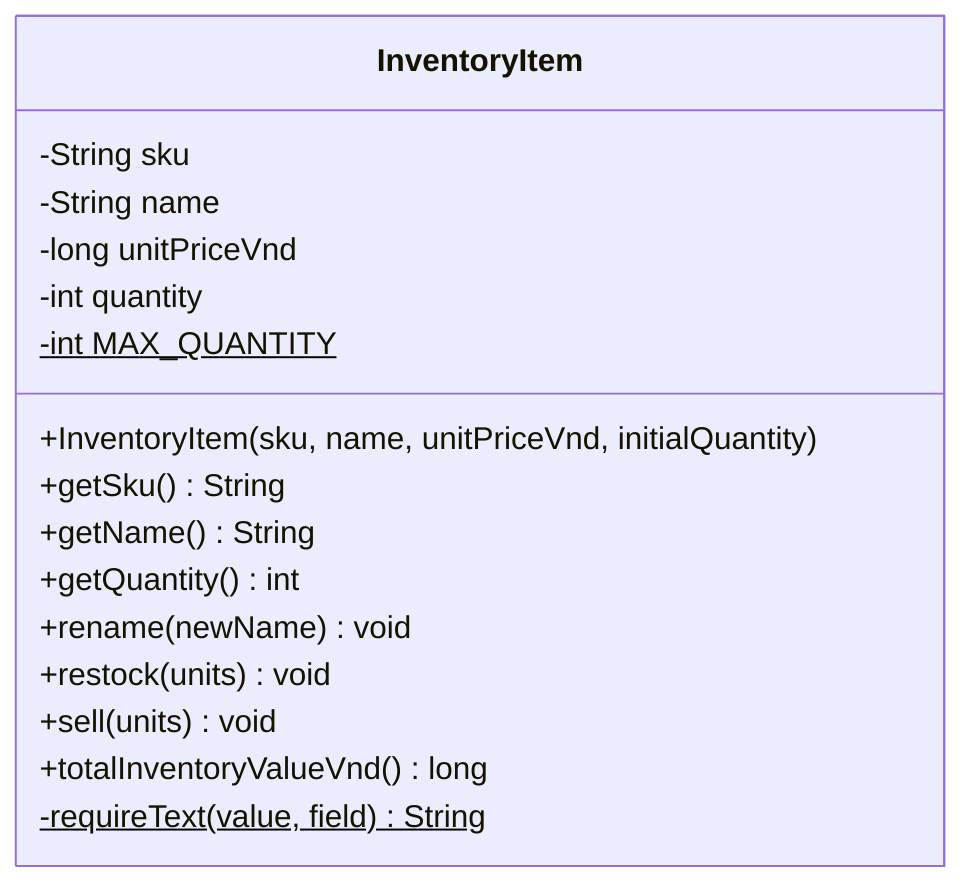
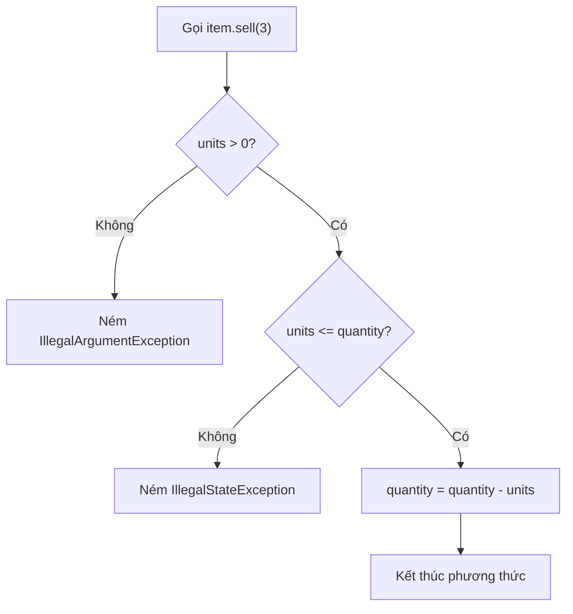

# Class structure in Java: fields and methods

A **class** is a blueprint for objects of the same type. Within a class, **fields** store state, and **methods** define what an object can do. These two parts work together: methods read or modify fields according to rules that the class is responsible for enforcing.

For example, an inventory item has a stock-keeping code, name, unit price, and quantity on hand. Restocking or selling changes the quantity while the item code remains unchanged. Instead of letting external code change the quantity arbitrarily, the `InventoryItem` class provides `restock()` and `sell()` methods that validate the operation before making a change.

## 1. Overview of a class's structure

```java
public class Product {
    // Thuộc tính: trạng thái của từng đối tượng
    private final String code;
    private String name;
    private long priceVnd;

    // Constructor: tạo đối tượng với trạng thái ban đầu hợp lệ
    public Product(String code, String name, long priceVnd) {
        this.code = code;
        this.name = name;
        this.priceVnd = priceVnd;
    }

    // Phương thức: đọc trạng thái
    public String getName() {
        return name;
    }

    // Phương thức: thay đổi trạng thái
    public void rename(String newName) {
        this.name = newName;
    }
}
```

This is a syntax sketch; the complete example later adds input validation.

| Component | Example | Role |
| --- | --- | --- |
| Class declaration | `public class Product` | Defines an object type; class names typically use PascalCase |
| Field | `private String name;` | Holds data belonging to an object |
| Constructor | `public Product(...)` | Establishes the state when `new Product(...)` is called |
| Method | `public void rename(...)` | Exposes an operation the object permits |
| Parameter | `String newName` | Data received when a method is called |
| Return type | `String`, `long`, `void` | Specifies the returned result, or `void` if no result is returned |
| Access modifier | `private`, `public` | Determines where the member can be accessed |
| `this` | `this.name = newName` | Refers to the object currently executing the method |

The class diagram shows the components without detailing their implementations:



In UML notation, `+` means `public` and `-` means `private`; here, `$` indicates a `static` member.

## 2. How do fields store state?

A field is declared **directly in the class body, outside its methods**:

```java
private final String sku;
private String name;
private final long unitPriceVnd;
private int quantity;
```

- `sku` receives its value during initialization and cannot be reassigned afterward because it is `final`.
- `name` can be changed through a method controlled by the class.
- `unitPriceVnd` uses `long` to store an integer amount in Vietnamese dong; `double` is unsuitable for an example requiring exact integer monetary amounts.
- `quantity` represents state that changes as items are restocked or sold.

Each call to `new InventoryItem(...)` creates an object with **its own set of instance field values**. Selling an item from object A does not automatically reduce object B's stock.

### Instance fields, static fields, and local variables

| Kind | Declaration location | Ownership / lifetime |
| --- | --- | --- |
| Instance field | In the class, without `static` | Each object holds its own value |
| Static field | In the class, with `static` | Belongs to the class and is shared across objects |
| Local variable | Inside a method or block | Exists only within that block's execution scope |
| Parameter | In a method's parameter list | A local variable that receives a value when called |

For example, `private static final int MAX_QUANTITY = 1_000_000;` is a class-wide limit constant; conceptually, each object need not hold its own copy. `int units` in `sell(int units)` is a parameter, while `int remaining = quantity - units;` (if declared inside the method) is a local variable.

`final` prevents reassignment of **that variable or field** after initialization, but does not mean that every object it references is immutable. `private` restricts access from outside the class; it does not automatically make data valid, so methods and constructors must still validate it.

## 3. Methods define behavior and the public interface

A method declaration has this form:

```java
public void restock(int units) {
    // thân phương thức
}
```

Breaking it down: `public` is the access level; `void` is the return type; `restock` is the name; `int units` is the parameter; and the code inside `{ ... }` is the implementation. A method returning data declares an appropriate type and uses `return`:

```java
public int getQuantity() {
    return quantity;
}
```

Methods can be grouped by **responsibility**:

- Query methods (`getQuantity()`, `totalInventoryValueVnd()`) provide information without intentionally changing state.
- Command methods (`restock()`, `sell()`, `rename()`) perform operations and may change state.
- `private` helper methods reuse internal logic without becoming part of the object's public API.

Method names should be verbs or phrases that clearly describe the result. A method can take multiple parameters; Java also supports **overloading** (the same method name with different parameter types or counts). Changing only the return type is insufficient for an overload.

## 4. Complete example: an inventory management class

Create `InventoryItem.java`. This example requires Java 11 or later because it uses `String.isBlank()` and `String.strip()`.

```java
public final class InventoryItem {
    private static final int MAX_QUANTITY = 1_000_000;

    private final String sku;
    private String name;
    private final long unitPriceVnd;
    private int quantity;

    public InventoryItem(String sku, String name,
                         long unitPriceVnd, int initialQuantity) {
        this.sku = requireText(sku, "sku");
        this.name = requireText(name, "name");

        if (unitPriceVnd < 0) {
            throw new IllegalArgumentException("Giá không được âm");
        }
        if (initialQuantity < 0 || initialQuantity > MAX_QUANTITY) {
            throw new IllegalArgumentException("Số lượng ban đầu không hợp lệ");
        }

        this.unitPriceVnd = unitPriceVnd;
        this.quantity = initialQuantity;
    }

    public String getSku() {
        return sku;
    }

    public String getName() {
        return name;
    }

    public int getQuantity() {
        return quantity;
    }

    public void rename(String newName) {
        this.name = requireText(newName, "name");
    }

    public void restock(int units) {
        if (units <= 0) {
            throw new IllegalArgumentException("Số nhập phải dương");
        }
        if (units > MAX_QUANTITY - quantity) {
            throw new IllegalArgumentException("Vượt giới hạn tồn kho");
        }
        quantity += units;
    }

    public void sell(int units) {
        if (units <= 0) {
            throw new IllegalArgumentException("Số bán phải dương");
        }
        if (units > quantity) {
            throw new IllegalStateException("Không đủ hàng trong kho");
        }
        quantity -= units;
    }

    public long totalInventoryValueVnd() {
        return Math.multiplyExact(unitPriceVnd, (long) quantity);
    }

    private static String requireText(String value, String field) {
        if (value == null || value.isBlank()) {
            throw new IllegalArgumentException(field + " không được trống");
        }
        return value.strip();
    }
}
```

Key points to observe in the structure above:

1. **`private` fields and `public` methods:** external code reads the quantity through `getQuantity()` and changes it through valid operations; it cannot perform `item.quantity = -10`.
2. **Constructors have no return type:** a constructor has the same name as its class. It ensures that newly created objects have valid codes, names, prices, and quantities.
3. **`this.sku` versus `sku`:** the left side is the object's field, while the right side is the constructor parameter. `this` distinguishes the two variables with the same name.
4. **Consistent state:** `restock()` checks for a positive amount and the upper limit before adding; `sell()` checks for a positive amount and sufficient stock before subtracting. If validation fails, `quantity` has not been changed.
5. **Derived data through a method:** total inventory value equals unit price multiplied by current quantity, so it is calculated from the two fields. Storing an extra `totalValue` field would risk forgetting to update it. `Math.multiplyExact` signals an error if the `long` multiplication overflows.
6. **`static`:** `MAX_QUANTITY` and `requireText()` belong to the class because neither requires the state of a particular item. By contrast, `sell()` uses each object's `quantity`, so it is an instance method.

### Try running the object

Create `Main.java` in the same directory:

```java
public class Main {
    public static void main(String[] args) {
        InventoryItem item =
                new InventoryItem("KB-01", "Bàn phím", 129_000, 10);

        item.restock(5);               // 10 -> 15
        item.sell(3);                  // 15 -> 12
        item.rename("Bàn phím cơ");

        System.out.println(item.getSku());                    // KB-01
        System.out.println(item.getName());                   // Bàn phím cơ
        System.out.println(item.getQuantity());               // 12
        System.out.println(item.totalInventoryValueVnd());    // 1548000

        try {
            item.sell(20);
        } catch (IllegalStateException ex) {
            System.out.println(ex.getMessage()); // Không đủ hàng trong kho
        }

        System.out.println(item.getQuantity()); // Vẫn là 12
    }
}
```

Compile and run with:

```bash
javac InventoryItem.java Main.java
java Main
```

The control flow for `item.sell(3)`:



Immediately before the call, `quantity = 15`. The conditions are satisfied, so the field becomes `12`. With `sell(20)`, the sufficient-stock check fails, an exception is thrown, and the quantity **remains 12**. This illustrates the practical benefit of placing logic inside methods instead of allowing external code to modify fields directly.

### Two objects of the same class

```java
InventoryItem a = new InventoryItem("A", "Chuột", 200_000, 2);
InventoryItem b = new InventoryItem("B", "Bàn phím", 500_000, 4);

a.restock(3);

System.out.println(a.getQuantity()); // 5
System.out.println(b.getQuantity()); // 4
```

`InventoryItem` is the class; `a` and `b` refer to **two distinct objects**. Both have the same set of field and method names but independent state.

## 5. Distinguishing fields, properties, and methods

In everyday OOP terminology, an "attribute" often means data that characterizes an object. In basic Java, a data member declared as `private int quantity;` is specifically called a **field**. In design terminology, a "property" may be a value exposed through `getQuantity()` or calculated by `totalInventoryValueVnd()`; Java does not have automatic property syntax like some other languages.

Not every field needs a getter or setter. If a public `setQuantity(int x)` accepts any integer, callers can bypass the restocking and selling rules. Here, `restock()` and `sell()` express the business operations and enforce their conditions more effectively. Likewise, `sku` needs no setter because the item's identity is established at initialization.

### Common access levels

| Modifier | Typical access | Appropriate use |
| --- | --- | --- |
| `private` | Only within the declaring class | Fields and internal implementation details |
| No modifier (package-private) | Within the same package | Internal collaboration among classes in a package |
| `protected` | Within the same package and in subclasses under Java's rules | Members intended for extension through inheritance |
| `public` | Anywhere the class itself is accessible | API used by callers of the class |

A class can have many `private` fields and still expose all its intended behavior through `public` methods. This is the foundation of **encapsulation**: an object retains control over its own state.

## 6. Common design and Java mistakes

| Situation | Why it causes problems | Improvement |
| --- | --- | --- |
| `public int quantity;` | External code can assign a negative quantity | Keep the field `private` and provide validated operations |
| Constructor directly assigns an empty name | The object starts in an invalid state | Validate parameters during construction |
| `setQuantity(...)` for every operation | Callers must remember the restocking and selling rules | Use behavior-oriented names such as `restock` and `sell` |
| Adding a `totalValue` field and forgetting to synchronize it | Redundant data can become incorrect | Calculate it in a query method |
| Parameter and field share a name, but `this` is omitted | Assignment may affect the parameter or fail to update the field | Use `this.field = parameter` |
| Mistaking `static` for per-object data | Every object uses the same shared variable | Keep per-object data in instance fields |
| Calling an instance method without an object | There is no specific object state to work with | First create an object with `new` |
| Validating only after updating a field | An exception may leave the object in an invalid state | Validate all conditions before making changes |

Remember that a method does not necessarily modify fields; getters and calculations are valid behavior. Conversely, merely having fields and methods does not make a class well designed if its responsibilities are muddled or it permits data rules to be violated.

## 7. Check your understanding

Try modifying the example to meet these three requirements:

1. Add `getUnitPriceVnd()` to return the unit price without allowing external callers to change it.
2. Add `boolean canSell(int units)` to check `units > 0 && units <= quantity` **without changing** the quantity.
3. Call `restock(0)`, `sell(-1)`, and `sell(999)` and identify the exception types; check the stock before and after each call.

When reading any Java class, ask yourself: **Which fields represent state? Which fields belong to the class through `static`? What does the constructor guarantee? Which methods read or modify state? What rules prevent the object from becoming invalid?** If you can answer these questions, you understand the basic structure of a class with fields and methods.
