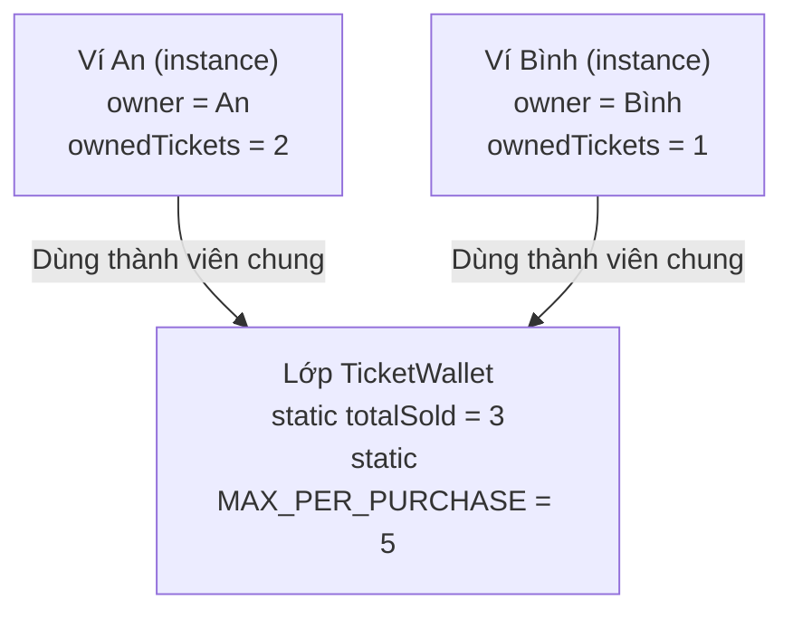

# Instance members and shared members in Java

In object-oriented programming, a **class** describes an object type, while an **instance** is a specific object created from that class. When declaring fields and methods, Java lets you choose whether a member belongs to **each individual object** or **the class and is shared** by using the `static` keyword.

This distinction answers two practical questions:

- Does this data belong to one particular object? Examples: an account holder's name, an account balance, or an order's status.
- Is this data or behavior meaningful for the entire object type? Examples: a counter for accounts created, a fixed limit, or a utility function that needs no individual account state.

## 1. Two kinds of members

| Criterion | Instance member | Shared (static) member |
|---|---|---|
| Declaration | Without `static` | With `static` |
| Associated with | Each object | The class (within the corresponding class loader) |
| Field storage | Each object has its own storage location | A single field is shared by that class's objects |
| Preferred access syntax | `doiTuong.tenThanhVien` | `TenLop.tenThanhVien` |
| Members a method can access directly | Instance and static fields/methods | Static members; instance members require an object reference |
| Use of `this` | Allowed in an instance context | Not allowed in a static context |
| Typical examples | `account.balance`, `account.deposit()` | `Account.getTotalCreated()`, `Math.max(a, b)` |

**Note:** `static` does not mean `public` or `final`. These have three distinct meanings: `static` determines what a member belongs to; `public/private` controls access; and `final` restricts reassignment or overriding, depending on the member type.

## 2. Practical example: an event ticket wallet

Suppose each customer has a wallet for event tickets and keeps track of their own tickets. At the same time, the system must count the total number of tickets sold across all wallets in the running program.

Create a **Demo.java** file and run it with Java 17 or later:

```java
public class Demo {
    public static void main(String[] args) {
        TicketWallet an = new TicketWallet("An");
        TicketWallet binh = new TicketWallet("Bình");

        an.buyTickets(2);
        binh.buyTickets(1);

        System.out.println(an.getOwner() + ": " + an.getOwnedTickets());
        System.out.println(binh.getOwner() + ": " + binh.getOwnedTickets());
        System.out.println("Tổng vé đã bán: " + TicketWallet.getTotalSold());
    }
}

class TicketWallet {
    // Dùng chung cho mọi TicketWallet trong phạm vi lớp đã nạp.
    private static int totalSold = 0;

    // Hằng số dùng chung: không cần một bản sao ở mỗi ví.
    public static final int MAX_PER_PURCHASE = 5;

    // Mỗi đối tượng TicketWallet có trạng thái của riêng mình.
    private final String owner;
    private int ownedTickets;

    public TicketWallet(String owner) {
        if (owner == null || owner.isBlank()) {
            throw new IllegalArgumentException("Tên chủ ví không hợp lệ");
        }
        this.owner = owner;
        this.ownedTickets = 0;
    }

    // Phương thức instance: tác động lên chính ví được gọi.
    public void buyTickets(int quantity) {
        if (quantity <= 0 || quantity > MAX_PER_PURCHASE) {
            throw new IllegalArgumentException("Số vé mỗi lần mua phải từ 1 đến 5");
        }

        this.ownedTickets += quantity; // Chỉ thay đổi ví hiện tại.
        totalSold += quantity;         // Thay đổi bộ đếm chung.
    }

    public String getOwner() {
        return owner;
    }

    public int getOwnedTickets() {
        return ownedTickets;
    }

    // Phương thức static: không cần một ví cụ thể để trả lời.
    public static int getTotalSold() {
        return totalSold;
    }
}
```

Output:

```text
An: 2
Bình: 1
Tổng vé đã bán: 3
```

Follow the steps:

1. `new TicketWallet("An")` creates An's wallet with `ownedTickets = 0`.
2. `new TicketWallet("Bình")` creates Bình's wallet with `ownedTickets = 0`. The wallets are two distinct objects.
3. `an.buyTickets(2)` sets `an.ownedTickets = 2` and `TicketWallet.totalSold = 2`.
4. `binh.buyTickets(1)` sets `binh.ownedTickets = 1` and `TicketWallet.totalSold = 3`. An still owns 2 tickets.

Visualize the relationship:



The diagram represents **logical ownership**, not a byte-level memory layout in the JVM. Each instance has its own fields; both see the same `TicketWallet.totalSold` within that loaded class.

## 3. Instance fields: state belonging to each object

A field declared without `static` is an instance field:

```java
class Lamp {
    private boolean on; // Mặc định là false cho mỗi đèn.

    public void turnOn() {
        this.on = true;
    }

    public boolean isOn() {
        return on;
    }
}
```

Usage:

```java
Lamp bedroom = new Lamp();
Lamp kitchen = new Lamp();

bedroom.turnOn();

System.out.println(bedroom.isOn()); // true
System.out.println(kitchen.isOn()); // false
```

Both objects are `Lamp` instances, but turning on the bedroom lamp does not automatically change the kitchen lamp's state. This ability to **encapsulate individual state** is fundamental to OOP.

Instance fields receive default values when an object is initialized (for example, `int = 0`, `boolean = false`, and reference fields `= null`), unless code assigns other values. Each new object gets its own initialized instance fields. If two reference fields point to the same other object, that referenced object can still be shared; "separate fields" does not imply that the entire object graphs are independent.

## 4. Static fields: class-level data

Declare a field `static` when the information **truly applies to the entire class**:

```java
class Player {
    private static int createdCount;
    private final String nickname;

    public Player(String nickname) {
        this.nickname = nickname;
        createdCount++;
    }

    public static int getCreatedCount() {
        return createdCount;
    }

    public String getNickname() {
        return nickname;
    }
}
```

```java
Player p1 = new Player("Fox");
Player p2 = new Player("Bear");

System.out.println(p1.getNickname());     // Fox
System.out.println(p2.getNickname());     // Bear
System.out.println(Player.getCreatedCount()); // 2
```

`nickname` is an attribute of each player. `createdCount` records the number of *instance-creation events* counted by the constructor during the current run; it is not the number of live players, database records, or players across all servers.

**Distinguish `static` from constants:**

```java
class Pricing {
    public static final int MAX_DISCOUNT_PERCENT = 30;
    private static int successfulOrders = 0;
}
```

- `MAX_DISCOUNT_PERCENT` is a class-level integer constant that cannot be reassigned.
- `successfulOrders` also belongs to the class but can change over time; it is **mutable shared state**.
- `final` on a reference variable only prevents it from referring to a different object; it does not automatically make the referenced object immutable.

A potentially confusing example:

```java
private static final java.util.List<String> NAMES =
        new java.util.ArrayList<>();

// NAMES = new java.util.ArrayList<>(); // Lỗi: không thể gán lại.
// NAMES.add("An");                       // Vẫn hợp lệ: nội dung list có thể đổi.
```

If you need an unmodifiable list, you can use `List.of("An", "Bình")` together with appropriate data-control rules.

## 5. Instance methods and static methods

An instance method executes in the context of **an object receiving the call**, so it can use `this`, read or modify instance fields, and call other instance methods.

```java
class Rectangle {
    private final double width;
    private final double height;

    Rectangle(double width, double height) {
        this.width = width;
        this.height = height;
    }

    public double area() {        // Instance method
        return width * height;
    }

    public static boolean isValidSize(double width, double height) {
        return width > 0 && height > 0; // Static method
    }
}
```

```java
Rectangle r = new Rectangle(3, 4);
System.out.println(r.area());                     // 12.0
System.out.println(Rectangle.isValidSize(3, 4));  // true
```

`area()` needs the dimensions of **a particular rectangle**. `isValidSize(width, height)` receives all the required data through parameters and does not need an existing rectangle, so it can be `static`.

A `static` method **cannot directly** read an instance field or use `this`:

```java
class Student {
    private String name;

    public static void printNameWrong() {
        // System.out.println(name); // Lỗi biên dịch:
        // non-static variable name cannot be referenced from a static context
        // System.out.println(this.name); // Cũng lỗi: không có this.
    }

    public static void printName(Student student) {
        System.out.println(student.name); // Hợp lệ nhờ đối tượng student.
    }

    public void printMyName() {
        System.out.println(this.name);    // Hợp lệ trong instance method.
    }
}
```

The key point is that a static method **can still use object data** if it is given an object reference (for example, as a parameter). It simply has no implicit `this`.

Java technically allows calling a static method through an object reference expression, but you should call it through the **class name**: `TicketWallet.getTotalSold()`. This expresses its meaning correctly and avoids suggesting that each wallet has its own counter.

## 6. Initialization and lifecycle: what happens when an object is created?

In a simple case (without considering inheritance), the general sequence is:

1. When a class is used in a way that requires initialization, the JVM initializes the class: it executes static field initializers and `static { ... }` blocks in source order. This happens once **per class initialization within a class loader**, rather than every time `new` is used.
2. On each `new` operation, Java allocates an instance, initializes its instance fields and instance initializer blocks, then executes the constructor body.
3. When a static field changes, instances of that loaded class observe the shared state. When an instance field changes, only the state associated with that instance is affected.

Example:

```java
class Sample {
    static int shared = 10;
    int local = 1;

    Sample() {
        local++;
        shared++;
    }
}

Sample a = new Sample(); // a.local = 2; shared = 11
Sample b = new Sample(); // b.local = 2; shared = 12
a.local += 5;

System.out.println(a.local);      // 7
System.out.println(b.local);      // 2
System.out.println(Sample.shared); // 12
```

Do not imagine `static` as "one variable for the entire world." Different JVMs/processes have their own state; applications running on multiple servers do not automatically synchronize static fields. Separate class loaders can also load classes with the same name as distinct classes. Moreover, static fields **are not persistent storage**: restarting an application does not guarantee that their previous values will survive.

## 7. Inheritance: overriding instance methods versus hiding static methods

Instance methods can participate in **runtime polymorphism**: the implementation invoked depends on the actual object's type. Static methods are not overridden in this sense; when a subclass declares a static method with the same signature, this is **method hiding**.

```java
class Animal {
    public static String group() {
        return "Animal";
    }

    public String sound() {
        return "...";
    }
}

class Dog extends Animal {
    public static String group() {
        return "Dog";
    }

    @Override
    public String sound() {
        return "Gâu";
    }
}

Animal pet = new Dog();
System.out.println(pet.sound());   // Gâu: đa hình instance.
System.out.println(pet.group());   // Animal: chọn static theo kiểu tham chiếu.
System.out.println(Dog.group());   // Dog: gọi rõ tên lớp.
```

The `pet.group()` line illustrates a language rule; in real code, prefer `Animal.group()` or `Dog.group()`. Do not put `@Override` on a static method or rely on static dispatch to implement behavior that requires polymorphism.

## 8. Risks of shared state: concurrency and testing

A mutable `static` field can support counters or shared configuration within a JVM, but it also creates a shared point that multiple parts of the code can modify. For example, `totalSold += quantity` is a read-add-write operation and is **not atomic**. If multiple threads buy tickets concurrently, overlapping updates can cause the total to be too low.

When you need a counter in JVM memory that multiple threads can update, you can use `AtomicInteger`:

```java
import java.util.concurrent.atomic.AtomicInteger;

class SalesMetrics {
    private static final AtomicInteger TOTAL_SOLD = new AtomicInteger();

    public static void recordSale(int quantity) {
        if (quantity <= 0) {
            throw new IllegalArgumentException("quantity phải > 0");
        }
        TOTAL_SOLD.addAndGet(quantity);
    }

    public static int getTotalSold() {
        return TOTAL_SOLD.get();
    }
}
```

`AtomicInteger` provides atomic operations **on this counter itself**, but does not automatically guarantee consistency across ticket purchases, order storage, refunds, or different servers. In a production system, total sales might need to be derived from a database or transaction-management service, depending on the required accuracy.

Mutable static fields can also cause tests to affect each other because state remains between tests. Do not make all data static merely for convenient access.

## 9. Choosing members in real-world designs

| Requirement | Recommended choice | Reason |
|---|---|---|
| Name, status, or balance of an account | Instance field | Each account has its own data |
| `deposit(amount)`, `withdraw(amount)` | Instance method | The behavior affects a specific account |
| Shared fixed limit, such as `MAX_RETRY` | `static final` | One shared rule without per-object copies |
| Pure function `Math.abs(x)` | Static method | The output depends only on inputs; no `this` is needed |
| Counter of objects created within one JVM | Possibly a static field | Shared within the loaded class; watch for concurrency |
| Number of registered users across a system | Suitable data store/service | Must remain accurate across processes, restarts, and servers |
| Data that varies by request or user | Usually instance / request scope | Prevents state leaking between users |

**Rule of thumb:** If the meaning of data disappears when an instance is deleted, that data usually belongs in an instance field. If a behavior needs no receiving object, consider a static method. If data must be shared and mutable, consider sharing scope, concurrency, lifecycle, and storage requirements before choosing a static field.

## 10. Check your understanding

**Question 1.** Two `Counter` objects each have a non-static `int value` field. Does incrementing `a.value` increment `b.value`?  
**Answer:** No, unless other logic explicitly updates `b`.

**Question 2.** Is `static int count` recreated every time `new Counter()` is executed?  
**Answer:** No. It belongs to the class within its class loader; the constructor may update its value, but does not create a new static field for each instance.

**Question 3.** Can a static method access `user.name`?  
**Answer:** Yes, if it has a valid `user` reference and sufficient access rights. What is prohibited is accessing `name` as though an implicit `this` were available.

**Question 4.** Is a `static final List<String>` always immutable?  
**Answer:** No. `final` only prevents reassigning the reference variable; the list may still be mutable if the object permits modification.

**Question 5.** Should a static field store the total payments from all customers across multiple servers?  
**Answer:** It is unsuitable as the authoritative data source. Static fields are not synchronized across JVMs and do not persist automatically across restarts.

**Remember when reading Java code:** Ask whether a member is declared `static`, **whose** state it stores, whether it needs `this`, and **what scope** that state must be shared within. Answering these four questions is usually enough to choose correctly between instance and shared members.
