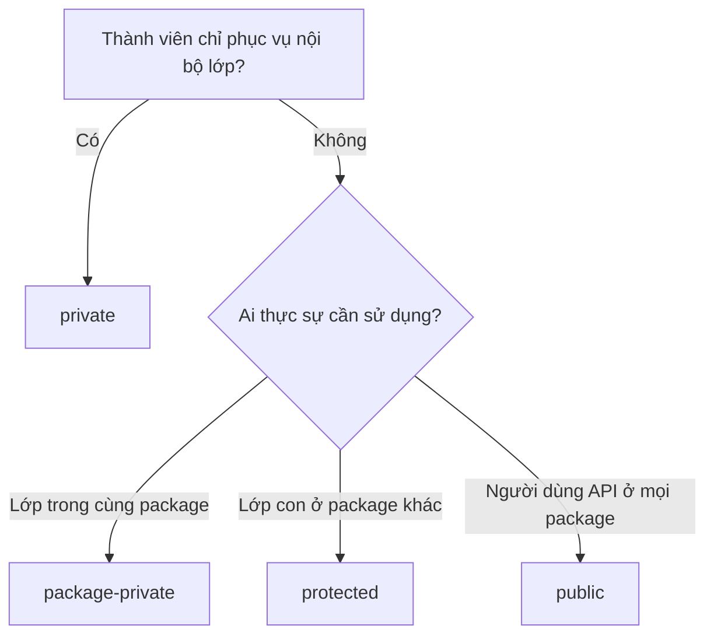

# Member access levels in Java

When designing a class in OOP, an **access level** determines where code is allowed to use that class's members: fields, methods, constructors, and nested types. Java enforces access control at compile time, allowing a class to expose the operations callers need while hiding its data and implementation details.

For example, a student object's ID must be readable externally, but its credit count should not be modified arbitrarily. You can expose a read method while restricting the method that adds credits to preserve business rules.

## 1. Four member access levels

| Declaration | Meaning | Use case |
|---|---|---|
| `private` | Direct access only within the declaring class (including nested types under Java's rules) | Internal data, helper functions, input validation |
| *package-private* (no keyword) | Accessible to classes in the **same package** | Helpers internal to a package |
| `protected` | Accessible to classes in the same package; subclasses in other packages can access it subject to additional conditions | Extension points for subclasses |
| `public` | Accessible from any package if the containing type is also accessible | API the class exposes to external callers |

In Java, *package-private* is the name for default access when **no access modifier is written**. There is no `default int score;` syntax for a field: `default` is a keyword used in other contexts, such as a `default` interface method.

### Access matrix

Assume the member is declared in a `public` class and the accessing code can see that class:

| Accessing code's location | `private` | No modifier | `protected` | `public` |
|---|:---:|:---:|:---:|:---:|
| Within the declaring class | ✅ | ✅ | ✅ | ✅ |
| Another class in the same package | ❌ | ✅ | ✅ | ✅ |
| Subclass in a different package | ❌ | ❌ | ✅* | ✅ |
| Unrelated class in a different package | ❌ | ❌ | ❌ | ✅ |

**(*) Important `protected` restriction:** From another package, a subclass can access an inherited member through `this`, `super`, or an expression whose type is that subclass (or one of its subclasses). It cannot access a `protected` member through an arbitrary reference whose type is the parent class.

## 2. Real-world example: student management

Consider this package structure:

```text
vn.edu.school
├── domain
│   ├── Student.java
│   └── StudentAudit.java
├── exchange
│   └── ExchangeStudent.java
└── presentation
    └── StudentViewer.java
```

### 2.1. Declaring access levels within a class

**`domain/Student.java`**

```java
package vn.edu.school.domain;

public class Student {
    private final String studentId; // Chỉ Student trực tiếp sử dụng
    private int credits;            // Không cho bên ngoài sửa tùy ý
    String internalNote;            // Package-private: cùng package

    public Student(String studentId) {
        this.studentId = requireValidId(studentId);
    }

    public String getStudentId() {
        return studentId;
    }

    public int getCredits() {
        return credits;
    }

    protected void addCredits(int amount) {
        if (amount <= 0) {
            throw new IllegalArgumentException("Số tín chỉ phải dương");
        }
        credits += amount;
    }

    private static String requireValidId(String id) {
        if (id == null || id.isBlank()) {
            throw new IllegalArgumentException("Mã sinh viên không hợp lệ");
        }
        return id;
    }
}
```

In this example:

- `studentId` and `credits` are `private`, so outside classes cannot modify them directly.
- `getStudentId()`, `getCredits()`, and the constructor are `public`: other code can create an object and read its information.
- `internalNote` has no modifier, so only classes in `vn.edu.school.domain` can access it directly.
- `addCredits()` is `protected` so subclasses can extend the validated behavior.
- `requireValidId()` is `private`: callers of `Student` do not need to know how the ID is validated.

### 2.2. Another class in the same package

**`domain/StudentAudit.java`**

```java
package vn.edu.school.domain;

class StudentAudit {
    void markReviewed(Student student) {
        student.internalNote = "Đã kiểm tra"; // Hợp lệ: cùng package
        student.addCredits(3);                // Hợp lệ: protected cũng mở cho package
        System.out.println(student.getCredits()); // public

        // student.credits = 99; // LỖI BIÊN DỊCH: credits là private
    }
}
```

Two classes belong to the same package only when they declare **exactly the same package name**; `vn.edu.school.domain` and `vn.edu.school.domain.audit` are different packages. Sharing a package-name prefix grants no special access.

### 2.3. A subclass in another package: the subtlety of protected

**`exchange/ExchangeStudent.java`**

```java
package vn.edu.school.exchange;

import vn.edu.school.domain.Student;

public class ExchangeStudent extends Student {
    public ExchangeStudent(String studentId) {
        super(studentId); // Gọi public constructor của Student
    }

    public void recognizeTransferredCredits(int amount) {
        addCredits(amount);       // Hợp lệ: gọi thành viên kế thừa trên this
        this.addCredits(1);       // Hợp lệ: this là ExchangeStudent

        Student other = new Student("S-02");

        // other.addCredits(1);   // LỖI: receiver có kiểu Student
        // other.internalNote = ""; // LỖI: package-private
        // other.credits = 100;   // LỖI: private
    }
}
```

In the `vn.edu.school.exchange` package, `ExchangeStudent` can use `addCredits()` because it inherits from `Student`. However, the variable `other` has type `Student`, so `other.addCredits(1)` is invalid even inside the subclass. This is why `protected` should not be interpreted as "a subclass can access every parent-class object."

Note: adding 1 credit with `this.addCredits(1)` only illustrates access syntax. In a real application, every credit adjustment must follow a well-defined business process.

### 2.4. An ordinary class in another package

**`presentation/StudentViewer.java`**

```java
package vn.edu.school.presentation;

import vn.edu.school.domain.Student;

public class StudentViewer {
    public String format(Student student) {
        // student.credits = 100;      // private: không được
        // student.internalNote = "";  // package-private: không được
        // student.addCredits(3);      // protected: không được

        return student.getStudentId() + " - " + student.getCredits();
    }
}
```

`StudentViewer` can use only the `public` API of `Student`. These restrictions prevent the presentation layer from bypassing business validation by changing data directly.

## 3. Access control and encapsulation

**Encapsulation** means more than making every field `private` and adding getters and setters. The goal is to protect an object's valid state while exposing only the operations that are actually needed.

An error-prone design:

```java
public class ExamResult {
    public int score; // Bất kỳ ai cũng có thể gán -5 hoặc 200
}
```

A controlled design:

```java
public class ExamResult {
    private int score;

    public ExamResult(int initialScore) {
        updateScore(initialScore);
    }

    public int getScore() {
        return score;
    }

    public void updateScore(int newScore) {
        if (newScore < 0 || newScore > 100) {
            throw new IllegalArgumentException("Điểm phải từ 0 đến 100");
        }
        this.score = newScore;
    }
}
```

`score` remains readable from outside the class, but modifying it must go through `updateScore()`, where the 0-to-100 rule is always enforced. You do not need a setter for every field: state that should remain unchanged after initialization may need only a constructor and getter together with `private final`.

## 4. Additional common rules

**Class accessibility and member accessibility are separate concerns.** A top-level class can be declared `public` or with no modifier (*package-private*), but not `private` or `protected`. A nested class may use any of the four levels. Even if a method is `public`, code outside the package cannot access it through a top-level class that is itself inaccessible.

**Rules for constructors.** A `private` constructor is often used to control object creation (for example, with static factories or utility classes). A `protected` constructor can support inheritance. If a class declares no constructors, Java generates a default constructor with access corresponding to the class's accessibility; do not confuse this with explicitly writing a `public` constructor.

**Overriding cannot reduce method accessibility.** If a parent class declares a `protected` method, a subclass may override it as `protected` or `public`, but not as `private`.

```java
class Parent {
    protected void validate() {}
}

class Child extends Parent {
    @Override
    public void validate() {} // Hợp lệ: mở rộng quyền truy cập

    // private void validate() {} // Không hợp lệ nếu dùng để override
}
```

**`private` does not grant access to subclasses.** A subclass cannot directly use its parent's `private` fields or methods; if that behavior is needed, the parent should expose an appropriate `protected` or `public` method.

**In interfaces:** Fields declared in an interface are implicitly `public static final`; ordinary abstract methods are implicitly `public`. Interfaces also support `private` methods for internal logic reuse (since Java 9), but do not allow `protected` or package-private interface methods.

## 5. How should you choose an access level?



Choose **the narrowest access level that meets the requirement**. Prefer `private` for data; expose `package-private`, `protected`, or `public` access only when there is a clear design reason. Avoid exposing directly mutable fields when the class must maintain business constraints.

## 6. Check your understanding

1. Class `A` has an `int count;` field. Can class `B` in the same package read `count`? **Yes**, because the field is package-private by default.
2. Can `C extends A` in another package read `count`? **No**, because package-private access does not extend to subclasses in different packages.
3. Change `count` to `protected`. Inside `C`, is `this.count` valid? **Yes**. But `new A().count` in `C` is still **invalid** across package boundaries.
4. Can a `private` field be changed through a `public` method? **Possibly**, if the class itself provides a public method that makes the change. Access control governs *where direct access is allowed*; it does not mean that state is permanently immutable.

**Remember:** `private` protects details within a class; *package-private* shares members within a package; `protected` supports package access and conditional subclass access; `public` exposes an interface to external code. Design APIs around the class's responsibilities and the invariants they must protect.
