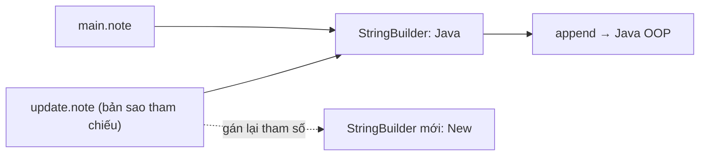

# Method parameters, return values, and effects in Java

> **Context:** OOP → Classes. Methods describe object behavior. When calling a method, we can supply data through **parameters**, receive a **return value**, and observe **effects** on state or the environment.

## 1. Reading a method's structure

```java
public class Rectangle {
    public static double area(double width, double height) {
        if (width <= 0 || height <= 0) {
            throw new IllegalArgumentException("Kích thước phải dương");
        }
        return width * height;
    }

    public static void main(String[] args) {
        double result = area(3.5, 2.0);
        System.out.println(result); // 7.0
    }
}
```

In this example:

- `area` is the **method name**, indicating the requested operation.
- `double width, double height` are the **formal parameters**: the declared names and types of the inputs.
- `3.5, 2.0` are the **arguments**: the actual values passed at the call site.
- `double` before `area` is the **return type**, while `7.0` is the **return value** of this particular call.
- `return width * height;` sends the result back to the call site and ends the current method invocation.
- The `area` method does not modify external data; the `println` call inside `main` produces the console-output effect.

| Concept | Question to answer | Example |
|---|---|---|
| Parameter | What data does the method need? | `width`, `height` |
| Argument | What values were supplied when calling? | `3.5`, `2.0` |
| Return value | What result does the caller receive? | `7.0` |
| Effect | What did the call change? | `area` does not modify state |

**Return values differ from effects:** a method can return a result without changing state, change state without returning a result, or do both.

## 2. Parameters: the input contract

A declaration has this form:

```java
[accessModifier] ReturnType methodName(Type1 param1, Type2 param2) {
    // Thân phương thức
}
```

Parameters are in the method's scope; callers must supply arguments compatible in type, number, and order (except for cases such as varargs). For example:

```java
public static String formatUser(String name, int age, boolean active) {
    if (name == null || name.isBlank()) {
        throw new IllegalArgumentException("Tên không được để trống");
    }
    if (age < 0) {
        throw new IllegalArgumentException("Tuổi không hợp lệ");
    }
    return name + " (" + age + "), active=" + active;
}

String label = formatUser("An", 20, true);
```

Input validation matters because valid data is part of a method's contract. If a method requires a positive monetary amount, check that condition before using it.

### Method overloading

Java allows multiple methods with the same name if their **parameter lists** differ:

```java
static int multiply(int a, int b) {
    return a * b;
}

static double multiply(double a, double b) {
    return a * b;
}
```

The compiler selects which version to call based on the arguments and method-resolution rules. Changing only the **return type** does not create a valid overload.

### Default parameters and varargs

Java has no default-parameter syntax such as `method(int x = 10)`. You can use overloading instead:

```java
static String greeting(String name) {
    return greeting(name, "Xin chào");
}

static String greeting(String name, String prefix) {
    return prefix + ", " + name;
}
```

For a variable number of arguments, use varargs:

```java
static int sum(int... numbers) {
    int total = 0;
    for (int number : numbers) {
        total += number;
    }
    return total;
}

int x = sum();         // 0
int y = sum(2, 4, 6);  // 12
```

`int... numbers` is treated as an array inside the method. A varargs parameter must be the last parameter in the list.

## 3. Java always passes arguments by value

In Java, **all arguments are passed by value**, even when an argument is an object. What gets copied depends on the data type:

| Parameter | Value copied | Consequence |
|---|---|---|
| `int`, `long`, `double`, `boolean`... | Primitive value | Reassigning the parameter does not change the original variable |
| `StringBuilder`, `List`, class instances... | Object reference value | The method can mutate the same mutable object held by the caller |
| Reference reassigned to a new object | Only the method's copy of the reference | The caller's reference variable does not point to the new object |

A standalone Java example:

```java
public class ParameterDemo {
    static void update(int score, StringBuilder note) {
        score = 100;                       // Chỉ sửa bản sao của số
        note.append(" OOP");               // Sửa đối tượng đang được chia sẻ
        note = new StringBuilder("New");   // Chỉ gán lại tham số cục bộ
    }

    public static void main(String[] args) {
        int score = 10;
        StringBuilder note = new StringBuilder("Java");

        update(score, note);

        System.out.println(score); // 10
        System.out.println(note);  // Java OOP
    }
}
```



Initially, the `note` variable in `main` and the `note` parameter both refer to the same object. The `append` call modifies that object, so the caller sees the change. In contrast, `note = new StringBuilder(...)` only changes the local parameter.

With `String`, strings are **immutable** objects:

```java
static void rename(String name) {
    name = name.toUpperCase();
}

String name = "Lan";
rename(name);
System.out.println(name); // Lan
```

To obtain a new string, return it and assign the result:

```java
static String normalize(String input) {
    return input.trim().toUpperCase();
}

name = normalize(name); // LAN
```

The key point: Java **does not pass reference variables by reference**. It passes **copies of reference values**.

## 4. Return values and the return statement

The return type appears before the method name. For methods with a return type other than `void`, every path that completes normally must return a compatible value.

```java
static String grade(int score) {
    if (score < 0 || score > 100) {
        throw new IllegalArgumentException("Điểm không hợp lệ");
    }
    if (score >= 85) return "Giỏi";
    if (score >= 70) return "Khá";
    if (score >= 50) return "Đạt";
    return "Chưa đạt";
}
```

Here, `return` ends the method immediately. The `throw` branch completes abruptly and transfers control to exception handling.

| Return type | Meaning | Example |
|---|---|---|
| `int`, `long`, `double` | Numeric value | `return total;` |
| `boolean` | True/false or success/failure result | `return balance >= amount;` |
| `String` or object | Result data | `return user;` |
| `Optional<T>` | Presence or absence of a result, when the API chooses this representation | `Optional<User>` |
| `void` | No return value | `return;` (early exit) |

`void` does not mean "no effects." A `void` method can update state, print information, or store data.

### Returning objects can expose internal state

```java
List<String> getNames() {
    return names; // Người gọi có thể sửa trực tiếp nếu names là danh sách mutable
}
```

If `names` is an `ArrayList`, calling `getNames().clear()` will erase the contents of the list owned by the class. A safer option for a list of strings is:

```java
List<String> getNames() {
    return List.copyOf(names);
}
```

`List.copyOf` (Java 10+) creates an unmodifiable list. This is a **shallow** copy: if its elements are mutable objects, they can still be changed through other references. The element types therefore matter too.

## 5. What are method effects?

A **side effect** is an observable change other than the return value: modifying an object's field, changing an input collection, writing a file, printing to the console, updating a database, sending a network request, and so on.

| Operation | What can change? | Note |
|---|---|---|
| `square(4)` returns `16` | No external state | Example of a pure function |
| `account.getBalance()` | Does not modify the account | Result depends on current state |
| `account.deposit(50)` | The `balance` field | Affects the object itself |
| `items.add("Java")` | List contents | Other holders of the list see the change |
| `System.out.println(...)` | Console | I/O is a side effect |
| `repository.save(entity)` | Stored data | May involve transactions or I/O failures |

A **pure function** produces the same result for the same input and has no observable side effects. A function that reads `balance` may modify nothing but still depend on object state, so it is not necessarily pure in the strict sense.

Throwing an exception also changes control flow and is observable behavior. When designing a method contract, specify possible exceptions alongside return values and state changes.

## 6. Practical OOP example: method contracts for a job counter

Consider a counter for jobs waiting to be processed. This example distinguishes **inputs**, **return values**, and **effects on state** in each method's signature and body. The counter only simulates the number of jobs; it does not execute any real work.

~~~java
public class MethodDemo {
    static final class JobCounter {
        private int pendingJobs;

        JobCounter(int initialJobs) {
            if (initialJobs < 0) {
                throw new IllegalArgumentException("Số tác vụ ban đầu không hợp lệ");
            }
            this.pendingJobs = initialJobs;
        }

        public int getPendingJobs() {
            return pendingJobs; // Chỉ đọc, trả về số tác vụ
        }

        public void addJobs(int count) {
            if (count <= 0) {
                throw new IllegalArgumentException("Số tác vụ thêm phải dương");
            }
            pendingJobs = Math.addExact(pendingJobs, count);
        }

        public boolean completeOne() {
            if (pendingJobs == 0) {
                return false; // Không có việc để hoàn tất, không thay đổi trạng thái
            }
            pendingJobs--;
            return true; // Đã giảm số tác vụ chờ đi một
        }
    }

    public static void main(String[] args) {
        JobCounter jobs = new JobCounter(1);
        jobs.addJobs(2);
        System.out.println(jobs.getPendingJobs()); // 3
        System.out.println(jobs.completeOne());     // true
        System.out.println(jobs.getPendingJobs()); // 2

        try {
            jobs.addJobs(-1);
        } catch (IllegalArgumentException ex) {
            System.out.println("Bị từ chối");
        }
        System.out.println(jobs.getPendingJobs()); // 2

        jobs.completeOne();
        jobs.completeOne();
        System.out.println(jobs.completeOne());     // false
        System.out.println(jobs.getPendingJobs()); // 0
    }
}
~~~

After saving the code as `MethodDemo.java`, compile and run:

~~~bash
javac MethodDemo.java
java MethodDemo
~~~

Output:

~~~text
3
true
2
Bị từ chối
2
false
0
~~~

| Method | Parameters | Return value | Effect or error |
| --- | --- | --- | --- |
| `getPendingJobs()` | None | `int`: number of pending jobs | Does not modify the counter |
| `addJobs(int count)` | Number of jobs to add | `void` | Increases jobs if `count > 0`; an invalid argument throws `IllegalArgumentException`, and overflow throws `ArithmeticException` before assignment |
| `completeOne()` | None | `boolean` | Returns `true` and removes one pending job when work remains; returns `false` and leaves state unchanged when there are no jobs |

~~~mermaid
flowchart TD
    A["completeOne()"] --> B{"pendingJobs > 0?"}
    B -->|Không| C["return false; không đổi"]
    B -->|Có| D["pendingJobs--"]
    D --> E["return true"]
~~~

Suppose there is initially one job: `addJobs(2)` raises the counter from 1 to 3. The first `completeOne()` returns `true` **and** reduces the counter to 2. When no jobs remain, the method returns `false` without reducing the count below 0. `addJobs(-1)` fails **before changing** the counter.

`Math.addExact` detects `int` overflow, but does not make the check-and-update operation thread-safe. This example assumes one thread; a real application needs suitable synchronization if several threads update the same counter.

Here, returning `true` or `false` reports **the result of the operation**, while decrementing `pendingJobs` is **an effect on the object**. The signature alone does not reveal both; you need to understand the method's contract and error conditions.

## 7. Return a new object or modify an input object?

The following two versions have different API semantics. The examples require `import java.util.*;`.

**Version A — return a new list:**

```java
static List<String> withAddedTag(List<String> original, String tag) {
    List<String> result = new ArrayList<>(original);
    result.add(tag);
    return result;
}

List<String> oldTags = new ArrayList<>(List.of("OOP"));
List<String> newTags = withAddedTag(oldTags, "Java");
// oldTags = [OOP]
// newTags = [OOP, Java]
```

**Version B — modify the supplied list directly:**

```java
static void addTag(List<String> tags, String tag) {
    tags.add(tag);
}

List<String> tags = new ArrayList<>(List.of("OOP"));
addTag(tags, "Java");
// tags = [OOP, Java]
```

Approach A is easier to reason about when callers need to preserve their inputs. Approach B is convenient when the operation intentionally updates a list. Do not call `addTag` with `List.of(...)` because that list is unmodifiable; `add` would throw `UnsupportedOperationException`.

Note that in approach B, Java still passes **a copy of the reference** into `addTag`. The effect occurs because both sides see the same `ArrayList` object, not because the variable is passed by reference.

## 8. Designing methods with clear contracts

Before writing a method, define four things:

1. **Inputs:** which parameters are needed, and what makes them valid?
2. **Output:** which type is returned, and can the result be absent or the operation fail?
3. **Effects:** which fields, arguments, or external resources will be modified?
4. **Errors:** when are exceptions thrown, and does the state remain consistent?

| Purpose | Suggested signature | Contract |
|---|---|---|
| Calculation | `double calculateTotal(int quantity, double price)` | Returns a result |
| State query | `boolean isEmpty()` | Only queries state |
| State change | `void clear()` | Empties the object's contents |
| Change with a result | `boolean remove(String key)` | Reports whether an element was removed |
| Search that may find nothing | `Optional<User> findUser(String id)` | Expresses the possibility of no result |

Some practical guidelines:

- **Names reflect behavior:** `calculate...`, `find...`, and `get...` commonly signal queries; `add...`, `update...`, and `delete...` commonly signal changes. These are conventions, not substitutes for actual contracts.
- **Check invariants before updating:** for example, a balance must remain nonnegative. Avoid making partial updates before discovering invalid inputs.
- **Avoid silently modifying caller data:** when an API must modify a collection, make that clear in its name, documentation, and tests. Consider returning a copy when independence is required.
- **Do not expose internal mutable fields:** keep fields `private` and provide suitable access methods.
- **Do not overuse `void` when a result should be reported:** a withdrawal method should clearly indicate success, failure, or an error.
- **Reduce unrelated parameters:** group related information into a meaningful class or record. Replace `process(x, true)` with an API that makes the meaning of `true` clear.

In larger systems, it can be helpful to separate **commands** (which perform changes) from **queries** (which only return data). This is a useful design direction, not a rigid rule for every Java class.

## 9. Common mistakes

```java
// Sai kỳ vọng 1: tưởng n thay đổi ở bên ngoài.
static void increment(int n) { n++; }

// Sai kỳ vọng 2: tưởng gán lại tham số là thay biến của người gọi.
static void replace(StringBuilder b) {
    b = new StringBuilder("X");
}

// Sai kỳ vọng 3: bỏ qua dữ liệu trả về của đối tượng bất biến.
String original = " java ";
original.trim(); // original vẫn là " java "

// Đúng: nhận và lưu kết quả trả về.
String cleaned = original.trim(); // "java"
```

Also remember:

- `System.out.println(total)` only prints data, whereas `return total;` sends data back to the call site; both can occur, but neither replaces the other.
- If `return` executes before a statement, that statement will not execute along the corresponding path.
- Using `==` on two object references generally checks whether they point to the same object; to compare `String` contents, you would typically use `equals`.
- Do not assume that a `get...` method is always pure: it may depend on changing state or produce side effects if poorly designed.

## 10. Self-check exercises

1. Write `TemperatureConverter.toFahrenheit(double celsius)`: identify its parameter and return type, the result for `0`, and whether it changes any state.
2. Write a `Counter` class with a `private int count` field and two methods, `increment()` and `getCount()`. Explain which updates state and which queries it.
3. Predict the result of passing an `int`, `StringBuilder`, and `ArrayList<String>` into a method, then distinguish **reassigning a parameter** from **modifying an object**.
4. Given a class that manages a `tasks` list, explain why `return tasks;` can break encapsulation and propose a safer `getTasks()` implementation.

**Remember:** **Parameters** describe incoming data; **return** delivers a result and ends a call; **effects** describe observable changes after a call. To understand a Java method correctly, always consider **both its returned value and the state it may change**.
