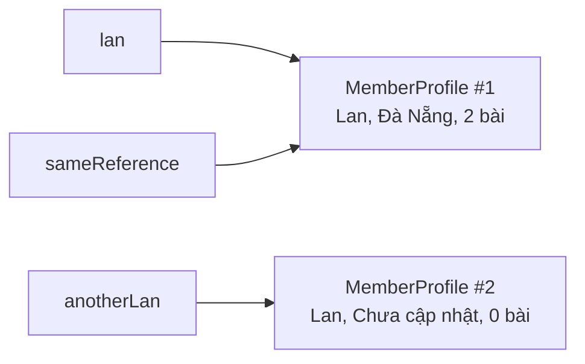

# References to the current object in Java: `this`

In Java, each object has fields that store state and methods that operate on it. While an **instance method** or **constructor** is running, the `this` keyword allows the code to refer to **the current object itself**.

For example, when you call `lan.completeLesson()`, `this` inside `completeLesson()` is the object referenced by the `lan` variable. When the same method is called on `minh`, `this` refers to the object referenced by `minh` instead.

```java
MemberProfile lan = new MemberProfile("Lan");
MemberProfile minh = new MemberProfile("Minh");

lan.completeLesson();  // this trong lời gọi này là đối tượng Lan
minh.completeLesson(); // this trong lời gọi này là đối tượng Minh
```

**Key point:** `this` does not create a new object. It lets code inside an instance refer to that very instance.

## 1. Using `this.field` to access the current object's fields

Consider the `MemberProfile` class:

```java
class MemberProfile {
    private String username;

    MemberProfile(String username) {
        this.username = username;
    }
}
```

In the constructor, the `username` parameter has the same name as the field:

- `this.username` is **the current object's field**.
- `username` on the right is **the constructor parameter**.
- `this.username = username;` stores the supplied data in the object's state.

If you write `username = username;`, both sides refer to the parameter. The `username` field is left unassigned and retains its default value, `null`. This mistake is easy to miss because the statement can still compile.

The same rule applies when a local variable **shadows** a field:

```java
class Counter {
    private int count = 10;

    void example() {
        int count = 3;
        System.out.println(count);      // 3: biến cục bộ
        System.out.println(this.count); // 10: trường của đối tượng
    }
}
```

When no local variable or parameter shares the field's name, you can write `count` instead of `this.count` inside an instance method. However, deliberately using `this.` helps readers recognize that the code operates on the object's state.

## 2. Practical example: a learner profile updating its own state

Put all the following code in **`Main.java`** and run it with Java 11 or later (because it uses `String.isBlank()`):

```java
class MemberProfile {
    private final String username;
    private String city;
    private int completedLessons;

    // Constructor một tham số ủy quyền sang constructor hai tham số.
    MemberProfile(String username) {
        this(username, "Chưa cập nhật");
    }

    MemberProfile(String username, String city) {
        if (username == null || username.isBlank()) {
            throw new IllegalArgumentException("Tên không được trống");
        }
        if (city == null || city.isBlank()) {
            throw new IllegalArgumentException("Thành phố không được trống");
        }

        this.username = username;
        this.city = city;
        this.completedLessons = 0;
    }

    MemberProfile moveTo(String city) {
        if (city == null || city.isBlank()) {
            throw new IllegalArgumentException("Thành phố không được trống");
        }
        this.city = city;
        return this;
    }

    MemberProfile completeLesson() {
        this.completedLessons++;
        return this;
    }

    boolean isSameInstance(MemberProfile other) {
        return this == other;
    }

    void sendReport(Reporter reporter) {
        reporter.print(this);
    }

    String getUsername() {
        return username;
    }

    String getCity() {
        return city;
    }

    int getCompletedLessons() {
        return completedLessons;
    }
}

class Reporter {
    void print(MemberProfile member) {
        System.out.println(
            "Báo cáo: " + member.getUsername()
            + " - " + member.getCity()
            + " - " + member.getCompletedLessons()
        );
    }
}

public class Main {
    public static void main(String[] args) {
        MemberProfile lan = new MemberProfile("Lan");
        MemberProfile sameReference = lan;
        MemberProfile anotherLan = new MemberProfile("Lan");

        lan.moveTo("Đà Nẵng")
           .completeLesson()
           .completeLesson();

        System.out.println(lan.getCity());
        System.out.println(lan.getCompletedLessons());
        System.out.println(sameReference.getCompletedLessons());
        System.out.println(lan.isSameInstance(sameReference));
        System.out.println(lan.isSameInstance(anotherLan));

        lan.sendReport(new Reporter());
        System.out.println(anotherLan.getCity());
    }
}
```

Compile and run:

```bash
javac Main.java
java Main
```

Output:

```text
Đà Nẵng
2
2
true
false
Báo cáo: Lan - Đà Nẵng - 2
Chưa cập nhật
```

**Examine the different roles of `this` in the same example:**

| Source code | What does `this` represent or do? |
| --- | --- |
| `this.username = username` | Distinguishes the `username` field from the parameter with the same name |
| `this(username, "Chưa cập nhật")` | Calls another constructor of **the same class** |
| `this.city = city` | Changes the receiving object's `city` field |
| `this.completedLessons++` | Increments this object's completed-lesson count |
| `return this` | Returns a reference to the current object so another method can be called |
| `this == other` | Checks whether two references point to the same object |
| `reporter.print(this)` | Passes the current object itself as an argument to another method |

`sameReference = lan` **does not** create a new profile, so both variables see `completedLessons = 2`. In contrast, `new MemberProfile("Lan")` creates a different object even though the learner's name is the same. Therefore, `lan.isSameInstance(anotherLan)` returns `false`.

## 3. `this` depends on the object receiving the call

The following diagram shows the relationships between references:



In the `lan.completeLesson()` call, object #1 is the current object. If you call `anotherLan.completeLesson()`, object #2 becomes the current object. The same method code can run with different values of `this`.

Within an instance method, the following two calls are usually equivalent:

```java
completeLesson();
this.completeLesson();
```

Both invoke `completeLesson()` on the current object. `this.` emphasizes the receiving object but is not always required.

Distinguish these references:

- `this`: the current object.
- `other` or `member`: another supplied reference that may point to the same object or a different one.
- `new MemberProfile(...)`: creates a new object.
- `super`: accesses parent-class members or invokes a parent-class constructor; it is not the same as `this`.

## 4. Using `this(...)` to call another constructor in the same class

In addition to `this.field` and `return this`, Java provides the special `this(...)` syntax to **invoke another constructor in the same class** (*constructor chaining*).

```java
class ReportConfig {
    private final String language;
    private final int pageSize;

    ReportConfig() {
        this("vi", 20);
    }

    ReportConfig(String language) {
        this(language, 20);
    }

    ReportConfig(String language, int pageSize) {
        if (language == null || language.isBlank() || pageSize <= 0) {
            throw new IllegalArgumentException("Cấu hình không hợp lệ");
        }
        this.language = language;
        this.pageSize = pageSize;
    }
}
```

In Java 17/21, a `this(...)` call must be **the first statement** in the invoking constructor. You cannot place another statement before `this(...)` in that constructor:

```java
// Ví dụ SAI trên Java 17/21:
ReportConfig() {
    System.out.println("Đang khởi tạo");
    this("vi", 20); // Lỗi biên dịch
}
```

Constructors must not form circular invocation chains. A constructor also cannot contain both an explicit `this(...)` call and an explicit `super(...)` call. If no explicit constructor invocation is present, Java implicitly calls `super()` when applicable.

| Syntax | Meaning |
| --- | --- |
| `this.field` | Accesses a field of the current object |
| `this.method()` | Calls a method on the current object |
| `this(...)` | In a constructor, invokes another constructor of the same class |
| `super(...)` | In a constructor, invokes a parent-class constructor |
| `super.method()` | Calls the parent-class method implementation when appropriate |

**Note:** The "first statement" restriction above applies to Java 17/21, common versions for learning Spring/Java. Newer Java versions introduce changes to constructor structure; when using them, consult the rules for the exact compiler version.

## 5. Returning `this` for method chaining

A method can return the object receiving the call:

```java
MemberProfile moveTo(String city) {
    this.city = city;
    return this;
}
```

This allows:

```java
lan.moveTo("Đà Nẵng").completeLesson().completeLesson();
```

This is equivalent to:

```java
lan.moveTo("Đà Nẵng");
lan.completeLesson();
lan.completeLesson();
```

This technique is called a *fluent API* or *method chaining*. **`return this` simply returns a reference to the current object**; it neither copies the object nor creates a new immutable version. In this example, the calls modify `lan`'s state.

Not every method should return `this`. A query such as `getCity()` should return the requested data; a method that reports errors or transaction results may need a more suitable return type. In an **immutable** class, a change operation usually creates and returns **a new object** rather than modifying the current one.

## 6. Passing `this` to another object

In the main example:

```java
void sendReport(Reporter reporter) {
    reporter.print(this);
}
```

The `reporter.print(this)` call passes a reference to the `MemberProfile` object currently executing `sendReport()`. This lets `Reporter` read information from the supplied object.

Similar use cases include:

- Registering an object as a listener: `eventBus.register(this)`.
- Passing an object to a processor: `processor.process(this)`.
- Calling a helper that needs the current object: `validator.validate(this)`.

**Be careful when exposing `this` from a constructor.** If a listener, another thread, or an external component uses the object before construction finishes, it may observe incompletely initialized state. Complete initialization before registering or publishing the object.

## 7. When can `this` not be used?

`this` belongs to a **specific instance**. A `static` method belongs to the class and has no implicit receiving object, so `this` cannot be used in a static context:

```java
class MathHelper {
    static int doubleValue(int value) {
        // return this.value; // SAI: không có this trong static method
        return value * 2;
    }
}
```

Likewise, `this` cannot be used directly in a `static` initializer block or a `static` field initializer. A static method can still work with an object when that object is **explicitly passed** as a parameter:

```java
class ProfilePrinter {
    static void print(MemberProfile member) {
        System.out.println(member.getUsername());
    }
}
```

Reference table:

| Context | Can `this` be used? | Why? |
| --- | --- | --- |
| Instance method | Yes | There is a receiving object |
| Constructor | Yes, subject to initialization rules | The current object is being constructed |
| Instance initializer block | Yes | Part of initializing each instance |
| Static method | No | There is no current object |
| Static initializer block or field initializer | No | Belongs to the class, not an instance |

## 8. Advanced case: `OuterClass.this` in an inner class

A **non-static inner class** has an enclosing object. Inside the inner class, `this` refers to **the inner-class object**, while `OuterClass.this` refers to the enclosing class's object.

```java
class Classroom {
    private final String name;

    Classroom(String name) {
        this.name = name;
    }

    class Student {
        private final String name;

        Student(String name) {
            this.name = name;
        }

        String describe() {
            return this.name + " thuộc lớp " + Classroom.this.name;
        }
    }
}

public class InnerClassDemo {
    public static void main(String[] args) {
        Classroom room = new Classroom("Java OOP");
        Classroom.Student student = room.new Student("Mai");
        System.out.println(student.describe());
    }
}
```

Save this example **separately** as `InnerClassDemo.java`, then run `javac InnerClassDemo.java` and `java InnerClassDemo`. Output: `Mai thuộc lớp Java OOP`.

Here, `this.name` is the student's name, while `Classroom.this.name` is the classroom's name. This is a case where you must distinguish whether you mean the inner object or its enclosing object.

## 9. Common misconceptions

| Misconception | Correct interpretation |
| --- | --- |
| `this` is a new object | `this` refers to the object that received the call or is being initialized |
| `this.username = username` and `username = username` are always equivalent | Not when a parameter shadows the field; the second statement assigns the parameter to itself |
| `this(...)` calls a method named `this` | No; it invokes another constructor of the same class |
| `return this` creates a copy | No; it returns the same reference |
| Assigning `b = a` gives `b` its own object | No; for reference types, assignment copies the reference |
| `this` can be used in every Java function | No; static methods have no `this` |
| `this == other` compares object contents | No; it checks whether the references point to the same object |
| `OuterClass.this` and `this` always refer to the same object | No; within an inner class, they can refer to different objects |

## 10. Check your understanding

**Question 1.** Given:

```java
class Box {
    int value;

    Box(int value) {
        value = value;
    }
}
Box box = new Box(5);
System.out.println(box.value);
```

The result is **`0`**, because `value = value;` affects only the parameter, leaving the `int value` field at its default value. Changing it to `this.value = value;` makes the result `5`.

**Question 2.** Suppose `MemberProfile a = new MemberProfile("A");` and `MemberProfile b = a;`. After `b.completeLesson()`, what does `a.getCompletedLessons()` return? **`1`**, because `a` and `b` refer to the same object.

**Question 3.** How does `this("vi", 20);` in a constructor differ from `this.language = "vi";`? The first **delegates to another constructor**; the second **assigns an object field**.

**Question 4.** Can you write `static void hello() { System.out.println(this); }`? **No**, because a static method has no current instance.

**Question 5.** After `MemberProfile result = a.moveTo("Huế");`, what is `result == a`? **`true`**, because `moveTo()` returns `this` without creating a new object.

When reading or writing Java code, ask yourself, "On **which object** is this method running?" That object is what `this` means at that location. Thinking this way helps you understand how objects hold separate state, how constructors initialize state, and how calls affect the same instance.
