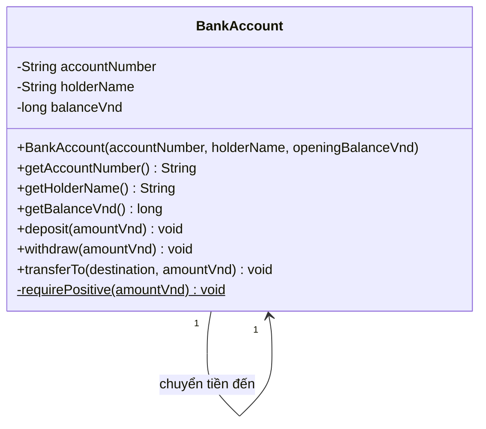
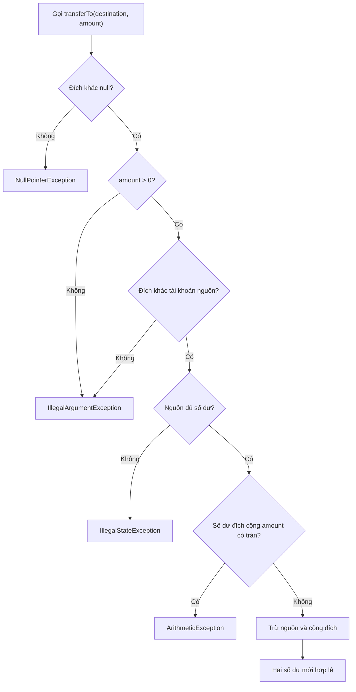

# Designing a class using a bank account example (Java OOP)

## Problem: what must a bank account know and do?

Suppose we are building the core of a simulated banking application in Java. Each account has an **account number**, **account holder's name**, and **balance**. Users can deposit money, withdraw money, transfer money to another account, and check their balance.

A key idea in object-oriented design is that **data and its related operations belong in the same class**, and the class is responsible for keeping data valid. If arbitrary code could modify `balance` directly, negative balances or incorrect transfers could easily occur.

This lesson builds an educational model that runs on Java 11+, using Vietnamese dong (`VND`) represented as `long` integers to keep the examples clear. It is an in-memory model for learning **class design**, not a production banking system.

### Business requirements

| Scenario | Rule to enforce |
| --- | --- |
| Open an account | Valid account number, nonblank holder name, and nonnegative initial balance |
| Deposit | Deposit amount must be greater than 0; addition must not overflow `long` |
| Withdraw | Withdrawal amount must be greater than 0 and must not exceed the balance |
| Transfer | Destination account must exist and differ from the source; source must have sufficient funds, and destination must accept the amount without overflow |
| Query | Necessary information can be read, but external code cannot arbitrarily assign a balance |
| Failed operation | Balances must remain unchanged if validation conditions fail |

A condition that always holds for an object after initialization and every valid operation is called an **invariant**. For this class, the most important invariant is `balanceVnd >= 0`. The established identity information also remains unchanged throughout the object's lifetime.

## 1. Identifying the class, fields, and methods

Before writing code, translate the business description into class components:

| Business concept | Suggested Java component | Reason |
| --- | --- | --- |
| Account number | `private final String accountNumber` | Identifies the account; cannot be reassigned after creation |
| Account holder | `private final String holderName` | Name confirmed at account opening in this model |
| Balance (VND) | `private long balanceVnd` | Per-object state that changes through business operations |
| Open account | Constructor `BankAccount(...)` | Establishes and validates initial state |
| Check balance | `getBalanceVnd()` | Provides controlled read access |
| Deposit | `deposit(long amountVnd)` | Validates and increases the balance |
| Withdraw | `withdraw(long amountVnd)` | Validates and decreases the balance |
| Transfer | `transferTo(BankAccount destination, long amountVnd)` | Coordinates changes across two objects |
| Validate amount | `requirePositive(long amountVnd)` | Shared validation logic for internal use only |

**Why use `private` for fields?** If `public long balanceVnd` were declared, external code could do this:

```java
// Ví dụ thiết kế SAI: giả sử balanceVnd được khai báo public
account.balanceVnd = -500_000;
```

The balance would then violate the rules. A generic setter such as `setBalanceVnd(-500_000)` could cause the same problem if it lacked business validation. The `deposit`, `withdraw`, and `transferTo` API methods express **the meaning of each operation**, keeping validation in one place.

The UML diagram shows the main structure:



In the notation, `-` means `private`, `+` means `public`, and `$` indicates a `static` member. The association shows that the transfer method works with **another BankAccount object**; it does not mean that every account has one fixed destination account.

## 2. Implementing the BankAccount class

Create **`BankAccount.java`** as follows. To keep the example self-contained, the class does not depend on a framework, database, or libraries outside the JDK.

```java
import java.util.Objects;

public final class BankAccount {
    private final String accountNumber;
    private final String holderName;
    private long balanceVnd;

    // Constructor: tạo đối tượng ở trạng thái ban đầu hợp lệ
    public BankAccount(String accountNumber,
                       String holderName,
                       long openingBalanceVnd) {
        Objects.requireNonNull(accountNumber, "accountNumber");
        Objects.requireNonNull(holderName, "holderName");

        if (!accountNumber.matches("[A-Z0-9]{6,20}")) {
            throw new IllegalArgumentException(
                    "Số tài khoản phải gồm 6-20 chữ in hoa hoặc chữ số");
        }

        String normalizedName = holderName.strip();
        if (normalizedName.isBlank()) {
            throw new IllegalArgumentException(
                    "Tên chủ tài khoản không được rỗng");
        }

        if (openingBalanceVnd < 0) {
            throw new IllegalArgumentException(
                    "Số dư ban đầu không được âm");
        }

        this.accountNumber = accountNumber;
        this.holderName = normalizedName;
        this.balanceVnd = openingBalanceVnd;
    }

    // Các phương thức truy vấn: không thay đổi trạng thái
    public String getAccountNumber() {
        return accountNumber;
    }

    public String getHolderName() {
        return holderName;
    }

    public long getBalanceVnd() {
        return balanceVnd;
    }

    // Nạp tiền: validate trước, cập nhật sau
    public void deposit(long amountVnd) {
        requirePositive(amountVnd);
        balanceVnd = Math.addExact(balanceVnd, amountVnd);
    }

    // Rút tiền: không cho phép thấu chi trong ví dụ
    public void withdraw(long amountVnd) {
        requirePositive(amountVnd);

        if (amountVnd > balanceVnd) {
            throw new IllegalStateException("Số dư không đủ để rút");
        }

        balanceVnd -= amountVnd;
    }

    // Chuyển tiền giữa hai tài khoản trong chương trình đơn luồng
    public void transferTo(BankAccount destination, long amountVnd) {
        Objects.requireNonNull(destination, "destination");
        requirePositive(amountVnd);

        if (destination == this) {
            throw new IllegalArgumentException(
                    "Không chuyển tiền cho chính tài khoản nguồn");
        }

        if (amountVnd > balanceVnd) {
            throw new IllegalStateException("Số dư không đủ để chuyển");
        }

        // Tính trước số dư đích để bắt tràn số trước khi trừ tiền nguồn.
        long nextDestinationBalance =
                Math.addExact(destination.balanceVnd, amountVnd);

        // Cập nhật chỉ sau khi mọi kiểm tra đều thành công.
        this.balanceVnd -= amountVnd;
        destination.balanceVnd = nextDestinationBalance;
    }

    private static void requirePositive(long amountVnd) {
        if (amountVnd <= 0) {
            throw new IllegalArgumentException(
                    "Số tiền giao dịch phải lớn hơn 0");
        }
    }
}
```

### Analyzing the design decisions

**`public final class BankAccount`:** this is a concrete class; `final` prevents other classes from extending it. This lesson deliberately avoids inheritance to focus on the account contract. Declaring the class `final` **does not** make its objects immutable: `balanceVnd` can still change through methods.

**`private final String accountNumber`:** `private` prevents direct external access, while `final` means the field is assigned once in the constructor. The example requires account numbers with 6–20 uppercase letters or digits; this is an **illustrative rule**, not a standard for every bank.

**`private long balanceVnd`:** this field is not `final` because the balance must change through deposits, withdrawals, and transfers. It represents each object's own state. Values are expressed in **Vietnamese dong**, so `125_000` means 125,000 VND.

**Constructor `BankAccount(...)`:** it has no return type, shares its name with the class, and is invoked by `new BankAccount(...)`. The constructor validates all parameters before assigning fields, preventing objects with negative balances or invalid names. `this.accountNumber` denotes the object's field; `accountNumber` on the right is the parameter.

**Getter:** `getBalanceVnd()` returns a primitive `long`, so callers receive the value without gaining permission to modify the field. Because the requirements prohibit arbitrary balance updates, the class **has no** `setBalanceVnd()`.

**`deposit()`:** uses `Math.addExact` to detect overflow. If the sum cannot be represented as a `long`, Java throws `ArithmeticException` before assignment, leaving the balance unchanged.

**`withdraw()`:** validates the amount before subtracting; it throws `IllegalArgumentException` for arguments equal to 0 or negative values and `IllegalStateException` when the account has insufficient funds. A real product might define a domain-specific exception such as `InsufficientFundsException`.

**`transferTo()`:** receives a reference to another `BankAccount` object. Java lets a class method access the `private` fields of *another object of the same class*, because `private` applies to **the declaring class**, not each individual instance. The destination balance is calculated first to avoid debiting the source before discovering an overflow.

**`requirePositive()`:** is `private static` because this validation depends only on its parameter and needs neither `this` nor account fields. The helper still belongs to the class but is not exposed publicly.

## 3. Creating and using two objects

Create another file, **`Main.java`**, in the same directory:

```java
public class Main {
    public static void main(String[] args) {
        BankAccount an = new BankAccount(
                "ACC001", "Nguyễn An", 1_000_000);
        BankAccount binh = new BankAccount(
                "ACC002", "Trần Bình", 200_000);

        an.deposit(300_000);       // An: 1.000.000 -> 1.300.000
        an.withdraw(100_000);      // An: 1.300.000 -> 1.200.000
        an.transferTo(binh, 400_000);

        System.out.println("An: " + an.getBalanceVnd());
        System.out.println("Bình: " + binh.getBalanceVnd());

        try {
            an.withdraw(900_000);  // An còn 800.000: không đủ tiền
        } catch (IllegalStateException ex) {
            System.out.println("Bị từ chối: " + ex.getMessage());
        }

        System.out.println("An sau lỗi: " + an.getBalanceVnd());
    }
}
```

Run these commands in a terminal with JDK 11 or later installed:

```bash
javac BankAccount.java Main.java
java Main
```

Expected output:

```text
An: 800000
Bình: 600000
Bị từ chối: Số dư không đủ để rút
An sau lỗi: 800000
```

Track the balances step by step:

| Operation | An's account | Bình's account |
| --- | ---: | ---: |
| Immediately after initialization | 1.000.000 | 200.000 |
| An deposits 300,000 | 1.300.000 | 200.000 |
| An withdraws 100,000 | 1.200.000 | 200.000 |
| An transfers 400,000 to Bình | **800.000** | **600.000** |
| An attempts to withdraw 900,000 (rejected) | **800.000** | **600.000** |

The transfer preserves the combined balance of the two accounts in this scenario: it is 1,400,000 VND before the transfer and remains 1,400,000 VND afterward. Deposits and withdrawals change the total amount held by these two accounts, while transfers only move money from one object to another.

## 4. How does a method call execute?

Suppose `an` and `binh` refer to two different objects. When `an.transferTo(binh, 400_000)` is called:

```mermaid
sequenceDiagram
    participant Main
    participant An as an: BankAccount
    participant Binh as binh: BankAccount
    Main->>An: transferTo(binh, 400000)
    An->>An: Kiểm tra đích và số tiền dương
    An->>An: Kiểm tra đủ số dư
    An->>Binh: Đọc balanceVnd để tính số dư mới
    Note over An,Binh: Tính trước kết quả; kiểm tra tràn số
    An->>An: balanceVnd -= 400000
    An->>Binh: balanceVnd = số dư mới
    An-->>Main: Hoàn tất
```

When a condition fails, the operation stops before updating state:



This mechanism leaves balances unchanged when ordinary validation fails **in the single-threaded example**. It does not guarantee a durable transaction if the machine shuts down between updates to the two variables, nor is it safe when multiple threads modify the accounts concurrently.

## 5. Understanding OOP concepts through the example

### Classes and objects

`BankAccount` is the **class** (the blueprint). `an` and `binh` are **reference variables** referring to two **objects** created with `new`. Each object has its own `accountNumber`, `holderName`, and `balanceVnd`.

```java
BankAccount first = new BankAccount("ACC003", "Lan", 500_000);
BankAccount alias = first; // Hai biến cùng tham chiếu một đối tượng

alias.deposit(50_000);
System.out.println(first.getBalanceVnd()); // 550000
```

The assignment `alias = first` **does not create a new object**. Both names see the same balance because they refer to the same instance. By contrast, calling `new BankAccount(...)` again creates an independent instance.

### Encapsulation

Encapsulation combines two ideas: keeping state inside the class and providing a controlled API. `private` is only an access-control tool; good design also requires rules in constructors and methods.

```java
// Không biên dịch được vì balanceVnd là private:
an.balanceVnd = -1;

// Cũng không có phương thức setBalanceVnd:
an.setBalanceVnd(-1);

// Phải sử dụng hành vi đã được lớp định nghĩa:
an.withdraw(100_000);
```

This example does not mean that every field in every class must automatically be `private`. What matters is protecting invariants, defining clear class responsibilities, and providing a sensible API.

### State and behavior

- **State:** `balanceVnd` is the *current* balance.
- **State-changing behavior:** `deposit`, `withdraw`, and `transferTo`.
- **Query behavior:** `getAccountNumber`, `getHolderName`, and `getBalanceVnd`.
- **Information unchanged after initialization:** `accountNumber` and `holderName` are marked `final` in this version.

A method therefore does not necessarily modify fields. A getter is query behavior, while a business method may interact with another object.

### Abstraction at the API level

Callers only need to know that `an.withdraw(100_000)` requests a withdrawal of 100,000 VND. They do not need to calculate the new balance or validate the amount themselves. If a daily withdrawal limit is introduced later, the class or an appropriate business service can enforce it without requiring every caller to duplicate the logic.

### Assigning responsibilities appropriately

An account class **should** know its state and the rules for changing that state within the model. It **should not** handle everything itself, such as reading passwords, sending emails, writing SQL data, generating PDF reports, or rendering user interfaces. In larger systems, appropriate components coordinate those responsibilities.

| Component in a larger application | Example responsibility |
| --- | --- |
| `BankAccount` (domain model) | Account state and local business rules |
| `TransferService` | Coordinates transfers, policies, authorization, and database transactions |
| `BankAccountRepository` | Reads/writes accounts from/to storage |
| `TransactionRepository` | Stores transaction history for traceability |
| API/controller | Receives requests, validates inputs at the system boundary, and returns responses |

These are architectural extension directions, not classes required to run this small example.

## 6. Testing edge cases

A well-designed class must handle more than successful scenarios; it should define what happens when input is invalid.

| Call | Expected result | State |
| --- | --- | --- |
| `new BankAccount("ACC004", "Mai", -1)` | `IllegalArgumentException` | No valid object is created |
| `new BankAccount("A", "Mai", 0)` | `IllegalArgumentException` | No valid object is created |
| `new BankAccount("ACC004", "   ", 0)` | `IllegalArgumentException` | No valid object is created |
| `deposit(0)` / `deposit(-10)` | `IllegalArgumentException` | Balance unchanged |
| `withdraw(0)` / `withdraw(-10)` | `IllegalArgumentException` | Balance unchanged |
| `withdraw(x)` where `x > balanceVnd` | `IllegalStateException` | Balance unchanged |
| `transferTo(null, 100)` | `NullPointerException` | Balance unchanged |
| `transferTo(this, 100)` | `IllegalArgumentException` | Balance unchanged |
| `deposit(Long.MAX_VALUE)` with a positive balance | `ArithmeticException` | Balance unchanged |
| Transfer into an account near `Long.MAX_VALUE` causing overflow | `ArithmeticException` | Both balances unchanged |

You can check error cases without adding libraries:

```java
public class BoundaryCheck {
    public static void main(String[] args) {
        BankAccount account =
                new BankAccount("ACC005", "Hà", 100_000);

        try {
            account.withdraw(200_000);
            throw new AssertionError("Lẽ ra phải từ chối rút");
        } catch (IllegalStateException expected) {
            // Đúng: số dư không đủ
        }

        if (account.getBalanceVnd() != 100_000) {
            throw new AssertionError("Số dư đã bị thay đổi khi rút thất bại");
        }

        try {
            account.deposit(0);
            throw new AssertionError("Lẽ ra phải từ chối nạp 0 đồng");
        } catch (IllegalArgumentException expected) {
            // Đúng: số tiền phải dương
        }

        System.out.println("Kiểm tra biên thành công");
    }
}
```

Compile and run:

```bash
javac BankAccount.java BoundaryCheck.java
java BoundaryCheck
```

The checks above illustrate the behavior. In a real application, these scenarios can be turned into JUnit unit tests for automated execution.

## 7. Why not use double to store money?

`double` uses binary floating-point representation; many decimal values cannot be represented exactly.

```java
System.out.println(0.1 + 0.2); // 0.30000000000000004
```

For a problem involving only **whole VND amounts**, `long` is a simple choice: `500_000L` represents 500,000 dong. Systems that support fractional amounts or multiple currencies typically require `BigDecimal` along with consistent rules for units, rounding, and scale.

A separate example of exact decimal addition:

```java
import java.math.BigDecimal;

BigDecimal amount = new BigDecimal("0.10")
        .add(new BigDecimal("0.20"));

System.out.println(amount); // 0.30
```

Note: `new BigDecimal("0.10")` accepts a decimal string; `new BigDecimal(0.1)` takes a `double` value that already contains a representation error. `BigDecimal` also does not automatically solve every monetary rule: you still need explicit choices for units, decimal places, and rounding.

In a real financial system, money can be represented by a `Money` value type that contains an amount, currency, and valid operations. This helps prevent accidentally adding VND to USD.

## 8. Intentional model limitations and future extensions

The `BankAccount` code above works well for learning **classes, objects, fields, methods, constructors, access control, encapsulation, and invariants**. However, real banking requires additional layers of protection and guarantees:

**Concurrency.** Two threads withdrawing from the same account could both read the old balance and then subtract funds, producing an incorrect result. This model has no locks or contention control. `Math.addExact` cannot replace synchronization.

**Atomicity and durability of transfers.** In a real application, debiting the source and crediting the destination must occur within **a single atomic data transaction**. Writing to two fields in RAM is insufficient: if the process crashes partway through, memory is lost or a database write is incomplete, the transfer is not guaranteed. A `TransferService` can coordinate database transactions and mechanisms to prevent duplicate request processing.

**Security.** Holding a `BankAccount` reference and calling `withdraw()` is only an illustration of behavior in this lesson. It does not verify identity, check authorization, or represent transaction authentication. In a real system, users must not be allowed to modify balances without server-side authorization checks.

**Audit trails and reconciliation.** A balance alone cannot answer "where did this money come from?" Operational systems need transaction records, timestamps, request IDs, auditability, and error/refund handling procedures. A double-entry ledger may be appropriate when business requirements call for it.

**Evolving business rules.** Account holders may legally change their names; accounts may be frozen or subject to limits, fees, or multiple currencies. These needs require extending the model; do not change fields arbitrarily without a clear policy.

### Practice questions

1. Why is `balanceVnd` not declared `public` while `getBalanceVnd()` is `public`?
2. How does `final` on `accountNumber` differ from `final` on the `BankAccount` class itself?
3. If `deposit(-50_000)` is rejected, what should the balance be before and after the call?
4. If account A holds 300,000 dong and account B holds 200,000 dong, what is the result of `A.transferTo(B, 120_000)`? What happens if the requested transfer is 400,000?
5. Why can `transferTo()` read `destination.balanceVnd` even though the field is declared `private`?
6. Why must checking for overflow at the destination happen **before** debiting the source account?
7. If every transaction must be stored in a database, should that responsibility be added directly to `BankAccount` or coordinated through a service/repository? Explain in terms of giving each class a clear responsibility.

**Extension exercise:** Add a `status` field with two states, `ACTIVE` and `FROZEN`. Write a `freeze()` method; only `ACTIVE` accounts may withdraw or transfer money out. Clearly define whether a frozen account may receive money, then add validation to the appropriate methods. This demonstrates a benefit of class design: **rules for changes are centralized where the state is owned**.
