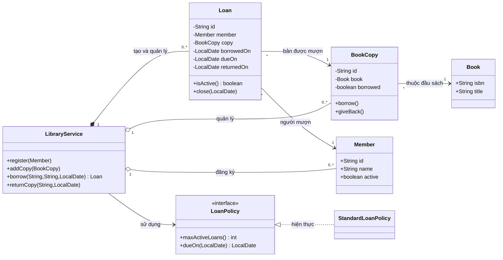
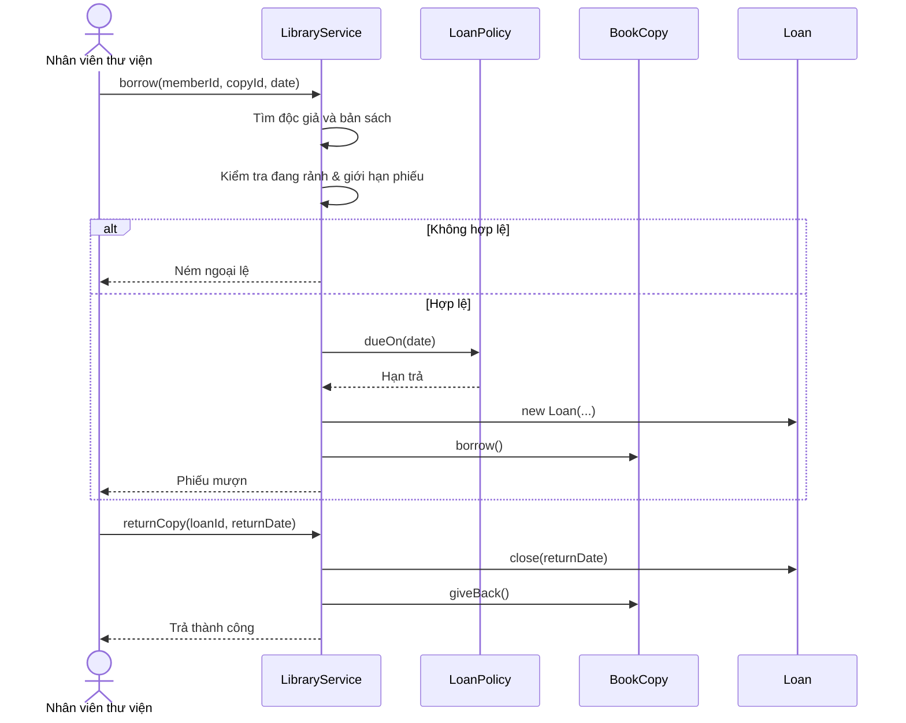

# OOP capstone: Designing classes and relationships in a library lending system

> **Goal:** Starting from natural-language business requirements, identify suitable objects, responsibilities, attributes, behaviors, and class relationships; implement a runnable Java 17 version; verify invariants and justify the chosen relationships. The project focuses on **class and relationship design**, rather than UI or database implementation.

## 1. Context and requirements

A small library manages **book titles**, **physical copies**, **members**, and **loan records**.

- Each title has an ISBN and title name. One title may have multiple distinct copies. For example, three books with the same title share an ISBN but have three different copy IDs.
- Each member is identified by a unique ID.
- Only AVAILABLE copies may be loaned to registered, active members; members with overdue open loans cannot borrow more.
- Borrowing creates a loan record with the member, copy, borrow date, and due date. A copy may not belong to two **active** loans at once.
- Each member may have at most three active loans; the fourth must be rejected. The default loan period is 14 days, and an open loan becomes overdue only after its due date. These policy values may change.
- Returns use the loan ID: the loan must be active, the return date must not precede borrowing, and the copy becomes available afterward.
- Reject duplicate IDs, missing IDs, and invalid operations with meaningful exceptions.

**Out of scope for the first version:** login, reservations, fines, durable storage, graphical UI, and concurrent data writes. Explicit scope limits make the OOP relationships easier to verify.

### Extracting nouns and verbs

| Requirement phrase | Proposed model | Rationale |
|---|---|---|
| Book title | `Book` | Shared descriptive information across copies |
| Book copy | `BookCopy` | Own identifier and availability/loan status |
| Member | `Member` | Has an ID and name |
| Loan record | `Loan` | Records one specific lending event |
| Due-date and quantity rules | `LoanPolicy` | Rules that can vary independently of business flow |
| Register, borrow, return, search | `LibraryService` | Coordinates multiple objects to complete use cases |

Do not mechanically turn every noun into a class. A "return date" is `LocalDate` data; "on loan" is a state; "lend" is behavior involving multiple objects.

## 2. Assign responsibilities before writing code

| Class/interface | Responsibility | Should not be responsible for |
|---|---|---|
| `Book` | Hold valid ISBN and title | Tracking who borrowed each copy |
| `BookCopy` | Hold copy ID and borrowing status | Finding members or deciding borrowing limits |
| `Member` | Hold member identity and active-status flag | Managing the entire book inventory |
| `Loan` | Maintain the history of **one** loan and enforce one-time return | Managing all members |
| `LoanPolicy` | Define loan duration and active-loan limits | Reading/writing storage |
| `StandardLoanPolicy` | Implement a concrete policy | Orchestrating the lending workflow |
| `LibraryService` | Find objects, check cross-object rules, and create/close loans | UI formatting, SQL, or HTTP details |

**Single Responsibility** check: "If loan duration changes from 14 to 21 days, which class must change?" Ideally, adjust configuration or the `LoanPolicy` implementation, not `Book`, `Member`, or `Loan`.

### Relationship diagram (UML)



Interpret the notation carefully:

- **Association (`-->`):** `Loan` references `Member` and `BookCopy`. Referenced objects retain independent meaning and need not be recreated for each loan.
- **Aggregation (`o--`):** `LibraryService` holds a collection of members and copies registered externally; those objects can exist independently of the service.
- **Composition (`*--`):** in this illustrative design, the service creates and manages the lifecycle of `Loan` records in its history store. This represents **conceptual model ownership**; Java does not automatically destroy objects according to UML, and real systems may need a separate loan repository.
- **Realization (`<|..`):** `StandardLoanPolicy` *implements* `LoanPolicy`. The service depends on the interface contract, allowing policies to be replaced without changing the workflow.
- **Multiplicity:** `"*"` means many, and `"1"` means one. A title has multiple copies; a loan references exactly one member and one copy.

**Do not use `extends` just because two classes share fields.** Inherit only when a genuine "is a type of" relationship holds and substitutability preserves the contract (Liskov Substitution). With `Book` and `BookCopy`, a copy *belongs to* its title; it is not a subtype of the title. A reference is more appropriate than inheritance.

## 3. Interaction flow



**Invariants to enforce:**

1. Member and copy IDs are unique within a service; blocked members may not borrow.
2. Every loan refers to a registered member and book copy.
3. `Loan.borrowedOn < Loan.dueOn`; return date cannot precede borrow date.
4. A book copy has at most one active loan at a time.
5. Each member's active loans never exceed `LoanPolicy.maxActiveLoans()`; an overdue open loan prevents further borrowing.
6. Returned loans cannot be returned again.

Invariants 1, 2, 4, and 5 require examining **multiple objects**, so the service enforces them. Invariants internal to a loan belong in `Loan`. Borrowing/return state belongs in `BookCopy` and is guarded by methods rather than an exposed `borrowed` field.

## 4. Runnable Java 17 implementation

Create **one `LibraryDemo.java` file**. Types other than the `public` class are package-private to keep the example in one file; real projects should place types in separate package-organized files.

```java
import java.time.LocalDate;
import java.util.HashMap;
import java.util.Map;
import java.util.Objects;
import java.util.UUID;

public class LibraryDemo {
    public static void main(String[] args) {
        LoanPolicy policy = new StandardLoanPolicy(14, 3);
        LibraryService library = new LibraryService(policy);

        Book book = new Book("978-0134685991", "Effective Java");
        BookCopy copy = new BookCopy("COPY-001", book);
        Member member = new Member("M-001", "Lan", true);

        library.addCopy(copy);
        library.register(member);

        Loan loan = library.borrow(
                "M-001", "COPY-001", LocalDate.of(2026, 10, 15));
        System.out.println("Hạn trả: " + loan.dueOn());
        System.out.println("Đang mượn: " + copy.isBorrowed());

        try {
            library.borrow(
                    "M-001", "COPY-001", LocalDate.of(2026, 10, 16));
        } catch (IllegalStateException expected) {
            System.out.println("Chặn mượn trùng bản sách");
        }

        library.returnCopy(loan.id(), LocalDate.of(2026, 10, 20));
        System.out.println("Đã trả: " + !copy.isBorrowed());
        System.out.println("Phiếu còn hoạt động: " + loan.isActive());
    }
}

final class Checks {
    private Checks() {}

    static String nonBlank(String value, String label) {
        if (value == null || value.isBlank()) {
            throw new IllegalArgumentException(label + " không được rỗng");
        }
        return value.trim();
    }
}

// Value objects: không có trạng thái biến đổi sau khi tạo.
record Book(String isbn, String title) {
    Book {
        isbn = Checks.nonBlank(isbn, "ISBN");
        title = Checks.nonBlank(title, "Tên sách");
    }
}

record Member(String id, String name, boolean active) {
    Member {
        id = Checks.nonBlank(id, "Mã độc giả");
        name = Checks.nonBlank(name, "Tên độc giả");
    }
}

final class BookCopy {
    private final String id;
    private final Book book;
    private boolean borrowed;

    BookCopy(String id, Book book) {
        this.id = Checks.nonBlank(id, "Mã bản sách");
        this.book = Objects.requireNonNull(book, "book");
    }

    String id() { return id; }
    Book book() { return book; }
    boolean isBorrowed() { return borrowed; }

    void borrow() {
        if (borrowed) {
            throw new IllegalStateException("Bản sách đã được mượn: " + id);
        }
        borrowed = true;
    }

    void giveBack() {
        if (!borrowed) {
            throw new IllegalStateException("Bản sách chưa được mượn: " + id);
        }
        borrowed = false;
    }
}

final class Loan {
    private final String id;
    private final Member member;
    private final BookCopy copy;
    private final LocalDate borrowedOn;
    private final LocalDate dueOn;
    private LocalDate returnedOn; // null nghĩa là đang mượn

    Loan(String id, Member member, BookCopy copy,
         LocalDate borrowedOn, LocalDate dueOn) {
        this.id = Checks.nonBlank(id, "Mã phiếu");
        this.member = Objects.requireNonNull(member, "member");
        this.copy = Objects.requireNonNull(copy, "copy");
        this.borrowedOn = Objects.requireNonNull(borrowedOn, "borrowedOn");
        this.dueOn = Objects.requireNonNull(dueOn, "dueOn");
        if (!dueOn.isAfter(borrowedOn)) {
            throw new IllegalArgumentException("Hạn trả phải sau ngày mượn");
        }
    }

    String id() { return id; }
    Member member() { return member; }
    BookCopy copy() { return copy; }
    LocalDate borrowedOn() { return borrowedOn; }
    LocalDate dueOn() { return dueOn; }
    LocalDate returnedOn() { return returnedOn; }
    boolean isActive() { return returnedOn == null; }

    boolean isOverdue(LocalDate day) {
        return isActive() && Objects.requireNonNull(day, "day").isAfter(dueOn);
    }

    void close(LocalDate date) {
        Objects.requireNonNull(date, "Ngày trả");
        if (!isActive()) {
            throw new IllegalStateException("Phiếu đã được trả: " + id);
        }
        if (date.isBefore(borrowedOn)) {
            throw new IllegalArgumentException("Ngày trả trước ngày mượn");
        }
        returnedOn = date;
    }
}

interface LoanPolicy {
    int maxActiveLoans();
    LocalDate dueOn(LocalDate borrowedOn);
}

final class StandardLoanPolicy implements LoanPolicy {
    private final int loanDays;
    private final int maxLoans;

    StandardLoanPolicy(int loanDays, int maxLoans) {
        if (loanDays <= 0 || maxLoans <= 0) {
            throw new IllegalArgumentException("Chính sách phải dương");
        }
        this.loanDays = loanDays;
        this.maxLoans = maxLoans;
    }

    @Override
    public int maxActiveLoans() {
        return maxLoans;
    }

    @Override
    public LocalDate dueOn(LocalDate borrowedOn) {
        return Objects.requireNonNull(borrowedOn).plusDays(loanDays);
    }
}

final class LibraryService {
    private final Map<String, Member> members = new HashMap<>();
    private final Map<String, BookCopy> copies = new HashMap<>();
    private final Map<String, Loan> loans = new HashMap<>();
    private final LoanPolicy policy;

    LibraryService(LoanPolicy policy) {
        this.policy = Objects.requireNonNull(policy, "policy");
    }

    void register(Member member) {
        Objects.requireNonNull(member, "member");
        if (members.putIfAbsent(member.id(), member) != null) {
            throw new IllegalArgumentException("Trùng mã độc giả: " + member.id());
        }
    }

    void addCopy(BookCopy copy) {
        Objects.requireNonNull(copy, "copy");
        if (copies.putIfAbsent(copy.id(), copy) != null) {
            throw new IllegalArgumentException("Trùng mã bản sách: " + copy.id());
        }
    }

    Loan borrow(String memberId, String copyId, LocalDate date) {
        Objects.requireNonNull(date, "Ngày mượn");
        Member member = members.get(memberId);
        BookCopy copy = copies.get(copyId);

        if (member == null) {
            throw new IllegalArgumentException("Không tìm thấy độc giả: " + memberId);
        }
        if (copy == null) {
            throw new IllegalArgumentException("Không tìm thấy bản sách: " + copyId);
        }
        if (!member.active()) {
            throw new IllegalStateException("Độc giả đã bị khóa: " + memberId);
        }
        if (copy.isBorrowed()) {
            throw new IllegalStateException("Bản sách đang được mượn: " + copyId);
        }

        long activeCount = loans.values().stream()
                .filter(l -> l.isActive() && l.member().id().equals(memberId))
                .count();
        if (activeCount >= policy.maxActiveLoans()) {
            throw new IllegalStateException("Độc giả đã đạt giới hạn mượn");
        }
        boolean hasOverdue = loans.values().stream()
                .anyMatch(l -> l.member().id().equals(memberId)
                        && l.isOverdue(date));
        if (hasOverdue) {
            throw new IllegalStateException("Độc giả có phiếu quá hạn");
        }

        LocalDate due = Objects.requireNonNull(policy.dueOn(date), "dueOn");
        Loan loan = new Loan(UUID.randomUUID().toString(),
                member, copy, date, due);
        copy.borrow();
        loans.put(loan.id(), loan);
        return loan;
    }

    void returnCopy(String loanId, LocalDate date) {
        Loan loan = loans.get(loanId);
        if (loan == null) {
            throw new IllegalArgumentException("Không tìm thấy phiếu: " + loanId);
        }
        loan.close(date);       // kiểm tra hợp lệ trước
        loan.copy().giveBack(); // mở bản sách cho lượt mượn sau
    }
}
```

In this code:

- `Book` represents a *book title* (`BookTitle` in the requirements-analysis exercise); `BookCopy` remains a distinct physical copy and does not use ISBN as a copy ID.
- `Book` and `Member` are immutable `record` types, appropriate for identity/descriptive information. Java generates value-based accessors, `equals`, `hashCode`, and `toString`.
- `BookCopy` and `Loan` have **state that evolves over time**. Copies sharing an ISBN remain distinct entities through `copy.id()`.
- Fields use `private`, essential dependencies use `final`, and rules are checked at construction or state changes. This is **encapsulation**, beyond merely writing getters/setters.
- `LibraryService` receives `LoanPolicy` through its constructor (**dependency injection**) and calls through the interface (**polymorphism**). No complex inheritance tree is needed.
- `HashMap` supports lookup by ID, and `UUID` provides illustrative loan IDs; production requires explicit identity, persistence, and transaction rules.

### Compile and run

Requires **JDK 17 or later** because the code uses `record` and `String.isBlank()`.

```bash
javac -encoding UTF-8 LibraryDemo.java
java LibraryDemo
```

Expected output:

```text
Hạn trả: 2026-10-29
Đang mượn: true
Chặn mượn trùng bản sách
Đã trả: true
Phiếu còn hoạt động: false
```

Fixed dates make the example repeatable. `2026-10-15.plusDays(14)` gives `2026-10-29`. The due date does not automatically close a loan; late returns remain allowed because this version has no penalty handling.

## 5. Testing behavior and relationships

Run each scenario with a fresh `LibraryService` or reset state between cases. Reusing a store with existing loans changes test preconditions.

| Test case | Action | Expected result |
|---|---|---|
| Normal flow | Register member, add copy, borrow and return | Correct due date; state changes `false → true → false` |
| Duplicate member ID | Call `register` with two `Member` objects sharing an ID | `IllegalArgumentException` |
| Duplicate copy ID | Call `addCopy` with two copies sharing an ID | `IllegalArgumentException` |
| Unknown ID | `borrow("unknown", "COPY-001", date)` | `IllegalArgumentException` |
| Copy on loan | Borrow the same `copyId` again before return | `IllegalStateException` |
| Loan limit reached | Member has three copies on loan; attempts a fourth | `IllegalStateException` |
| Return twice | Call `returnCopy` again with the same `loanId` | `IllegalStateException` |
| Blocked member | `Member(..., false)` borrows an available copy | `IllegalStateException`; no Loan created |
| Overdue open loan | Open loan due yesterday; member borrows another copy today | `IllegalStateException`; no data changes |
| Exactly on due date | Open loan due today, attempt another loan while below the limit of 3 | Not blocked as overdue |
| Invalid return date | Return before borrowed date | `IllegalArgumentException`; loan remains active |
| Custom loan terms | Construct `StandardLoanPolicy(21, 5)` | Due date + 21 days; limit 5 loans |

A crucial test is **state after exceptions**: an attempted duplicate loan must not create another record, and the copy must still be held by its original loan; an invalid return date must leave `Loan` active and `BookCopy` on loan. Check postconditions, not just exception types.

### Quick self-check example without a test library

Add the following method to `LibraryDemo`, then call `selfCheck()` at the end of `main` if desired. Recreate input data each time to avoid dependencies on previous runs.

```java
private static void selfCheck() {
    LibraryService service = new LibraryService(new StandardLoanPolicy(14, 3));
    service.register(new Member("M2", "Minh", true));
    Book b = new Book("ISBN-2", "OOP");
    BookCopy c = new BookCopy("C2", b);
    service.addCopy(c);

    LocalDate start = LocalDate.of(2026, 10, 15);
    Loan loan = service.borrow("M2", "C2", start);
    if (!loan.dueOn().equals(LocalDate.of(2026, 10, 29))) {
        throw new AssertionError("Sai hạn trả");
    }

    try {
        service.returnCopy(loan.id(), start.minusDays(1));
        throw new AssertionError("Đã chấp nhận ngày trả sai");
    } catch (IllegalArgumentException expected) {
        if (!loan.isActive() || !c.isBorrowed()) {
            throw new AssertionError("Trạng thái bị thay đổi khi lỗi");
        }
    }

    service.returnCopy(loan.id(), start.plusDays(5));
    if (loan.isActive() || c.isBorrowed()) {
        throw new AssertionError("Trả sách chưa cập nhật trạng thái");
    }
}
```

The method above **must be placed inside** the braces of `public class LibraryDemo` when added to the sample file. Its `if` statements check state directly; larger projects can use JUnit with `assertThrows`, `assertEquals`, and independent test suites.

## 6. Reviewing design choices

**Why separate `Book` and `BookCopy`?** With just a `Book` containing a `borrowed` field, a library with two copies sharing an ISBN cannot identify which is borrowed. Separating title data from physical copies reflects reality and avoids duplicated information.

**Why model `Loan` as a class instead of storing `memberId` on `BookCopy`?** Each copy can be borrowed many times. Loans record lending events, borrow/due/return dates, and preserve history after books are returned.

**Why not let `Member.borrow(BookCopy)` modify all the data?** Borrowing requires registration lookup, loan-limit checks, copy status checks, and loan creation. Putting everything into `Member` or `BookCopy` would couple those classes to repositories and global policies. `LibraryService` coordinates while entities enforce their own state.

**When should a new class be added?** When responsibility and reasons for change are independent. For example: real persistence → extract `MemberRepository`, `CopyRepository`, and `LoanRepository`; due-date notifications → `ReminderService`; multiple member groups → different `LoanPolicy` implementations. Do not introduce empty interfaces/repositories merely to inflate the class count.

### Limitations to address in production

- **Concurrency and atomicity:** with parallel `borrow` requests, checking availability and then updating it can race. The demo assumes one thread. Production needs transactions, suitable locks, or database constraints; closing a loan and freeing a copy must also be atomic.
- **Source of truth for status:** `BookCopy.borrowed` and `Loan.returnedOn` both describe loan state. Keep updates consistent or derive copy status from active loans in a different persistence design.
- **Persistence:** `HashMap` loses data when the program stops. Use repositories without dropping business-layer invariants.
- **Access boundaries:** state-changing methods are package-private to keep this lesson in one file. Real applications should organize packages/aggregates and APIs so external callers cannot invoke `copy.borrow()` or `loan.close()` to bypass the service.
- **Data:** proper ISBN validation, identifier normalization, timezone handling for timestamps, logs/audits, fines, and late-return policies require additional modeling.

## 7. Extensions with explicit criteria

1. **Add renewals:** `extendLoan(loanId, days)`; forbid extending returned loans or supplying negative days; decide which class owns due-date updates. Update UML and tests.
2. **Reserve copies:** add `Reservation` only after defining its lifecycle, who creates/cancels it, and duplicate-borrowing cases. Explain how reservations differ from loans.
3. **Change policy without changing service:** implement `ShortTermPolicy` with a due date 7 days later and a maximum of 1 loan; use the same `LibraryService` to demonstrate polymorphism.
4. **Split types into separate files/packages:** practice `public`/package-private and prevent clients from changing loan states outside the workflow.
5. **Revise the diagram after extensions:** for each relationship edge, specify "holds a reference", "owns lifecycle", "implements contract", or "genuine inheritance"; update the diagram if the code does not support the edge.

**Completion criteria:** Justify every class, describe UML relationships and multiplicities, identify where each invariant is enforced, compile and run the example using Java 17, and verify both successful and failed operations preserve consistent state.
