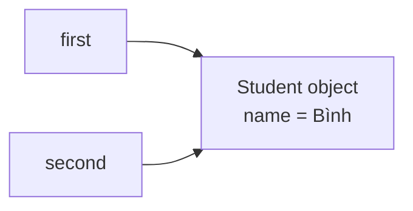
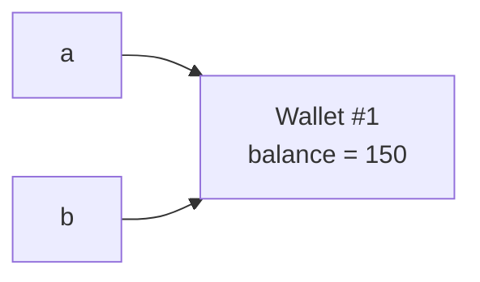
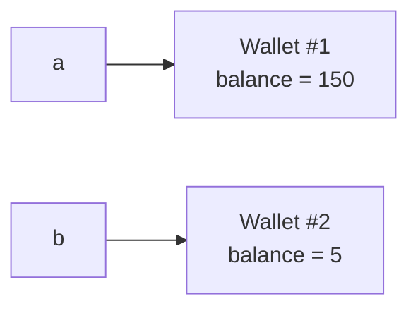

# References, Values, and Passing Objects in Java

When working with **objects** in Java, we often encounter these questions:

- Why does assigning `b = a` mean changes made through `b` also appear when reading through `a`?
- Why does passing an object to a method and then assigning `obj = new ...` fail to replace the caller's object?
- Does Java pass arguments **by value** or **by reference**?

The answers depend on distinguishing **the value of a variable**, **a reference to an object**, and **the object itself**. Understanding these distinctions helps prevent errors in API design, state updates, collections, and data passing between classes.

## 1. Values of Primitive and Reference Variables

Java has two main categories of data types:

| Category | Examples | Value stored in the variable | When assigned to another variable of the same type |
|---|---|---|---|
| Primitive type | `int`, `long`, `boolean`, `double`, `char` | A primitive value, such as `42` | Copies that value |
| Reference type | `Student`, `String`, `int[]`, `List<String>` | A reference value pointing to an object, or `null` | Copies **the reference value**, not the object |

Example using a primitive type:

```java
int a = 10;
int b = a;     // b nhận bản sao của giá trị 10
b = 20;

System.out.println(a); // 10
System.out.println(b); // 20
```

Each variable has its own value, so changing `b` does not change `a`.

With an object:

```java
class Student {
    String name;

    Student(String name) {
        this.name = name;
    }
}

Student first = new Student("An");
Student second = first; // Sao chép tham chiếu, không tạo Student mới

second.name = "Bình";

System.out.println(first.name);  // Bình
System.out.println(second.name); // Bình
```

`first` and `second` are **two variables** but refer to **one `Student` object**. Changing that object's `name` field is observable through both variables.

### Visualizing Reference Relationships



The diagram describes logical relationships between variables and objects; it **does not** specify exact physical addresses, stack/heap layout, or how the JVM optimizes memory.

> **Remember:** `Student second = first;` creates another reference variable pointing to an existing object. Only `new Student(...)` in this example creates a new `Student` object.

## 2. Distinguishing Object Mutation from Reference Reassignment

These are very different operations.

```java
class Wallet {
    private int balance;

    Wallet(int balance) {
        this.balance = balance;
    }

    void deposit(int amount) {
        if (amount <= 0) {
            throw new IllegalArgumentException("Số tiền phải dương");
        }
        balance += amount;
    }

    int getBalance() {
        return balance;
    }
}

Wallet a = new Wallet(100);
Wallet b = a;

b.deposit(50);             // Sửa đối tượng được a và b cùng tham chiếu
System.out.println(a.getBalance()); // 150

b = new Wallet(5);         // Chỉ cho biến b tham chiếu đối tượng mới
System.out.println(a.getBalance()); // 150
System.out.println(b.getBalance()); // 5
```

**Before `b = new Wallet(5)`:**



**After `b = new Wallet(5)`:**



`b.deposit(50)` invokes a method on the `Wallet #1` object, so `a` also observes the new balance. Assigning `b = new Wallet(5)` only changes **which object variable `b` references**; it does not affect `a`.

When several variables reference the same object, this is called **aliasing**. Aliasing is not inherently wrong, but it needs careful management when the object has mutable state.

## 3. Java Always Passes Arguments by Value

**In Java, every method argument is passed by value.** A method parameter receives **a copy of the value** produced by the argument expression at the call site.

- For `int`, the copy is the integer value.
- For `Student`, the copy is **the reference value to the `Student` object**.
- Java **does not** pass parameters by making a parameter variable a direct alias of the caller's reference variable.

### 3.1. Passing a Primitive: Changing the Parameter Does Not Affect the Caller

```java
public class PrimitiveParameterDemo {
    static void increase(int number) {
        number += 10;
        System.out.println("Trong method: " + number);
    }

    public static void main(String[] args) {
        int value = 5;
        increase(value);

        System.out.println("Sau lời gọi: " + value);
    }
}
```

Output:

```text
Trong method: 15
Sau lời gọi: 5
```

Parameter `number` starts with the `5` value supplied by `value` and is then changed to `15`. The caller's `value` variable remains `5`.

### 3.2. Passing an Object: Shared Object State Can Be Modified

A complete standalone runnable example:

```java
public class ReferenceParameterDemo {

    static class Account {
        private int balance;

        Account(int balance) {
            this.balance = balance;
        }

        void deposit(int amount) {
            if (amount <= 0) {
                throw new IllegalArgumentException("amount must be positive");
            }
            balance += amount;
        }

        int getBalance() {
            return balance;
        }
    }

    static void depositTo(Account account) {
        account.deposit(20); // Sửa đối tượng qua bản sao tham chiếu
    }

    static void replaceLocally(Account account) {
        account = new Account(999); // Chỉ gán lại tham số cục bộ
    }

    public static void main(String[] args) {
        Account account = new Account(100);

        depositTo(account);
        System.out.println(account.getBalance()); // 120

        replaceLocally(account);
        System.out.println(account.getBalance()); // 120
    }
}
```

With `depositTo(account)`, the method's `account` parameter and the `account` variable in `main` have reference values pointing to the same `Account`. Calling `deposit(20)` changes the shared object, so `main` sees balance `120`.

In `replaceLocally(account)`, assigning `account = new Account(999)` only reassigns **the local parameter variable**. The `account` variable in `main` still references the object with balance `120`.

| Operation inside the method | Changes the caller's reference variable? | Can the caller observe a state change? |
|---|---|---|
| `account = new Account(...)` | No | No, if this assignment is the only operation |
| `account = null` | No | No, if this assignment is the only operation |
| `account.deposit(20)` | No | Yes, because it modifies an object both references point to |
| `account.balance = ...` (if the field is accessible) | No | Yes, because it modifies object state |
| `account = someOtherReference` | No | No, if it only reassigns the parameter |

**Do not conclude that “Java passes objects by reference”** simply because a method can modify an object through its parameter. The reference value is what gets copied; a method cannot reassign the caller's reference variable.

## 4. Attempting to Swap Two Objects Through a Method

One way to verify pass-by-value is to try writing a `swap` function:

```java
static void swap(Account left, Account right) {
    Account temp = left;
    left = right;
    right = temp;
}

// Giả sử Account có getBalance()
Account a = new Account(10);
Account b = new Account(20);

swap(a, b);

System.out.println(a.getBalance()); // 10
System.out.println(b.getBalance()); // 20
```

The `swap` method swaps only **the two local parameter variables**, `left` and `right`. The caller's `a` and `b` variables are not reassigned, so their references remain in their original order.

If the goal is to update which object the caller uses, the API should **return the new object**:

```java
static Account accountWithBonus(Account original, int bonus) {
    return new Account(original.getBalance() + bonus);
}

Account a = new Account(100);
a = accountWithBonus(a, 25);

System.out.println(a.getBalance()); // 125
```

Here, `a` is reassigned **at the call site**, where the caller decides whether to accept the returned result.

## 5. A Reference Variable Does Not Necessarily Point to an Object

The `null` value means a reference variable currently points to no instance. It is not an empty object; invoking an instance method through `null` can cause a `NullPointerException`.

~~~java
Student student = null;
if (student != null) {
    System.out.println(student.name);
}
~~~

Distinguish `Student student;`, an **unassigned local variable** (which cannot be read before assignment), from `Student student = null;`, a variable explicitly assigned `null`. Reference-type fields default to `null` if not explicitly initialized. *Null Values and Objects That Do Not Exist* examines absence and API-handling strategies in greater detail.

## 6. Reference Values Are Also Copied for Strings, Arrays, and Collections

`String`, arrays, and `List` are all reference types; passing them to methods also **copies their reference values**, just as with `Student`. Whether changes are visible depends on **whether the referenced object is mutable**:

~~~java
String text = "Java";
String aliasText = text;
aliasText = aliasText.concat(" OOP");
System.out.println(text);                 // Java

int[] scores = {7, 8};
int[] sharedScores = scores;
sharedScores[0] = 10;
System.out.println(scores[0]);            // 10
~~~

`String` is immutable, so concatenation does not alter the original string; arrays are mutable, so changes through an alias are visible from both variables. With `List<Student>`, `add/get` operations pass and return references to `Student` objects rather than automatically producing deep copies.

This is why, when passing data to a library, you must check whether its contract says the method only reads, mutates in place, or returns a new object. The lessons on *Mutable/Immutable Objects* and *Shallow/Deep Copying* examine these designs in detail.

## 7. `final` Only Restricts Reference Reassignment

~~~java
final StringBuilder message = new StringBuilder("Xin chào");
message.append(" Java"); // Hợp lệ: sửa object.
 // message = new StringBuilder("Khác"); // Không hợp lệ: gán lại final.
~~~

`final` does not make an object immutable. Declaring a parameter `final` only prevents code inside the method from reassigning **that parameter variable**; the method can still call operations that mutate the referenced object.

## 8. Designing APIs That Do Not Mutate the Caller's Objects

A method receiving a mutable object can modify it without reassigning the caller's reference variable. An API contract should therefore state clearly **whether mutation occurs**. When accepting and retaining an array from a caller, consider making a defensive copy:

~~~java
final class ScoreReport {
    private final int[] scores;

    ScoreReport(int[] input) {
        this.scores = java.util.Objects.requireNonNull(input).clone();
    }

    int[] getScores() {
        return scores.clone();
    }
}
~~~

`int[].clone()` creates a new array and copies its primitive elements; modifications to the caller's original array or the getter's returned array cannot affect the internal array. If elements are mutable objects, cloning the array copies only **element references**, so an appropriate copying policy is needed. This follows from pass-by-value and ownership rules; it is not an exception to them.

## 9. Do Not Use Reference Comparison to Check Content

For two reference values, `==` checks whether they refer to the same instance (or both are `null`), while `equals()` checks equality according to the class contract:

~~~java
String a = new String("OOP");
String b = new String("OOP");
System.out.println(a == b);      // false
System.out.println(a.equals(b)); // true
~~~

The `equals/hashCode` contract is implemented and verified in *Object Identity vs. Value Equality*. When writing methods that pass objects, use the comparison appropriate to the business requirement.

## 10. Common Misconceptions

| Claim | True or false? | Explanation |
|---|---|---|
| `obj2 = obj1` creates a copy of the object | False | It copies only the reference value |
| Java passes object parameters by reference | False | Java passes **a copy of the reference value** |
| Modifying a passed object's field can be visible to the caller | True | Both references point to the same object |
| Reassigning a parameter with `new` changes the caller's reference variable | False | The parameter is an independent local variable |
| `final MyType x` guarantees that the object is immutable | False | It only prevents reassignment of `x` |
| `new ArrayList<>(old)` deep-copies elements | False | This is a shallow copy |
| Every `equals()` compares content | False | It depends on the class's contract and implementation |
| A reference variable holding `null` points to an empty object | False | `null` means no object is referenced |

## 11. Self-Assessment Exercises

### Exercise 1 — Predict the Output

```java
class Box {
    int value;
    Box(int value) { this.value = value; }
}

static void modify(Box box) {
    box.value += 5;
    box = new Box(100);
    box.value++;
}

// Tại nơi gọi:
Box original = new Box(10);
modify(original);
System.out.println(original.value);
```

**Answer: `15`.** `box.value += 5` changes the original `Box(10)` to `15`. Then `box = new Box(100)` makes only the `box` parameter reference a new object; `box.value++` changes that new object's value to `101`. The `original` variable still refers to the original object.

### Exercise 2 — Are the Two Arrays Independent?

```java
int[][] matrix = {{1, 2}, {3, 4}};
int[][] copy = matrix.clone();

copy[0][0] = 99;
System.out.println(matrix[0][0]);
```

**Answer: `99`.** `clone()` copies only the outer array; the inner `int[]` elements are still shared. To copy each row, create new inner arrays, for example by repeating `copy[i] = matrix[i].clone()`.

### Exercise 3 — Designing a Safe API

A `Classroom` class accepts `List<Student>` in its constructor and provides `getStudents()`. Identify every path through which external code could modify its internal state. Hint: examine the incoming `List` reference, the returned list reference, and references to the `Student` elements. Propose a design using list copies, read-only query APIs, and either immutable element types or copies of the required data.

---

**Remember:** The value of an object-typed variable is a **reference**. Assignments and method calls copy that reference value; they do not automatically copy the object. **Java is always pass-by-value.** A method can modify a shared object through the reference it receives, but reassigning its parameter cannot reassign the caller's variable. Understanding this is essential for aliasing, immutable objects, arrays, collections, and controlled API design.
