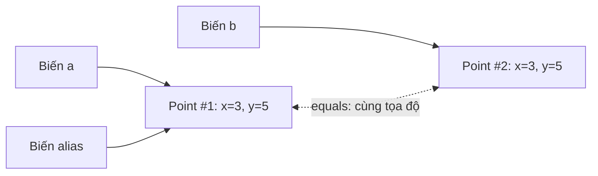

# Distinguishing Object Identity from Value Equality in Java

> **Topic:** OOP → Objects. Two reference variables may **point to the same object** or to **two distinct objects with equivalent data**. These are independent questions. Understanding the distinction prevents mistakes when comparing `String` values, designing classes, working with lists, and using `HashSet`/`HashMap`.

## 1. Two Different Questions: Identity and Equality

Suppose two objects are created with the coordinates `(3, 5)`:

```java
Point a = new Point(3, 5);
Point b = new Point(3, 5);
Point alias = a;
```

- **Object identity:** `a` and `alias` refer to **one instance**. Consequently, `a == alias` is `true`.
- **Value equality:** `a` and `b` can be **two instances** with identical `x` and `y` values. If `Point` implements `equals()` to compare coordinates, `a.equals(b)` is `true`.
- **Different objects** do not necessarily have **different values**. `a == b` is generally `false` even when the objects contain identical data.



`a == alias` checks whether two references point to the same object. `a.equals(b)` asks whether `Point` considers two instances equivalent in value.

| Comparison | Question answered | Meaning |
|---|---|---|
| `a == b` when `a` and `b` are references | Are they the same instance? | Object identity |
| `a != b` for references | Do they refer to different objects? | Different identity |
| `a.equals(b)` | Are they equal under the class's `equals` rule? | Value/logical equality |
| `Objects.equals(a, b)` | Are they equal, with safe handling of `null`? | Null-safe equality |
| `x == y` when `x` and `y` are primitives | Are the two **primitive values** equal? | Value comparison, not object identity |

Remember that primitives such as `int` and `boolean` are not objects; `==` compares their **values**. The identity/value-equality distinction is especially important when comparing **object references**.

## 2. Why Can Two Objects with Identical Fields Still Have `equals() == false`?

Every Java class inherits `equals(Object)` from `java.lang.Object`. If it **does not override** that method, the default `Object.equals` implementation considers only **the same instance** equal.

```java
class Book {
    String isbn;
    Book(String isbn) {
        this.isbn = isbn;
    }
}

Book first = new Book("978-000");
Book second = new Book("978-000");

System.out.println(first == second);      // false
System.out.println(first.equals(second)); // false
```

The objects have identical `isbn` field values, but `Book` does not define equality based on `isbn`, so `equals` retains identity-based behavior.

By contrast:

```java
Book sameBook = first;
System.out.println(first == sameBook);      // true
System.out.println(first.equals(sameBook)); // true
```

**Important distinction:** `equals()` does not automatically compare every field of every class. Equality rules are part of the class design.

## 3. Complete Example: Implementing `equals()` and `hashCode()` for a Value Class

We design `Point` as a **value object**: two points are equal when both coordinates match. The class is declared `final` to avoid subclasses altering its equality rules; its fields are `final` so the values cannot change after initialization.

Save the following code as `EqualityDemo.java` (Java 17+):

```java
import java.util.HashMap;
import java.util.HashSet;
import java.util.Map;
import java.util.Objects;
import java.util.Set;

public class EqualityDemo {
    static final class Point {
        private final int x;
        private final int y;

        Point(int x, int y) {
            this.x = x;
            this.y = y;
        }

        @Override
        public boolean equals(Object obj) {
            if (this == obj) {
                return true;  // Cùng một instance luôn bằng nhau
            }
            if (!(obj instanceof Point other)) {
                return false; // Bao gồm cả null và loại khác
            }
            return x == other.x && y == other.y;
        }

        @Override
        public int hashCode() {
            return Objects.hash(x, y);
        }

        @Override
        public String toString() {
            return "Point(" + x + ", " + y + ")";
        }
    }

    public static void main(String[] args) {
        Point a = new Point(3, 5);
        Point b = new Point(3, 5);
        Point alias = a;
        Point c = new Point(4, 5);

        System.out.println(a == b);       // false
        System.out.println(a == alias);   // true
        System.out.println(a.equals(b));  // true
        System.out.println(a.equals(c));  // false
        System.out.println(a.hashCode() == b.hashCode()); // true

        Set<Point> points = new HashSet<>();
        points.add(a);
        points.add(b);
        points.add(c);
        System.out.println(points.size()); // 2

        Map<Point, String> labels = new HashMap<>();
        labels.put(a, "Điểm A");
        System.out.println(labels.get(b)); // Điểm A
    }
}
```

Expected output, in the same order as the `println` statements:

```text
false
true
true
false
true
2
Điểm A
```

Here, `a` and `b` are created by separate `new` expressions, making them distinct instances. But their `x` and `y` values match, so `equals` returns `true` and `hashCode` returns the same hash. `HashSet` retains only one equivalent entry from `a` and `b`; `HashMap` can retrieve a stored value using an equivalent key.

### Reading `equals()` Line by Line

```java
@Override
public boolean equals(Object obj) {
    if (this == obj) return true;
    if (!(obj instanceof Point other)) return false;
    return x == other.x && y == other.y;
}
```

1. `this == obj`: a fast path when two references point to the same object; an object must equal itself.
2. `instanceof Point other`: accepts only objects of the relevant type and binds the checked reference to `other` (pattern matching has been available since Java 16); `null instanceof Point` is `false`.
3. Compare **the fields defining the value** of `Point`. Since `x` and `y` are `int` values, using `==` is correct.

Do not write `public boolean equals(Point other)` when your goal is to override `Object.equals(Object)`: that would be an **overload**, not a replacement for the `equals(Object)` used by Java collections. Use `@Override` so the compiler catches incorrect signatures.

Choosing between `instanceof` and `getClass()` requires considering inheritance. Because `Point` above is `final`, no subclasses can create additional equality problems. For inheritable classes, design equality to be **symmetric** and **transitive**, avoiding conflicting equality criteria in parent and child classes.

## 4. The `equals()` Contract: More Than Comparing the Right Fields

Java specifies several properties of `equals()` for non-null references:

| Property | Requirement | Example |
|---|---|---|
| Reflexive | `x.equals(x)` is `true` | A point equals itself |
| Symmetric | `x.equals(y)` and `y.equals(x)` produce the same result | Equality cannot depend on call direction |
| Transitive | If `x.equals(y)` and `y.equals(z)`, then `x.equals(z)` | Equality must remain consistent across three objects |
| Consistent | Results remain unchanged while data used for equality stays the same | Repeated calls do not unexpectedly change results |
| Non-null vs. `null` | `x.equals(null)` must be `false` | Null is not a Point |

If equality depends on **mutable** state, comparison results may change after fields are updated. This does not automatically violate consistency (because the state changed), but it is a major source of errors when such objects are used in hash-based collections.

**Example of broken symmetry:** a parent class considers its child objects equal, while the child requires an additional field and accepts only objects of the same child class. Then `parent.equals(child)` might be `true` while `child.equals(parent)` is `false`. Avoid such rules.

## 5. Why Must `hashCode()` Be Overridden Alongside `equals()`?

`hashCode()` returns an `int` used by hash-based data structures. Its core contract is:

> **If `a.equals(b)` is `true`, then `a.hashCode() == b.hashCode()` must also be true.**

The reverse is **not** guaranteed: two **unequal** objects can share the same hash code (a hash collision). Hash codes support efficient lookup; they do not replace `equals()`.

| Situation | Valid? | Explanation |
|---|---|---|
| `equals` true, same hash code | Required | `Object` contract |
| `equals` false, same hash code | Possible | Hash collision |
| `equals` false, different hash codes | Possible | Common case |
| `equals` true, different hash codes | **Invalid** | Breaks `HashSet`/`HashMap` behavior |

When overriding `equals`, you almost always need to override `hashCode` using **the same data fields**. `Objects.hash(x, y)` is useful for learning and small classes. In performance-critical paths, calculating the hash manually can avoid unnecessary overhead.

```java
@Override
public int hashCode() {
    int result = Integer.hashCode(x);
    result = 31 * result + Integer.hashCode(y);
    return result;
}
```

The formula above may produce a different number from `Objects.hash(x, y)`, but both are valid if objects with the same `x` and `y` always produce the same hash code. Different hashing algorithms need not return identical numbers.

### A Subtle Bug: Using a Mutable Object as a Key

```java
final class MutableKey {
    int code;

    MutableKey(int code) {
        this.code = code;
    }

    @Override
    public boolean equals(Object obj) {
        return obj instanceof MutableKey other && code == other.code;
    }

    @Override
    public int hashCode() {
        return Integer.hashCode(code);
    }
}

// Ví dụ sử dụng:
MutableKey key = new MutableKey(1);
Map<MutableKey, String> map = new HashMap<>();
map.put(key, "One");

key.code = 2; // Thay đổi trường quyết định equality/hashCode
String result = map.get(key); // Có thể không tìm được giá trị đã lưu
```

A hash table determines a storage location using the hash code when inserting an entry. Changing `code` can change `hashCode()`, causing lookup based on the new state to miss the original location. **Solution:** use immutable keys or ensure that fields involved in equality/hashCode are not modified while the object is used as a key.

## 6. `String`: The Most Common Misuse of `==`

`String` overrides `equals()` to compare **character contents**. Use `equals` to compare string values, or `equalsIgnoreCase` when case-insensitive comparison is required.

```java
String s1 = new String("Java");
String s2 = new String("Java");
String s3 = s1;

System.out.println(s1 == s2);       // false: hai đối tượng riêng
System.out.println(s1 == s3);       // true: cùng tham chiếu
System.out.println(s1.equals(s2));  // true: cùng nội dung
```

For string literals:

```java
String left = "Java";
String right = "Java";
System.out.println(left == right); // true do cơ chế intern của literal
```

Java uses a **string pool/interning**, allowing equivalent literals to reference the same interned string. Thus, `==` between strings *sometimes* returns `true` and hides a bug. **Do not use `==` to compare string contents**, because values can also come from files, APIs, keyboard input, `new String(...)`, or transformations.

```java
String status = null;

System.out.println(Objects.equals(status, "READY")); // false
System.out.println("READY".equals(status));           // false

// status.equals("READY") sẽ ném NullPointerException nếu status null.
```

`Objects.equals(a, b)` is null-safe: it returns `true` if both are null, `false` if only one is null, and otherwise calls `a.equals(b)`.

## 7. Different Types Have Different Equality Rules

| Data type | `==` | `equals()` or an appropriate alternative |
|---|---|---|
| `int`, `boolean`, etc. | Compares primitive values | Primitives do not have `equals` |
| `String` | Same string instance | `String.equals` compares contents |
| `StringBuilder` | Same instance | Inherits `Object.equals`, not content comparison; use `toString().equals(...)` or `contentEquals` as appropriate |
| `List<String>` | Same list instance | `List.equals` compares elements in order |
| `Set<String>` | Same set instance | `Set.equals` compares elements regardless of order |
| `int[]`, `String[]` | Same array instance | `Arrays.equals` compares elements |
| Nested arrays | Same outer-array instance | Use `Arrays.deepEquals` for nested comparisons |
| Java `record` | Same record instance | Generated `equals` compares record components |
| `enum` | Compares enum constants | `==` is appropriate because each enum constant is a unique instance |

**Concrete examples:**

```java
import java.util.Arrays;
import java.util.List;

int[] a = {1, 2, 3};
int[] b = {1, 2, 3};

System.out.println(a == b);             // false
System.out.println(a.equals(b));        // false
System.out.println(Arrays.equals(a, b));// true

int[][] x = {{1, 2}, {3, 4}};
int[][] y = {{1, 2}, {3, 4}};

System.out.println(Arrays.equals(x, y));     // false
System.out.println(Arrays.deepEquals(x, y)); // true

List<String> list1 = List.of("A", "B");
List<String> list2 = List.of("A", "B");
System.out.println(list1.equals(list2));      // true
```

In the two-dimensional example, `Arrays.equals(x, y)` compares elements that are **nested arrays**, which use identity-based `equals`. `Arrays.deepEquals` traverses nested arrays. For arrays of objects, `Arrays.equals` applies the elements' equality rules; for primitive arrays, it compares individual values.

### `BigDecimal`: Numerically Equal Values May Not Have `equals` True

```java
import java.math.BigDecimal;

BigDecimal one = new BigDecimal("1.0");
BigDecimal another = new BigDecimal("1.00");

System.out.println(one.equals(another));       // false
System.out.println(one.compareTo(another) == 0);// true
```

`BigDecimal.equals` compares both **the unscaled value** and **the scale**, so `1.0` differs from `1.00` under `equals` even though their mathematical magnitude matches under `compareTo`. This illustrates that **“equality” depends on a type's contract**.

When using `BigDecimal` as a key in hash-based collections, standardize the scale consistently or understand its `equals`/`hashCode` rules. `TreeSet` normally relies on `compareTo` ordering, while `HashSet` uses `equals` and `hashCode`, so deduplication may differ for values with different scales.

## 8. `record`: A Concise Way to Express a Value Object

Since Java 16, `record` can describe a data group whose components are defined directly in the declaration. Java automatically generates the corresponding constructor, accessors, `equals`, `hashCode`, and `toString`:

```java
record Coordinate(int x, int y) {}

Coordinate first = new Coordinate(3, 5);
Coordinate second = new Coordinate(3, 5);

System.out.println(first == second);      // false
System.out.println(first.equals(second)); // true
System.out.println(first.hashCode() == second.hashCode()); // true
```

For this record, equality matches the idea that equal coordinates represent equal values. But a record only prevents reassignment of **field references**; it does not automatically make contained mutable objects deeply immutable. If a record component is an array, its default equality still compares array references rather than array contents.

For example:

```java
record Bytes(byte[] data) {}

Bytes one = new Bytes(new byte[] {1, 2});
Bytes two = new Bytes(new byte[] {1, 2});

System.out.println(one.equals(two)); // false: mảng con khác identity
```

Therefore, before choosing a record, define **the meaning of value** for each component; consider defensive copying and custom equality when mutable collections or arrays are involved.

## 9. Distinguishing Entities from Value Objects in OOP Design

Not every pair of objects with identical displayed data should be considered equal.

A **value object** is defined primarily by its component properties: `Coordinate(3,5)`, a date range, a pair of coordinates, or a configuration structure. Two instances with the same values can be considered equivalent.

An **entity** has business identity independent of mutable attributes: two accounts may have the same owner name and balance but **are not the same account**. For an entity, define business identity, such as an account number, rather than comparing arbitrary fields.

| Situation | Same object identity? | Desired equality |
|---|---|---|
| Two variables reference the same `BankAccount` | Yes | Yes |
| Two separately created `Coordinate(3,5)` objects | No | Yes, if based on coordinates |
| Two accounts with balance 100.000 but different IDs | No | Usually no |
| Two objects represent the same account ID after separate loads | Not necessarily | Depends on the application's entity contract |
| Two DTOs have the same fields | Not necessarily | Depends on whether the DTO defines value equality |

For database-persisted entities, `equals`/`hashCode` rules must account for unassigned IDs, ORM proxies, and entity lifecycles. Do not mechanically apply `Objects.equals(id, other.id)`: two newly created entities with `id == null` might be incorrectly considered equal. For basic OOP, remember that **equality is a design decision based on the object's meaning**.

## 10. Null Checks, Wrappers, and Common Pitfalls

**Do not call `equals` on a null reference:**

```java
String input = null;

// input.equals("OK") -> NullPointerException
boolean ok = Objects.equals(input, "OK"); // false
boolean alsoOk = "OK".equals(input);      // false
```

**Avoid `==` for boxed values such as `Integer`:**

```java
Integer p = Integer.valueOf(1000);
Integer q = Integer.valueOf(1000);

System.out.println(p.equals(q)); // true
// p == q không phải hợp đồng so sánh giá trị; kết quả tùy identity.
```

Some small boxed values may be cached, causing `==` to return `true`; this does not mean the variables must reference the same instance in every situation. For content comparison, use `equals`; when either side can be null, use `Objects.equals`. Automatically unboxing a null `Integer` into `int` can throw `NullPointerException`.

**Do not infer identity or equality from hash codes:**

```java
boolean equal = a.equals(b);                // Câu hỏi về equality
boolean same = a == b;                      // Câu hỏi về identity
boolean sameHash = a.hashCode() == b.hashCode(); // Chỉ câu hỏi về mã băm
```

`sameHash == true` **does not** prove `equal == true`. Likewise, `System.identityHashCode(obj)` is neither a memory address nor an absolutely unique identifier: different objects may return the same number.

## 11. Self-Assessment and Exercises

**Question 1 — Predict the Output:**

```java
String a = new String("oop");
String b = new String("oop");
String c = a;
System.out.println(a == b);
System.out.println(a.equals(b));
System.out.println(a == c);
```

Answers in order: `false`, `true`, `true`. Two `new String` expressions create separate instances with the same content; `c` refers to exactly the same object as `a`.

**Question 2 — Fix a Bug:** A `ProductCode` class only has a `String code` field, but `new ProductCode("P01").equals(new ProductCode("P01"))` currently returns `false`. Rewrite the class so equality is based on `code`, add `hashCode`, and test it with `HashSet`.

**Question 3 — Explain:** Why is `Arrays.equals(new int[]{1,2}, new int[]{1,2})` `true`, while `new int[]{1,2}.equals(new int[]{1,2})` is `false`? Relate this to the default `equals` method inherited from `Object`.

**Question 4 — Design:** Two `Customer` objects have the same name and birth date but different IDs. Should `equals` return `true`? Decide whether the model is an entity or a value object before choosing equality fields.

**Question 5 — Hash Collections:** Use an object with a mutable field as a `HashMap` key and then change a field used by `hashCode`. Explain why lookup may fail and propose a fix.

---

**Remember:**

- For **references**, `==` asks **“Are these the same instance?”**; for **primitives**, `==` compares **values**.
- `equals` asks **“Are these equal under the class contract?”**; many classes must define this contract themselves.
- Overriding `equals` requires a consistent `hashCode` implementation, particularly with `HashSet` or `HashMap`.
- Objects equal in value **need not** be the same object. Equality rules should reflect whether the data represents an entity or a value object.
