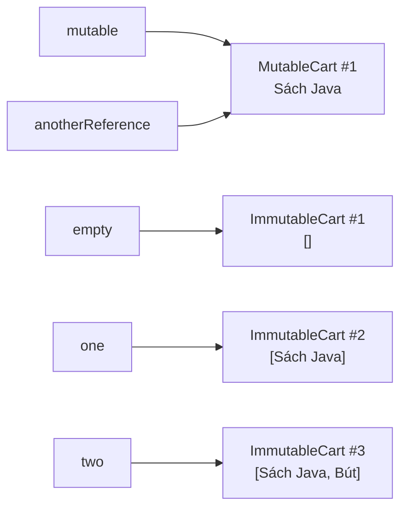

# Mutable and Immutable Objects in Java

In object-oriented programming, **object state** refers to the values an object holds, such as a username, product list, or balance. Depending on whether its state can change **after initialization**, we distinguish:

- **Mutable object:** its observable state can change without creating a replacement object.
- **Immutable object:** once successfully constructed, its observable state never changes. To obtain a new value, the program generally creates another object.

The critical distinction is that **reassigning a reference variable** is not the same as **modifying the object it references**. A variable can be redirected to another object while the original object remains immutable.

## 1. A Quick Comparison of `String` and `StringBuilder`

Two familiar Java types illustrate the difference:

```java
String title = "Java";
String updatedTitle = title.concat(" OOP");

System.out.println(title);        // Java
System.out.println(updatedTitle); // Java OOP

StringBuilder builder = new StringBuilder("Java");
builder.append(" OOP");

System.out.println(builder);      // Java OOP
```

- `String` is **immutable**: `concat()` creates or returns another string; the original `"Java"` content stays unchanged.
- `StringBuilder` is **mutable**: `append()` updates the internal state of the `builder` object itself.

A commonly confusing case:

```java
String message = "A";
message = message + "B";
System.out.println(message); // AB
```

The assignment does not modify the string `"A"`. Variable `message` receives a reference to the resulting string `"AB"`. **A variable being reassignable** does not mean **its object is mutable**.

| Criterion | Mutable object | Immutable object |
| --- | --- | --- |
| State after initialization | Can change | Cannot change through APIs or shared references |
| Update approach | Usually modifies the current object | Usually creates an object containing the new value |
| Multiple references to one object | All observe its changes | All observe a fixed state |
| Java examples | `StringBuilder`, `ArrayList`, `Date` | `String`, `Integer`, `LocalDate`, `BigDecimal` |
| Typical advantages | Frequent updates with fewer copies | Easier reasoning, sharing, and testing |
| Key consideration | Unexpected state changes | Costs of creating values and copying may increase |

The immutable examples above are library classes designed for immutability. A custom class is immutable only if **all observable state** is genuinely protected—not merely because it uses `final`.

## 2. Complete Java Example: Mutable and Immutable Shopping Carts

The following example places both designs side by side. `MutableCart` adds products to the existing object; `ImmutableCart` returns **a new cart** after each addition.

Put all code into **`Main.java`**; it can be compiled with Java 17 or Java 21.

```java
import java.util.ArrayList;
import java.util.List;
import java.util.Objects;

final class MutableCart {
    private final List<String> products = new ArrayList<>();

    void addProduct(String product) {
        validateProduct(product);
        products.add(product);  // Thay đổi trạng thái bên trong đối tượng
    }

    int size() {
        return products.size();
    }

    List<String> products() {
        return List.copyOf(products); // Trả về snapshot để tránh lộ list nội bộ
    }

    private static void validateProduct(String product) {
        Objects.requireNonNull(product, "product");
        if (product.isBlank()) {
            throw new IllegalArgumentException("Tên sản phẩm không được trống");
        }
    }
}

final class ImmutableCart {
    private final List<String> products;

    ImmutableCart(List<String> products) {
        Objects.requireNonNull(products, "products");
        List<String> copy = List.copyOf(products); // Sao chép cấu trúc danh sách
        for (String product : copy) {
            if (product.isBlank()) {
                throw new IllegalArgumentException("Tên sản phẩm không được trống");
            }
        }
        this.products = copy;
    }

    ImmutableCart withAddedProduct(String product) {
        Objects.requireNonNull(product, "product");
        if (product.isBlank()) {
            throw new IllegalArgumentException("Tên sản phẩm không được trống");
        }

        List<String> updated = new ArrayList<>(products);
        updated.add(product);
        return new ImmutableCart(updated); // Không sửa this.products
    }

    int size() {
        return products.size();
    }

    List<String> products() {
        return products; // Danh sách đã không thể sửa cấu trúc
    }
}

public class Main {
    public static void main(String[] args) {
        MutableCart mutable = new MutableCart();
        MutableCart anotherReference = mutable;
        mutable.addProduct("Sách Java");
        System.out.println(anotherReference.size()); // 1

        ImmutableCart empty = new ImmutableCart(List.of());
        ImmutableCart one = empty.withAddedProduct("Sách Java");
        ImmutableCart two = one.withAddedProduct("Bút");
        System.out.println(empty.size());  // 0
        System.out.println(one.size());    // 1
        System.out.println(two.size());    // 2
        System.out.println(one == two);    // false

        List<String> source = new ArrayList<>(List.of("Vở"));
        ImmutableCart snapshot = new ImmutableCart(source);
        source.add("Thước");
        System.out.println(snapshot.products()); // [Vở]

        try {
            snapshot.products().add("Tẩy");
        } catch (UnsupportedOperationException ex) {
            System.out.println("Không thể sửa danh sách kết quả");
        }
    }
}
```

Run:

```bash
javac Main.java
java Main
```

Output:

```text
1
0
1
2
false
[Vở]
Không thể sửa danh sách kết quả
```

**What to Observe:**

1. `mutable` and `anotherReference` refer to the same `MutableCart`; after `addProduct()`, both observe a product count of 1.
2. `empty`, `one`, and `two` hold **three `ImmutableCart` instances**, with 0, 1, and 2 products respectively. Each `withAddedProduct()` call creates a new object without modifying older carts.
3. `one == two` is `false` because they are distinct objects.
4. The `ImmutableCart` constructor copies the input list: later changes to `source` do not affect `snapshot`.
5. `snapshot.products()` disallows `add()`, preventing callers from changing the list structure.

The diagram illustrates the reference differences:



**A class is not necessarily immutable just because it has no setters.** If it exposes a mutable internal list directly, calling `getItems().add(...)` still changes state even without a `setItems()` method.

## 3. Why Is `final` Insufficient to Make an Object Immutable?

`final` can appear in several places, with different meanings:

| Declaration | What `final` guarantees | What `final` does not guarantee |
| --- | --- | --- |
| `final int count` | The field cannot be reassigned after valid initialization | Nothing about other object fields |
| `final List<String> items` | The `items` field cannot point to another list | `items.add(...)` may still be allowed |
| `final class Cart` | The class cannot be subclassed | Its fields and contents can still change |
| `final Cart cart` | Variable `cart` cannot be reassigned | Object `cart` itself can still be mutable |

For example:

```java
final List<String> names = new ArrayList<>();
names.add("An");       // Hợp lệ: sửa nội dung của list
// names = new ArrayList<>(); // Lỗi biên dịch: không được gán lại biến final
```

For a **truly immutable** object, protect *every access path to mutable state*, including nested objects.

## 4. Defensive Copying: Protecting Input and Output Data

Suppose we write:

```java
final class UnsafeSchedule {
    private final List<String> lessons;

    UnsafeSchedule(List<String> lessons) {
        this.lessons = lessons;
    }

    List<String> lessons() {
        return lessons;
    }
}
```

The class uses `final` and has no setter, yet it **is not immutable**:

```java
List<String> input = new ArrayList<>(List.of("OOP"));
UnsafeSchedule schedule = new UnsafeSchedule(input);

input.add("Concurrency");             // Sửa qua tham chiếu bên ngoài
schedule.lessons().add("Spring Boot"); // Sửa qua getter
System.out.println(schedule.lessons()); // [OOP, Concurrency, Spring Boot]
```

A suitable fix for a list of immutable elements, such as `String`:

```java
final class Schedule {
    private final List<String> lessons;

    Schedule(List<String> lessons) {
        this.lessons = List.copyOf(lessons);
    }

    List<String> lessons() {
        return lessons;
    }
}
```

`List.copyOf(lessons)` produces a list whose **structure cannot be modified** and is unaffected by later additions or removals from the input list. This method rejects `null` elements. Because `String` is also immutable, the sample `Schedule` can maintain stable list state.

However, `List.copyOf()` **does not deep-copy element objects**. If an element is mutable, another reference may still modify it.

```java
final class MutableTask {
    String status = "TODO";
}

MutableTask task = new MutableTask();
List<MutableTask> snapshot = List.copyOf(List.of(task));
task.status = "DONE";

System.out.println(snapshot.get(0).status); // DONE
// snapshot.add(new MutableTask());          // UnsupportedOperationException
```

Elements cannot be added to or removed from the list, but `MutableTask` state can still change. For deep immutability, use immutable elements, make suitable deep copies, or redesign the data model.

### How Do `List.copyOf`, `List.of`, and `Collections.unmodifiableList` Differ?

```java
List<String> original = new ArrayList<>(List.of("A"));
List<String> view = java.util.Collections.unmodifiableList(original);
List<String> snapshot = List.copyOf(original);
List<String> literal = List.of("A");

original.add("B");
System.out.println(view);     // [A, B]
System.out.println(snapshot); // [A]
System.out.println(literal);  // [A]
```

| API | Primary meaning | Does it reflect changes to the original list? |
| --- | --- | --- |
| `Collections.unmodifiableList(list)` | Creates a **read-only view** that blocks modifications through the view | **Yes**, when the original list changes |
| `List.copyOf(list)` | Creates a structurally immutable list representing a snapshot of the contents | **No**, for structural changes to the original list |
| `List.of(...)` | Creates an unmodifiable list directly | There is no mutable original list to track |

None of these guarantees immutable elements. Also, `List.copyOf()` may reuse a list that is already unmodifiable; do not assume it **always** creates a new list object. “Snapshot” here refers to **observable contents**, not a guarantee of distinct object identity.

## 5. Are `record` Instances Automatically Immutable?

Java `record` declarations are convenient for data objects: the compiler generates `private final` fields, a canonical constructor, accessors, and methods such as `equals()`, `hashCode()`, and `toString()`. However, **records only ensure reference fields cannot be reassigned; they do not automatically provide deep immutability**.

An unsafe example:

```java
record UnsafeInvoice(List<String> products) {}

List<String> data = new ArrayList<>(List.of("Sách"));
UnsafeInvoice invoice = new UnsafeInvoice(data);
data.add("Bút");

System.out.println(invoice.products()); // [Sách, Bút]
```

A better design when each product is represented by immutable data:

```java
import java.util.List;
import java.util.Objects;

record LineItem(String sku, int quantity) {
    LineItem {
        Objects.requireNonNull(sku, "sku");
        if (sku.isBlank() || quantity <= 0) {
            throw new IllegalArgumentException("Dòng hàng không hợp lệ");
        }
    }
}

record Invoice(List<LineItem> lines) {
    Invoice {
        lines = List.copyOf(lines);
    }
}
```

Here, `LineItem` contains an immutable `String` and a primitive integer; `Invoice` copies the list in its compact constructor. Because `LineItem` elements are also immutable, ordinary code cannot modify the initialized data. Accessor `lines()` returns a list that does not permit additions or removals.

**Note:** A `record` does not automatically protect components containing `StringBuilder`, arrays, `Date`, `List<MutableTask>`, or other mutable objects. Those components need special handling.

## 6. Immutability Does Not Mean New Values Cannot Be Produced

With an immutable object, an “update” often looks like this:

```java
java.time.LocalDate original = java.time.LocalDate.of(2026, 10, 15);
java.time.LocalDate nextWeek = original.plusDays(7);

System.out.println(original); // 2026-10-15
System.out.println(nextWeek); // 2026-10-22
```

`original` stays unchanged; `plusDays(7)` returns a new value. Similarly, `BigDecimal.add()`, `String.replace()`, and `ImmutableCart.withAddedProduct()` do not mutate their receiver objects.

Therefore, you must **retain the returned result**:

```java
String name = "java";
name.toUpperCase(); // Kết quả bị bỏ qua
System.out.println(name); // java

name = name.toUpperCase();
System.out.println(name); // JAVA
```

This differs from mutable APIs that return `void` or `this` after modifying the current object.

## 7. Effects on Reference Sharing and Multithreading

When multiple components share a mutable object, one component can observe state another has just changed:

```java
StringBuilder shared = new StringBuilder("A");
StringBuilder alias = shared;
alias.append("B");
System.out.println(shared); // AB
```

That follows from shared references. In a multithreaded environment, **modifying shared mutable state without proper synchronization** can cause race conditions and unpredictable results. Immutability substantially reduces this risk because the initialized state does not change.

But be precise:

- **Immutable objects** are useful for sharing read-only data across threads; there are no internal updates to contend over.
- To observe correctly initialized state across threads, Java Memory Model initialization rules and **safe publication** still matter. Letting `this` escape before the constructor completes is especially dangerous.
- **A reference to an immutable object can still change**: if multiple threads assign to the same shared variable, suitable synchronization/visibility mechanisms such as `volatile`, locks, or atomic references may be needed.
- **An immutable wrapper** does not automatically make a mutable element, external service, or complete business process thread-safe.

Example of sharing immutable configuration:

```java
record AppConfig(String endpoint, int timeoutSeconds) {
    AppConfig {
        if (endpoint == null || endpoint.isBlank() || timeoutSeconds <= 0) {
            throw new IllegalArgumentException("Cấu hình không hợp lệ");
        }
    }
}
```

Once correctly initialized and safely published, an `AppConfig` can be read by multiple threads without locking solely to prevent modification of its two fields. To update configuration, the application can create a new `AppConfig` and replace the shared reference using an appropriate mechanism.

## 8. Why Can Mutable Objects Be Dangerous as `HashMap` Keys?

`HashMap` and `HashSet` use `hashCode()` and `equals()` to locate keys or elements. If a mutable object is used as a key and its `hashCode()`/ `equals()` fields change after insertion, later lookups may fail.

Example of a risky design:

```java
import java.util.Objects;

class MutableKey {
    String code;

    MutableKey(String code) {
        this.code = code;
    }

    @Override
    public boolean equals(Object obj) {
        return obj instanceof MutableKey other
                && Objects.equals(code, other.code);
    }

    @Override
    public int hashCode() {
        return Objects.hashCode(code);
    }
}
```

If a `MutableKey("A")` is inserted into a `HashSet` and later assigned `key.code = "B"`, the lookup hash may differ from the insertion hash, so `contains(key)` can return `false`. Prefer keys whose comparison values **remain stable throughout their time in the map/set**; immutable value objects are a common choice.

If a key must change, remove the entry while its old key value is still usable and reinsert it with a new key, rather than mutating state that determines hash-bucket placement.

## 9. Choosing Mutable or Immutable Based on Requirements

There is no rule that “every object must be immutable.” The choice depends on usage:

| Situation | Often appropriate design | Reason |
| --- | --- | --- |
| DTOs containing configuration, monetary values, dates | Immutable | Stable value semantics and easy sharing |
| Value objects such as coordinates, identifiers, intervals | Immutable | Prevent unexpected changes and support value equality |
| Buffers for repeated string concatenation | Mutable, e.g. `StringBuilder` | Many updates within one processing cycle |
| Objects managing evolving state, such as a session shopping cart | Controlled mutable or immutable objects returning new versions | Depends on update frequency and sharing needs |
| Event snapshots or data passed between components | Immutable | Preserve data as it existed when captured |
| Large structures updated frequently | Consider mutable or persistent data structures | Avoid copying everything after each update |

**Costs:** For example, `ImmutableCart` copies the entire list for every added product, which can take time and memory with large lists. Systems requiring frequent updates may use carefully encapsulated mutable structures or immutable data structures with **structural sharing** (reusing unchanged portions) instead of full copies. Do not assume immutable designs are always faster or slower; evaluate real operations and workloads.

**Mutable objects still need encapsulation.** A well-designed mutable class should keep fields `private`, control updates through validated methods, and avoid exposing internal references for arbitrary modification. For example, `MutableCart.products()` returns a snapshot even though the cart itself remains mutable.

## 10. Common Mistakes and Fixes

| Mistake | Effect | Fix |
| --- | --- | --- |
| Assuming `final List` makes a list immutable | Code can still call `add/remove` | Use `List.copyOf` for snapshots and control access |
| Storing a caller's mutable list directly | Caller changes the list, modifying object state | Defensive copy in the constructor |
| Returning a mutable internal list directly | Caller mutates it through the getter | Return a snapshot or use a suitable read-only API |
| Assuming `List.copyOf` makes elements immutable | Mutable elements can still change | Use immutable elements or deep-copy them |
| Discarding the result of an immutable object's method | The original value remains unchanged | Retain the returned value |
| Assuming `record` always guarantees deep immutability | Record components can be mutable | Defensive copying and immutable component design |
| Using a mutable object with a changing hash as a map key | Inserted key may become unfindable | Use keys with stable `equals/hashCode` |
| Assuming immutability solves all concurrency issues | Shared reference variables or dependencies may still race | Combine safe publication and synchronization where necessary |

## 11. Check Your Understanding

**Question 1.** What is the output?

```java
String a = "Hi";
String b = a;
a = a.concat("!");
System.out.println(b);
```

**Answer:** `Hi`. `a` is reassigned to the new result string, while `b` still references the original string.

**Question 2.** If `List<String> input` is passed to a constructor for a class containing `private final List<String> data;`, is assigning `this.data = input;` enough to guarantee immutability?

**Answer:** No. The caller can still modify `input`, directly affecting `data`. Use `List.copyOf(input)` when elements are also immutable and the requirement is to store a snapshot.

**Question 3.** Why does `return this` from a field-modifying method differ from `return new ImmutableCart(updated)`?

**Answer:** `return this` returns the receiving object itself (possibly with modified state), while `return new ...` produces a different instance, allowing the original to remain unchanged.

**Question 4.** Does `record Event(List<MutableTask> tasks)` become deeply immutable merely by using `List.copyOf(tasks)`?

**Answer:** No. The list cannot be structurally modified, but each `MutableTask` may still be changed through another reference.

**Question 5.** What matters when designing configuration read concurrently by dozens of threads?

**Answer:** Prefer an immutable model when appropriate; initialize it fully; publish it safely; and synchronize replacement of a shared reference when configuration changes. Value immutability does not replace all system-wide synchronization.

**Remember:** Mutable and immutable describe **whether an object's state can change**, not whether a variable name can be reassigned. To design an immutable Java object, control every path to state changes: constructors, fields, nested elements, incoming arguments, and returned data. For mutable objects, place state changes behind methods with explicit rules.
